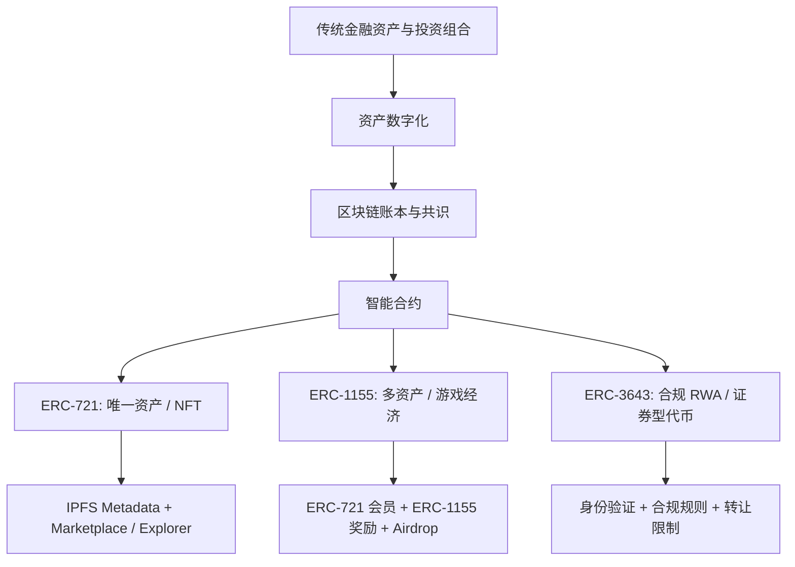
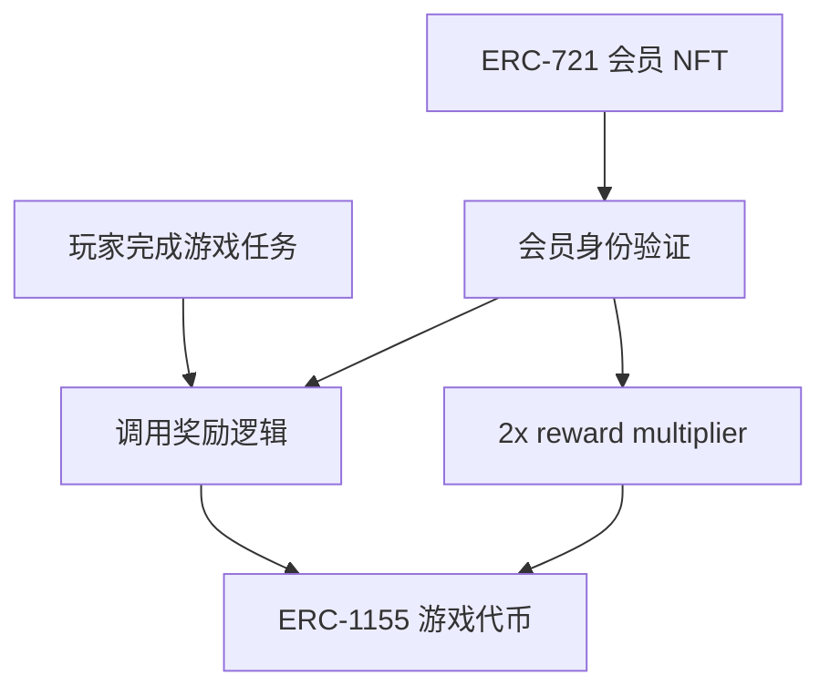
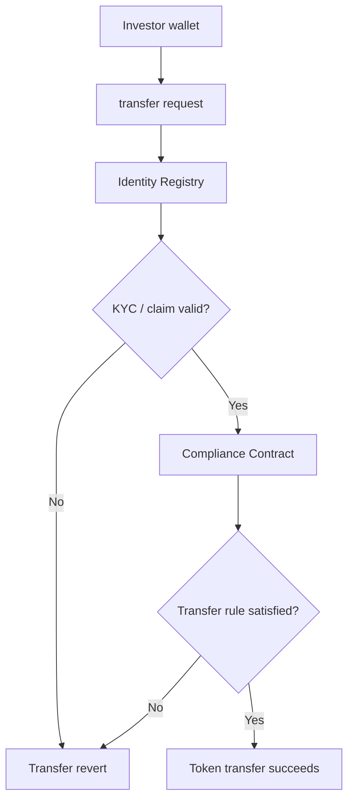
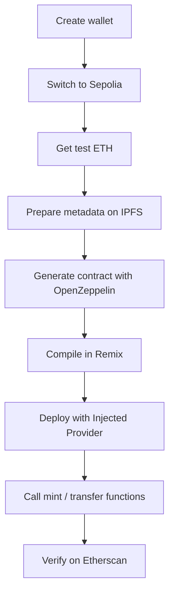

> [!info] 这份总整理记录的原始笔记
> 原总整理依据的材料见下方历史来源记录；课程原始 PDF 和 Notebook 位于 `/Users/xuji/Documents/qfft/sem 1/AMA571-FINANCIAL TECHNOLOGY/`。前三讲的代码现已直接补充在本文「前三讲：课堂代码」中。
> - `Lecture 8 - Blockchain_Overview.md`：区块链、Ethereum、DeFi、NFT、治理、安全、监管与未来趋势。
> - `ERC721.md`：从钱包和 Sepolia 到 ERC-721、IPFS metadata、交易、角色、空投、升级、ERC-1155 入门。
> - `Solidity_2.md` 与 `erc1155.md`：ERC-1155 游戏代币、ERC-721 会员 NFT、空投奖励、前端 Web3 集成。
> - `ERC3643.md` 与 `ERC-3643_Workshop_Presentation_84eaa68a.md`：RWA tokenization、ERC-3643、T-REX、合规、身份、metadata、债券代币化。
> - `Prerequisite knowledg of portfolio management.md`：portfolio、expected return、variance、efficient frontier、CAL。
>
> `ERC3643.md` 和 `ERC-3643_Workshop_Presentation_84eaa68a.md` 基本是同一份 workshop 材料，只有少量图片和拼写差异；本整理按一份内容处理，避免重复。

## 1. 课程主线

AMA571 的核心可以用一句话概括：

> **用编程分析金融数据与投资组合，并了解区块链和智能合约如何表示资产及执行规则。**

本整理涉及以下几条主线：

1. **金融数据与投资组合**：用 Python 下载和分析价格数据，学习收益率、组合风险、有效前沿、资产配置及回测。
2. **区块链基础设施**：DLT、transaction lifecycle、consensus、Bitcoin vs Ethereum、EVM、Layer 2。
3. **智能合约与代币标准**：ERC-721 表示唯一资产，ERC-1155 表示多资产系统，ERC-3643 表示合规证券型/RWA 代币。
4. **应用与风险**：DeFi、NFT、RWA、DAO、bridge、security、regulation、metadata、identity、KYC/AML。

可以把整门课看成从“资产”到“链上表示”的映射：



## 前三讲：课堂代码

以下内容直接收录六份原始 Notebook 的代码和对应说明，按讲次、来源和单元排列。代码原样保留，不同版本分开列出；空白练习与原代码中的问题都有标注。课程概览：[[AMA571 前三讲代码主线.canvas]]。

- [[#第 1 讲：金融科技与股票数据分析|第 1 讲：金融科技与股票数据分析]]：Python 基础、行情下载、收益率、图表和移动平均。
- [[#第 2 讲：投资组合管理|第 2 讲：投资组合管理]]：收益与协方差、随机组合、风险收益前沿及训练／测试划分。
- [[#第 3 讲：量化投资组合回测|第 3 讲：量化投资组合回测]]：再平衡、风险指标、换手率与历史压力测试。

> [!warning] 学习代码与真实回测
> 课堂示例用于理解方法，不能直接视为可交易策略或样本外业绩。尤其要检查收益率口径、资产列与权重对齐、调仓时点、数据复权以及交易成本。具体问题标在各讲代码旁。

### 第 1 讲：金融科技与股票数据分析

> [!info] 阅读说明
> 本笔记按原始单元顺序收录两份 Notebook 的原文说明与代码。两个版本既有相同主题，也有不同示例与解题内容，因此分别保留。每个代码块对应一个原单元；空单元与只有注释的单元保留原有状态，不将补充解释冒充原题答案。
>
> 原始资料：`/Users/xuji/Documents/qfft/sem 1/AMA571-FINANCIAL TECHNOLOGY/week1 9.5/Weel1 with solution.ipynb` 和 `/Users/xuji/Documents/qfft/sem 1/AMA571-FINANCIAL TECHNOLOGY/week1 9.5/Lecture 1：Introduction to Financial Technology & Stock Data Analysis.ipynb`。
>
> 从上到下运行需要相应 Python 包和网络；部分代码依赖此前单元保存的变量。原有安装命令、版本差异和错误均在代码块外说明，代码本身未改写。

##### 来源 1：Weel1 with solution.ipynb

###### 单元 1 · 原文说明

> [!quote] Notebook 原文
> # AMA571 Financial Technology
> ## Lecture 1: Introduction to Financial Technology & Stock Data Analysis
> 
> **Lecturer:** Dr. Selena Qian
> 
> 
> ## Learning Objectives:
> 
> By the end of this lecture, you should be able to:
> 
> 1. Gain confidence in applying Python to financial data analysis.  
> 2. Download stock price data directly from Yahoo Finance.  
> 3. Compute daily returns from price data.  
> 4. Create clear visualizations of stock prices and returns.  
> 5. Resample daily prices into weekly and monthly series.  
> 6. Apply Simple Moving Average (SMA) to detect trends.  
> ---

###### 单元 2 · 原文说明

> [!quote] Notebook 原文
> ## Part 1. What is Financial Technology and Why Do We Care?
> 
> Imagine: You want to send money abroad instantly, invest your savings with just a few clicks, or get a loan in 10 minutes without visiting a bank.
> 
> Behind the scenes, **technology** makes this possible:
> - Mobile apps process millions of payments every second.
> - Algorithms decide whether you qualify for credit.
> - AI-driven platforms trade stocks faster than any human could.
> 
> In short:  
> **Finance + Technology = FinTech** 🚀
> 
> 
> ---

###### 单元 3 · 原文说明

> [!quote] Notebook 原文
> ## Part 2. Key Features
> - **Innovation**: Using new tools (apps, AI, blockchain) to redesign financial services.  
> - **Efficiency**: Automating manual processes, reducing costs, and speeding up transactions.  
> - **Accessibility**: Bringing financial services to more people (e.g., mobile banking, online lending).  
> - **Data-driven**: Using large datasets and analytics to make smarter financial decisions.  
> 
> ---

###### 单元 4 · 原文说明

> [!quote] Notebook 原文
> 
> ## Part 3. Examples of FinTech Applications
> 1. **Digital Payments** 💳 — PayPal, Alipay, Apple Pay.  
> 2. **Online Lending & Credit Scoring** 🏦 — Ant Financial, LendingClub, WeBank.  
> 3. **Robo-Advisors** 🤖 — Betterment, Wealthfront, offering automated portfolio management.  
> 4. **Algorithmic & High-Frequency Trading** 📈 — Quant strategies powered by Python/ML.  
> 5. **Cryptocurrency & Blockchain** ₿ — Bitcoin, Ethereum, DeFi platforms.  
> 6. **RegTech** 🛡️ — Compliance and risk management tools using AI.  

###### 单元 5 · 原文说明

> [!quote] Notebook 原文
> ## Part 4. Why Study FinTech with Python?
> 
> - **Real-time data access**: APIs allow us to directly download stock/crypto prices.  
> - **Powerful libraries**: `pandas`, `numpy`, `matplotlib`, `scikit-learn` enable analysis, visualization, and modeling.  
> - **Hands-on learning**: Each project connects theory → data → practical coding.  
> 
> ---

###### 单元 6 · 原文说明

> [!quote] Notebook 原文
> ## Part 5. Python Basics Refresher (for absolute beginners)
> 
> We’ll keep this short and practical. The goal is to make everyone comfortable enough to follow the simulations.

###### 单元 7 · 原文说明

> [!quote] Notebook 原文
> ### 5.1 Variables
> 
> A **variable** is a *name* that stores a value in memory.  
> Think of it as a **label** you attach to a box containing some data.
> 
> - Variables let us **reuse values** later in the program.
> - Each variable has a **name** (e.g., `course`) and a **value** (e.g., `"Simulation and Risk Analysis"`).
> - You assign a value with the `=` operator.
> 
> **Examples of variable types:**
> - **String (`str`)**: text data, always written inside quotes (`" "` or `' '`).
> - **Integer (`int`)**: whole numbers, like `13`.
> - **Float (`float`)**: numbers with decimals, like `3.0`.

###### 单元 8 · 代码

> [!note] 代码理解
> 变量 `course` 保存字符串；在 Notebook 中，单元格末尾的表达式会显示其值。

```python
# Create variables
course='Math'
course
```

###### 单元 9 · 代码

> [!note] 代码理解
> 一个单元格连续写多个表达式时，Notebook 通常只自动显示最后一个；需要同时显示可使用 `print()`。

```python
weeks=5
hours_per_week=1.0
weeks
hours_per_week
```

###### 单元 10 · 原文说明

> [!quote] Notebook 原文
> ### 5.2 The `print()` Function
> 
> To **see the result** of your code, we use the built-in `print()` function.
> 
> - `print()` shows values on the screen.
> - You can print variables, numbers, or text.
> - If you want to print text directly, you must put it **inside quotes**.

###### 单元 11 · 代码

```python
print(weeks)
print(hours_per_week)
```

###### 单元 12 · 代码

```python
print(5)
```

###### 单元 13 · 代码

```python
print("Hello,AMA571")
```

###### 单元 14 · 原文说明

> [!quote] Notebook 原文
> In Python, **f-strings** make it easy to combine text with variables.  
> 
> - Start the string with the letter **`f`** in front of the quotes.
> - Inside the string, put variables inside curly braces `{ }`.
> - Python will replace `{variable}` with its value.

###### 单元 15 · 代码

```python
print(f"{course} runs for {weeks} weeks, {hours_per_week} hours each")
```

###### 单元 16 · 原文说明

> [!quote] Notebook 原文
> **Mini-Exercise A:**  
> 1) Create variables `student_name` (string), `student_id` (integer), and `gpa` (float). 
> 2) Print one sentence describing the student using an f-string.

###### 单元 17 · 代码

```python
student_name="Selena"
student_id=123
gpa=4.0

print(f'{student_name} got a GPA of{gpa}, and her student ID is {student_id}')
```

###### 单元 18 · 原文说明

> [!quote] Notebook 原文
> ### 5.3 Lists and Indexing
> 
> ### Lists
> A **list** is an ordered collection of items.  
> We use square brackets `[ ]` to create a list, and items are separated by commas.
> 
> - Lists can store numbers, text (strings), or even mixed data types.
> - Lists are **ordered**: each element has a position (index).
> - Indexing starts at **0** in Python, not 1.

###### 单元 19 · 代码

> [!note] 代码理解
> 列表下标从 0 开始；后续单元格中的 `append` 和 `remove` 会直接修改同一个列表。

```python
# Create a list of stock tickers
stocks=['AAPL','GOOGL','TSLA','MSFT','META']

```

###### 单元 20 · 代码

```python
# Show the entire list
stocks
```

###### 单元 21 · 代码

```python
# Get the first item in the list
stocks[0]
```

###### 单元 22 · 代码

```python
# Get the last item in the list
stocks[-1]
```

###### 单元 23 · 代码

```python
# Add "AMZN" to the list
stocks.append("AMZN")
stocks
```

###### 单元 24 · 代码

```python
# Remove "GOOGL" from the list
stocks.remove("GOOGL")
stocks
```

###### 单元 25 · 原文说明

> [!quote] Notebook 原文
> **Mini-Exercise B:**  
> Create a list of 6 numbers of your choice.  
> 1) Print the first and the second to last elements.  
> 2) Replace the 3rd element with the value `999`.  
> 3) Compute the list length with `len(...)`.

###### 单元 26 · 代码

> [!note] 代码理解
> 这里和后续三个单元一起完成列表练习；索引 `-2` 表示倒数第二个元素。

```python
# Create a list of numbers
number=[10,20,30,40,50,60]
number
```

###### 单元 27 · 代码

```python
# Print the first element and the second to last element (by using negative index)
print(number[0])
print(number[-2])
```

###### 单元 28 · 代码

```python
# Replace the 3rd element with the value 999
number[2]=999
number
```

###### 单元 29 · 代码

```python
# Compute the list length
len(number)
```

###### 单元 30 · 原文说明

> [!quote] Notebook 原文
> ### 5.4 Loops and Conditionals
> 
> When we write programs, we often need to:
> 1. **Repeat actions** many times → this is where **loops** (`for`) help.
> 2. **Make decisions** based on conditions → this is where **conditionals** (`if/elif/else`\)help.

###### 单元 31 · 代码

> [!note] 代码理解
> 使用 `%` 判断偶数，通过 `total += n` 累计符合条件的数字，而不是统计个数。

```python
# Calculate the sum of even numbers from a list

numbers=[1,2,3,4,5]
total=0

for n in numbers:
    if n%2==0:
        total +=n
print('Sum of even numbers:', total)


```

###### 单元 32 · 原文说明

> [!quote] Notebook 原文
> **Mini-Exercise C:**  
> Given `scores = [55, 72, 90, 66, 81]`, use a loop to count how many scores are **>= 70**. Print the count.

###### 单元 33 · 代码

> [!note] 代码理解
> 这里 `count += 1` 才是在每次满足条件时增加一个计数。

```python
scores = [55, 72, 90, 66, 81]
count=0

for s in scores:
    if s>=70:
        count +=1
print('number of scores >=70:',count)


```

###### 单元 34 · 原文说明

> [!quote] Notebook 原文
> ### 5.5 Functions
> - Functions package logic so you can reuse it
> - We use the keyword **`def`** to define a function.

###### 单元 35 · 代码

> [!note] 代码理解
> 函数的 `return` 将结果返回给调用方，和直接打印结果不同。

```python
# Define a function that returns the sum of two numbers
def add_numbers(a,b):
    return a+b

print(add_numbers(3,5))


```

###### 单元 36 · 原文说明

> [!quote] Notebook 原文
> **Mini-Exercise D:**  
> Write a function `grade(score)` that returns `"Pass"` if `score >= 60` else `"Fail"`.  
> Test it on `[58, 60, 99]`.

###### 单元 37 · 代码

```python
def grade(score):
    if score>=60:
        return "Pass"
    else:
        return "Fail"

scores=[58, 60, 99]

for s in scores:
    print(grade(s))

```

###### 单元 38 · 原文说明

> [!quote] Notebook 原文
> ### 5.6 Data Visualization
> 
> We will use **AAPL (Apple Inc.)** stock data from Yahoo Finance and create different types of charts.
> 
> Visualizations help us understand:
> - The **trend** of stock prices
> - The **moving averages** 
> - The **daily returns** 

###### 单元 39 · 代码

> [!note] 代码理解
> 原单元包含两条安装命令，均予保留；`%pip` 和 `!pip` 是 Jupyter 语法，不是普通 `.py` 文件的 Python 语句。

```python
# Import required libraries
%pip install yfinance --upgrade

!pip install yfinance

import yfinance as yf # to download stock data
import pandas as pd #to handle data tables
import numpy as np #for numerical operations
import matplotlib.pyplot as plt #visualization package


```

###### 单元 40 · 原文说明

> [!quote] Notebook 原文
> #### 5.6.1 Download data

###### 单元 41 · 代码

> [!note] 代码理解
> 从 Yahoo Finance 获取 AAPL 数据；需要网络连接，数据可用性和返回结构受接口与软件版本影响。

```python
data=yf.download('AAPL',start='2023-06-01',end=None)
```

###### 单元 42 · 代码

```python
data
```

###### 单元 43 · 原文说明

> [!quote] Notebook 原文
> #### 5.6.2  Line Chart — Closing Price
> 
> A simple **line chart** shows how the stock price changes over time.

###### 单元 44 · 代码

```python
plt.figure(figsize=(10,5))
plt.plot(data["Close"],label='AAPL Close',color="green")
plt.title('Apple Closing Price')
plt.xlabel("Date")
plt.ylabel("Price")
plt.legend()
plt.show()

```

###### 单元 45 · 原文说明

> [!quote] Notebook 原文
> ### 5.6.3  Resampling — Weekly / Monthly Close
> 
> Resample to weekly last price (Friday) and monthly last price (EOM) for smoother views.

###### 单元 46 · 代码

> [!note] 代码理解
> `W-FRI` 以周五为周期标签，`ME` 表示月末；`last()` 取每个周期最后一个非缺失观测，并非保证每周五都有交易。`ME` 别名可用性取决于 pandas 版本。

```python
# Create weekly and monthly close series using resampling
close_d=data["Close"].astype(float)
close_w=close_d.resample('W-FRI').last()
close_m=close_d.resample("ME").last()

print('Daily:',len(close_d), '|Weekly:',len(close_w), '| Monthly:',len(close_m))
```

###### 单元 47 · 代码

```python
# Plot the three series on the same chart
plt.figure(figsize=(10,6))
plt.plot(close_d,label='Daily')
plt.plot(close_w,label='Weekly')
plt.plot(close_m,label='Monthly')
plt.title('AAPL close price at different frequencies')
plt.xlabel('Date')
plt.ylabel('Price')
plt.legend()
plt.show()
```

###### 单元 48 · 原文说明

> [!quote] Notebook 原文
> #### 5.6.4 Daily Returns

###### 单元 49 · 代码

> [!note] 代码理解
> `pct_change()` 计算相邻记录的简单收益率；第一个值没有前一期基数。默认缺失值处理在不同 pandas 版本可能有变化，应核对数据与版本。

```python
# Compute daily returns
daily_returns=data['Close'].pct_change().dropna()
daily_returns
```

###### 单元 50 · 代码

```python
# Plot line chart
plt.figure(figsize=(10,5))
plt.plot(daily_returns,label='Daily Return',color="blue")
plt.title('Apple daily return')
plt.xlabel("Date")
plt.ylabel("Daily return")
plt.legend()
plt.show()
```

###### 单元 51 · 代码

> [!note] 代码理解
> 原单元只有“绘制直方图”的注释，没有实际绘图代码。

```python
# Plot histogram

```

###### 单元 52 · 原文说明

> [!quote] Notebook 原文
> #### 5.6.5 Moving Averages
> $SMA_t = \frac{1}{n} \sum_{i=0}^{n-1} P_{t-i}$
> 
> Moving averages smooth the price data:
> - **MA20** = average over 20 trading days (short-term trend)
> - **MA60** = average over 60 trading days (long-term trend)

###### 单元 53 · 原文说明

原单元为空。

###### 单元 54 · 原文说明

> [!note] 代码理解
> 此版本后续七项课堂练习的代码单元均为空；下一个 Notebook 包含相应作答。

> [!quote] Notebook 原文
> ### **In-class Exercise for Week 1**
> 

###### 单元 55 · 原文说明

> [!quote] Notebook 原文
> 1. **Download** daily price data for **Tesla (TSLA)** from **2024-01-01** to **2024-12-31**.

###### 单元 56 · 代码

原单元为空，未填写代码。

###### 单元 57 · 原文说明

> [!quote] Notebook 原文
> 2. **Compute** the **daily return**.

###### 单元 58 · 代码

原单元为空，未填写代码。

###### 单元 59 · 原文说明

> [!quote] Notebook 原文
> 3. **Visualize** the **daily return** .

###### 单元 60 · 代码

原单元为空，未填写代码。

###### 单元 61 · 原文说明

> [!quote] Notebook 原文
> 4. **Compute** **SMA10** and **SMA30**.

###### 单元 62 · 代码

原单元为空，未填写代码。

###### 单元 63 · 原文说明

> [!quote] Notebook 原文
> 5. **Plot** **Close**, **SMA10**, and **SMA30** **on the same chart**.

###### 单元 64 · 代码

原单元为空，未填写代码。

###### 单元 65 · 原文说明

> [!quote] Notebook 原文
> 6. **Write a `for` loop** over all daily returns and use **`if/else`** to count:
> 
>    * **Up Day**: return **> 0**
>    * **Down Day**: return **≤ 0**

###### 单元 66 · 代码

原单元为空，未填写代码。

###### 单元 67 · 原文说明

> [!quote] Notebook 原文
> 7. **Draw** a **bar chart** comparing the counts of **Up Days** vs **Down Days**.

###### 单元 68 · 代码

原单元为空，未填写代码。

##### 来源 2：Lecture 1：Introduction to Financial Technology & Stock Data Analysis.ipynb

###### 单元 1 · 原文说明

> [!quote] Notebook 原文
> # AMA571 Financial Technology
> ## Lecture 1: Introduction to Financial Technology & Stock Data Analysis
> 
> **Lecturer:** Dr. Selena Qian
> 
> 
> ## Learning Objectives:
> 
> By the end of this lecture, you should be able to:
> 
> 1. Gain confidence in applying Python to financial data analysis.  
> 2. Download stock price data directly from Yahoo Finance.  
> 3. Compute daily returns from price data.  
> 4. Create clear visualizations of stock prices and returns.  
> 5. Resample daily prices into weekly and monthly series.  
> 6. Apply Simple Moving Average (SMA) to detect trends.  
> ---

###### 单元 2 · 原文说明

> [!quote] Notebook 原文
> ## Part 1. What is Financial Technology and Why Do We Care?
> 
> Imagine: You want to send money abroad instantly, invest your savings with just a few clicks, or get a loan in 10 minutes without visiting a bank.
> 
> Behind the scenes, **technology** makes this possible:
> - Mobile apps process millions of payments every second.
> - Algorithms decide whether you qualify for credit.
> - AI-driven platforms trade stocks faster than any human could.
> 
> In short:  
> **Finance + Technology = FinTech** 🚀
> 
> 
> ---

###### 单元 3 · 原文说明

> [!quote] Notebook 原文
> ## Part 2. Key Features
> - **Innovation**: Using new tools (apps, AI, blockchain) to redesign financial services.  
> - **Efficiency**: Automating manual processes, reducing costs, and speeding up transactions.  
> - **Accessibility**: Bringing financial services to more people (e.g., mobile banking, online lending).  
> - **Data-driven**: Using large datasets and analytics to make smarter financial decisions.  
> 
> ---

###### 单元 4 · 原文说明

> [!quote] Notebook 原文
> 
> ## Part 3. Examples of FinTech Applications
> 1. **Digital Payments** 💳 — PayPal, Alipay, Apple Pay.  
> 2. **Online Lending & Credit Scoring** 🏦 — Ant Financial, LendingClub, WeBank.  
> 3. **Robo-Advisors** 🤖 — Betterment, Wealthfront, offering automated portfolio management.  
> 4. **Algorithmic & High-Frequency Trading** 📈 — Quant strategies powered by Python/ML.  
> 5. **Cryptocurrency & Blockchain** ₿ — Bitcoin, Ethereum, DeFi platforms.  
> 6. **RegTech** 🛡️ — Compliance and risk management tools using AI.  

###### 单元 5 · 原文说明

> [!quote] Notebook 原文
> ## Part 4. Why Study FinTech with Python?
> 
> - **Real-time data access**: APIs allow us to directly download stock/crypto prices.  
> - **Powerful libraries**: `pandas`, `numpy`, `matplotlib`, `scikit-learn` enable analysis, visualization, and modeling.  
> - **Hands-on learning**: Each project connects theory → data → practical coding.  
> 
> ---

###### 单元 6 · 原文说明

> [!quote] Notebook 原文
> ## Part 5. Python Basics Refresher (for absolute beginners)
> 
> We’ll keep this short and practical. The goal is to make everyone comfortable enough to follow the simulations.

###### 单元 7 · 原文说明

> [!quote] Notebook 原文
> ### 5.1 Variables
> 
> A **variable** is a *name* that stores a value in memory.  
> Think of it as a **label** you attach to a box containing some data.
> 
> - Variables let us **reuse values** later in the program.
> - Each variable has a **name** (e.g., `course`) and a **value** (e.g., `"Simulation and Risk Analysis"`).
> - You assign a value with the `=` operator.
> 
> **Examples of variable types:**
> - **String (`str`)**: text data, always written inside quotes (`" "` or `' '`).
> - **Integer (`int`)**: whole numbers, like `13`.
> - **Float (`float`)**: numbers with decimals, like `3.0`.

###### 单元 8 · 代码

```python
# Create variables
course = "Fintech"
print(course)
```

###### 单元 9 · 代码

```python
weeks = 13
hours_per_week = 3.0
print(weeks)
print(hours_per_week)
```

###### 单元 10 · 原文说明

> [!quote] Notebook 原文
> ### 5.2 The `print()` Function
> 
> To **see the result** of your code, we use the built-in `print()` function.
> 
> - `print()` shows values on the screen.
> - You can print variables, numbers, or text.
> - If you want to print text directly, you must put it **inside quotes**.

###### 单元 11 · 代码

```python
print(weeks)
print(hours_per_week)
```

###### 单元 12 · 代码

```python
print(5)
```

###### 单元 13 · 原始 raw 内容

> [!note] 代码理解
> 注意：此单元在原 Notebook 中是 **raw** 类型，内容看似 Python 代码，但并不是原始可执行 code 单元。下面仅为保留原文。

```python
print("Hello, AMA571")
```

###### 单元 14 · 原文说明

> [!quote] Notebook 原文
> In Python, **f-strings** make it easy to combine text with variables.  
> 
> - Start the string with the letter **`f`** in front of the quotes.
> - Inside the string, put variables inside curly braces `{ }`.
> - Python will replace `{variable}` with its value.

###### 单元 15 · 代码

```python
print(f"{course} runs for {weeks} weeks, {hours_per_week} hours each")
```

###### 单元 16 · 原文说明

> [!quote] Notebook 原文
> **Mini-Exercise A:**  
> 1) Create variables `student_name` (string), `student_id` (integer), and `gpa` (float). 
> 2) Print one sentence describing the student using an f-string.

###### 单元 17 · 代码

```python
student_name = "Alan"
student_id = 100
gpa = 4.0
print(f"the student {student_name} whose ID is {student_id} gets the GPA {gpa}")
```

###### 单元 18 · 代码

原单元为空，未填写代码。

###### 单元 19 · 原文说明

> [!quote] Notebook 原文
> ### 5.3 Lists and Indexing
> 
> ### Lists
> A **list** is an ordered collection of items.  
> We use square brackets `[ ]` to create a list, and items are separated by commas.
> 
> - Lists can store numbers, text (strings), or even mixed data types.
> - Lists are **ordered**: each element has a position (index).
> - Indexing starts at **0** in Python, not 1.

###### 单元 20 · 代码

```python
# Create a list of stock tickers
stocks = ['AAPL', 'GOOGL', 'TSLA', 'MSFT', 'META']
stocks
```

###### 单元 21 · 代码

```python
# Show the entire list
stocks
```

###### 单元 22 · 代码

```python
# Get the first  in the list
stocks[0]
```

###### 单元 23 · 代码

```python
# Get the last item in the list
stocks[-1]
```

###### 单元 24 · 代码

> [!note] 代码理解
> 此单元只有添加股票的注释，原文件没有实际代码；另一版本的对应单元包含 `append`。

```python
# Add "AMZN" to the list
```

###### 单元 25 · 代码

> [!note] 代码理解
> 此单元只有删除股票的注释，原文件没有实际代码；另一版本的对应单元包含 `remove`。

```python
# Remove "GOOGL" from the list
```

###### 单元 26 · 原文说明

> [!quote] Notebook 原文
> **Mini-Exercise B:**  
> Create a list of 6 numbers of your choice.  
> 1) Print the first and the second to last elements.  
> 2) Replace the 3rd element with the value `999`.  
> 3) Compute the list length with `len(...)`.

###### 单元 27 · 代码

```python
# Create a list of numbers
list1 = [1,2,3,4,5,6]
```

###### 单元 28 · 代码

> [!note] 代码理解
> 连续两个独立表达式通常只自动显示最后一个结果；若想同时查看两个值，可分别调用 `print()`。

```python
# Print the first element and the second to last element (by using negative index)
list1[0]
list1[-2]
```

###### 单元 29 · 代码

```python
# Replace the 3rd element with the value 999
list1[2] = 999
print(list1)
```

###### 单元 30 · 代码

```python
# Compute the list length
len(list1)
```

###### 单元 31 · 原文说明

> [!quote] Notebook 原文
> ### 5.4 Loops and Conditionals
> 
> When we write programs, we often need to:
> 1. **Repeat actions** many times → this is where **loops** (`for`) help.
> 2. **Make decisions** based on conditions → this is where **conditionals** (`if/elif/else`\)help.

###### 单元 32 · 代码

```python
# Calculate the sum of even numbers from a list
numbers = [1,2,3,4,5]
total = 0
for n in numbers:
    if n % 2 == 0:
        total += n
print(total)


```

###### 单元 33 · 原文说明

> [!quote] Notebook 原文
> **Mini-Exercise C:**  
> Given `scores = [55, 72, 90, 66, 81]`, use a loop to count how many scores are **>= 70**. Print the count.

###### 单元 34 · 代码

> [!note] 代码理解
> **原代码与题意不一致**：`count += i` 将大于等于 70 的分数相加，得到 243，而不是统计人数 3。按题意应每次增加 1；前一份 Notebook 的第 33 单元展示了这一写法。这里保留原代码供对照。

```python
scores = [55, 72, 90, 66, 81]
count = 0
for i in scores:
    if i >= 70:
        count += i
    else:
        continue
print(count)


```

###### 单元 35 · 原文说明

> [!quote] Notebook 原文
> ### 5.5 Functions
> - Functions package logic so you can reuse it
> - We use the keyword **`def`** to define a function.

###### 单元 36 · 代码

```python
# Define a function that returns the sum of two numbers
def add(a, b):
    return a + b

add(2,3)


```

###### 单元 37 · 原文说明

> [!quote] Notebook 原文
> **Mini-Exercise D:**  
> Write a function `grade(score)` that returns `"Pass"` if `score >= 60` else `"Fail"`.  
> Test it on `[58, 60, 99]`.

###### 单元 38 · 代码

```python
def grade(score):
    if score >= 60:
        return "Pass"
    else:
        return "Fail"
scores = [58, 60, 99]
for i in scores:
    print(grade(i))

```

###### 单元 39 · 原文说明

> [!quote] Notebook 原文
> ### 5.6 Data Visualization
> 
> We will use **AAPL (Apple Inc.)** stock data from Yahoo Finance and create different types of charts.
> 
> Visualizations help us understand:
> - The **trend** of stock prices
> - The **moving averages** 
> - The **daily returns** 

###### 单元 40 · 代码

> [!note] 代码理解
> 安装命令 `!pip` 是 Notebook 环境中的 shell 语法；安装包和下载数据需要网络。

```python
# Import required libraries
!pip install yfinance

import yfinance as yf  # to download stock data
import pandas as pd  # to handle data table
import numpy as np  # for numerical operations
import matplotlib.pyplot as plt  # visualization package
```

###### 单元 41 · 原文说明

> [!quote] Notebook 原文
> #### 5.6.1 Download data

###### 单元 42 · 代码

> [!note] 代码理解
> 获取 AAPL 数据；不同 yfinance 版本可能返回多级列。`Close` 是否经过自动复权取决于所用版本及 `auto_adjust` 参数，不宜未经核实将其视作固定口径。

```python
data = yf.download('AAPL', start = '2023-06-01', end = None)
```

###### 单元 43 · 代码

```python
data
```

###### 单元 44 · 代码

> [!note] 代码理解
> `info()` 查看结构与非空数量，`head()` 查看前几行，`describe()` 输出数值列的描述统计。

```python
# 查看数据的基本信息
print(data.info())

# 查看前几行数据
print(data.head())

# 查看数据的统计摘要
print(data.describe())
```

###### 单元 45 · 原文说明

> [!quote] Notebook 原文
> #### 5.6.2  Line Chart — Closing Price
> 
> A simple **line chart** shows how the stock price changes over time.

###### 单元 46 · 代码

> [!note] 代码理解
> 图例中的 `APPL Close` 是原单元的文字拼写，股票代码本身是 AAPL；它只影响图例标签。

```python
plt.figure(figsize=(10,5))
plt.plot(data["Close"], label = "APPL Close", color = "green")
plt.title("Apple Closing Price")
plt.xlabel("Date")
plt.ylabel("Price")
plt.legend()
plt.show()
```

###### 单元 47 · 原文说明

> [!quote] Notebook 原文
> ### 5.6.3  Resampling — Weekly / Monthly Close
> 
> Resample to weekly last price (Friday) and monthly last price (EOM) for smoother views.

###### 单元 48 · 代码

> [!note] 代码理解
> 周频和月频通过 `resample(...).last()` 取每个周期最后一个非缺失观测；`ME` 需要对应 pandas 版本支持。

```python
# Create weekly and monthly close series using resampling
close_d = data["Close"].astype(float)
close_w = close_d.resample("W-FRI").last()
close_m = close_d.resample("ME").last()

print("Daily:",len(close_d), "| Weekly:",len(close_w),"| Monthly:",len(close_m))
```

###### 单元 49 · 代码

```python
# Plot the three series on the same chart
plt.figure(figsize = (10,6))
plt.plot(close_d, label = "Daily")
plt.plot(close_w, label = "Weekly")
plt.plot(close_m, label = "Monthly")
plt.title("AAPL close price at different frequencies")
plt.xlabel("Date")
plt.ylabel("Price")
plt.legend()
plt.show()
```

###### 单元 50 · 原文说明

> [!quote] Notebook 原文
> #### 5.6.4 Daily Returns

###### 单元 51 · 代码

> [!note] 代码理解
> 收益率是相邻收盘价的简单变动率；`dropna()` 会删除含缺失值的行。

```python
# Compute daily returns
daily_returns = data["Close"].pct_change().dropna()   #由于第一个数据点没有前一个值，pct_change()会在第一个位置返回NaN，dropna()删除所有包含NaN的行，确保结果中只包含有效收益率数据
daily_returns
```

###### 单元 52 · 代码

```python
# Plot line chart
plt.figure(figsize=(10,5))
plt.plot(daily_returns, label = "Daily returns", color = "Yellow")
plt.title("Apple daily returns")
plt.xlabel("Date")
plt.ylabel("Returns")
plt.legend()
plt.show()

```

###### 单元 53 · 代码

> [!note] 代码理解
> 直方图展示收益率样本的分布；`bins=40` 指分组数量。

```python
# Plot histogram
plt.figure(figsize = (10, 6))
plt.hist(daily_returns, bins = 40)
plt.title('Distribution of Apple returns')
plt.xlabel('Return')
plt.ylabel('Frequency')
plt.show()
```

###### 单元 54 · 原文说明

> [!quote] Notebook 原文
> #### 5.6.5 Moving Averages
> $SMA_t = \frac{1}{n} \sum_{i=0}^{n-1} P_{t-i}$
> 
> Moving averages smooth the price data:
> - **MA20** = average over 20 trading days (short-term trend)
> - **MA60** = average over 60 trading days (long-term trend)

###### 单元 55 · 代码

> [!note] 代码理解
> 滚动窗口分别为 20 和 60 个观测值；默认需要完整窗口，开头数据不足时会是缺失值。

```python
# 计算移动平均线
data['MA20'] = data['Close'].rolling(window=20).mean()  # 20日移动平均
data['MA60'] = data['Close'].rolling(window=60).mean()  # 60日移动平均

# 绘制图表
plt.figure(figsize=(12, 6))
plt.plot(data['Close'], label='Close Price', alpha=0.5)
plt.plot(data['MA20'], label='20-Day MA', color='orange')
plt.plot(data['MA60'], label='60-Day MA', color='red')
plt.title('Moving Averages')
plt.legend()
plt.show()


```

###### 单元 56 · 原文说明

> [!quote] Notebook 原文
> # **In-class Exercise for Week 1**
> 

###### 单元 57 · 原文说明

> [!quote] Notebook 原文
> 1. **Download** daily price data for **Tesla (TSLA)** from **2024-01-01** to **2024-12-31**.

###### 单元 58 · 代码

> [!note] 代码理解
> 注意 Yahoo 下载的 `end` 为**排他边界**，原代码不包含 2024-12-31；如需包含该日，可在另一个适配示例中把结束日期设为 2025-01-01。原代码保留不变。

```python
data = yf.download('TSLA', start = '2024-01-01', end = '2024-12-31')
data
```

###### 单元 59 · 原文说明

> [!quote] Notebook 原文
> 2. **Compute** the **daily return**.

###### 单元 60 · 代码

```python
daily_returns = data["Close"].pct_change().dropna()
daily_returns
```

###### 单元 61 · 原文说明

> [!quote] Notebook 原文
> 3. **Visualize** the **daily return** .

###### 单元 62 · 代码

```python
plt.figure(figsize=(12,6))
plt.plot(daily_returns, label = "daily return", color = "#f333f3", linestyle = "--")
plt.title("Tsla daily returns")
plt.xlabel("Date")
plt.ylabel("Returns")
plt.legend()
plt.show()

```

###### 单元 63 · 原文说明

> [!quote] Notebook 原文
> 4. **Compute** **SMA10** and **SMA30**.

###### 单元 64 · 代码

> [!note] 代码理解
> 这里的 SMA10 和 SMA30 均基于交易记录的滚动窗口，而非连续自然日。

```python
# 计算移动平均线
data['MA10'] = data['Close'].rolling(window=10).mean()  # 10日移动平均
data['MA30'] = data['Close'].rolling(window=30).mean()  # 30日移动平均

```

###### 单元 65 · 原文说明

> [!quote] Notebook 原文
> 5. **Plot** **Close**, **SMA10**, and **SMA30** **on the same chart**.

###### 单元 66 · 代码

```python
# 绘制图表
plt.figure(figsize=(12, 6))
plt.plot(data['Close'], label='Close Price', alpha=0.5)
plt.plot(data['MA10'], label='10-Day MA', color='orange')
plt.plot(data['MA30'], label='30-Day MA', color='red')
plt.title('Moving Averages')
plt.legend()
plt.show()
```

###### 单元 67 · 原文说明

> [!quote] Notebook 原文
> 6. **Write a `for` loop** over all daily returns and use **`if/else`** to count:
> 
>    * **Up Day**: return **> 0**
>    * **Down Day**: return **≤ 0**

###### 单元 68 · 代码

> [!note] 代码理解
> 此处按题意将收益率大于 0 归为 Up Day，其余归为 Down Day，包含零收益日。`daily_returns["TSLA"]` 依赖下载结果的列结构；yfinance 版本或单层/多层列不同可能报错，需先查看 `daily_returns.columns`。

```python
count_upday = 0
count_downday = 0
for row in daily_returns["TSLA"]:
    if row > 0:
        count_upday += 1
    else:
        count_downday += 1
print(f"Up Day:{count_upday}, Down Day:{count_downday}")
        
```

###### 单元 69 · 原文说明

> [!quote] Notebook 原文
> 7. **Draw** a **bar chart** comparing the counts of **Up Days** vs **Down Days**.

###### 单元 70 · 代码

> [!note] 代码理解
> 以已有计数绘制柱状图；Notebook 通常会显示当前图形，普通脚本中可能需要额外的 `plt.show()`。

```python
values = [count_upday, count_downday]
labels = ["Up Days", "Down Days"]
colors = ["#abb343", "#f33fff"]
plt.title("comparing")
plt.xlabel("type")
plt.ylabel("days")
bars = plt.bar(labels, values, color=colors)
```

---

### 第 2 讲：投资组合管理

> [!info] 阅读方式
> 本页依次收录课堂 Notebook、同主题练习 Notebook 和配套思路讲解。所有非空代码单元以原顺序和原文放入 Python 代码块；单元编号从 1 开始，空代码单元单独标记。不同 Notebook 的变量不能假定共享，请在各自 Notebook 中按顺序执行。

> [!warning] 练习文件名不等于完成状态
> `week2 with solution.ipynb` 虽然名称含 solution，其后半部分仍保留空赋值、未完成的括号和空白图表步骤，不能直接完整运行；下方如实保留。完成版本可参考第一部分的对应步骤，但并不代表两个文件完全相同。

##### 学习路线

先下载价格并观察归一化走势，再计算日对数收益率、年化均值与协方差；接着用随机权重比较等权、最低波动和最高夏普组合，最后引入无风险资产、训练/测试划分与资金曲线。**这些示例用于学习，不保证目标收益或实际交易表现**。

> [!warning] 运行环境与数据
> 需要 `numpy`、`pandas`、`matplotlib`、`seaborn` 和 `yfinance`。下载需要网络，结果会受样本截止日、数据缺失、数据源以及 `yfinance` 版本和复权参数影响；若价格缺失、日期不足或下载失败，后续索引与统计可能报错。代码中的 `warnings.filterwarnings("ignore")` 会隐藏警告，排查问题时应留意。

##### 一、课堂 Notebook：投资组合管理

> [!info] 原文件
> `/Users/xuji/Documents/qfft/sem 1/AMA571-FINANCIAL TECHNOLOGY/week2 9.12/Lecture 2：portfolio management.ipynb`

###### 原 Notebook 单元 1｜原文说明

###### AMA571 Financial Technology
###### Lecture 2: Portfolio Optimization

**Lecturer:** Dr. Selena Qian


###### Learning Objectives
By the end of this lecture, you should be able to:

1.	Comprehend the theoretical foundations of Markowitz mean–variance portfolio optimization
2.	Formulate and visualize the efficient frontier under empirical return and risk estimates
3.	Identify key portfolios, including the Equal-Weight, Minimum-Variance, and Maximum Sharpe Ratio portfolios
4.	Integrate a risk-free asset to derive the tangency portfolio and characterize the Capital Market Line (CML)
5.	Quantify leverage and capital allocation strategies required to attain a specified target return
6.	Conduct out-of-sample backtesting to evaluate portfolio performance
7.	Interpret realized risk–return trade-offs in terms of annualized return, volatility, Sharpe ratio, and terminal wealth trajectories

###### 原 Notebook 单元 2｜代码

```python
# 0) Setup — imports and display

import warnings; warnings.filterwarnings("ignore")

import numpy as np
import pandas as pd
import matplotlib.pyplot as plt
import seaborn as sns

# Data source
#! pip install yfinance
import yfinance as yf


plt.rcParams["figure.figsize"] = (10, 6)

plt.rcParams["axes.grid"] = True
#Configures Matplotlib to display grid lines on all plots by default.

pd.set_option("display.float_format", lambda x: f"{x:,.6f}")
# 设置Pandas的显示选项，指定浮点数的显示格式
# lambda x: f"{x:,.6f}" 是一个匿名函数，它将浮点数格式化为：使用逗号作为千位分隔符，保留6位小数
# 例如，数字1234567.891234会显示为"1,234,567.891234"
```

> [!note] 阅读提示
> `pd.set_option` 只影响数据显示格式，不改变底层数值；`yf.download` 的价格列及是否复权须结合所用版本与参数核对。

###### 原 Notebook 单元 3｜原文说明

###### Step 1 — Choose a Universe and Date Range

We mix sectors for diversification:
- AAPL (Tech), MSFT (Tech), KO (Consumer Staples), JPM (Financials), XOM (Energy), GLD (Gold ETF)

###### 原 Notebook 单元 4｜代码

```python
# 1) Universe and dates
tickers = ['AAPL', 'MSFT', 'KO', 'JPM', 'XOM', 'GLD']
start_data = '2020-01-01'
end_data = None
```

###### 原 Notebook 单元 5｜原文说明

###### Step 2 — Download Stock Data

###### 原 Notebook 单元 6｜代码

```python
# 2a) Download daily data
raw = yf.download(tickers, start = start_data, end = end_data)
raw
```

###### 原 Notebook 单元 7｜代码

```python
# 2b) Extract only the "Close" column
prices = raw["Close"]
prices
```

###### 原 Notebook 单元 8｜原文说明

###### Step 3 — Visualize Prices and Normalize for Comparability

- Price levels differ; we normalize to **1.0** at the start so lines share a common scale.

###### 原 Notebook 单元 9｜代码

```python
# 3a) Plot raw prices
plt.figure()
for c in prices.columns:
    plt.plot(prices.index, prices[c].values, label = c, alpha = 0.8)
plt.title('Close Price')
plt.xlabel('Date')
plt.ylabel('Price')
plt.legend()
plt.show()

```

###### 原 Notebook 单元 10｜代码

```python
# 3b) Normalized prices (start = 1.0)
base = prices.iloc[0] # 获取第一行（起始日）的所有价格作为基准
norm_prices = prices/base # 将所有价格除以基准价格，实现归一化(通过广播形式)
for c in norm_prices.columns:
    plt.plot(prices.index, norm_prices[c].values, label = c, alpha = 0.8)
plt.title('Normalized Close Price')
plt.xlabel('Date')
plt.ylabel('Price')
plt.legend()
plt.show()
```

> [!note] 阅读提示
> 归一化用每列首日价格作分母，适合比较相对价格路径；若首日缺值或为零，应先处理数据。

###### 原 Notebook 单元 11｜原文说明

###### Step 4 — Returns, Annualization, and Summary Stats

- Daily **log returns** (additive): $r_t = \ln(P_t / P_{t-1}) $  
- Annualized mean ≈ mean_daily × 252  
- Annualized volatility ≈ std_daily × √252

###### 原 Notebook 单元 12｜代码

```python
# 4a) Compute log returns
# 对数收益率的优势：
# 具有时间可加性：多期收益率等于各期收益率之和
# 更符合金融理论的假设（如正态分布假设）
# 在计算复合收益率时更方便
log_ret = np.log(prices/prices.shift(1)).dropna()
#.dropna() 删除包含缺失值（NaN）的行第一行会变成NaN，因为没有前一日数据

# 4b) Compute Daily stats
mean_d = log_ret.mean()
std_d  = log_ret.std(ddof=1)
# ddof=1 表示使用无偏估计（分母为n-1），这是样本标准差的计算方式

# 4c) Annualized stats
ANN = 252 # 252是美国股市一年的大致交易日数量（365天 - 104个周末 - 9个左右节假日）
mean_a = mean_d * ANN # 收益率是累加的，所以年化收益率 = 日均收益率 × 年交易天数
vol_a  = std_d * np.sqrt(ANN) # 波动率（标准差）遵循平方根法则，所以年化波动率 = 日波动率 × √年交易天数

# 4d) creates a pandas DataFrame called `summary` that displays annualized return and volatility statistics
summary = pd.DataFrame({'Ann.Return(%)':mean_a * 100, 'Ann.Vol(%)':vol_a * 100})
summary
```

> [!note] 阅读提示
> `shift(1)` 取前一行，`dropna()` 默认删除含任意缺失值的整行；`ddof=1` 是样本标准差。这里年化的是**平均对数收益率**，不是直接得到复合简单年化收益率；波动率平方根年化还依赖跨期协方差等条件。

###### 原 Notebook 单元 13｜原文说明

###### Step 5 — Correlation and Covariance

- Diversification works when correlations are **less than 1**.
- Heatmap (simple `imshow`) helps visualize correlation structure.

###### 原 Notebook 单元 14｜代码

```python
# 5a) Correlation & covariance (daily)
corr = log_ret.corr()
cov  = log_ret.cov()

print("Covariance matrix:\n", cov,type(cov))

print("Correlation matrix:\n", corr,type(corr))
```

###### 原 Notebook 单元 15｜代码

```python
# 5b) Correlation heatmap
plt.figure()
sns.heatmap(corr, 
            annot = True,  # 在单元格中显示数值
            cmap = 'RdBu', # 使用红蓝配色方案
            center = 0,    # 颜色中心点为0（白色）
            vmin = -1, vmax = 1,  # 颜色范围从-1到1
            xticklabels = corr.columns,  # x轴标签使用股票代码
            yticklabels = corr.index)    # y轴标签使用股票代码
plt.title('Correlation Matrix')
plt.show()

```

###### 原 Notebook 单元 16｜原文说明

###### *********Step 6 — Two-Asset Frontier (entire thing)*******

With two assets A and B, portfolio weight on A is $w$, on B is $1-w$.  
We can **sweep w** from 0→1 to trace the curve (no short-selling version).

We’ll plot:
- Volatility (x-axis)
- Expected return (y-axis)

###### 原 Notebook 单元 17｜代码

```python
# 6) Two-asset illustration using first two tickers
A, B = tickers[0], tickers[1]
mu2 = mean_a[[A,B]].values
cov_AB = (log_ret[[A,B]].cov() * ANN).values
w_grid = np.linspace(0, 1, 201)
print([A,B])
print(mean_a)
# weights go from 0% in A/100% in B to 100% in A/0% in B in small steps of (1-0)/(201-1) = 0.5%
ret_AB = []
vol_AB = []
sharpes = []

for w in w_grid:
    wv = np.array([w, 1-w])
    r = wv@mu2
    s_AB = np.sqrt(wv@cov_AB@wv)
    sharpes_1 = (r-0)/s_AB
    ret_AB.append(r)
    vol_AB.append(s_AB)
    sharpes.append(sharpes_1)

idx = np.nanargmax(sharpes)


plt.figure()
plt.plot(vol_AB, ret_AB, label = f'frontier:{A}-{B}')
# plt.scatter(vol_a[A], mean_a[A], c = 'tab:blue', label = f'{A}')
# plt.scatter(vol_a[B], mean_a[B], c = 'tab:orange', label = f'{B}')
plt.scatter(vol_AB[-1], ret_AB[-1], c = 'tab:blue', label = f'{A}')
plt.scatter(vol_AB[0], ret_AB[0], c = 'tab:orange', label = f'{B}')
plt.title(f'Two asset efficient frontier-{A}&{B}')
plt.xlabel('Vol(Ann.)')
plt.ylabel('Expected Return(Ann.)')
plt.legend()
plt.show()
```

> [!note] 阅读提示
> `wv @ mu2` 是权重与收益的内积，`wv @ cov_AB @ wv` 是组合方差。这条曲线遍历全部允许权重，因此可能同时包含均值—方差有效和无效部分。

###### 原 Notebook 单元 18｜原文说明

###### Step 7 — Multi-Asset Portfolio Optimization with Backtesting (No Short-Selling)

We **simulate many random portfolios** (weights ≥ 0, sum = 1).  
For each portfolio:
- Compute expected return $ \mu_p = w^\top \mu$
- Compute volatility $\sigma_p = \sqrt{w^\top \Sigma w} $
- Compute Sharpe ratio $\frac{\mu_p - r_f}{\sigma_p} $ (we’ll set $r_f = 0$ for simplicity)

###### 原 Notebook 单元 19｜代码

```python
# 7a) Train/Test split (chronological by trading rows)
n_obs = len(log_ret)
split_idx = int(n_obs * 0.70)

log_ret_train = log_ret.iloc[:split_idx].copy()
log_ret_test  = log_ret.iloc[split_idx:].copy()
    
print("Train rows:", len(log_ret_train), " Test rows:", len(log_ret_test))
print("Train %:", len(log_ret_train)/len(log_ret), " Test %:", len(log_ret_test)/len(log_ret))
print("Test period:", log_ret_test.index[0].date(), "→", log_ret_test.index[-1].date())
```

> [!note] 阅读提示
> 训练集在前、测试集在后，避免用测试期数据选取权重；本讲前面用全样本画的两资产图是描述性图表，不应拿它作为事前训练结果。

###### 原 Notebook 单元 20｜代码

```python
# 7b) Compute Annualised mean and cov of train data
# 可以不写.values()
mu_vec  = (log_ret_train.mean().values) * ANN
cov_ann = (log_ret_train.cov().values) * ANN
print(cov_ann)
```

###### 原 Notebook 单元 21｜代码

```python
# 7c) Simulate random portfolios (no short) on TRAIN μ,Σ 
np.random.seed(42)
N = 60000
rets = []
vols = []
sharpes = []
weight_store = []
rf = 0.0
for _ in range(N):
    w = np.random.rand(len(tickers))
    w /= w.sum()
    r = w@mu_vec
    s = np.sqrt(w@cov_ann@w)
    sh = (r-rf)/s
    rets.append(r)
    vols.append(s)
    sharpes.append(sh)
    weight_store.append(w)
rets = np.array(rets)
vols = np.array(vols)
sharpes = np.array(sharpes)
```

> [!note] 阅读提示
> 随机生成的 60,000 个非负权重之和为 1；后续最小方差和最高夏普只是**这些随机样本内**的最优值，不保证是连续可行域的数学最优解。归一化独立均匀随机数也不意味着权重在单纯形上均匀。

###### 原 Notebook 单元 22｜代码

```python
print(rets)
print(vols)
print(sharpes)
print()
```

###### 原 Notebook 单元 23｜原文说明

###### Step 8 — Identify Key Portfolios: EW, Min-Var, Max-Sharpe

- **Equal-Weight (EW)** baseline: each asset gets 1/N.  
- **Min-Variance (MVP)**: lowest volatility among the simulated set.  
- **Max-Sharpe (Tangency)**: highest Sharpe among the set.

###### 原 Notebook 单元 24｜代码

```python
# 8a) Compute EW stats
w_ew = np.ones(len(tickers))/len(tickers)
ret_ew = w_ew@mu_vec
vol_ew =  np.sqrt(w_ew@cov_ann@w_ew)
sh_ew  = (ret_ew-rf)/vol_ew

# 8b) Find MVP and Max-Sharpe from simulation cloud
idx_mvp = np.argmin(vols)  # 这个函数返回数组vols中最小值所在的索引位置
idx_msr = np.nanargmax(sharpes)  # 这个函数返回数组sharpes中最大值所在的索引位置，同时会忽略NaN值
print(idx_mvp)
w_mvp = weight_store[idx_mvp]
w_msr = weight_store[idx_msr]
w_mvp
```

> [!note] 阅读提示
> `np.argmin(vols)` 返回最小值的位置，`np.nanargmax(sharpes)` 忽略 NaN 后返回最大值的位置；若全部为 NaN，后者会报错。

###### 原 Notebook 单元 25｜代码

```python
# 8c) Extract and print the performance metrics for both portfolios using their respective indices
ret_mvp, vol_mvp, sh_mvp = rets[idx_mvp], vols[idx_mvp], sharpes[idx_mvp]
ret_msr, vol_msr, sh_msr = rets[idx_msr], vols[idx_msr], sharpes[idx_msr]

print("EW:", round(ret_ew,4), round(vol_ew,4), round(sh_ew,3))
print("MVP:", round(ret_mvp,4), round(vol_mvp,4), round(sh_mvp,3))
print("MSR:", round(ret_msr,4), round(vol_msr,4), round(sh_msr,3))


```

###### 原 Notebook 单元 26｜代码

```python
# 8d) Print weight of each asset in MSR
print("\nMSR weights:")
for a,w in zip(tickers, np.round(w_msr,3)):
    print(f'{a}:{w}')

```

###### 原 Notebook 单元 27｜原文说明

###### Step 9 — Plot the Frontier Cloud and Highlight EW, Min-Var and Max-Sharpe

###### 原 Notebook 单元 28｜代码

```python
plt.figure()
sc = plt.scatter(vols, rets, c = sharpes, cmap = 'viridis', alpha = 0.4)
plt.colorbar(sc, label = 'Sharpe')

plt.scatter(vol_ew, ret_ew, c= 'black', marker = 's', s = 120, label = 'Equally-weighted Portfolio')
plt.scatter(vol_mvp, ret_mvp, c= 'red', marker = '^', s = 120, label = 'Minimum Variance Portfolio')
plt.scatter(vol_msr, ret_msr, c= 'blue', marker = '*', s = 120, label = 'Maximum Sharpe Ratio Portfolio')

plt.title('Efficient Frontier')
plt.xlabel('Vol(Ann.)')
plt.ylabel('Expected Return(Ann.)')
plt.legend()
plt.show()


```

###### 原 Notebook 单元 29｜原文说明

###### Step 10 —  Set a positive risk-free rate and find the **tangency portfolio**

- The **Capital Market Line (CML)** is the straight line from the risk-free rate **rf** (on the y-axis at volatility 0)
  to the **tangency portfolio** on the efficient frontier (the one with the **highest Sharpe ratio** computed with this rf).
- We will:
  1) Set a realistic rf (e.g., 4% annually).  
  2) Recompute Sharpe = (Return − rf) / Vol for every simulated portfolio.  
  3) Identify the portfolio with the maximum Sharpe under this rf.  

###### 原 Notebook 单元 30｜代码

```python
# Choose a positive risk-free rate (annualized). 
rf = 0.04

sharpe_rf = (rets-rf)/vols 

# Index of the tangency (max Sharpe under new rf)
idx_tan = np.nanargmax(sharpe_rf)

# Extract tangency stats and weights
ret_tan = rets[idx_tan]        
vol_tan = vols[idx_tan]       
sh_tan  = sharpe_rf[idx_tan]
w_tan   = weight_store[idx_tan]

print("Risk-free rate (annual):", rf)
print("Tangency Portfolio — Return:", round(ret_tan,4),
      "\nVolatility:", round(vol_tan,4),
      "\nSharpe (rf>0):", round(sh_tan,3))
print("Tangency Weights:")
for a, w in zip(tickers, np.round(w_tan,3)):
    print(f"  {a}: {w}")
```

> [!note] 阅读提示
> 这里重新以 4% 为无风险利率，对同一组模拟组合选取最高夏普。它是这组风险资产得到的资本配置线；要称为理论上的资本市场线，还需要 CAPM 假设和市场组合条件。收益指标与无风险利率的口径须一致。

###### 原 Notebook 单元 31｜原文说明

###### Step 11 - Plot the **Capital Market Line** with the frontier cloud

- We draw:
  - The **efficient frontier cloud** (your simulated portfolios).
  - The **risk-free point** at (vol=0, ret=rf).
  - The **tangency portfolio** (star).
  - The **CML**: a straight line with slope = Sharpe(tangency) passing through (0, rf).
- Intuition: any combination of risk-free asset and the tangency portfolio will lie **on this line**.

###### 原 Notebook 单元 32｜代码

```python
# Prepare x-range for the CML line: from 0 volatility up to slightly beyond the tangency volatility
x_line = np.linspace(0,max(vols.max(),vol_tan)*1.2,100)

y_line = rf+(ret_tan-rf)/vol_tan*x_line

plt.figure(figsize=(10,6))
# Frontier cloud (no-short simulated)
sc = plt.scatter(vols, rets, c = sharpes, cmap = 'viridis', alpha = 0.4)
plt.colorbar(sc, label = 'Sharpe')


# Risk-free point
plt.scatter(0, rf, c='green', marker='o', s=120, label=f'Risk-free Rate ({rf*100:.1f}%)')

# Tangency portfolio
plt.scatter(vol_tan, ret_tan, c='red', marker='*', s=200, label='Tangency Portfolio')

# CML line
plt.plot(x_line, y_line, 'r--', linewidth=2, label='Capital Market Line')
plt.title("Capital Market Line (CML) with Risk-free Asset")
plt.xlabel("Volatility (Annualized)")
plt.ylabel("Expected Return (Annualized)")
plt.legend(loc="best")
plt.show()
```

> [!note] 阅读提示
> 注意散点颜色仍使用先前 `rf=0` 时的 `sharpes`，而切线组合和直线使用 `rf=0.04`；因此颜色图例和当前切线计算的夏普口径不一致。

###### 原 Notebook 单元 33｜原文说明

###### Step 12 - Backtesting with target return

###### 原 Notebook 单元 34｜代码

```python
# 12a) Set user targets
capital = 500000                
target_ann_return = 0.20
```

###### 原 Notebook 单元 35｜代码

```python
# 12b) Align asset order for the test matrix (use the same 'tickers' order)
assets = tickers                            
X_test = log_ret_test[assets].values
```

###### 原 Notebook 单元 36｜代码

```python
# 12c) Compute leverage multiplier along the CML
lambda_leverage = (target_ann_return - rf) / (ret_tan - rf)  
```

> [!note] 阅读提示
> 此公式由目标收益与现金、风险组合的线性权重关系求出；分母为零或接近零时结果不可用或非常不稳定。若 λ 大于 1，则现金权重为负，假设可以按给定利率借款。此处的对数均值和简单利率混用会影响实际含义。

###### 原 Notebook 单元 37｜代码

```python
# 12d) Cash/borrowing weight (can be negative if λ>1), and risky-asset weights scaled by λ
w_rf = 1 - lambda_leverage                   
w_total_stocks = lambda_leverage * w_tan
```

###### 原 Notebook 单元 38｜代码

```python
# 12e) Report the capital mix
print("\n=== CML Capital Mix for 20% Target ===")
print(f"Risk-free (annual): {rf:.2%}")
print(f"Tangency E[R]     : {ret_tan:.2%}")
print(f"Target E[R]       : {target_ann_return:.2%}")
print(f"λ (tangency leverage): {lambda_leverage:.3f}")
print(f"Risk-free weight (neg = borrowing): {w_rf:.3f}")
print(f"Sum of risky weights (tangency part): {w_total_stocks.sum():.3f} (λ)")

```

###### 原 Notebook 单元 39｜代码

```python
# 12f) Dollar allocations (weights × capital)
print("\n--- Dollar Allocation at Start ---")

rf_dollars = w_rf * capital   


print(f"Risk-free (cash / borrowing): ${rf_dollars:,.2f} "
      f"({'borrow' if rf_dollars < 0 else 'invest'})")

print("\nAssets in Tangency:")
for a, w in zip(assets, w_total_stocks):            # list risky sleeve allocation
    print(f"  {a:<6s} | weight={w:>8.4f} | dollars=${capital * w:>12,.2f}")
```

> [!note] 阅读提示
> **资产顺序风险**： `mu_vec` 和 `cov_ann` 从价格数据当前列顺序转为数组，但此处和测试期按 `tickers` 列表顺序解释权重。若下载结果列顺序不同，权重、股票标签及测试回报就可能错配。实际使用前应先用同一 `tickers` 顺序重排训练数据、协方差和测试数据，再转换为数组。

###### 原 Notebook 单元 40｜代码

```python
# 12g) Realized annualized metrics on TEST


rf_daily_simple = (1 + rf) ** (1/252) - 1  # 简单无风险日利率        
rf_daily_log    = np.log1p(rf_daily_simple)  # 对数无风险日利率


# Tangency portfolio daily log-returns on TEST
port_log_tan = X_test @ w_tan  # 切线组合的日度对数收益率                   

# Combine risky sleeve and cash leg using λ
# 结合风险部分和无风险部分，使用杠杆倍数λ
# 组合收益 = 无风险收益 + λ * (切线组合收益 - 无风险收益)
port_log_all = rf_daily_log + lambda_leverage * (port_log_tan - rf_daily_log)
port_log_all = pd.Series(port_log_all,index=log_ret_test.index,name='PortLog')

# Convert cumulative log-returns to an equity curve in dollars
# 将累积对数收益率转换为美元计价的权益曲线
# port_log_all.cumsum() 计算的是累积对数收益
# 但我们需要的是价格倍数（1元变成多少元），而不是对数收益
gross_return_factor = np.exp(port_log_all.cumsum())  # 累计收益因子

equity = capital * gross_return_factor  # 权益曲线


mean_log = port_log_all.mean()
vol_log  = port_log_all.std(ddof=1)
ann_ret  = np.exp(mean_log * ANN) - 1   #简单收益率更直观，是投资者实际关心的"我赚了百分之几"
ann_vol_log  = vol_log * np.sqrt(ANN)
sharpe   = (ann_ret - rf) / ann_vol_log if ann_vol_log > 0 else 0   # 假如预期收益率就是无风险利率

print("\n=== Backtest — Target via CML (LOG returns, TEST) ===")
print(f"Period: {equity.index[0].date()} → {equity.index[-1].date()}")
print(f"Realized Ann. Return: {ann_ret:.2%}")
print(f"Realized Ann. Vol   : {ann_vol_log:.2%}")
print(f"Sharpe (rf≈0 in ratio): {sharpe:.3f}")
print(f"Final Equity        : ${equity.iloc[-1]:,.2f}")
```

> [!note] 阅读提示
> **组合收益口径**： 个股对数收益率的加权和通常不等于实际组合的对数收益率；先按约定的再平衡规则加权简单收益，再转换为组合对数收益更严谨。这里也将几何年化收益与对数波动率用于夏普比率，属于教学近似。尚未计入交易成本、融资利差及实际执行限制，样本外表现并不保证达到训练期的 20% 目标。

###### 原 Notebook 单元 41｜代码

```python
# 12h) Visualization of Equity vs target annualized pace
# 计算目标收益路径（按目标年化收益率线性增长）
days=np.arange(len(equity))
print(type(days))
target_path=capital*np.exp(np.log1p(target_ann_return)/ANN*days)
plt.figure(figsize=(10,5))
plt.plot(equity.index,equity.values,label='Portfilo equity($)')
plt.plot(equity.index,target_path,label='30% annualized path')
plt.title('Captial over test period')
plt.xlabel('Date')
plt.ylabel('Equity($)')
plt.grid(True)
plt.legend()
plt.show()
```

> [!note] 阅读提示
> 原代码目标值为 20%，图例却写 30%，且 `target_path` 以第 0 个观测点为初始本金，而 `equity` 第一个点已计入首个测试收益；比较前应先统一图例和两条曲线起点。

###### 原 Notebook 单元 42｜代码

*原单元为空，未添加代码。*

###### 原 Notebook 单元 43｜代码

*原单元为空，未添加代码。*

##### 二、练习 Notebook：week2 with solution

> [!info] 原文件
> `/Users/xuji/Documents/qfft/sem 1/AMA571-FINANCIAL TECHNOLOGY/week2 9.12/week2 with solution.ipynb`

###### 原 Notebook 单元 1｜原文说明

###### AMA571 Financial Technology
###### Lecture 2: Portfolio Optimization

**Lecturer:** Dr. Selena Qian


###### Learning Objectives
By the end of this lecture, you should be able to:

1.	Comprehend the theoretical foundations of Markowitz mean–variance portfolio optimization
2.	Formulate and visualize the efficient frontier under empirical return and risk estimates
3.	Identify key portfolios, including the Equal-Weight, Minimum-Variance, and Maximum Sharpe Ratio portfolios
4.	Integrate a risk-free asset to derive the tangency portfolio and characterize the Capital Market Line (CML)
5.	Quantify leverage and capital allocation strategies required to attain a specified target return
6.	Conduct out-of-sample backtesting to evaluate portfolio performance
7.	Interpret realized risk–return trade-offs in terms of annualized return, volatility, Sharpe ratio, and terminal wealth trajectories

###### 原 Notebook 单元 2｜代码

```python
# 0) Setup — imports and display

import warnings; warnings.filterwarnings("ignore")

import numpy as np
import pandas as pd
import matplotlib.pyplot as plt
import seaborn as sns

# Data source
#! pip install yfinance
import yfinance as yf


plt.rcParams["figure.figsize"] = (10, 6)

plt.rcParams["axes.grid"] = True
#Configures Matplotlib to display grid lines on all plots by default.

pd.set_option("display.float_format", lambda x: f"{x:,.6f}")
```

###### 原 Notebook 单元 3｜原文说明

###### Step 1 — Choose a Universe and Date Range

We mix sectors for diversification:
- AAPL (Tech), MSFT (Tech), KO (Consumer Staples), JPM (Financials), XOM (Energy), GLD (Gold ETF)

###### 原 Notebook 单元 4｜代码

```python
# 1) Universe and dates
tickers=['AAPL','MSFT','KO','JPM','XOM','GLD']
start_date='2020-01-01'
end_date=None
```

###### 原 Notebook 单元 5｜原文说明

###### Step 2 — Download Stock Data

###### 原 Notebook 单元 6｜代码

```python
# 2a) Download daily data
raw=yf.download(tickers, start=start_date, end=end_date)
raw
```

###### 原 Notebook 单元 7｜代码

```python
# 2b) Extract only the "Close" column

prices=raw['Close']
prices
```

###### 原 Notebook 单元 8｜原文说明

###### Step 3 — Visualize Prices and Normalize for Comparability

- Price levels differ; we normalize to **1.0** at the start so lines share a common scale.

###### 原 Notebook 单元 9｜代码

```python
# 3a) Plot raw prices
plt.figure()
for c in prices.columns:
    plt.plot(prices.index,prices[c].values,label=c,alpha=0.8)
plt.title('Close Price')
plt.xlabel('Date')
plt.ylabel('Price')
plt.legend()
plt.show()


```

###### 原 Notebook 单元 10｜代码

```python
# 3b) Normalized prices (start = 1.0)
base=prices.iloc[0]
norm_prices=prices/base

plt.figure()
for c in norm_prices.columns:
    plt.plot(norm_prices.index,norm_prices[c].values,label=c,alpha=0.8)
plt.title('Normalized Close Price(start at 1)')
plt.xlabel('Date')
plt.ylabel('Index')
plt.legend()
plt.show()
```

###### 原 Notebook 单元 11｜原文说明

###### Step 4 — Returns, Annualization, and Summary Stats

- Daily **log returns** (additive): $r_t = \ln(P_t / P_{t-1}) $  
- Annualized mean ≈ mean_daily × 252  
- Annualized volatility ≈ std_daily × √252

###### 原 Notebook 单元 12｜代码

```python
# 4a) Compute log returns
log_ret = np.log(prices/prices.shift(1)).dropna()

# 4b) Compute Daily stats
mean_d =log_ret.mean()
std_d  = log_ret.std(ddof=1)

# 4c) Annualized stats
ANN = 252
mean_a = mean_d*ANN
vol_a  = std_d*np.sqrt(ANN)

# 4d) creates a pandas DataFrame called `summary` that displays annualized return and volatility statistics
summary = pd.DataFrame({'Ann.Return(%)':mean_a*100,'Ann.Vol(%)':vol_a*100})
summary
```

###### 原 Notebook 单元 13｜原文说明

###### Step 5 — Correlation and Covariance

- Diversification works when correlations are **less than 1**.
- Heatmap (simple `imshow`) helps visualize correlation structure.

###### 原 Notebook 单元 14｜代码

```python
# 5a) Correlation & covariance (daily)
corr = log_ret.corr()
cov  = log_ret.cov()

print("Covariance matrix:\n", cov)

print("Correlation matrix:\n", corr)
```

###### 原 Notebook 单元 15｜代码

```python
# 5b) Correlation heatmap
plt.figure()
sns.heatmap(corr,annot=True,cmap='RdBu',center=0,vmin=-1,vmax=1,xticklabels=corr.columns,
           yticklabels=corr.index)
plt.title('correlation matrx')
plt.show()

```

###### 原 Notebook 单元 16｜原文说明

###### Step 6 — Two-Asset Frontier

With two assets A and B, portfolio weight on A is $w$, on B is $1-w$.  
We can **sweep w** from 0→1 to trace the curve (no short-selling version).

We’ll plot:
- Volatility (x-axis)
- Expected return (y-axis)

###### 原 Notebook 单元 17｜代码

```python
# 6) Two-asset illustration using first two tickers
A,B=tickers[0],tickers[1]

mu2=mean_a[[A,B]].values
cov_AB=(log_ret[[A,B]].cov()*ANN).values

w_grid=np.linspace(0,1,201)
#weight go from 0% in A/100% in B to 100% in A/0% in B in small steps of (1-0)/(201-1)=0.5%

ret_AB=[]
vol_AB=[]

for w in w_grid:
    wv=np.array([w,1-w])
    r=wv@mu2#matrix multiplication of weights and expected returns
    s_AB=wv@cov_AB@wv
    ret_AB.append(r)
    vol_AB.append(np.sqrt(s_AB))

ret_AB=np.array(ret_AB)
vol_AB=np.array(vol_AB)

plt.figure()
plt.plot(vol_AB,ret_AB,label=f'Frontier:{A}-{B}')
plt.scatter(vol_a[A],mean_a[A],c='tab:blue',label=f'{A}')
plt.scatter(vol_a[B],mean_a[B],c='tab:orange',label=f'{B}')
plt.title(f'Two asset frontier-{A}&{B}')
plt.xlabel('Volatility(Ann.)')
plt.ylabel('Expected Return(Ann.)')
plt.legend()
plt.show()
```

###### 原 Notebook 单元 18｜原文说明

###### Step 7 — Multi-Asset Portfolio Optimization with Backtesting (No Short-Selling)

We **simulate many random portfolios** (weights ≥ 0, sum = 1).  
For each portfolio:
- Compute expected return $ \mu_p = w^\top \mu$
- Compute volatility $\sigma_p = \sqrt{w^\top \Sigma w} $
- Compute Sharpe ratio $\frac{\mu_p - r_f}{\sigma_p} $ (we’ll set $r_f = 0$ for simplicity)

###### 原 Notebook 单元 19｜代码

```python
# 7a) Train/Test split (chronological by trading rows)
n_obs = len(log_ret)
split_idx = int(n_obs*0.70)

log_ret_train = log_ret.iloc[:split_idx].copy()
log_ret_test  = log_ret.iloc[split_idx:].copy()

print("Train rows:", len(log_ret_train), " Test rows:", len(log_ret_test))
print("Train %:", len(log_ret_train)/len(log_ret), " Test %:", len(log_ret_test)/len(log_ret))
print("Test period:", log_ret_test.index[0].date(), "→", log_ret_test.index[-1].date())
```

###### 原 Notebook 单元 20｜代码

```python
# 7b) Compute Annualised mean and cov of train data

mu_vec  = (log_ret_train.mean().values)*ANN
cov_ann = (log_ret_train.cov().values)*ANN
```

###### 原 Notebook 单元 21｜代码

```python
# 7c) Simulate random portfolios (no short) on TRAIN μ,Σ 
np.random.seed(42)
N=60000

rets=[]
vols=[]
sharpes=[]
weight_store=[]

rf=0.0

for _ in range(N):
    w=np.random.rand(len(tickers))
    w=w/w.sum()
    r=w@mu_vec
    s=np.sqrt(w@cov_ann@w)
    sh=(r-rf)/s
    rets.append(r)
    vols.append(s)
    sharpes.append(sh)
    weight_store.append(w)
rets=np.array(rets)
vols=np.array(vols)
sharpes=np.array(sharpes)
```

###### 原 Notebook 单元 22｜代码

```python
print(rets)
```

###### 原 Notebook 单元 23｜原文说明

###### Step 8 — Identify Key Portfolios: EW, Min-Var, Max-Sharpe

- **Equal-Weight (EW)** baseline: each asset gets 1/N.  
- **Min-Variance (MVP)**: lowest volatility among the simulated set.  
- **Max-Sharpe (Tangency)**: highest Sharpe among the set.

###### 原 Notebook 单元 24｜代码

```python
# 8a) Compute EW stats
w_ew = np.ones(len(tickers))/len(tickers)
ret_ew = w_ew@mu_vec
vol_ew = np.sqrt(w_ew@cov_ann@w_ew)
sh_ew  = (ret_ew-rf)/vol_ew

# 8b) Find MVP and Max-Sharpe from simulation cloud
idx_mvp =np.argmin(vols)   
idx_msr =np.nanargmax(sharpes)

w_mvp = weight_store[idx_mvp] 
w_msr = weight_store[idx_msr] 
```

###### 原 Notebook 单元 25｜代码

```python
# 8c) Extract and print the performance metrics for both portfolios using their respective indices
ret_mvp, vol_mvp, sh_mvp = rets[idx_mvp],vols[idx_mvp],sharpes[idx_mvp]
ret_msr, vol_msr, sh_msr = rets[idx_msr],vols[idx_msr],sharpes[idx_msr]

print("EW:", round(ret_ew,4), round(vol_ew,4), round(sh_ew,3))
print("MVP:", round(ret_mvp,4), round(vol_mvp,4), round(sh_mvp,3))
print("MSR:", round(ret_msr,4), round(vol_msr,4), round(sh_msr,3))
```

###### 原 Notebook 单元 26｜代码

```python
# 8d) Print weight of each asset in MSR
print("\nMSR weights:")
for a,w in zip(tickers,np.round(w_msr,3)):
    print(f'{a}:{w}')
```

###### 原 Notebook 单元 27｜原文说明

###### Step 9 — Plot the Frontier Cloud and Highlight EW, Min-Var and Max-Sharpe

###### 原 Notebook 单元 28｜代码

```python
plt.figure()
sc=plt.scatter(vols,rets,c=sharpes,cmap='viridis',alpha=0.4)
plt.colorbar(sc,label='Sharpe')
plt.scatter(vol_ew,ret_ew,c='black',marker='s',s=120,label='Equal-weight')
plt.scatter(vol_mvp,ret_mvp,c='red',marker='^',s=120,label='Min-Variance')
plt.scatter(vol_msr,ret_msr,c='blue',marker='*',s=120,label='Max-sharpe')
plt.title('Efficient Frontier')
plt.xlabel('Volatility(Ann.)')
plt.ylabel('Expected Return(Ann.)')
plt.legend()
plt.show()
```

###### 原 Notebook 单元 29｜原文说明

###### Step 10 —  Set a positive risk-free rate and find the **tangency portfolio**

- The **Capital Market Line (CML)** is the straight line from the risk-free rate **rf** (on the y-axis at volatility 0)
  to the **tangency portfolio** on the efficient frontier (the one with the **highest Sharpe ratio** computed with this rf).
- We will:
  1) Set a realistic rf (e.g., 4% annually).  
  2) Recompute Sharpe = (Return − rf) / Vol for every simulated portfolio.  
  3) Identify the portfolio with the maximum Sharpe under this rf.  

###### 原 Notebook 单元 30｜代码

```python
# Choose a positive risk-free rate (annualized). 
rf = 

sharpe_rf = 

# Index of the tangency (max Sharpe under new rf)
idx_tan = 

# Extract tangency stats and weights
ret_tan =         
vol_tan =        
sh_tan  = 
w_tan   = 

print("Risk-free rate (annual):", rf)
print("Tangency Portfolio — Return:", round(ret_tan,4),
      "Volatility:", round(vol_tan,4),
      "Sharpe (rf>0):", round(sh_tan,3))
print("Tangency Weights:")
for a, w in zip(tickers, np.round(w_tan,3)):
    print(f"  {a}: {w}")
```

> [!note] 阅读提示
> 从本单元开始出现尚未填写的占位赋值；按原样复制运行会产生 `SyntaxError`。

###### 原 Notebook 单元 31｜原文说明

###### Step 11 - Plot the **Capital Market Line** with the frontier cloud

- We draw:
  - The **efficient frontier cloud** (your simulated portfolios).
  - The **risk-free point** at (vol=0, ret=rf).
  - The **tangency portfolio** (star).
  - The **CML**: a straight line with slope = Sharpe(tangency) passing through (0, rf).
- Intuition: any combination of risk-free asset and the tangency portfolio will lie **on this line**.

###### 原 Notebook 单元 32｜代码

```python
# Prepare x-range for the CML line: from 0 volatility up to slightly beyond the tangency volatility
x_line = 

y_line = 

plt.figure(figsize=(10,6))
# Frontier cloud (no-short simulated)


# Risk-free point


# Tangency portfolio


# CML line


plt.title("Capital Market Line (CML) with Risk-free Asset")
plt.xlabel("Volatility (Annualized)")
plt.ylabel("Expected Return (Annualized)")
plt.legend(loc="best")
plt.show()
```

###### 原 Notebook 单元 33｜原文说明

###### Step 12 - Backtesting with target return

###### 原 Notebook 单元 34｜代码

```python
# 12a) Set user targets
capital =                  
target_ann_return =           
```

###### 原 Notebook 单元 35｜代码

```python
# 12b) Align asset order for the test matrix (use the same 'tickers' order)
assets =                             
X_test = 
```

###### 原 Notebook 单元 36｜代码

```python
# 12c) Compute leverage multiplier along the CML
lambda_leverage =   
```

###### 原 Notebook 单元 37｜代码

```python
# 12d) Cash/borrowing weight (can be negative if λ>1), and risky-asset weights scaled by λ
w_rf =                    
w_total_stocks =  
```

###### 原 Notebook 单元 38｜代码

```python
# 12e) Report the capital mix
print("\n=== CML Capital Mix for 20% Target ===")
print(f"Risk-free (annual): {rf:.2%}")
print(f"Tangency E[R]     : {ret_tan:.2%}")
print(f"Target E[R]       : {target_ann_return:.2%}")
print(f"λ (tangency leverage): {lambda_leverage:.3f}")
print(f"Risk-free weight (neg = borrowing): {w_rf:.3f}")
print(f"Sum of risky weights (tangency part): {w_total_stocks.sum():.3f} (λ)")

```

###### 原 Notebook 单元 39｜代码

```python
# 12f) Dollar allocations (weights × capital)
print("\n--- Dollar Allocation at Start ---")

rf_dollars =     

print(f"Risk-free (cash / borrowing): ${rf_dollars:,.2f} "
      f"({'borrow' if rf_dollars < 0 else 'invest'})")

print("\nAssets in Tangency:")
for a, w in zip(assets, w_total_stocks):            # list risky sleeve allocation
    print(f"  {a:<6s} | weight={w:>8.4f} | dollars=${capital * w:>12,.2f}")
```

###### 原 Notebook 单元 40｜代码

```python
# 12g) Realized annualized metrics on TEST


rf_daily_simple =          
rf_daily_log    = 


# Tangency portfolio daily log-returns on TEST
port_log_tan =                      

# Combine risky sleeve and cash leg using λ
port_log_all = 
port_log_all = 

# Convert cumulative log-returns to an equity curve in dollars
gross_return_factor = )              
equity  = 

mean_log = 
vol_log  = 
ann_ret  = 
ann_vol  = 
sharpe   = 

print("\n=== Backtest — Target via CML (LOG returns, TEST) ===")
print(f"Period: {equity.index[0].date()} → {equity.index[-1].date()}")
print(f"Realized Ann. Return: {ann_ret:.2%}")
print(f"Realized Ann. Vol   : {ann_vol:.2%}")
print(f"Sharpe (rf≈0 in ratio): {sharpe:.3f}")
print(f"Final Equity        : ${equity.iloc[-1]:,.2f}")
```

> [!note] 阅读提示
> 本单元含多处未填写表达式及不匹配的 `)`，属于未完成练习；不要把它作为可运行解答。

###### 原 Notebook 单元 41｜代码

```python
# 12h) Visualization of Equity vs target annualized pace


```

##### 三、配套思路讲解

> [!info] 原文件
> `/Users/xuji/Documents/qfft/sem 1/AMA571-FINANCIAL TECHNOLOGY/week2 9.12/思路讲解.ipynb`

###### 原 Notebook 单元 1｜原文说明

1. 导入数据库，设置好基础参数
2. 通过yfinance.download()导入想要分析的若干支股票
3. 选取收盘价作为分析对象，此时获得一个datafram数组，行索引是时间戳，列索引是股票简称
4. 可视化一下，归一化(将每一天的收盘价除以第一天的收盘价即可)再可视化一下
5. 计算每天的对数收益率、对数收益率均值、每天的标准差(ddof=1)、年化收益率、年化波动率np.sqrt(ANN)(日波动率 × √年交易天数)
6. 计算相关系数和协方差(这里返回的是dataframe，行列索引都是股票代码)，绘制相关系数热力图
7. 画两个资产的有效前沿--->根据索引取出两只股票的年化收益率和年化波动率--->遍历[0%-100%]—[100%-0%]的权重组合，实现方式可以通过np.linspace(0,1,201)--->年化收益率对每一个权重向量对一次矩阵乘法，年化波动率则做两次再开根(多资产组合的标准差公式),将值储存在列表即可--->画图
8. 多个资产的组合优化--->将之前的日对数收益率dataframe数组分成70%训练，30%回测(用iloc(索引切片).copy()实现)--->计算训练数据的年化收益率和年化波动率--->设种子，设训练次数，设无风险利率，设很多空列表(储存完以后再转成ndarray数组)存储之后不同权重下的年化收益率、年化波动率、夏普比率、每个权重组合--->等权重组合 (Equal-Weight, EW)直接设置一样的权重算一下三个率就ok；最小方差组合 (Minimum Variance Portfolio, MVP)用这个函数np.argmin()，这个函数返回数组vols中最小值所在的索引位置，根据这个索引可以找到三率；最大夏普比率组合 (Maximum Sharpe Ratio)用np.nanargmax()，这个函数返回数组sharpes中最大值所在的索引位置，同时会忽略NaN值，根据这个索引可以找到三率。--->将年化收益率和年化波动率绘制成散点图，将那三个特殊组合的点也找出来
9. 画资本市场线--->画这个线比较巧妙，首先要设置一系列的点x，再根据这些点得到相应的一系列点y--->具体来说，x_line = np.linspace(0,max(vols.max(),vol_tan) * 1.2,100)，y_line = rf+(ret_tan-rf)/vol_tan * x_line，想象这条直线一定过两个点(0，rf),(vol_tan,ret_tan)就可以得出y的公式
10. 画图，先画所有年化收益率和年化波动率的散点图，再画出无风险利率和最优组合的点，最后画x-y直线
11. 根据上面的训练结果进行回测，回测的目的就是按照测试出来的最优夏普比率下的年化收益率再结合我们设置的预期年化收益率算出要投入多少杠杆在风险资产中，投入多少在无风险资产中，然后根据之前最优夏普比率的各资产权重，按照这个杠杆计算一下新的权重--->先设置本金和期望的年化收益率--->牢记预期收益率=λ*训练中的最优年化收益率+(1-λ)*无风险利率，这样就能算出λ--->用λ乘以之前的最优权重，得出回测中我们需要投入在各个风险资产中的权重，这样我们就能得出要在无风险资产中投入多少钱，在各个风险资产中应该投入多少钱，才能实现我们的预期收益率--->但是！时刻谨记！我们前面得出的只是说在那70%训练数据中，要实现我们的目标就需要这么做，但我们没有超能力，不可能回到过去用这些钱投入到这些资产，我们只能试一下将这些策略运用到后面30%的数据中，看看我们是否真的可以实现预期的收益。这里需要转换思路，因为我们是一开始就投入了这么多，我们不想直接看最后的数据以及这个策略的年化收益率，我们想知道每天的收益波动，所以这里需要将年化无风险利率变成每天的对数无风险利率，再得到未加杠杆前的每天对数收益率，使用公式：组合收益=(1-λ) * 日对数无风险收益 + λ * 最优日对数收益,将这个组合收益存入Series中，并将索引改成对应的每天日期。--->因为组合收益这个数组中装着每天的对数收益率，需要用累加函数.cumsum()将他们加到一起，这样的话最后一天的数据就是前面所有数据之和，因为对数相加可以将在里面相乘，这样的话取掉ln以后(np.exp())就得到了每天简单收益率的累乘(简称累计收益因子)，这时只需将投入的资金与这个累计收益因子相乘就能得到每一天的收益，也就是收益曲线--->因为投资者更关心年化收益率，年化波动率，夏普比率，但我们现在只有每天的对数收益率，所以需要先求出平均对数收益率，再求出年化对数收益率，再通过np.exp()-1算出简单的年化收益率；同理，先求出组合收益的对数标准差，再求出年化对数标准差(波动率)；根据简单年化收益率、无风险利率、年化对数波动率求出夏普比率
12. 画出预期收益率下的资金增长曲线以及实际的资金增长曲线--->实际的资金增长曲线很好求，我们已经有了收益曲线以及index，直接plt.plot()即可；但预期收益率下的资金增长曲线有点难度，首先想象我们需要一张表，这张表的索引index是日期，列名是预期收益率下的累积简单收益率，假如第一天是1(第一天刚投入，需要第二天才有收益)，第二天就是105%，第三天就是105% * 105%，，，，以此类推，所以我们需要一个一维数组numpy.ndarray([0,1,2,3,4,,,,,,最后一天的序数])，这个数组可以通过days=np.arange(len(权益曲线))来实现，首先将(年化预期收益率)变成(日预期收益率+1)，只需资金*np.exp(np.log1p(年化预期收益率)/ANN * days)--->最后可以画出该图像

> [!note] 阅读提示
> 下方保留配套原始思路。其第 11 步将各资产对数收益加权作为组合对数收益，是近似而非一般恒等式；目标收益也只是在训练期参数下的假设，不保证样本外实现。第 12 步描述的起点应与实际资金曲线对齐。

###### 原 Notebook 单元 2｜代码

*原单元为空，未添加代码。*

---

### 第 3 讲：量化投资组合回测

> [!info] 来源与阅读方式
> 原文件：`/Users/xuji/Documents/qfft/sem 1/AMA571-FINANCIAL TECHNOLOGY/week3 9.19/Lecture 3：Quant Portfolio Backtesting.ipynb`。
> 本笔记按照原 Notebook 的单元顺序呈现；单元编号从 1 开始。Python 代码保持原样，原英文说明保留，补充的中文提示用于解释代码和指出局限。原 Notebook 输出及图片不在此复制；要重新运行需要相应 Python 库、网络和数据。

> [!warning] 先看回测实现
> 原示例中的“买入并持有”实际上按固定权重逐日计算收益，月末更新还存在使用当日收盘数据计算当日收益的时间错位。它适合学习代码结构，但不能把原输出直接当成无前视、无交易成本的策略表现。

##### 原 Notebook 单元 1（英文说明）

#### AMA571 Financial Technology
##### Lecture 3: Quant Portfolio Backtesting

**Lecturer:** Dr. Selena Qian


##### Learning Objectives

1. Construct and implement **Buy & Hold** and **Monthly Rebalancing** strategies, specifying rebalance cadence and rolling lookback windows.
2. Align and normalize equity curves on a common TEST window to enable fair performance comparison.
3. Evaluate portfolios using **CAGR**, **annualized volatility**, **Sharpe**, **MDD**, **VaR95**, and **CVaR95**, and summarize results in comparative tables.
4. Quantify portfolio **turnover** (per-rebalance and annualized, single-side) and translate it into estimated transaction-cost drag.
5. Conduct **historical episode** stress tests to assess portfolio resilience across market regimes.


##### 原 Notebook 单元 2（代码）

> [!note] 中文讲解与核对
> 这段代码导入 `numpy`、`pandas`、`matplotlib` 和 `yfinance`，下载 6 类资产，按时间先后划分训练集和测试集，并在训练集随机搜索最大夏普组合。`end_date=None` 会随运行日期改变样本；下载涉及网络，`Close` 是否为调整后价格取决于 yfinance 版本和参数，复现时应明确指定。`prices.columns` 的排列不一定与 `tickers` 原列表相同，因此最后 `zip(tickers, w_tan)` 打印的标签可能错配：权重实际对应收益矩阵的列顺序。
>
> 回测前应检查下载失败、停牌和缺失价格；不同 pandas 版本的 `pct_change()` 默认缺失值处理可能不同。这里分别对对数收益和简单收益清洗，再用同一个位置 `split_idx` 分割：如果两者日期索引不同，训练／测试边界会错位，应按日期显式对齐。

```python
# === Setup ===
import warnings; warnings.filterwarnings("ignore")

import numpy as np
import pandas as pd
import matplotlib.pyplot as plt
import yfinance as yf

# Constants
ANN   = 252       # trading days per year
ALPHA = 0.95      # VaR/CVaR confidence level
rf   = 0.04      # annual risk-free rate for Sharpe

pd.set_option("display.float_format", lambda x: f"{x:,.6f}")
plt.rcParams["figure.figsize"] = (10, 6)
plt.rcParams["axes.grid"] = True


# === Universe & date range ===
tickers    = ["AAPL", "MSFT", "KO", "JPM", "XOM", "GLD"]
start_date = "2020-01-01"
end_date   = None  # latest

print("Universe:", tickers)

# === Download Close ===
prices = yf.download(tickers, start=start_date, end=end_date)["Close"]

# Compute log returns & simple returns
log_ret    = np.log(prices / prices.shift(1)).dropna()
simple_ret = prices.pct_change().dropna()

print(f"Data shape — prices: {prices.shape}, log_ret: {log_ret.shape}, simple_ret: {simple_ret.shape}")


# === Split data to train & test set ===
n_obs = len(log_ret)
split_idx = int(n_obs * 0.70) 

log_ret_train = log_ret.iloc[:split_idx].copy()
log_ret_test  = log_ret.iloc[split_idx:].copy()

print("Train rows:", len(log_ret_train), " Test rows:", len(log_ret_test))
print("Train %:", len(log_ret_train)/len(log_ret), " Test %:", len(log_ret_test)/len(log_ret))
print("Test period:", log_ret_test.index[0].date(), "→", log_ret_test.index[-1].date())


# === Simulate 60000 protfolios ===
mu_vec  = (log_ret_train.mean().values)* ANN               # annualized means (TRAIN)
cov_ann = (log_ret_train.cov().values) * ANN                # annualized covariance (TRAIN)

np.random.seed(42)
N = 60_000

rets = [] #to store portfolio returns
vols = [] #to store portfolio volatilities
sharpes = [] #to store Sharpe ratios
weights_store = [] #to store portfolio weights


for _ in range(N):
    # draw random nonnegative weights and normalize to sum to 1
    w = np.random.rand(len(tickers))
    w = w / w.sum()

    r = w @ mu_vec
    s = np.sqrt(w @ cov_ann @ w)
    sh = (r - rf) / s if s > 0 else np.nan

    rets.append(r); vols.append(s); sharpes.append(sh); weights_store.append(w)

rets    = np.array(rets)
vols    = np.array(vols)
sharpes = np.array(sharpes)

# === Identfiy tangent portfoli ===
# Index of the tangency (max Sharpe under new rf)
idx_tan = np.nanargmax(sharpes)

# Extract tangency stats and weights
ret_tan = rets[idx_tan]         
vol_tan = vols[idx_tan]         
sh_tan  = sharpes[idx_tan]    
w_tan   = weights_store[idx_tan] 

print("Risk-free rate (annual):", rf)
print("Tangency Portfolio — Return:", round(ret_tan,4),
      "Volatility:", round(vol_tan,4),
      "Sharpe (rf>0):", round(sh_tan,3))
print("Tangency Weights:")
for a, w in zip(tickers, np.round(w_tan,3)):
    print(f"  {a}: {w}")
```

##### 原 Notebook 单元 3（英文说明）

##### Part 1. Buy-and-Hold on TEST vs Monthly Rebalancing (Rolling Estimation)

###### **Why need rebalancing?**  

Even if you pick “the best weights” today, markets move and your **actual** weights drift. 

Rebalancing is how you **bring the portfolio back** to your targets. 

###### 📌 Instructions:

**Goal:** Evaluate how a dynamically updated portfolio performs when adapting to market changes.

**Steps:**
1. During the **TEST period**, rebalance **once at the end of each month**
2. On each rebalance day $ t $:
   - Look back at the **most recent 126 trading days (~6 months)** of prices (rolling window)
   - Compute daily log returns on this window
   - Estimate annualized $\mu_t$ and $\Sigma_t$
   - Use random search to find the **Max-Sharpe ratio portfolio** (long-only)
3. Hold these new weights until the next rebalance day  
   → This allows the portfolio to **adjust to changing market regimes**
4. Compare with the Buy & Hold strategy (no rebalancing during TEST)
---


##### 原 Notebook 单元 4（代码）

> [!note] 中文讲解与核对
> **代码含义及重要区别**：`simple_test_df @ w` 在每天都使用同一组权重，再对组合每日收益复利。因此它隐含每日恢复目标权重，并非严格的买入并持有。真正的买入并持有应让每种资产的持仓价值随各自收益漂移，再汇总总资产；后面所有标作 `Buy&Hold` 的比较需据此重新计算。

```python
# Get the test dataset using the previously defined split point
simple_test = simple_ret.iloc[split_idx:]

# Define a function to calculate the portfolio equity curve
def equity_TEST(simple_test_df: pd.DataFrame, w, start: float = 1.0) -> pd.Series:
    """
    Calculate the equity curve of a portfolio with given weights
    
    Parameters:
    simple_test_df: DataFrame containing asset returns
    w: Portfolio weight vector
    start: Initial investment amount, default is 1.0
    
    Returns:
    pd.Series: Time series of portfolio equity values
    """
    # Calculate portfolio returns: matrix multiplication of returns and weights
    port_r = simple_test_df@w
    
    # Calculate cumulative returns and convert to equity curve, preserving original index
    return pd.Series((1.0+port_r).cumprod()*start,index=simple_test_df.index)

```

##### 原 Notebook 单元 5（代码）

```python
# Buy & Hold strategy: using the previously calculated tangent portfolio weights (w_tan)
eq_bh = equity_TEST(simple_test,w_tan,start=1.0)
eq_bh
```

##### 原 Notebook 单元 6（代码）

> [!note] 中文讲解与核对
> 该函数截至 `t` 取最近 `W` 条日对数收益，估计收益和协方差，并从 8,000 组非负权重中选最大夏普。随机搜索的结果是样本内近似最优，不保证全局最优；代码将各资产对数收益加权作为组合对数收益的近似，并非严格恒等式。

```python
# Define a function to calculate optimal portfolio weights using the Maximum Sharpe Ratio approach
def msr_weights_at(t, W):
    """
    Calculate Maximum Sharpe Ratio portfolio weights at time t.
    
    Parameters:
    t : datetime or str - The timestamp to calculate weights at
    W : int - Window size (number of trading days), default is 126 (approximately 6 months)
    
    Returns:
    numpy.ndarray - Portfolio weights that maximize the Sharpe ratio
    """
    # Get log returns for the specified window length ending at time t and keep the last W rows as our lookback window
    px = prices.loc[:t]
    
    window = np.log(px/px.shift(1)).dropna().tail(W)
   
    # Calculate annualized mean returns vector of the lookback window
    mu  = window.mean()*ANN
    
    # Calculate annualized covariance matrix of the lookback window
    cov = window.cov()*ANN

    # Create random number generator with seed 
    rng = np.random.default_rng(42)
    
    # Initialize variables to track best Sharpe ratio and corresponding weights
    best_sh, best_w = -np.inf, None
    
    # Simulate 8000 random portfolio weight combinations
    for _ in range(8000):
        # Generate random weights and normalize them to sum to 1
        w = rng.random(len(mu))
        w = w/w.sum()
        
        # Calculate portfolio standard deviation
        s = np.sqrt(w@cov@w)
            
        # Calculate Sharpe ratio
        sh = (w@mu-rf)/s
        
        # Update best weights if current Sharpe ratio is higher
        if sh>best_sh:
            best_sh,best_w=sh,w
            
    return best_w
```

##### 原 Notebook 单元 7（代码）

> [!note] 中文讲解与核对
> 此处使用 pandas 的月末分组来选择测试期每月最后一个有数据的交易日。频率别名在不同 pandas 版本中可能有兼容提示。

```python
# Define the window size for historical data requirement (126 trading days)
W = 126

#Create a series of rebalance dates by finding the last day of each month in the test dataset 
rebalance_days=simple_test.groupby(pd.Grouper(freq='M')).tail(1).index

# grouped = simple_test.groupby(pd.Grouper(freq='M'))
# for month, group_data in grouped:
#     print(f"\n月份: {month}")
#     print(f"数据形状: {group_data.shape}")
#     print("前几行数据:")
#     print(group_data.head())
```

##### 原 Notebook 单元 8（代码）

> [!note] 中文讲解与核对
> **时间对齐问题**：代码先用包含 `t` 日收盘价的窗口计算新权重，又马上把新权重用于同一天从前一收盘到 `t` 收盘的收益，产生前视偏差。若在 `t` 日收盘后更新权重，权重应从下一交易日的收益开始生效。此外 `t>first_reb` 跳过了测试期第一个月末；持有期中每天直接使用同一组权重，也隐含日内权重恢复，不是无交易的自然漂移。

```python
# Get the first rebalance date from the rebalance_days list
first_reb = rebalance_days[0]

# Initialize empty list to store equity values
eq_vals = []
# Set initial equity value to 1.0
eq = 1.0
# Copy Buy & Hold weights for the first month
w = w_tan.copy()             

# Iterate through each date in the test period
for t in simple_test.index:
    if (t in rebalance_days) and (t>first_reb):
        w=msr_weights_at(t,W)
    eq=eq*(1.0+simple_test.loc[t]@w)   # 假如2024.1.31是第一个月末平衡日，那么整个二月的权重还是按照之前的
    eq_vals.append(eq)                 # 测试集来赋值给二月的每一天的简单收益率，并不断累乘直到2.28,2.28再测试之前126天的数据得出新的权重，再赋值给三月每一天的简单收益率以此类推
print(type(t))

# Create a pandas Series of equity values indexed by dates
eq_reb = pd.Series(eq_vals,index=simple_test.index)
eq_reb
```

##### 原 Notebook 单元 9（代码）

> [!note] 中文讲解与核对
> 两条曲线除以各自的第一个观测值，便于视觉比较，但这会把首个测试日收益从比较中抹掉；若要完整计入测试期，需将初始净值 1.0 放在首个测试收益之前。

```python
# Visualize equity curve of buy&hold strategy vs. rebalancing
a=eq_bh/eq_bh.iloc[0]
b=eq_reb/eq_reb.iloc[0]
plt.figure(figsize=(10,6))
plt.plot(a.index,a.values,label='Buy&Hold')
plt.plot(b.index,b.values,label='Monthly Rebalance',alpha=0.6)
plt.legend()
plt.show()
```

##### 原 Notebook 单元 10（英文说明）

##### Part 2. Recap: Risk Metrics 

**Concepts & formulas (daily simple returns $r_t$):**

1) **Volatility (annualized):**  
$$
\sigma_{\text{ann}} = \sqrt{252}\cdot \mathrm{Std}(r_t)
$$

2) **Value-at-Risk (VaR) at level $\alpha$ (historical, distribution-free):**  
VaR is the **loss threshold** not exceeded with probability $\alpha$. For daily simple returns,
$$
\mathrm{VaR}_\alpha = -\min\{0,\; q_{1-\alpha}(r_t)\}
$$

    We report VaR as a **positive** number (e.g., 2% means a 1-day 95% VaR of −2%).

3) **Expected Shortfall (CVaR) at level $\alpha$:**  
Average loss **conditional** on being in the worst $(1-\alpha)$ tail:
$$
\mathrm{CVaR}_\alpha = -\mathbb{E}\big[r_t \mid r_t \le q_{1-\alpha}(r_t)\big]
$$

4) **Maximum Drawdown (MDD) for an equity curve $E_t$:**  
$$
DD_t = \frac{E_t}{\max_{s \le t} E_s} - 1,\quad \mathrm{MDD} = \min_t DD_t
$$

##### 原 Notebook 单元 11（英文说明）

> [!note] 中文讲解与核对
> **手算示例修正**：原示例从首日收盘后的 0.988 开始记录峰值，漏掉初始净值 $E_0=1$。若按标准口径把初始净值也计入历史峰值，第一天回撤即为 −1.2%，因此这组数据的最大回撤为 −1.2%；原文的 −0.906% 是不包含初始峰值时的结果。其余收益、样本波动率与分位数计算采用原文口径。

##### Calculation Example (by hand): Volatility, VaR, CVaR, Max Drawdown

We use **20 daily simple returns** (in decimals). Think of them as one asset’s daily % moves:

$$
\begin{aligned}
r_1,\dots,r_{20} = [&-0.012,\; 0.006,\; -0.004,\; 0.008,\; -0.002,\; 0.003,\; -0.005,\; 0.004,\; -0.001,\; 0.007,\\
& 0.002,\; -0.009,\; 0.005,\; -0.003,\; 0.006,\; -0.002,\; 0.001,\; -0.007,\; 0.004,\; 0.003]
\end{aligned}
$$

We’ll compute, step by step, **annualized volatility**, **VaR(95%)**, **CVaR(95%)**, and **Maximum Drawdown (MDD)**.

---

###### 1) Annualized Volatility

- Daily sample mean:
  $$
  \bar r = \frac{1}{20}\sum_{t=1}^{20} r_t = \frac{0.0040}{20} = 0.0002 \quad(\text{i.e., }0.02\% \text{ per day})
  $$

- Sum of squares:
  $$
  \sum r_t^2 = 0.000598
  $$

- Daily sample variance (unbiased):
  $$
  s^2 = \frac{\sum r_t^2 - n\bar r^2}{n-1}
      = \frac{0.000598 \;-\; 20\cdot(0.0002)^2}{19}
      = \frac{0.000598 - 0.0000008}{19}
      = \frac{0.0005972}{19}
      = 3.1431579\times 10^{-5}
  $$

- Daily sample standard deviation:
  $$
  s = \sqrt{s^2} \approx 0.0056064 \quad(\text{= }0.56064\% \text{ per day})
  $$

- **Annualized volatility** (252 trading days):
  $$
  \sigma_{\text{ann}} = \sqrt{252}\cdot s
  \approx 15.8740 \times 0.0056064
  \approx 0.088999 \;\; \Rightarrow \;\; \mathbf{8.90\% \; per\; year}
  $$

---

###### 2) Historical VaR(95%) — “1-day loss not exceeded with 95% probability”

- Sort the 20 returns ascending (worst to best):

$$
[-0.012,\;-0.009,\;-0.007,\;-0.005,\;-0.004,\;-0.003,\;-0.002,\;-0.002,\;-0.001,\;0.001,\;0.002,\;0.003,\;0.003,\;0.004,\;0.004,\;0.005,\;0.006,\;0.006,\;0.007,\;0.008]
$$

- The **5% quantile** (left tail) using linear interpolation is at position
  $$
  p=(n-1)\times 0.05=19\times 0.05=0.95,
  $$
  i.e., between the **0-th** and **1-st** sorted values:
  $$
  q_{0.05} = x_{(0)} + 0.95\cdot (x_{(1)} - x_{(0)})
           = (-0.012) + 0.95\cdot\big((-0.009)-(-0.012)\big)
           = -0.012 + 0.95\cdot 0.003
           = -0.00915.
  $$

- We report **VaR** as a **positive** loss number:
  $$
  \mathrm{VaR}_{95\%} = -\min\{0,\; q_{0.05}\} = 0.00915
  \;\Rightarrow\; \mathbf{0.915\% \; (1-day)}.
  $$

*(Note: with only 20 observations, VaR95 lands very near the worst few days; that’s normal for small samples.)*

---

###### 3) Historical CVaR(95%) — “Average loss *conditional* on being in the worst 5%”

- Take all returns in the **left tail** $ \{ r_t \le q_{0.05}\} $.  
  Here, that tail contains just one observation: $-0.012$ (i.e., $-1.2\%$).

- **CVaR(95%)** as a positive loss:
  $$
  \mathrm{CVaR}_{95\%} = -\text{Average}\big(\text{tail}\big) = -(-0.012) = \mathbf{0.012} \;\Rightarrow\; \mathbf{1.20\%}.
  $$

> With small samples, it’s common that CVaR95 equals the single worst observation.  
> (If you use 90% instead, the tail would include the two worst $-1.2\%$ and $-0.9\%$,  
> giving $\mathrm{VaR}_{90\%}=0.72\%$ and $\mathrm{CVaR}_{90\%}=(1.2\%+0.9\%)/2=1.05\%$.)

---

###### 4) Maximum Drawdown (MDD) on a \$1 equity curve

- Build the equity curve by **multiplicative compounding**:
  $$
  E_t = E_{t-1}\cdot(1+r_t),\quad E_0=1.
  $$
- Running peak $P_t=\max_{s\le t}E_s$, drawdown $DD_t=E_t/P_t - 1$.

Let’s compute the **first few days** explicitly:

| Day | Return $r_t$ | Equity $E_t$                | Peak $P_t$                 | Drawdown $DD_t$     |
|----:|:--------------:|:------------------------------:|:----------------------------:|:----------------------:|
| 1   | $-1.2\%$     | $1\times 0.988 = 0.988000$  | $0.988000$                 | $0.0000$             |
| 2   | $+0.6\%$     | $0.988\times 1.006=0.993928$| $0.993928$                 | $0.0000$             |
| 3   | $-0.4\%$     | $0.993928\times 0.996=0.989952$ | $0.993928$             | $\frac{0.989952}{0.993928}-1=\mathbf{-0.0040}$ |

… carry on day by day (peak updates whenever a new high occurs). Over the full 20 days:

- Final equity: $E_{20}\approx 1.003707$ (about **+0.37%** total).
- Highest peak observed: $P_{\max}\approx 1.005833$.
- **MDD** (most negative drawdown):
  $$
  \min_t DD_t \approx \mathbf{-0.009061} \;\Rightarrow\; \mathbf{-0.906\%}.
  $$

This maximum drawdown occurs on the day the equity falls to $E_t\approx 0.996718$ while the prior peak is $P_t\approx 1.005833$:
$$
DD_t = \frac{0.996718}{1.005833}-1 \approx -0.009061.
$$

---

##### 原 Notebook 单元 12（英文说明）

##### Part 3. Risk Metrics on ONE Asset
**Instructions:**

Pick one asset (AAPL).

Compute daily metrics → annualize where appropriate.

Build \$1 equity curve and MDD.

##### 原 Notebook 单元 13（代码）

> [!note] 中文讲解与核对
> 这里选的是全样本 `simple_ret` 中的 AAPL，而不是仅使用测试集。

```python
# === Pick a demo asset ===
# Select Apple stock as our demonstration asset
demo_asset = 'AAPL'
# Extract simple returns for the selected asset
r = simple_ret[demo_asset].dropna()
```

##### 原 Notebook 单元 14（代码）

> [!note] 中文讲解与核对
> 样本日标准差使用 `ddof=1`；乘 $\sqrt{252}$ 是方差相同且跨期不相关的平方根年化近似。

```python
# --- Volatility (annualized from daily std) ---
# Calculate daily standard deviation of returns 
sigma_daily = r.std(ddof=1)
# Convert daily volatility to annualized volatility 
sigma_ann   = sigma_daily*np.sqrt(ANN)
```

##### 原 Notebook 单元 15（代码）

> [!note] 中文讲解与核对
> `np.quantile` 的分位数采用当前 NumPy 的插值约定；这里对阈值以下观察取简单平均作为尾部损失估计。小样本、分位点处存在并列值时，与按精确尾部概率加权的 Expected Shortfall 可能不同；当尾部收益为正时该代码的 CVaR 也可能为负。

```python
# --- Historical VaR/CVaR (positive loss numbers) ---
# Calculate the quantile corresponding to our confidence level (5% worst returns)
q_left = np.quantile(r.values,1-ALPHA)
# Value at Risk: convert to a positive number representing potential loss
var95  = -min(0.0,q_left)
# Identify all returns that fall below our VaR threshold (the tail of the distribution)
tail   = r.values[r.values<=q_left]
# Conditional VaR (Expected Shortfall): average of all returns in the tail
cvar95 = -tail.mean()
```

##### 原 Notebook 单元 16（代码）

```python
# Plot VaR cutoff
plt.figure(); plt.hist(r.values, bins=60); plt.axvline(q_left, color="k", lw=2)
plt.title(f"Daily Return Histogram — {demo_asset} (VaR95 cutoff)"); plt.xlabel("Daily Return"); plt.ylabel("Freq"); plt.show()
```

##### 原 Notebook 单元 17（代码）

> [!note] 中文讲解与核对
> 代码从首日持仓后的净值开始计算 `cummax()`，没有把投资开始时的 1.0 纳入峰值，因此可能漏掉首日回撤。

```python
# --- Equity curve and MDD ---
# Calculate cumulative equity curve starting with $1 investment
equity = (1.0+r).cumprod()
# Track the running maximum (peak) of the equity curve
peak   = equity.cummax()
# Calculate drawdown as percentage decline from peak
dd     = equity/peak-1
# Maximum drawdown is the worst (minimum) drawdown value
mdd    = dd.min()
```

##### 原 Notebook 单元 18（代码）

```python
# Print risk metrics
print(f"[{demo_asset}] Ann.Vol: {sigma_ann*100:.2f}%  | VaR95: {var95*100:.2f}% | "
      f"CVaR95: {cvar95*100:.2f}% | MDD: {mdd*100:.2f}%")
```

##### 原 Notebook 单元 19（代码）

```python
# Plot Equity Curve
plt.figure(); plt.plot(equity.index, equity.values)
plt.title(f"Equity Curve ($1 start) — {demo_asset}"); plt.xlabel("Date"); plt.ylabel("Equity"); plt.show()
```

##### 原 Notebook 单元 20（代码）

```python
# Plot Max Drawdown curve
plt.figure(); plt.plot(dd.index, 100*dd.values)
plt.title(f"Drawdown (%) — {demo_asset}"); plt.xlabel("Date"); plt.ylabel("Drawdown (%)"); plt.show()
```

##### 原 Notebook 单元 21（英文说明）

##### Part 4. Risk Metrics for the Whole Universe (Summary Table)

**Instructions:**

Loop assets → compute Ann.Vol, VaR95, CVaR95, MDD.

Produce a tidy, rounded table.

##### 原 Notebook 单元 22（代码）

> [!note] 中文讲解与核对
> 该表基于全样本，对每项资产重复相同指标计算；其中回撤计算仍遗漏初始净值峰值，结果不能直接视作仅测试期表现。

```python
# Initialize empty list to store risk metrics for each asset
rows = []
for col in simple_ret.columns:
    # Extract returns for current asset
    r = simple_ret[col].dropna()
    
    # Calculate annualized volatility
    
    ann_vol = r.std(ddof=1)*np.sqrt(ANN)
    
    # Calculate left quantile for Value at Risk
     
    q_left  = np.quantile(r.values,1-ALPHA)

    
    # Convert quantile to positive VaR value
    var_pos = -min(0.0,q_left)
    
    # Extract returns in the tail 
    tail    = r.values[r.values<=q_left]
    
    # Calculate Conditional VaR (CVaR) as the mean of tail losses
   
    cvar_pos= -tail.mean()

    # Calculate equity curve (cumulative returns)
    eq   = (1.0+r).cumprod()
    
    # Calculate Maximum Drawdown (MDD)
    
    mdd  = (eq/eq.cummax()-1).min()

    # Store all risk metrics for current asset
    rows.append({
        "Asset": col,
        "Ann.Vol(%)": 100*ann_vol,  
        "VaR95(%)":   100*var_pos,  
        "CVaR95(%)":  100*cvar_pos,  
        "MDD(%)":     100*mdd        
    })

# Create a DataFrame from the collected risk metrics
risk_table = pd.DataFrame(rows).set_index("Asset").round(2)
risk_table
```

##### 原 Notebook 单元 23（英文说明）

##### Part 5. Comparing risk performance between buy&hold strategy vs. rebalancing

##### 原 Notebook 单元 24（代码）

> [!note] 中文讲解与核对
> `eq.pct_change()` 从第二个净值观测才产生收益，因此第一天被遗漏；`eq.iloc[-1]/eq.iloc[0]` 与 `len(eq)/ann` 对应的收益区间也不完全一致。Sharpe 使用年化算术平均收益、年化波动率及固定年化无风险利率；无成本，且波动率为零时应单独处理。函数说明中把 0.05 写作 95% 的 `alpha` 示例，但实际代码定义 `alpha=0.95`，以 `1-alpha` 取左侧 5% 分位数。

```python
def metrics_from_equity(eq: pd.Series, ann=ANN, alpha=ALPHA, rf_rate=rf):
    """
    Calculate key performance metrics from an equity curve.
    
    Parameters:
    -----------
    eq : pd.Series
        Equity curve time series
    ann : float
        Annualization factor (e.g., 252 for daily data to annual)
    alpha : float
        Confidence level for VaR and CVaR calculations (e.g., 0.05 for 95%)
    rf_rate : float
        Risk-free rate used in Sharpe ratio calculation
        
    Returns:
    --------
    tuple: (CAGR, Volatility, Maximum Drawdown, VaR, CVaR, Sharpe Ratio)
    """
    r    = eq.pct_change().dropna()
    total_years = len(eq)/ann
    cagr = (eq.iloc[-1]/eq.iloc[0])**(1/total_years)-1.0
    vol  = r.std(ddof=1)*np.sqrt(ann)
    mdd  = (eq/eq.cummax()-1).min()
    q    = np.quantile(r.values,1-alpha)
    var_ = -min(0.0,q)
    tail = r.values[r.values<=q]
    cvar_= -tail.mean()
    sharpe = (r.mean()*ann-rf_rate)/vol
    return cagr, vol, mdd, var_, cvar_, sharpe

    

m_bh  = metrics_from_equity(eq_bh,ANN,ALPHA,rf)
m_reb = metrics_from_equity(eq_reb,ANN,ALPHA,rf)

summary = pd.DataFrame({
    "CAGR(%)":    [100*m_bh[0],  100*m_reb[0]],
    "Ann.Vol(%)": [100*m_bh[1],  100*m_reb[1]],
    "MDD(%)":     [100*m_bh[2],  100*m_reb[2]],
    "VaR95(%)":   [100*m_bh[3],  100*m_reb[3]],
    "CVaR95(%)":  [100*m_bh[4],  100*m_reb[4]],
    "Sharpe":     [m_bh[5],      m_reb[5]],
}, index=["Buy&Hold", "Rebalance"]).round(2)

summary
```

##### 原 Notebook 单元 25（英文说明）

> [!note] 中文讲解与核对
> 上面是原 Notebook 对某次样本结果的解读，并非再平衡通常会降低风险或提高夏普的保证；且原策略实现存在本页指出的时间对齐问题，不能作为可靠的样本外实证结论。

###### Summary: Why Rebalancing Shows Better Risk Metrics

**What we compared**
- **Buy & Hold:** Train once for Max-Sharpe weights, then hold fixed weights over the TEST period.
- **Monthly Rebalance:** At each month-end, recompute Max-Sharpe weights using the **most recent 126 trading days** (rolling window), then hold until next month-end.

**Observed results (example)**
- Rebalance: lower **Volatility**, **Max Drawdown**, **VaR/CVaR**, and higher **Sharpe** than Buy & Hold.
- Buy & Hold: slightly higher **CAGR** but with higher risk.

**Why rebalancing reduces risk**
- **Controls drift:** Trims winners / tops up laggards → keeps diversification, prevents concentration risk.
- **Adapts to current regime:** Rolling 126-day μ and Σ reflect recent volatility/correlation spikes → lowers tail risk.
- **Smoother path:** “Sell high, buy low” effect dampens extremes → smaller drawdowns and tails.

**Trade-off**
- In strong trends, rebalancing can mute upside (lower CAGR), but risk drops more → **better risk-adjusted return (Sharpe)**.

##### 原 Notebook 单元 26（英文说明）

> [!note] 中文讲解与核对
> 若买入额等于卖出额，单边换手率乘以 2 才是双边成交额占比；成本近似式假设买卖两边按相同费率计费。这里是估算说明，后续代码并没有将该成本逐笔扣入净值。

##### Part 6. Turnover for Monthly Rebalance
###### Why calculate turnover?

**Turnover** measures how much of the portfolio you trade when you rebalance. Tracking it matters because it directly affects:

- **Transaction costs**  
  More trading → higher commissions/fees/spreads.  
  *Rule of thumb (single-side turnover)*:  
  Annual cost drag ≈ `2 × cost_per_side × annual_turnover`.  
  Example: 10 bps/side and 3.5× annual turnover ⇒ ~0.70%/yr transaction cost.

- **Taxes** (where applicable)  
  High turnover realizes **short-term gains** more often, increasing the tax bill vs. buy-and-hold.


- **Implementability & operational risk**  
  Lower-turnover designs are **easier to run** (fewer trade tickets, less room for operational errors).

- **Risk control design**  
  Turnover quantifies how “active” your rebalancing rules are. You can tune frequency/bands/thresholds to **reduce unnecessary trading**.

- **Fair, apples-to-apples comparisons**  
  Two strategies with similar Sharpe may differ a lot **after costs**. Turnover lets you compare **net** performance.

> **Note on conventions:**  
> The common definition reported in class is **single-side turnover**  单边换手率 = 需要实际交易的资产比例
> $ \text{Turnover} = 0.5 \sum_i |w_i^{\text{target}} - w_i^{\text{drifted}}| $.  
> Some practitioners report **double-side** (the L1 distance without the 0.5). Be consistent when benchmarking.

##### 原 Notebook 单元 27（英文说明）

###### Single-Side Turnover — Example

From **\[0.4, 0.3, 0.3\]** to **\[0.5, 0.2, 0.3\]**:

**L1 distance**(the sum of the component-wise absolute differences between two vectors):
$$
\|w^{\text{target}} - w^{\text{drifted}}\|_1
= |0.4-0.5| + |0.3-0.2| + |0.3-0.3|
= 0.2
$$

**Buys/Sells**
- Buys = **0.1** (into asset 1)  
- Sells = **0.1** (out of asset 2)

**Single-side turnover**
$$
\text{Turnover} \;=\; \tfrac{1}{2}\sum_i \big|\,w_i^{\text{target}} - w_i^{\text{drifted}}\,\big|
= \tfrac{1}{2}\times 0.2
= \mathbf{0.10}
\quad (\text{trade } 10\% \text{ of portfolio value})
$$

##### 原 Notebook 单元 28（代码）

```python
w_tan
```

##### 原 Notebook 单元 29（代码）

> [!note] 中文讲解与核对
> **换手与持仓时点**：此循环在计入当日收益之前，根据包含当日收盘价的数据计算目标权重并计算换手，随后又用目标权重承接当日收益，与注释所称收盘后调仓不一致。正确的收盘调仓应先用当日收益更新旧持仓、计算收盘漂移权重，再计算和执行新目标权重，并从下一交易日承接收益。成本和滑点亦未计入。

```python
# Initialize data structures
turnovers = []   # list of tuples containing (date, single-side turnover)
h = None           # current holdings vector (drifts with returns)
w = None           # current target weights

# Iterate through each date in the test period
for t in simple_test.index:
    if h is None:
        
        w = w_tan.copy()      # Copy target weights from training period
        h = w_tan.copy()      # Initialize holdings to match target weights

    

    # At month-end (including first month-end): Calculate turnover at EOD and reset holdings to new target weights
    if (t in rebalance_days) and (t > first_reb):
        drift_w = h/h.sum()                 # Calculate drifted weights at end of day
        # 在投资组合管理中，即使您不进行任何交易，由于各资产价格变动幅度不同，投资组合的权重也会自然发生变化。
        w_new = msr_weights_at(t, W)        # Calculate new target weights using rolling W-day parameter estimation
        to_t = 0.5 * np.sum(np.abs(w_new - drift_w))                    # Calculate single-side turnover rate
        turnovers.append((t, to_t))                    # Record the date and turnover
        w = w_new.copy()                       # Update target weights
        h = w_new*h.sum()                      # Reset holdings to new target weights (effective next day at open)

    # Apply today's returns to let holdings naturally drift to end-of-day (EOD) values
    h *= (1.0 + simple_test.loc[t].values)
    
# Summarize turnover statistics
turnover_series = pd.Series(dict(turnovers)).sort_index()                # Convert to time series
avg_monthly_turnover = float(turnover_series.mean())            # Calculate average monthly turnover
annualized_turnover = avg_monthly_turnover*12      # Annualize the turnover rate

# Display turnover statistics
print("Avg monthly turnover:", round(avg_monthly_turnover, 4))
print("Annualized turnover :", round(annualized_turnover, 4))
print(turnover_series.head())
print(turnover_series.tail())  # Display the last few turnover values
```

##### 原 Notebook 单元 30（英文说明）

##### Part 7. Stress Testing (Historical Episodes) 

**What it does**
- Uses your chosen weights `w_stress` (here set to `w_tan`) to build a **portfolio return series**:  
  `port_ret = simple_ret @ w_stress`.
- For each **named episode** (date range), computes **cumulative PnL** by compounding daily returns.

**How to use**
1. **Pick weights**  
   - Keep `w_stress = w_tan.copy()` (TRAIN tangency) or replace with any weight vector (same asset order as `simple_ret.columns`).
2. **Edit episodes**  
   - Add/remove date ranges in the `episodes` dict:  
     `{"Label": ("YYYY-MM-DD", "YYYY-MM-DD"), ...}`  
   - Dates must exist in `port_ret.index`.


##### 原 Notebook 单元 31（代码）

> [!note] 中文讲解与核对
> `w_tan` 用整个训练期估计，再回头应用到 2020 和 2022 的历史事件；如果这些事件先于训练结束，权重包含事件之后的信息。这是固定权重的事后情景分析，不是可直接复现的实时样本外交易表现。日期窗口内没有观测值时，空序列的乘积也可能给出误导性零收益，应先检查。

```python
# === Choose weights for stress test ===
w_stress = w_tan.copy()
# Portfolio daily simple returns over full dataset
port_ret = simple_ret@w_stress

# --- Historical episode test (edit dates as needed) ---
episodes = {
    "COVID Crash (2020-02-19→2020-03-23)": ("2020-02-19", "2020-03-23"),
    "Russia–Ukraine (2022-02-24→2022-06-30)": ("2022-02-24", "2022-06-30")
}

for name, (start, end) in episodes.items():
    m = port_ret.loc[start:end]
    pnl = (1+m).prod()-1
    print(f"{name}: {pnl*100:.2f}%")
```

##### 原 Notebook 单元 32（代码）

原单元为空，无代码。

##### 原 Notebook 单元 33（代码）

原单元为空，无代码。

---

## 2. Portfolio Management 预备知识

### 2.1 为什么需要 portfolio

Portfolio 的直觉是：不要把所有风险暴露在单一资产上。

原始例子里有两个资产：

| 情景 | Asset A | Asset B |
|---|---:|---:|
| Scenario 1 | 10% | -5% |
| Scenario 2 | -6% | 8% |

如果只买 A，结果可能是赚 10% 或亏 6%；只买 B，结果可能是亏 5% 或赚 8%。如果各投一半，则两个情景下组合收益更平滑。这就是 diversification 的起点。

### 2.2 Portfolio expected return

组合收益是资产收益的加权平均：

$$
E(r_P)=\sum_{i=1}^n\omega_iE(r_i)
$$

两资产时：

$$
E(r_P)=\omega_AE(r_A)+\omega_BE(r_B)
$$

权重 $\omega_i$ 表示资金分配比例，不同权重对应不同 portfolio。对于完全投资组合，权重之和为 1；若允许卖空，权重可以为负。

### 2.3 Portfolio variance

风险不只取决于单个资产波动，还取决于资产之间的 correlation。

两资产组合方差：

$$
\sigma_P^2
=\omega_A^2\sigma_A^2
+\omega_B^2\sigma_B^2
+2\omega_A\omega_B\rho_{AB}\sigma_A\sigma_B
$$

其中：

- $\sigma_A,\sigma_B$ 是各资产波动率；
- $\rho_{AB}$ 是相关系数；
- 在波动率和非负权重固定时，相关性越低，组合方差越低；
- 负相关资产可以显著降低组合风险。

### 2.4 Matrix notation

多资产组合可以写成矩阵形式：

$$
E(r_P)=\omega^\top\mu
$$

$$
\sigma_P^2=\omega^\top\Sigma\omega
$$

其中：

- $\omega$ 是权重向量；
- $\mu$ 是资产期望收益向量；
- $\Sigma$ 是 covariance matrix；
- 对角线元素是资产 variance；
- 非对角线元素是 covariance：

$$
\sigma_{ij}=\rho_{ij}\sigma_i\sigma_j
$$

### 2.5 Efficient frontier

Efficient frontier 是可行组合中均值—方差有效的部分：没有其他可行组合能在风险不高于它时取得更高收益，或在收益不低于它时取得更低风险。它依赖所设定的卖空、权重等约束。

直觉：

- 同样风险下，收益更高的组合更优；
- 同样收益下，风险更低的组合更优；
- 最小方差边界在 GMVP 以下的部分通常不是有效前沿：同风险可找到更高收益组合；
- GMVP 是 global minimum variance portfolio，即风险最低的组合。

### 2.6 Capital Allocation Line

当存在 risk-free asset 时，投资者可以把资金分配到：

- risk-free asset；
- risky portfolio。

Capital Allocation Line (CAL) 描述 risk-free asset 与某个 risky portfolio 的线性组合：

$$
E(r_C)=r_f+\frac{E(r_P)-r_f}{\sigma_P}\sigma_C
$$

斜率：

$$
\frac{E(r_P)-r_f}{\sigma_P}
$$

就是 risky portfolio 的 Sharpe ratio。当风险资产权重为非负、$\sigma_P>0$ 时，上式描述向风险资产配置的射线；若允许以相同无风险利率借入，则可延伸至杠杆组合。最优 CAL 与有效前沿相切，切点是给定约束下最大 Sharpe ratio 的风险组合；借贷利率不同或存在交易约束时结论需调整。

## 3. 区块链基础

### 3.1 Distributed Ledger

Distributed Ledger 是由多个节点共同维护和同步的数据库；治理方式可能去中心化，也可能由许可制网络中的机构共同管理。

核心特征：

| 特征 | 含义 |
|---|---|
| Replicated | 多个参与节点持有账本或相关状态的副本，具体范围视节点类型而定 |
| Synchronized | 更新按网络协议传播并逐步达成一致 |
| Decentralized | 可降低对单一节点的依赖，但并不保证没有单点故障 |
| Transparent | 可见范围取决于公链或许可链的权限和隐私设计 |
| Immutable | 记录一旦确认就很难篡改 |

区块链是 distributed ledger 的一种实现形式，它把交易打包成 block，并用 cryptographic hash 把区块串起来。

### 3.2 Transaction lifecycle

一笔链上交易通常经历：

1. **Initiation & Signing**：用户创建交易，并用 private key 签名。
2. **Broadcasting**：交易被广播到网络，进入 mempool。
3. **Validation**：节点验证签名、余额、nonce、gas 等。
4. **Block Inclusion**：miner/validator 把交易放入新区块。
5. **Confirmation**：新区块被其他节点验证并接受。
6. **Settlement**：状态更新成为链上事实，余额和合约状态被记录。

关键参与者：

| 层级 | 参与者 | 作用 |
|---|---|---|
| User Layer | sender、receiver、wallet、custodian | 发起与接收交易 |
| Infrastructure Layer | nodes、validators、RPC、indexers、oracles、bridges | 维护网络、提供访问和数据 |
| Governance & Compliance | regulators、auditors、analytics、DAO participants | 监督、审计、治理、合规 |

### 3.3 PoW vs PoS

| 机制 | 核心逻辑 | 优点 | 缺点 |
|---|---|---|---|
| Proof of Work | miner 通过算力竞争出块 | 安全性经过长期验证，去中心化潜力高 | 能耗高，速度慢，矿池集中 |
| Proof of Stake | validator 质押资产，被选择出块 | 能耗低，扩展性更好，参与门槛较灵活 | 可能出现 stake 集中、治理复杂 |

Bitcoin 是典型 PoW；Ethereum Merge 后转为 PoS。独立运行 Ethereum 验证者的最低激活质押额为 32 ETH；部分质押或质押池的参与门槛可能不同。复利型验证者的有效余额可超过 32 ETH，具体见 [Ethereum 验证者说明](https://launchpad.ethereum.org/en/faq)。

### 3.4 Bitcoin vs Ethereum

| 维度 | Bitcoin | Ethereum |
|---|---|---|
| 目标 | Store of value / digital gold | Smart contract platform |
| 核心资产 | BTC | ETH |
| 编程能力 | 脚本能力有限 | EVM 支持通用智能合约 |
| 典型用途 | 支付、价值储存 | DeFi、NFT、DAO、RWA、DApp |
| 启动时间 | 2009 | 2015 |

Bitcoin 更像“去中心化货币网络”；Ethereum 更像“可编程金融与应用平台”。

## 4. Ethereum、Smart Contract 与 EVM

### 4.1 Smart contract

Smart contract 是部署在区块链上的程序。它由交易或其他合约调用，按照代码规则执行；外部数据、管理权限和前端仍可能依赖中介。

例子：

> Escrow contract 可以在买家确认收货后自动释放资金，减少中介信任成本。

核心特点：

- 公链上的字节码公开，源代码是否公开并经验证取决于开发者；
- 执行可验证；
- 状态存储在链上；
- 交易触发状态变化；
- 部署后默认不可随意修改。

### 4.2 EVM

EVM 是 Ethereum 的执行环境，负责在每个节点上运行智能合约 bytecode。

EVM 的关键概念：

| 概念 | 含义 |
|---|---|
| Account | 包括 EOA 和 contract account |
| Gas | 执行计算和存储的费用 |
| State | 账户余额、合约变量、存储内容 |
| Bytecode | Solidity 编译后的 EVM 指令 |
| ABI | 前端或其他合约调用合约函数的接口描述 |

### 4.3 Layer 2 scaling

Layer 2 的目标是在利用 L1 安全性的同时降低成本、提高吞吐；实际安全性取决于证明系统、数据可用性、升级权限等设计，不能视为无条件等同于 L1。

| 方案 | 机制 | 优点 | 代价 |
|---|---|---|---|
| Optimistic Rollup | 默认交易有效，争议期内可 fraud proof | EVM 兼容好，生态成熟 | 提现等待时间长 |
| ZK Rollup | 用 validity proof 证明批量交易正确 | 安全性强、确认快 | 技术复杂，开发成本高 |
| State Channel | 交易双方链下交互，最终上链结算 | 快、便宜 | 适合固定参与者，不适合开放复杂应用 |

## 5. DeFi、NFT 与企业应用

### 5.1 DeFi

DeFi 是用智能合约重建金融服务。它的核心是：

- self-custody；
- permissionless access；
- composability；
- on-chain transparency。

典型协议：

| 类型 | 机制 | 例子 |
|---|---|---|
| DEX | 用户直接通过合约交换资产 | Uniswap |
| AMM | 用 liquidity pool 和定价公式撮合交易 | Uniswap |
| Lending | 存款人提供流动性，借款人超额抵押借款 | Aave、Compound |
| Flash loan | 单个交易内借入并归还，无需传统抵押 | Aave |

AMM 的基础直觉是 pool 不依赖订单簿，而依赖储备资产和定价函数。最经典的 constant product 形式是：

$$
x\cdot y=k
$$

### 5.2 NFT beyond digital art

NFT 不只是头像或艺术品，也可以表达：

- 游戏道具；
- membership pass；
- event ticket；
- identity credential；
- real estate ownership proof；
- supply chain authenticity；
- certificate / diploma。

关键在于：NFT 可以把链上 token 标识、持有记录与 metadata、转让规则组合在一起。链上持有不自动等同于现实资产法律所有权、知识产权或元数据内容的真实性；仍须核验协议、法律文件和发行人承诺。

### 5.3 Enterprise blockchain

企业场景更关注 permission、audit、privacy、workflow integration。

| 场景 | 问题 | 区块链解决思路 |
|---|---|---|
| Supply Chain | 信息分散、追踪慢、造假难查 | shared ledger + traceability |
| Food Traceability | 传统追踪耗时很久 | Hyperledger Fabric / IBM Food Trust |
| Trade Finance | 纸质单据、流程慢、跨机构协调难 | digitized letters of credit / R3 Corda |

企业链通常不是追求完全 permissionless，而是追求多方之间的可信协作。

## 6. ERC-721：唯一资产与 NFT

### 6.1 ERC-721 是什么

ERC-721 是 Non-Fungible Token 标准：同一合约中的每个 tokenId 对应一个独立 token，标准本身不提供部分单位转账；其经济权益仍可通过其他结构进行拆分。

核心属性：

- 每个 token 有唯一 `tokenId`；
- 每个 token 有一个 owner；
- token 可以转移；
- token 可以关联 metadata；
- 适合艺术品、收藏品、证书、会员资格、域名、RWA 单件权益。

常用函数：

| 函数 | 作用 |
|---|---|
| `ownerOf(tokenId)` | 查询 token 所有者 |
| `balanceOf(owner)` | 查询某地址拥有多少 NFT |
| `safeTransferFrom(from,to,tokenId)` | 安全转移 NFT |
| `approve(to,tokenId)` | 授权某地址操作某个 token |
| `setApprovalForAll(operator,approved)` | 授权/取消授权第三方管理全部 token |
| `tokenURI(tokenId)` | 查询 metadata URI；属于可选的 metadata 扩展 |

### 6.2 Metadata 与 IPFS

ERC-721 的图像和属性通常不直接存在链上，而是放在 IPFS 等外部存储中。链上只保存 URI。

典型 metadata JSON：

```json
{
  "name": "Class NFT #1",
  "description": "A student-created NFT on Sepolia",
  "image": "ipfs://<image-cid>",
  "attributes": [
    { "trait_type": "Course", "value": "AMA571" }
  ]
}
```

重要点：

- image 先上传 IPFS；
- metadata JSON 再引用 image URI；
- metadata JSON 也上传 IPFS；
- 合约里的 `tokenURI` 指向 metadata JSON；
- Etherscan 或 marketplace 通过 URI 读取 metadata。

### 6.3 ERC-721 lab workflow

从零部署 ERC-721 的流程：

1. 安装 MetaMask，创建钱包。
2. 切换到 Sepolia testnet。
3. 从 faucet 获取 test ETH。
4. 在 Pinata 上传 NFT image，拿到 `ipfs://...`。
5. 创建并上传 metadata JSON。
6. 用 OpenZeppelin Wizard 生成 ERC-721 合约。
7. 在 Remix 编译并部署。
8. 调用 mint 函数，把 NFT 铸造到目标地址。
9. 在 Sepolia Etherscan 检查 contract、tokenURI、owner。

### 6.4 Transfer 与 marketplace

NFT 转移方式：

| 方式 | 说明 |
|---|---|
| Direct transfer | owner 直接调用 `safeTransferFrom` |
| Approved transfer | owner 授权第三方，再由第三方转移 |
| Marketplace approval | 用 `setApprovalForAll` 授权市场合约 |

笔记中特别强调：

> 对合约接收方，`safeTransferFrom` 会检查其是否实现并正确返回 ERC-721 接收接口；这只能减少误转至不兼容合约的风险，并不能保证接收地址正确或资产一定安全。

### 6.5 Access control 与 airdrop

OpenZeppelin `AccessControl` 可以把权限拆开：

| Role | 含义 |
|---|---|
| `DEFAULT_ADMIN_ROLE` | 管理角色的管理员 |
| `MINTER_ROLE` | 可以 mint 新 token |
| custom roles | 根据业务定义 |

为什么需要 roles：

- 不希望所有函数都只有 owner 一个超级权限；
- 可以把 mint、pause、upgrade 等权限交给不同账户；
- 更适合团队或生产系统。

Airdrop 的常见方式：

- batch mint 给地址列表；
- 遍历旧合约 token holder，给他们 mint 新 token；
- 触发 event 方便后续 index 和审计；
- 控制 batch size，避免 gas limit。

### 6.6 Upgradeable contracts

智能合约默认不可变。如果需要保留同一地址并更换合约逻辑，可以采用 proxy pattern；其他架构也可通过迁移或模块化实现升级。

核心概念：

| 概念 | 含义 |
|---|---|
| Proxy | 用户交互的合约地址，保存 storage |
| Implementation | 逻辑合约 |
| `delegatecall` | 在 proxy 的 storage 上执行 implementation 逻辑 |
| Initializer | 替代 constructor |
| Storage collision | 升级时 storage layout 不兼容导致状态损坏 |

Proxy 类型：

| 类型 | 特点 | 适合 |
|---|---|---|
| Transparent Proxy | admin 和 user 调用路径区分，模式成熟 | 初学者、保守项目 |
| UUPS Proxy | 升级逻辑放在 implementation 中，gas 更低 | 高级用户 |

注意：

- proxy 的状态初始化应使用受保护的 initializer；implementation 自身的 constructor 可用于禁用 initializer，避免逻辑合约被接管；
- storage layout 必须保持兼容；
- implementation 初始化要禁用；
- 升级路径必须测试。

## 7. ERC-1155：多代币与游戏经济

### 7.1 ERC-1155 是什么

ERC-1155 是 multi-token standard，一个合约可以管理多种 token。

它可以同时表示：

- fungible token，例如游戏金币；
- non-fungible token，例如唯一装备；
- semi-fungible token，例如限量版票券或 edition。

### 7.2 ERC-721 vs ERC-1155

| 维度 | ERC-721 | ERC-1155 |
|---|---|---|
| Token 类型 | 只适合非同质化 token | 同质化、非同质化、半同质化都可以 |
| 合约结构 | 通常一个 collection 一个合约 | 一个合约可管理多种资产 |
| Batch 操作 | 标准接口不含通用批量转移 | 标准接口支持批量转移；批量铸造依赖具体合约实现 |
| Gas 效率 | 多次转移成本较高 | 批量操作更省 gas |
| Metadata | 每个 token 单独 URI | URI template，可用 `{id}` |
| 典型场景 | 艺术品、会员证、证书 | 游戏资产、多资产系统、门票、多 edition |

### 7.3 游戏代币经济

笔记里的游戏经济结构：



设计逻辑：

- ERC-1155 表示游戏内可赚取 token；
- ERC-721 表示会员身份；
- 拥有 ERC-721 的玩家获得更高奖励；
- 示例中前端负责部分游戏交互，智能合约负责资产铸造和链上状态更新；前端提交的奖励依据必须由可信机制验证，否则可被伪造；
- 所有流程部署在 Sepolia 测试网。

### 7.4 GameToken 合约结构

示意用 ERC-1155 合约结构（仅展示奖励逻辑，省略 import、版本及构造函数，不能直接视为完整可部署合约）：

```solidity
contract GameToken is ERC1155, Ownable {
    uint256 public constant GAME_TOKEN = 0;
    uint256 public rewardAmount = 10;

    function mintReward(address player) public {
        _mint(player, GAME_TOKEN, rewardAmount, "");
    }

    function setRewardAmount(uint256 amount) public onlyOwner {
        rewardAmount = amount;
    }
}
```

理解重点：

- `GAME_TOKEN = 0` 表示当前只定义一种游戏 token；
- `rewardAmount` 是每次奖励数量；
- `mintReward` 给玩家 mint ERC-1155 token；
- `setRewardAmount` 只有 owner 能改，属于 admin 参数。

实务上要注意：如果 `mintReward` 任何人都能调用，会被刷奖励。生产系统需要权限、签名验证、冷却时间、任务证明或后端验证。

### 7.5 Web3 前端连接

前端连接合约需要三件东西：

| 组件 | 作用 |
|---|---|
| Wallet provider | MetaMask 提供 `window.ethereum` |
| Contract address | 已部署合约地址 |
| ABI | 函数和事件接口 |

连接流程：

```javascript
const accounts = await ethereum.request({ method: "eth_requestAccounts" });
```

创建合约实例：

```javascript
const contract = new ethers.Contract(contractAddress, abi, signer);
```

调用写入函数：

```javascript
const tx = await contract.mintReward(player);
await tx.wait();
```

读写区别：

- read call 不改变链上状态，通常不消耗 gas；
- write transaction 改变状态，需要用户签名并支付 gas。

### 7.6 Membership NFT

ERC-721 会员合约用于判断某个地址是否拥有会员身份。

核心函数：

```solidity
function hasMembership(address user) public view returns (bool) {
    return balanceOf(user) > 0;
}
```

这个函数会被空投合约或游戏合约调用，用来决定玩家是否有奖励加成。

### 7.7 Airdrop with double rewards

Airdrop 合约把 ERC-721 会员身份和 ERC-1155 奖励连接起来：

```solidity
interface IGameToken {
    function mint(address to, uint256 id, uint256 amount) external;
}

interface IMembershipNFT {
    function hasMembership(address user) external view returns (bool);
}
```

奖励逻辑：

```solidity
bool isMember = membershipNFT.hasMembership(player);
uint256 reward = isMember ? baseRewardAmount * 2 : baseRewardAmount;
gameToken.mint(player, 0, reward);
```

注意上面的 $\texttt{IGameToken.mint}$ 接口与 7.4 示意合约中的 $\texttt{mintReward}$ 不是同一个函数；两段示意代码不能直接拼接使用。实际部署时应让代币合约显式实现该 mint 接口并授予空投合约权限，或统一改用双方一致的接口。

测试结果应当是：

| 玩家类型 | 基础奖励 | 实际奖励 |
|---|---:|---:|
| Standard Player | 10 tokens | 10 tokens |
| Premium Member | 10 tokens | 20 tokens |

常见问题：

- airdrop 合约没有 mint 权限；
- gameToken 地址或 membershipNFT 地址填错；
- ABI 和部署合约不匹配；
- `hasMembership()` 逻辑写错；
- 前端没有等待交易确认。

## 8. ERC-3643 与 Real World Assets

### 8.1 什么是 RWA

Real World Assets (RWA) 是现实世界中有经济价值的资产，例如：

- bonds；
- stocks / equity；
- real estate；
- commodities；
- invoices；
- private credit；
- funds；
- carbon credits。

Tokenization 是把这些资产的所有权、收益权或交易权表示为链上 token。

### 8.2 为什么要 tokenization

RWA tokenization 的价值：

| 价值 | 含义 |
|---|---|
| Unlock liquidity | 原本不容易交易的资产可以更灵活转让 |
| Fractional ownership | 高门槛资产可以拆分成小份额 |
| Cost efficiency | 减少中介、手工流程和结算成本 |
| Global access | 投资者跨地域参与 |
| Transparency | 所有权、转让和规则可审计 |
| Programmability | 收益分配、限制、合规规则可写入合约 |

### 8.3 ERC-3643 是什么

ERC-3643 是面向 permissioned token / security token / RWA 的标准。它不同于普通 ERC-20、ERC-721 或 ERC-1155，因为它把合规控制嵌入转让流程。

核心特征：

- identity-aware；
- permissioned transfers；
- compliance rules；
- claim-based verification；
- issuer / agent control；
- audit trail；
- 适合 regulated assets。

简化理解：

> ERC-721/1155 关心“谁拥有 token”；ERC-3643 还关心“这个人是否有资格拥有和接收这个 token”。

### 8.4 T-REX protocol architecture

ERC-3643 workshop 使用 T-REX 架构。核心组件：

| 组件 | 作用 |
|---|---|
| Token Contract | 表示证券型/RWA token 本身 |
| Identity Registry | 记录哪些 wallet 绑定了合格身份 |
| Compliance Contract | 执行转让限制和规则 |
| Trusted Issuers Registry | 记录可信 claim issuer |
| Claim Topics Registry | 定义需要哪些 claim，例如 KYC、AML、accredited investor |

转让前的逻辑大致是：



### 8.5 Compliance 三大支柱

| 支柱 | 含义 | 链上实现 |
|---|---|---|
| KYC/AML | 确认投资者身份和反洗钱状态 | identity registry + claim issuer |
| Identity Verification | wallet 与 verified identity 绑定 | ONCHAINID / identity contract |
| Transfer Restrictions | 限制谁能持有、何时转让、最多持有多少 | compliance contract |

例子：

- 只有 KYC 通过的钱包能接收 token；
- 只有特定 jurisdiction 的投资者能参与；
- 每个投资者有持仓上限；
- token 有 lock-up period；
- issuer 可以 freeze 或 recover。

### 8.6 Claims

Claim 是由可信发行者签发的身份或资格证明。

常见 claim：

| Claim | 含义 |
|---|---|
| KYC approved | 已完成身份验证 |
| AML clear | 未触发反洗钱风险 |
| Accredited investor | 合格投资者 |
| Residency / jurisdiction | 所属国家或地区 |
| Investor category | retail / professional / institutional |

Claim-based verification 的好处是：合约不需要存储大量敏感数据，只需要验证“某个可信 issuer 是否给这个 identity 签发过所需 claim”。

### 8.7 Metadata for RWA

RWA metadata 不只是图片和名字，还要包含资产、法律、合规和金融字段。

常见 metadata：

| 类型 | 字段 |
|---|---|
| Token metadata | name、symbol、totalSupply、decimals |
| Bond metadata | faceValue、couponRate、maturityDate、issuer、seniority、creditRating |
| Stock metadata | shareClass、votingRights、dividendPolicy、issuer |
| Compliance metadata | jurisdiction、transferRestrictions、investorEligibility、lockupPeriod |

存储方式：

| 方式 | 优点 | 缺点 |
|---|---|---|
| IPFS | 去中心化、内容寻址、适合 metadata | 需要 pinning |
| On-chain | 最透明、不可变 | 成本高，不适合大文件 |
| Centralized API | 易更新、速度快 | 信任依赖强 |
| Hybrid | 链上保存关键 hash / URI，链下保存详细文档 | 实务最常见 |

### 8.8 ERC-3643 bond tokenization

债券代币化特别适合 ERC-3643，因为债券天然有：

- issuer；
- face value；
- coupon；
- maturity date；
- investor eligibility；
- transfer restrictions；
- payment schedule。

传统债券 vs tokenized bond：

| 维度 | Traditional | Tokenized |
|---|---|---|
| 结算 | 多中介、周期长 | 链上可快速结算 |
| 投资门槛 | 较高 | 可 fractional ownership |
| 转让 | 依赖券商/托管/登记 | 合规检查后链上转让 |
| 信息披露 | 分散 | metadata + audit trail |
| 合规 | 人工和系统流程 | 合约规则强制执行 |

ERC-3643 bond workflow：

1. 准备 metadata。
2. 在 Sepolia 配好 MetaMask。
3. 获取 test ETH。
4. 获取或编写 T-REX template。
5. 部署 token、identity registry、compliance 等合约。
6. 注册投资者 identity。
7. 添加 KYC claim。
8. 配置 compliance rules。
9. 测试合法转账和非法转账。
10. 用 compliance 合约的 `canTransfer(from,to,amount)` 预检查合规规则。该返回值通常只表示通过与否；身份、冻结、余额等还需分别检查，具体诊断方式取决于实现。

### 8.9 ERC-3643 vs ERC-721 vs ERC-1155

| 标准 | 资产类型 | 是否强调合规 | 典型用途 |
|---|---|---|---|
| ERC-721 | 唯一 token | 否，默认 permissionless | NFT、会员、证书、唯一资产 |
| ERC-1155 | 多资产 token | 否，默认 permissionless | 游戏资产、多 edition、门票、混合资产 |
| ERC-3643 | permissioned security token | 是 | RWA、证券型 token、债券、基金、合规资产 |

最重要的差异：

- ERC-721/1155 的核心是 token representation；
- ERC-3643 的核心是 token representation + identity + compliance。

## 9. Security、Governance 与 Interoperability

### 9.1 Security threats

| 风险 | 说明 | 缓解 |
|---|---|---|
| 51% attack | 攻击者控制多数算力/权益，重组链或双花 | 更强经济安全、去中心化 validator/miner |
| Smart contract exploit | 代码漏洞导致资金损失或状态被操纵 | audit、testing、formal verification、OpenZeppelin |
| Phishing / social engineering | 用户被骗签名、泄露私钥 | 验证 URL、硬件钱包、交易模拟、用户教育 |
| Bridge hack | bridge 锁定大量资产，成为攻击目标 | 多重验证、限额、审计、监控 |
| Access control failure | 管理函数未保护或角色配置错误 | `onlyOwner`、roles、least privilege |
| Gas / loop issue | 无界循环导致交易失败 | batch limit、pagination |

Solidity 开发安全原则：

- 使用 OpenZeppelin；
- 保持合约简单；
- 写测试；
- 做权限控制；
- 验证输入；
- 避免 unbounded loop；
- mainnet 前做专业审计。

### 9.2 DAO 与 governance

Blockchain governance 分成：

| 类型 | 含义 |
|---|---|
| On-chain governance | 提案、投票、执行都在链上 |
| Off-chain governance | 社区讨论、论坛、治理会议，最终由开发者或多签执行 |

DAO 的基本流程：

1. 持有治理 token；
2. 发起 proposal；
3. 社区讨论；
4. token holder 投票；
5. 达到 quorum 和 threshold 后执行；
6. treasury 或 protocol 参数更新。

MakerDAO 是典型例子，MKR holder 对 DAI 相关参数和风险框架进行治理。

### 9.3 Cross-chain bridge

Bridge 解决链之间资产和消息不互通的问题。典型 lock-and-mint 模式：

1. 在 source chain 锁定资产；
2. bridge validator / relayer 观察事件；
3. 在 destination chain mint wrapped asset；
4. 反向操作时 burn wrapped asset，再 unlock 原资产。

Bridge 的风险很高，因为它们往往集中锁定大量资产。攻击面包括：

- validator compromise；
- smart contract bug；
- message verification failure；
- private key compromise；
- liquidity / accounting mismatch。

## 10. Regulation 与未来趋势

### 10.1 Regulatory landscape

笔记强调 2025 年左右的监管趋势：

- EU MiCA 形成较完整的 crypto-asset regulatory framework；
- US 仍存在 SEC/CFTC 管辖边界、token classification、stablecoin 监管等问题；
- 全球监管更关注 AML、custody、disclosure、investor protection；
- RWA tokenization 必须把 legal enforceability 和 on-chain transfer 结合起来。

### 10.2 Future trends

| 趋势 | 含义 |
|---|---|
| RWA tokenization | 债券、基金、房地产、商品等上链 |
| AI + Blockchain | AI agent、自动审计、智能合约生成、链上数据分析 |
| Green blockchain | PoS、低能耗共识、碳市场 |
| Modular architecture | execution、settlement、data availability 分层 |
| Interoperability | 多链资产和消息互通 |
| CBDC | 中央银行数字货币与商业支付系统结合 |

## 11. 开发工具与实验流程

### 11.1 工具栈

| 工具 | 用途 |
|---|---|
| MetaMask | 钱包、签名、切换网络 |
| Sepolia | Ethereum 测试网 |
| Sepolia Faucet | 获取 test ETH |
| Remix IDE | 编写、编译、部署合约 |
| OpenZeppelin Wizard | 生成安全合约模板 |
| Pinata / IPFS | 上传图片和 metadata |
| Sepolia Etherscan | 查看交易、合约、NFT |
| ethers.js | 前端与合约交互 |
| Hardhat / Foundry | 更专业的本地开发和测试 |

### 11.2 标准部署流程



### 11.3 Troubleshooting checklist

| 问题 | 检查 |
|---|---|
| MetaMask 连接失败 | 钱包是否解锁，网页是否刷新，是否授权当前站点 |
| 交易失败 | Sepolia ETH 是否足够，network 是否正确 |
| 编译失败 | Solidity version、import path、OpenZeppelin version |
| 部署失败 | constructor 参数是否正确，gas 是否足够 |
| 函数找不到 | ABI 是否来自当前部署合约 |
| metadata 不显示 | IPFS URI 是否可访问，JSON 是否有 `name` 和 `image` |
| token 不显示 | 钱包中手动 import token address |
| transfer revert | owner、approval、recipient、compliance rules 是否满足 |

## 12. 关键公式速查

| 模块 | 公式 | 含义 |
|---|---|---|
| Portfolio return | $E(r_P)=\sum_i\omega_iE(r_i)$ | 组合期望收益 |
| Two-asset variance | $\sigma_P^2=\omega_A^2\sigma_A^2+\omega_B^2\sigma_B^2+2\omega_A\omega_B\rho_{AB}\sigma_A\sigma_B$ | 两资产组合风险 |
| Covariance | $\sigma_{ij}=\rho_{ij}\sigma_i\sigma_j$ | 相关系数转协方差 |
| Matrix return | $E(r_P)=\omega^\top\mu$ | 多资产组合收益 |
| Matrix variance | $\sigma_P^2=\omega^\top\Sigma\omega$ | 多资产组合风险 |
| CAL | $E(r_C)=r_f+\frac{E(r_P)-r_f}{\sigma_P}\sigma_C$ | 风险资产与无风险资产组合 |
| Sharpe slope | $\frac{E(r_P)-r_f}{\sigma_P}$ | CAL 斜率 |
| AMM | $x\cdot y=k$ | constant product AMM |
| ERC-1155 reward | $\mathrm{reward}=m\cdot R_0$ | 会员乘数奖励，会员时 $m=2$ |
| Gas intuition | $\mathrm{execution\ fee}=\mathrm{gas\ used}\times\mathrm{effective\ gas\ price}$ | EVM 执行费用；L2 等网络可能另收数据费用 |

## 13. 标准与概念速查

| 概念 | 一句话解释 |
|---|---|
| Address | 链上账户标识 |
| Private key | 控制账户的密钥，不能泄露 |
| Seed phrase | 钱包恢复助记词，等同于资产控制权 |
| Gas | 交易执行成本 |
| RPC | 钱包或应用连接区块链节点的接口 |
| ABI | 前端调用合约所需的函数接口说明 |
| IPFS | 内容寻址的去中心化文件存储 |
| NFT | 唯一 token，常用 ERC-721 |
| ERC-1155 | 一个合约管理多种 token |
| ERC-3643 | 合规证券型/RWA token 标准 |
| Claim | 可信 issuer 对身份或资格的证明 |
| `canTransfer()` | compliance 合约的规则预检查；不单独覆盖所有转账条件 |
| DApp | 使用智能合约作为后端逻辑的应用 |
| TVL | DeFi 协议中锁定的资产价值 |

## 14. 复习路线

### 第一轮：抓大框架

按这个顺序读：

1. `Prerequisite knowledg of portfolio management.md`
2. `Lecture 8 - Blockchain_Overview.md`
3. `ERC721.md`
4. `Solidity_2.md` 或 `erc1155.md`
5. `ERC3643.md`

第一轮只要抓住主线：

- Portfolio 解释“资产组合与风险”；
- Blockchain 解释“账本如何可信运行”；
- Smart contract 解释“规则如何自动执行”；
- ERC-721/1155/3643 解释“不同资产如何被 token 化”。

### 第二轮：比较 token standards

重点背这张对比：

| 问题 | 优先考虑 |
|---|---|
| 每个资产都唯一？ | ERC-721 |
| 一个合约里有金币、装备、门票等多类型资产？ | ERC-1155 |
| 资产涉及 KYC、合格投资者、转让限制？ | ERC-3643 |
| 只是普通同质化代币？ | ERC-20 |

### 第三轮：按 lab 流程复盘

复盘每个 workshop 的操作路径：

1. 钱包与 Sepolia。
2. IPFS metadata。
3. OpenZeppelin Wizard。
4. Remix compile/deploy。
5. Etherscan verify。
6. 前端连接。
7. 权限和安全检查。
8. 合规规则测试。

### 第四轮：从风险角度理解技术

这门课真正重要的不是“会 mint NFT”，而是理解每一层风险：

| 层级 | 风险 |
|---|---|
| Wallet | seed phrase 泄露、钓鱼签名 |
| Smart contract | 漏洞、权限错误、不可升级 |
| Metadata | IPFS 未 pin、URI 错误、数据不一致 |
| Frontend | ABI 错、网络错、交易状态处理差 |
| Bridge | 跨链验证失败、资产被盗 |
| RWA | 法律权属、KYC、转让限制、监管披露 |

## 15. 一句话总结

> [!summary] 总结
> AMA571 把金融科技的主线串成了一个完整系统：先理解资产组合和风险，再理解区块链如何提供共享账本，接着用智能合约定义资产规则，最后用 ERC-721、ERC-1155 和 ERC-3643 分别处理唯一数字资产、多资产游戏经济和合规 RWA。真正要掌握的是“资产、身份、规则、合规、风险”如何一起被写进链上系统。


> [!info] 标准核对与时效
> 批量接口和合规检查可分别参阅 [ERC-1155](https://eips.ethereum.org/EIPS/eip-1155) 和 [ERC-3643](https://eips.ethereum.org/EIPS/eip-3643) 标准。监管、工具版本和网络状态会变化；本页中的监管部分是课程时期的概览，不作为现行法律结论。
