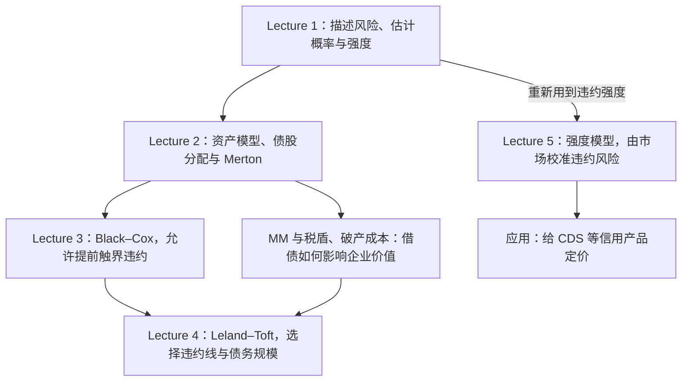

# AMA572｜先把 Lecture 1–5 串起来

> [!abstract] 这份笔记的目标
> 顶部保留课程大框架；第三节按各讲原文顺序，用自然语言串起“先做什么、接着做什么、最后得到什么公式”。省略长证明，保留关键定理、结果与适用条件；参数和原讲义入口在后面。
> **你现在优先要记住的是模型的任务与假设，而不是每一个根号里的参数。**

## 一、整门课反复在问什么？

公司借了钱，未来可能还不上。围绕这件事，有三个核心问题：

1. **风险有多大？** 什么时候可能违约？违约后还能收回多少？
2. **今天值多少钱？** 债券、股权、违约保险应该如何定价？
3. **公司该怎么选择？** 借多少钱合适？什么时候继续经营，什么时候违约？

Lecture 1–5 是围绕这些问题逐步换模型、加条件。很多公式再次出现，是因为新模型沿用了旧模型的一部分。

| 讲次 | 用一句人话说 | 主要得到什么 |
|---|---|---|
| **Lecture 1** | 先学会描述和估计违约风险 | 评级迁移概率、违约强度，以及由债价反推违约参数的方法 |
| **Lecture 2** | 把公司资产看成一个随机变化的“资金池”，研究债主和股东各分多少 | 股权与债权的期权表达式、MM 思想、Merton 债价与违约概率 |
| **Lecture 3** | 公司可能没等到债券到期就出事 | Black–Cox 提前违约模型及债券定价方法 |
| **Lecture 4** | 违约线和借债规模也可以由公司自己选择 | Leland–Toft 模型中的最优违约边界与最优债务水平 |
| **Lecture 5** | 从市场价格校准违约强度，再给信用产品定价 | Duffie–Singleton 定价方法与 CDS 公平保费 |

## 二、先看懂这张关系图

**Lecture 2–4 是结构式模型的主线：**先描述公司资产，再规定什么情况算违约，从而算出证券价值。

**Lecture 5 转向简约式模型：**直接对违约到来的强度建模，用市场债价等信息校准，再给其他信用产品定价。

Lecture 5 换了一种出发点。本页按各讲实际内容归类，未沿用 Lecture 1 导论中与现有分讲文件不完全一致的后续预告。

## 三、按讲义顺序：先做什么，再得到什么？

> [!info] 阅读约定
> 每个步骤都写“这一段想解决什么 → 使用什么设定或工具 → 最后得到什么”。公式直接给结果，省略中间代数和证明。步骤按各讲正文顺序排列；Lecture 2 的配套数学推导另列，避免把它误当成一个新模型。
>
> $\mathbf1_{\{A\}}$ 是指示函数：事件 $A$ 发生时为 1，否则为 0；$\tau\wedge T=\min(\tau,T)$。$E^*$、$P^*$ 表示定价所用的风险调整期望与概率；在本课相应风险中性设定下使用。$\Phi$ 是标准正态分布函数。

### Lecture 1：从债券现金流，走到违约概率的估计

对应 [[AMA572 Fixed-Income and Credit Risk/Lecture 1/01 - Lecture 1（英文原文与折叠译文）|Lecture 1 原笔记]]，正文 §1–6，PDF p.1–14。

#### 第 1 步：先摆出整门课要定价的对象——可能违约的债券

讲义一开始先不规定违约怎么发生，而是问：债券在不同情景下究竟付多少钱？设面值为 1、到期日为 $T$、连续票息率为 $\rho$，违约时点为 $\tau$，违约回收金额为 $c(T,\tau)$。折现后的总现金流为：

$$
 e^{-rT}\mathbf1_{\{\tau>T\}}
 +e^{-r\tau}c(T,\tau)\mathbf1_{\{\tau\leq T\}}
 +\int_0^{\tau\wedge T}\rho e^{-ru}\,du.
$$

三项依次是：存活到期的本金、违约回收、存活期间的票息。**后面更换模型，主要是在更具体地规定 $\tau$ 和回收金额；这三类现金流会反复出现。**

接着定义到期收益率 $y$（本讲原文记为 $v(T)$）：用同一个收益率折现全部承诺现金流，恰好等于市场债价。

$$
B(0,T)=e^{-yT}+\frac{\rho}{y}(1-e^{-yT}),
\qquad \text{信用利差}=y-r.
$$

$y=0$ 时，票息现值取极限 $\rho T$。这里的收益率是由价格反解出来的指标，不是现实中保证能收到的收益。

随后讲义说明信用风险还会影响资本结构、股权和信用衍生品，并区分结构式与简约式两种建模路线，为后面几讲提出问题。

#### 第 2 步：引入评级，并区分累计违约概率与某一年的违约概率

讲义先用评级表示信用好坏，再给累计违约数据。设：

$$
F(t)=P(\tau\leq t).
$$

它表示“截至 $t$ 已经违约”的概率。第 $k$ 年发生违约的无条件概率是：

$$
P(k-1<\tau\leq k)=F(k)-F(k-1).
$$

若条件改成“已存活至第 $k-1$ 年”，对应条件概率为：

$$
P(\tau\leq k\mid\tau>k-1)
=\frac{F(k)-F(k-1)}{1-F(k-1)}.
$$

**得到的区别：**累计到今天的概率、某一年的概率、给定此前没出事的概率，是三个不同的量。

#### 第 3 步：进一步缩短时间，定义违约强度

为了描述“已经活到现在，接下来一小段时间出事有多快”，讲义引入 hazard rate，也称违约强度：

$$
\lambda(t)=\frac{f_\tau(t)}{P(\tau>t)},
\qquad
P(t<\tau\leq t+dt\mid\tau>t)\approx\lambda(t)\,dt.
$$

再由这个定义得到生存概率：

$$
P(\tau>T)=\exp\left(-\int_0^T\lambda(u)\,du\right).
$$

常强度时，结果简化为：

$$
P(\tau>T)=e^{-\lambda T},
\qquad P(\tau\leq T)=1-e^{-\lambda T}.
$$

所以强度本身是“速率”，不是一年违约概率；两者通过上式转换。

#### 第 4 步：从“是否违约”推广到“评级在多个状态之间怎样迁移”

接着建立评级迁移矩阵。$P_{ij}(t)$ 表示公司现在在评级 $i$，经过 $t$ 后在评级 $j$ 的概率。每行和为 1，违约状态通常设为吸收态。

在时间齐次马尔可夫假设下，利用 **Chapman–Kolmogorov 关系**，得到：

$$
P(t+u)=P(t)P(u),
\qquad P(n)=P(1)^n.
$$

这一步的作用是：把一年迁移数据连接到多年迁移，而不是另估一套完全独立的概率。

#### 第 5 步：比较两种迁移矩阵估计方法

先给出经验法：只统计期初与期末的评级。

$$
\widehat P_{ij}
=\frac{\text{期初在 }i\text{、期末在 }j\text{ 的公司数}}
{\text{期初在 }i\text{ 的公司总数}}.
$$

然后指出它忽略中途的迁移时点，因此引入生成矩阵 $\Lambda$。对非对角项，估计结果为：

$$
\widehat\Lambda_{ij}=\frac{M_{ij}}{N_i}\quad(i\ne j),
\qquad
\widehat\Lambda_{ii}=-\sum_{j\ne i}\widehat\Lambda_{ij}.
$$

$M_{ij}$ 是观察到的迁移次数，$N_i$ 是所有公司在状态 $i$ 停留的累计时间。最终：

$$
\widehat P(t)=\exp(t\widehat\Lambda),
\qquad
\exp(A)=\sum_{k=0}^{\infty}\frac{A^k}{k!}.
$$

配套 Notebook 就是在计算或近似这个矩阵指数。它包含多步间接路径，不能逐个元素取普通指数。课内练习也沿用“先统计次数与停留时间，再求生成矩阵和矩阵指数”的顺序。

#### 第 6 步：解释历史概率与市场隐含概率为什么不同

前面的评级数据来自历史，讲义随后转向定价：市场债价反推出的风险调整概率，可以与历史频率不同，因为价格还反映风险补偿及流动性等因素。

若已知某期限的累计违约概率，可换成平均强度：

$$
\bar\lambda(T)=-\frac1T\ln[1-F(T)].
$$

**结果：**先辨认概率的来源，再决定用它描述现实风险，还是用于市场定价；相同符号不代表相同口径。

#### 第 7 步：最后给定回收假设，用债券价格反推违约参数

讲义先列三种回收基准：面值、违约前市场价值、对应无风险债券价值。回收假设给定后，就可以把无风险债券与公司债的价格差解释为预期损失现值。

在本讲离散、线性损失表的计算口径下：

$$
B_{\mathrm{rf}}-B_{\mathrm{risky}}
=\sum_i w_i e^{-rt_i}\,[A_i-C_i].
$$

$A_i$ 是在违约时点 $t_i$ 的剩余无风险现金流价值，$C_i$ 是回收金额，$w_i$ 是表中使用的违约权重。原讲义五年债例子最终写成：

$$
104.09-95.34=288.48w,
\qquad w\approx3.03\%.
$$

这里的 $w$ 是为避免与迁移矩阵混淆而改写的符号，原文记为 $P$。**课堂表直接把这个参数当作损失权重使用，不能将它与严格连续时间强度完全等同。**

配套三年、五年债练习进一步把违约参数分段：先用短债确定前三年的 $P_1$，再用长债确定后两年的 $P_2$。现有笔记的订正版结果是：

$$
P_1\approx1.6149\%,
\qquad P_2\approx2.5946\%.
$$

详见 [[AMA572 Fixed-Income and Credit Risk/Lecture 1/02 - 课内练习解答（英文原文与折叠译文）#练习 2：完整题目与订正解答（按课堂简化模型）|练习 2 的订正解答]]；不要用上方保留的原解答误印数值覆盖订正版。

**本讲走完的路线：现金流 → 概率与强度 → 评级迁移 → 历史估计 → 市场价格反推风险。**

### Lecture 2：从债股分配，走到 Merton 定价与反向校准

对应 [[AMA572 Fixed-Income and Credit Risk/Lecture 2/01 - Lecture 2（英文原文与折叠译文）|Lecture 2 原笔记]]，正文 §1–5，PDF p.1–9。

#### 第 1 步：先按受偿顺序，写出股东与债主的到期所得

最初假设没有票息、没有税收利益、没有破产成本，债务面值为 $D$。于是：

$$
\text{债权到期所得}=\min(V_T,D),
\qquad
\text{股权到期所得}=(V_T-D)^+.
$$

这里 $x^+=\max(x,0)$。第二个式子恰好是看涨期权收益：标的是公司资产，执行价是债务面值。

接着把债务分成优先债 $D_S$ 和次级债 $D_J$，得到：

$$
\begin{aligned}
\text{优先债所得}&=V_T-(V_T-D_S)^+,\\
\text{次级债所得}&=(V_T-D_S)^+-(V_T-D_S-D_J)^+,\\
\text{股权所得}&=(V_T-D_S-D_J)^+.
\end{aligned}
$$

这一步还没有计算今天的价格，而是先把“未来谁拿多少”写对，建立或有索取权与期权的联系。

#### 第 2 步：把债股所得加起来，提出 MM 资本结构无关结论

然后对未来所得折现、取风险调整期望，得到股权和债权的现值。把两者相加，讲义给出这个简化版本的 **Modigliani–Miller 定理**：

$$
M(0)=S(0)+B(0)=E^*[e^{-rT}V_T].
$$

右边没有债务面值 $D$，所以在这里的理想设定下，改变债股比例，只改变各方怎么分，总价值不变。**这个加总论证本身不要求先假定右边一定等于 $V_0$。**

#### 第 3 步：放松理想条件，加入税收利益与破产损失

现实中资本结构会影响价值，因此讲义接着引入税率 $\kappa$ 和破产后保留资产的比例 $\alpha$。本节用一个简化的到期税收利益设定，把税收利益写为存活时的 $\kappa D$。

最终定义并得到：

$$
A(0)=E^*[e^{-rT}\kappa D\mathbf1_{\{V_T\geq D\}}],
$$

$$
C(0)=E^*[e^{-rT}(1-\alpha)V_T\mathbf1_{\{V_T<D\}}],
$$

$$
M(0)=E^*[e^{-rT}V_T]+A(0)-C(0).
$$

因此，选择债务规模的经济问题变成：**税收利益增加多少，破产损失又增加多少？**这里是在讲义的简化模型内定义税收利益，不是现实税法中“本金普遍可抵税”的结论。

随后 Exercise 1 要求在几何布朗运动下把 $A(0)$、$C(0)$ 算出来；具体结果见后面的“配套数学推导”。

#### 第 4 步：转入基本 Merton 模型，用 Black–Scholes 公式实际定价

接着讲义回到无税收利益、无破产成本的设定，令公司只在债务到期时因资产不足而违约。风险中性下：

$$
dV_t=rV_t\,dt+\sigma_VV_t\,dW_t.
$$

把“股权是一份看涨期权”代入 Black–Scholes 公式，最终得到：

$$
S(t)=V_t\Phi(d_1)-De^{-r(T-t)}\Phi(d_2),
$$

$$
d_1=\frac{\ln(V_t/D)+(r+\tfrac12\sigma_V^2)(T-t)}
{\sigma_V\sqrt{T-t}},
\qquad d_2=d_1-\sigma_V\sqrt{T-t}.
$$

债权价值等于资产减股权，因此：

$$
B(t,T)=V_t\Phi(-d_1)+De^{-r(T-t)}\Phi(d_2).
$$

再利用资产对数正态分布，得到风险中性违约概率：

$$
P^*(V_T<D\mid\mathcal F_t)=\Phi(-d_2).
$$

**这一步的产出是三件事：股权价格、债券价格、违约概率。**$d_1,d_2$ 是为了表达这些结果而引入的标准化组合量。

#### 第 5 步：把债价转换为收益率与信用利差

Merton 的债务没有票息，所以从债价直接得到：

$$
y(t,T)=\frac{1}{T-t}\ln\frac{D}{B(t,T)},
\qquad s(t,T)=y(t,T)-r.
$$

然后讲义讨论期限结构：当前资产高于债务面值时，短端利差趋于零，曲线可呈驼峰；资产低于面值时，短端利差可发散，讲义展示递减形状。重点是：基本模型能生成的形状不够灵活。

#### 第 6 步：检查模型与现实的差距

接着讨论实证拟合：模型简单，也能为风险排序提供信息，但没有票息、只允许到期违约、信用利差形状有限。

**这个环节没有再推出一个新定价公式，而是在解释为什么下一讲还需要更换违约机制。**

#### 第 7 步：单独说明为什么极短期利差会趋于零

讲义随后研究短期限问题。在初始资产高于债务门槛、资产按这里的连续扩散模型变化时，得到界：

$$
0\leq s(0,T)\leq-\frac1T\ln P^*(V_T\geq D),
$$

并得到：

$$
\lim_{T\downarrow0}s(0,T)=0
\qquad(V_0>D).
$$

它说明：当公司离违约门槛还有距离，极短时间内连续资产路径跨过这段距离的概率太小，因此模型难以解释现实中的非零短端利差。**初始资产已经低于门槛的情形不能套这个结论。**

#### 第 8 步：最后反过来，用股市数据推断资产与违约概率

前面是假设知道 $V_0,\sigma_V$ 再定价，最后一节改问：资产价值看不见，但股权市值 $S_0$ 和股权收益率波动率 $\sigma_S$ 能估计，怎么办？

讲义对 $S(t)=C(V_t,D,\sigma_V,r,T-t)$ 使用 Itô 引理，比较随机项，得到第二条方程：

$$
\sigma_SS_0=\Phi(d_1)\sigma_VV_0.
$$

与股权定价式联立：

$$
\begin{cases}
S_0=V_0\Phi(d_1)-De^{-rT}\Phi(d_2),\\
\sigma_SS_0=\Phi(d_1)\sigma_VV_0.
\end{cases}
$$

解出两个未知数 $V_0,\sigma_V$，再代回 $\Phi(-d_2)$。其中 $\Phi(d_1)$ 是股权对资产的 Delta，不能把它也当成违约概率。

#### 配套数学推导：它如何把 Exercise 1 补完整？

这部分对应 [[AMA572 Fixed-Income and Credit Risk/Lecture 2/02 - 补充推导（Ito 等距版，英文原文与折叠译文）|Itô 等距版补充]] 与 [[AMA572 Fixed-Income and Credit Risk/Lecture 2/03 - 补充推导（Ito 引理及手写批注版）|Itô 引理及批注版]]。它们在补同一条计算路线，不是两个新的信用风险模型。

**先对资产取对数。**从 GBM 出发，用 Itô 引理得到：

$$
d\ln V_t=(r-\tfrac12\sigma_V^2)\,dt+\sigma_V\,dW_t.
$$

所以对数资产增量的条件分布为：

$$
\ln(V_T/V_t)\mid\mathcal F_t
\sim N\left((r-\tfrac12\sigma_V^2)(T-t),\ \sigma_V^2(T-t)\right).
$$

均值和方差可分别由随机积分的零均值性质与 Itô 等距计算；正态性还使用了布朗增量的正态分布，不能只凭均值、方差推出。

**再把违约事件标准化。**将 $V_T<D$ 改写成标准正态变量小于某个阈值，得到的仍是 $\Phi(-d_2)$。

**最后分别计算税收利益与破产成本。**在本节的 GBM、无资产支付率设定下，推广到任意初始资产 $V_0$ 后，结果为：

$$
A(0)=\kappa De^{-rT}\Phi(d_2),
\qquad
C(0)=(1-\alpha)V_0\Phi(-d_1).
$$

原补充文件采用 $V_0=1$，因此它的结果中不显式出现 $V_0$。第一个结果是固定金额乘存活概率；第二个是违约状态下资产的截断期望，不能只写成固定金额乘违约概率。

**文件末尾再列出两个工具。**若 $dX_t=\mu_tdt+\eta_tdW_t$，Itô 引理为：

$$
df(t,X_t)=\left(f_t+\mu_tf_x+\tfrac12\eta_t^2f_{xx}\right)dt
+\eta_tf_x\,dW_t.
$$

Itô 等距在适应、平方可积等条件下为：

$$
E\left[\left(\int_a^b H_u\,dW_u\right)^2\right]
=E\left[\int_a^b H_u^2\,du\right].
$$

前者负责“函数怎样变化”，后者负责“随机积分二阶矩多大”，用途不同。

**课堂插入的矩计算例题。**对 $X_t=\mu t+\sigma W_t$、$X_0=0$，按一阶、二阶、三阶逐级使用 Itô 引理，最后得到：

$$
\begin{aligned}
E[X_t]&=\mu t,\\
E[X_t^2]&=\mu^2t^2+\sigma^2t,\\
E[X_t^3]&=\mu^3t^3+3\mu\sigma^2t^2.
\end{aligned}
$$

它是在练习后续要用的工具；这些是原点矩，方差另为 $\sigma^2t$。需要把工具名称系统串起来时，再查 [[AMA572 Fixed-Income and Credit Risk/Lecture 2/06 - 伊藤随机微积分知识框架|Itô 知识框架]]。

**本讲走完的路线：分清债股所得 → MM → 税盾与破产成本 → Merton 定价 → 利差与局限 → 股市数据反推风险。**

### Lecture 3：先研究首次穿越，再用它给 Black–Cox 债券定价

对应 [[AMA572 Fixed-Income and Credit Risk/Lecture 3/01 - Lecture 3（英文原文与折叠译文）|Lecture 3 原笔记]]，PDF p.1–7 为首次穿越与模型，p.8–12 为应用补充；中间还附有反演作业解答。

#### 第 1 步：暂时离开公司，先研究一个纯数学问题

讲义先考虑带漂移的布朗运动：

$$
X_t=\mu t+\sigma W_t,
\qquad \tau_b=\inf\{t\geq0:X_t=b\}.
$$

先取上方边界 $b>0$，问：第一次碰到 $b$ 的时间，具有怎样的分布？后面的信用模型要研究首次碰到破产线，因此先准备这个工具。

#### 第 2 步：提出首次穿越时间的 Laplace 变换定理

定理先给出：对 $s>0$，

$$
E[e^{-s\tau_b}]
=\exp\left[-\frac{b}{\sigma^2}
\left(\sqrt{\mu^2+2\sigma^2s}-\mu\right)\right],
\qquad b>0.
$$

$\tau_b=\infty$ 时约定指数项为零。证明路线是构造指数鞅、使用可选抽样，再处理极限；这里保留结果，不展开证明。

再令变换参数趋于零，得到“最终会不会碰到”的概率：

$$
P(\tau_b<\infty)=
\begin{cases}
\exp(2\mu b/\sigma^2),&\mu b<0,\\
1,&\mu b\geq0.
\end{cases}
$$

直觉上，漂移若一直把过程推离边界，最终碰到边界的概率可以小于 1。

#### 第 3 步：再提出密度引理，把变换反演成时间分布

接着利用 Laplace 反演表，得到有限首次穿越时间的密度：

$$
f_{\tau_b}(u)
=\frac{b}{\sigma\sqrt{2\pi u^3}}
\exp\left[-\frac{(b-\mu u)^2}{2\sigma^2u}\right],
\qquad b>0,\ u>0.
$$

这说明第一次碰线可能发生在什么时间。若最终触界概率小于 1，这个有限时间密度的总积分也小于 1，剩余概率对应永远不触界。

**到这里都是数学准备，还没有给债券定价。**

#### 第 4 步：正式建立 Black–Cox 模型，并写出三类现金流

然后回到公司。风险中性下资产服从：

$$
\frac{dV_t}{V_t}=(r-\delta)\,dt+\sigma\,dW_t,
\qquad
V_t=V_0e^{(r-\delta-\sigma^2/2)t+\sigma W_t}.
$$

这里 $\delta$ 是资产总支付率。违约规则改为：

$$
\tau=\inf\{t\geq0:V_t\leq V_B\},
\qquad 0<V_B<V_0.
$$

面值 1 的债券有连续票息 $\rho$；违约时回收 $ce^{-r(T-\tau)}$，即剩余期限无风险零息债价值的 $c$ 倍。于是价格为：

$$
B(V_0;V_B,T)=E^*\left[
 e^{-rT}\mathbf1_{\{\tau>T\}}
 +ce^{-rT}\mathbf1_{\{\tau\leq T\}}
 +\int_0^{\tau\wedge T}\rho e^{-ru}\,du
\right].
$$

回收项中两个折现因子已合并。**这就是 Lecture 1 的现金流模板，换上本讲的违约和回收规则。**

#### 第 5 步：发现公司违约对应“向下触界”，因此换用负边界公式

资产取对数后，违约等价于：

$$
(r-\delta-\tfrac12\sigma^2)t+\sigma W_t
\leq\ln(V_B/V_0).
$$

因此数学参数对应为：

$$
\mu=r-\delta-\tfrac12\sigma^2,
\qquad b=\ln(V_B/V_0)<0.
$$

不能把这个负 $b$ 直接塞进前面的上穿公式。向下触界的结果是：

$$
E[e^{-s\tau_b}]
=\exp\left[\frac{b}{\sigma^2}
\left(\sqrt{\mu^2+2\sigma^2s}+\mu\right)\right],
\qquad b<0.
$$

令 $q=V_B/V_0$、$\xi=(r-\delta)/\sigma^2-1/2$，公司违约时间的变换最终变成：

$$
\psi(s):=E^*[e^{-s\tau}]
=q^{\sqrt{\xi^2+2s/\sigma^2}+\xi}.
$$

**这一步把纯数学定理接到了公司的违约时间上。**$\psi$ 只是本页为方便阅读给变换起的简称。

#### 第 6 步：对债券价格关于到期日做 Laplace 变换

直接算不同到期日的价格比较复杂，讲义接着定义：

$$
\widehat B(s)=\int_0^\infty e^{-sT}B(V_0;V_B,T)\,dT.
$$

先算本金与票息，再算回收，分别得到：

$$
\text{本金与票息部分的变换}
=\frac{\rho+s}{s(r+s)}[1-\psi(s+r)],
$$

$$
\text{回收部分的变换}
=\frac{c}{s+r}\psi(s+r).
$$

合并后的最终结果是：

$$
\widehat B(s)
=\frac{\rho+s}{s(r+s)}
-\left[\frac{\rho}{rs}
+\frac{1-\rho/r-c}{s+r}\right]\psi(s+r).
$$

要区分：$\psi$ 是“违约时间的变换”，$\widehat B$ 是“债价关于到期日的变换”。它们通过上式连接，但不是同一个对象。

#### 第 7 步：正文先讨论改进与局限，再把反演留作作业

到这里已经允许提前违约、连续票息和回收，模型比 Merton 更丰富。但资产若仍连续变化，且起点离边界有距离，非零极短期利差问题依然存在。

正文随后提出反演作业。现有笔记的作业解答和 p.8–12 应用补充，继续完成“从变换回到实际价格”的工作，仍属于同一个 Black–Cox 模型。

#### 第 8 步：应用补充先整理参数、查反演表，最后给出闭式债价

应用部分重新确认违约与现金流设定，再把指数项整理成反演表可识别的形式。为区分经济参数与计算简记，这里写：

$$
L=\ln(V_0/V_B),\qquad
A_L=\frac{2L^2}{\sigma^2},\qquad
\lambda_L=r+\frac12\sigma^2\xi^2.
$$

$A_L$ 对应补充原文的 $\alpha$，$\lambda_L$ 对应原文的 $\lambda$；它们是反演简记，不是资产回收比例和违约强度。

对 $z\in\{0,r\}$，反演所需的函数最后等于：

$$
\begin{aligned}
G_z(T)=e^{-zT}\Bigg[&
 e^{\sqrt{A_L(\lambda_L-z)}}
 \Phi\left(-\sqrt{\frac{A_L}{2T}}-\sqrt{2(\lambda_L-z)T}\right)\\
&+e^{-\sqrt{A_L(\lambda_L-z)}}
 \Phi\left(-\sqrt{\frac{A_L}{2T}}+\sqrt{2(\lambda_L-z)T}\right)
\Bigg].
\end{aligned}
$$

将两次查表结果合并，完整债券价格是：

$$
B(V_0;V_B,T)
=B_{\mathrm{rf}}(T)
-q^\xi\left[
\frac{\rho}{r}G_0(T)
+\left(1-\frac{\rho}{r}-c\right)G_r(T)
\right],
$$

$$
B_{\mathrm{rf}}(T)
=\frac{\rho}{r}+\left(1-\frac{\rho}{r}\right)e^{-rT}.
$$

以上写法采用 $r>0$；$\lambda_L-z=0$ 时按连续极限理解。**最终结果已经是可计算的正态分布函数表达式，没有留下待反演的符号。**

#### 第 9 步：最后由债价算利差，并说明实际需要估计哪些量

有票息时，先解收益率 $y$：

$$
B(V_0;V_B,T)=e^{-yT}+\frac{\rho}{y}(1-e^{-yT}),
\qquad CS(T)=y-r.
$$

若是面值 1 的零息债，才可直接写为：

$$
CS(T)=-\frac1T\ln B_Z(T)-r.
$$

最后讨论资产距离边界的远近、波动、回收等参数如何影响债价，并说明应用时要估计或校准 $V_0,V_B,\sigma,r,\delta,c,\rho,T$。

**本讲走完的路线：首次穿越定理 → 密度引理 → 资产触界违约 → 债价变换 → 反演闭式价格 → 收益率与利差。**

### Lecture 4：先算整家公司的价值，再优化违约线和债务规模

对应 [[AMA572 Fixed-Income and Credit Risk/Lecture 4/01 - Lecture 4（英文原文与折叠译文）|Lecture 4 原笔记]]，§1 建立模型与命题 1，§2 给出两阶段问题与定理 1，最后讨论参数影响。

#### 第 1 步：沿用资产模型，但将公司设为持续经营

讲义开头保留 Lecture 3 的资产过程：

$$
\frac{dV_t}{V_t}=(r-\delta)\,dt+\sigma\,dW_t.
$$

变化主要发生在债务结构：公司每时刻都有老债到期，也发行新债，不再只盯着一笔固定到期的债务。

#### 第 2 步：规定发行速度与期限分布，得到稳定的债务总面值

假设每单位时间发行面值 $p$ 的新债，期限服从参数为 $m$ 的指数分布：

$$
\varphi(u)=me^{-mu},\qquad u\geq0,
\qquad \text{平均期限}=1/m.
$$

在平稳的借新还旧结构下，时点 $t$ 存续债务中、在未来 $(s,s+ds)$ 到期的面值为：

$$
pe^{-m(s-t)}\,ds.
$$

对未来到期量加总，得到：

$$
P=\frac{p}{m}.
$$

$P$ 是存续债务面值总额。**公司虽然持续发债和还债，存量面值可以保持不变。**

接着讲义描述经营现金流：收入来自资产支付和发行新债，支出是到期本金与税后票息。盈余付给股东，短缺则需要股东注资；所以后面必须要求违约前的股权价值非负。

#### 第 3 步：规定违约与回收，并使单只债券回收和全体债权人回收一致

违约仍定义为首次碰到 $V_B$。资产路径连续，因此有限违约时点有 $V_\tau=V_B$。全体债权人拿到 $\alpha V_B$，企业损失 $(1-\alpha)V_B$。

对单只面值 1 的债券，仍设违约时回收 $ce^{-r(T-\tau)}$。把所有期限的回收加总并匹配 $\alpha V_B$ 后，得到：

$$
c=\frac{m+r}{m}\frac{\alpha V_B}{P}.
$$

因此 $c$ 与 $\alpha$ 不是同一个比例。若要使用 $0\leq c\leq1$ 的单债回收设定，还需相应的参数限制。

#### 第 4 步：先写价值的“组成”，再求具体公式

讲义接着沿用 Lecture 3 的单债定价，并提出三个总量：企业市场价值 $v$、总债务市场价值 $D$、股权价值 $S$。

企业总价值的经济表达式是：

$$
v(V;V_B)
=V+E^*\left[\int_0^\tau\kappa\rho P e^{-rt}\,dt\right]
-(1-\alpha)V_BE^*[e^{-r\tau}].
$$

即：资产价值，加违约前持续获得的利息税盾，减违约时的破产损失。这是在动态情形中继续使用 Lecture 2 的价值权衡。

总债务则按剩余期限加总：

$$
D(V;V_B)=Pm\int_0^\infty e^{-mT}B(V;V_B,T)\,dT,
\qquad S(V;V_B)=v(V;V_B)-D(V;V_B).
$$

讲义还要求 $\kappa\rho<r$，用来限制模型里的税收利益。

#### 第 5 步：提出命题 1，给出企业、总债务、股权的显式价值

为让长公式看得出结构，采用原笔记补充解答也使用的简记：

$$
\xi=\frac{r-\delta}{\sigma^2}-\frac12,
\qquad q=\frac{V_B}{V},
$$

$$
a=\sqrt{\xi^2+\frac{2r}{\sigma^2}}+\xi,
\qquad
b=\sqrt{\xi^2+\frac{2(r+m)}{\sigma^2}}+\xi,
$$

$$
k=\frac{\kappa\rho}{r},
\qquad d=\frac{\rho+m}{r+m}.
$$

这些是本讲内的计算简记，$k$ 不是税率 $\kappa$。命题 1 的最终结果可等价地写成：

$$
v(V;V_B)=V+kP-[kP+(1-\alpha)V_B]q^a,
$$

$$
D(V;V_B)=Pd-[Pd-\alpha V_B]q^b,
$$

$$
\begin{aligned}
S(V;V_B)={}&V+kP-Pd\\
&-[kP+(1-\alpha)V_B]q^a
+[Pd-\alpha V_B]q^b.
\end{aligned}
$$

它们分别对应原讲义式（4）、（5）、（6），只是把重复根号压缩了。

**这些结果从哪里来？**企业价值用到 Lecture 3 的 $E^*[e^{-r\tau}]=q^a$；总债务则恰好满足：

$$
D(V;V_B)=Pm\widehat B(m).
$$

所以把上一讲的债价变换参数取成 $m$ 就能求总债务，**这里不必先把每一个期限的单债价格反演出来。**这也解释了为什么 Laplace 工具又出现一次。

#### 第 6 步：明确谁优化什么，提出两阶段优化问题

有了价格公式后，讲义才开始优化。

先固定债务面值总额 $P$，由股东选择违约边界，目标是股权价值最大：

$$
\max_{V_B}S(V;V_B),
\qquad
S(V';V_B)\geq0\quad\text{对所有 }V'\geq V_B.
$$

后一个条件是有限责任约束：公司尚未违约时，不能要求股东持有负价值的股权。

再预见股东会选择的 $V_B^*(P)$，由公司在发债时选择 $P$，使企业总价值最大：

$$
\max_P v(V;V_B^*(P)).
$$

这是求解顺序：先算未来的违约决策，再回到今天的融资决策。两个目标函数不同，不能当作同一个无约束最大化问题。

#### 第 7 步：提出定理 1，先求最优边界，再处理债务规模

定理先利用边界上的平滑拼接条件：

$$
\left.\frac{\partial S(V;V_B^*)}{\partial V}\right|_{V=V_B^*}=0.
$$

注意这里对资产状态 $V$ 求导，不是直接把 $\partial S/\partial V_B=0$ 当成同一句话。边界上还满足股权价值为零。

用第 5 步的简记，边界结果为：

$$
V_B^*=\epsilon P,
\qquad
\epsilon=\frac{db-ka}{1+(1-\alpha)a+\alpha b}.
$$

随后定理说明这个边界解决了带有限责任约束的第一阶段问题，并给出界：

$$
0<\epsilon<\frac{d}{\alpha}
=\frac{1}{\alpha}\frac{\rho+m}{r+m}
\qquad(\alpha>0).
$$

最后把边界代回企业价值，得到只关于 $P$ 的函数：

$$
v(V;\epsilon P)=V+kP-HP^{a+1},
\qquad
H=[k+(1-\alpha)\epsilon]\left(\frac{\epsilon}{V}\right)^a.
$$

在通常非退化条件下，$a>0,H>0$，该函数严格凹，因此可以求唯一最优债务规模。讲义主要展示凹性；把该结果进一步写成显式内点解，就是：

$$
P^*=\left[\frac{k}{(a+1)H}\right]^{1/a}
\qquad(k>0),
\qquad V_B^*=\epsilon P^*.
$$

这里 $H$ 是本页为写出结果引入的简称。该内点公式仍须满足所采用模型的可行条件；税盾为零等边界情形需另看边界最优。

> [!note]- 原讲义的一个条件问题，复习时单独留意
> 上面的 $\epsilon<d/\alpha$ 是式（11），不能仅凭它推出单债回收条件 $c\leq1$。后者实际要求 $\epsilon\leq m/[\alpha(m+r)]$。现有 Lecture 4 原笔记的式（11）解答后已经指出两者差别；本页保留各自条件，不沿用原文“因此自动满足”的推断。

#### 第 8 步：最后用参数表解释最优杠杆，并留出不等式证明练习

讲义最后展示参数变化的影响：在表中设定下，$\alpha$ 越高、平均期限 $1/m$ 越长，最优杠杆越高；资产波动率 $\sigma$ 越高，最优杠杆越低。

最优杠杆看的是债务**市场价值**在企业市场价值中的占比，即在最优决策处计算 $D/v$，不是直接把债务面值 $P$ 当作市场价值。模型仍有局限，例如不能解释所有高科技企业零负债的现象。

最后的 HWK 是证明式（11）的范围，而不是再建立一个新模型；最终不等式就是第 7 步给出的 $0<\epsilon<d/\alpha$，现有原笔记中已有证明。

**本讲走完的路线：借新还旧结构 → 回收匹配 → 价值组成 → 命题 1 算价值 → 两阶段问题 → 定理 1 求边界和债务规模 → 参数含义。**

### Lecture 5：先重述风险率与强度，再给产品定价，最后计算 CDS

对应 [[AMA572 Fixed-Income and Credit Risk/Lecture 5/01 - Lecture 5（英文原文与折叠译文）|Lecture 5 原笔记]]，§1 为 Duffie–Singleton，§2 为 CDS。

#### 第 1 步：先改变出发点——由市场校准违约风险

讲义开头先对比两条路线：结构式模型从公司资产出发产生违约；简约式模型直接设定违约强度等外生过程，再让模型价格匹配市场债价。

它提到强度型 Duffie–Singleton 与评级迁移型 Jarrow–Turnbull，随后主要讲前者。这里没有再要求先求 $V_t$ 或 $V_B$。

#### 第 2 步：重新定义生存概率、风险率，并连接到即时强度

在尚未违约的时点 $t$，用已知信息 $\mathcal F_t$ 定义未来生存概率 $S(t,T)$。在光滑等条件下：

$$
S(t,T)=P^*(\tau>T\mid\mathcal F_t),
\qquad
h(t,T)=-\frac{\partial}{\partial T}\ln S(t,T).
$$

由此得到：

$$
S(t,T)=\exp\left[-\int_t^T h(t,u)\,du\right].
$$

$h(t,T)$ 描述今天看来、未来期限 $T$ 的条件风险率；即时强度则在适当条件下为：

$$
\lambda(t)=h(t,t).
$$

Lecture 1 的强度概念在这里升级成可随信息变化的过程。若 $\lambda$ 随机，不能把未来随机路径直接当作今天已经知道的一条确定风险率曲线。

> [!note]- 原文符号的规范化
> 原讲义 p.1 把生存函数对 $T$ 的导数直接当成密度，漏了负号。由于生存概率随期限下降，密度应为 $f(t,T)=-\partial_T S(t,T)$，所以这里使用正的风险率 $h=f/S=-\partial_T\ln S$。
>
> 讲义还用计数过程 $N_t=\mathbf1_{\{\tau\leq t\}}$ 说明强度：扣除累计条件到达速率后成为鞅。若 $\lambda_t$ 指违约前强度，严格写法应在违约后停止累计，即 $N_t-\int_0^t\mathbf1_{\{\tau\geq u\}}\lambda_u\,du$ 为相应信息流下的鞅；这与把停止后的强度一并记作 $\lambda$ 的简写要区分。

#### 第 3 步：规定“按违约前市场价值回收”，给出核心定价结果

随后引入一个存活到期时支付 $g(T)$ 的产品。假设违约时回收其违约前市场价值的比例 $R$；本讲原文用 $\delta$ 表示这个比例，本页用 $R$ 避免与 Lecture 3–4 的支付率混淆。

Duffie–Singleton 的关键定价结果是，在违约前：

$$
g(t)=E^*\left[
\exp\left(-\int_t^T[r(u)+(1-R)\lambda(u)]\,du\right)
g(T)\mid\mathcal F_t
\right].
$$

面值 1 的零息债取 $g(T)=1$，因此：

$$
B(0,T)=E^*\left[
\exp\left(-\int_0^T[r(u)+(1-R)\lambda(u)]\,du\right)
\right].
$$

**结果是：把信用风险折算进折现率，而不必先求资产触界概率。**若 $r,\lambda,R$ 都为常数，进一步简化为：

$$
B(0,T)=e^{-[r+(1-R)\lambda]T},
\qquad \text{零息债信用利差}=(1-R)\lambda.
$$

这依赖本节的市场价值比例回收假设。实际校准时还要给定回收率等设定，不能说一个债价会同时唯一确定所有参数。

#### 第 4 步：再用一个很短的时间段，解释上述结果为什么合理

注意讲义是**先陈述定价结果，再给启发式推导**。它把下一个小时间段分成“违约”和“不违约”两种情形：违约概率约为 $\lambda(t)dt$，违约时损失比例为 $1-R$。

把两种情形合并、忽略二阶小量后，最终的有效折现率是：

$$
r_{\mathrm{eff}}(t)=r(t)+(1-R)\lambda(t).
$$

再把小时间段的定价递推到到期，得到第 3 步的期望公式。这里是在说明同一个结果，不是又加一个不同模型。

#### 第 5 步：随后介绍 CDS，把“信用风险”变成可以买卖的保护

保护买方按约定支付保费；若参考实体违约，卖方按合约支付损失补偿。若名义本金为 $N$、回收率为 $R$，简化赔付金额是：

$$
\text{违约赔付}=N(1-R).
$$

讲义接着用市场案例解释 CDS 的用途与风险，然后转入五年合约的估值。

#### 第 6 步：按原文顺序，分别算常规保费、应计保费、违约赔付

例子假设每年末付费、违约发生在年中。令年度条件违约概率为 $q$、年保费率为 $s$。采用单位名义本金，存活至第 $i$ 年末的概率为 $(1-q)^i$，在第 $i$ 年中违约的无条件概率为 $q(1-q)^{i-1}$。

**先算常规保费腿：**公司活到付费日才付该年的保费。

$$
PV_{\mathrm{regular}}
=s\sum_{i=1}^n e^{-ri}(1-q)^i.
$$

**再算违约时应补的应计保费：**年中违约，补付从上次付费日至违约日的半年度保费。

$$
PV_{\mathrm{accrual}}
=\frac{s}{2}\sum_{i=1}^n e^{-r(i-1/2)}q(1-q)^{i-1}.
$$

**最后算保护腿：**在违约情景支付损失比例 $1-R$。

$$
PV_{\mathrm{protection}}
=(1-R)\sum_{i=1}^n e^{-r(i-1/2)}q(1-q)^{i-1}.
$$

讲义把例子中的 $q=0.02$ 称为年度 intensity，但实际表格用的是离散年度条件概率。若改用严格常强度 $\lambda$，一年概率应为 $1-e^{-\lambda}$，不能悄悄互换。

#### 第 7 步：令合约初始价值为零，得到公平保费

最后令买卖双方的预期现值相等：

$$
PV_{\mathrm{regular}}+PV_{\mathrm{accrual}}
=PV_{\mathrm{protection}}.
$$

因此：

$$
s^*=
\frac{(1-R)\sum_{i=1}^n e^{-r(i-1/2)}q(1-q)^{i-1}}
{\sum_{i=1}^n e^{-ri}(1-q)^i
+\tfrac12\sum_{i=1}^n e^{-r(i-1/2)}q(1-q)^{i-1}}.
$$

原例子 $n=5,q=2\%,r=5\%,R=40\%$，表格取整后的方程与结果为：

$$
4.0704s+0.0426s=0.0511,
\qquad s\approx1.24\%=124\text{ bp/年}.
$$

最后的 HWK 只是改参数：$q=3\%,r=7\%,R=30\%$，仍然年中违约、年末付费；代入同一公式得到约 $2.2067\%$，即 $220.67$ bp/年（按离散年度概率口径）。

讲义末尾还提醒：合约成交后市场风险判断会变，已有 CDS 的价值也会随之变化；初始公平保费不代表合约永远没有盈亏。

**本讲走完的路线：改变建模出发点 → 生存率、风险率与强度 → Duffie–Singleton 定价结果 → 启发式解释 → CDS 三类现金流 → 公平保费。**

## 四、到底哪里重复了，哪里升级了？

### 1. 三个结构式模型，只先记住这三个问题

| 模型 | 什么时候违约？ | 违约线怎么来？ | 主要任务 |
|---|---|---|---|
| Merton，Lecture 2 | 到期时资产不够偿债 | 到期比较的门槛是债务面值 | 用期权方法给债股定价 |
| Black–Cox，Lecture 3 | 到期前首次触及资产下限也会违约 | 外生给定 | 纳入提前违约、票息和回收 |
| Leland–Toft，Lecture 4 | 同样采用首次触界违约 | 由股东决策内生求出 | 同时研究违约决策和最优资本结构 |

> [!example] 同一条资产路径，判断为什么会不同？
> 假设债务到期要还 80，公司资产从 100 跌到 70，后来又回到 90。
>
> **Merton：**中途跌到 70 本身不触发违约；到期有 90，足以还 80。
>
> **Black–Cox：**如果事先设定违约线为 75，那么下跌途中首次碰到 75 就已触发违约；不能靠后来的反弹撤销这次违约。
>
> **Leland–Toft：**仍然用触界规则，但先要解释股东会选择怎样的违约线，以及公司会选择多大的债务规模。它的债务结构也更复杂，不能直接套用上面单笔到期债务的全部设定。

### 2. 反复出现的工具，各自负责什么？

| 工具 | 用途 | 出现位置 |
|---|---|---|
| 几何布朗运动 GBM | 描述资产怎样随机变化 | L2–4 共用 |
| Itô 引理 | 从资产的变化，推导对数、股权价格等函数的变化 | L2 推导与校准 |
| Itô 等距 | 计算随机积分的二阶矩 | L2 补充推导 |
| Black–Scholes 公式 | 给期权式收益定价 | L2 Merton |
| 首次穿越时间 | 描述第一次碰到违约线的时刻 | L3–4 |
| Laplace 变换与反演 | 换一种形式处理违约时间与债价计算 | L3–4 |
| MM 及其扩展 | 理解债股分配、税盾与破产成本对总价值的影响 | L2 提出，L4 优化 |
| 违约强度 | 描述短时间内的条件违约速率 | L1 入门，L5 建模核心 |

Lecture 4 再次出现 Laplace，是在复用 Lecture 3 的工具；再次出现税盾，是在接回 Lecture 2 的经济问题。

## 五、参数记不住时，先按角色认，不要按字母硬背

> [!note]- 需要时再展开：最小参数地图与容易串台的符号
> **资产侧：**$V$ 是公司资产价值；$\sigma$ 或 $\sigma_V$ 是资产收益率波动率；$r$ 是无风险利率；Lecture 3–4 的 $\delta$ 是资产向投资者支付的总支付率。
>
> **合同侧：**$T$ 是到期时间；$\rho$ 是连续票息率；Lecture 2 的 $D$ 是债务面值；Lecture 4 的 $P$ 是全部存续债务的面值总额，$m$ 控制到期速度，$1/m$ 是平均期限。
>
> **违约侧：**$\tau$ 是违约发生的时间，$V_B$ 是触发违约的资产边界，$\lambda$ 是违约强度。Lecture 2、4 中的 $\alpha$ 表示破产后保留下来的资产比例，$1-\alpha$ 才是损失比例；$\kappa$ 是税率。
>
> **计算简记：**$d_1,d_2$ 是期权公式中的标准化变量，$\xi$ 是把漂移和波动组合起来的简记，$\epsilon$ 汇总最优边界与债务面值的比例。先理解它们服务哪个计算，展开式需要时查。
>
> **同字母会换意思：**Lecture 2 的 $S$ 是股权价值，Lecture 5 的 $S(t,T)$ 是生存概率；Lecture 2 的 $D$ 是债务面值，Lecture 4 的 $D(V;V_B)$ 是总债务的市场价值。Lecture 5 的 $\delta$ 是回收比例；Lecture 3 反演部分的 $\lambda$ 是代数简记，也不能自动当作违约强度。
>
> **“回收率”还要问相对于什么：**Lecture 3 的 $c$ 乘的是剩余期限对应的无风险零息债价值；Lecture 4 的 $\alpha$ 是对全公司剩余资产而言；Duffie–Singleton 的回收比例是对违约前产品市场价值而言。百分比一样，计算基准也可能不同。
>
> **概率与敏感度也不同：**Merton 中 $\Phi(-d_2)$ 是风险中性违约概率，$\Phi(d_1)$ 是无支付率设定下股权对资产的 Delta；它们在不同任务里出现。

## 六、接下来怎样读才不乱？

每次看到一页公式，先定位三件事：**现在用哪个模型？本页在算哪个量？与上一讲相比改了什么假设？**

例如，Lecture 4 总债务的长积分，可以先读成：“把不同期限的债券价格，按债务期限分布加总。”知道在算什么，再进入推导。

复习时先把这条主线说清楚：**L1 描述风险 → L2 用资产和期权解释债股价值 → L3 允许提前违约 → L4 选择违约线与债务规模 → L5 用强度校准市场、定价信用产品。**

## 资料入口

本页用于建立框架；考试范围另查既有提醒总览。

- [[AMA572 Fixed-Income and Credit Risk/Lecture 1/01 - Lecture 1（英文原文与折叠译文）|Lecture 1 原笔记]]：§2–6，强度、迁移矩阵、历史与隐含概率、回收。
- [[AMA572 Fixed-Income and Credit Risk/Lecture 2/01 - Lecture 2（英文原文与折叠译文）|Lecture 2 原笔记]]：§1–2 债股分配与 MM；§3–5 Merton、利差与校准。
- [[AMA572 Fixed-Income and Credit Risk/Lecture 2/06 - 伊藤随机微积分知识框架|Itô 工具专题]]：需要补随机微积分时再读。
- [[AMA572 Fixed-Income and Credit Risk/Lecture 3/01 - Lecture 3（英文原文与折叠译文）|Lecture 3 原笔记]]：首次穿越、Black–Cox 与 Laplace 定价；后半为反演与实施。
- [[AMA572 Fixed-Income and Credit Risk/Lecture 4/01 - Lecture 4（英文原文与折叠译文）|Lecture 4 原笔记]]：§1 模型和价值；§2 两阶段优化与参数影响。
- [[AMA572 Fixed-Income and Credit Risk/Lecture 5/01 - Lecture 5（英文原文与折叠译文）|Lecture 5 原笔记]]：§1 Duffie–Singleton；§2 CDS。
- [[AMA572 Fixed-Income and Credit Risk/00 - 课堂重点与考试提醒总览|课堂重点与考试提醒总览]]。
