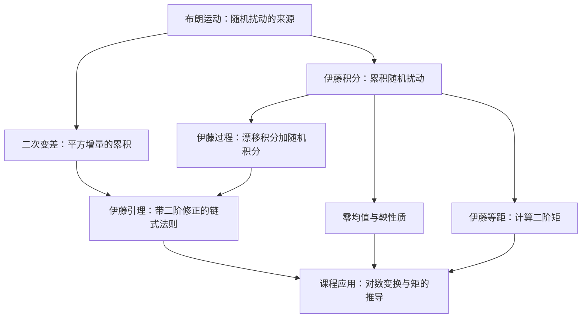

# 伊藤随机微积分知识框架

> [!abstract] 先抓住一句话
> **伊藤积分**定义怎样累积随机扰动；**伊藤等距**计算这种累积的二阶矩；**伊藤引理**处理随机过程经过函数变换后怎样变化。**二次变差**解释了为什么随机链式法则会多出一个二阶修正项。

本笔记将 Lecture 2 已出现的术语与课堂例子重新组织为知识框架，不是原 PDF 的逐字转录。默认讨论**一维、连续、由布朗运动驱动**的情形；不直接套用于有跳跃的过程。

返回：[[AMA572 Fixed-Income and Credit Risk/Lecture 2/02 - 补充推导（Ito 等距版，英文原文与折叠译文）|补充推导原笔记]] · [[AMA572 Fixed-Income and Credit Risk/Lecture 2/00 - Lecture 2 资料索引|Lecture 2 资料索引]]

## 一、先统一名称：哪些其实是同一件事？

| 中文名称        | 英文名称／常见写法                             | 类型        | 回答的问题                      |
| ----------- | ------------------------------------- | --------- | -------------------------- |
| 伊藤随机微积分     | Itô calculus / Ito calculus           | 一整套理论     | 怎样对带随机扰动的过程做微积分？           |
| 布朗运动／维纳过程   | Brownian motion / Wiener process      | 基础随机过程    | 随机扰动怎样建模？                  |
| 伊藤积分        | Itô integral / Ito integral           | 随机积分的定义   | 怎样定义 $\int H_s\,dW_s$？     |
| 伊藤过程        | Itô process                           | 一类随机过程    | 什么过程可以写成“漂移＋布朗扰动的累积”？      |
| 伊藤等距／伊藤等距公式 | Itô isometry / Ito isometry           | 积分的一个定理   | 随机积分的二阶矩有多大？               |
| 伊藤引理／伊藤公式   | Itô's lemma / Itô lemma / Itô formula | 随机链式法则    | 已知 $dX_t$，怎样求 $df(t,X_t)$？ |
| 二次变差        | Quadratic variation                   | 路径的平方增量累积 | 为什么二阶项不能忽略？                |
| 鞅           | Martingale                            | 一类条件期望性质  | 已知现在的信息，未来的条件均值是否等于现在？     |

> [!important] 不要重复记名称
> **Itô isometry 就是伊藤等距，不是另一条定理。**在本课的一维连续情形中，“伊藤引理”和“伊藤公式”指同一个函数变换公式。Itô、Ito、Itō 是常见的拼写／转写差异。

## 二、知识地图：它们怎样联系起来？

可以按三层理解：

1. **基础对象：**布朗运动、当前信息、适应性。
2. **积分及性质：**伊藤积分、零均值、鞅、等距公式。
3. **变换与应用：**二次变差、伊藤引理、几何布朗运动、均值和方差。

这张图描述概念依赖，不表示每道题都必须使用全部工具；例如课堂三阶矩推导不需要直接调用伊藤等距。

## 三、基础层：布朗运动、信息与二次变差

### 1. 布朗运动是什么？

标准布朗运动 $W_t$ 从 $W_0=0$ 出发，路径连续。对确定时点 $0\le s<t$：

$$
W_t-W_s\sim N(0,t-s).
$$

未来增量与过去的信息独立，因此：

$$
E[W_t-W_s]=0,\qquad
\operatorname{Var}(W_t-W_s)=t-s.
$$

短时间增量的典型大小为 $\sqrt{\Delta t}$，而不是 $\Delta t$。布朗路径几乎必然处处不可微，所以 $dW_t$ 不能简单理解为一个普通导数乘 $dt$。

### 2. 什么是“当前信息”与“适应”？

$\mathcal F_t$ 表示截至时间 $t$ 已经掌握的信息。若 $H_t$ 只使用当前及过去的信息，不偷看未来，就称它对这套信息是**适应的（adapted）**。

例如，在布朗运动自身的信息下：

- $H_t=W_t$：可以，因为当前的 $W_t$ 已经知道；
- $H_t=W_{t+1}$：通常不可以，因为它使用了未来值。

严格定义随机积分还需要相应的可测性条件，例如渐进可测性；学习本课时，先记住“不预知未来”，但不要把它当成唯一条件。

### 3. 二次变差为什么重要？

把 $[0,T]$ 划分成越来越细的小区间，累加布朗运动增量的平方：

$$
\boxed{
[W]_T
=\lim_{\lvert\pi\rvert\to0}
\sum_i(W_{t_{i+1}}-W_{t_i})^2
=T
}
$$

这里可按概率收敛理解；对等距分割，也有均方收敛。$[W]_T$ 叫作布朗运动的二次变差。

对长度 $h=T/n$ 的等距分割，令 $Q_n=\sum_i(\Delta W_i)^2$，有：

$$
E[Q_n]=T,\qquad
\operatorname{Var}(Q_n)=\frac{2T^2}{n}\longrightarrow0.
$$

因此，平方增量并不会在累积后消失。常把这个事实简写成：

$$
(dW_t)^2=dt,\qquad dt\,dW_t=0,\qquad(dt)^2=0.
$$

> [!warning] 这些是随机微积分的计算规则
> **不是每一次都有 $(\Delta W)^2=\Delta t$。**也不要把二次变差与方差混为一谈：前者是同一路径的平方增量累积，后者是固定时点随机变量围绕均值的离散程度。

## 四、伊藤积分：怎样累积随机扰动？

### 1. 符号与直觉

$$
\boxed{I_t=\int_0^t H_s\,dW_s}
$$

- $W_s$：提供随机增量；
- $H_s$：决定每个时点承受多大程度的扰动；
- $I_t$：这些加权随机增量的累计结果。

金融上的直觉是：在每小段时间开始时确定持仓，再累积这段时间的随机价格变化。

### 2. 为什么使用“左端点”的信息？

对简单适应过程，每段取一个在该段开始时已知的系数 $h_i$，定义：

$$
\int_0^T H_s\,dW_s
=\sum_i h_i(W_{t_{i+1}}-W_{t_i}),
\qquad h_i\text{ 在 }\mathcal F_{t_i}\text{ 下已知}.
$$

对于一般被积过程，用这类简单过程在均方意义下逼近，从而定义积分。若 $H$ 足够规则，可以直观地把它看成左端点加权和的极限：

$$
\sum_i H_{t_i}(W_{t_{i+1}}-W_{t_i}).
$$

**不是先看到未来涨跌，再回头决定这一段的权重。**此外，不能把任意随机过程的任意采样和都直接当成这个定义。

### 3. 本笔记采用的常用条件

在有限时间区间 $[0,T]$ 上，假设 $H$ 满足适当的可测性／适应性条件，并且：

$$
E\left[\int_0^T H_s^2\,ds\right]<\infty.
$$

这叫作平方可积条件。下面的零均值、平方可积鞅与等距结论，均在这一框架下使用。更一般的局部伊藤积分不一定自动具有所有这些全局性质。定义与条件可进一步参考 [MIT：伊藤积分讲义](https://www.ocw.mit.edu/courses/15-070j-advanced-stochastic-processes-fall-2013/resources/mit15_070jf13_lec16/)。

### 4. 两个最简单的例子

$$
\int_0^T1\,dW_s=W_T,
\qquad
\int_t^T\sigma\,dW_s=\sigma(W_T-W_t),
$$

第二个公式假设 $\sigma$ 为常数；如果系数随时间或状态变化，就不能直接当成常数提出去。

## 五、零均值与鞅：为什么可以消去随机积分项？

在上一节的条件下，$I_t=\int_0^tH_s\,dW_s$ 是从 0 出发的平方可积鞅：

$$
\boxed{E[I_t\mid\mathcal F_s]=I_s,\qquad0\le s\le t}
$$

所以：

$$
\boxed{E[I_t]=0}
$$

**直觉：**权重在未来扰动发生前已经确定，而未来的布朗增量在当前信息下均值为 0；在这些条件下，不能仅靠这种加权累积产生非零的平均收益。

这解释了老师计算矩时，为什么取期望后可以消去：

$$
\int_0^t2\sigma S_s\,dW_s
\quad\text{或}\quad
\int_0^t3\sigma S_s^2\,dW_s.
$$

前提是这些具体积分满足所需可积性；常系数算术布朗运动在有限时间内满足这里需要的条件。

> [!note] 零均值不等于没有波动
> $E[I_t]=0$ 不代表 $I_t=0$，也不代表 $\operatorname{Var}(I_t)=0$。这里也不能无条件写成 $E[H_s\,dW_s]=E[H_s]E[dW_s]$；正确依据是适应随机积分的鞅／零均值性质。

## 六、伊藤等距：随机积分的二阶矩有多大？

### 1. 核心公式

$$
\boxed{
E\left[\left(\int_0^T H_s\,dW_s\right)^2\right]
=E\left[\int_0^T H_s^2\,ds\right]
}
$$

中文“伊藤等距”与英文 **Itô isometry** 完全对应。它把“随机积分平方的期望”转成“被积系数平方的时间积分，再取期望”。

因为相应积分均值为 0，左边也等于它的方差。如果 $H_s$ 是随机的，右侧的期望一般不能省略；若 $H_s$ 是确定性函数，则右侧本身是确定数。

“等距”的含义是这种映射保持平均平方意义下的大小，也保持对应的距离：

$$
E\left[\left(\int_0^T(H_s-G_s)\,dW_s\right)^2\right]
=E\left[\int_0^T(H_s-G_s)^2\,ds\right].
$$

### 2. 为什么成立？简单过程的直觉证明

若 $I_T=\sum_i h_i\Delta W_i$，展开平方后：

- 对角项满足 $E[h_i^2(\Delta W_i)^2]=E[h_i^2]\Delta t_i$；
- 不同时段的交叉项，通过条件期望与布朗增量独立性得到期望为 0。

于是：

$$
E[I_T^2]=\sum_iE[h_i^2]\Delta t_i
=E\left[\int_0^T H_s^2\,ds\right].
$$

再通过均方逼近推广到一般平方可积被积过程。注意：当权重随机时，不应简单声称“所有加权增量彼此独立”；交叉项为 0 的论证使用了时间顺序与条件期望。

### 3. 本课直接用到的例子

若 $\sigma$ 为常数：

$$
\begin{aligned}
E\left[\left(\int_t^T\sigma\,dW_s\right)^2\right]
&=E\left[\int_t^T\sigma^2ds\right]\\
&=\boxed{\sigma^2(T-t)}.
\end{aligned}
$$

这正是原笔记中求对数资产价值增量方差所用的步骤。

> [!warning] 等距不等于逐条路径相等
> 一般不能写成 $\left(\int H_s\,dW_s\right)^2=\int H_s^2ds$；等式两侧必须按公式取期望。公式与零均值性质的另一份教学表述见 [MIT：Itō Calculus，第2节](https://ocw.mit.edu/courses/18-s096-topics-in-mathematics-with-applications-in-finance-fall-2013/ef2c66c8079ba656210ad1fd4a5e2fa8_MIT18_S096F13_lecnote18.pdf#page=4)。

## 七、伊藤过程与伊藤引理：随机链式法则

### 1. 什么是伊藤过程？

在相应可测性与积分存在条件下，可写成：

$$
X_t=X_0+\int_0^t a_sds+\int_0^t b_s\,dW_s
$$

的过程称为伊藤过程，其微分记法是：

$$
\boxed{dX_t=a_tdt+b_t\,dW_t}
$$

- $a_t$ 是漂移系数；
- $b_t$ 是扩散系数，可以依赖时间与当前状态，不一定是一个常数 $\sigma$。

例如，$dV_t=rV_tdt+\sigma V_tdW_t$ 中，$a_t=rV_t$，$b_t=\sigma V_t$，而不是 $a_t=r、b_t=\sigma$。

### 2. 伊藤引理的公式

若 $f(t,x)$ 对时间一阶、对状态二阶连续可微，即通常记作 $C^{1,2}$，则：

$$
\boxed{
df(t,X_t)
=\left(f_t+a_tf_x+\frac12b_t^2f_{xx}\right)dt
+b_tf_x\,dW_t
}
$$

所有偏导均在 $(t,X_t)$ 处计算。该公式就是本课的 **Itô lemma／Itô formula**。更正式的过程与公式陈述见 [MIT：Ito process and formula](https://live.ocw.mit.edu/courses/15-070j-advanced-stochastic-processes-fall-2013/d9d7372cbf65d56aa8aa9d59ba0ab2e8_MIT15_070JF13_Lec17.pdf)。

### 3. 为什么有二阶修正项？

先作二阶泰勒展开：

$$
df=f_tdt+f_xdX_t+\frac12f_{xx}(dX_t)^2.
$$

在二次变差的计算意义下：

$$
(dX_t)^2=(a_tdt+b_tdW_t)^2=b_t^2dt.
$$

所以保留下来：

$$
\frac12b_t^2f_{xx}dt.
$$

这只是直觉推导；严格证明要把时间切片、应用泰勒展开，并控制余项。相应的二次变差公式为 $[X]_t=\int_0^t b_s^2ds$：漂移的有限变差部分不贡献这一项。

### 4. 应用：为什么对数漂移是 $r-\frac12\sigma^2$？

取 $f(t,v)=\ln v$，在 $v>0$ 上有：

$$
f_t=0,\qquad f_v=\frac1v,\qquad f_{vv}=-\frac1{v^2}.
$$

对 $dV_t=rV_tdt+\sigma V_tdW_t$ 应用伊藤引理：

$$
\begin{aligned}
d(\ln V_t)
&=\left[0+\frac1{V_t}rV_t
+\frac12\left(-\frac1{V_t^2}\right)\sigma^2V_t^2\right]dt
+\frac1{V_t}\sigma V_t\,dW_t\\
&=\boxed{\left(r-\frac12\sigma^2\right)dt+\sigma\,dW_t}.
\end{aligned}
$$

$f_t=0$ 只表示固定 $v$ 时，函数没有显式时间依赖；不表示 $\ln V_t$ 不随时间变化。

## 八、一个连接积分、引理和等距的例子

考虑：

$$
I_T=\int_0^T W_s\,dW_s.
$$

对 $f(w)=w^2$ 用伊藤引理：

$$
d(W_t^2)=2W_t\,dW_t+dt.
$$

积分并整理得到：

$$
\boxed{I_T=\frac12(W_T^2-T)}.
$$

这个例子把几个概念接起来：

| 使用工具 | 得到什么 |
|---|---|
| 伊藤积分 | 定义 $\int_0^T W_s\,dW_s$ 这个随机变量 |
| 伊藤引理 | 算出它等于 $\frac12(W_T^2-T)$ |
| 零均值性质 | $E[I_T]=0$ |
| 伊藤等距 | $E[I_T^2]=\int_0^T E[W_s^2]ds=T^2/2$ |

> [!important] 伊藤积分不一定服从正态分布
> 对确定性平方可积函数 $h(s)$，$\int_0^T h(s)dW_s$ 是正态随机变量；但被积系数随机时一般不能保证。上例在 $T>0$ 时等于平移、缩放后的平方正态变量，并非正态分布。这也说明“零均值＋已知方差”不足以判断分布。

## 九、在 Lecture 2 中怎样分工？

### 路线 A：从几何布朗运动得到对数增量分布

从：

$$
dV_t=rV_tdt+\sigma V_t\,dW_t,\qquad V_0>0
$$

出发，对确定时点 $0\le t<T$：

1. **伊藤引理：**求出 $d(\ln V_t)$。
2. **积分：**得到

$$
\ln\frac{V_T}{V_t}
=\left(r-\frac12\sigma^2\right)(T-t)+\int_t^T\sigma\,dW_s.
$$

3. **零均值性质：**得到均值 $\left(r-\frac12\sigma^2\right)(T-t)$。
4. **伊藤等距：**得到方差 $\sigma^2(T-t)$。
5. **布朗增量的正态性：**由于随机积分等于 $\sigma(W_T-W_t)$，才进一步得到

$$
\boxed{
\ln\frac{V_T}{V_t}
\sim N\left(\left(r-\frac12\sigma^2\right)(T-t),\sigma^2(T-t)\right)
}.
$$

这里的正态性不是仅靠第 3、4 步推出的。对数增量分布随后用于计算违约概率、税盾和破产成本。

### 路线 B：老师手写例子的均值、二阶矩、三阶矩

对 $dS_t=\mu dt+\sigma dW_t、S_0=0$：

| 目标 | 主要操作 | 结果 |
|---|---|---|
| 均值 | 积分后取期望，随机积分均值为 0 | $E[S_t]=\mu t$ |
| 二阶原点矩 | 对 $f(s)=s^2$ 用伊藤引理，再取期望和积分 | $E[S_t^2]=\mu^2t^2+\sigma^2t$ |
| 三阶原点矩 | 对 $f(s)=s^3$ 用伊藤引理，再代入低阶矩 | $E[S_t^3]=\mu^3t^3+3\mu\sigma^2t^2$ |

此路线**不需要直接调用伊藤等距**；当然也能另外用它核对方差。

完整步骤见 [[AMA572 Fixed-Income and Credit Risk/Lecture 2/02 - 补充推导（Ito 等距版，英文原文与折叠译文）#课堂手写例题整理：均值、二阶矩与三阶矩|老师例题的逐步整理]]；另有 [[AMA572 Fixed-Income and Credit Risk/Lecture 2/05 - 手写推导：Ito 引理与布朗运动三阶矩|独立手写原稿]] 可对照。

## 十、看到题目时，应该调用哪个工具？

| 题目／步骤 | 优先想到 |
|---|---|
| $\int H_s\,dW_s$ 到底是什么意思？ | 伊藤积分的定义与适应性 |
| 为什么随机积分取期望后消失？ | 在可积条件下的鞅／零均值性质 |
| 求 $E[(\int H_s\,dW_s)^2]$ 或其方差 | 伊藤等距 |
| 已知 $dX_t$，求 $d\ln X_t、d(X_t^2)、d(X_t^3)$ | 伊藤引理 |
| 为什么多出 $\frac12b_t^2f_{xx}dt$？ | 二阶泰勒展开与二次变差 |
| 为什么不能把 $(dW_t)^2$ 直接忽略？ | 布朗增量是 $\sqrt{dt}$ 量级 |
| 求常系数过程的分布 | 显式解加布朗增量的正态性，不能只看两个矩 |
| 方程里用 $\mu$ 还是 $r$？ | 先明确现实／定价测度与建模假设，不是伊藤引理自己决定 |

> [!note] 与风险调整概率的边界
> 伊藤微积分是数学工具，不等于风险中性定价。现实测度和风险调整测度下都可以使用，但必须保证所写的 $W_t$ 在当前测度下确实是布朗运动，漂移也与该测度相符。换测度时不能只把 $E$ 改成 $E^*$ 而保留所有过程设定不变。

## 十一、复习时的最小记忆卡

1. **一个来源：**布朗运动 $W_t$。
2. **一个积分：**$\int H_s\,dW_s$，累积不预知未来的随机暴露。
3. **两个性质：**在平方可积等条件下，积分均值为 0；平方期望满足伊藤等距。
4. **一个变换公式：**伊藤引理，即普通链式法则加上 $\frac12b_t^2f_{xx}dt$。
5. **一个根本原因：**布朗运动的平方增量累积不消失，即二次变差 $[W]_t=t$。

**最重要的三个动词：积分负责“累积”，等距负责“算二阶矩”，引理负责“做函数变换”。**

## 来源与继续阅读

- 课程主体：[[AMA572 Fixed-Income and Credit Risk/Lecture 2/02 - 补充推导（Ito 等距版，英文原文与折叠译文）|Itô 等距版补充推导]]、[[AMA572 Fixed-Income and Credit Risk/Lecture 2/03 - 补充推导（Ito 引理及手写批注版）|Itô 引理版补充推导]]。
- 手写例子：当前补充推导的截图 09—10，以及 [[AMA572 Fixed-Income and Credit Risk/Lecture 2/05 - 手写推导：Ito 引理与布朗运动三阶矩|三阶矩手写原稿]]。本笔记对术语、条件与易混点作补充说明，不把补充内容冒充原稿文字。
- 定义与定理条件：[MIT 15.070J Lecture 16：Ito integral](https://www.ocw.mit.edu/courses/15-070j-advanced-stochastic-processes-fall-2013/resources/mit15_070jf13_lec16/)、[Lecture 17：Ito process and formula](https://live.ocw.mit.edu/courses/15-070j-advanced-stochastic-processes-fall-2013/d9d7372cbf65d56aa8aa9d59ba0ab2e8_MIT15_070JF13_Lec17.pdf)。
- 入门阅读：[MIT 18.S096 Lecture 18：Itō Calculus](https://ocw.mit.edu/courses/18-s096-topics-in-mathematics-with-applications-in-finance-fall-2013/ef2c66c8079ba656210ad1fd4a5e2fa8_MIT18_S096F13_lecnote18.pdf)。
