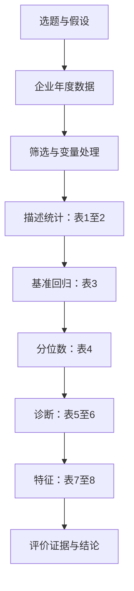

# 第一轮通读与研究地图

返回：[[00 阅读导航与核心结论]]

## 第一步：用一句话确定论文在问什么

**在中国A股上市公司中，数字化转型程度较高的企业，ESG表现是否也较好；这种关联是否随ESG分布位置、企业产权和盈利水平而不同？**

这里有三个层次：首先判断总体关联，再看分布和企业特征差异，最后才讨论可能的经济解释。不能在第一步就把“相关”换成“因果”。

| 概念 | 通俗理解 | 在本文中的落点 |
| --- | --- | --- |
| 数字化转型CDT／DT | 企业在业务、组织和管理中应用数字技术 | 由年报文本分析得到的指标，具体构建细节未给全 |
| ESG | 环境、社会、公司治理三个方面的综合表现 | 华证ESG评级赋分，文中说1—9分 |
| 双碳背景 | 引出绿色发展与数字化协同的现实动机 | 没有单独的双碳政策处理变量或碳排放结果变量 |
| 机制 | 解释DT为什么可能关联ESG | 引言讨论了相关路径，但正文没有中介机制回归 |

“机制”出现在题目中，并不表示论文已完整识别机制；“双碳”出现在背景中，也不表示研究实施了双碳政策效果评估。

## 第二步：抓住两条假设

**H1：** 企业数字化转型与ESG表现正相关。若用线性回归表达，关注DT系数是否大于0。

**H2：** 数字化转型与ESG之间存在门槛效应，达到某个数字化水平后正向作用更强。

H2真正问的是“DT在什么位置跨过一个界点”。但论文实际展示的是ESG条件分布的25%、50%、75%分位数回归。这是第一轮阅读就应该标记的“研究问题—检验方法”错位，详见[[04 模型公式与方法推导#四、分位数差异与数字化门槛不是同一个问题]]。

## 第三步：画出研究结构

【阅读判断】这张图按论文顺序组织阅读路线；分位数、诊断和特征分析均以基准设定为参照，并不表示必须以前一项输出作为下一项输入。原始代码的实际执行先后顺序、每一步是谁操作，PDF无法确认。

## 第四步：建立一页证据地图

| 研究问题 | 原文提供的证据 | 目前较稳妥的判断 |
| --- | --- | --- |
| DT是否与ESG正相关 | 表3：DT=0.0935*** | 在文中展示的设定下报告了显著正相关 |
| 结果是否在ESG条件分布不同位置出现 | 表4：0.086、0.096、0.099，均*** | 三个分位点均为正；数值上75%最大，尚未检验系数差异 |
| 是否存在DT门槛 | 未展示门槛估计值、门槛模型或相应检验 | H2没有得到对应方法的直接检验 |
| 正相关是否对重抽样较稳定 | 表5：均值0.084，95%区间[0.071,0.094] | 文中重抽样结果支持正向关联；重抽样单位不明 |
| 自变量是否高度共线 | 表6：VIF范围1.006—1.694 | 所展示变量的线性共线性较低 |
| 国企是否比非国企更强 | 表7：0.082对0.084 | 两组都为正；表格不能支持“国企更强” |
| 盈利是否改变DT斜率 | 交互项p=0.888 | 未发现显著调节证据，不能说两组必然完全相同 |
| 是否验证了传导机制 | 没有中介变量和机制模型结果 | 有理论动机，缺少机制的实证识别 |

## 第五步：区分贡献的三个层次

**选题贡献：** 把数字化转型与企业可持续发展放在同一经验研究框架中，聚焦中国A股情境。

**实证工作：** 组合财务治理数据、ESG评价和数字化代理指标，开展多种回归与诊断。这是恢复个人研究经历时最值得展开的部分。

**创新边界：** 本文没有提出新的统计估计方法，也没有展示新算法、因果识别设计或原创文本模型。相对于已引用文献究竟有多大增量，需要进一步通读相关研究；仅凭6页PDF不能下强结论。

## 本轮阅读结束后，我应当能回答

- 因变量是什么？华证ESG赋分。
- 核心自变量是什么？企业数字化指标DT。
- 数据是哪几年？2015—2021年。
- 核心证据在哪？表3，PDF p.3／印刷p.60。
- 最大的方法问题是什么？把条件分位数分析解释为数字化门槛。
- 最先需要找回的历史材料是什么？DT构造代码、主样本、回归日志，以及能说明最终表格版本的输出。

下一步：[[02 第二轮逐节精读]]。
