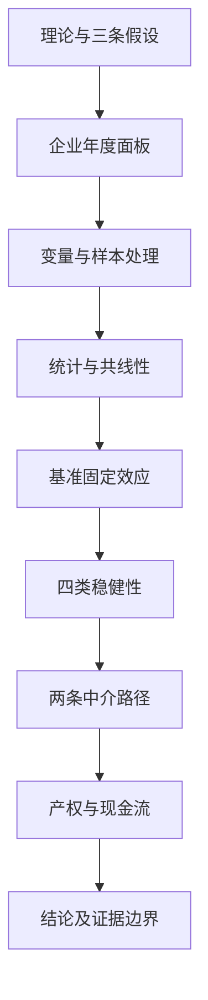

# 第一轮通读与研究地图

返回：[[00 CEO论文阅读导航与核心结论]]

## 第一步：用一个直观问题抓住论文

一家原本做制造、贸易或其他实体业务的上市公司，为什么会把更多资产配置到交易性金融资产、金融投资或投资性房地产等领域？本文从CEO的履历切入：**曾在金融机构任职的CEO，是否会影响公司对金融资产的配置？**

这里的“金融化”不是企业改行成为银行，也不是自动意味着炒股、违规或经营失败；本文测量的是所定义金融资产占总资产的比例。资金管理与风险分散可能有合理性，过度配置也可能挤出主营投入；本研究没有直接估计一个最优比例。

## 第二步：区分三个研究层次

| 层次 | 所问问题 | 论文对应内容 |
| --- | --- | --- |
| 总体关系 | CEO金融背景与金融化是否正相关 | H1、双向固定效应、表4 |
| 可能路径 | 为什么可能出现这种关系 | H2过度自信、H3融资约束、表6 |
| 不同情境 | 哪些企业中关系更明显 | 产权与现金流分组、表7 |

四类稳健性分析试图检查主结果对测量、年份、时间安排和匹配样本的敏感性，不是第四条独立经济机制。

## 第三步：两种理论如何连接到假设

**高阶梯队理论（Upper Echelons Theory）：** 高管经历与认知可能影响战略选择。它提供“为什么要研究CEO履历”的理论动机，不是可直接代入的统计变量。

**烙印理论（Imprinting Theory）：** 早期或关键时期经历可能留下持续行为影响。稿件用它解释金融职业经历如何影响后续金融决策。文中的stigma、branding等用语存在翻译混乱，应理解为烙印，不应按“污名”或“品牌营销理论”学习。

**H1：** 金融背景与更高的金融资产配置比例相关。

**H2：** 金融背景可能通过提高管理者过度自信，与更高金融化相关。

**H3：** 金融背景可能通过缓解融资约束，与更高金融化相关。

理论上“金融专业能力更强”和“判断偏差更大”是两种不同解释。文中同时使用二者，需要留意：真正的专业能力不等于过度自信，过度自信要有独立、有效的代理测量。

## 第四步：按论文顺序画阅读路线

流程图是阅读顺序，不表示各扩展分析必须串联计算。所有分析都需要自己的模型、估计样本和来源记录。

## 第五步：建立证据地图

| 问题 | 投稿稿证据 | 暂时可以说到哪里 |
| --- | --- | --- |
| 基准关系 | 表4：CEOFIN=0.0074*** | 双向固定效应及所列控制项下报告正向关联 |
| 只看是否持有金融资产 | 表5(1)：0.0186* | 在10%水平有较弱正向证据；模型类型需确认 |
| 排除2020—2022年 | 表5(2)：0.0070*** | 2008—2019年子样本方向与显著性保留 |
| 考虑时间滞后 | 表5(3)：LCEOFIN=0.0088*** | 表中显示滞后的是CEO背景；与文字不一致 |
| 匹配相关结果 | 表5(4)：0.0057，无星号 | 方向相同，但未达到常用显著性水平；DID设计不完整 |
| OC路径 | 表6：0.0455、0.0023 | 两段正系数与理论方向相符，尚非独立因果中介识别 |
| SA路径 | 表6：-0.0076、-0.0724 | 符号乘积为正；解释取决于SA编码、公式及识别假设 |
| 产权 | 表7：0.0049对0.0100*** | 非国企点估计更大；尚缺正式组间差异检验 |
| 现金流 | 表7：0.0049对0.0054** | 低现金流组显著，差值仅0.0005；不能仅凭星号判强弱 |

## 第六步：判断贡献而不夸大

这项研究把CEO的金融职业经历、实体企业资产配置、两条机制代理变量和企业情境放进同一经验分析框架；它不是新的机器学习算法或新估计方法。

稿件已引用Lun关于CEO金融背景与金融化的既有研究，因此不宜概括为“首次发现CEO金融背景影响金融化”。相对已有研究的增量，应从样本、CEO定义、机制代理变量及情境差异等方面逐项比较，不能只靠引言“填补空白”的说法。

## 本轮结束时，我应该能回答

- 结果变量是金融资产占比，核心解释变量是CEO有无金融职业背景。
- 样本跨15个年度，3,919家企业，24,004条观测，属于覆盖不齐的面板。
- 主要估计是企业与年份固定效应，软件在稿件中明确写STATA17。
- 两条机制是OC与SA；两类分组是产权和现金流。
- 最关键的证据边界是PSM-DID列不显著、滞后说明错位及机制代理变量的解释问题。

下一步：[[02 CEO论文摘要引言与假设精读]]。
