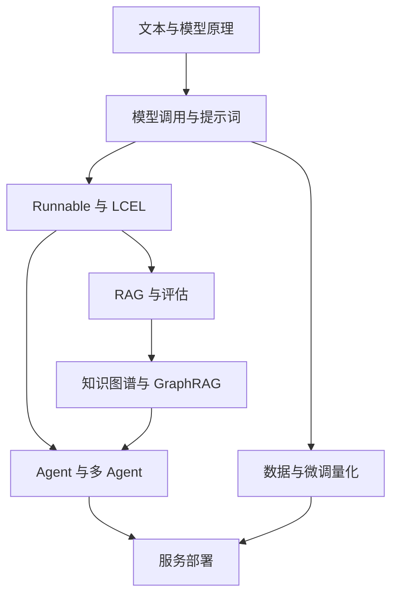

> [!abstract] 这套笔记怎么学
> 从模型原理到应用、训练与部署，共 65 篇知识点笔记。先读“核心理解”，再看代码阅读路径，最后按需展开原始课堂片段。编号表达建议学习顺序，Day 只保留在资料追溯中。

## 学习路线

## 使用约定

- **先读讲解，再读代码**：上方解释为本轮补充，折叠框中为老师原始课堂片段，二者边界明确。
- **追溯资料**：每个课堂片段标记原笔记与行号；PDF 保留在本目录，相关页通过双链引用。
- **代码是课堂记录**：已指出发现的缺失、复制问题与评估偏差；本轮未把所有示例改造成已验证项目。
- **来源完整保留**：原三篇未修改，并另存原始副本；日期、环境、ZIP 与通告见资料台账。

## 基础原理

- [[大模型全栈/01-NLP 任务与整阶段学习地图|01-NLP 任务与整阶段学习地图]] — 先判断输入与输出，再选择模型与应用架构。
- [[大模型全栈/02-中文分词、正则与文本预处理|02-中文分词、正则与文本预处理]] — 理解文本进入统计模型前，为什么要先确定词和规则。
- [[大模型全栈/03-文本表示：词袋、TF-IDF 与 N-Gram|03-文本表示：词袋、TF-IDF 与 N-Gram]] — 理解稀疏检索为何仍然能与语义向量互补。
- [[大模型全栈/04-Word2Vec 与上下文词向量|04-Word2Vec 与上下文词向量]] — 分清静态词向量、上下文表示与句向量。
- [[大模型全栈/05-RNN、LSTM、GRU 与 Seq2Seq|05-RNN、LSTM、GRU 与 Seq2Seq]] — 理解 Transformer 要解决的序列建模问题。
- [[大模型全栈/06-Transformer：Embedding、注意力与归一化|06-Transformer：Embedding、注意力与归一化]] — 把结构图连成一条能解释张量流向的计算路径。
- [[大模型全栈/07-BERT、MLM 与 Transformer 家族|07-BERT、MLM 与 Transformer 家族]] — 区分 Encoder-only、Decoder-only 和 Encoder–Decoder 的信息可见性。
- [[大模型全栈/08-句向量、池化与 Embedding 接口|08-句向量、池化与 Embedding 接口]] — 理解一句话如何变成一个能被检索系统使用的向量。
- [[大模型全栈/09-BERT 文本分类与监督微调|09-BERT 文本分类与监督微调]] — 从预训练表征走到有标签的具体任务。
- [[大模型全栈/10-GPT 自回归生成与采样策略|10-GPT 自回归生成与采样策略]] — 理解下一 token 分布如何变成一段文字。
- [[大模型全栈/11-因果注意力与 Mask 可视化|11-因果注意力与 Mask 可视化]] — 用矩阵检查模型有没有偷看未来。
- [[大模型全栈/12-手写 GPT：模块、训练与生成|12-手写 GPT：模块、训练与生成]] — 把模型结构真正落到可跟踪的模块中。
- [[大模型全栈/13-推测解码：草稿、验证与接受率|13-推测解码：草稿、验证与接受率]] — 理解小模型为何能帮助大模型减少串行调用。

## 模型交互

- [[大模型全栈/14-API 调用、Token 与生成参数|14-API 调用、Token 与生成参数]] — 把模型调用拆成服务地址、凭证、模型和消息四件事。
- [[大模型全栈/15-PromptTemplate 与消息角色|15-PromptTemplate 与消息角色]] — 把可复用的任务说明与每次变化的数据分开。
- [[大模型全栈/16-Few-shot 与动态示例选择|16-Few-shot 与动态示例选择]] — 通过例子约束任务，再按输入选择更相关的例子。
- [[大模型全栈/17-多轮对话、历史消息与模型封装|17-多轮对话、历史消息与模型封装]] — 理解模型如何通过本次请求看到之前的对话。
- [[大模型全栈/18-复杂提示：CoT、Self-Consistency 与 ToT|18-复杂提示：CoT、Self-Consistency 与 ToT]] — 分清单路径生成、多次采样与分支搜索。
- [[大模型全栈/19-结构化输出与解析器|19-结构化输出与解析器]] — 把模型文字变成程序能够校验的数据。
- [[大模型全栈/20-订单客服：信息抽取与业务查询|20-订单客服：信息抽取与业务查询]] — 区分模型负责理解、程序负责查询与校验。

## 工作流

- [[大模型全栈/21-Runnable 协议：同步、异步与流式|21-Runnable 协议：同步、异步与流式]] — 用统一接口调用不同 AI 组件。
- [[大模型全栈/22-LCEL：串行、并行与数据流|22-LCEL：串行、并行与数据流]] — 沿着每条边追踪数据，而不是只记住管道符。

## 检索增强

- [[大模型全栈/23-Document 与多格式文档加载|23-Document 与多格式文档加载]] — 先统一文本和来源，再考虑检索算法。
- [[大模型全栈/24-文本清洗：规则、去重与可追溯性|24-文本清洗：规则、去重与可追溯性]] — 提高可读性，同时保留回答所需的证据。
- [[大模型全栈/25-文本切片：固定、递归、结构与语义|25-文本切片：固定、递归、结构与语义]] — 让每个片段既能被召回，也能独立提供有用证据。
- [[大模型全栈/26-最小 RAG：检索、上下文与生成|26-最小 RAG：检索、上下文与生成]] — 跑通一条最小链，并能分别检查检索与回答。
- [[大模型全栈/27-FAISS：Flat、HNSW、IVF 与 PQ|27-FAISS：Flat、HNSW、IVF 与 PQ]] — 理解近似检索如何在速度、内存和召回之间取舍。
- [[大模型全栈/28-查询改写与多查询召回|28-查询改写与多查询召回]] — 把用户表达转换成更容易命中知识库的检索表达。
- [[大模型全栈/29-BM25、向量检索与融合排序|29-BM25、向量检索与融合排序]] — 组合词项匹配与语义匹配，避免直接混加不同尺度的分数。
- [[大模型全栈/30-Cross-Encoder 与粗排精排|30-Cross-Encoder 与粗排精排]] — 用便宜的召回找候选，再用更细的匹配选证据。
- [[大模型全栈/31-论文 RAG：从朴素检索到 Advanced RAG|31-论文 RAG：从朴素检索到 Advanced RAG]] — 把前面的组件组合成一个可解释的论文问答系统。
- [[大模型全栈/32-RAG 评估：检索指标与生成指标|32-RAG 评估：检索指标与生成指标]] — 把有没有找到证据，与有没有正确使用证据分开评估。
- [[大模型全栈/33-测试集构建与 RAGAS 评估流水线|33-测试集构建与 RAGAS 评估流水线]] — 让测试数据和评分过程成为可检查的实验材料。
- [[大模型全栈/34-RAG 超参数搜索与评估偏差|34-RAG 超参数搜索与评估偏差]] — 学习搜索流程，同时识别会让最优分数失真的标注方法。
- [[大模型全栈/35-论文系统：检索与生成的联合评测|35-论文系统：检索与生成的联合评测]] — 把项目输出、评价标签和实验边界连在一起。

## 知识图谱

- [[大模型全栈/36-知识图谱：实体、关系与图结构|36-知识图谱：实体、关系与图结构]] — 从相似文本检索，走向显式关系与多跳查询。
- [[大模型全栈/37-NER、标签对齐与三元组抽取|37-NER、标签对齐与三元组抽取]] — 把自然语言中的实体与关系转成可校验的结构。
- [[大模型全栈/38-实体融合：名称、属性与相似度|38-实体融合：名称、属性与相似度]] — 解决同名不同人、异名同一人的实体对齐问题。
- [[大模型全栈/39-Neo4j、Cypher 与批量入库|39-Neo4j、Cypher 与批量入库]] — 用图数据库保存、查询和约束关系数据。
- [[大模型全栈/40-Text2Cypher 与图谱问答|40-Text2Cypher 与图谱问答]] — 把自然语言问题转成结构化查询，再基于结果回答。
- [[大模型全栈/41-GraphRAG：向量召回与关系扩展|41-GraphRAG：向量召回与关系扩展]] — 先找到相关实体，再沿关系补充上下文。

## Agent 与协作

- [[大模型全栈/42-工具调用：Schema、执行与结果回传|42-工具调用：Schema、执行与结果回传]] — 模型提出调用，应用程序执行，并将真实结果送回模型。
- [[大模型全栈/43-Agent、ReAct 与 Self-Ask|43-Agent、ReAct 与 Self-Ask]] — 理解 Agent 的核心是带反馈的行动循环。
- [[大模型全栈/44-Plan-and-Execute：规划与任务分解|44-Plan-and-Execute：规划与任务分解]] — 先把目标转成可执行步骤，再逐步验证产物。
- [[大模型全栈/45-金融研报：LangGraph 规划与工具执行|45-金融研报：LangGraph 规划与工具执行]] — 用共享状态把计划、工具和总结连起来。
- [[大模型全栈/46-对话记忆：缓冲、摘要与向量检索|46-对话记忆：缓冲、摘要与向量检索]] — 按记忆用途选择保存和注入方式。
- [[大模型全栈/47-Multi-Agent 与 CrewAI 基础|47-Multi-Agent 与 CrewAI 基础]] — 用角色、任务与依赖组织协作，控制额外沟通成本。
- [[大模型全栈/48-CrewAI 金融分析项目与系统评估|48-CrewAI 金融分析项目与系统评估]] — 区分数据工具、分析任务与最终汇总的责任。
- [[大模型全栈/49-LCEL 合同审查任务流|49-LCEL 合同审查任务流]] — 把读取、条款识别、评分与报告编排成可追踪链。
- [[大模型全栈/50-LangGraph：状态、条件分支与循环|50-LangGraph：状态、条件分支与循环]] — 用显式状态图表达可分支、可回环的业务。
- [[大模型全栈/51-人工介入、Checkpoint 与时间旅行|51-人工介入、Checkpoint 与时间旅行]] — 把暂停、继续与历史状态分叉区别理解。
- [[大模型全栈/52-GraphRAG 合同审查综合案例|52-GraphRAG 合同审查综合案例]] — 把复杂度判断、补充检索与人工审查放进同一状态图。
- [[大模型全栈/53-AutoML 多 Agent：模块与数据流程|53-AutoML 多 Agent：模块与数据流程]] — 从多个源码文件理解一套自动建模项目。
- [[大模型全栈/54-工具权限、审计与代码执行边界|54-工具权限、审计与代码执行边界]] — 把模型能提出什么动作，与程序允许什么动作分开。
- [[大模型全栈/55-MCP：天气与文件工具服务器|55-MCP：天气与文件工具服务器]] — 理解协议如何把工具服务与调用方解耦。
- [[大模型全栈/56-Context Engineering 与 Skill|56-Context Engineering 与 Skill]] — 把模型此刻需要看到的信息组织成可复用上下文。

## 微调与量化

- [[大模型全栈/57-指令数据：扩充、过滤与质量控制|57-指令数据：扩充、过滤与质量控制]] — 先保证训练目标与数据质量，再扩大样本数量。
- [[大模型全栈/58-领域续训与全参数微调|58-领域续训与全参数微调]] — 区分原始文本续训、监督微调与更新参数范围。
- [[大模型全栈/59-LoRA：低秩适配与 SFT|59-LoRA：低秩适配与 SFT]] — 理解参数高效微调究竟训练了什么。
- [[大模型全栈/60-QLoRA、4-bit 基座与回答掩码|60-QLoRA、4-bit 基座与回答掩码]] — 分清存储精度、计算精度与参与优化的参数。
- [[大模型全栈/61-训练监控、LoRA 对照与困惑度|61-训练监控、LoRA 对照与困惑度]] — 同时检查训练稳定性、任务表现与语言模型损失。
- [[大模型全栈/62-GPTQ 与 AWQ：校准、量化与导出|62-GPTQ 与 AWQ：校准、量化与导出]] — 把模型压缩流程与适配器训练区别开。

## 服务部署

- [[大模型全栈/63-部署分层：Ollama、vLLM 与业务接口|63-部署分层：Ollama、vLLM 与业务接口]] — 分清模型怎样运行、怎样服务并发、怎样接入业务。
- [[大模型全栈/64-FastAPI 前后端聊天服务|64-FastAPI 前后端聊天服务]] — 让浏览器、业务接口与模型调用形成完整请求链。
- [[大模型全栈/65-法律项目：RAG、微调、评估与部署如何衔接|65-法律项目：RAG、微调、评估与部署如何衔接]] — 用课程三个项目入口串联整条技术路线，并明确现有材料边界。

## 资料与复习

- [[大模型全栈/资料/00-资料索引|PDF 与原始资料索引]]
- [[大模型全栈/资料/02-课堂内容映射|核对三篇课堂内容的去向]]
- [[大模型全栈/资料/03-压缩包与缺失依赖|缺失包与运行依赖]]
- [[大模型全栈/资料/04-整理说明与核查|整理范围、发现的问题与核查说明]]
- [[大模型全栈/大模型全栈-知识地图.canvas|打开知识地图]]

建议按一个问题复习一条链：问题怎样表达 → 数据怎样进入 → 使用哪些证据或工具 → 输出怎样验证 → 如何提供给用户。
