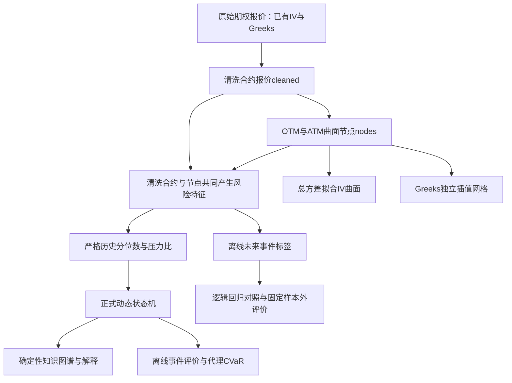

> [!abstract] 先记住一句话
> 这是一个面向商品期权截面的、可回溯的风险观察原型。输入一个品种和历史时间点，读取当时及过去的报价，返回曲面、风险证据、0—3级状态，以及按固定业务规则构成的解释链。

## 用一个具体场景理解

假设你负责白银期权风险观察。10:15时，市场上同时有白银不同月份、不同执行价的看涨和看跌期权。逐行看几百个数值很难判断：隐含波动率是否整体升高，近月是否比远月紧张，Gamma是否集中在少数合约，报价关系是否异常。

项目先把这些行按“同一时刻、品种、期货月份”组织，得到微笑和期限结构；把复杂报价压缩成风险特征，再与严格过去的历史分位数比较。状态机决定当前处于无预警、关注、警告还是危险。知识图谱把“数值→异常判断→可能作用机理→结论”连接起来，让你能核查每一句解释。

## 必须分开的三条支路

风险特征同时使用清洗后的合约报价cleaned和曲面节点nodes。Gamma/Vega集中度、零成交占比等来自全部清洗合约；粗糙度、日历总方差等使用曲面节点。它们与拟合后的可视曲面是不同支路，不能说“12项证据都从SSVI拟合后的曲面求导得到”。Greeks列本来就存在于数据里，本项目主要做选择、聚合和网格化。

## 三个“模型”分别是什么

|口语中的模型|实际对象|是否用训练标签学习|
|---|---|---|
|曲面模型|SSVI、Raw-SVI、PCHIP、线性回退|用当期报价拟合数值曲线，不是预测未来事件|
|正式决策模型|动态分位阈值＋预注册固定参数的状态机|参数固定，历史阈值滚动更新|
|机器学习模型|中位数填补及缺失指示、RobustScaler稳健缩放、逻辑回归|在训练集学习，验证集定概率门槛，测试集冻结|
|解释模型|NetworkX图谱＋注册业务规则＋固定文本生成|没有训练LLM，也没有在线学因果|

## 赛题完成范围

提交完成问题一和问题二。问题三的DRL是赛题可选进阶方向；最终源码没有DQN/PPO/SAC训练系统。数据是15分钟历史数据，系统可以回放历史，不应说已接入真实实时行情、自动执行交易、部署到期货公司生产账户。

## 你应如何介绍自己的工作

先讲需求、实际技术路线和证据；被追问时指出本次复习能够解释的模块。历史材料不能证明团队成员的具体分工。你可以说明使用Codex辅助工程实现，并准确讲出自己能核查和复现的设计；不要把尚未掌握的原创推导或实盘经验写成自己的经历。

相关：[[00-开始学习]]、[[04-面试与验证/01-简历口径与证据边界]]、[[01-项目与数据/03-从一行报价到一个时点的真实例子]]。
