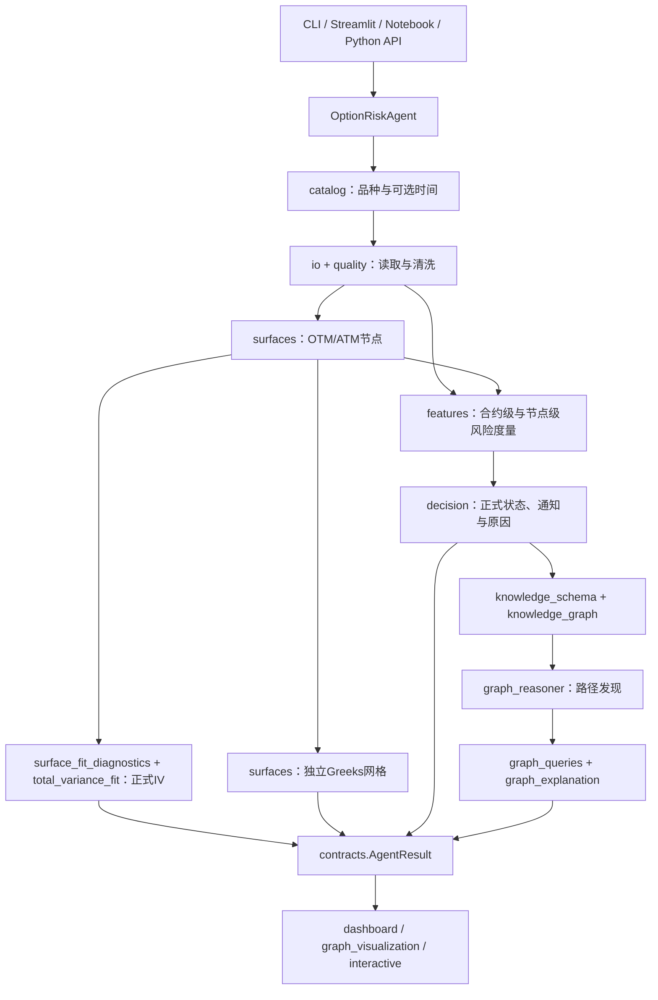
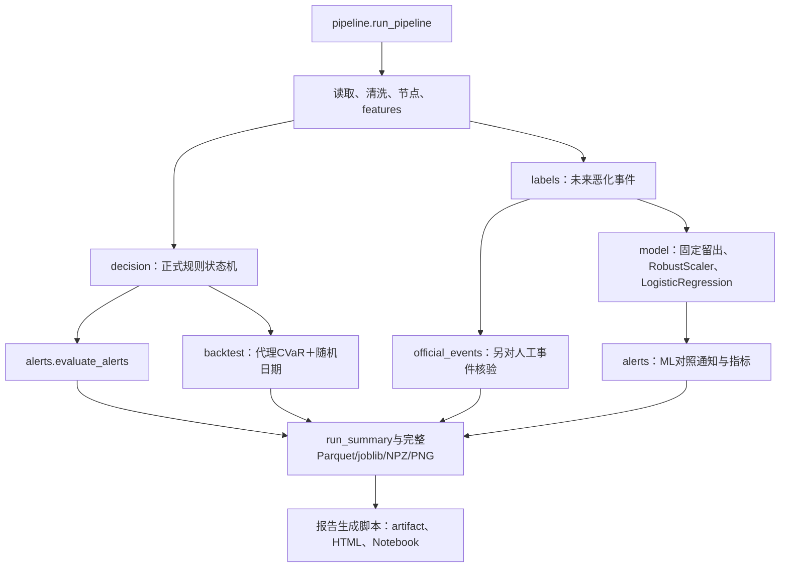

## 主链不是一条“训练一个模型”直线

## 离线训练与报告支路

## 文件族的责任边界

|文件族|消费什么|产出什么|不要混淆|
|---|---|---|---|
|配置与合同|部署路径、参数、schema|类型化配置与结果|默认值不等于已从数据学习|
|目录与读取|外部Parquet或归档|品种、可选时点、窗口数据|目录资格与逐信号滚动样本不同|
|曲面引擎|当期选定节点|拟合IV、方法、检查和失败|优化success不等于曲面可用|
|特征与决策|cleaned、nodes、过去阈值|12证据、状态、通知|风险分数不是概率|
|离线评价|特征、未来标签、测试切分|ML对照、事件指标、CVaR|不向在线Agent回写调参|
|图谱与解释|问题一的既有结果|节点、关系、路径、五段文本|不学习因果、不改写等级|
|报告与测试|已有证据或可控fixture|可读报告、断言和验收记录|历史passed不等于当前重新通过|

## 建议的源码阅读顺序

先config/contracts，再agent与pipeline两个入口；沿io→quality→surfaces→features→decision读正式路径。理解这些后，再读labels/model/alerts/backtest的离线对照。最后读knowledge_schema→knowledge_graph→graph_reasoner→graph_explanation→graph_queries，以及catalog/provenance/validation的工程审计。两个超长拟合文件按逐文件笔记的函数族索引读，不必死背所有防御代码。
