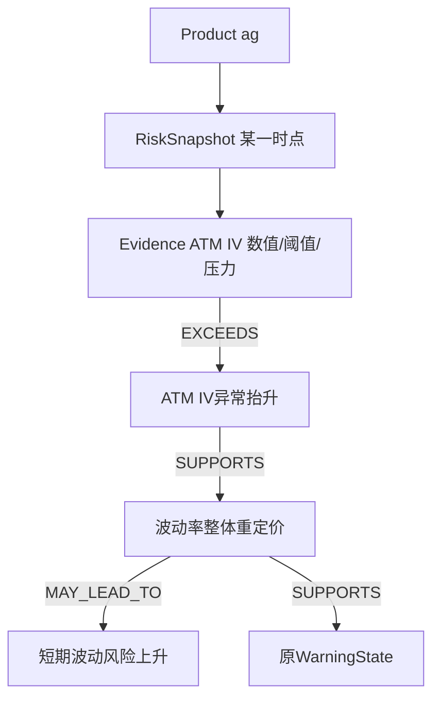

> [!abstract] 本篇要练成的能力
> 能手画一条真实存在的路径、说明每条边从哪来，以及为什么图谱能够追溯却不能声称已经识别经济因果。

## 先分清三种东西

知识schema规定允许的节点/关系/字段；规则表规定某项指标的语义映射；事件图把某品种某时点真实证据实例放进去。动态的是每时点数值与激活关系，稳定的是规则语义与校验契约。没有用历史数据估计边权或自动学出新机制。

[src/option_risk/knowledge_schema.py 第114行](</Users/xuji/Documents/第五届中国研究生金融科技创新大赛/揭榜挂帅-11-曲面观策/可运行的项目成果/option_risk_warning/src/option_risk/knowledge_schema.py:114>)（15—57、114—126行）定义八类节点、九种关系、十二规则。[src/option_risk/knowledge_graph.py 第350行](</Users/xuji/Documents/第五届中国研究生金融科技创新大赛/揭榜挂帅-11-曲面观策/可运行的项目成果/option_risk_warning/src/option_risk/knowledge_graph.py:350>)（350—625行）把这些规则应用在当前事件。图是NetworkX MultiDiGraph，Python内存对象，不是图数据库或大模型知识库。

## 四层不等于四种节点

业务解释链为Evidence→Anomaly→Mechanism→Conclusion。Conclusion有三类：非方向市场后果、复制原预警、质量置信状态。Product与RiskSnapshot只是上下文，不该把它们当作更多风险传导层。

最后一条仅当原预警等级大于0才存在。图不会因为有MAY_LEAD_TO就决定等级，顺序是先判断再解释。质量另走ConfidenceState而不是W。

## 用一组数亲手构造关系

假设某项ATM当前0.30，历史参考0.25，压力1.2，变化率-0.02。构图器为它建Evidence并保留全部数值、数据来源、规则ID、时间。

`_active_relation`先看压力是否至少0.90。若小于门槛，Evidence仍可存在，但不扩展异常/机制。0.90≤压力<1是NEAR_THRESHOLD，≥1是EXCEEDS。对于凸性/日历违反率，只要已经达到激活门槛且当前违反率>0，第一关系是VIOLATES。

此例压力1.2：ATM Evidence→EXCEEDS→ATM异常→SUPPORTS→整体重定价→MAY_LEAD_TO→短期波动风险。方向下降并不撤销异常：它仍相对自身过去高，只是比上bar回落。

## “推理”到底执行了什么

[src/option_risk/graph_reasoner.py 第235行](</Users/xuji/Documents/第五届中国研究生金融科技创新大赛/揭榜挂帅-11-曲面观策/可运行的项目成果/option_risk_warning/src/option_risk/graph_reasoner.py:235>)（235—372行）按十二规则枚举，找唯一对应Evidence/Anomaly/Mechanism，核对同事件/同规则，再找登记关系边，生成四节点三边RiskPath。它没有最短路、概率传播、贝叶斯更新、GNN、LLM或因果发现。

若原等级大于0，每项活动市场证据通常给两条路径：一条到市场后果，一条到原预警。证据只有六项也可能有十二条路径。不要拿路径数当“独立信号数”；3级计数来自decision里九个市场压力列，而非图边计数。

## 为什么主图前三路径可能只含两项指标

排序先市场后质量，再按单项严重度、压力、规则顺序、末端顺序和ID。某证据压力最大，它的后果链与预警链可以排第一第二；第三是下一个证据后果链。主图直接切前三路径，根证据列表则沿路径保序去重取前三Evidence。两种输出故意职责不同。

排序完全确定，便于缓存和审计；“排名最高”不是经济原因最确定或未来损失概率最大。normal/limited也只是质量规则状态，不是校准概率。

## 固定查询为何看起来像问答

页面给六个自然语言标签，如“为什么是当前等级”。后台是有限接口：根证据、到预警路径、市场后果、质量限制、精确节点、某异常的路径。没有自由输入，也不会理解任意问句。

[src/option_risk/graph_queries.py 第42行](</Users/xuji/Documents/第五届中国研究生金融科技创新大赛/揭榜挂帅-11-曲面观策/可运行的项目成果/option_risk_warning/src/option_risk/graph_queries.py:42>) 的构造器先从图重算规范路径，再比query_index。返回deepcopy，避免调用者修改共享图。精确ID必须在当前图存在；过期或另品种的ID不能靠相似名称匹配。

## 解释可信的来源是可验证，而非自由发挥

[src/option_risk/graph_explanation.py 第468行](</Users/xuji/Documents/第五届中国研究生金融科技创新大赛/揭榜挂帅-11-曲面观策/可运行的项目成果/option_risk_warning/src/option_risk/graph_explanation.py:468>)（468—503行）先重新发现完整路径，要求传入完全相等，再模板化五段。证据/传导/后果句以[path_id]开头，段落引用必须与正文ID精确对应。最终有限语法检查禁止买卖指令、保证涨跌、确定因果等表述。

这可以回答“这句话依据什么字段”，不能回答“若删除某外部政策，风险会怎样”的反事实问题。“直接数据根因”在此是触发解释的异常指标；经济根因仍未知。无套利几何违反也未计交易成本、同步可成交报价等，不能直接讲成可执行套利。

## 扩展时最容易踩的边界

当前每次建独立事件图。Evidence/Warning带品种和时间，Anomaly/Mechanism/Consequence语义ID没有事件信息，仅属性带事件。直接合并多事件NetworkX图会造成这些节点覆盖，无法据此宣称已经有全市场动态时序网络。如确需跨事件图，要重新设计全局事件身份、共享概念与时点证据分层。

> [!question]- 面试问：图谱比直接规则if-else多了什么？
> 当前结论生成仍是规则；图表示把证据、语义与结论拆成有身份、有来源的路径，统一支持精确查询、句子追溯、稳定展示和独立验证。价值是组织解释与审计，不能夸大为自动学习新金融知识。

逐文件：[[曲面观策项目学习与面试/03-源码逐文件/智能体与图谱/knowledge_schema.py - 图谱词典和十二条规则.md|knowledge_schema.py - 图谱词典和十二条规则]]、[[曲面观策项目学习与面试/03-源码逐文件/智能体与图谱/knowledge_graph.py - 事件中心图的构造和防伪.md|knowledge_graph.py - 事件中心图的构造和防伪]]、[[曲面观策项目学习与面试/03-源码逐文件/智能体与图谱/graph_reasoner.py - 规则路径枚举和排序.md|graph_reasoner.py - 规则路径枚举和排序]]、[[曲面观策项目学习与面试/03-源码逐文件/智能体与图谱/graph_queries.py - 固定查询与精确节点检索.md|graph_queries.py - 固定查询与精确节点检索]]、[[曲面观策项目学习与面试/03-源码逐文件/智能体与图谱/graph_explanation.py - 五段式解释与逐句追溯.md|graph_explanation.py - 五段式解释与逐句追溯]]。
