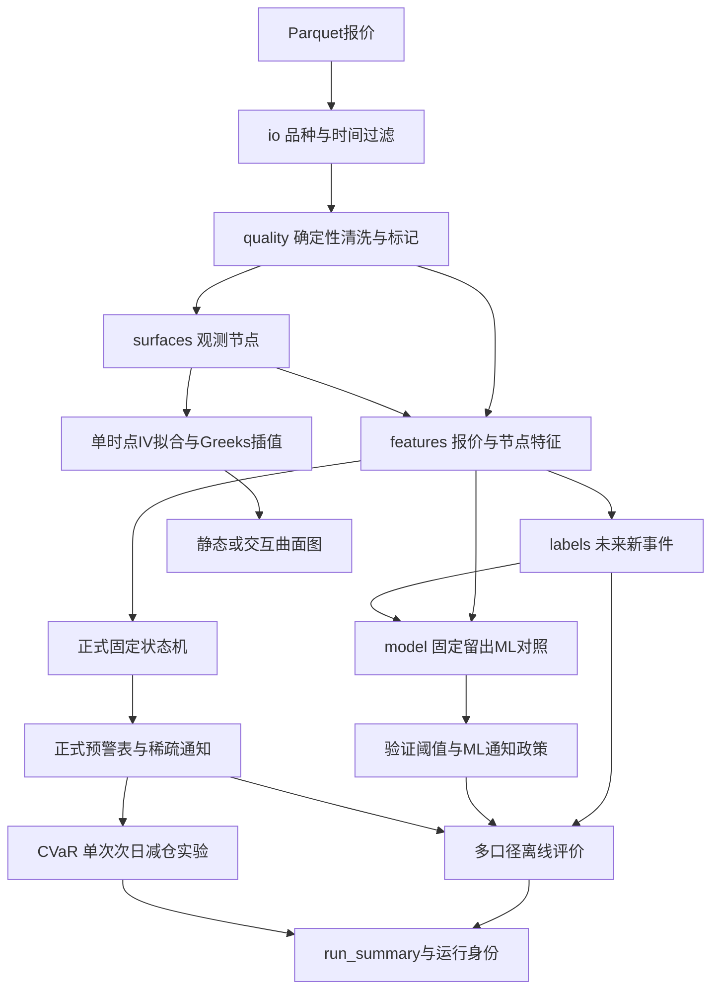

## 两条入口共用事实计算，解决不同问题

离线`run_pipeline`读取覆盖多月的历史，构建标签、训练对照、校准、固定测试、回测并保存报告。单时点`OptionRiskAgent.analyze(product,timestamp)`验证时点可选、读取此前45个日历日、截断未来、清洗/节点/特征/正式决策/五指标曲面/解释图谱，输出一份结构化响应。它不是每请求都训练，也不要求每品种已有完整离线测试报告才能算时点证据。

| 任务 | Pipeline | Agent |
|---|---|---|
|输入|历史数据路径、输出路径、品种/日期配置|精确品种、精确可选时点、部署配置|
|时间范围|配置指定的多月历史|目标时点以前默认45日历日|
|标签|构造未来2—8根事件标签并purge|当前分析不构造未来监督标签|
|ML|固定留出训练+验证阈值+测试+消融|当前决策不加载ML bundle|
|正式预警|固定canonical状态机全序列|同一状态机在历史截止点重放|
|评估|计算并写run_summary|读取已有离线评估作附加信息|
|展示|最新数量合格快照与测试时间轴|用户精确选择时点的五指标曲面与截止时间轴|

## 用一张图记住共享与分支

箭头表示数据依赖；ML分支没有箭头指向正式状态机，正式等级不以ML概率为输入。Agent复用B—F与M/N，另附结构化解释、缓存和图谱；离线Pipeline还负责G—L与报告。图省略了部署验证与异常处理，实际接口需继续逐文件读。

## 按数据对象追一遍

`raw`还可能有重复、污染和无效值；`cleaned`保留基本合格报价及质量标记；`nodes`选OTM/ATM并排除地板后合并；`features`每时点一行含当前证据与过去阈值；`labels`仅离线用未来事件定义目标；`predictions`含ML概率/split/有效标签；`alerts`正式规则覆盖风险级别与通知；`summary`绑定配置、身份、质量与多口径评估。逐层问“粒度、时间可见性、单位、谁消费”，比只背模块名有效。

## Pipeline为什么要求很多月份

它强制执行ML固定划分，默认至少6个覆盖月份；只有一天的数据即使能建一张曲面，也不能完成整条离线run。Agent则只需此时点数据与足够历史证据，可对单品种45日回看生成阈值。历史最少96根并不等于一定能用，因为还需至少4项压力、核心值、足够报价和期限。

## 目录合格计数与阈值历史计数要分开

catalog为UI可选时点做更具体的节点资格检查：清洗、选OTM/ATM、去地板，合并节点，要求每个可用期限至少3节点，再要求至少20节点、2期限、1个ATM节点，并在默认45日内有至少96个严格更早的合格候选时点。这个目录计数不等于特征阈值的历史样本集合。

Agent随后读取窗口内原始报价、清洗并对全部传入特征时点算rolling；features虽标记data_ready，却没有先把False行过滤掉。只要某信号非缺失，它可贡献该信号后续阈值。当前时点能否决策再由data_ready/history_ready与核心值检查。见[catalog目录门槛](</Users/xuji/Documents/第五届中国研究生金融科技创新大赛/揭榜挂帅-11-曲面观策/可运行的项目成果/option_risk_warning/src/option_risk/catalog.py:667>)与[features完整表传入](</Users/xuji/Documents/第五届中国研究生金融科技创新大赛/揭榜挂帅-11-曲面观策/可运行的项目成果/option_risk_warning/src/option_risk/features.py:255>)。

## Agent怎样避免看未来

读到end_date整天后，Agent额外用raw.datetime≤timestamp截断，防止同一天稍后报价进入当前分析。features滚动门槛shift(1)排当前；assess_features只取≤timestamp；时间轴先在完整截止历史重放状态，再截最后512行展示，避免只从512行开头重置状态而丢失过去watch/cooldown。

可是45日回看是有限截断，和离线完整序列起点不必绝对相同；数据窗口或不同可用行会影响历史阈值与状态初始条件。是否完全复现某次离线结果，应核对窗口、配置、数据、政策与运行身份，而不是只看版本名字。

## 为什么离线评估可以缺失

Agent从部署output_dir寻找run_summary，并匹配品种；找不到就返回“该品种尚未生成连续三个月离线回测”的不可用评价，不应编造Precision/Recall。时点分析ready和离线评估ready是两个状态。目录有35个品种也不能推出每个品种都有连续三个月回测。

已有run_summary还可能来自旧代码/旧数据。provenance和缓存校验等模块负责进一步身份匹配，应跟随它们的逐文件笔记；本教程不把“找到JSON”当成“已证明本次结果有效”。

## 文件产物怎样辅助复盘

`risk_features`用来检查某次解释的当前值与历史门槛；`risk_labels`看有效标签和purge；`warning_predictions`看正式状态/通知；`ml_predictions_raw_only`与ablation表看对照；`detected_events`看全序列起点；`cvar_backtest_daily`验证次日收益拆分；随机基线表看降仓日期分布；`run_summary`看总体协议与身份；`latest_surface_grids.npz`看各指标真实网格；figures只是便于阅读的图。

SQL文件只是从保存报告中展开products或抽取headline字段，不是另一个独立模型，也没有独立重算CVaR。报告中的“5张曲面”“5组证据”是结构数量，必须和数值支持/质量检查一起判断。

## 最后用5个问题自查是否真正懂了

第一，随便指出一个输出字段，能否追到输入列、函数和单位？第二，选一个时点，能否手算压力和状态并说明通知为何发或不发？第三，能否用一张时间表解释训练/验证/测试及purge？第四，能否把内部事件、官方事件、价格尾损分开解释？第五，能否说明哪些结论是源码静态读得、哪些经过函数样例、哪些经过完整测试或UI运行？能回答这些才有扎实面试表达。

> [!question]- 练习1：某品种Agent输出ready，但evaluation.available=False，矛盾吗？
> [!success] 答案
> 不矛盾。时点分析具备曲面与历史证据，离线多月评估产物尚不存在，两个能力分开。

> [!question]- 练习2：为何读end_date当天后还要raw≤timestamp？
> [!success] 答案
> io结束日是整天闭含，若请求10:15，同日14:00也会进入读取结果；额外截断让当前决策只看10:15前数据。

> [!question]- 练习3：能把Agent称“实盘自动交易系统”吗？
> [!success] 答案
> 当前代码展示请求驱动的数据分析与规则告警，没有据此证明实时行情订阅、自动交易执行、真实账户风控或实盘绩效。应称单Agent风控分析/预警原型，并按实际部署证据补充。

建议此时按 [[03-源码逐文件/核心链路/pipeline.py.md]] → [[03-源码逐文件/核心链路/features.py.md]] → [[03-源码逐文件/核心链路/labels.py.md]] → [[03-源码逐文件/核心链路/model.py.md]] → [[03-源码逐文件/核心链路/alerts.py.md]] 顺序回到源码，再查Agent与图谱相关模块。

## 回到实际代码

[离线总编排](</Users/xuji/Documents/第五届中国研究生金融科技创新大赛/揭榜挂帅-11-曲面观策/可运行的项目成果/option_risk_warning/src/option_risk/pipeline.py:130>)；[单时点总编排](</Users/xuji/Documents/第五届中国研究生金融科技创新大赛/揭榜挂帅-11-曲面观策/可运行的项目成果/option_risk_warning/src/option_risk/agent.py:1187>)；[先重放再截取时间轴](</Users/xuji/Documents/第五届中国研究生金融科技创新大赛/揭榜挂帅-11-曲面观策/可运行的项目成果/option_risk_warning/src/option_risk/agent.py:736>)；[独立离线评估读取](</Users/xuji/Documents/第五届中国研究生金融科技创新大赛/揭榜挂帅-11-曲面观策/可运行的项目成果/option_risk_warning/src/option_risk/agent.py:784>)；[命令入口](</Users/xuji/Documents/第五届中国研究生金融科技创新大赛/揭榜挂帅-11-曲面观策/可运行的项目成果/option_risk_warning/src/option_risk/cli.py:82>)。
