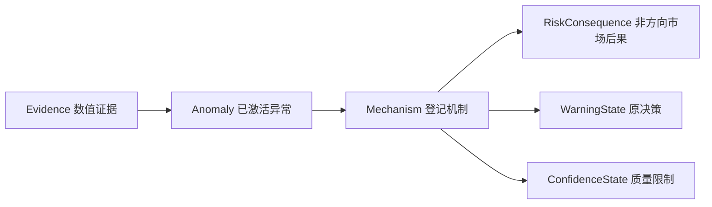

> [!info] 在项目里的职责
> 从问题1已形成的证据构建一个NetworkX有向多重图。每次对应一个品种和一个时点；Product/Snapshot给上下文，活动业务链是证据→异常→机制→结论。大量代码用于独立验证图的身份、字段和精确拓扑。

源码入口：[src/option_risk/knowledge_graph.py 第1行](</Users/xuji/Documents/第五届中国研究生金融科技创新大赛/揭榜挂帅-11-曲面观策/可运行的项目成果/option_risk_warning/src/option_risk/knowledge_graph.py:1>)。本篇依据最终提交目录，源码保持只读；完整逐字源码由知识库档案区保存，本篇聚焦如何理解和讲解。

## 输入、输出和上下游

问题1数值证据、原等级/通知、策略、质量和价格来源 → nx.MultiDiGraph；支持与严格node-link JSON互转。下游reasoner/query/explanation/visualization。

直接导入模块：`__future__`, `collections.abc`, `copy`, `dataclasses`, `math`, `numbers`, `re`, `typing`, `networkx`, `numpy`, `pandas`, `.contracts`, `.decision`, `.knowledge_schema`。

## 一张图究竟有多少层

八类节点不等于八层传导。`Product→RiskSnapshot→Evidence`承载上下文；真正用于路径解释的是四层：

图中M是“各特征自己的机制”示意，并非同一机制可任选所有终点。质量机制只连置信状态；市场机制只连市场后果，并在原等级大于0时连原警告。图本身不会由边数投票产生新等级。

## 动态发生在哪里

所有有限当前值都可成为Evidence。仅压力达到0.90时才有异常与机制。若是凸性/日历约束指标且当前值为正，第一条边是VIOLATES；否则0.90至小于1为NEAR_THRESHOLD，≥1为EXCEEDS。同一预注册规则在不同时间可以激活、退激活或换第一条边，其语义文本不随行情训练。

`anomaly:...`与`mechanism:...`的ID不含时间；它们在每张独立事件图里有效，属性仍带品种与源时间。直接把多个事件图compose会有身份覆盖风险；如要扩展成跨事件图，必须设计新的全局身份与时序契约。

## 为什么验证器比构图器还长

构图器知道自己打算生成什么，但缓存可能伪造或丢边。验证器从每项Evidence重算激活集合，再推导应该存在的精确节点与边集合，比较实际图。它禁止多出来的边、漏掉的边、错关系、错规则版本、未来来源、错标签和因果权重。仅 `nx.is_directed` 或“节点都存在”无法做到这些。

图的数值来自问题1且附来源；序列化稳定排序使同输入同版本有相同JSON，适合比较与复现。它没有证实风险机制的因果效应；禁止概率/因果权重也提醒读者别把线画成估计出的因果强度。

## 逐个类与函数查阅

每个锚点都指向当前源文件的实际定义。嵌套函数属于所在外层算法；`self`表示实例状态，不是额外业务输入。

### `KnowledgeGraphError` · 27—28行

[查看定义](</Users/xuji/Documents/第五届中国研究生金融科技创新大赛/揭榜挂帅-11-曲面观策/可运行的项目成果/option_risk_warning/src/option_risk/knowledge_graph.py:27>)。图谱边界共同基类，可被Agent捕获并降级。

输入/输出接口：类；共享配置/方法边界。

### `KnowledgeGraphValidationError` · 31—32行

[查看定义](</Users/xuji/Documents/第五届中国研究生金融科技创新大赛/揭榜挂帅-11-曲面观策/可运行的项目成果/option_risk_warning/src/option_risk/knowledge_graph.py:31>)。图输入、语义、版本、拓扑违反协议时抛出。

输入/输出接口：类；共享配置/方法边界。

### `_safe_code` · 150—154行

[查看定义](</Users/xuji/Documents/第五届中国研究生金融科技创新大赛/揭榜挂帅-11-曲面观策/可运行的项目成果/option_risk_warning/src/option_risk/knowledge_graph.py:150>)。规范化ASCII代码，拒绝变为空字符串的身份。

输入/输出接口：`(value: object)` → `str`。

### `_as_timestamp` · 157—164行

[查看定义](</Users/xuji/Documents/第五届中国研究生金融科技创新大赛/揭榜挂帅-11-曲面观策/可运行的项目成果/option_risk_warning/src/option_risk/knowledge_graph.py:157>)。转Timestamp并拒绝NaT。

输入/输出接口：`(value: object, *, field: str)` → `pd.Timestamp`。

### `_strict_in_memory_timestamp` · 167—170行

[查看定义](</Users/xuji/Documents/第五届中国研究生金融科技创新大赛/揭榜挂帅-11-曲面观策/可运行的项目成果/option_risk_warning/src/option_risk/knowledge_graph.py:167>)。内存图只接受真实Timestamp，不接受可转换的字符串。

输入/输出接口：`(value: object, *, field: str)` → `pd.Timestamp`。

### `_is_finite_real` · 173—174行

[查看定义](</Users/xuji/Documents/第五届中国研究生金融科技创新大赛/揭榜挂帅-11-曲面观策/可运行的项目成果/option_risk_warning/src/option_risk/knowledge_graph.py:173>)。严格有限实数检测，排除bool。

输入/输出接口：`(value: object)` → `bool`。

### `_finite_or_none` · 177—178行

[查看定义](</Users/xuji/Documents/第五届中国研究生金融科技创新大赛/揭榜挂帅-11-曲面观策/可运行的项目成果/option_risk_warning/src/option_risk/knowledge_graph.py:177>)。把有效数转float，无效变None。

输入/输出接口：`(value: object)` → `float | None`。

### `_direction` · 181—188行

[查看定义](</Users/xuji/Documents/第五届中国研究生金融科技创新大赛/揭榜挂帅-11-曲面观策/可运行的项目成果/option_risk_warning/src/option_risk/knowledge_graph.py:181>)。由变化率正负得方向；缺失标不可用。

输入/输出接口：`(change_rate: float | None)` → `str`。

### `_severity` · 191—200行

[查看定义](</Users/xuji/Documents/第五届中国研究生金融科技创新大赛/揭榜挂帅-11-曲面观策/可运行的项目成果/option_risk_warning/src/option_risk/knowledge_graph.py:191>)。计算单项0—3严重度标签。

输入/输出接口：`(pressure: float | None, policy: DecisionPolicy)` → `int`。

### `_strict_alert_level` · 203—208行

[查看定义](</Users/xuji/Documents/第五届中国研究生金融科技创新大赛/揭榜挂帅-11-曲面观策/可运行的项目成果/option_risk_warning/src/option_risk/knowledge_graph.py:203>)。只接受0—3原生int，防True==1冒充等级。

输入/输出接口：`(value: object)` → `int`。

### `_strict_risk_score` · 211—216行

[查看定义](</Users/xuji/Documents/第五届中国研究生金融科技创新大赛/揭榜挂帅-11-曲面观策/可运行的项目成果/option_risk_warning/src/option_risk/knowledge_graph.py:211>)。只接受有限风险分数或None。

输入/输出接口：`(value: object)` → `float | None`。

### `_strict_bool` · 219—222行

[查看定义](</Users/xuji/Documents/第五届中国研究生金融科技创新大赛/揭榜挂帅-11-曲面观策/可运行的项目成果/option_risk_warning/src/option_risk/knowledge_graph.py:219>)。不接受0/1冒充布尔通知。

输入/输出接口：`(value: object, *, field: str)` → `bool`。

### `_strict_attention_pressure` · 225—231行

[查看定义](</Users/xuji/Documents/第五届中国研究生金融科技创新大赛/揭榜挂帅-11-曲面观策/可运行的项目成果/option_risk_warning/src/option_risk/knowledge_graph.py:225>)。关注激活阈值必须是(0,1]有限数。

输入/输出接口：`(value: object)` → `float`。

### `_strict_optional_string` · 234—239行

[查看定义](</Users/xuji/Documents/第五届中国研究生金融科技创新大赛/揭榜挂帅-11-曲面观策/可运行的项目成果/option_risk_warning/src/option_risk/knowledge_graph.py:234>)。文本审计字段只允许str或None。

输入/输出接口：`(value: object, *, field: str)` → `str | None`。

### `_rebuild_policy` · 242—287行

[查看定义](</Users/xuji/Documents/第五届中国研究生金融科技创新大赛/揭榜挂帅-11-曲面观策/可运行的项目成果/option_risk_warning/src/option_risk/knowledge_graph.py:242>)。完整还原策略字段、强类型和相对边界，核对版本和参数哈希。

输入/输出接口：`(parameters: object, parameter_hash: object, *, require_hash: bool=True)` → `DecisionPolicy`。

### `_stamp` · 290—291行

[查看定义](</Users/xuji/Documents/第五届中国研究生金融科技创新大赛/揭榜挂帅-11-曲面观策/可运行的项目成果/option_risk_warning/src/option_risk/knowledge_graph.py:290>)。把时点格式化成确定ID片段。

输入/输出接口：`(timestamp: pd.Timestamp)` → `str`。

### `_base_node` · 294—303行

[查看定义](</Users/xuji/Documents/第五届中国研究生金融科技创新大赛/揭榜挂帅-11-曲面观策/可运行的项目成果/option_risk_warning/src/option_risk/knowledge_graph.py:294>)。统一节点ID、类型、标签、品种、源时间基础字段。

输入/输出接口：`(*, node_id: str, node_type: NodeType, label: str, product: str, timestamp: pd.Timestamp)` → `dict[str, Any]`。

### `_edge_id` · 306—307行

[查看定义](</Users/xuji/Documents/第五届中国研究生金融科技创新大赛/揭榜挂帅-11-曲面观策/可运行的项目成果/option_risk_warning/src/option_risk/knowledge_graph.py:306>)。由源/关系/目标形成确定多重边ID。

输入/输出接口：`(source: str, target: str, relation: RelationType)` → `str`。

### `_add_edge` · 310—331行

[查看定义](</Users/xuji/Documents/第五届中国研究生金融科技创新大赛/揭榜挂帅-11-曲面观策/可运行的项目成果/option_risk_warning/src/option_risk/knowledge_graph.py:310>)。写关系/规则版本/语义/来源时间/措辞模板属性。

输入/输出接口：`(graph: nx.MultiDiGraph, source: str, target: str, relation: RelationType, *, rule_id: str, timestamp: pd.Timestamp)` → `None`。

### `_active_relation` · 334—347行

[查看定义](</Users/xuji/Documents/第五届中国研究生金融科技创新大赛/揭榜挂帅-11-曲面观策/可运行的项目成果/option_risk_warning/src/option_risk/knowledge_graph.py:334>)。压力低于关注阈值不激活；约束正违反优先VIOLATES，否则按1区分NEAR_THRESHOLD/EXCEEDS。

输入/输出接口：`(row: FeatureEvidence, rule: FeatureRule, policy: DecisionPolicy)` → `RelationType | None`。

### `build_knowledge_graph` · 350—625行

[查看定义](</Users/xuji/Documents/第五届中国研究生金融科技创新大赛/揭榜挂帅-11-曲面观策/可运行的项目成果/option_risk_warning/src/option_risk/knowledge_graph.py:350>)。先建产品/快照/原预警/置信结点，再为有限证据建节点，仅对活动证据扩展三层后续链。

输入/输出接口：`(*, product: str, timestamp: pd.Timestamp, evidence: Sequence[FeatureEvidence], alert_level: int, alert_name: str, risk_score: float | None, alert_emitted: bool, transition_reason: str | None, policy_version: str | None, policy_parameter_hash: str | None, data_quality: Mapping[str, Any], price_source: str, policy: DecisionPolicy)` → `nx.MultiDiGraph`。

### `_require_fields` · 628—631行

[查看定义](</Users/xuji/Documents/第五届中国研究生金融科技创新大赛/揭榜挂帅-11-曲面观策/可运行的项目成果/option_risk_warning/src/option_risk/knowledge_graph.py:628>)。检查记录必需字段是否缺少。

输入/输出接口：`(record: Mapping[str, Any], fields: set[str], *, owner: str)` → `None`。

### `_require_exact_values` · 634—642行

[查看定义](</Users/xuji/Documents/第五届中国研究生金融科技创新大赛/揭榜挂帅-11-曲面观策/可运行的项目成果/option_risk_warning/src/option_risk/knowledge_graph.py:634>)。验证规范字段精确值，bool/int尤其要求类型一致。

输入/输出接口：`(record: Mapping[str, Any], expected: Mapping[str, Any], *, owner: str)` → `None`。

### `_ensure_not_future` · 645—655行

[查看定义](</Users/xuji/Documents/第五届中国研究生金融科技创新大赛/揭榜挂帅-11-曲面观策/可运行的项目成果/option_risk_warning/src/option_risk/knowledge_graph.py:645>)。来源时间不能晚于快照，时区必须可比。

输入/输出接口：`(value: object, snapshot: pd.Timestamp, *, owner: str)` → `pd.Timestamp`。

### `_reject_forbidden_attributes` · 658—699行

[查看定义](</Users/xuji/Documents/第五届中国研究生金融科技创新大赛/揭榜挂帅-11-曲面观策/可运行的项目成果/option_risk_warning/src/option_risk/knowledge_graph.py:658>)。递归拒绝因果/概率/置信权重字段及循环容器。

输入/输出接口：`(value: object, *, owner: str, active_containers: set[int] | None=None)` → `None`。

### `validate_knowledge_graph` · 702—1109行

[查看定义](</Users/xuji/Documents/第五届中国研究生金融科技创新大赛/揭榜挂帅-11-曲面观策/可运行的项目成果/option_risk_warning/src/option_risk/knowledge_graph.py:702>)。独立按证据重新推导活动集合、各层节点和完整预期边集合，拒绝多边、漏边和语义漂移。

输入/输出接口：`(graph: nx.MultiDiGraph)` → `None`。

### `validate_knowledge_graph.expect_edge` · 1011—1015行

[查看定义](</Users/xuji/Documents/第五届中国研究生金融科技创新大赛/揭榜挂帅-11-曲面观策/可运行的项目成果/option_risk_warning/src/option_risk/knowledge_graph.py:1011>)。嵌套辅助函数，把每条应有关系登记为精确端点/ID/关系/规则。

输入/输出接口：`(source: str, target: str, relation: RelationType, rule_id: str)` → `None`。

### `_json_safe` · 1112—1142行

[查看定义](</Users/xuji/Documents/第五届中国研究生金融科技创新大赛/揭榜挂帅-11-曲面观策/可运行的项目成果/option_risk_warning/src/option_risk/knowledge_graph.py:1112>)。输出严格JSON；不把NaN/Infinity默默变None。

输入/输出接口：`(value: Any)` → `Any`。

### `graph_to_node_link` · 1145—1159行

[查看定义](</Users/xuji/Documents/第五届中国研究生金融科技创新大赛/揭榜挂帅-11-曲面观策/可运行的项目成果/option_risk_warning/src/option_risk/knowledge_graph.py:1145>)。复验后序列化NetworkX，并稳定排序节点与边。

输入/输出接口：`(graph: nx.MultiDiGraph)` → `dict[str, Any]`。

### `_validate_raw_json_value` · 1162—1217行

[查看定义](</Users/xuji/Documents/第五届中国研究生金融科技创新大赛/揭榜挂帅-11-曲面观策/可运行的项目成果/option_risk_warning/src/option_risk/knowledge_graph.py:1162>)。恢复之前递归检查原JSON容器、有限数、键类型与循环。

输入/输出接口：`(value: Any, *, path: str, active_containers: set[int] | None=None)` → `None`。

### `_require_raw_iso_timestamp` · 1220—1234行

[查看定义](</Users/xuji/Documents/第五届中国研究生金融科技创新大赛/揭榜挂帅-11-曲面观策/可运行的项目成果/option_risk_warning/src/option_risk/knowledge_graph.py:1220>)。原始JSON时间必须是能无损往返的ISO字符串。

输入/输出接口：`(value: object, *, path: str)` → `None`。

### `_preflight_node_link` · 1237—1316行

[查看定义](</Users/xuji/Documents/第五届中国研究生金融科技创新大赛/揭榜挂帅-11-曲面观策/可运行的项目成果/option_risk_warning/src/option_risk/knowledge_graph.py:1237>)。严格顶层五键、有向多图标志、唯一节点/边和存在端点，防NetworkX恢复时合并坏记录。

输入/输出接口：`(payload: Mapping[str, Any])` → `None`。

### `graph_from_node_link` · 1319—1354行

[查看定义](</Users/xuji/Documents/第五届中国研究生金融科技创新大赛/揭榜挂帅-11-曲面观策/可运行的项目成果/option_risk_warning/src/option_risk/knowledge_graph.py:1319>)。预检→深拷贝→NetworkX恢复→还原时间→完整语义拓扑验证。

输入/输出接口：`(payload: Mapping[str, Any])` → `nx.MultiDiGraph`。

## 面试先讲清楚这一问

**问：为何不用图数据库？**

答：当前是一张小型单事件内存图，固定规则与查询足够；这里没有跨事件实体库、Cypher或在线图学习。

继续学习：[[20 - Agent如何把一次请求变成可复核风险判断]] → [[21 - 动态知识图谱的机制与推理边界]] → [[22 - 可追溯、防未来与运行身份]] → [[23 - 界面、真实案例与35品种验收]]。
