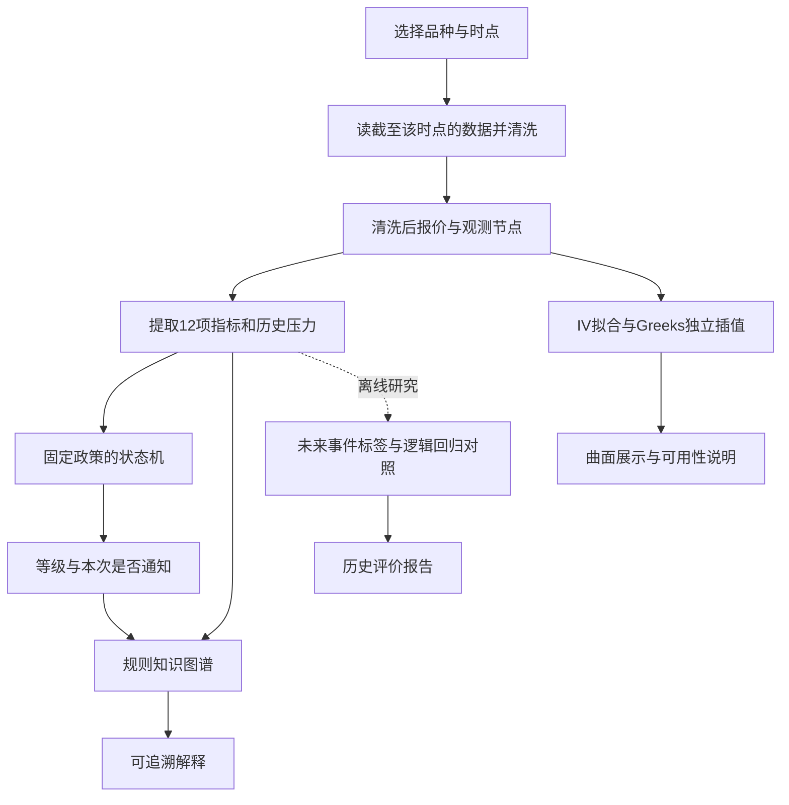

> [!abstract] 这次只完成一个目标
> 合上笔记，你能说清：**项目解决什么问题、数据经过哪些步骤、预警怎么产生、结果怎么验证、哪里还有限制**。第一遍只读正文；折叠内容留给追问。学习时间是安排建议，不是掌握程度的保证。
>
> 学完接着用 [[曲面观策项目学习与面试/04-面试与验证/07-面试前十分钟：口述稿与追问卡.md|十分钟追问卡]] 演练。完整知识库继续作为查词典和查源码的地方。

## 先把一小时分成六段

|时间|只解决这一件事|合上笔记后要能回答|
|---|---|---|
|0—5分钟|理解项目目标|用户给什么，系统返回什么？|
|5—15分钟|理解数据怎样变成可用证据|一条报价、一张截面、一行特征有什么不同？|
|15—25分钟|理解曲面拟合|为什么需要拟合，拟合失败怎么办？|
|25—40分钟|理解预警判断|压力倍数、预警等级、通知有什么区别？|
|40—50分钟|理解Agent和图谱|谁组织计算，谁作判断，谁解释？|
|50—60分钟|理解项目成绩|57%和77%各在回答什么问题？|

## 第一段：你做的是一个什么系统

假设你是关注白银期权的风控人员。某个时点有很多期权：不同执行价、不同到期月份、看涨和看跌都有。你想知道：这些报价透露出的风险是否异常，异常体现在哪里，依据是否可信。

系统接收一个**品种和时点**，例如“白银AG，2025年4月7日10:15”，读取截至该时点的报价和历史，返回曲面、风险等级、具体指标、解释路径。它帮助人观察风险，当前交付没有接入真实账户自动下单。

用一句话记：**把大量期权报价整理成可检查的风险证据，再给出分级预警和解释**。

“模型”在这里并不是一个东西。你会遇到四种不同工作：

|你听到的名字|它实际回答的问题|
|---|---|
|SSVI、SVI曲面模型|这些离散的IV点，可以用什么形状描述？|
|动态阈值与状态机|当前风险到了什么程度，要不要发通知？|
|逻辑回归|用历史特征预测未来内部风险事件，作为对照效果怎样？|
|知识图谱|这次结论由哪些证据和规则支持？|

先分清四种工作，再记名字，就不会把“拟合得好”“预测得准”“解释得清楚”混成一件事。

> [!question]- 自测：面试官问“你的模型输出的是明天涨跌吗？”
> 不是。正式输出是当前期权风险的分级状态和证据；离线对照预测的是按项目规则定义的未来风险事件，不是明天收益的正负。

## 第二段：从一条报价，走到一行风险特征

### 1. 一行原始数据只描述一份合约在一个时点的情况

先看一个**教学假设**：白银价格约100，某看涨期权执行价105，剩余30天，价格2，IV为25%。这是一份合约的一次观测。IV是把观察到的期权价格代回定价关系后反求出的波动率参数；25%是年化波动率尺度，不是“上涨概率25%”。

项目的原始数据已经带有IV和Delta、Gamma、Vega、Theta等字段。最终系统主要读取这些字段；不能说所有原始IV、Greeks都是这个项目从零计算的。

固定同一时点，收集不同执行价和不同期限的合约，才组成一个期权截面。固定时点、再固定期限，IV随执行价变化，是一条“微笑/偏斜”；把多个期限放在一起，才有曲面。

**曲面的期限轴表示离到期还有多久，不是过去几天的时间轴**。

### 2. 在Python里，最关键的是表的“每一行代表什么”

|对象名|每一行大致代表什么|为什么需要这一层|
|---|---|---|
|`raw`|某合约在某时点的原始报价|保留读入的数据|
|`cleaned`|经过基础清洗、带质量标记的报价|处理无效值、异常范围等|
|`nodes`|同一时点、期限、相对执行价上的合并观测节点|选取OTM/ATM等节点，便于比较形状|
|`features`|某品种某时点的一组风险指标|把很多合约压缩为可决策的证据|
|结果对象|某次查询的等级、通知、曲面与解释|让界面和报告使用同一份结果|

可以把DataFrame理解成一张表。`groupby`把同一时点或期限的行归到一起；`median`等聚合把一组报价变成代表值；`rolling`在历史窗口上算统计量；`shift(1)`让当前行使用上一行之前已算好的门槛。

ATM是平值，指执行价接近标的价格；OTM是虚值，对Call通常是执行价高于标的价格，对Put则相反。选取OTM/ATM节点，是选择用于曲面分析的报价，并不表示其他合格报价对风险统计没有作用。

注意：**风险特征同时使用`cleaned`和`nodes`**。例如零成交量占比要看清洗后的合约，某些曲面形状指标要看节点。拟合曲面只是其中一个分支，不是所有风险指标的前置步骤。

### 3. 大数据为何不等于把整个文件塞进内存

已有核查记录显示，数据目录约12.62 GB，合并表约2.259亿行、24列、35个品种；目录还保留了分区表示。合并表与分区是同一批数据的两种存放方式，读取时应选一种，不能当两批独立样本拼接。

分析一个白银时点时，先按品种、日期读取需要的部分。Parquet可以理解为适合表格分析的压缩列式文件格式；按分区筛选，能减少读入量。**数据仓库很大，不代表每次查询、每次拟合或历史测试都使用了全部数据**。

> [!question]- 自测：为什么“2亿行原始数据”和“2000多个测试时点”可以同时成立？
> 一行原始数据是合约报价；一行风险特征汇总了一个时点的很多合约。再限定白银与测试月份，粒度和范围都变了，所以数量不能直接比较。

需要查字段时再看 [[曲面观策项目学习与面试/01-项目与数据/02-原始数据定位与24列字典.md|原始数据与24列字典]]。

## 第三段：曲面拟合到底在做什么

### 1. 先懂三个符号，不急着背SSVI大公式

不同日期白银价格不同，直接拿执行价100和8000比较没有意义，所以用相对位置：

$$
k=\ln(K/F),\qquad T=\frac{\text{剩余天数}}{365},\qquad w=\sigma_{\mathrm{IV}}^2T
$$

这里$K$是执行价，$F$是用于相对定位的标的价格，$k$是对数相对执行价；$T$是以年计的剩余期限；$\sigma_{\mathrm{IV}}$是小数形式的年化IV；$w$叫总方差。项目中标的价格信息有由`strike/moneyness`重构的代理，不能把它说成另行接入的完整期货行情。

继续上面的教学假设：$K=105$、$F=100$、IV=0.25、剩余30天，则：

$$
k\approx0.04879,\qquad T\approx0.08219,\qquad w=0.25^2\times\frac{30}{365}\approx0.005137
$$

为什么多一个$T$？年化波动率没有表达还要承担多久的波动。总方差把期限带进来。在模型解释下，累计波动尺度约为$\sigma\sqrt{T}$，平方就是$\sigma^2T$。这并不是对未来实际波动的保证。

例如30天IV为30%、90天IV为25%：远月IV更低，但总方差约为0.01541，大于近月的0.00740。**远月IV低于近月，不等于总方差发生倒挂**。

### 2. 拟合是“用少量参数描述一堆点”

原始节点有噪声、稀疏和缺口。SSVI试图同时描述多个期限，并共享部分形状参数；Raw SVI则按单个期限分别拟合。程序调整参数，让拟合值接近观测总方差，同时检查参数、误差和适用的价格形状条件。

你可以类比学过的回归：给定很多$(x,y)$点，找一个函数接近它们。这里横轴是$k$，纵轴是$w$；函数形状为期权微笑设计，而且要关注金融约束。

如果合格参数曲线找不到，项目按节点数量尝试更简单的方法。PCHIP是保形分段三次插值，优先保留节点间形状；极少节点时才用线性。**简单方法仍要接受适用检查，失败就保留“不可用”状态**。

> [!info]- 被追问“具体如何降级”时再展开
> 先检查是否具备SSVI联合拟合资格：至少两个期限，各至少4个合并节点。联合拟合被拒绝或不适用后，逐期限处理：
>
> - 至少5个节点：尝试Raw SVI，失败再尝试PCHIP。
> - 4个节点：尝试PCHIP。
> - 2—3个节点：尝试线性。
> - 0—1个节点：不可用。
>
> 因此不是所有期限都走“SSVI→SVI→PCHIP→线性”。尤其4个以上节点的PCHIP失败后，没有再用线性强行补救。具体还有父级接受和跨期限检查，见 [[曲面观策项目学习与面试/02-循序学习/11-拟合与降级：从SSVI到可解释的失败.md|完整拟合分支]]。

### 3. 为什么优化器说成功，项目仍可能拒绝

优化器的“成功”表示满足了它的停止条件。业务还要问：误差是否够小、参数是否合理、价格曲线有没有明显不合适的形状、与其他期限是否冲突。

此前留存的真实AG复现就是：整体SSVI显示优化成功，但误差检查返回`rmse_exceeded`，随后逐期限回退，最终只有3个期限可用，另3个不可用。**求出了参数和结果足以使用，是两道检查**。

“无套利检查”也要说清范围：欧式期权在适用假设下，同一到期的Call价格应随执行价不增且呈凸性，否则相应组合可能暴露价格关系异常。项目在有限节点/网格上做适用检查，并不是给所有价格、所有期限作全面证明；不同期货月份的跨期限比较还需要谨慎解释。

> [!question]- 自测：图上有IV、Delta、Gamma、Vega、Theta五张曲面，是不是后四张都是对SSVI求导？
> 不是。本项目的Greeks来自原始数据字段，独立做节点和网格插值。SSVI总方差关于$k$的导数，也不是期权价格关于标的价格的Delta/Gamma。

## 第四段：怎样从12项指标变成预警

### 1. 指标先回答“哪里异常”

先按用途记，暂时不用背12个字段名。下表是学习分组，代码里保留了更细的分组。

|观察角度|典型指标|直觉|
|---|---|---|
|风险定价和曲面形状|ATM IV、IV上升、期限倒挂、局部跳变|市场对波动的定价水平或结构是否异常|
|报价关系|价格凸性违反、Put-Call平价偏离、日历总方差违反|不同报价之间是否失去通常应有的协调关系|
|敏感度集中|Gamma、Vega持仓加权集中度|敏感度是否集中在少数合约|
|数据和流动性|零成交量比例、IV求解地板比例、节点覆盖缺口|证据是否稀疏或有质量问题|

ATM IV就是平值附近期权的IV。价格凸性检查比较同期限、不同执行价的期权价格是否满足应有的弯曲关系，违反越多，报价关系越值得关注；它不是检查IV曲线是否向上弯。

Greeks先懂三项的关系：Delta描述期权价格对标的价格变化的敏感度；Gamma描述Delta随标的价格变化的速度；Vega描述期权价格对IV变化的敏感度。集中度高表示敏感度权重集中，不代表拿到了交易商或某账户的净多空仓位。

### 2. 不同指标单位不同，怎样比较

用自己的历史作为尺子。先把某项指标转换为代码规定的非负风险量$x_t^+$，计算当前时点之前的历史95%分位数$q_{t-1}$，再计算压力倍数：

$$
p_t=\frac{x_t^+}{\max(q_{t-1},10^{-12})}
$$

这是核心计算，代码另有缺失值处理和倍数上限。若历史参考为0.25，当前为0.30，压力就是1.2：比自己的高位历史参考高20%。**它是相对异常程度，不是120%的发生概率**。

95%分位数可直观理解为“历史中大约95%的观测不超过这个位置”。它不是预测准确率。这里一个观测位置，是按时间排序后该品种特征表中的一个时点，不是一条合约报价，也不一定对应固定的实际经过时间。默认滚动窗口最多640个观测位置，要求该信号至少96个有效历史值；不足时不能把阈值当成已知。

这一步最值得记的Python逻辑是：**先滚动计算分位数，再`shift(1)`**。这样当前大幅上升的值不会先抬高自己的比较门槛。实际阈值不是先过滤所有`data_ready=False`行才算，各指标依自身缺失值和有效历史数量处理。

### 3. 状态机是带记忆的if/else

普通判断只问“现在高不高”。状态机还问“上一刻处于什么状态、最近通知过没有、什么时候可以解除关注”，使持续异常不必每个时点重复提醒。

当前代码有两个关键数：

- **总体压力**：12项有限压力中的最大值，用于显示总体分数等。
- **核心压力**：ATM IV压力与价格凸性违反率压力的最大值，参与正式2/3级判定。

动态变化的是每项指标的历史参考值；0.90、0.98、1.50等是当前政策设置的固定压力倍率，不是SSVI算出的结果，也不是行业统一标准。在数据和历史满足要求的前提下，当前政策的骨架如下：

|状态|容易记住的规则|
|---|---|
|0：正常|没有进入或保持关注，也没有正式警告|
|1：关注|总体压力达到0.90可进入；退出还看历史状态和释放条件|
|2：警告|核心压力至少0.98，且没有满足3级条件|
|3：危险|核心压力至少1.50，同时至少3项不同市场指标的压力达到1|

三项数据/流动性指标可以影响总体分数和关注，但不计入正式市场升级的多指标数量。代码所说“不同指标”不代表证明了统计独立。

等级表示当前状态，`alert_emitted`表示这一刻是否新发通知。进入正式风险状态时可以发通知；持续期间是否再发，还受具体条件和冷却规则约束。所以**2级、未新发通知**完全可能同时成立。

> [!info]- 被追问“如何防止频繁抖动”时再展开
> 当前政策有关注进入0.90、释放0.85的不同门槛，并有最短保持、最长关注和通知冷却等条件。`persistence_bars=2`主要限制关注释放，不是“必须连续两根确认才能首次预警”。重复2级通知也不是每隔6根无条件发送，仍受核心压力区间等分支限制。
>
> 数据或历史不足应先看业务可用性。不能把“无法有效判断”解释为“确认没有风险”。

### 4. 把真实白银案例手算一遍

以下来自**此前已保存的真实数据复现证据**，本篇整理没有重新运行模型。分析时点为2025-04-07 10:15。

|指标|当前值|历史参考|压力|
|---|---:|---:|---:|
|ATM IV|0.29848|0.24667|约1.210|
|价格凸性违反率|0.28283|0.24495|约1.155|
|Put-Call平价偏离指标|0.077674|0.019094|约4.068|

先取核心压力：$\max(1.210,1.155)=1.210$。再取全部12项的最大值，这次是4.068。所以：

1. 总体分数约4.068，表示最大指标压力很高。
2. 核心压力1.210达到2级门槛0.98。
3. 核心压力没有达到3级门槛1.50，因此没有升级为3级。
4. 返回`alert_level=2`、`alert_emitted=False`、`warning_held`，说明维持警告状态，这一刻没有新通知。

这就是一个很适合面试的例子：**最大异常指标解释“哪里突出”，核心条件决定正式等级，状态历史影响通知**。

> [!question]- 自测：如果只有零成交量比例异常，能直接判3级吗？
> 不能。它可以抬高总体压力并引起关注，但正式升级仍要求核心市场指标和规定的其他市场证据；不能把数据质量差直接当成严重市场风险。

完整数字与图见 [[曲面观策项目学习与面试/04-面试与验证/00-真实AG案例完整拆解.md|真实AG案例]]。

## 第五段：Agent、图谱和机器学习各放在哪里

### 1. 一张图把项目放回正确位置

实线表示主要数据依赖；虚线标出离线研究支路。Agent负责组织这次请求的各个步骤；图里没有把逻辑回归预测接回正式状态机，也没有把图谱解释接回去改写等级。

### 2. Agent在这里像“协调员”

`OptionRiskAgent.analyze(product, timestamp)`负责验证输入、读取历史、调用计算、组装结构化结果。默认回看45个日历日，读取后还截断到指定时点；需要历史来计算阈值、重放状态，不是只看一张静态截图。

它每次查询不重新训练模型。本项目的Agent是确定性业务流程编排，没有调用大语言模型，也没有强化学习训练。

### 3. 图谱在这里像“带出处的解释提纲”

NetworkX可以理解成一个Python图结构工具：节点装对象，边装关系。本项目按注册规则，把“证据→异常→机理→结论”连起来，每条路径能追到数值、阈值、时点和规则。

例如：平价偏离指标约为历史参考的4.068倍 → 对应报价关系异常 → 注册的风险解释 → 连接到相关后果或既有预警结论。它帮助回答“依据是什么”。

这不是从数据里发现了新闻冲击的真正原因，也不是让LLM自由写解释。图谱接收已经算出的预警等级，不负责重新决定它。

### 4. 逻辑回归回答另一个研究问题

项目把核心压力从低于1变为至少1，并满足可用性和事件间隔条件的起点，定义为一个新的内部风险事件。核心压力仍来自ATM IV或价格凸性风险；连续越线很多个时点，不等于发生很多次新事件。

在离线研究里，再用当下特征预测未来2—8个观测位置内是否出现该事件。逻辑回归根据特征计算事件概率，是一个容易检查的基线。

代码按时间先后划分训练、验证、测试：训练阶段拟合参数，验证阶段选择ML阈值等，测试阶段评价。项目保存的白银划分是训练截至2024年12月、验证2025年1月、测试2025年2—4月。

未来可以用于制作标签，因为训练结束后我们知道后来发生了什么；未来不能进入当时用于决策的特征。为了避免训练末尾标签越过验证边界，项目还屏蔽边界前8个观测位置的标签；验证与测试边界也这样处理，这叫`purge`。

> [!info]- 面试官追问ML实现时，再补这四句
> 缺失值用训练集的中位数填补，并加入缺失指示；`RobustScaler`用训练中位数和四分位距缩放；逻辑回归设置类别平衡权重；原始特征对照排除了与内部标签定义直接派生同源的压力等列。这里是固定月份留出测试，不能因为函数名有`walk_forward`就说做了完整滚动回测。

### 5. 真要定位代码，先找这六个入口

|入口|你只需要先回答的问题|详细笔记|
|---|---|---|
|`agent.py`|一次查询怎样串起所有步骤？|[[曲面观策项目学习与面试/03-源码逐文件/智能体与图谱/agent.py - 唯一业务入口与可信缓存.md\|Agent入口]]|
|`quality.py`和`surfaces.py`|报价怎样变成清洗表和节点？|[[曲面观策项目学习与面试/02-循序学习/核心02-同一时间怎样从微笑走到曲面.md\|清洗表与节点]]|
|`features.py`|每个时点的指标与历史门槛怎样算？|[[曲面观策项目学习与面试/03-源码逐文件/核心链路/features.py.md\|特征入口]]|
|`decision.py`|为什么这次是2级，为什么未通知？|[[曲面观策项目学习与面试/03-源码逐文件/智能体与图谱/decision.py - 动态压力与状态机.md\|决策入口]]|
|`surface_fit_diagnostics.py`和`total_variance_fit.py`|曲面方法怎样选择，为什么被拒绝？|[[曲面观策项目学习与面试/02-循序学习/11-拟合与降级：从SSVI到可解释的失败.md\|拟合入口]]|
|`knowledge_graph.py`等图谱模块|证据怎样组成解释路径？|[[曲面观策项目学习与面试/02-循序学习/21 - 动态知识图谱的机制与推理边界.md\|解释入口]]|

离线实验再查`pipeline.py`总流程、`labels.py`标签、`model.py`逻辑回归、`alerts.py`评价、`backtest.py`减仓实验。它们的顺序和产物见 [[曲面观策项目学习与面试/02-循序学习/核心08-离线Pipeline与单时点Agent的完整关系.md|两条运行链]]。这轮学习不用逐行读完全部文件。

## 第六段：怎么讲结果，才经得住追问

### 1. 精确率和召回率是两个方向

历史提交摘要中的AG测试期为2025年2—4月，测试中有57个**算法规则定义的事件**。把密集通知整理成告警片段后，有129段。

$$
\text{事件精确率}=\frac{\text{匹配到事件的告警片段}}{\text{全部告警片段}}=\frac{74}{129}\approx57.36\%
$$

$$
\text{事件召回率}=\frac{\text{有提前告警的事件}}{\text{全部事件}}=\frac{44}{57}\approx77.19\%
$$

精确率问“发出的告警，有多少匹配上了事件”；召回率问“发生的事件，有多少被提前覆盖”。所以不是“准确率77%”，74也不是74个不同事件：多个片段可匹配同一个事件。

这两项是**正式规则预警的历史事件指标**，不属于逻辑回归。它们也不是这次写笔记时重新训练得到的结果。

> [!info]- 为什么两个指标不能直接合成普通分类混淆矩阵
> 告警精确率允许片段起点后0—8个观测位置匹配事件；事件召回要求事件前1—8个位置有告警。匹配不是一对一排他，而且“同一时点匹配”不属于提前预警。两者分母和窗口都不同。
>
> 保存摘要中匹配事件平均提前约46.36分钟，最短15分钟；它按观测位置差乘15换算，跨休市不保证等于真实时钟时间。不能说“每次至少提前半小时”。

### 2. 事件标签本身也有边界

内部事件来自ATM IV或价格凸性风险压力越线，并满足相应可用性与事件间隔条件。它有助于检验系统是否预示了自己定义的异常，但不是独立证明捕捉了所有市场危机。

原始官方事件表有17条，和这57个算法事件不是同一组。保存报告中，AG测试期只重叠1条官方事件，该事件没有提前告警、事件中有告警。评价结果必须连同事件定义一起讲。

### 3. CVaR下降50%为什么不能直接当预测成绩

CVaR可以先理解成“落入最差那一部分收益时，平均损失有多大”。项目做了一个探索性实验：第一次通知后，从下一交易日起把仓位减半，之后不恢复。

假设某天原来损失10元，半仓后大致只损失5元。减少风险暴露本身就会降低尾部损失。因此报告中的约50%改善含有机械减仓效果，需要与相同敞口的基线比较；当前还有代理价格、成本和账户真实性等限制。

### 4. 不同验证分别证明什么

|证据|可以支持的结论|不能据此推出|
|---|---|---|
|真实AG时点复现|这一时点能产生可检查结果|所有市场阶段都有效|
|35品种最新有效时点验收|跨品种功能入口能运行|35品种都完成长期回测|
|历史AG测试指标|在指定样本与事件规则下的表现|未来稳定收益、实盘有效|
|代码测试通过|受测试覆盖的行为符合预期|金融假设与收益已经证明|

> [!question]- 自测：面试官问“你最想改进什么”，怎样回答具体？
> 可以选一项展开：将内部异常标签与独立市场事件分开评价，并扩大跨品种、跨阶段测试；或者用真实行情、交易成本和相同敞口基线重做减仓评价。这些是下一步方案，不是已完成成果。

## 学完以后，用20分钟把知识变成自己的话

**前5分钟：空白纸画图**。画出“报价→清洗/节点→特征→历史压力→状态机→解释”，再从节点旁边画出曲面拟合支路，从特征旁边画出离线ML支路。箭头不会画时，只回看第五段。

**中间5分钟：讲真实例子**。不看笔记说出：AG某时点，平价偏离压力约4.068，核心压力约1.210，所以2级；持续状态下没新通知；SSVI误差门禁未通过，最后部分期限可用。

**最后10分钟：按追问卡练出声**。每题先用20—40秒解释，再给一个例子，最后补适用边界。别人能顺着你的话理解，比堆术语更有用。

达到这五项，就完成本轮速通目标：

- [ ] 能用60秒介绍项目输入、处理、输出。
- [ ] 能区分曲面拟合、正式规则、ML对照、图谱解释。
- [ ] 能手算一个压力倍数，并解释2级不一定新通知。
- [ ] 能解释57.36%和77.19%的分母与事件定义。
- [ ] 能说清一项实际限制和对应的改进方案。

暂时不必优先背：SSVI完整导数、优化器所有初值、全部测试名称、打包脚本细节。若面试岗位明确侧重期权定价，再进入 [[曲面观策项目学习与面试/04-面试与验证/曲面拟合专项追问.md|曲面拟合专项]]；侧重Python工程，则先读Agent和特征入口。

## 本篇的核对入口

本篇把源码行为、历史报告、此前真实复现、教学假设分开标记；没有新增收益实验或改动原项目。主要核对入口：

- [历史阈值和压力计算](</Users/xuji/Documents/第五届中国研究生金融科技创新大赛/揭榜挂帅-11-曲面观策/可运行的项目成果/option_risk_warning/src/option_risk/features.py:265>)。
- [正式政策与状态机](</Users/xuji/Documents/第五届中国研究生金融科技创新大赛/揭榜挂帅-11-曲面观策/可运行的项目成果/option_risk_warning/src/option_risk/decision.py:193>)。
- [离线流程与各分支](</Users/xuji/Documents/第五届中国研究生金融科技创新大赛/揭榜挂帅-11-曲面观策/可运行的项目成果/option_risk_warning/src/option_risk/pipeline.py:130>)。
- [[曲面观策项目学习与面试/04-面试与验证/00-真实AG案例完整拆解.md|真实AG证据]]、[[曲面观策项目学习与面试/04-面试与验证/02-历史指标逐项核算.md|历史指标分母与窗口]]、[[曲面观策项目学习与面试/04-面试与验证/01-简历口径与证据边界.md|个人职责与成果边界]]。
