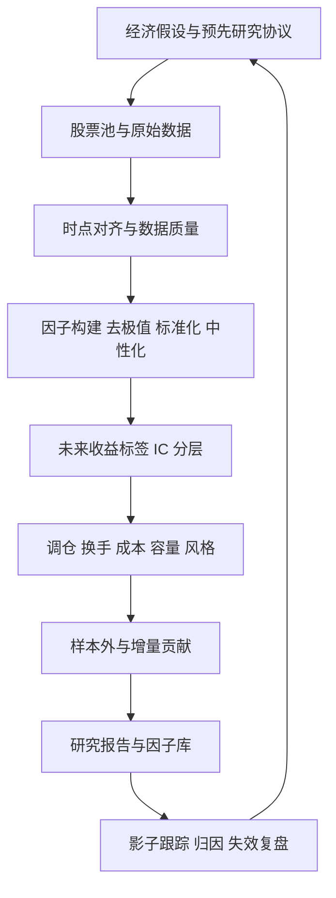

# 从零走通一次股票因子研究

> [!abstract] 这套笔记为你解决什么
> 你已有 Python、机器学习和一点深度学习基础，缺的是股票研究中的数据、时点、检验与交易闭环。目标是：**你能独立提出一个可证伪的因子假设，用可复现代码检查它，并诚实解释为什么保留、修改或放弃。**

它按你提供的“股票中低频量化研究员（校招）”岗位设计。学习顺序按关卡推进，学习时间由你自己决定。第一遍只走主线；进阶内容在遇到相应问题时再回来读。读完笔记不等于具备岗位全部经验，过关靠你亲手完成的产物。

## 今天从哪开始

1. 打开 [[03 第一课 - 因子到底在预测什么]]，先用五只虚构股票手算。
2. 打开 [[05 环境与实验台使用]]，运行随附实验，或先阅读 Obsidian 中的结果。
3. 在 [[02 一对一学习方式与进度板]] 留下你的答案、结果与疑问。
4. 下次对我说：“从第一关带我学，一次只讲一步，先让我回答，再纠正我。”

**一次只完成当前关卡，不必先读完全部笔记。** 不懂的词查 [[26 术语速查与常见报错]]。

## 研究流程

## 关卡与产物

| 关卡 | 阅读和操作 | 你必须交出的产物 |
|---|---|---|
| 0 建立直觉 | [[01 岗位能力地图与学习路线]]、[[03 第一课 - 因子到底在预测什么]] | 因子与标签的手算表 |
| 1 写清假设 | [[04 全流程与预先研究协议]]、[[08 从经济逻辑到因子公式]] | 一页冻结的研究协议 |
| 2 数据可信 | [[06 A股数据字典与股票池]]、[[07 Point-in-time与复权]]、[[09 数据清洗与横截面标准化]] | 数据字典、缺失报告、时间轴 |
| 3 构造信号 | [[10 行业市值中性化]]、[[11 收益标签与交易时间轴]] | 可复算的因子面板、标签表 |
| 4 检验排序 | [[12 因子检验 - IC与ICIR]]、[[13 分层收益与组合回测]] | IC 序列、分层图和反例 |
| 5 面对交易 | [[14 换手成本容量与衰减]]、[[17 风格暴露与收益归因]] | 费用压力表、容量情景、风格解释 |
| 6 验证稳定性 | [[15 样本外验证与过拟合控制]]、[[16 多因子合成与增量贡献]] | 冻结参数的样本外报告 |
| 7 研究交接 | [[18 因子失效复盘与下线]]、[[19 因子库数据管线与实验记录]] | 因子卡、实验记录、跟踪计划 |
| 8 拓展 | [[20 另类数据与文本因子实战]]、[[21 LLM辅助研究与信息泄漏]]、[[22 从SQL到机器学习因子]] | 一个有时间戳的文本信号或 ML 对照实验 |
| 毕业 | [[24 毕业项目 - 独立完成一份因子研究]] | 能让别人复现且能接受质疑的完整研究 |

## 本套材料采用的统一案例

- 主因子：过去 5 个交易日收益取负，数值越大表示过去跌得越多；这只是待检验的“短期反转”假设。
- 时点：交易日 $t$ 收盘后取得已发布数据；$t+1$ 开盘形成理想化成交；$t+6$ 开盘退出，持有 5 个开盘到开盘区间。
- 每 5 个交易日调仓，属于周度近似，**不是固定每周五**。
- 检验：五分组、Rank IC、非年化 ICIR、换手、成本、衰减、样本外；多头对样本等权组合，Q5−Q1 只作排序诊断。
- 模拟实验用于看懂方法；真实固定小样本用于练习数据接入。真实实验还需历史股票池、可交易性、行业及完整费用等，才能向岗位标准推进。

## 工具与资料

实验说明见 [[05 环境与实验台使用]]。阅读路线见 [[23 GitHub与官方资料精读路线]]，所有外部入口汇总在 [[27 来源索引与核验记录]]。研究模板与后续对话入口在 [[25 研究模板与一对一提问卡]]。你提供的岗位原文保存在 [[28 目标岗位原文与学习边界]]。

实际运行的模拟与真实固定小样本结果见 [[29 实测记录 - 模拟与真实小样本]]；也可打开 [[因子研究学习路线.canvas|可视化学习路线]] 浏览关卡关系。

> [!tip] 好研究允许得出“无效”
> 数据正确、时间正确、试验可复现，但因子没有样本外贡献，仍是一份有价值的学习成果。不能把模拟表现、课程实验或失败试验写成实盘收益。
