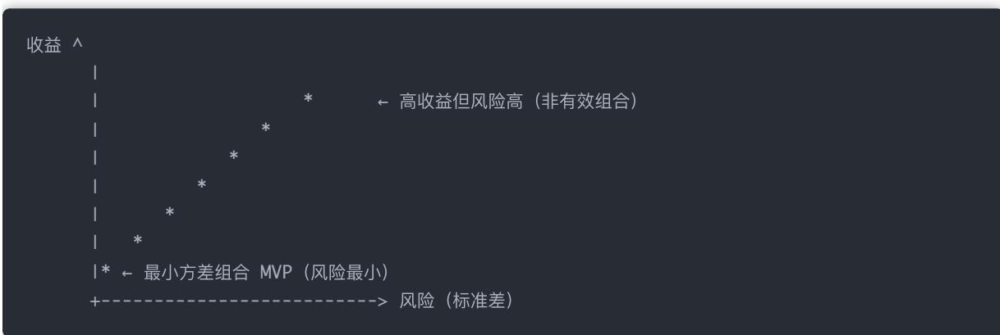
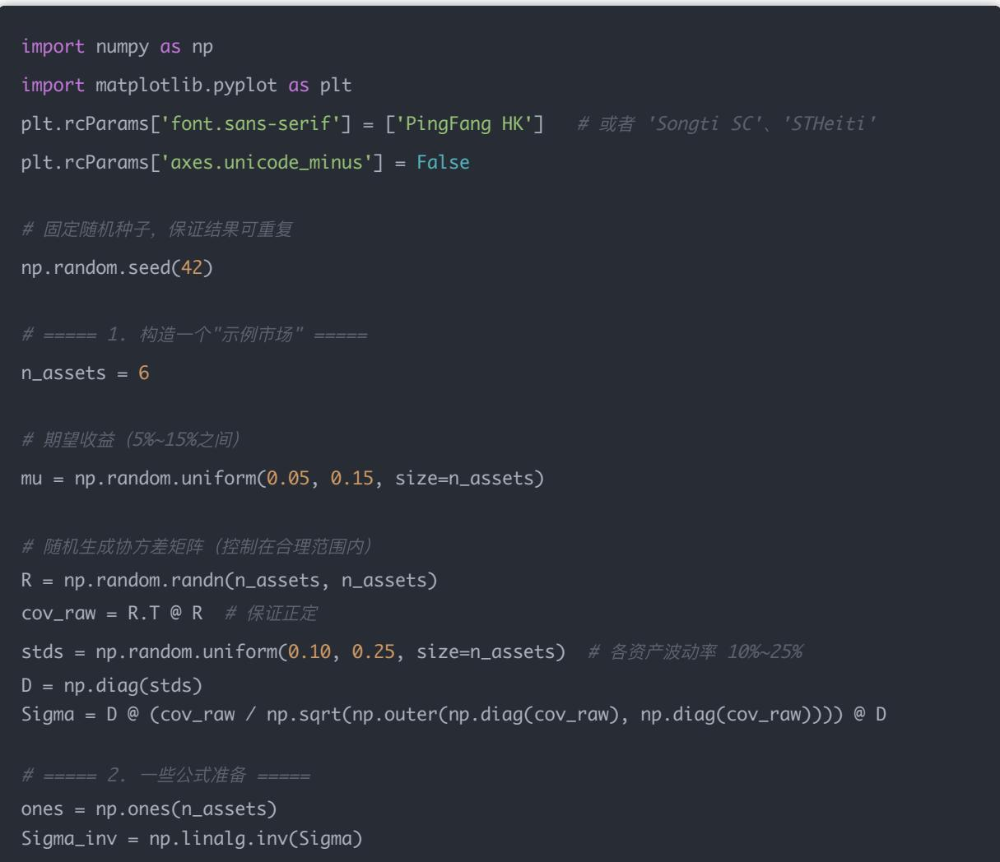
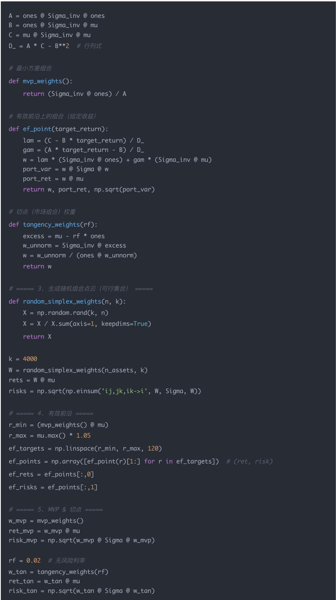
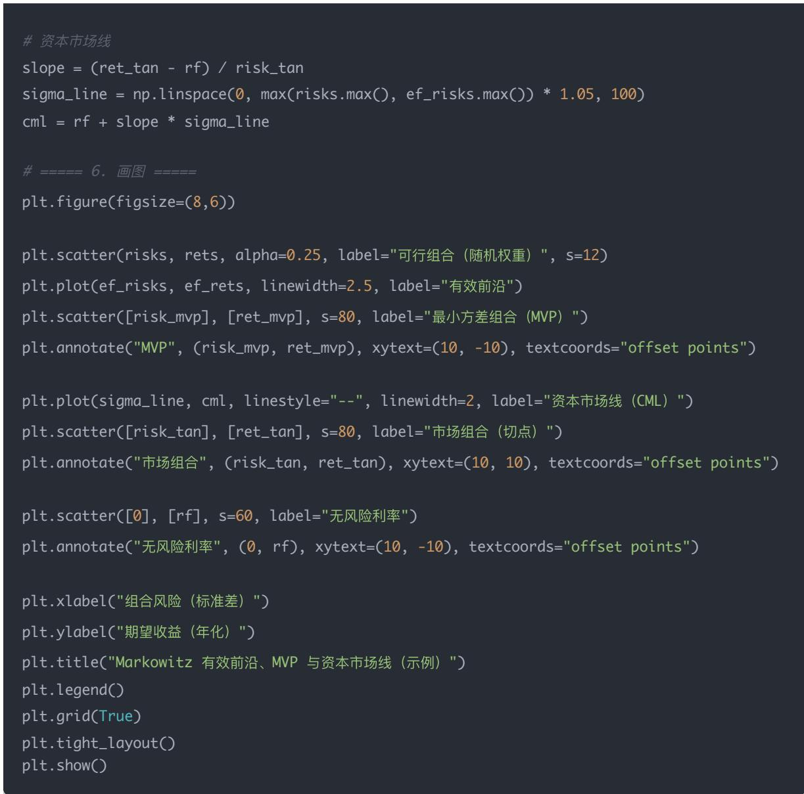

# 量化交易入门指南：第10天 - 资产配置与均值-方差理论（Mean-Variance Theory）

原创 逻辑与流 逻辑与流 2025年9月 3 日 15:42 北京 1人

这是现代投资组合理论的核心 它不仅是基金经理配置资产的基础，也是量化多资产策略 ETF构建风险平衡策略（如风险平价）等模型的出发点

## 学习目标

理解以下核心内容：

1. 投资组合收益与风险的数学表示

2. 投资组合的协方差与波动性

3. Markowitz 均值-方差理论（有效前沿）

4. 无风险资产的引入 & 最优资产配置线（CAL）

5. Python 代码实践（手动或附带代码）

预计学习时间：2-3小时

## 一 理论学习

### 1.组合收益和风险如何计算？

假设你有两个资产 $\mathsf { A } , \mathsf { B } _ { \mathrm { i } }$ ，权重分别为 $w _ { A } , w _ { B }$ ，期望收益为 $E [ R _ { A } ] , E [ R _ { B } ]$ ，波动率为 $\sigma _ { A } , \sigma _ { B } $ ，协方差 为 $\operatorname { C o v } ( A , B )$

组合预期收益：

$$
E [ R _ {p} ] = w _ {A} E [ R _ {A} ] + w _ {B} E [ R _ {B} ]
$$

组合方差（风险）：

$$
\sigma_ {p} ^ {2} = w _ {A} ^ {2} \sigma_ {A} ^ {2} + w _ {B} ^ {2} \sigma_ {B} ^ {2} + 2 w _ {A} w _ {B} \cdot \operatorname{Cov} (A, B)
$$

如果有多个资产（如 n 个），就扩展成协方差矩阵形式：

$$
\sigma_ {p} ^ {2} = \mathbf {w} ^ {T} \boldsymbol {\Sigma} \mathbf {w}
$$

### 2.组合期望收益是怎么计算的？

"期望是怎么计算的"，意思是：我们怎么得到 $E [ R _ { A } ] , E [ R _ { B } ] ?$

答案是：基于历史数据或未来预期来估算的

例如：

如果用历史平均：

$$
E [ R _ {A} ] = \frac {1}{T} \sum_ {t = 1} ^ {T} R _ {A, t}
$$

其中 $R _ { A , t }$ 是第 t 期的实际收益率

如果是基于分析师预测 基本面判断，可以人为设定一个预期收益

### 3.波动率是固定的吗？

不是"固定的"，而是基于一段历史数据估算的，并且会随着数据更新不断变化

波动率 本质上是收益率的标准差：

$$
\sigma_ {A} = \sqrt {\frac {1}{T - 1} \sum_ {t = 1} ^ {T} (R _ {A , t} - E [ R _ {A} ]) ^ {2}}
$$

它衡量的是收益的"上下波动性"

波动越大，风险越高

注意：波动率是用对数收益率还是线性收益率都可以，但要保持一致

### 4.协方差怎么计算的？

协方差公式是：

$$
\operatorname{Cov} (A, B) = \frac {1}{T - 1} \sum_ {t = 1} ^ {T} (R _ {A, t} - E [ R _ {A} ]) (R _ {B, t} - E [ R _ {B} ])
$$

它衡量的是：两个资产收益变动之间的关系

正协方差：同涨同跌

负协方差：一个涨一个跌

协方差 = 0：互不相关

协方差可以换算成"相关系数"：

$$
\begin{array}{c} \rho_ {A, B} = \frac {\operatorname{Cov} (A , B)}{\sigma_ {A} \sigma_ {B}} \\ \Rightarrow \end{array}
$$

$$
\operatorname{Cov} (A, B) = \rho_ {A, B} \cdot \sigma_ {A} \cdot \sigma_ {B}
$$

因为协方差是组合风险不可忽略的一部分

组合的整体波动不仅取决于每个资产自身的波动，还取决于它们之间是否"同步波动"

来看下组合方差的公式：

$$
\sigma_ {p} ^ {2} = w _ {A} ^ {2} \sigma_ {A} ^ {2} + w _ {B} ^ {2} \sigma_ {B} ^ {2} + 2 w _ {A} w _ {B} \cdot \operatorname{Cov} (A, B)
$$

➤ 解释：

前两项：分别是 A B 各自的风险

最后一项：是组合中由于资产之间的联动带来的额外风险或抵消效果

举例：

如果两个资产相关性是 -1，你可以组合出几乎"无波动"的投资（理论最小方差）

如果两个资产完全正相关，你的组合波动不会被降低

所以：

资产之间的协方差（或相关性）越低，组合分散风险的效果越好

这就是"不要把鸡蛋放在一个篮子里"的数学基础

### 6.多个资产的协方差矩阵形式

对于多个资产 n，你就不能一个个手工算了，要用矩阵：

权重向量：

$$
\mathbf {w} = \left[ \begin{array}{c} w _ {1} \\ w _ {2} \\ \vdots \\ w _ {n} \end{array} \right]
$$

协方差矩阵：

$$
\Sigma = \left[ \begin{array}{c c c c} \sigma_ {1} ^ {2} & \operatorname{Cov} 1, 2 & \dots & \operatorname{Cov} 1, n \\ \operatorname{Cov} 2, 1 & \sigma_ {2} ^ {2} & \dots & \operatorname{Cov} 2, n \\ \vdots & \vdots & \ddots & \vdots \\ \operatorname{Cov} n, 1 & \operatorname{Cov} n, 2 & \dots & \sigma_ {n} ^ {2} \end{array} \right]
$$

组合方差公式（矩阵形式）：

$$
\sigma_ {p} ^ {2} = \mathbf {w} ^ {T} \boldsymbol {\Sigma} \mathbf {w}
$$

你可以用 Excel 或 Python numpy 很方便地实现这个计算期望收益衡量你希望赚多少，波动率衡量一个资产自身有多不稳定， 协方差衡量资产之间是否"同时跳动"， 三者共同决定你的投资组合是否稳健 是否值得投入

8.深入理解组合方差公式的数学展开

### 8.1 矩阵形式的展开

我们已经知道组合方差可以用简洁的矩阵形式表示：

$$
\sigma_ {p} ^ {2} = \mathbf {w} ^ {\top} \boldsymbol {\Sigma} \mathbf {w}
$$

这个公式看起来很简洁，但具体展开是什么样子的呢？让我们一步步来理解

首先，我们需要学习一个重要的数学恒等式：

$$
\left(\sum_ {i} a _ {i}\right) ^ {2} = \sum_ {i} \sum_ {j} a _ {i} a _ {j}
$$

这个恒等式的展开过程是：

$$
\left(\sum_ {i = 1} ^ {n} a _ {i}\right) ^ {2} = \left(\sum_ {i = 1} ^ {n} a _ {i}\right) \left(\sum_ {j = 1} ^ {n} a _ {j}\right) = \sum_ {i = 1} ^ {n} \sum_ {j = 1} ^ {n} a _ {i} a _ {j}
$$

第一等号：平方就是"自 己乘自 己" 第二等号：对两边的求和逐项相乘，用分配律把所有成对的乘积都列出来

用小例子看得更清楚（n=3）：

$$
\bigl (a _ {1} + a _ {2} + a _ {3} \bigr) ^ {2} = \bigl (a _ {1} + a _ {2} + a _ {3} \bigr) \bigl (a _ {1} + a _ {2} + a _ {3} \bigr) = a _ {1} a _ {1} + a _ {1} a _ {2} + a _ {1} a _ {3} + a _ {2} a _ {1} + a _ {2} a _ {2} + a _ {2} a _ {3} + a _ {3} a _ {1} + a _ {3} a _ {2} + a _ {3} a _ {3}
$$

这正是

$$
\sum_ {i = 1} ^ {3} \sum_ {j = 1} ^ {3} a _ {i} a _ {j}
$$

把对称的交叉项合并（因为 $a _ { i } a _ { j }$ 与 $a _ { j } a _ { i }$ 相同），就得到常见的另一种写法：

$$
\sum_ {i = 1} ^ {n} a _ {i} ^ {2} + 2 \sum_ {1 \leq i <   j \leq n} a _ {i} a _ {j}
$$

8.2 组合方差公式的完整展开

根据上面的恒等式，我们可以将

$$
\sigma_ {p} ^ {2} = \mathbf {w} ^ {\top} \boldsymbol {\Sigma} \mathbf {w}
$$

展开如下：

$$
\sigma_ {p} ^ {2} = \mathbf {w} ^ {\top} \boldsymbol {\Sigma} \mathbf {w} = \sum_ {i = 1} ^ {n} \sum_ {j = 1} ^ {n} w _ {i} w _ {j} \boldsymbol {\Sigma} _ {i j}
$$

其中：

$\Sigma _ { i j } = \operatorname * { C o v } ( R _ { i } , R _ { j } )$ 表示资产i和资产j的协方差

$\Sigma _ { i i } = \mathrm { V a r } ( R _ { i } ) = \sigma _ { i } ^ { 2 }$ 表示资产i的方差

等价地也常写成"方差项 + 两两协方差项"的形式：

$$
\sigma_ {p} ^ {2} = \sum_ {i = 1} ^ {n} w _ {i} ^ {2} \sigma_ {i} ^ {2} + 2 \sum_ {1 \leq i <   j \leq n} w _ {i} w _ {j} \operatorname{Cov} (R _ {i}, R _ {j})
$$

8.3 三资产组合的具体例子

为了更直观地理解，我们看一个三资产组合的例子

设权重向量

$$
\mathbf {w} = [ w _ {1}, w _ {2}, w _ {3} ] ^ {\top}
$$

，协方差矩阵：

$$
\Sigma = \left[ \begin{array}{c c c} \sigma_ {1} ^ {2} & \mathrm{Cov} _ {1 2} & \mathrm{Cov} _ {1 3} \\ \mathrm{Cov} _ {2 1} & \sigma_ {2} ^ {2} & \mathrm{Cov} _ {2 3} \\ \mathrm{Cov} _ {3 1} & \mathrm{Cov} _ {3 2} & \sigma_ {3} ^ {2} \end{array} \right]
$$

则组合方差展开为：

$$
\begin{array}{l} \sigma_ {p} ^ {2} = w _ {1} ^ {2} \sigma_ {1} ^ {2} + w _ {2} ^ {2} \sigma_ {2} ^ {2} + w _ {3} ^ {2} \sigma_ {3} ^ {2} \\ \qquad + 2 \big (w _ {1} w _ {2} \operatorname{Cov} _ {1 2} + w _ {1} w _ {3} \operatorname{Cov} _ {1 3} + w _ {2} w _ {3} \operatorname{Cov} _ {2 3} \big). \end{array}
$$

8.4 用相关系数表示的方差公式

我们也可以用相关系数来表示协方差 若 $\rho _ { i j }$ 为相关系数，则：

$$
\operatorname{Cov} _ {i j} = \rho_ {i j} \sigma_ {i} \sigma_ {j}
$$

令 $D = \operatorname { d i a g } ( \sigma _ { 1 } , . . . , \sigma _ { n } )$ 为对角矩阵， 为相关矩阵，则：

$$
\Sigma = D \rho D, \sigma_ {p} ^ {2} = \mathbf {w} ^ {\top} D \rho D \mathbf {w}
$$

8.5 两个重要特例

特例1：资产独立/不相关 $( \mathrm { C o v } _ { i j } = 0 )$

$$
\sigma_ {p} ^ {2} = \sum_ {i} w _ {i} ^ {2} \sigma_ {i} ^ {2}
$$

这种情况下没有"分散化"溢出项，组合风险就是各资产风险的加权平方和

特例2：完全正相关 $( \rho _ { i j } = 1 )$

$$
\sigma_ {p} = \sum_ {i} | w _ {i} | \sigma_ {i}
$$

权重同号时近似线性叠加，分散化效果最差

8.6 组合方差公式的数学推导

让我们从组合收益的定义和方差展开的性质角度来理解这个公式

组合收益的定义：组合收益率：

$$
R _ {p} = \sum_ {i = 1} ^ {n} w _ {i} R _ {i}
$$

组合方差定义：

$$
\sigma_ {p} ^ {2} = \operatorname{Var} (R _ {p}) = \operatorname{Var}! \left(\sum_ {i = 1} ^ {n} w _ {i} R _ {i}\right)
$$

方差展开：根据方差的性质：

$$
\operatorname{Var} \left(\sum_ {i = 1} ^ {n} a _ {i} X _ {i}\right) = \sum_ {i = 1} ^ {n} a _ {i} ^ {2} \operatorname{Var} \left(X _ {i}\right) + 2 \sum_ {1 \leq i <   j \leq n} a _ {i} a _ {j} \operatorname{Cov} \left(X _ {i}, X _ {j}\right)
$$

代入 $a _ { i } = w _ { i } , X _ { i } = R _ { i }$

$$
\operatorname{Var} \left(\sum_ {i = 1} ^ {n} a _ {i} X _ {i}\right) = \sum_ {i = 1} ^ {n} a _ {i} ^ {2} \operatorname{Var} \left(X _ {i}\right) + 2 \sum_ {1 \leq i <   j \leq n} a _ {i} a _ {j} \operatorname{Cov} \left(X _ {i}, X _ {j}\right)
$$

8.7 为什么组合方差是平方形式？

从方差定义角度：方差的定义：

$$
\operatorname{Var} (X) = \mathbb {E} [ (X - \mathbb {E} [ X ]) ^ {2} ]
$$

所以不管是单个资产还是组合，方差都是"平方"的量 这就是为什么组合风险写成 $\sigma _ { p } ^ { 2 }$ ，而不是 $\sigma _ { p } .$

$\sigma _ { p } :$ ：标准差，度量风险的直观"量纲"

$\sigma _ { p } ^ { 2 } \colon$ 方差，计算方便 能和协方差一起组合

从组合收益形式角度：组合收益：

$$
R _ {p} = \sum_ {i = 1} ^ {n} w _ {i} R _ {i}
$$

组合方差：

$$
\sigma_ {p} ^ {2} = \operatorname{Var} (R _ {p}) = \operatorname{Var}! \left(\sum_ {i = 1} ^ {n} w _ {i} R _ {i}\right)
$$

利用方差的二次性质（线性组合 → 二次型），平方自然出现了：因为方差计算里有"平方差"的定义，叠加权重之后就变成了"二次形式"

8.8 组合收益为什么是累加形式？

回到最基本的地方：为什么组合收益率 $R _ { p } \# ^ { \bigstar }$ 一堆资产收益率的加权和？

投资组合的本质：假设你有 100 元钱，要投到不同资产里：

把 50 元投到股票 A

把 30 元投到股票 B

把 20 元投到债券 C

那么这些比例就是组合的权重： $w _ { A } = 0 . 5 , w _ { B } = 0 . 3 , w _ { C } = 0 . 2$ ，而且满足 $\textstyle \sum w _ { i } = 1$ 。

组合总收益率的计算：组合最终价值：

$$
V _ {p} = 1 0 0 \times (w _ {A} (1 + R _ {A}) + w _ {B} (1 + R _ {B}) + w _ {C} (1 + R _ {C}))
$$

组合的收益率：

$$
R _ {p} = \frac {V _ {p} - 1 0 0}{1 0 0} = w _ {A} R _ {A} + w _ {B} R _ {B} + w _ {C} R _ {C}
$$

你会发现，组合收益率就是各资产收益率的加权平均，权重就是你投的钱的比例

推广到 n 个资产：

$$
R _ {p} = \sum_ {i = 1} ^ {n} w _ {i} R _ {i}, \quad \sum_ {i = 1} ^ {n} w _ {i} = 1
$$

所以， $R _ { p }$ 是个"累加的和"，本质原因是：组合收益是"总钱数的变化率"；总钱数 = 各部分投资价值之和；每部分的价值变化率（收益率）乘以它的占比（权重），累加起来就是整体的变化率

8.9 期望值在方差计算中的作用

公式里的 $\mu _ { i }$ 和 $\mu _ { p } \uparrow$ 代表期望收益率（expected return），和单次实现的收益率 $R _ { i } , R _ { p } \pi .$ 一样。

符号对照：

● $R _ { i }$ ：第 i 个资产的随机收益率（可能是个随机变量，有波动）

$\mu _ { i } = \mathbb { E } [ R _ { i } ] :$ 第 i 个资产的期望收益率（平均收益）

$\begin{array} { r } { R _ { p } = \sum _ { i } w _ { i } R _ { i } } \end{array}$ ：投资组合的随机收益率

$\mu _ { p } = \mathbb { E } [ R _ { p } ]$ ：投资组合的期望收益率

为什么要用期望值？因为方差和协方差的定义里，都需要减去期望值：

$$
\operatorname{Var} (X) = \mathbb {E} [ (X - \mathbb {E} [ X ]) ^ {2} ]
$$

$$
\operatorname{Cov} (X, Y) = \mathbb {E} [ (X - \mathbb {E} [ X ]) (Y - \mathbb {E} [ Y ]) ]
$$

所以推导组合方差时，自然会出现 $\mu _ { i } , \ \mu _ { p } \mathrm { { c } }$

完整的推导过程：

$$
R _ {p} = \sum_ {i} w _ {i} R _ {i}, \quad \mu_ {p} = \sum_ {i} w _ {i} \mu_ {i}
$$

组合方差：

$$
\sigma_ {p} ^ {2} = \operatorname{Var} (R _ {p}) = \mathbb {E} \left[ \left(R _ {p} - \mu_ {p}\right) ^ {2} \right]
$$

代入：

$$
= \mathbb {E} \left[ \left(\sum_ {i} w _ {i} \left(R _ {i} - \mu_ {i}\right)\right) ^ {2} \right]
$$

展开双重和：

$$
= \sum_ {i} \sum_ {j} w _ {i} w _ {j} \mathbb {E} [ (R _ {i} - \mu_ {i}) (R _ {j} - \mu_ {j}) ]
$$

注意到 $\mathbb { E } [ ( R _ { i } - \mu _ { i } ) ( R _ { j } - \mu _ { j } ) ] = \operatorname { C o v } ( R _ { i } , R _ { j } )$ ，于是得到：

$$
\sigma_ {p} ^ {2} = \sum_ {i = 1} ^ {n} w _ {i} ^ {2} \sigma_ {i} ^ {2} + 2 \sum_ {1 \leq i <   j \leq n} w _ {i} w _ {j} \operatorname{Cov} (R _ {i}, R _ {j})
$$

8.10 协方差的数学定义

协方差 $( \mathrm { c o v a r i a n c e } ^ { \circ } )$ 在概率论里的定义就是：

$$
\operatorname{Cov} (X, Y) := \mathbb {E} [ (X - \mathbb {E} [ X ]) (Y - \mathbb {E} [ Y ]) ]
$$

所以如果我取 $X = R _ { i } , \ Y = R _ { j } ,$ ，那么：

$$
\operatorname{Cov} \left(R _ {i}, R _ {j}\right) = \mathbb {E} \left[ \left(R _ {i} - \mu_ {i}\right) \left(R _ {j} - \mu_ {j}\right) \right]
$$

其中 $\mu _ { i } = \mathbb { E } [ R _ { i } ] , \ \mu _ { j } = \mathbb { E } [ R _ { j } ] ,$ 。

特殊情况：方差是协方差的特例如果 $i = j ,$ ，那么：

$$
\operatorname{Cov} (R _ {i}, R _ {i}) = \mathbb {E} [ (R _ {i} - \mu_ {i}) (R _ {i} - \mu_ {i}) ] = \mathbb {E} [ (R _ {i} - \mu_ {i}) ^ {2} ] = \operatorname{Var} (R _ {i})
$$

所以，方差其实就是"自 己和自 己"的协方差

直观理解：

如果 $R _ { i }$ 和 $R _ { j } -$ 起涨一起跌，则 $( R _ { i } - \mu _ { i } ) ( R _ { j } - \mu _ { j } )$ 大部分时候为正，协方差为正 → 说明它们走势一致

如果一个涨时另一个跌，这个乘积大多为负，协方差为负 → 说明它们走势相反

如果两者独立，正负相互抵消，协方差接近 0

所以

$$
\mathbb {E} [ (R _ {i} - \mu_ {i}) (R _ {j} - \mu_ {j}) ]
$$

这不是我们"推出来"的，而是概率论里定义协方差时的基本公式

## 二 Markowitz 均值-方差理论（Mean-Variance Frontier）

在给定的风险水平下，找到能带来最高期望收益的投资组合 或者在给定收益目标下，找到风险最小的组合

这就构成了所谓的：

有效前沿（Efficient Frontier ）

一条向上的"边界线"，表示在不同风险水平下最优的资产组合

### 1. 背景与目标：资产组合优化的本质

假设你有多个投资对象（如股票 基金 债券等），你希望在控制风险的前提下，获得尽可能高的收益。

Markowitz 的思想核心就是：

收益越高越好，风险越低越好 但二者存在权衡：收益越高，风险往往越大

于是，我们的目标转化为：

在固定风险水平下，找期望收益最高的组合

或者 在固定收益目标下，找风险最小的组合

先假设你知道所有资产的：

期望收益 $E [ R _ { i } ]$

风险（标准差） $\sigma _ { i }$

两两之间的协方差 $\operatorname { C o v } ( R _ { i } , R _ { j } )$

你可以通过不同的权重组合

$$
\mathbf {w} = [ w _ {1}, w _ {2}, \ldots , w _ {n} ]
$$

构造出许多组合，每个组合都有：

一个期望收益

$$
E [ R _ {p} ] = \sum w _ {i} E [ R _ {i} ]
$$

一个组合风险

$$
\sigma_ {p} = \sqrt {\mathbf {w} ^ {T} \boldsymbol {\Sigma} \mathbf {w}}
$$

把所有这些组合画在二维坐标系里（x轴是风险，y轴是收益），你就得到一个"抛物线形的图" —— 这叫做可行集合

### 3. 有效前沿（Efficient Frontier）

在这个"抛物线形区域"的上边界，就是 Markowitz 所定义的：

有效前沿（Efficient Frontier）

它包含了所有在给定风险水平下，期望收益最高的投资组合

特点：

所有有效组合都在这条边界上

边界以下的组合，要么收益低，要么风险高 —— 非最优

这条边界线通常是向上弯曲的（凸的）

### 4. 最左边的点：最小方差组合（Minimum Variance Portfolio）

在所有组合中，风险（方差）最小的是哪一个？

就是 有效前沿最左侧的那一点，称为：

Minimum Variance Portfolio（MVP）

它的特点是：

不管你是否追求高收益，它无条件风险最小

通常是分散投资效果最强的组合

有时候收益也不错，但不是最优收益

### 5. 再引入无风险资产后（Capital Market Line）

如果市场中存在一个无风险资产（如国债），你还可以：

和有效前沿上的某一点做一条切线

找到一条叫做 资本市场线（CML） 的直线

它的切点就是市场组合（Market Portfolio），夏普比率最大

这是 CAPM 的基础，可以之后扩展讲

### 6. 小结：图像理解

你可以把整个 Markowitz 均值-方差理论理解为：

\*表示有效前沿上的组合

最左边那点风险最低

你选组合的位置，取决于你对风险和收益的偏好（风险厌恶程度）

## 三 引入无风险资产：资本配置线（CAL）

当你能投资于一个无风险资产（如国债）和一个风险资产组合时：

整个有效前沿不再是曲线，而变成一条直线

最陡的那条线，即为资本配置线（Capital Allocation Line），斜率就是 Sharpe Ratio

投资组合理论的目标就是找到那条最陡的 CAL，其与有效前沿相切的点，称为：

最优风险投资组合（Tangency Portfolio）

### 1.先回顾：没有无风险资产时的有效前沿

我们已经知道：

有 n 个风险资产，比如股票 基金等

通过不同的权重组合，构建出各种投资组合

把这些组合在二维坐标系（风险 σ，期望收益 E[R]）上画出来，形成一个"向上凸的边界曲线"，那是：有效前沿（Efficient Frontier）

### 2.现在引入一个无风险资产

比如：短期国债，固定收益 3%，标准差为 0（无波动）

我们现在可以干一件以前不能做的事：

把"无风险资产" 和 "任何风险资产组合" 做加权投资！

例如：

投资组合 = 50% 无风险资产（如年化 3%）

50% 风险资产（如股票组合年化 8%，σ = 15%）

那整体组合的：

预期收益 = 0.5 × 3% + 0.5 × 8% = 5.5%

风险 = 0.5 × 15% = 7.5% （因为无风险资产波动是 0）

注意：风险线性增长，收益也线性增长！ 这说明：你在两个资产间做线性组合，最终结果也落在一条直线上。

### 3.这就是"资本配置线（CAL）"

如果你：

把无风险资产当作左端点

另一端是某个风险投资组合

你就可以在这两点之间做任意线性组合（例如 30/70, 60/40 等）

那么：

所有这些组合就落在一条穿过无风险收益点 延伸到风险资产组合的直线上，这条线就是：

资本配置线（CAL, Capital Allocation Line）

### 4.为什么我们要找"最陡的"那条线？

因为：

线的斜率 = 单位风险所获得的超额收益

$$
\mathrm{CAL} \text {斜率} = \frac {E [ R _ {p} ] - R _ {f}}{\sigma_ {p}} = \mathrm{SharpeRatio}
$$

所以我们希望这条线尽可能"陡"，代表单位波动带来最多收益！

## 结论：

找到和有效前沿"相切"的 CAL，就是找到单位风险回报比（Sharpe）最大的投资组合！

这个切点对应的组合就是：

切点投资组合（Tangency Portfolio）

它是所有风险资产中最优的"基础组合"

投资者可以根据自 己的风险偏好，在这条线上的不同点做组合（加杠杆或持有部分国债）

### 5.图像理解：

上面这张图就是你要的"可行集合 + 有效前沿 + MVP + 资本市场线 $( C M L ^ { \alpha } )$ "的标准示意

快速读图指南（从图上元素出发）：

可行组合（散点云）： 这是随机生成的不同权重的组合，每个点都对应一对 (风险σ, 收益μ) 整片散点区域就是"可行集合"

有效前沿（平滑的上边界曲线）： 这条曲线的每一个点，都是"在该风险下收益最高"的最优组合 散点云里位于它下方或右下方的点，要么更低的收益，要么更高的风险（劣解）

MVP（最小方差组合，左端点）： 有效前沿最左边的点，对应全市场风险最低的组合（不考虑收益目标时的最优解） 它通常具有最强的分散化效果

无风险利率（纵轴上的点）与 CML（虚线）： 加入无风险资产后，我们从"无风险利率点"作一条与有效前沿相切的直线，这条直线就是 CML

切点 = 市场组合（Max Sharpe）：在包含无风险资产的世界里，它是夏普比率最高的有风险组合。

CML 上任意一点，都可以看成"无风险资产 + 市场组合"的线性搭配 其斜率就是最大夏普比率

## 原理小结（对应你给的理论）：

1. 二维世界：横轴风险 （标准差），纵轴期望收益

2. 可行集合用所有可能权重组合生成；有效前沿是其上边界（在每个σ上 μ 最大）

3. MVP是方差最小的组合；

4. 引入无风险资产后，最优投资不再是"前沿上的某点"，而是无风险点到前沿的切线（CML）；切点就是"市场组合"。

## 备注

我用多资产的年化期望收益/协方差构造了一个示例市场；有效前沿用 Markowitz 的拉格朗日乘子闭式解逐点求得；MVP用 归一化公式；切点（市场组合）用 $\Sigma ^ { - 1 } ( \mu - r _ { f } \mathbf { 1 } )$ 归一化求得；CML 是从 经过切点的直线

这个只是"形状正确 逻辑正确"的演示；真实投资需要用实际历史数据或前瞻估计的均值/协方差来生成这张图。

### 6. 实践：Python代码实现

为了让你能够直观地看到上述理论的可视化效果，下面提供了一个完整的Python代码示例 这个代码会生成一个包含可行集合 有效前沿 MVP和资本市场线的完整图表，帮助你更好地理解Markowitz均值-方差理论

## 代码功能说明：

构造一个6资产的示例市场

生成随机权重组合的可行集合（散点云）

计算并绘制有效前沿曲线

找到最小方差组合（MVP）

引入无风险资产，计算切点组合（市场组合）

绘制资本市场线（CML）

使用前准备：确保你的Python环境已安装numpy和matplotlib库：

pip install numpy matplotlib

## 完整代码：

plt.rcParams['axes.unicode\_minus'] = False

\# 固定随机种子，保证结果可重复

\# 有效前沿上的组合（给定收益 def ef\_point(target\_return): lam = (C - B \* target\_return) / D\_ gam = (A \* target\_return - B) / D\_ w = lam \* (Sigma\_inv @ ones) + gam \* (Sigma\_inv @ mu) port\_var = w @ Sigma @ w port\_ret = w @ mu return w, port\_ret, np.sqrt(port\_var)

def tangency\_weights(rf): excess = mu - rf \* ones w\_unnorm = Sigma\_inv @ excess w = w\_unnorm / (ones @ w\_unnorm) return w

## 运行说明：

1. 直接复制粘贴上述代码到你的Python环境（Jupyter Notebook PyCharm VS Code等）

2. 运行后会生成一个完整的Markowitz投资组合理论可视化图表

3. 图表包含：

蓝色散点：4000个随机权重组合（可行集合）

红色曲线：有效前沿

绿色点：最小方差组合（MVP）

虚线：资本市场线（CML）

橙色点：市场组合（切点）

紫色点：无风险利率

## 代码特点：

使用真实的数学公式计算有效前沿和MVP

随机生成合理的市场数据，每次运行结果略有不同

包含完整的图例和标注，便于理解各个元素

代码结构清晰，便于学习和修改

运行这个代码后，你就能看到我们前面讨论的所有理论概念的可视化表示，这将大大加深你对Markowitz均值-方差理论的理解

### 7.总结

<table><tr><td>概念</td><td>含义</td></tr><tr><td>无风险资产</td><td>固定收益、零波动,如国债</td></tr><tr><td>资本配置线 CAL</td><td>投资组合 = 无风险资产 + 风险组合</td></tr><tr><td>CAL 斜率</td><td>Sharpe Ratio,单位波动带来的超额收益</td></tr><tr><td>切点组合</td><td>Sharpe 最大,最优风险投资组合</td></tr><tr><td>投资选择</td><td>你可以在 CAL 上移动,根据风险承受能力选择组合</td></tr></table>
