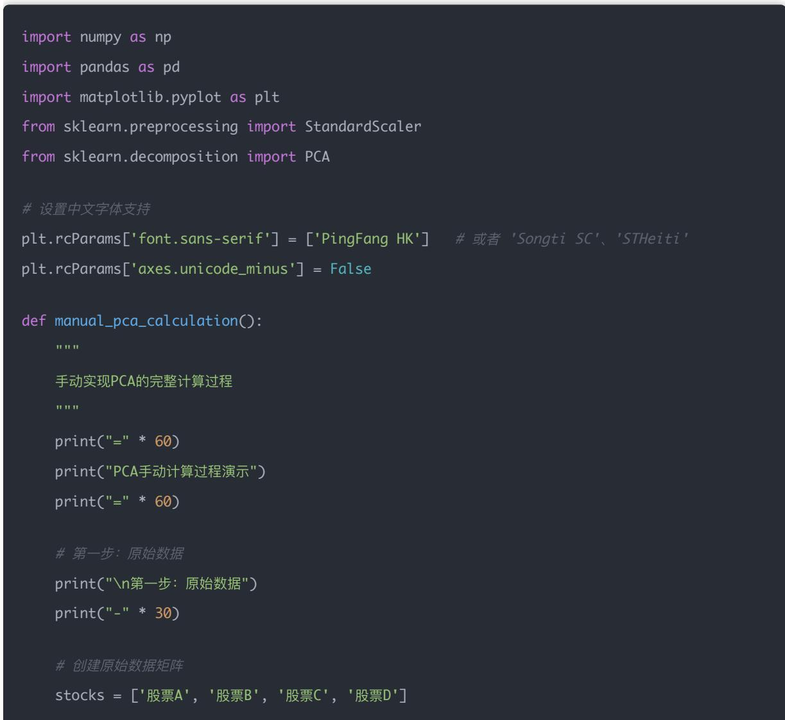
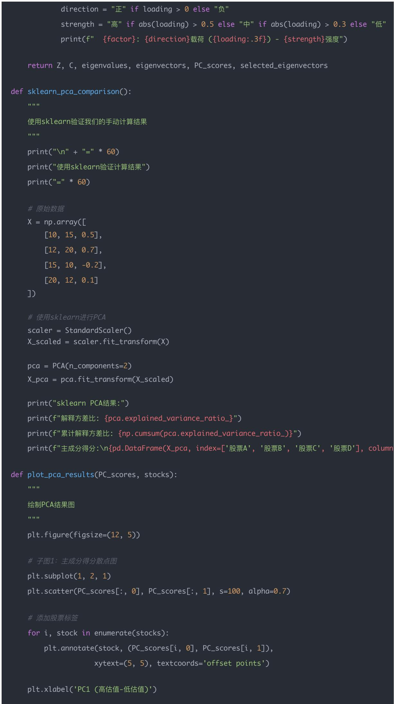
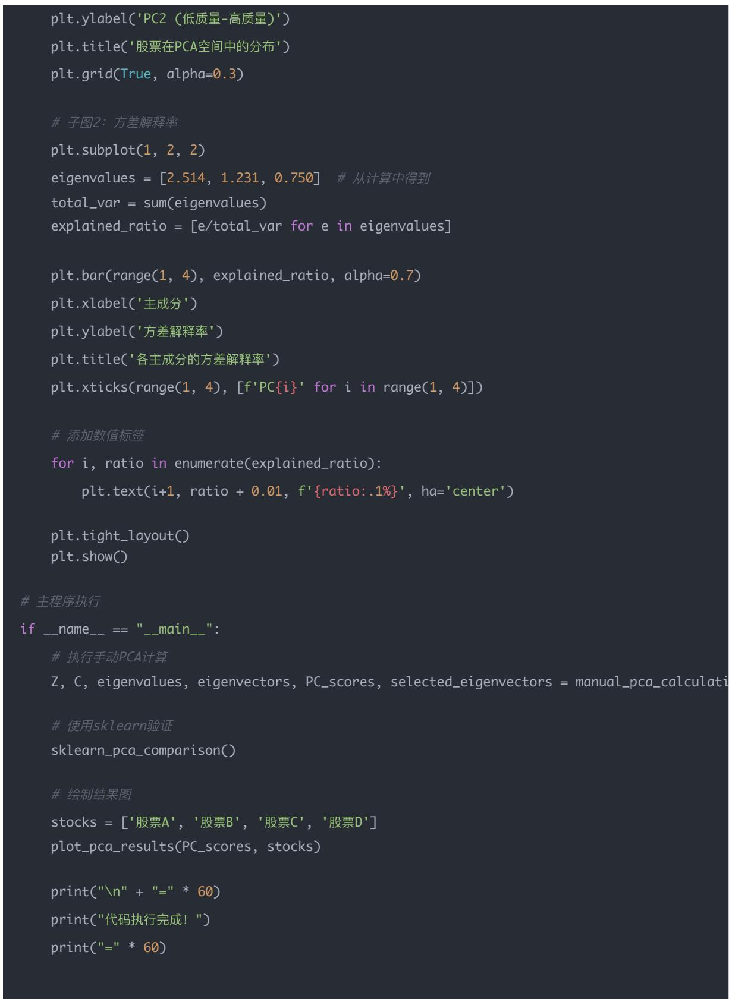
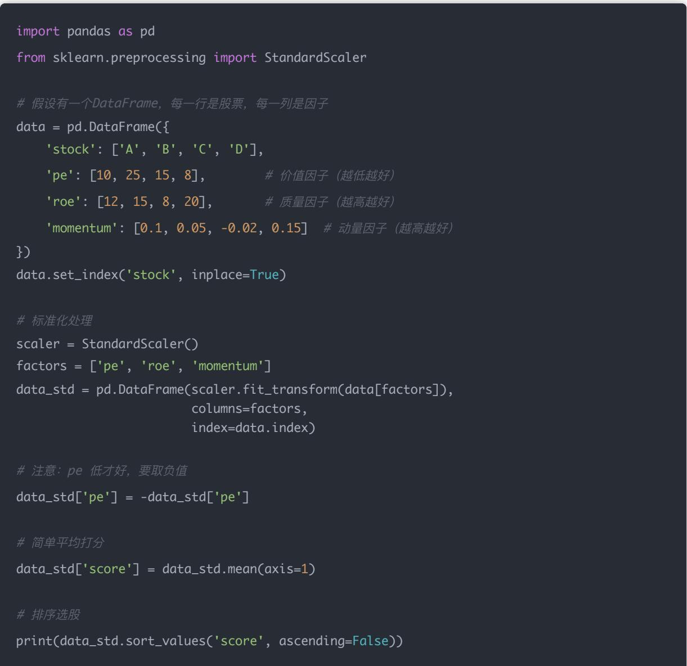

## 量化交易入 门指南：第11天 - 多因子选股模型（Factor Investing）

原创 逻辑与流 逻辑与流 2025年9月 6 日 22:32 山 西 7人

本文为量化交易学习系列第11天内容，系统讲解多因子选股模型的原理 因子分类 组合方法 实战流程与Python实现，帮助你掌握现代量化基金的Alpha策略核心。

## 学习时间：60分钟

## 今日 目标

## 你将掌握：

1. 什么是"因子"（Factor）？

2. 常见的因子类别和含义

3. 多因子模型的组合方式

4. 用 Python 实现一个简单的多因子评分系统

5. 如何从"因子"走向"策略"？

## 一、为什么是"Alpha 策略"？

在量化投资中，理解"Alpha"和"Beta"是构建选股策略的基础

Alpha（α）：资产的超额收益，即超出市场基准（如标普500 沪深300）的收益

Beta（β）：资产对市场整体波动的敏感性（系统性风险），如市场涨1%，你的组合涨1.2%，Beta≈1.2。

Alpha 策略：通过研究 建模等手段，获取"额外收益"的策略，这种收益不是因为市场整体上涨，而是因为你"选股（择时）能力强"

目标：Alpha 策略的目标是击败市场基准，赚取额外收益

## 二、为什么用"因子"来构建 Alpha 策略？

股票价格的变化并非完全随机，而是受到一系列可量化的驱动因子（Factor）影响：

价值因子（Value）：低市盈率 市净率的股票长期表现更好；

动量因子（Momentum）：过去表现好的股票短期内更可能继续上涨；

质量因子（Quality）：高盈利能力 低负债率的公司长期表现更稳健；

小市值因子（Size）：小盘股有时能跑赢大盘股；

波动率因子（Volatility）：低波动率的股票长期有超额收益

AQR Two Sigma 桥水等顶级量化机构的核心能力，就是围绕因子构建出组合稳定 风险可控 长期有效的 Alpha 策略。

## 三 Alpha 策略 vs Beta 策略

<table><tr><td>对比项</td><td>Alpha 策略</td><td>Beta 策略</td></tr><tr><td>目标</td><td>超越市场收益(择股择时)</td><td>复制市场收益(持有指数)</td></tr><tr><td>收益来源</td><td>股票的相对表现(选得好)</td><td>市场整体上涨(靠大盘)</td></tr><tr><td>代表产品</td><td>多因子选股策略、统计套利</td><td>ETF、指数基金</td></tr><tr><td>难度</td><td>高(需要建模、预测)</td><td>低(只需跟随指数)</td></tr></table>

小结：量化基金用"多个因子"预测股票收益，是为了追求 Alpha（超额收益），而不是简单追踪市场（Beta）

## 四 什么是因子（Factor）？

在量化中，因子是能够系统性解释资产收益差异的特征变量

举例：

市盈率（PE）低的股票平均表现更好（价值因子）

最近上涨的股票更容易继续上涨（动量因子）

因子不是噪声，而是"能预测部分收益的结构性信息"

## 五 常见因子分类（五大类）

<table><tr><td>因子类型</td><td>示例因子</td><td>含义</td></tr><tr><td>价值因子</td><td>PE、PB、EV/EBITDA</td><td>低估值股票长期跑赢</td></tr><tr><td>动量因子</td><td>3个月涨幅、6月收益</td><td>趋势延续效应</td></tr><tr><td>质量因子</td><td>ROE、净利润率</td><td>高质量企业表现稳定</td></tr><tr><td>规模因子</td><td>市值、总资产</td><td>小市值公司长期有超额收益</td></tr><tr><td>波动/风险因子</td><td>波动率、Beta、最大回撤</td><td>低波动股票可能更优(Low Vol)</td></tr></table>

## 六、单因子 vs 多因子模型

单因子模型：只使用一个因子排序选股，简单但容易失效

多因子模型：多个因子融合打分，更稳定 抗噪音

## 多因子融合方法举例：

Z-score 归一化后加权求和

PCA 主成分分析

机器学习模型：XGBoost 线性回归 Random Forest 等

### 1. Z-score 加权求和法（标准化加权法）

### 1.1 为什么要用 Z-score？

在多因子模型中，我们面临一个核心问题：各因子的数值尺度完全不同

## 尺度差异问题：

PE（市盈率）：通常在 5-50 之间

PB（市净率）：通常在 0.5-10 之间

动量因子（收益率）：通常在 -20% 到 +20% 之间

波动率：通常在 10%-50% 之间

如果直接对这些不同尺度的因子进行加权求和，会产生严重的不公平影响：

数值大的因子（如 PE=30）会主导结果

数值小的因子（如动量=5%）几乎被忽略

最终评分完全失真，无法反映真实的因子贡献

Z-score 的解决方案：Z-score 标准化将所有因子转换到同一尺度（均值=0，标准差=1），让每个因子都能公平参与评分

1.2 Z-score 公式详解

标准化公式：

$$
Z _ {i, f} = \frac {X _ {i , f} - \mu_ {f}}{\sigma_ {f}}
$$

参数含义：

$X _ { i , f } \colon$ 股票 i 在因子 f 上的原始值

$\mu _ { f } \colon$ 因子 f 的样本均值

$\sigma _ { f } \colon$ 因子 f 的标准差

$Z _ { i , f } \colon$ 标准化后的值，表示该股票在该因子上的相对位置

## Z-score 的实际意义：

大小代表偏离程度：Z=2 表示比平均水平高 2 个标准差；Z=-1 表示比平均水平低 1 个标准差

正负代表方向：Z>0 表示在平均水平之上；Z<0 表示在平均水平之下

可跨领域比较：不同量纲的因子经过 Z 转换后，都变成了"标准差单位"，可以公平比较

### 1.3 形象比喻：运动会评分

想象你参加运动会，有三个项目：

跑步：用秒数衡量（10-20秒）

跳远：用米衡量（2-8米）

举重：用公斤衡量（50-200公斤）

这三个成绩原本无法直接相加比较 Z-score 的做法是：

1. 减去平均水平：看每个成绩比平均差多少

2. 除以标准差：用"常见差距"作为统一刻度

这样，每个项目都变成了"比平均好多少个标准差"，所有项目都用同一把"尺子"衡量，自然可以公平相加。

### 1.4 加权求和公式

标准化后，每个因子都变成了"可比的分数"，可以进行加权求和：

$$
\operatorname{Score} _ {i} = \sum_ {f = 1} ^ {F} w _ {f} \cdot Z _ {i, f}
$$

参数含义：

$\mathbf { S c o r e } _ { i }$ ：股票 i 的综合得分

$\boldsymbol { w } _ { f } \colon$ 因子 f 的权重（可等权或根据历史表现设定）

：因子总数

1.5 实际计算例子

假设我们有两个因子：PE（越低越好）和动量（越高越好）

某股票数据：

PE = 8，市场均值 = 15，标准差 = 5

$Z – s c o r e = ( 8 \cdot 1 5 ) / 5 = - 1 . 4$

动量 = 20%，市场均值 = 5%，标准差 = 10%

Z-score = (0.20 - 0.05)/0.10 = 1.5

等权加权计算（权重各 0.5）： $\mathrm { S c o r e } = 0 . 5 \times ( - 1 . 4 ) + 0 . 5 \times 1 . 5 = 0 . 0 5$

结果解读：这只股票的综合得分接近 0，说明在平均水平附近，不是特别突出

### 1.6 应用步骤

1. 选取有效因子：选择动量 价值 波动率 质量等多个因子

2. 横截面标准化：对每个因子在当期所有股票中进行 Z-score 处理

3. 设定权重：可等权 根据历史绩效或主观判断设定

4. 计算综合得分：加权求和得到每只股票的评分

5. 排序选股：按得分排序，选择前 N 名构建组合

## 优点：

1. 简单直观，便于解释和理解

2. 不需要复杂算法，容易实施和调试

3. 权重可控，可以融入主观判断和策略偏好

4. 标准化处理消除了量纲差异，确保公平比较

## 缺点：

1. 因子权重通常是静态设定的，无法自动适应市场变化

2. 没有处理因子间的相关性和冗余信息

3. 假设因子与收益呈线性关系，可能忽略非线性效应

4. 对异常值敏感，极端数据可能影响标准化结果

### 2. PCA 主成分分析（降维融合法）

### 2.1 PCA 原理概述

PCA（Principal Component Analysis）是一种无监督降维算法，用于从多个相关变量中提取最核心的无关成分，即"主成分"

## 核心思想：

在多因子选股中，许多因子之间存在相关性（如PE和PB都反映估值）

PCA 通过线性变换，将相关因子转换为不相关的主成分

保留解释大部分方差的前几个主成分，实现降维和去冗余

数学原理：PCA 通过寻找数据的主要变化方向，将原始因子空间投影到新的坐标系中，使得：

1. 新坐标轴（主成分）之间相互垂直（不相关）

2. 第一个主成分解释最大方差，第二个解释次大方差，以此类推

2.2 量化投资中的PCA实战案例

我们用一个量化投资中的实际例子来详细讲解PCA的每一步计算 假设我们有4只股票，每只股票有3个因子暴露：市盈率（PE） 净资产收益率（ROE）和动量因子（Momentum）

## 原始数据：

<table><tr><td>股票</td><td>PE ( $X_1$ )</td><td>ROE ( $X_2$ ) %</td><td>Momentum ( $X_3$ )</td></tr><tr><td>股票A</td><td>10</td><td>15</td><td>0.5</td></tr><tr><td>股票B</td><td>12</td><td>20</td><td>0.7</td></tr><tr><td>股票C</td><td>15</td><td>10</td><td>-0.2</td></tr><tr><td>股票D</td><td>20</td><td>12</td><td>0.1</td></tr></table>

目标：将这三个相关性较高的因子降维融合成1个或2个不相关的综合因子

### 2.3 第一步：数据标准化

由于三个因子的量纲和尺度完全不同，必须进行标准化

标准化公式：

$$
Z = \frac {x - \mu}{\sigma}
$$

计算各因子的均值和标准差：

<table><tr><td>因子</td><td> $\mu$ (均值)</td><td> $\sigma$ (标准差)</td></tr><tr><td>PE ( $X_1$ )</td><td>14.25</td><td>4.03</td></tr><tr><td>ROE ( $X_2$ )</td><td>14.25</td><td>4.03</td></tr><tr><td>Momentum ( $X_3$ )</td><td>0.275</td><td>0.35</td></tr></table>

标准化后的数据矩阵 Z：

<table><tr><td>股票</td><td> $Z_1$ (PE)</td><td> $Z_2$ (ROE)</td><td> $Z_3$ (Momentum)</td></tr><tr><td>股票A</td><td>-1.055</td><td>0.186</td><td>0.643</td></tr><tr><td>股票B</td><td>-0.558</td><td>1.427</td><td>1.214</td></tr><tr><td>股票C</td><td>0.186</td><td>-1.055</td><td>-1.357</td></tr><tr><td>股票D</td><td>1.427</td><td>-0.558</td><td>-0.500</td></tr></table>

### 2.4 第二步：计算协方差矩阵

对于标准化后的数据，协方差矩阵计算公式为：

$$
C o v _ {i j} = \frac {1}{n - 1} \sum_ {k = 1} ^ {n} Z _ {k i} Z _ {k j}
$$

协方差矩阵 C：

$$
C = \left[ \begin{array}{c c c} 1. 1 6 5 & - 0. 6 6 1 & - 0. 7 7 4 \\ - 0. 6 6 1 & 1. 1 6 5 & 0. 6 0 7 \\ - 0. 7 7 4 & 0. 6 0 7 & 1. 1 6 5 \end{array} \right]
$$

2.5 第三步：计算特征值和特征向量

通过求解特征方程 $d e t ( C - \lambda I ) = 0$ ，得到三个特征值：

$$
\lambda_ {1} \approx 2. 5 1 4
$$

$$
\lambda_ {2} \approx 1. 2 3 1
$$

$$
\lambda_ {3} \approx 0. 7 5 0
$$

对应的单位化特征向量：

$$
\vec {v _ {1}} \approx [ 0. 6 4 5, - 0. 4 5 5, - 0. 6 1 3 ] ^ {T}
$$

$$
\vec {v _ {2}} \approx [ - 0. 5 8 3, - 0. 7 3 5, 0. 3 4 7 ] ^ {T}
$$

$$
\vec {v _ {3}} \approx [ 0. 4 9 5, - 0. 5 0 3, - 0. 7 0 9 ] ^ {T}
$$

2.6 第四步：选择主成分并解释

方差解释率：

PC1解释方差比例：55.9%

PC2解释方差比例：27.4%

PC3解释方差比例：16.7%

前两个主成分共解释了约83.3%的方差，因此选择降维到2维

主成分的经济含义：

第一主成分 $( \mathbf { P C 1 } ) \colon { \vec { v _ { 1 } } } = [ 0 . 6 4 5 , - 0 . 4 5 5 , - 0 . 6 1 3 ]$

PE (0.645) 有很高的正载荷

ROE (-0.455) 和 Momentum (-0.613) 有较高的负载荷

解释：代表"高估值 低质量 负动量" vs "低估值 高质量 正动量"的风格暴露

第二主成分 (PC2)： $\vec { v _ { 2 } } = [ - 0 . 5 8 3 , - 0 . 7 3 5 , 0 . 3 4 7 ]$

ROE (-0.735) 和 PE (-0.583) 有很高的负载荷

Momentum (0.347) 有正载荷

解释：代表"低估值 高质量 正动量" vs "高估值 低质量 负动量"

2.7 第五步：数据投影（得到主成分得分）

将标准化后的原始数据投影到选定的主成分方向上：

投影矩阵 W：

$$
W = \left[ \begin{array}{c c} 0. 6 4 5 & - 0. 5 8 3 \\ - 0. 4 5 5 & - 0. 7 3 5 \\ - 0. 6 1 3 & 0. 3 4 7 \end{array} \right]
$$

## 主成分得分矩阵：

<table><tr><td>股票</td><td>PC1 Score</td><td>PC2 Score</td></tr><tr><td>股票A</td><td>-1.159</td><td>0.701</td></tr><tr><td>股票B</td><td>-1.343</td><td>1.405</td></tr><tr><td>股票C</td><td>1.589</td><td>-0.469</td></tr><tr><td>股票D</td><td>0.913</td><td>-1.637</td></tr></table>

### 2.8 Python代码实现

\# 原始数据矩阵（股票 ×因子） X = np.array([ [10, 15, 0.5], # 股票A [12, 20, 0.7], # 股票B [15, 10, -0.2],   # 股票C [20, 12, 0.1] # 股票D

\# 创建DataFrame便干显示 df\_original = pd.DataFrame(X, index=stocks, columns=factors) print("原始数据矩阵 X:") print(df\_original)

print("\n特征向量 (对应列):") eigenvec\_df = pd.DataFrame(eigenvectors, index=factors, columns=[f'PC{i+1}' for i in range(len(factors))])

total\_variance = np.sum(eigenvalues) explained\_variance\_ratio = eigenvalues / total\_variance cumulative\_variance\_ratio = np.cumsum(explained\_variance\_ratio)

print("方差解释率:") for i, (var, ratio, cum\_ratio) in enumerate(zip(eigenvalues, explained\_variance\_ratio, print(f"PC{i+1}: {var:.3f} ({ratio:.1%}) - 累计: {cum\_ratio:.1%}")

n\_components = 2 selected\_eigenvectors = eigenvectors[:, :n\_components]

pc\_df = pd.DataFrame(PC\_scores, index=stocks, columns=[f'PC{i+1}' for i in range(n\_comp print("主成分得分矩阵:") print(pc\_df.round(3))

for j, factor in enumerate(factors):

loading = selected\_eigenvectors[j, i]

### 2.9 图表分析：PCA结果的可视化解读

通过运行上述代码，我们得到了两个重要的可视化结果，让我们详细分析这些图表在量化投资中的实际意义

## 左图：股票在PCA空间中的分布

坐标轴的经济含义：

## X轴 (PC1)：高估值-低估值维度

正值：高估值股票（PE PB较高，价格相对昂贵）

负值：低估值股票（PE PB较低，价格相对便宜）

这个维度解释了55.9%的方差，是影响股票表现的最重要因子

## Y轴 (PC2)：低质量-高质量维度

正值：低质量股票（ROE较低 盈利质量差 基本面较弱）

负值：高质量股票（ROE较高 盈利质量好 基本面强劲）

这个维度解释了27.4%的方差，是第二重要的因子

## 四只股票的投资特征深度分析：

### 1. 股票A(左上象限，坐标约-1.2, 0.6)

投资特征：低估值 + 低质量

投资含义：这是一只"便宜但基本面较差"的股票，可能存在价值陷阱

风险提示：虽然价格便宜，但公司基本面不佳，需要仔细甄别是否值得投资

适合策略：深度价值投资者，需要对公司进行深入的基本面分析

### 2. 股票B(左下象限，坐标约-1.6, -0.4)

投资特征：低估值 + 高质量

投资含义：典型的"价值投资"标的，既便宜又优质，是理想的投资标的

投资优势：符合巴菲特式价值投资理念，具有较高的安全边际

适合策略：长期价值投资，适合稳健型投资者长期持有

### 3. 股票C(右上象限，坐标约1.4, 0.6)

投资特征：高估值 + 低质量

投资含义：典型的"泡沫股"，价格昂贵但基本面差，风险极高

风险警告：这类股票通常存在严重高估，容易发生大幅下跌

适合策略：应该避免投资，或者考虑做空策略（如果允许的话）

### 4. 股票D(右下象限，坐标约1.2, -0.8)

投资特征：高估值 + 高质量

投资含义：成长股特征，虽然价格较高但基本面优秀

投资逻辑：高估值反映了市场对公司未来成长性的预期

适合策略：成长投资策略，适合看好公司长期发展前景的投资者

## 右图：各主成分的方差解释率

## 主成分重要性分析：

\*\*PC1 (55.9%)\*\*：最重要的维度

主要解释估值相关的信息差异

在投资决策中应该给予最高权重

反映了市场对股票估值水平的核心判断

\*\*PC2 (27.4%)\*\*：次重要维度

主要解释质量相关的信息差异

是估值因子之外的第二重要考虑因素

反映了公司基本面和盈利质量的影响

\*\*PC3 (16.7%)\*\*：第三维度

可能包含动量 波动率或其他因子信息

虽然解释率相对较低，但仍包含有用信息

在构建完整模型时不应完全忽略

## 投资策略启示：

1. 前两个主成分累计解释了83.3%的方差，说明估值和质量是影响股票表现的核心因子

2. 可以构建二维选股模型：仅使用PC1和PC2就能捕获大部分重要信息

3. 因子权重分配：PC1应该获得更高权重，因为其解释能力更强

4. 模型简化：从3个原始因子降维到2个主成分，既简化了模型又保留了主要信息

## 实际投资应用策略

基于这个PCA分析结果，我们可以构建以下投资策略：

### 1. 象限投资策略

价值成长象限：重点关注股票B和股票D

风险规避：避免股票C这类高估值低质量股票

深度研究：对股票A需要深入分析，判断是否为价值陷阱

### 2. 因子轮动策略

牛市环境：可以适当增加PC2（质量因子）的权重

熊市环境：应该更加重视PC1（估值因子）的保护作用

震荡市：平衡两个主成分的权重

### 3. 组合优化策略

风险分散：选择不同象限的股票构建组合

权重分配：根据主成分得分进行权重分配

动态调整：定期重新计算主成分得分，调整组合

### 4. 风险管理策略

集中度控制：避免过度集中在某个象限

相关性管理：利用主成分的不相关性降低组合风险

止损设置：对高估值股票设置更严格的止损线

### 2.10 结果解读与投资应用

## 股票分析：

股票B：在PC2上得分最高(1.405)，代表"低估值 高质量 正动量"的优质股票

股票D：在PC2上得分最低(-1.637)，代表相反的风格特征

股票C：在PC1上得分最高(1.589)，代表"高估值 低质量 负动量"

## 投资组合构建：

1. 可以用PC1和PC2作为新的"综合因子"进行选股

2. 根据风险偏好选择不同主成分权重的组合

3. 实现因子降维，减少冗余信息，提高策略稳定性

## 优点：

1. 自动识别最重要的信息方向，数据驱动

2. 可剔除冗余或高相关因子，避免重复信息

3. 主成分之间相互独立，便于风险控制

4. 降维后计算效率更高

## 缺点：

1. 主成分权重不可解释（变成了组合线性项）

2. 主成分不一定有明确的经济含义

3. 假设数据服从线性结构，非线性关系可能被忽略

4. 对异常值敏感，可能影响主成分方向

### 3. 机器学习模型融合（非线性方法）

## 原理：

使用机器学习模型（如 XGBoost Random Forest 线性回归等）来学习因子与"未来收益"之间的映射关系。

因子作为特征，未来收益为标签，训练模型得到预测器

## 应用流程：

1. 构建训练集：

特征：多因子横截面数据（如动量 估值 盈利质量等）；

标签：未来 n 天/1 个月收益率；

2. 选模型（XGBoost 随机森林 逻辑回归 SVM等）；

3. 训练模型并交叉验证；

4. 在预测期使用模型输出股票"预期收益" → 排序建仓；

5. 定期更新模型或重新训练

优点：可自动学习非线性 交互项；可以挖掘隐藏结构（如哪个因子在当前市场更有效）；灵活且可与大数据结合

缺点：黑箱模型，不易解释；容易过拟合（尤其样本小/特征多）；需要更强算力 数据 调参经验

## 总结比较

<table><tr><td>方法</td><td>原理</td><td>优点</td><td>缺点</td><td>适用场景</td></tr><tr><td>Z-score加权</td><td>标准化 + 权重加总</td><td>简单易用、可控</td><td>无法自适应、冗余多</td><td>初学者、快速测试</td></tr><tr><td>PCA降维</td><td>降维提主成分</td><td>自动识别核心成分</td><td>不可解释、假设线性</td><td>有多个高相关因子时</td></tr><tr><td>机器学习</td><td>学习因子→收益映射</td><td>可建复杂非线性模型</td><td>黑箱+易过拟合</td><td>大数据、实盘策略</td></tr></table>

## 七 因子挖掘流程（实战视角）

## 构建因子库

目的：从多个维度（财务/市场/行为）系统收集可能有效的特征变量，为后续筛选打基础

数据来源：Tushare Pro Wind 聚宽 RiceQuant

数据频率：财务因子用季度数据，行情因子用 日频或周频

因子类型：

财务类：PE PB ROE 营收增长等

行情类：动量（近3月涨幅） 波动率 换手率等

行为类：新闻情绪 基金调仓轨迹 龙虎榜等

## 标准化处理

目的：将不同量纲的因子统一为可比较的标准格式，并处理异常值，消除极端影响

常见方法：

$\begin{array} { r } { Z \mathrm { - s c o r e } \colon z = \frac { x - \mu } { \sigma } } \end{array}$ ，转为标准正态分布

Min-Max：将值压缩到[0, 1]区间

去极值（winsorize）：截断极端值（如1% 99%）

行业/市值中性化：消除行业结构或市值对因子的影响

## 单因子测试

目的：判断某个单因子是否具备预测未来收益的能力（alpha 信息含量）

常用检验方法：

分组收益法：将股票按因子打分分组，比较高组 vs 低组未来收益

IC（信息系数）：因子值与未来收益的 Spearman 相关系数

IR（信息比率）： $\begin{array} { r } { I R = \frac { \langle \mp | \mathcal { E } | \mp \mathcal { Z } \| \widehat { \Xi } \star \mathcal { W } \rangle \mathcal { H } \langle \mp \mathcal { J } | \mathcal { H } \rangle \mathcal { Z } } { \mathcal { H } \langle \Xi \rangle \mathcal { V } \langle \Xi \rangle \mathcal { I } } } \end{array}$

T检验：高分组收益是否显著大于低分组

判断标准：

IC > 0.02 一般认为有效，> 0.05 较强

分组图呈现"单调结构"最佳（高分组 > 中 > 低）

## 因子组合评分

目的：融合多个有效因子，提高策略稳定性，减少"因子漂移"与"失效风险"

融合方法：

Z-score加权 PCA 机器学习模型 IC加权组合

输出结果：每只股票得到一个"多因子评分"，用于排序选股

## 选股 + 回测 + 组合优化

目的：用因子评分排序，选出前 N 名股票构建组合，并通过回测评估其历史表现

选股逻辑：每期取评分排名前 5% 10% 20% 的股票，可设定行业 市值中性化约束

回测核心指标：年化收益率 夏普比率 最大回撤 胜率 换手率

组合优化：等权 风险平价 最小方差 均值-方差优化

目的：将策略落地运行在实际环境中，观察表现 调优及风控

工具推荐：Tushare Pro、RiceQuant、聚宽、backtrader、Qlib、Pyfolio、EasyTrader、vn.py

常见实盘问题：板块轮动 高换手 滞后问题

小结：因子挖掘的流程是一个从信息提取 → 信号验证 → 策略集成 → 交易落地的完整闭环，每一步都强调数据严谨性 统计显著性与执行可行性

## 八 Python 实战：多因子评分系统

我们实现一个简化版的多因子评分系统，用于选出"优质股票"

步骤：使用财务数据构建三因子打分系统（价值 + 质量 + 动量）

import pandas as pdfrom sklearn.preprocessing import StandardScaler#假设有一个DataFrame，每一行是股票，每一列是因子data = pd.DataFrame({'stock': ['A', 'B', 'C', 'D'],'pe': [10, 25, 15, 8], # 价值因子 （越低越好）'roe': [12, 15, 8, 20], # 质量因子 （越高越好）'momentum': [0.1, 0.05, -0.02, 0.15]  # 动量因子 （越高越好）})data.set\_index('stock', inplace=True)#标准化处理scaler = StandardScaler()factors = ['pe', 'roe', 'momentum']data\_std = pd.DataFrame(scaler.fit\_transform(data[factors]),columns=factors,index=data.index)# 注意：pe 低才好，要取负值data\_std['pe'] = -data\_std['pe']# 简单平均打分data\_std['score'] = data\_std.mean(axis=1)#排序选股print(data\_std.sort\_values('score', ascending=False))

分析：哪只股票综合表现最好？如果选 Top 2，会是哪两只？

让我们逐步分析这个多因子评分系统的结果：

第一步：原始数据分析

<table><tr><td>股票</td><td>PE (价值因子)</td><td>ROE (质量因子)</td><td>动量因子</td><td>因子特点</td></tr><tr><td>股票A</td><td>10 (低估值)</td><td>12% (中等质量)</td><td>0.1 (正动量)</td><td>估值优势明显</td></tr><tr><td>股票B</td><td>25 (高估值)</td><td>15% (高质量)</td><td>0.05 (弱动量)</td><td>质量优势突出</td></tr><tr><td>股票C</td><td>15 (中等估值)</td><td>8% (低质量)</td><td>-0.02 (负动量)</td><td>三因子均不突出</td></tr><tr><td>股票D</td><td>8 (最低估值)</td><td>20% (最高质量)</td><td>0.15 (最强动量)</td><td>三因子全面优秀</td></tr></table>

第二步：标准化处理结果

经过Z-score标准化后（PE因子取负值，因为PE越低越好）：

<table><tr><td>股票</td><td>PE_z (标准化)</td><td>ROE_z (标准化)</td><td>动量_z (标准化)</td><td>综合得分</td></tr><tr><td>股票A</td><td>-0.62</td><td>-0.34</td><td>0.41</td><td>-0.18</td></tr><tr><td>股票B</td><td>1.45</td><td>0.24</td><td>-0.27</td><td>0.47</td></tr><tr><td>股票C</td><td>0.07</td><td>-1.12</td><td>-1.23</td><td>-0.76</td></tr><tr><td>股票D</td><td>-0.90</td><td>1.22</td><td>1.10</td><td>0.47</td></tr></table>

第三步：投资价值分析

� 综合表现最佳：股票B和股票D（并列第一，得分0.47）

Top 2选择：股票B和股票D

详细投资分析：

1. 股票D（得分0.47）- 全能型投资标的

核心优势：

最低估值（PE=8），价值因子表现最佳

最高质量（ROE=20%），盈利能力强

最强动量（0.15），市场认可度高

投资逻辑：典型的"价值+质量+动量"三优股票，符合现代量化投资理念

适合策略：长期持有，适合追求稳健收益的投资者

2. 股票B（得分0.47）- 质量驱动型标的

核心优势：

高质量（ROE=15%），基本面扎实

估值合理（PE=25），虽然不便宜但可接受

投资逻辑：质量因子表现突出，符合"买好公司"的投资理念

适合策略：适合稳健型投资者，注重公司质量而非绝对估值

### 3. 股票A（得分-0.18）- 价值陷阱风险

问题分析：

虽然估值低（PE=10），但质量一般（ROE=12%）

可能存在价值陷阱，需要深入基本面分析

投资建议：谨慎投资，需要进一步研究公司基本面

### 4. 股票C（得分-0.76）- 应避免投资

问题分析：

质量最差（ROE=8%），盈利能力弱

负动量（-0.02），市场表现不佳

估值中等，没有明显优势

投资建议：应该避免投资，风险较高

第四步：投资策略建议

基于多因子评分结果的策略构建：

### 1. 核心持仓策略：

重点配置股票D（40%权重）：三因子全面优秀

配置股票B（30%权重）：质量驱动，稳健增长

少量配置股票A（20%权重）：深度价值，需要持续跟踪

避免股票C（0%权重）：基本面较差

### 2. 风险控制要点：

定期重新评估因子得分，动态调整权重

关注股票A的基本面变化，防范价值陷阱

监控市场环境变化对因子有效性的影响

### 3. 策略验证：

这个结果验证了多因子模型的价值：通过综合考虑估值 质量和动量三个维度，能够更全面地评估股票的投资价值

避免了单一因子的局限性，提高了选股的稳定性和准确性

结论：股票D是最理想的投资标的，股票B是稳健的选择，两者构成了一个平衡的投资组合

九 思考题（理解因子选股核心）

## 为什么单因子策略容易"失效"？

<table><tr><td>原因类型</td><td>具体解释</td></tr><tr><td>拥挤交易</td><td>市场大量资金使用同一因子,超额收益被套利抹平</td></tr><tr><td>因子周期性</td><td>因子效果存在周期,某些阶段有效,某些阶段失效</td></tr><tr><td>结构变化</td><td>宏观政策、估值体系或行业逻辑改变导致因子失效</td></tr><tr><td>缺乏稳健性</td><td>单因子抗干扰能力差,易受极端数据或短期波动影响</td></tr></table>

比如：动量因子在牛市中表现亮眼，但熊市中反转频繁，效果可能变差

## 如何判断一个因子是否"有效"？

<table><tr><td>检验维度</td><td>检验方法</td></tr><tr><td>信息比率 (IR)</td><td>IR = 年化超额收益 / 年化跟踪误差,越高越好</td></tr><tr><td>IC (信息系数)</td><td>因子与未来收益的 Spearman/Pearson 相关系数, IC &gt; 0.02 通常有效</td></tr><tr><td>分层回测</td><td>因子分组,检验高分组是否优于低分组</td></tr><tr><td>横截面回归</td><td>因子解释横截面收益,t值 &gt; 2 更好</td></tr><tr><td>稳定性与可迁移性</td><td>不同时间、行业、市场是否仍有效</td></tr></table>

## 如果两个因子高度相关，组合时会出现什么问题？

<table><tr><td>问题类型</td><td>说明</td></tr><tr><td>冗余信息</td><td>反复加入相似信息不会提升预测效果,只会放大权重偏差</td></tr><tr><td>权重不稳</td><td>回归模型中权重会变得不稳定、容易过拟合</td></tr><tr><td>噪声放大</td><td>相关因子的误差可能会相互强化而非抵消</td></tr></table>

示例：若用"PB"和"PE"作为两个因子，这两者都高度相关于"估值"，组合后并不会真正多样化  
解决方案：相关性检测 降维（PCA） 删除冗余因子

## 动量因子是否会在极端行情中失效？

是的，动量因子典型地在极端行情中"反转失效"

<table><tr><td>市场阶段</td><td>动量表现</td></tr><tr><td>趋势强烈（牛市）</td><td>非常有效，顺势上涨</td></tr><tr><td>震荡市/横盘市</td><td>失效，涨跌反复，信号混乱</td></tr><tr><td>极端转折点</td><td>严重失效，强势股被快速抛售</td></tr></table>

  
阅读 824 修改于2025年9月 6 日

## 举例：

2020年3月疫情冲击，之前涨得猛的股票（如科技股）出现剧烈回调，动量策略遭遇大幅回撤

2008金融危机也是动量策略失效的典型案例

应对方式：加入风险控制 设置切换机制 动量+反转/低波动等多因子组合增强稳定性

## 十、小结

<table><tr><td>内容</td><td>你应掌握的知识</td></tr><tr><td>因子是什么</td><td>能解释收益差异的特征变量</td></tr><tr><td>因子分类</td><td>价值、质量、动量、波动、规模</td></tr><tr><td>多因子组合</td><td>标准化 → 加权 → 打分 → 选股</td></tr><tr><td>Python 实战</td><td>简单实现 Z-score 多因子评分</td></tr></table>

通过今天的学习，你已经掌握了多因子选股模型的核心原理 实战流程与Python实现 下一讲我们将进入"量化回测与风险管理"的世界，敬请期待！
