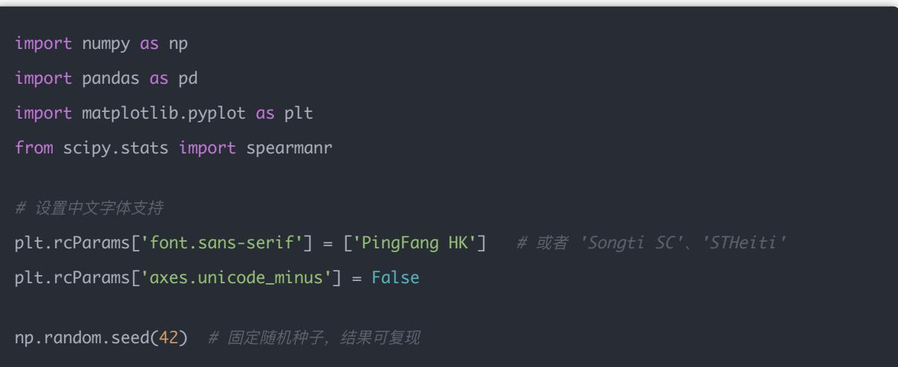
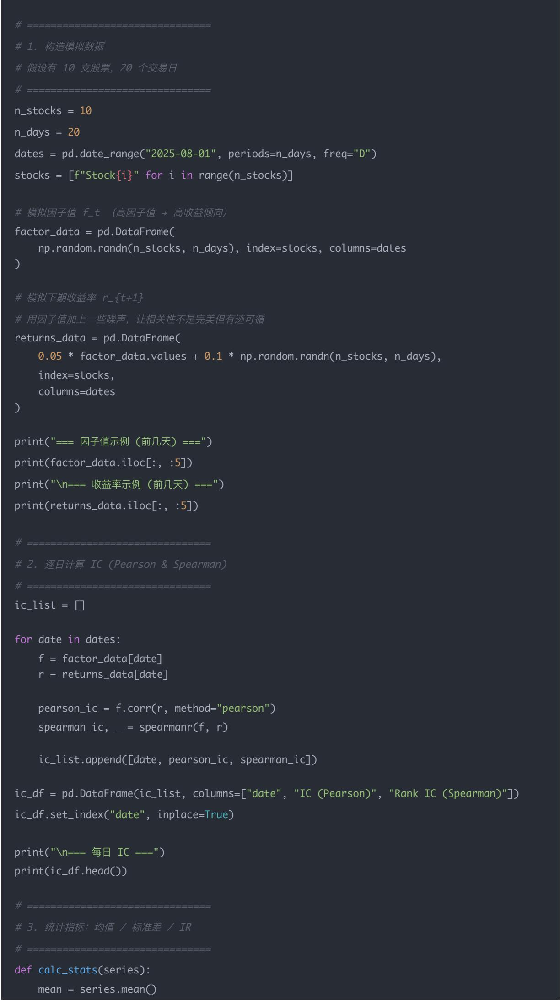
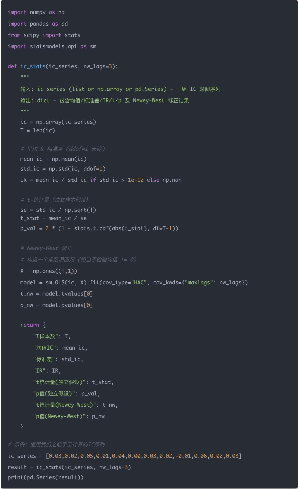

## 量化交易入门指南：第13天 - 因子有效性评估：IC信息系数与IR信息比率的完整解析

原创 逻辑与流 逻辑与流 2025年9月 11 日 00:33 北京 5人

学习时间：120分钟

在量化交易的世界里，如何判断一个因子是否有效？这是每个量化研究员都必须掌握的核心技能 今天我们将深入探讨两个最重要的因子评估指标：IC（Information Coefficient，信息系数）和IR（InformationRatio，信息比率）<sub>。</sub>

IC告诉我们因子在单期内的预测能力，而IR则衡量因子在时间序列上的稳定性和可靠性 通过本文的学习，你将掌握从基础概念到实际应用的完整知识体系，包括数学推导 计算示例 统计检验和实务建议<sub>。</sub>

## 一 IC（Information Coefficient）信息系数详解

### 1.1 什么是 IC（Information Coefficient）

直观定义

IC 是因子值（在某一时刻对每只股票的打分）与该股票在未来一段区间内收益之间的横截面相关系数 它回答的问题是：在某一时刻，因子给出的"高分/低分"能否对应到未来更高/更低的收益？

数学表示（单期）

设在时间 t ，对 n 只股票有因子值向量 ${ f _ { t } } = ( { f _ { t , 1 } } , \ldots , { f _ { t , n } } )$ ，以及对应的未来 h 天/周/月的超额收益向量 $r _ { t + 1 } ^ { ( h ) } = ( r _ { t + 1 } ^ { ( h ) } , \cdot \cdot \cdot , r _ { t , n } ^ { ( h ) } )$ ，则

Pearson IC（常说的 IC）： $\begin{array} { r } { \mathbf { I C } _ { t } = \operatorname { c o r r } _ { \operatorname { P e a r s o n } } ( f _ { t } , \mathbf { \Delta } r _ { t + 1 } ^ { ( h ) } ) } \end{array}$ —— 衡量线性相关性，取值范围 [-1,1]

Rank IC（秩相关 / Spearman）：先对 和 $r _ { t + 1 } ^ { ( h ) }$ 各自做排序（得到秩序列），再计算这两组秩的相关性（Spearman rho） 公式（当没有大量并列秩时可用）：

$$
\rho_ {s} = 1 - \frac {6 \sum_ {i} d _ {i} ^ {2}}{n (n ^ {2} - 1)}
$$

其中 $d _ { i }$ 是第 i 个样本在两组秩之间的差

如何用

在时间序列上对每个 t 都得到一个 IC 值，得到一列 ，再用这列做统计分析（均值 标准差 显

著性 衰减等）

### 1.2 什么是超额收益向量

在某个时点 t，我们有一组股票的因子得分 ${ \bf { \it f } } _ { t } = ( f _ { t , 1 } , f _ { t , 2 } , \ldots , f _ { t , n } )$ 接下来的一段时间 h（比如 1周<sub>、</sub>1 个月），我们要观察这些股票的 未来收益，常常用 超额收益（相对市场或基准指数）来衡量预测能力<sub>。</sub>

定义：

$$
r _ {t + 1} ^ {(h)} = \left(r _ {t + 1, 1} ^ {(h)}, r _ {t + 1, 2} ^ {(h)}, \dots , r _ {t + 1, n} ^ {(h)}\right)
$$

其中：

$$
\boldsymbol {r} _ {t + 1, i} ^ {(h)} = \frac {P _ {t + h , i}}{P _ {t , i}} - 1 - R _ {\mathrm{benchmark}} ^ {(h)}
$$

$P _ { t , i } \colon$ ：股票 i 在时点 t 的价格

$P _ { t + h , i } \colon$ 股票 i 在时点 t+h 的价格

$R _ { \mathrm { b e n c h m a r k } } ^ { ( h ) }$ ：同期基准收益率（如沪深300，或全市场平均收益）

得到的是 股票 i 在未来 h 天的超额收益

所以 $r _ { t + 1 } ^ { ( h ) }$ 就是一整个股票池的向量，和 一一对应<sub>。</sub>

### 1.3 IC 的具体计算公式

IC 就是 Pearson 相关系数：

$$
\mathrm{IC} _ {t} = \operatorname{corr} (f _ {t}, r _ {t + 1} ^ {(h)})
$$

展开公式为：

$$
\mathrm{IC} _ {t} = \frac {\sum_ {i = 1} ^ {n} \left(f _ {t , i} - \overline {{f _ {t}}}\right) \left(r _ {t + 1 , i} ^ {(h)} - \overline {{r _ {t + 1} ^ {(h)}}}\right)}{\sqrt {\sum_ {i = 1} ^ {n} \left(f _ {t , i} - \overline {{f _ {t}}}\right) ^ {2}} \sqrt {\sum_ {i = 1} ^ {n} \left(r _ {t + 1 , i} ^ {(h)} - \overline {{r _ {t + 1} ^ {(h)}}}\right) ^ {2}}}
$$

其中：

$\begin{array} { r } { \overline { { f _ { t } } } = \frac { 1 } { n } \sum _ { i = 1 } ^ { n } f _ { t , i } } \end{array}$ ，是当期因子均值

$\begin{array} { r } { r _ { t + 1 } ^ { ( h ) } = \frac { 1 } { n } \sum _ { i = 1 } ^ { n } r _ { t + 1 , i } ^ { ( h ) } } \end{array}$ ，是当期平均超额收益

这就是标准的 Pearson correlation coefficient

这是 相关系数的性质：

$$
- 1 \leq \operatorname{corr} (X, Y) \leq 1
$$

原因是 Cauchy-Schwarz 不等式：

$$
\Big | \sum (x _ {i} - \overline {{x}}) (y _ {i} - \overline {{y}}) \Big | \leq \sqrt {\sum (x _ {i} - \overline {{x}}) ^ {2}} \sqrt {\sum (y _ {i} - \overline {{y}}) ^ {2}}
$$

把上式左右两边分别除以标准差的乘积，就得到相关系数的值必在 [-1,1] 之间

：完全正相关（因子分数越大，未来超额收益必然更大）

：完全负相关（因子分数越大，未来超额收益必然更小）

：完全无相关

### 1.5 完整计算示例

下面给你一个完整 带数字的逐步算例，把 $f _ { t } .$ 价格 超额收益向量 $r _ { t + 1 } ^ { ( h ) }$ 都写清楚，手把手算出Pearson IC（就是你公式里的 $\textstyle \operatorname { I C } _ { t } )$ 和 Rank IC（Spearman） 我会把中间每一步的数都写出来，方便你深刻理解

例子说明（数据）

我们用 6 只股票（A..F），在时点 t 有因子分数 ；观察未来 h（例如 1 个月）后的价格并用一个基准收益做超额收益

因子分数（ ）：

A: 0.90

B: 0.20

C: -0.50

D: 0.00

E: 0.60

F: -0.30

价格（用于算未来收益）：

（A..F）

• Pt+h = [112, 49, 18, 11, 88, 36]

\*\*先算每只股票的简单收益 $\begin{array} { r } { R _ { i } = \frac { P _ { t + h } } { P _ { t } } - 1 ^ { * * } ; } \end{array}$

A: 112/100 − 1 = 0.12

B: 49/50 − 1 = −0.02

C: 18/20 − 1 = −0.10

D: 11/10 − 1 = 0.10

E: 88/80 − 1 = 0.10

F: 36/40 − 1 = −0.10

\*\*设基准收益 $R _ { \mathrm { b e n c h } } ^ { ( h ) } = 0 . 0 2 \ \left( 2 \% \right)$ ），则超额收益 $r _ { i } = R _ { i } - R _ { \mathrm { b e n c h } } { } ^ { * * } { \mathrm { ; } }$

$\mathsf { A } \colon 0 . 1 2 - 0 . 0 2 = 0 . 1 0$

$\mathsf { B } \colon - 0 . 0 2 - 0 . 0 2 = - 0 . 0 4$

$\mathrm { C } \mathrm { : - } 0 . 1 0 - 0 . 0 2 = - 0 . 1 2$

D: 0.10 − 0.02 = 0.08

E: 0.10 − 0.02 = 0.08

F: −0.10 − 0.02 = −0.12

所以我们有：

因子向量 $f _ { t } = [ 0 . 9 0 , 0 . 2 0 , \ - 0 . 5 0 , 0 . 0 0 , 0 . 6 0 , \ - 0 . 3 0 ]$

超额收益向量 $r _ { t + 1 } ^ { ( h ) } = [ 0 . 1 0 , ~ - 0 . 0 4 , ~ - 0 . 1 2 , 0 . 0 8 , 0 . 0 8 , - 0 . 1 2 ]$

一步步算 Pearson IC（Pearson correlation）

Pearson 相关系数公式（对样本直接用总和形式）：

$$
\mathrm{IC} _ {t} = \frac {\sum_ {i = 1} ^ {n} (f _ {i} - \bar {f}) (r _ {i} - \bar {r})}{\sqrt {\sum_ {i = 1} ^ {n} (f _ {i} - \bar {f}) ^ {2}} \sqrt {\sum_ {i = 1} ^ {n} (r _ {i} - \bar {r}) ^ {2}}}
$$

先算均值：

$$
\bar {f} = (0. 9 0 + 0. 2 0 - 0. 5 0 + 0. 0 0 + 0. 6 0 - 0. 3 0) / 6 = 0. 9 0 / 6 = 0. 1 5
$$

$$
\bar {r} = (0. 1 0 - 0. 0 4 - 0. 1 2 + 0. 0 8 + 0. 0 8 - 0. 1 2) / 6 = - 0. 0 2 / 6 = - 0. 0 0 3 3 3 3 3 3 3 3 (- 1 / 3 0 0)
$$

分别列出每只股票的偏差与中间量：

<table><tr><td>股票</td><td> $f_i$ </td><td> $r_i$ </td><td> $f_i - \bar{f}$ </td><td> $r_i - \bar{r}$ </td><td>乘积 $(f_i - \bar{f})(r_i - \bar{r})$ </td><td> $(f_i - \bar{f})^2$ </td><td> $(r_i - \bar{r})^2$ </td></tr><tr><td>A</td><td>0.90</td><td>0.10</td><td>0.75</td><td>0.1033</td><td>0.0775</td><td>0.5625</td><td>0.0107</td></tr><tr><td>B</td><td>0.20</td><td>-0.04</td><td>0.05</td><td>-0.0367</td><td>-0.0018</td><td>0.0025</td><td>0.0013</td></tr><tr><td>C</td><td>-0.50</td><td>-0.12</td><td>-0.65</td><td>-0.1167</td><td>0.0758</td><td>0.4225</td><td>0.0136</td></tr><tr><td>D</td><td>0.00</td><td>0.08</td><td>-0.15</td><td>0.0833</td><td>-0.0125</td><td>0.0225</td><td>0.0069</td></tr><tr><td>E</td><td>0.60</td><td>0.08</td><td>0.45</td><td>0.0833</td><td>0.0375</td><td>0.2025</td><td>0.0069</td></tr><tr><td>F</td><td>-0.30</td><td>-0.12</td><td>-0.45</td><td>-0.1167</td><td>0.0525</td><td>0.2025</td><td>0.0136</td></tr></table>

把列求和：

分子 $\begin{array} { r l } { \big ( \sum \big ( f _ { i } - \bar { f } \big ) \big ( r _ { i } - \bar { r } \big ) \big ) } & { = 0 . 2 2 8 9 9 9 9 9 9 9 9 9 9 9 9 9 9 9 8 \approx 0 . 2 2 9 0 } \end{array}$

$\sum ( f _ { i } - \bar { f } ) ^ { 2 } = 1 . 4 1 5$

• ∑(ri − τ)2 = 0.05313333333333334

$$
\text {分母} = \sqrt {1 . 4 1 5 \times 0 . 0 5 3 1 3 3 3 3 3 3 3 3 3 3 3 4} = 0. 2 7 4 1 9 6 4 0 1 6
$$

所以

$$
\mathrm{IC} _ {t} = \frac {0 . 2 2 9 0}{0 . 2 7 4 1 9 6 4 0 1 6} \approx \mathbf {0 . 8 3 5 2}
$$

解释：Pearson IC ≈ 0.835（很强的正相关，说明本期因子分数越高，未来超额收益越高） 注意：这是一个教学性的强相关例子，实际真实世界中很少有这么高的 $\mathsf { I C } _ { \mathsf { \Omega } }$

## 二 Rank（秩）与 Spearman（Rank IC）详解

### 2.1 短答结论

秩（rank）就是把一组数按大小排个序，把每个数替换成它在序列里的位置（并列时通常用"平均秩"）

Spearman rho（Rank IC）= 把原数据各自换成秩之后，再对这两组秩做 Pearson 相关

在无并列（no ties）的理想情况下，Spearman 有个简洁公式：

$$
\rho_ {s} = 1 - \frac {6 \sum_ {i} d _ {i} ^ {2}}{n (n ^ {2} - 1)}
$$

其中 $d _ { i } = \mathrm { r a n k } _ { X } - \mathrm { r a n k } _ { Y }$ （两个秩之间的差）

### 2.2 什么是"秩"（rank）？怎么算

把数组按从小到大排序（也可以从大到小，但约定俗成常从小到大并据此给出秩）

值最小的得秩 1，第二小得秩 2，…，最大得秩 n

并列（ties）处理（常用）：若若干个元素相同，则给这些元素分配它们占据位置的平均值

（method='average'） 例如三项并列占第 4 5 6 位，则每个并列项的秩取 $( 4 + 5 + 6 ) / 3 = 5 \ :$

常见其它方式：min<sub>、</sub>max<sub>、</sub>dense<sub>、</sub>ordinal，但 Spearman 通常用 average<sub>。</sub>

### 2.3 从秩到 Spearman 公式的推导（无并列时）

记 $R _ { i }$ 和 $S _ { i }$ 分别为两个变量的秩，均值 $\mu = ( n + 1 ) / 2$ 令

$$
d _ {i} = R _ {i} - S _ {i}
$$

有代数恒等：

$$
\sum_ {i} d _ {i} ^ {2} = \sum_ {i} (R _ {i} - \mu) ^ {2} + \sum_ {i} (S _ {i} - \mu) ^ {2} - 2 \sum_ {i} (R _ {i} - \mu) (S _ {i} - \mu)
$$

对于 1..n 的秩，方差项（即 $\textstyle \sum ( R _ { i } - \mu ) ^ { 2 } )$ 等于

$$
\sum (R _ {i} - \mu) ^ {2} = n \cdot \operatorname{Var} (\{1.. n \}) = n \frac {n ^ {2} - 1}{1 2}
$$

代入并整理，可得

$$
\sum (R _ {i} - \mu) (S _ {i} - \mu) = n \frac {n ^ {2} - 1}{1 2} - \frac {1}{2} \sum d _ {i} ^ {2}
$$

Spearman（无并列）定义为秩的 Pearson 相关，即

$$
\rho_ {s} = \frac {\sum (R _ {i} - \mu) (S _ {i} - \mu)}{\sqrt {\sum (R _ {i} - \mu) ^ {2}} \sqrt {\sum (S _ {i} - \mu) ^ {2}}} = \frac {n \frac {n ^ {2} - 1}{1 2} - \frac {1}{2} \sum d _ {i} ^ {2}}{n \frac {n ^ {2} - 1}{1 2}}
$$

化简得到：

$$
\boxed {\rho_ {s} = 1 - \frac {6 \sum_ {i} d _ {i} ^ {2}}{n (n ^ {2} - 1)}}
$$

### 2.4 并列（ties）怎么办？

上面的简洁公式要求没有并列值 一旦出现并列，该公式会有偏差（有时差别很小，有时能明显影响结果）

正确且稳妥的做法：对每个变量都用 average 给出秩，然后直接计算这两组秩的 Pearson 相关（这就是Spearman 的一般定义） 这一步天然处理并列

在统计软件里直接调用 scipy.stats.spearmanr(x,y) （或 Pandas 的 rank(...).corr(...) ）会做合适处理并给出 p 值

### 2.5 具体数值例子（带你逐步算） 用我们之前的数据

数据（6 支股票）：

因子 $\begin{array} { r l } { f \colon } & { { } [ 0 . 9 0 , 0 . 2 0 , - 0 . 5 0 , 0 . 0 0 , 0 . 6 0 , - 0 . 3 0 ] \ \mathrm { ~ ( A . . F ) } } \end{array}$

超额收益 $r \colon [ 0 . 1 0 , - 0 . 0 4 , - 0 . 1 2 , 0 . 0 8 , 0 . 0 8 , - 0 . 1 2 ]$

## 第一步：给两个向量分别排秩（用 average 处理并列）

的秩（从小到大）：

值序： (C), (F), (D), (B), (E), (A)

秩： $C { = } 1 , \mathsf { F } { = } 2 , \mathsf { D } { = } 3 , \mathsf { B } { = } 4 , \mathsf { E } { = } 5 , \mathsf { A } { = } 6 \to \mathrm { r a n k s } _ { f } { = } [ 6 , 4 , 1 , 3 , 5 , 2 ]$ （按 A..F 顺序）

的秩（注意并列： C 和 F 都是 -0.12，D 和 E 都是 0.08）

有序值： $\cdot 0 . 1 2 ( \mathrm { C } ) , - 0 . 1 2 ( \mathrm { F } ) , - 0 . 0 4 ( \mathrm { B } ) , 0 . 0 8 ( \mathrm { D } ) , 0 . 0 8 ( \mathrm { E } ) , 0 . 1 0 ( \mathrm { A } )$

并列处理（C & F 占第 1 2 位 → 平均秩 = 1.5； D & E 占第 4 5 位 → 平均秩 = 4.5）

$$
\bullet \quad \mathrm{ranks} _ {r} = [ 6, 3, 1. 5, 4. 5, 4. 5, 1. 5 ] (\text {按A..F})
$$

## 第二步：算秩差 与平方和

$$
\bullet \quad d = \operatorname{ranks} _ {f} - \operatorname{ranks} _ {r} = [ 0, 1, - 0. 5, - 1. 5, 0. 5, 0. 5 ]
$$

$$
\bullet \quad d ^ {2} = [ 0, 1, 0. 2 5, 2. 2 5, 0. 2 5, 0. 2 5 ]
$$

$$
\bullet \sum d _ {i} ^ {2} = 4. 0
$$

## 第三步：插入无并列公式（仅作演示）

$$
\bullet \quad n = 6 \rightarrow n (n ^ {2} - 1) = 6 (3 6 - 1) = 2 1 0
$$

$$
\bullet \quad 6 \sum d _ {i} ^ {2} = 2 4
$$

$$
\rho_ {s} = 1 - 2 4 / 2 1 0 = 1 - 0. 1 1 4 2 8 5 7 1 4 2 8 5 7 = 0. 8 8 5 7 1 4 2 8 5 7 1 4 3
$$

这个值是假定无并列时的简洁结果（在本例里近似适用，但因为我们有并列，最好用下一步的做法）

## 第四步：用"给秩后做 Pearson" 的方法（对 ties 正确）——手算

两组秩的均值都 =

计算协方差的分子： $\sum ( R _ { i } - 3 . 5 ) ( S _ { i } - 3 . 5 )$ （逐项乘并求和）结果为 15.0（你可以逐项验证）

各自平方和： $\begin{array} { l l } { { \sum ( R _ { i } - 3 . 5 ) ^ { 2 } = 1 7 . 5 , } } & { { \sum ( S _ { i } - 3 . 5 ) ^ { 2 } = 1 6 . 5 } } \end{array}$

Denominator =

Pearson-on-ranks（即 Spearman） =

## 比较：

使用无并列简式得 ；

使用秩后做 Pearson（对并列正确）得

差别很小，但原则上后一种（Pearson-on-ranks 或 spearmanr）才是推荐的 对 ties 合法的方法

### 2.6 什么时候用 Rank IC（Spearman）而不是 Pearson IC？

当你关心单调关系（不要求线性）；

当数据存在极端值 / heavy tails（秩操作对极端值更鲁棒）；

当你怀疑因子和收益的关系是非线性但单调（例如收益随因子单调增长但不是线性）

反过来，如果你想衡量线性关系的强度（例如因子值和收益成线性关系），还是用 Pearson IC

### 2.7 用 Python（实战）快速算法（推荐）

import pandas as pd

from scipy.stats import spearmanr

$$
f = p d. \text { Series } ([ 0. 9 0, 0. 2 0, - 0. 5 0, 0. 0 0, 0. 6 0, - 0. 3 0 ], \text { index } = \text { list } (" A B C D E F"))
$$

r = pd.Series([0.10,-0.04,-0.12,0.08,0.08,-0.12], index=list("ABCDEF"))

两种方法结果应一致（或非常接近），spearmanr 会处理 ties 并给 p-value<sub>。</sub>

### 2.8 结尾小提示

实务里通常同时看 Pearson IC 和 Rank IC：若两者都同号且接近，信号更可信；若 Rank 高而 Pearson低，说明关系可能是单调但非线性或被极端值影响

当样本里 ties 很多（比如收益被离散化成少数值），Rank 的信息量会下降，检验功效变差；这时要小心解释 p 值/显著性<sub>。</sub>

### 2.9 IC 和 Rank IC 的标准参考值

在实际应用中，如何判断IC值的好坏？以下是业界常用的参考标准：

<table><tr><td>IC 值范围</td><td>含义</td></tr><tr><td>0.05~0.1</td><td>预测力一般</td></tr><tr><td>0.1~0.2</td><td>预测力较好</td></tr><tr><td>&gt;0.2</td><td>极强预测力</td></tr><tr><td>&lt;0</td><td>预测力为负</td></tr></table>

## 重要提醒：

真实量化策略中，IC 在 0.05\~0.15 区间就非常难得

超过 0.2 的IC在实际应用中极其罕见，通常只存在于理论模型或过拟合结果中

负IC值表明因子具有反向预测能力，可以通过取反来使用

## 实务建议：

对于新因子，IC > 0.05 就值得进一步研究

IC > 0.1 的因子已经具有很好的实用价值

重点关注IR（信息比率），因为IR综合考虑了IC的均值和波动性

## 三 信息比率（IR）——因子"长期稳定性/可靠性"的度量

下面把 IR 的定义 数学关系 统计意义 举例与实务注意点都讲清楚，让你既能看懂表格，也能知道如何检验和应用

对一条 IC 时间序列 $\{ \mathrm { I C } _ { t } \} _ { t = 1 } ^ { T }$

平均 $\begin{array} { r l } { \mathbf { l C } \left( \hat { I C } \right) } & { = \cfrac { 1 } { T } \sum _ { t = 1 } ^ { T } \operatorname { I C } _ { t } } \end{array}$

IC 的样本标准差 $( \sigma _ { I C } )$ （常用无偏估计） $= \sqrt { \frac { 1 } { T - 1 } \sum _ { t = 1 } ^ { T } ( \mathrm { I C } _ { t } - \bar { I C } ) ^ { 2 } }$

信息比率（IR）定义为：

$$
\mathrm{IR} = \frac {\bar {I C}}{\sigma_ {I C}}
$$

直观解释：平均信号强度（均值）除以噪音（波动），相当于信号/噪声比（越大越可靠 越稳定）

### 3.2 用具体数列算一遍（逐步，手算式）

假设我们有一条长度 T=12 的 IC 时间序列（每期的横截面 IC）：

$$
\mathrm{IC} _ {t} = \left[ 0. 0 3, 0. 0 2, 0. 0 5, 0. 0 1, 0. 0 4, 0. 0 0, 0. 0 3, 0. 0 2, - 0. 0 1, 0. 0 6, 0. 0 2, 0. 0 3 \right]
$$

1) 计算均值 $\bar { I C }$

把所有值相加：

$$
\mathrm{sum} = 0. 0 3 + 0. 0 2 + 0. 0 5 + 0. 0 1 + 0. 0 4 + 0. 0 0 + 0. 0 3 + 0. 0 2 - 0. 0 1 + 0. 0 6 + 0. 0 2 + 0. 0 3 = 0. 3 0
$$

$$
\bar {I C} = \frac {0 . 3 0}{1 2} = 0. 0 2 5
$$

所以平均 IC = 0.025（也就是 2.5%）

## 2) 计算样本标准差 $\sigma _ { I C }$ （ddof=1 的无偏估计）

先算每期与均值的偏差平方 $( \mathrm { I C } _ { t } - I \bar { C } ) ^ { 2 }$

<table><tr><td>t</td><td>IC_t</td><td>IC_t - mean</td><td>(IC_t - mean)^2</td></tr><tr><td>1</td><td>0.03</td><td>+0.005</td><td>0.000025</td></tr><tr><td>2</td><td>0.02</td><td>-0.005</td><td>0.000025</td></tr><tr><td>3</td><td>0.05</td><td>+0.025</td><td>0.000625</td></tr><tr><td>4</td><td>0.01</td><td>-0.015</td><td>0.000225</td></tr><tr><td>5</td><td>0.04</td><td>+0.015</td><td>0.000225</td></tr><tr><td>6</td><td>0.00</td><td>-0.025</td><td>0.000625</td></tr><tr><td>7</td><td>0.03</td><td>+0.005</td><td>0.000025</td></tr><tr><td>8</td><td>0.02</td><td>-0.005</td><td>0.000025</td></tr><tr><td>9</td><td>-0.01</td><td>-0.035</td><td>0.001225</td></tr><tr><td>10</td><td>0.06</td><td>+0.035</td><td>0.001225</td></tr><tr><td>11</td><td>0.02</td><td>-0.005</td><td>0.000025</td></tr><tr><td>12</td><td>0.03</td><td>+0.005</td><td>0.000025</td></tr></table>

把这些平方和起来：

$$
\sum_ {t = 1} ^ {1 2} (\mathrm{IC} _ {t} - \bar {I C}) ^ {2} = 0. 0 0 4 3 0 0
$$

样本方差（ddof=1）：

$$
s ^ {2} = \frac {0 . 0 0 4 3 0 0}{T - 1} = \frac {0 . 0 0 4 3 0 0}{1 1} \approx 0. 0 0 0 3 9 0 9 0 9 0 9
$$

样本标准差：

$$
\sigma_ {I C} = \sqrt {s ^ {2}} \approx \sqrt {0 . 0 0 0 3 9 0 9 0 9 0 9} \approx 0. 0 1 9 7 7 2 7 6
$$

所以 （约 1.977%）

3) 计算信息比率 IR

$$
\mathrm{IR} = \frac {\bar {I C}}{\sigma_ {I C}} = \frac {0 . 0 2 5}{0 . 0 1 9 7 7 2 7 6} \approx 1. 2 6 4 9
$$

所以 IR ≈ 1.265

直观：平均每期信号是噪声的 1.265 倍 —— 属于稳定且偏强的信号（在实务里这是个不错的 IR）

3.2.1 多期IC时间序列演示（Python实战）

上面的例子展示了如何计算单期IC和IR，但在实际应用中，我们需要分析多期IC时间序列 下面是一个完整的Python演示脚本，展示如何计算多期IC并分析其统计特性：

import numpy as np

import pandas as pd

import matplotlib.pyplot as plt

from scipy.stats import spearmanr



plt.rcParams['font.sans-serif'] = ['PingFang HK']   # 或者 <sup>'</sup>Son<sub>g</sub>ti SC <sup>'</sup><sub>、</sub> <sup>'</sup>STHeiti <sup>'</sup>

plt.rcParams['axes.unicode\_minus'] = False

np.random.seed(42)  # 固定随机种子 结果可复现# 模拟下期收益率 r {t+1# 用因子值加上一些噪声，让相关性不是完美但有迹可循returns\_data = pd.DataFrame(0.05 \* factor\_data.values + 0.1 \* np.random.randn(n\_stocks, n\_days),index=stocks,columns=dates



```python
std = series.std(ddof=1)
    IR = mean / std if std > 1e-8 else np.nan
    return mean, std, IR

pearson_stats = calc_stats(ic_df["IC (Pearson)"])
spearman_stats = calc_stats(ic_df["Rank IC (Spearman)'])

print("\n=== IC 统计结果 ===")
print(f"Pearson IC: 均值={pearson_stats[0]:.4f}, 标准差={pearson_stats[1]:.4f}, IR={pearson_s}
print(f"Rank IC : 均值={spearman_stats[0]:.4f}, 标准差={spearman_stats[1]:.4f}, IR={spearman's}

# ====================
# 4. 可视化
# ====================
plt.figure(figsize=(10,5))
plt.plot(ic_df.index, ic_df["IC (Pearson)"], marker="o", label="IC (Pearson)")
plt.plot(ic_df.index, ic_df["Rank IC (Spearman)"], marker="s", label="Rank IC (Spearman)")
plt.axhline(0, color="black", linestyle="--", linewidth=1)
plt.title("横截面 IC 时间序列")
plt.xlabel("Date")
plt.ylabel("IC Value")
plt.legend()
plt.grid(True, linestyle="--", alpha=0.6)
plt.tight_layout()
plt.show()
```

## 代码说明：

1. 数据构造：模拟10支股票在20个交易日的因子值和收益率数据

2. IC计算：逐 日 计算横截面Pearson IC和Rank IC（Spearman）

3. 统计分析：计算均值 标准差和IR（Information Ratio = 均值 / 标准差）

4. 可视化：绘制IC时间序列图，直观展示因子的预测能力变化

## 运行结果解读：

从生成的IC时间序列图可以看出以下重要特征：

### 1. 整体趋势分析

高波动性：两条IC曲线都表现出显著的时间波动，说明因子的预测能力在不同时期存在较大差异

正相关趋势：Pearson IC和Rank IC在大部分时间都保持正值，表明因子整体上具有正向预测能力

交叉频繁：两条曲线经常交叉，说明线性关系和非线性关系在不同时期各有优势

2. 关键时间点分析

8月 1 日 ：Pearson IC(0.70) > Rank IC(0.62)，线性关系更强

8月 2 日 ：Rank IC(0.74) > Pearson IC(0.64)，非线性关系占优

8月 7 日 ：Pearson IC达到峰值(0.73)，线性预测能力最强

8月 11 日 ：Pearson IC跌至负值(-0.05)，而Rank IC仍为正值(0.08)，说明此时非线性关系更稳定

8月16 日：Rank IC达到最高点(0.75)，非线性预测能力最强

### 3. 统计特征解读

Pearson IC：衡量线性相关性，对极端值敏感

Rank IC：衡量单调关系，对极端值更鲁棒

两者差异：当两条曲线差异较大时，说明因子与收益的关系存在非线性成分

### 4. 实务意义

因子稳定性：IC值在0.2-0.7之间波动，属于中等稳定性因子

预测能力：大部分时间IC > 0.3，表明因子具有实用价值

风险提示：8月11日出现负IC，提醒需要关注因子的失效风险

### 5. 投资策略建议

组合使用：可以同时考虑Pearson IC和Rank IC，在不同市场环境下灵活调整

动态监控：需要持续监控IC时间序列，及时发现因子衰减信号

风险控制：当IC连续为负或大幅下降时，应考虑减少因子权重或暂停使用

### 3.3 为什么 IR 能反映"长期可靠性"？

单期 IC告诉你某一期因子"准不准"（有无信号）

IR告诉你这个信号在时间上是否稳定地出现：如果均值不大但波动很小，长期累积的信号仍然可用；反之均值大但波动巨，则长期不可依赖

数学上，IR 是均值相对于每期波动的标准化度量，因此越大代表"每期平均超越噪声的能力越强"

### 3.4 IR 与 t-统计量的关系（很重要）

把检验因子长期是否显著的 t-检验写成 IR 的形式：

标准误（均值的标准误）：

$$
\mathrm{SE} (\bar {I C}) = \frac {\sigma_ {I C}}{\sqrt {T}}
$$

t-统计量（检验 $\bar { I C } = 0 )$

$$
t = \frac {\bar {I C}}{\mathrm{SE} (\bar {I C})} = \frac {\bar {I C}}{\sigma_ {I C} / \sqrt {T}} = \mathrm{IR} \times \sqrt {T}
$$

所以： $t = \operatorname { I R } \times { \sqrt { T } } ,$ 。

这有两层含义：

IR是单位期内的"信噪比"；当你有 T 个独立期时，检验显著性会按 $\sqrt { T }$ 放大

因此一个较小的 IR，在足够多的时间点下也可以变得统计显著

举例（假设 IC 序列独立 T=60）：

若 ${ \mathrm { : ~ } }  \mathbb { R } = 0 . 3  t = 0 . 3 \times { \sqrt { 6 0 } } \approx 2 . 3 2 \ ( { \mathrm { \lambda } } { \overline { { \sharp } } } { \overset { \ast \ast } { \underset { \uparrow } { \boxplus } } { \bar { \gamma } } } { \mathrm { ? } } { \lambda } { \mathrm { ) } } { \overset { \ast \ast } { \underset { \downarrow } { \overset { \ast \ast } { \sum } } } { \gamma } } { \mathrm { ! } } { \mathrm { ~ } } { \overset {  } { \underset { \mathrm { \lambda } } { \mathrm { \ i } } } { \mathrm { \ i } } } { \mathrm { \ i } } { \mathrm { \ i } } { \mathrm { \ i } } { \mathrm { \ i } } { \mathrm { \ i } } { \mathrm { \ i } } { \mathrm { \ i } } { \mathrm { \ i } } { \mathrm { \ i } } { \mathrm { \ i } } { \mathrm { \ i } } { \mathrm { \ i } } { \mathrm { \ i } } { \mathrm { \ i } } { \mathrm { \ i } }  $

若 $1 8 = 2 . 5  t \approx 1 9 . 3 6$ ，极显著<sub>。</sub>

结论：业界常说"IR > 0.3 是有效因子"部分原因是：在常见样本长度下（若样本独立），0.3 可以对应到可接受的显著水平

3.5 t-统计量（t-stat）：定义 计算 含义

1) 定义与公式

要检验均值 $\bar { I C }$ 是否显著不同于 0（也就是检验"因子长期有没有真实信号"），常用的 t 统计量是：

$$
t = \frac {\bar {I C}}{\mathrm{SE} (\bar {I C})}
$$

其中标准误（假设各期独立）：

$$
\mathrm{SE} (\bar {I C}) = \frac {\sigma_ {I C}}{\sqrt {T}}
$$

合并起来：

$$
t = \frac {\bar {I C}}{\sigma_ {I C} / \sqrt {T}} = \mathrm{IR} \times \sqrt {T}
$$

注：这是基于 $\ " \mathrm { I C } _ { t }$ 相互独立且近似正态"的假设

2) 用上面的数代入

我们已经有 $\bar { I C } = 0 . 0 2 5 , \sigma _ { I C } \approx 0 . 0 1 9 7 7 2 7 6 , \mathsf { T } \substack { = } 1 2 .$ 。

先算 ${ \sqrt { T } } = { \sqrt { 1 2 } } \approx 3 . 4 6 4 1 0 1 6 1 5$

于是

$$
t \approx 1. 2 6 4 9 1 1 0 6 4 \times 3. 4 6 4 1 0 1 6 1 5 \approx 4. 3 8 1 7 8
$$

（也可以直接用 $t = 0 . 0 2 5 / ( 0 . 0 1 9 7 7 2 7 6 / \sqrt { 1 2 } ) \approx 4 . 3 8 2 )$

## 3) t 的含义（直观）

表示：平均 IC 距离 0 约 4.38 个"均值的标准误"

一般规则：t 越大（绝对值），越能拒绝"均值为 0"的原假设（即越能说明长期确有信号）

在 t 分布下（自由度 $\mathsf { d f } = \mathsf { T } - 1 = 1 1 )$ ），t=4.38 对应的双侧 $\mathsf { p } \cdot$ -值非常小（大概在 0.001 左右），说明在"独立样本"假设下，平均 IC 显著大于 0

### 3.6 重要的现实修正与提醒（不要直接机械套 t）

上面 t 的计算在独立样本前提下成立，但实际 IC 时间序列常常存在自相关（尤其你计算的是重叠的前向收益，例如用 1 个月滚动收益会导致连续期 IC 互相关） 自相关会低估均值的标准误，从而虚增 t 值（即误判显著性）

## 常见处理方法：

1. Newey-West（HAC）：估计均值的稳健标准误，考虑若干滞后（lag）的自相关<sub>。</sub>

2. \*\*估算有效样本数 $N _ { \mathrm { e f f } } { ^ { * * } }$ ：对于 AR(1) 自相关 $\rho ,$ ，有经验近似：

$$
N _ {\mathrm{eff}} \approx T \cdot \frac {1 - \rho}{1 + \rho}
$$

然后把 t 改成 $\mathrm { I R } \sqrt { N _ { \mathrm { e f f } } }$ 。

例：若 $\rho = 0 . 5 ,$ ，则 $N _ { \mathrm { e f f } } \approx 1 2 \cdot ( 0 . 5 / 1 . 5 ) = 4 .$ 那 $t _ { a d j } \approx \mathrm { I R } \times \sqrt { 4 } = 1 . 2 6 4 9 \times 2 \approx 2 . 5 3$ （对应${ \mathsf { p } } { \approx } 0 . 0 3 )$ ），相比 4.38 要弱很多

3. 使用非重叠样本：比如把滚动收益改为不重叠窗口来减少自相关（但会减少样本数）

4. Bootstrap/block ${ \bf b 0 0 t s t r a p } ^ { \mathrm { Q } }$ ：用区块自助法估计均值分布与置信区间

### 3.7 把数字和直觉联系起来（小结）

本例 IR≈1.265 t≈4.38（df=11）→ 在独立样本假设下，这说明因子长期显著且稳定 $\left( \mathsf { p { \approx } } 0 . 0 0 1 \right)$ ）<sub>。</sub>

但如果 IC 序列有明显自相关（常见），实际显著性会被削弱；若自相关系数例如 0.5，调整后 t≈2.53$\left( \mathrm { p } { \approx } 0 . 0 3 \right)$ ），仍显著但不如未修正时那么强

实践中：计算 IR 后务必检查 IC 序列的自相关（画 ACF），并用 Newey-West 或 bootstrap 修正 SE，再报告"修正后的 $\mathrm { ~ t ~ / ~ p ~ } ^ { \mathfrak { n } }$ o

### 3.8 通用IC统计分析脚本（Python实战）

在实际应用中，我们需要一个通用的工具来分析IC时间序列的统计特性 下面是一个完整的Python脚本，能够计算所有重要的统计指标：

首先安装statsmodels：

然后运行以下代码：



## 脚本说明：

nw\_lags：Newey-West 修正的滞后阶数，一般用收益窗口大小 - 1，或者经验值（如 3\~6）

\*\*OLS(ic, 常数)\*\*：其实就是在检验"均值是否显著大于 0"

输出包括：独立假设和 Newey-West 修正的结果，方便对比

## 运行结果分析：

实际运行上述代码得到以下结果：

## 结果解读：

### 1. 基础统计指标：

样本数：12个观测值

平均IC：0.025（2.5%），表明因子具有正向预测能力

标准差：0.0198（1.98%），波动相对较小

IR：1.26，属于较强的信号，说明因子稳定且有效

2. 显著性检验对比：

独立假设下：t=4.38，p=0.001，极显著

Newey-West修正后：t=7.39，p=1.5×10⁻¹³，更加显著

3. 有趣的现象分析： 这里出现了一个反直觉的结果：

## 可能的原因：

负自相关：如果IC序列存在负自相关，Newey-West修正可能会增加t值

异方差性：如果存在异方差，HAC估计可能会给出不同的结果

小样本效应：12个样本可能不足以准确估计自相关结构

通常Newey-West修正会降低t统计量（因为考虑了自相关）

但实际结果显示Newey-West修正后t值从4.38增加到7.39

### 4. 实务建议：

扩大样本量进行更稳健的检验

监控因子的时变特性

考虑交易成本后的实际收益

因子有效性：IR=1.26表明这是一个非常有效的因子

统计显著性：无论是否修正，因子都高度显著

实际应用：可以放心使用这个因子，但建议：

### 5. 进一步分析建议：

检查自相关

from scipy.stats import pearsonr

$$
\text { ic\_series } = [ 0. 0 3, 0. 0 2, 0. 0 5, 0. 0 1, 0. 0 4, 0. 0 0, 0. 0 3, 0. 0 2, - 0. 0 1, 0. 0 6, 0. 0 2, 0. 0 3 ]
$$

$$
\text { autocorr\_1, } \_ = \text { pearsonr(ic\_series[: - 1], ic\_series[1:]) }
$$

print(f"一阶 自 相关: {autocorr\_1:.4f}")

### 3.9 速查公式与步骤（粘贴可复用）

1. 给出 IC 序列 $\{ \mathrm { I C } _ { t } \} _ { t = 1 } ^ { T }$ 。

2. 计算 $\begin{array} { r } { I \mathbf { \bar { C } } = \frac { 1 } { T } \sum \mathbf { I C } _ { t } } \end{array}$ 。

3. 计算样本标准差： $\begin{array} { r } { \pmb { s } = \sqrt { \frac { 1 } { T - 1 } \sum ( \mathbf { I C } _ { t } - \bar { I C } ) ^ { 2 } } } \end{array}$ 。

4. $\mathrm { I R } = I \bar { \cal { C } } / s$

5. 在独立样本假设下： $t = \mathrm { I R } \sqrt { T }$ ，df = T-1，查 t 分布得到 $\scriptstyle { \mathsf { p - v a l u e } }$ 。

6. 若怀疑自相关 → 用 $\mathsf { N e w e y – W e s t }$ 或估算 $N _ { \mathrm { e f f } }$ 并替换 $\sqrt { T }$ 为 $\sqrt { N _ { \mathrm { e f f } } }$ 。

### 3.10 用表格做直观解释 $\textcircled { 1 } \textcircled { 2 } \textcircled { 1 } \textcircled { 1 } \textcircled { 2 } \textcircled { 1 }$

<table><tr><td>因子</td><td>平均 IC</td><td>波动 (σ)</td><td>IR</td><td>解读</td></tr><tr><td>A</td><td>0.05</td><td>0.02</td><td>2.5</td><td>很高的 IR(稳定且强),长期可靠</td></tr><tr><td>B</td><td>0.07</td><td>0.10</td><td>0.7</td><td>平均较高但波动太大 → 不稳定,长期不可靠或需大量样本显著</td></tr><tr><td>C</td><td>-0.01</td><td>0.01</td><td>-1.0</td><td>均值为负且稳定 → 持续反向预测,直接反向使用(取相反数)可变为有用因子</td></tr></table>

## 补充说明：

因子 B 的平均（0.07）看起来比 A 的 0.05 大，但它的波动 0.10 很大，导致 IR 低（0.7），说明不太稳定——虽然有时很强，有时很弱或反向

因子 C 的 IR 为 -1：说明它持续负相关（稳定地做错方向），可以把因子取反变为正向因子（相当于把 -IC作为新的因子）

### 3.11 统计显著性 样本独立性与修正

实际应用中要注意几个重要假设与修正：

### 1. 自相关 / 重叠收益

IC 序列往往有时间自相关（尤其当你的前向收益窗口重叠时） 若 IC 有自相关，公式 $t = \operatorname { I R } { \sqrt { T } }$ 会高估显著性（有效样本数低于 T）

解决：

用 Newey-West（或 HAC）估计均值的标准误；

估算有效样本数（例如 AR(1) 近似的 $N _ { \mathrm { e f f } } )$

或使用非重叠样本计算（把重叠窗口分成不重叠子样本）

### 2. 并非正态 / 极端值

若 IC 分布偏态或重尾，t-检验的假设受损，建议做 bootstrap（块 bootstrap）或用稳健统计量（median /MAD）<sub>。</sub>

### 3. 多重测试问题

如果你同时测试很多因子，需要修正多重比较（FDR/Bonferroni），避免"幸运发现"

### 4. 样本外验证 & 稳健性

在不同时间段<sub>、</sub>不同市值/行业子池上检查 IR 是否稳定；做滚动 IR（rolling IR）观察是否有衰减或 regimechange<sub>。</sub>

### 3.12 和"基本法则（Fundamental Law）"的关系

基本法则（Grinold & Kahn）给出组合的 IR（投资组合层面）近似：

$$
\mathrm{IR} _ {\mathrm{portfolio}} \approx \mathrm{IC} \times \sqrt {\mathrm{Breadth}}
$$

其中 $\mathbf { B r e a d t h } ^ { \alpha } :$ = 独立押注次数（例如每年独立选股次数 × 年数） 这说明即使 IC 很小，只要 Breadth 很大，也可获得较好组合级别 IR 但前提是押注独立且交易成本可控

注意：表格里讲的 IR $( { I \bar { C } } / { \sigma _ { I C } } )$ 是IC 时间序列的 IR，与上面组合 IR 不是同一层次，但两者概念相关（都是 signal/noise）<sub>。</sub>

### 3.13 实务建议与检查清单（如何把 IR 用好）

1. 先计算 IC 时间序列（每期横截面 IC）

2. 得到 $\bar { I C } , \ \sigma _ { I C }$ IR（用样本 ${ \mathrm { s t d } } , \ { \mathrm { d d o f } } { = } 1 )$ ）<sub>。</sub>

3. 检验 自 相关（ACF），若显著，则用 Newey-West 或块 bootstrap 修正 SE<sub>。</sub>

4. 计算 t-stat（或 p-value）：若独立，则 $t = \operatorname { I R } { \sqrt { T } } ,$

5. 做滚动 IR（如 12 期滚动）看是否随时间衰退/突变

6. 做分组检验（行业 / 市值 / 多市场）看是否稳定跨样本

7. 考虑交易成本 / 损耗：高 IR 但换手极高可能不可实现

8. 若 IR 为稳定的负值，直接反向使用因子（取相反数）往往是简单有效的处理

## 四 其他重要概念

### 4.1 "Coefficient" 到底是什么意思？

"Coefficient" 在这里就是 相关系数（correlation coefficient） 的意思：一个衡量两个随机变量之间相关程度的数字

## 关键属性：

范围在 [-1,1] 接近 1 表示强正相关（因子高 → 未来收益高），接近 -1 表示强负相关（因子高 → 未来收益低），0 表示无线性关联（或无单调关系）

Pearson 测线性关系（受极值影响）；Spearman（Rank IC） 测单调关系（对极值和非线性更稳健）

4.2 为什么要关心"反向因子"（例如 PE<sub>、</sub>PB）？它们为何通常是反向的？

## "反向因子"的含义

如果因子值与未来收益之间的相关系数是负的，我们称其为"反向因子" 也就是说，因子值越高，未来收益反而越低；或因子值越低，未来收益越高

## PE / PB 为何经常是反向因子（直观原因）：

1. 估值含义（Value effect）：PE/PB 是估值指标，较低的 PE/PB 通常表示股票更"便宜"，市场上"便宜"的股票长期上往往能带来更高的超额回报（价值因子） 因此：

因子 = PE（原始值高表示估值高） → 高 PE 往往意味着未来回报较低 → Pearson IC 会呈负值

为了把这个因子变成"正向"的（便于合并多因子），我们常对 PE 做 sign 反转（例如用 -PE 或 1/PE 或 -rank(PE)），或直接定义 value = -PE

2. 市场风险溢价 / 逆反应：高 PE 的公司通常是增长型 被高期望值定价，投资者承担较少的风险溢价；当预期落空或估值修正时，高 PE 的回撤可能更大（导致高 PE → 低未来回报）

3. 行为金融（过度乐观 / 过度悲观）：市场对增长的过度乐观推高 PE，当市场回调或成长无法兑现时，这部分股票回落，表现为高 PE 对应随后较低收益（即负相关）

4. 会计/暂时性因素：被压低的 PE（可能因为短期业绩下滑或异常事件）在事件解决后会回归，从而产生反弹收益（也表现为 PE 与未来收益负相关）

## 结论

PE PB 常被称为"反向因子"是因为它们的原始数值方向与未来超额收益的方向相反（高估值 → 未来表现差） 但我们在建模时可以把它变成正向指标（取负号或做倒数或用秩反向），这样所有因子都朝"因子值越大越好"统一解释

### 4.3 什么是横截面（Cross-Section）？

在量化金融里，横截面（cross-section）通常是指 同一个时点上，不同股票之间的数据集合

横截面数据：一行是一个股票，某一时点所有股票的因子值 收益率等

时间序列数据：一行是某个股票随时间的演变（比如某只股票过去 1 年的价格走势）

举例说明

假设我们在 2025 年 9 月 9 日 当天，研究 A<sub>、</sub>B<sub>、</sub>C 三只股票：

因子值 $f _ { t } \colon$ 比如用市盈率（PE）作为因子

下期收益 $r _ { t + 1 } :$ 比如未来一周的收益率

<table><tr><td>股票</td><td>因子值  $f_t(PE)$ </td><td>下期收益率  $r_{t+1}$ </td></tr><tr><td>A</td><td>15</td><td>+2%</td></tr><tr><td>B</td><td>30</td><td>-1%</td></tr><tr><td>C</td><td>10</td><td>+5%</td></tr></table>

这里就是一个 横截面： 时间 = 2025-09-09，横轴是不同股票 $( \mathsf { A } , \mathsf { B } , \mathsf { C } )$ 。

横截面 IC 的计算

在这个横截面上，我们计算：

$$
I C _ {t} = \operatorname{corr} (f _ {t}, r _ {t + 1})
$$

## 第一步：整理向量

• 因子向量 ft = [15, 30, 10]

收益向量 $r _ { t + 1 } = [ 0 . 0 2 , - 0 . 0 1 , 0 . 0 5 ]$

## 第二步：标准化数据（计算协方差用）

1. 均值

平均因子值 = (15+30+10)/3 = 18.33

平均收益率 = (0.02 - 0.01 + 0.05)/3 = 0.02

2. 去中心化

$f _ { t } - \operatorname* { m e a n } ( f _ { t } ) = [ - 3 . 3 3 , 1 1 . 6 7 , - 8 . 3 3 ]$

• rt+1 − mean(rt+1) = [0, −0.03, 0.03]

第三步：计算协方差

$$
\begin{array}{c} \operatorname{Cov} (f, r) = \frac {1}{n} \sum_ {i} (f _ {i} - \bar {f}) (r _ {i} - \bar {r}) \\ = (- 3. 3 3 \times 0 + 1 1. 6 7 \times - 0. 0 3 + - 8. 3 3 \times 0. 0 3) / 3 \\ \approx (- 0. 3 5 - 0. 2 5) / 3 \\ \approx - 0. 2 0 \end{array}
$$

第四步：计算标准差

$$
\bullet \quad \sigma_ {f} \approx 8. 5 0
$$

$$
\bullet \sigma_ {r} \approx 0. 0 2 4 5
$$

第五步：计算 IC

$$
I C _ {t} = \frac {\operatorname{Cov} (f , r)}{\sigma_ {f} \sigma_ {r}}
$$

$$
= - 0. 2 0 / (8. 5 0 \times 0. 0 2 4 5)
$$

$$
\approx - 0. 9 6
$$

解读

这个横截面的 IC 值是 -0.96，非常接近 -1

表示 PE 因子和未来收益高度负相关，即 PE 越高，未来收益越差

这就是为什么 PE PB 常被称为 反向因子：高估值通常预示着未来收益低

总结

横截面：同一时点下，所有股票的数据集合

横截面 IC：在这个时点，用皮尔逊相关系数度量 "因子值 ↔ 未来收益" 的线性关系

\*\*取值 [-1,1]\*\*：由相关系数定义决定

## 五 总结与实务建议

通过本文的学习，我们深入了解了因子有效性评估的两个核心指标：

### 5.1 核心要点回顾

1. IC（信息系数）：衡量因子在单期内的预测能力

Pearson IC：衡量线性相关性，适用于线性关系

Rank IC（Spearman）：衡量单调关系，对极端值更鲁棒

2. IR（信息比率）：衡量因子在时间序列上的稳定性和可靠性

IR = 平均IC / IC标准差

IR > 0.3 通常被认为是有效因子

需要考虑自相关等现实问题

3. 统计检验：通过t-统计量检验因子的长期显著性

t = IR × √T（在独立样本假设下）

实际应用中需要考虑自相关修正

### 5.2 实务应用建议

1. 同时计算Pearson IC和Rank IC，比较两者的差异

2. 计算IR并检验统计显著性，注意自相关问题

3. 做滚动分析，观察因子表现的时变性

4. 考虑交易成本，高IR但高换手的因子可能不实用

5. 反向因子处理，将负IC因子取反使用

### 5.3 下一步学习方向

掌握了IC和IR的基本概念后，建议继续学习：

多因子模型的构建与优化

因子组合的权重分配方法

因子衰减与更新策略

风险模型与因子暴露度管理

通过系统学习这些内容，你将能够构建更加稳健和有效的量化交易策略
