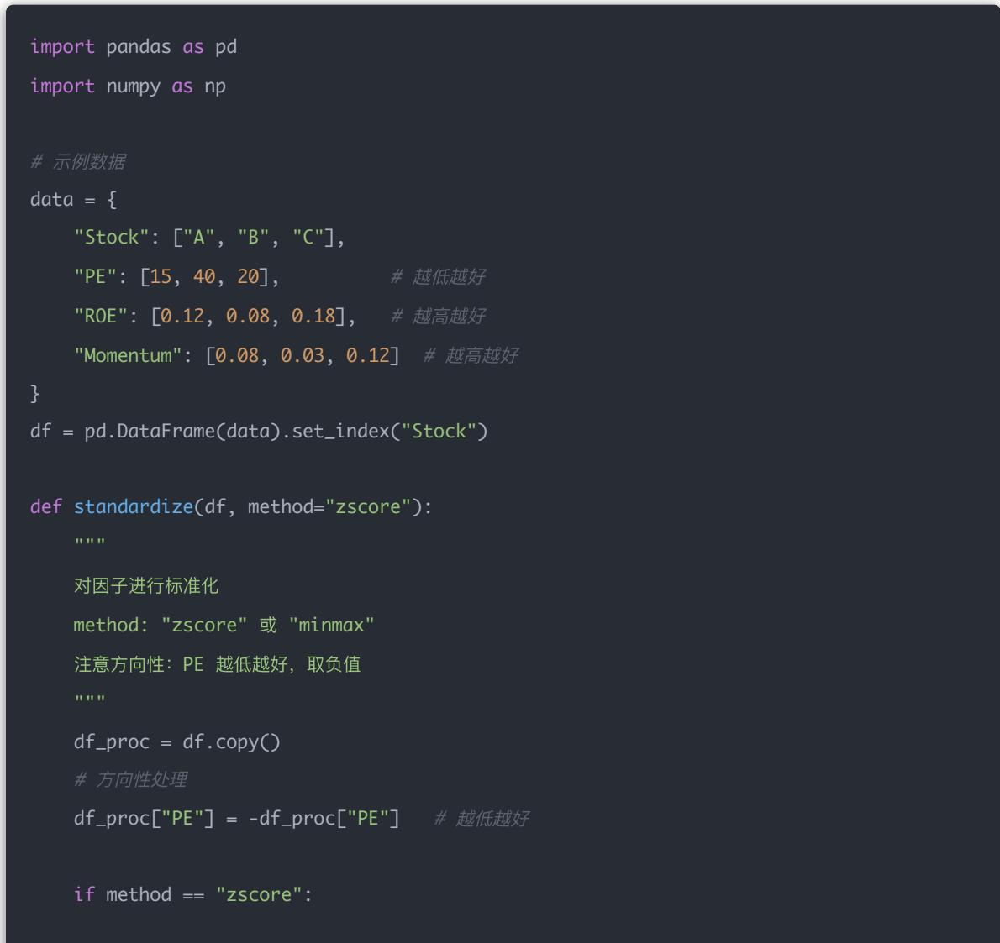
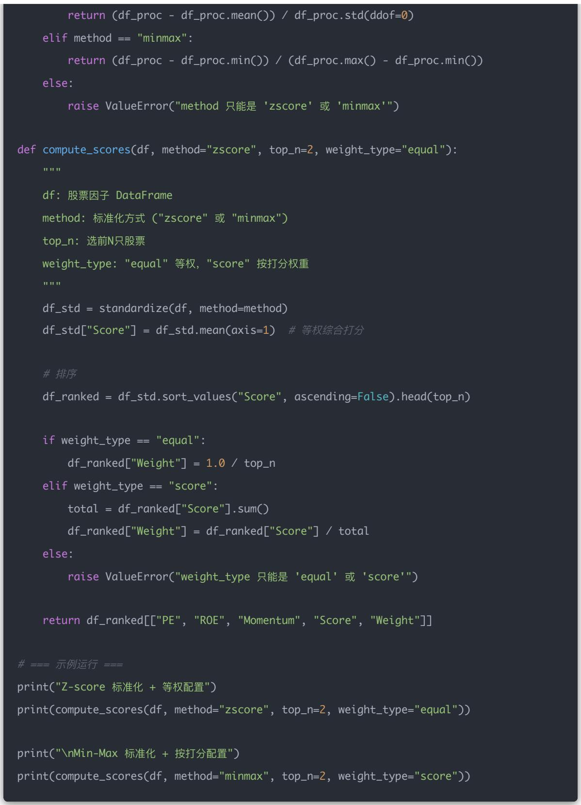
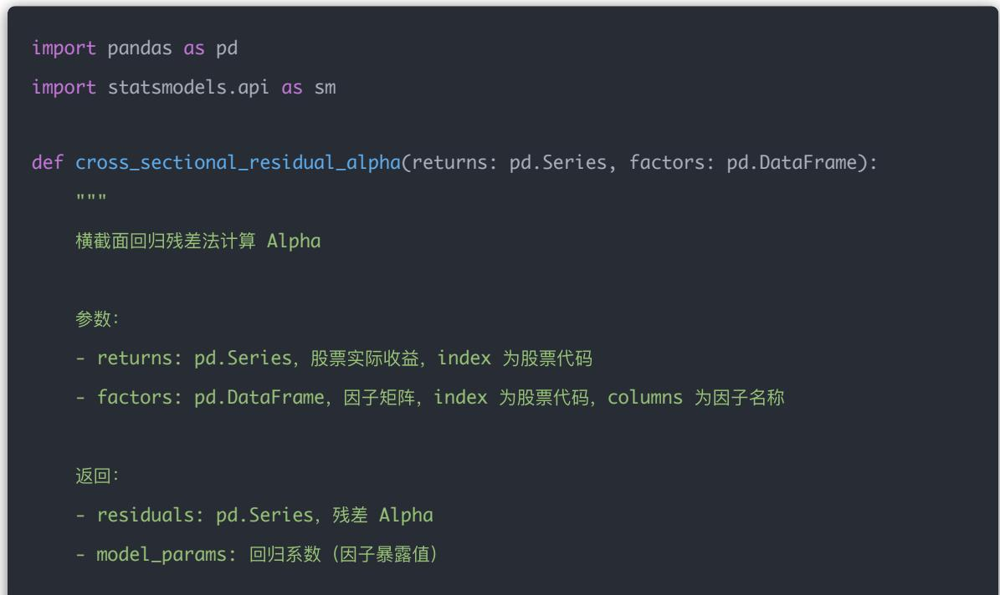
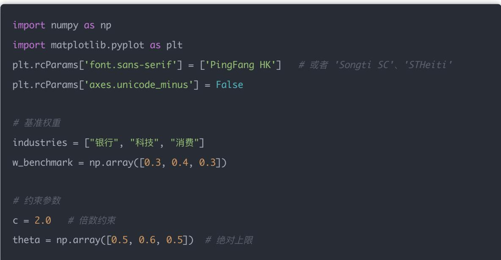
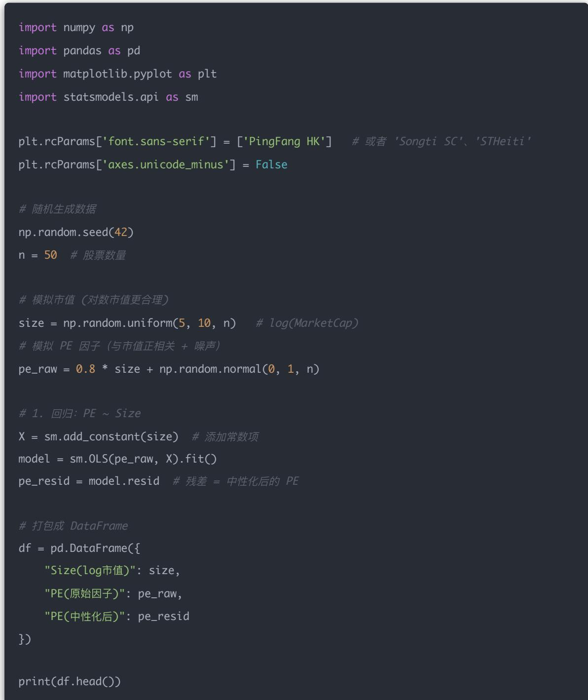
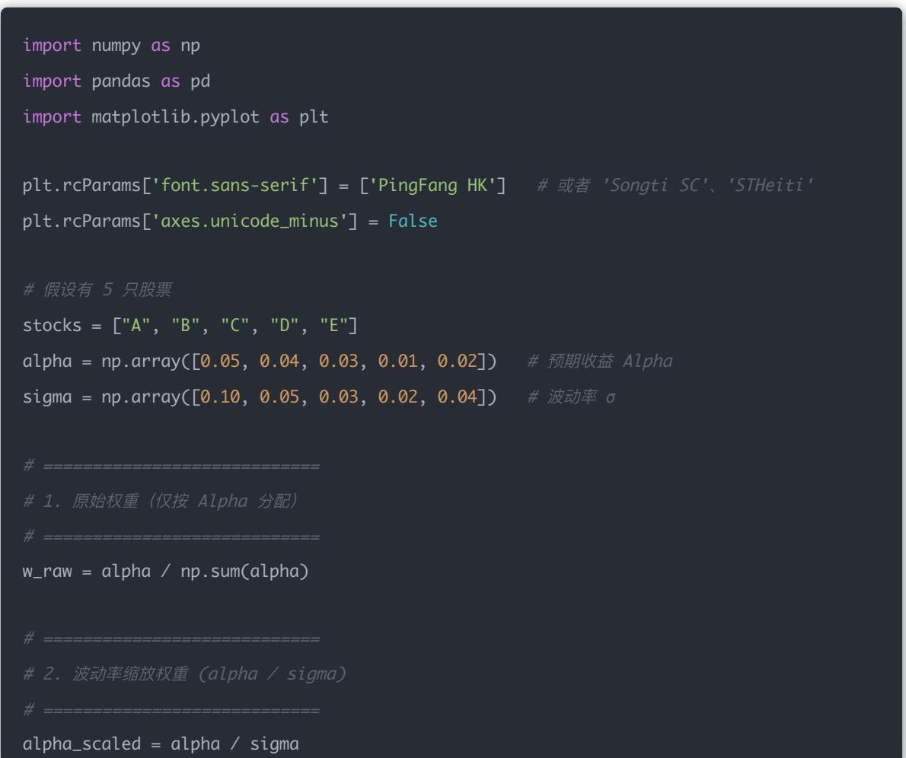
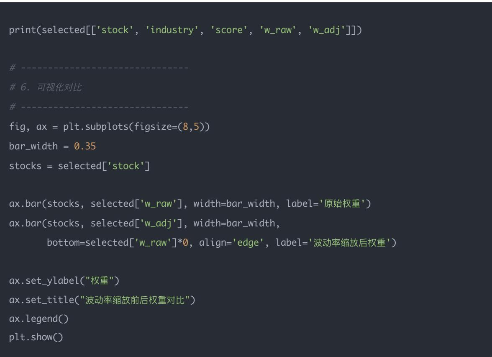

## 量化交易入门指南：第14天 - Alpha 组合构建与风险控制基础

原创 逻辑与流 逻辑与流 2025年9月13日 00:21 北京 📞 听全文

## 学习时间：60分钟

本文为量化交易学习系列第14天内容，系统讲解如何将因子打分转化为投资组合，包括组合构建方法、风险控制技术、Python实战与思考题，帮助你掌握量化策略从选股信号到投资组合的核心转化环节。

## Day 14 学习目标

## 你将掌握：

1. 理解如何将多个因子整合成组合权重

2. 学习常见的组合构建方法（打分法、回归法、优化法）

3. 掌握基本的风险控制手段（中性化、波动缩放、行业约束）

4. 实现一个简易的多因子 Alpha 投资组合分配策略

## 一、因子打分 $\neq$ 投资组合

因子分数只是一个排序指标，要构建可投资的组合，我们需要解决：

- 投资多少仓位到哪只股票？

- 如何控制风险暴露？

- 如何保证组合在行业、市值等维度不过度偏离基准？

## 二、组合构建的常用方法

### 2.1 等权打分法（最常见）

- 原理：把多个因子标准化后加权平均（如PE + ROE + Momentum）

### 2.1.1 计算流程拆解

## Step 1: 因子选择

- 比如选：PE（估值因子，越低越好）、ROE（盈利因子，越高越好）、Momentum $^{Q}$ （动量因子，越高越好）

## Step 2: 因子标准化

- 各因子量纲不同，要统一到同一个尺度

- 常见方法：

- Min-Max 标准化：

$$
x ^ {\prime} = \frac {x - \min (x)}{\max (x) - \min (x)}
$$

得分落在[0,1]

- Z-score 标准化:

$$
z = \frac {x - \mu}{\sigma}
$$

得分均值为0，标准差为1

- 注意方向性：像PE这种"越小越好"，需要取负值或做逆转

## Step 3: 合成综合打分

- 最简单（等权平均）：

$$
\mathrm{Score} _ {i} = \frac {1}{k} \sum_ {j = 1} ^ {k} z _ {i, j}
$$

- 可选：设置权重，比如 $50\%$ 权重给ROE， $25\%$ 给PE， $25\%$ 给Momentum

Step 4: 排序 & 选股

- 按 Score 排序，选 Top N 股票

## Step 5: 权重分配

- 等权：每只股票 $1 / \mathrm{N}$

- 按分数加权：

$$
w _ {i} = \frac {\mathrm{Score} _ {i}}{\sum \mathrm{Score}}
$$

2.1.2 举例计算

## 原始数据

<table><tr><td>股票</td><td>PE (越低越好)</td><td>ROE (越高越好)</td><td>Momentum (越高越好)</td></tr><tr><td>A</td><td>15</td><td>12%</td><td>8%</td></tr><tr><td>B</td><td>40</td><td>8%</td><td>3%</td></tr><tr><td>C</td><td>20</td><td>18%</td><td>12%</td></tr></table>

1. 标准化处理（Min-Max 标准化）

PE（越低越好，先取倒数）

- 先转化为 Earnings Yield = 1/PE:

A: $1 / 15 = 0.067$

B: $1 / 40 = 0.025$

C: $1 / 20 = 0.050$

- 再标准化到 [0,1]:

• A: $(0.067 - 0.025) / (0.067 - 0.025) = 1.00$

B: $(0.025 - 0.025) / (0.067 - 0.025) = 0.00$

C: $(0.050 - 0.025) / (0.067 - 0.025) = 0.60$

## ROE

A: $(12 - 8) / (18 - 8) = 0.40$

B: $(8 - 8) / (18 - 8) = 0.00$

C: $(18 - 8) / (18 - 8) = 1.00$

## Momentum

A: $(8 - 3) / (12 - 3) = 0.56$

B: $(3 - 3) / (12 - 3) = 0.00$

C: $(12 - 3) / (12 - 3) = 1.00$

### 2. 计算综合打分

• A: $(1.00 + 0.40 + 0.56)/3 = 0.65$

B: $(0.00 + 0.00 + 0.00) / 3 = 0.00$

• C: $(0.60 + 1.00 + 1.00)/3 = 0.87$

### 3. 选股 & 分配权重

- 排序：C (0.87) > A (0.65) > B (0.00)

- 假设选前 2: C 和 A

## 等权配置：

A: $50\%$

C: $50\%$

## 按分数配置：

• A: 0.65 / (0.87 + 0.65) = 43%

• C: 0.87 / (0.87 + 0.65) = 57%

2.1.3 Z-score 标准化详解

除了 Min-Max，也常用 Z-score 标准化。区别在于：

- Min-Max：把所有因子压缩到[0,1]，直观但容易受极端值影响

- Z-score：把因子变成均值为0、方差为1，更符合统计分析和多因子建模习惯

Z-score 标准化公式：

$$
z _ {i} = \frac {x _ {i} - \mu}{\sigma}
$$

- $x_{i}$ ：股票的原始因子值

- $\mu$ ：该因子的均值

- $\sigma$ ：该因子的标准差

## 方向性处理：

- PE因子（越小越好）：先取负号或转化成-PE再做标准化，或者直接用Earnings Yield = 1/PE

- ROE / Momentum（越大越好）：直接做标准化即可

## Z-score 计算实例：

### 1. 方向性处理

- PE越小越好 $\rightarrow$ 取-PE:

A: -15

B: -40

C: -20

### 2. 计算均值 & 标准差

- PE(-): 均值 = (-15 -40 -20)/3 = -25, $\sigma \approx 10.41$

- ROE：均值 $= (12 + 8 + 18) / 3 = 12.67$ ， $\sigma \approx 4.16$

- Momentum: 均值 $= (8 + 3 + 12) / 3 = 7.67$ ， $\sigma \approx 3.68$

3. 计算 Z-score

PE(-)

• A: $(-15 - -25)/10.41 = 0.96$

B: $(-40 - - 25) / 10.41 = -1.44$

C: $(-20 - - 25) / 10.41 = 0.48$

ROE

• A: (12 - 12.67)/4.16 = -0.16

B: $(8 - 12.67) / 4.16 = -1.12$

C: (18 - 12.67)/4.16 = 1.28

## Momentum

A: $(8 - 7.67) / 3.68 = 0.09$

B: $(3 - 7.67) / 3.68 = -1.27$

C: (12 - 7.67)/3.68 = 1.18

4. 综合打分（等权平均）

• A: $(0.96 + -0.16 + 0.09)/3 = 0.30$

B: $(-1.44 + -1.12 + -1.27) / 3 = -1.28$

C: $(0.48 + 1.28 + 1.18) / 3 = 0.98$

### 5. 排序 & 权重

- 排序：C(0.98) > A(0.30) > B(-1.28)

- 如果选前 2: C 和 A

- 等权：各 $50\%$

- 按打分权重：

• A: 0.30 / (0.30+0.98) ≈ 23%

• C: 0.98 / (0.30+0.98) ≈ 77%

## 结论：

- Z-score 的优点是能处理极值、保持相对差距

- 在多因子模型里，Z-score 比 Min-Max 更常用

2.1.4 Python 实战：等权打分法完整实现

下面的Python代码版本，支持两种标准化方式（minmax 和 zscore），然后自动计算因子打分和最终持仓权重：





## 输出结果（和前面我们手算的一致）：

<table><tr><td>C</td><td>0.60</td><td>1.0</td><td>1.00</td><td>0.87</td><td>0.57</td></tr><tr><td>A</td><td>1.00</td><td>0.4</td><td>0.56</td><td>0.65</td><td>0.43</td></tr></table>

## 举例：

<table><tr><td>股票</td><td>PE(低越好)</td><td>ROE(高越好)</td><td>动量(高越好)</td><td>综合打分</td></tr><tr><td>A</td><td>0.9</td><td>0.6</td><td>0.8</td><td>0.77</td></tr><tr><td>B</td><td>0.2</td><td>0.3</td><td>0.4</td><td>0.30</td></tr><tr><td>C</td><td>0.7</td><td>0.8</td><td>0.9</td><td>0.80</td></tr></table>

→选 C 和 A，等权各持 50%，或者按打分（0.80 vs 0.77）比例持仓。

## 优点：

- 简单直观，容易落地

- 不依赖优化器，避免过拟合

- 适合多因子原型策略

## 缺点：

- 没有风险约束：行业、市值可能偏离基准

- 忽视因子之间的相关性

- 组合稳定性差（换手率可能高）

### 2.2 回归残差法 (cross-sectional regression)

回归残差法（Cross-sectional Regression, CSR）是量化里面常用的一个因子处理方法，特别适合做风险中性多空组合。

### 2.2.1 基本原理

我们认为一只股票的未来收益率可以分解成两部分：

$$
r _ {i} = \beta_ {1} f _ {i 1} + \beta_ {2} f _ {i 2} + \dots + \beta_ {k} f _ {i k} + \epsilon_ {i}
$$

- $r_i$ ：股票i的未来收益（比如下月收益率）

- $f_{ik}$ : 股票 i 的第 k 个因子暴露（如 PE、ROE、Momentum 等）

- $\beta_{k}$ ：因子的横截面回归系数（市场平均因子溢价）

- $\epsilon_{i}$ ：残差部分，解释不了的收益，视为Alpha

## 直观理解：

- $\beta f$ ：市场的"共性部分"，大家都有的风险暴露

- $\epsilon$ ：个股的"独特超额收益"，就是我们要的选股信号

我们拿回归后的残差（实际收益 - 回归预测收益）作为 stock alpha:

- $\epsilon_{i} > 0$ ：股票跑赢预期，有Alpha

- $\epsilon_{i} < 0$ ：股票跑输预期，不建议买

2.2.2 计算流程

Step 1: 准备数据

- 横截面数据（同一个时间点所有股票的收益 + 因子值）

Step 2: 建模（横截面回归）

- 用所有股票的数据回归：

$$
r = F \beta + \epsilon
$$

其中 $r$ 是 $N \times 1$ 的收益向量， $F$ 是 $N \times k$ 的因子矩阵

Step 3: 获取残差

$$
\bullet \quad \hat {r} = F \hat {\beta}
$$

$$
\bullet \epsilon = r - \hat {r}
$$

- 残差 = 个股跑赢/跑输市场因子后应有收益

Step 4: 作为 Alpha 打分

- $\epsilon > 0$ ：股票收益好于预期，有 Alpha → 买入

- $\epsilon < 0$ ：股票收益差于预期，无Alpha $\rightarrow$ 卖出

2.2.3 数学推导详解

回归模型假设我们只有一个因子（比如PE），回归模型是：

$$
r _ {i} = \beta f _ {i} + \epsilon_ {i}
$$

- $r_i$ ：第i只股票的收益

- $f_{i}$ ：第i只股票的因子值

- $\beta$ ：回归系数（因子溢价）

- $\epsilon_{i}$ ：残差

目标：找到一个 $\beta$ ，让预测值 $\hat{r}_i = \beta f_i$ 尽量接近实际收益 $r_i$ 。

最小二乘法 (OLS) 我们要求解的就是：

$$
\min _ {\beta} \sum_ {i} (r _ {i} - \beta f _ {i}) ^ {2}
$$

推导公式对目标函数对 $\beta$ 求导：

$$
\frac {\partial}{\partial \beta} \sum_ {i} (r _ {i} - \beta f _ {i}) ^ {2} = 0
$$

展开：

$$
\sum_ {i} - 2 f _ {i} (r _ {i} - \beta f _ {i}) = 0
$$

$$
\sum_ {i} f _ {i} r _ {i} - \beta \sum_ {i} f _ {i} ^ {2} = 0
$$

所以：

$$
\beta = \frac {\sum_ {i} f _ {i} r _ {i}}{\sum_ {i} f _ {i} ^ {2}}
$$

2.2.4 计算实例

假设我们有3只股票，1个因子（比如PE值，取负号表示越小越好）：

<table><tr><td>股票</td><td>实际收益 r</td><td>因子值 f</td></tr><tr><td>A</td><td>5%</td><td>0.9</td></tr><tr><td>B</td><td>2%</td><td>0.3</td></tr><tr><td>C</td><td>7%</td><td>0.8</td></tr></table>

### 1. 计算回归系数

计算分子： $\sum f_{i}r_{i}$

$$
0. 9 \times 0. 0 5 + 0. 3 \times 0. 0 2 + 0. 8 \times 0. 0 7 = 0. 0 4 5 + 0. 0 0 6 + 0. 0 5 6 = 0. 1 0 7
$$

计算分母： $\sum f_{i}^{2}$

$$
0. 9 ^ {2} + 0. 3 ^ {2} + 0. 8 ^ {2} = 0. 8 1 + 0. 0 9 + 0. 6 4 = 1. 5 4
$$

计算回归系数：

$$
\beta = \frac {0 . 1 0 7}{1 . 5 4} \approx 0. 0 6 9 5 (\approx 0. 0 7)
$$

解释：

- $\beta \approx 0.07$ 的含义：因子值每提高1个单位，股票未来收益率平均提高约 $7\%$

- 它相当于"市场上这个因子的平均溢价"

- 残差 $\epsilon_{i}$ 就是剔除这个因子解释后的"个股超额收益"

2. 预测收益

A: $\hat{r} = 0.06 \times 0.9 = 5.4\%$

B: $\hat{r} = 0.06 \times 0.3 = 1.8\%$

C: $\hat{r} = 0.06 \times 0.8 = 4.8\%$

### 3. 计算残差

A: 实际 $5\% - 5.4\% = -0.4\%$

B: 实际 $2\% - 1.8\% = +0.2\%$

C: 实际 $7\% - 4.8\% = +2.2\%$

### 4. Alpha 打分

A: 跑输预期 $\rightarrow$ 不买

B: 跑赢预期（略微） $\rightarrow$ 中性

C: 显著跑赢预期 $\rightarrow$ 买入

2.2.5 优缺点总结

\*\*优点\*\*

- 剔除了因子"共性成分"，残差更像"纯粹的个股Alpha"

- 天然适合多空中性策略（多买残差大的，空卖残差小的）

- 可以在 Barra $^{Q}$ 风险模型框架里自然使用

\*\*缺点\*\*

- 对数据质量敏感（异常值会影响回归结果）

- 共线性问题：如果因子高度相关，回归结果不稳健

- 残差本身可能含有噪声，需要结合其他信号平滑

## 总结：

- 等权打分法 $\rightarrow$ 简单直观，适合初步选股

- 回归残差法 $\rightarrow$ 剔除市场风险，适合中性多空策略

### 2.2.6 Python 实战：横截面回归残差法实现

import pandas as pd

import statsmodels.api as sm

def cross\_sectional\_residual\_alpha(returns: pd.Series, factors: pd.DataFrame):

横截面回归残差法计算 Alpha



参数：

- returns: pd.Series，股票实际收益，index 为股票代码

- factors: pd.DataFrame，因子矩阵，index 为股票代码，columns 为因子名称

返回：

- residuals: pd.Series, 残差 Alpha

- model\_params: 回归系数（因子暴露值）

\# 对齐索引

data = pd.concat([returns, factors], axis=1, join="inner").dropna()

y = data[returns.name]

X = data[ factors.columns]

\# 添加截距项

X = sm.add\_constant(X)

\# 横截面 OLS 回归

model = sm.OLS(y, X).fit()

\# 残差作为 Alpha

residuals = model.resid

return residuals, model.params

\# ====== 示例数据 ======

\# 股票收益（比如 $A, B, C$ 三只股票）

returns = pd.Series({

"A": 0.05,

"B": 0.02,

"C": 0.08

}, name="return")

\# 股票因子值（比如 市值因子、PE 因子）

factors = pd.DataFrame({

"size": {"A": 10, "B": 20, "C": 15},

"PE": {"A": 30, "B": 25, "C": 28}

})

\# 计算残差 Alpha

alpha, betas = cross\_sectional\_residual\_alpha(returns, factors)

print("因子回归系数 (β): ")

print(betas)

print("\n残差 Alpha: ")

print(alpha)

## 输出示例：

因子回归系数 (β):

const 0.0100

size 0.0015

PE -0.0020

dtype: float64

## 解释：

- 回归系数 $\beta$ ：描述因子对收益的平均影响（比如 size 越大收益越高，PE 越大收益越低）

- 残差 Alpha：超额收益，说明在剔除因子解释部分后，股票本身是否还有"跑赢市场"的成分

### 2.3 最优化法（常用于机构）

### 2.3.1 为什么需要最优化法？

- 因子打分只是告诉你"哪些股票好"

- 回归残差法能剔除掉一些风险共性，但依然没有解决一个问题：买多少？怎么分仓？如何控制组合的风险与约束？

在实际机构投资中，组合必须满足一系列约束条件（风险、资金规模、换手率、行业配置等），这就需要优化器来"算出一组权重 $w''$ ——既能最大化预期收益，又能符合风险控制。

### 2.3.2 数学框架

我们一般写成二次规划（Quadratic Programming, QP）：

$$
\max _ {w} \mu^ {\top} w - \lambda w ^ {\top} \Sigma w
$$

解释：

- $w$ ：投资权重向量（每只股票买多少）

- $\mu$ ：预测的超额收益向量（来自因子模型/alpha模型）

- $\Sigma$ ：收益的协方差矩阵（风险）

- $\lambda$ ：风险厌恶参数，越大越保守

目标函数 $=$ 预期收益-风险惩罚。这是典型的均值-方差优化思路。

### 2.3.3 常见约束条件

机构最常用的约束分几类：

## (1) 基本约束

- 资金全投： $\sum w_{i} = 1$

- 空头限制： $w_{i} \geq 0$ （或允许 -x，即做空）

- 个股权重上限： $w_{i} \leq 5\%$

## (2) 风险相关

- 波动率约束： $\sqrt{w^{\top}\Sigma w} \leq 20\%$

- 跟踪误差约束：控制相对基准的风险，而不是绝对波动

- 行业/风格暴露约束：

• 例：金融行业权重不得偏离基准 ±10%

- 小盘/大盘因子的暴露不得超过某个值

## (3) 交易相关

- 换手率限制： $\sum |w - w_{prev}| \leq 30\%$

- 流动性约束：股票权重不得超过其平均成交额的某个比例

## (4) 资金规模

- 最小持仓单位：不能买0.01股，必须成手

- 仓位下限：比如小于1万元的仓位不交易

### 2.3.4 优缺点分析

\*\*优点\*\*

- 灵活性：能把各种实际交易限制都写进模型

- 风险控制：能做到风险中性、行业中性、低波动等不同风格

- 工程实用性：是大多数机构组合管理的核心手段

\*\*缺点\*\*

- 参数敏感：预测收益 $\mu$ 和协方差矩阵 $\Sigma$ 都需要估计，一旦估错，结果可能南辕北辙

- 实现复杂：需要调用优化器（cvxpy、GUROBI、CPLEX等），写法比简单的因子打分复杂很多

- 数值稳定性：协方差矩阵常常病态，需要正则化（Shrinkage、Ridge）

### 2.3.5 和前两种方法对比

- 因子打分法：简单粗暴，适合初学和小资金；但没风险控制

- 回归残差法：能剔除共性风险，适合多空中性策略，但仍然没考虑权重配置问题

- 最优化法：是前两者的"工业级版本"，真正能在实盘中落地，但需要更复杂的风险建模和运算

## 总结一句话：

- 因子分数 告诉你"哪只股票好"

- 残差法 告诉你"这部分是真正的超额收益"

- 最优化法 告诉你"该怎么配仓，既赚钱又安全"

### 2.4 总结对比表格

<table><tr><td>方法</td><td>优点</td><td>缺点</td><td>适用场景</td></tr><tr><td>等权打分法</td><td>简单、直观、容易实现</td><td>无法控制行业、市值、波动等风险</td><td>零基础策略初步实践</td></tr><tr><td>残差回归法</td><td>剥离共性风格、获得纯粹Alpha</td><td>回归稳定性要求高</td><td>风格中性选股策略</td></tr><tr><td>最优化法</td><td>风险控制精细、组合构建高度可控</td><td>数学门槛高、需要工具包</td><td>专业实盘组合管理</td></tr></table>

## 三、风险控制技术

### 3.1 行业中性化（Industry Neutralization）

### 3.1.1 背景问题

当我们用因子（比如 PE、ROE、动量）来打分时，往往会发现：

- 银行、地产等行业的股票天然符合某些因子特征（如低PE、高股息）

- 科技股、消费股可能更多出现在高成长因子中

结果：如果不加约束，你的组合可能高度集中在某一两个行业。

- 看上去是因子有效，实际上可能是"行业配置效应"

- 当行业轮动时，因子表现被行业噪声"污染"，难以检验因子本身是否有效

所以，行业中性化的目标就是：让组合的超额收益来自于因子，而不是行业配置。

### 3.1.2 为什么要中性化？

比如你用一个因子（如PE）打分后发现银行股全都在前列，你构建的组合 $80\%$ 是银行股。但过一个月涨的是科技股，那你因子可能其实没错，只是行业暴露太集中，把收益"污染"了。

### 3.1.3 实现方法

## 方法一：行业内打分再选股

逻辑：把因子信号限制在行业内部比较。

- 在每个行业里做Z-score标准化（去掉行业均值效应）

- 在行业内部排序，选出 Top N（或 Top X%）

- 各行业之间再等权、或按市值权重分配仓位

## 例子：

- 在银行股里选 2 只，科技股里选 2 只，消费股里选 2 只……

- 最终组合不会过度集中在某一个行业

这是最常见的方式，尤其适合做多空选股（long-short alpha）。

方法二：设置行业权重上限

逻辑：不剔除行业效应，但限制行业集中度。

- 先用因子全市场打分，再选出高分股票

- 在组合优化时，加入约束：

$$
w ^ {\text { industry }} \leq c \cdot w ^ {\text { benchmark,   industry }}
$$

- 其中 $c$ 是一个放宽倍数（如2倍）

- 若沪深300里银行占比 $10\%$ ，那你的组合里银行最多占 $20\%$

优点：保留了一定的行业暴露自由度，组合可能跑赢基准。缺点：没有完全剔除行业效应，还是会有部分风险敞口。

## 方法三：强制行业中性化

逻辑：严格要求组合的行业暴露与基准一致。

- 在优化时加入：

$$
w ^ {\mathrm{industry}} = w ^ {\mathrm{benchmark,industry}}
$$

- 这样，组合里各行业权重和基准一模一样，行业风险完全对冲

效果：组合的收益完全来自因子选择，而不是行业配置。缺点：约束过强，可能压制组合的主动性。

### 3.1.4 方法对比总结

<table><tr><td>方法</td><td>思路</td><td>优点</td><td>缺点</td><td>适用场景</td></tr><tr><td>行业内打分</td><td>行业内排序再选</td><td>简单、直观、完全剔除行业效应</td><td>行业间因子差异可能被忽略</td><td>多空选股、因子有效性检验</td></tr><tr><td>设置上限</td><td>限制行业集中度</td><td>保留部分行业配置灵活性</td><td>仍可能有行业暴露</td><td>实盘组合构建</td></tr><tr><td>行业对齐基准</td><td>完全跟基准行业结构一致</td><td>因子效应最纯净</td><td>约束过强,降低收益潜力</td><td>研究因子真实性能</td></tr></table>

### 3.1.5 数学公式详解

### 1. 行业权重上限约束

$$
w _ {\mathrm{industry}} \leq c \cdot w _ {\mathrm{benchmark,industry}}
$$

- $w_{\mathrm{industry}}$ ：组合在某个行业上的权重（该行业所有股票权重之和）

- $w_{\mathrm{benchmark, industry}}$ ：基准指数（比如沪深300）在该行业的权重

- $c$ ：放宽系数（比如2倍）

含义：组合中某个行业的权重，不能超过基准该行业权重的 c 倍。

- 如果基准中"银行"行业占 $10\%$ ， $c = 2$ ，那么组合里银行股最多 $20\%$

- 这样可以避免因子过度集中在某个行业

### 2. 行业对齐约束（严格中性化）

$$
w _ {\mathrm{industry}} = w _ {\mathrm{benchmark,industry}}
$$

含义：组合里每个行业的权重，必须和基准完全一致。

- 如果基准中银行是 $10\%$ ，科技是 $15\%$ ，那么组合中也必须严格保持 $10\%$ 和 $15\%$

这样做可以完全剔除行业配置效应，组合的超额收益只能来源于行业内部的选股能力（即因子Alpha）。

- 缺点：约束过强，可能牺牲部分收益潜力

### 3.行业权重定义公式

$$
w _ {\mathrm{industryk}} = \sum_ {i \in \mathrm{行业} \mathrm{k}} w _ {i}
$$

- $w_{i}$ : 第 $i$ 只股票的组合权重

- 行业 $k$ 的权重等于该行业所有股票权重的加总

这是行业暴露的基本定义：组合在某个行业的权重就是该行业所有股票权重的总和。

4. 行业偏离度约束（允许小范围偏离）

$$
\left| w _ {\mathrm{industryk}} - w _ {\mathrm{benchmark,industryk}} \right| \leq \delta_ {k}
$$

- $\delta_{k}$ : 允许的偏离容忍度（比如 $\pm 5\%$ ）

- 含义：组合在某个行业上的权重，可以和基准不一样，但差异必须小于 $\delta_{k}$

比如：

- 基准中银行 $10\%$ ， $\delta_{k} = 5\%$

- 那么组合里银行的权重必须在 $[5\%, 15\%]$ 之间

- 这种方式在实盘中很常见，既避免行业极端集中，又保留一定的主动配置自由度

### 3.1.6 公式对比总结

<table><tr><td>公式</td><td>含义</td><td>特点</td></tr><tr><td> $w_{industry} \leq c \cdot w_{benchmark}$ </td><td>行业权重不超过基准的c倍</td><td>控制行业过度集中</td></tr><tr><td> $w_{industry} = w_{benchmark}$ </td><td>行业权重必须与基准一致</td><td>完全中性化,最严格</td></tr><tr><td> $w_{industry} = \sum_{i \in \text{行业}} w_i$ </td><td>定义行业权重</td><td>数学定义</td></tr><tr><td> $|w_{industry} - w_{benchmark}| \leq \delta$ </td><td>允许小范围偏离基准</td><td>软约束,更灵活</td></tr></table>

## 可以理解为：

- 等式约束 = 强制中性化（最严格）

- 不等式约束 = 软约束（更灵活）

3.1.7 数值示例对比

用一个具体简单例子把三种行业约束在数值上对比，帮助理解约束对组合空间的影响。

假设基准行业权重：

- 银行 (B): $30\%$

- 科技 (T): $40\%$

- 消费 (C): $30\%$

组合权重向量记为 $w = (w_{B}, w_{T}, w_{C})$ ，并且始终满足：

$$
w _ {B} + w _ {T} + w _ {C} = 1, \quad w _ {i} \geq 0
$$

## 1) 严格行业对齐（完全中性）

约束： $w_{\mathrm{industry}} = w_{\mathrm{benchmark, industry}}$ 在本例就是： $(w_B,w_T,w_C) = (0.30,0.40,0.30)$

- 可行区间：只有一个解点，唯一可行组合（单点）

- 几何意义：在三维权重的单纯形上，是单点（没有自由度）

- 示例：唯一解 (0.30, 0.40, 0.30)

2) 行业权重上限（倍数上限）

约束形式： $w_{\mathrm{industry}} \leq c \cdot w_{\mathrm{benchmark, industry}}$ 取 $c = 1.5$ ，则数值上：

$$
w _ {B} \leq 0. 4 5, w _ {T} \leq 0. 6 0, w _ {C} \leq 0. 4 5
$$

- 可行区间（逐行业单独看）：

- $w_{B} \in [0, 0.45]$

• $w_{T} \in [0, 0.60]$

• $w_{C} \in [0, 0.45]$

- 几何意义：在三维权重单纯形上，去掉了超过上界的部分，剩下的是一个多边形（有若干顶点）。自由度较大，允许一定主动配置，但防止极端集中。

- 几个极端可行点：

- 银行最大化： $w_{B}=0.45$ ，例如 $w=(0.45,0.55,0.00)$

- 科技最大化： $w_{T}=0.60$ ，例如 $w=(0.40,0.60,0.00)$

## 3) 允许偏离基准的上下限 ( $\pm\delta$ )

约束形式： $|w_{\mathrm{industryk}} - w_k^{\mathrm{bench}}|\leq \delta_k$ 取统一容忍度 $\delta_{k} = \pm 5\%$ （即0.05），于是：

- 银行： $w_{B}\in [0.25,0.35]$

- 科技： $w_{T}\in [0.35,0.45]$

- 消费： $w_{C}\in [0.25,0.35]$

- 几何意义：在单纯形上是一个小型多边形区域（中心在基准点周围），比 $c$ 上限更严格、比完全对齐更松一点。适合既想保留行业中性效果又想给组合少量主动权的场景。

- 边界示例：

- 银行下限、科技上限： $w = (0.25, 0.45, 0.30)$

- 银行上限、消费下限： $w = (0.35, 0.35, 0.30)$

3.1.8 小结对比（直观）

- 严格对齐：可行集 $=$ 单点（无主动权，行业风险完全对冲）

- 倍数上限 (c): 可行集 = 大范围凸多边形（较灵活，可放开较多主动权，但防止极端集中）

- 偏离 $\pm \delta$ ：可行集 $=$ 以基准为中心的小凸多边形（保守、允许小幅主动配置）

## 直观举例表：

<table><tr><td>组合( $w_B, w_T, w_C$ )</td><td>严格对齐</td><td>倍数上限(c=1.5)</td><td>±δ (δ=0.05)</td></tr><tr><td>(0.30,0.40,0.30)</td><td>☑ (唯一)</td><td>☑</td><td>☑</td></tr><tr><td>(0.45,0.55,0.00)</td><td>✗</td><td>☑ (示例可行)</td><td>✗ (消费=0 &lt; 0.25)</td></tr><tr><td>(0.25,0.45,0.30)</td><td>✗</td><td>☑</td><td>☑ (银行下界,科技上界)</td></tr><tr><td>(0.60,0.40,0.00)</td><td>✗</td><td>✗ (银行&gt;0.45)</td><td>✗</td></tr><tr><td>(0.35,0.35,0.30)</td><td>✗</td><td>☑</td><td>☑</td></tr></table>

### 3.1.9 可视化对比：行业约束效果

为了更直观地理解三种约束方式的效果，我们用Python代码生成对比图：

import numpy as np

import matplotlib.pyplot as plt

plt.rcParams['font.sans-serif'] = ['PingFang HK'] # 或者 'Songti SC'、'STHeiti'

plt.rcParams['axes.unicode\_minus'] = False

#基准权重



industries = ["银行", "科技", "消费"]

w\_benchmark = np.array([0.3, 0.4, 0.3])

\# 约束参数

c = 2.0 # 倍数约束

theta = np.array([0.5, 0.6, 0.5]) # 绝对上限

delta = 0.1 # 偏离度约束

\# 三种约束下的可行区间

\# 1. 倍数约束

lower\_mult = np.zeros\_like(w\_benchmark)

upper\_mult = c \* w\_benchmark

2. 绝对上限

lower\_theta = np.zeros\_like(w\_benchmark)

upper\_theta = theta

#3. 偏离度约束

lower\_delta = np.maximum(0, w\_benchmark - delta)

upper\_delta = np.minimum(1, w\_benchmark + delta)

\# 绘图

x = np.arange(len(industries))

width = 0.25

fig, ax = plt.subplots(figsize=(8, 6))

ax.bar(x, w\_benchmark, width, label="基准权重", color="lightgray", edgecolor="black")

ax.errorbar(x - width, w\_benchmark,
    yerr=[w\_benchmark - lower\_mult, upper\_mult - w\_benchmark],
    fmt='o', label="倍数约束 (c=2)")

ax.errorbar(x, w\_benchmark,
    yerr=[w\_benchmark - lower\_theta, upper\_theta - w\_benchmark],
    fmt='o', label="绝对上限 0")

ax.errorbar(x + width, w\_benchmark,
    yerr=[w\_benchmark - lower\_delta, upper\_delta - w\_benchmark],
    fmt='o', label=f"偏离度约束 ±{delta\*100:.0f}%")

ax.set\_xticks(x)

ax.set\_xticklabels(industries, fontsize=12)

ax.set\_ylabel("权重", fontsize=12)

ax.set\_title("行业约束方式对比", fontsize=14)

ax.legend()

ax.grid(True, linestyle="--", alpha=0.5)

plt.tight\_layout()

plt.show()

C

- 灰色柱子=基准行业权重（银行30%、科技40%、消费30%）

- 左边小圆点 + 误差条 = 倍数约束范围（c=2倍上限）

- 中间小圆点 + 误差条 = 绝对上限范围 ( $\theta=50\%$ 、60%、50%)

- 右边小圆点 + 误差条 = 偏离度约束范围（±10%）

## 图表直观展示：

1. 倍数约束：允许各行业权重达到基准的2倍，范围最宽

2. 绝对上限：设置固定的权重上限，不依赖基准比例

3. 偏离度约束：在基准附近小范围波动，约束最严格

这个可视化图帮助理解不同约束方式对组合行业配置灵活性的影响，为实际应用提供直观参考。

### 3.2 市值中性化 (Size Neutralization)

### 3.2.1 背景问题

很多基本面因子（比如 PE、PB、ROE）在实证中会显得有效，但其实它们往往和市值（Size）高度相关：

- 小盘股往往PE更低（更便宜），所以当你选择低PE股票时，可能无意中买了一堆小盘股

- 最后赚的钱不一定是"低PE因子"的超额收益，而是"Size因子"贡献的

如果我们不把市值的影响剔除掉，就没法真正验证PE因子本身是否有效。

3.2.2 为什么市值偏好是问题？

- 市值也是一个"隐含风格因子"，许多因子（比如PE）天然偏爱小盘股

- 如果不剔除市值影响，你以为"PE有效"，其实是在买"Size因子"

3.2.3 实现方法

方法1：残差回归中性化

思路：把市值当作一个"解释变量"，对因子值做回归，把回归残差作为"净因子"。

数学形式：以 PE 因子为例：

$$
\mathrm{PE} _ {i} = \alpha + \beta \cdot \mathrm{Size} _ {i} + \epsilon_ {i}
$$

其中：

- $\mathrm{PE}_i =$ 股票 $i$ 的原始PE因子值

- $\mathrm{Size}_i =$ 股票 $i$ 的市值（取对数更稳健）

- $\epsilon_{i} =$ 残差（也就是去掉 size 影响后，真正属于 PE 的部分）

得到净因子：

$$
\mathrm{PE} _ {i} ^ {\mathrm{net}} = \epsilon_ {i}
$$

$\rightarrow$ 这个 $\epsilon_{i}$ 就是Size中性化后的PE因子。

这样构建组合时，不会因为市值风格而歪曲因子效果。

方法2：市值分组中性化

另一种常见方法是分桶法：

1. 按市值把股票分成几个组（比如大盘股组 vs 小盘股组，或者分成 5 组/10 组）

2. 在每个组里计算 PE 因子打分并选股

3. 最终组合按市值组内等权（或保持与市值分布相近），从而避免组合过度偏向小盘股

举例：

- 把全市场分成大盘 $50\%$ vs 小盘 $50\%$

- 在大盘和小盘里，各自挑 Top $10\%$ 的低 PE 股票

- 最终组合由大盘低PE+小盘低PE构成，而不是全都集中在小盘里

## 方法3（进阶）：构建对冲 Size 暴露的多空组合

量化对冲基金常用：

1. 计算一个股票的因子暴露向量（包含 PE、Size 等）

2. 构建一个线性约束，使组合对 Size 的暴露为 0

- 即：组合整体对 Size 的回归系数 $\beta_{\mathrm{Size}} = 0$

3. 得到一个"纯粹的PE因子多空组合"

3.2.4 小总结

- 为什么要做？ $\rightarrow$ 防止"Size因子"掺杂，误判因子有效性

- 怎么做？

1. 残差回归法（对因子回归市值，取残差）

2. 分组中性化法（在市值分组内打分/选股）

3. 优化法（在投资组合构建中强制 Size 暴露为 0）

- 结果：得到一个更干净的因子，能更准确反映它本身的预测能力

3.2.5 Python 实战：市值中性化对比

用Python随机生成一些股票数据（市值 $+\mathrm{PE}$ ），然后做回归残差中性化，对比中性化前后的PE因子：



```python
print("\n回归结果：\n", model.summary())

# 2. 可视化对比
plt.figure(figsize=(12, 5))

# 原始 PE vs Size
plt.subplot(1, 2, 1)
plt.scatter(size, pe_raw, color="blue", label="原始PE")
plt.plot(size, model.fittedvalues, color="red", label="回归线")
plt.xlabel("Size (log 市值)")
plt.ylabel("PE 原始")
plt.title("中性化前：PE 和 Size 明显相关")
plt.legend()

# 中性化后残差 vs Size
plt.subplot(1, 2, 2)
plt.scatter(size, pe_resid, color="green", label="中性化后PE残差")
plt.axhline(0, color="red", linestyle="--")
plt.xlabel("Size (log 市值)")
plt.ylabel("PE 残差")
plt.title("中性化后：已剔除 Size 影响")
plt.legend()

plt.tight_layout()
plt.show()
```

## 代码说明：

### 1. 生成数据：

- size 模拟股票的对数市值

- pe\_raw 模拟原始 PE 因子，与市值强相关

### 2. 回归：

$$
\mathrm{PE} = \alpha + \beta \cdot \mathrm{Size} + \epsilon
$$

### 3. 图形结果:

- model.resid 就是残差 $\rightarrow$ 中性化后的 PE

- 左图：原始PE与市值强相关（几乎一条直线）

- 右图：中性化后残差 vs 市值，关系消失，因子变干净

数学形式（标准化）：对某因子值（如PE）和size做如下回归：

$$
\mathrm{PE} _ {i} ^ {\text {中性}} = \mathrm{PE} _ {i} - \gamma \cdot \mathrm{Size} _ {i}
$$

你可以把 PE 视为"Size 中性化处理后"的净因子。

### 3.3 波动率缩放（Volatility Scaling）

波动率缩放（Volatility Scaling）在实际投资里是非常常见的一步，尤其是多因子组合、量化选股和CTA策略中。

### 3.3.1 核心思想

- 如果两只股票的 Alpha（预期收益）相同，但其中一只股票的波动率更高，它对组合的风险贡献就会更大

- 为了避免高波动股票"拖累"组合，把Alpha除以波动率，让低波动股票得到更高权重

等价于：

$$
w _ {i} \propto \frac {\alpha_ {i}}{\sigma_ {i}}
$$

再做归一化，使权重和为 1。

### 3.3.2 详细举例

假设我们有如下 5 只股票：

<table><tr><td>股票</td><td>Alpha</td><td>波动率 σ</td><td>初始权重 = α/σ</td></tr><tr><td>A</td><td>0.05</td><td>0.10</td><td>0.50</td></tr><tr><td>B</td><td>0.04</td><td>0.05</td><td>0.80</td></tr><tr><td>C</td><td>0.03</td><td>0.03</td><td>1.00</td></tr><tr><td>D</td><td>0.01</td><td>0.02</td><td>0.50</td></tr><tr><td>E</td><td>0.02</td><td>0.04</td><td>0.50</td></tr></table>

- 初始权重和 $= 3.30$

- 归一化后：

$$
\bullet \quad A = 0.50 / 3.30 \approx 15\%
$$

$$
\bullet \quad B = 0.80 / 3.30 \approx 24 \%
$$

$$
\bullet \quad C = 1.00 / 3.30 \approx 30\%
$$

$$
\bullet \quad D = 0.50 / 3.30 \approx 15 \%
$$

$$
\bullet \quad E = 0.50 / 3.30 \approx 15 \%
$$

结果：即使C的Alpha不是最高的，因为它波动率低，分配到了更多资金（ $30\%$ ）。

3.3.3 为什么要这样做？

### 1. 避免高波动股票主导风险

- 如果不控制，一只高波动股票就可能让整个组合出现很大 drawdown

2. 风险均衡（Risk Parity）的思想

- 组合应该让"每个股票对风险的贡献"大致相似，而不是让高波动股票"拉偏架"

### 3. 兼顾收益与风险

- 单看Alpha可能偏向高预期收益股票，但加上 $\sigma$ 的约束后，权重更稳健

3.3.4 数学公式

完整公式：

$$
w _ {i} = \frac {\alpha_ {i} / \sigma_ {i}}{\sum_ {j} (\alpha_ {j} / \sigma_ {j})}
$$

步骤分解：

1. 计算 $\alpha_{i} / \sigma_{i}$ （每只股票的收益风险比）

2. 归一化：除以所有股票的收益风险比之和

3.3.5 注意事项

波动率估计长度：

- 太短 $\rightarrow$ 噪声大，权重剧烈波动

- 太长 $\rightarrow$ 过度平滑，反应不灵敏

- $\rightarrow$ 一般用60天/120天历史收益率标准差

忽视"高风险高收益"股票：

- 有些高波动股票确实有高Alpha，单纯除以 $\sigma$ 可能过度惩罚它们

- 实务里有时会用 $\sigma$ 的某个幂次（例如 $\sigma^{0.5}$ ）来调和，而不是直接 $1 / \sigma$

风险聚合问题：

- 单个股票波动率低，但行业相关性强，可能导致组合整体风险还是很集中

- → 需要结合协方差矩阵（即优化法）

3.3.6 优缺点总结

\*\*优点：\*\*

- 抑制高波动股票

- 提升组合稳定性

- 兼顾 Alpha 与风险

\*\* 缺点：\*\*

- 依赖波动率估计

- 可能过度惩罚"高风险高收益"股票

3.3.7 Python 实战：波动率缩放对比

用 Python 直接计算波动率缩放前后权重，并画对比图：

import numpy as np

import pandas as pd

import matplotlib.pyplot as plt

plt.rcParams['font.sans-serif'] = ['PingFang HK'] # 或者 'Songti SC'、'STHeiti'

plt.rcParams['axes.unicode\_minus'] = False

\# 假设有 5 只股票

stocks = ["A", "B", "C", "D", "E"]

alpha = np.array([0.05, 0.04, 0.03, 0.01, 0.02]) # 预期收益 Alpha



sigma = np.array([0.10, 0.05, 0.03, 0.02, 0.04]) # 波动率 σ

\# 1. 原始权重（仅按 Alpha 分配）

w\_raw = alpha / np.sum(alpha)

\# 2. 波动率缩放权重 (alpha / sigma)

alpha\_scaled = alpha / sigma

\# 打包结果

df = pd.DataFrame({

"股票": stocks,

"Alpha": alpha,

"波动率σ": sigma,

"原始权重": w\_raw,

"波动率缩放权重": w\_scaled

})

print(df)

#3. 可视化对比

x = np.arange(len(stocks))

width = 0.35

plt.figure(figsize=(8,5))

plt.bar(x - width/2, w\_raw, width, label="原始权重(按Alpha)")

plt.bar(x + width/2, w\_scaled, width, label="波动率缩放权重")

plt.xticks(x, stocks)

plt.ylabel("权重")

plt.title("波动率缩放前后权重对比")

plt.legend()

plt.show()

## 运行结果解读：

3. 图形：能直观看出，波动率缩放把更多仓位分配给了低波动股票

### 3.4 总结对比表格

<table><tr><td>控制维度</td><td>方式</td><td>核心目的</td><td>方法类型</td></tr><tr><td>行业</td><td>每行业等权 / 限行业权重</td><td>避免行业偏离</td><td>择股 + 约束</td></tr><tr><td>市值</td><td>加入 size 回归 / 分层多空</td><td>剔除 size 因子影响</td><td>打分调整</td></tr><tr><td>波动率</td><td>α / σ → 归一化</td><td>分配更多仓位给低风险资产</td><td>权重调整</td></tr></table>

## 四、组合构建流程总结

Step 1: 多因子打分 → Z-score 合成

Step 2: 排序选股 → Top N

Step 3:风控处理 → 行业/市值/波动中性

Step 4: 权重计算 → 等权 / 打分加权 / 风险最小化

Step 5: 输出组合 → 仓位建议、资金分配

## 五、Python 实战：多因子组合构建

### 5.1 多因子组合构建（带风险控制）

下面我们用简化数据构建一个组合：

示例：多因子打分 + 波动率调整 + 行业中性

```python
import pandas as pd

# 假设我们有 6 只股票，三个因子，以及波动率 & 行业信息

import pandas as pd

import matplotlib.pyplot as plt

from sklearn.preprocessing import StandardScaler

plt.rcParams['font.sans-serif'] = ['PingFang HK'] # 或者 'Songti SC'、'STHeiti'

plt.rcParams['axes.unicode_minus'] = False

#

# 1. 假数据

df = pd.DataFrame({

'stock': ['A', 'B', 'C', 'D', 'E', 'F'],

'pe': [8, 10, 12, 7, 15, 20],
'roe': [15, 12, 8, 20, 5, 3],
'momentum': [0.05, 0.01, -0.02, 0.1, 0.03, -0.01],
'vol': [0.2, 0.3, 0.25, 0.15, 0.4, 0.35],
'industry': ['Tech', 'Tech', 'Finance', 'Finance', 'Energy', 'Energy']
})
# ----
# 2. 标准化 & 因子合成
#
df_ = df.copy()
df['pe'] = -df['pe']    # PE 越低越好，所以取负

scaler = StandardScaler()
df_std = pd.DataFrame(
    scaler.fit_transform(df[['pe', 'roe', 'momentum']]),
    columns=['pe', 'roe', 'momentum']
)

# 因子加权（可调整）
weights = {'pe': 0.4, 'roe': 0.3, 'momentum': 0.3}
df_std['score'] = (
    weights['pe'] * df_std['pe'] +
    weights['roe'] * df_std['roe'] +
    weights['momentum'] * df_std['momentum']
)

df['score'] = df_std['score']

# ----
# 3. 波动率缩放
#
df['adj_score'] = df['score'] / df['vol']

# ----
# 4. 行业中性（每行业选1只最优）
#
selected = df.loc[df.groupby('industry')['adj_score'].idxmax().copy()
# ----
# 5. 权重计算（缩放前 vs 缩放后）
# ----
# 缩放前（直接用score归一化）
selected['w_raw'] = selected['score'] / selected['score'].sum()
# 缩放后（adj_score归一化）
selected['w_adj'] = selected['adj_score'] / selected['adj_score'].sum()
```



ax.bar(stocks, selected['w\_raw'], width=bar\_width, label='原始权重')
ax.bar(stocks, selected['w\_adj'], width=bar\_width,
    bottom=selected['w\_raw']\*0, align='edge', label='波动率缩放后权重')

## 分析输出：

### 1. 数据输出：

- 会打印出每个行业选出来的股票、原始打分、原始权重 vs 缩放后权重

- 每个行业只选出1只股票，确保行业中性

- 用"因子分数 ÷ 波动率"优先挑选稳健股

- 最终按等权组合输出权重，便于实盘部署

### 2. 可视化图表：

- 橙色柱子：波动率缩放后的权重

- 可以直观看到低波股票的权重上升，高波股票的权重下降

## 六、思考题与解答

### 6.1 为什么我们要进行行业中性化？

答案：行业中性化可以消除行业层面的系统性偏差，使因子收益更纯净、更具可迁移性。

详细解释：当你用某个因子（如 PE）进行选股时，如果不控制行业，最终可能只是选中了某个特定行业的股票：

- 比如低PE因子容易集中买入银行、钢铁等传统行业

- 如果某个月这些行业涨了，看似因子有效，其实是行业beta的结果

- 但下个月这些行业大跌，你的策略就"失效"了

行业中性化的目标是：剥离行业驱动，仅保留因子驱动的收益。

### 6.2 在实际交易中，如果组合换手率太高，会带来什么问题？

答案：高换手率意味着高交易成本、滑点风险增加、组合不稳定，甚至难以实盘执行。

<table><tr><td>问题类型</td><td>说明</td></tr><tr><td>成本</td><td>每次调仓都会产生手续费、印花税、买卖价差(滑点)</td></tr><tr><td>执行难度</td><td>高频调仓对资金、系统要求更高,不适合大资金或散户</td></tr><tr><td>策略稳定性</td><td>高换手策略可能过拟合历史数据,对未来鲁棒性差</td></tr><tr><td>跟踪困难</td><td>高频调仓难以在真实环境中被及时执行,信号跟踪落后</td></tr></table>

在实盘策略设计中，一般控制月度换手率在 $30\% \sim 60\%$ 较为合理。

### 6.3 如何将你打分系统调整为"低换手"的策略？

答案：可以通过引入"信号平滑"机制、阈值控制或持仓惰性机制来降低换手。

<table><tr><td>方法</td><td>说明</td></tr><tr><td>持仓保持机制</td><td>只在得分下降到前 X% 以外才换出</td></tr><tr><td>排名差值控制</td><td>如果新期排名变化不大,不触发调仓</td></tr><tr><td>滚动窗口平均因子</td><td>用过去3期平均因子代替当期因子,降低抖动</td></tr><tr><td>信号打分&quot;惯性&quot;</td><td>合成打分 = α × 当前打分 + (1-α) × 上期打分 (α&lt;1)</td></tr></table>

答案：可以，但需要特别注意"因子稳定性"、"可解释性"和"组合风险控制"。

<table><tr><td>问题</td><td>说明</td></tr><tr><td>可沿用吗?</td><td>可以,ML输出的预测分数就像&quot;因子得分&quot;,可直接排序选股</td></tr><tr><td>风控问题</td><td>ML模型可能引入不平衡暴露(如行业、市值集中),仍需中性化</td></tr><tr><td>可解释性弱</td><td>ML模型构造的因子不透明,不利于风控与调整</td></tr><tr><td>过拟合风险</td><td>更强,需做好交叉验证、正则化、长期回测等防护</td></tr></table>

所以你可以继续使用如"等权打分法 + 行业中性 + 波动率调整"的组合构建方式，只需确保对 ML 输出做标准化 + 风控处理即可。

## 七、总结回顾

<table><tr><td>题目</td><td>关键结论</td></tr><tr><td>行业中性化</td><td>剥离行业涨跌影响,聚焦因子本身</td></tr><tr><td>高换手的风险</td><td>成本高、难实盘、鲁棒性差</td></tr><tr><td>控制换手方法</td><td>排名限制、平滑信号、得分惯性</td></tr><tr><td>ML 因子能否用</td><td>能用,但需加强风控和稳定性评估</td></tr></table>

## 八、小结

<table><tr><td>概念</td><td>说明</td></tr><tr><td>打分不等于组合</td><td>需考虑风险、行业、市值、波动性等维度</td></tr><tr><td>行业/市值中性</td><td>避免非因子收益主导组合表现</td></tr><tr><td>波动率调整</td><td>更稳健的组合构建方式</td></tr><tr><td>多因子组合构建</td><td>可从等权入手,再逐步引入优化与控制约束</td></tr></table>

通过今天的学习，你已经掌握了从因子打分到投资组合构建的核心流程和风险控制技术。下一讲我们将进入"量化回测框架与绩效评估"的世界，敬请期待！
