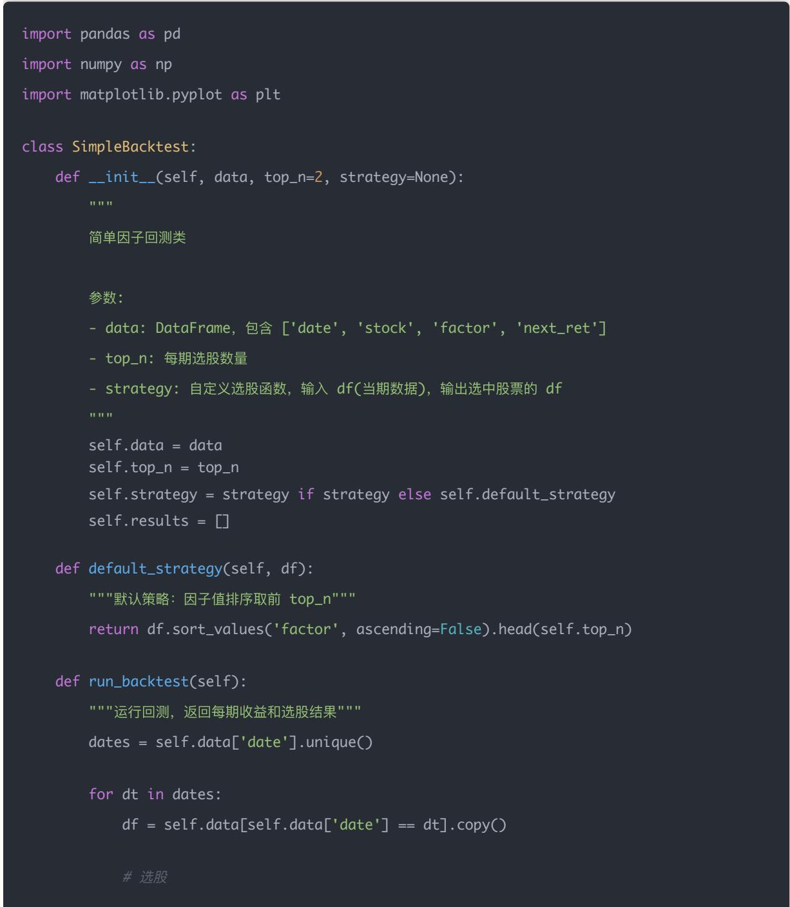

## 量化交易入门指南：第15天 - 组合回测与策略评估基础

原创 逻辑与流 逻辑与流 2025年9月 14 日 14:46 北京 1人

学习时间：60分钟

本文为量化交易学习系列第15天内容，系统讲解回测系统的基本结构与流程，组合收益 波动率 夏普比率 最大回撤的计算方法，常见评估指标与Python实战，帮助你掌握量化策略从理论到验证的关键环节<sub>。</sub>

## Day 15 学习 目 标

## 你将掌握：

1. 回测系统的基本结构与流程

2. 组合收益 波动率 夏普比率 最大回撤的计算方法

3. 常见的组合评估指标与解释

4. 实现一个简易组合回测脚本（支持多期滚动回测）

5. 初步了解换手率与滑点对策略性能的影响

## 一 回测系统概述

### 1.1 什么是回测？

回测（Backtesting）是量化投资中极其核心的概念 我们可以把它简单理解为：

"用历史数据模拟策略在过去会产生什么样的表现 "

换句话说：你把自 己构建的选股逻辑 交易信号 资产配置方法"放回过去"，看它是否真的能赚钱 表现是否稳定 风险是否可控

### 1.2 为什么要做回测？

因为我们无法直接用真实资金去试错

回测是一个安全的 低成本的实验室 它帮助我们回答以下关键问题：

<table><tr><td>关键问题</td><td>回测提供答案</td></tr><tr><td>这套策略过去有效吗?</td><td>收益、波动、回撤等指标</td></tr><tr><td>有哪些历史阶段策略表现不好?</td><td>市场分析、鲁棒性验证</td></tr><tr><td>策略是否稳定?未来是否还能用?</td><td>多期、多市场测试</td></tr><tr><td>策略换手率、交易频率高吗?</td><td>交易成本模拟</td></tr><tr><td>模型是否存在未来信息泄露?</td><td>因果关系检查(滚动回测)</td></tr></table>

## 二 回测系统的基本流程

### 2.1 回测流程详解

以选股策略为例，回测的流程可以分为以下步骤：

Step 1：输入数据（历史行情和财务数据）

你需要以下内容：

股票历史价格（日线/月线）

财务指标（如 PE ROE PB）

其他辅助数据（行业 市值 波动率等）

Step 2：构建因子 / 模型信号

比如你定义一个因子：

打分 = -PE + ROE + Momentum

或者用机器学习预测未来收益

Step 3：按调仓周期选股

例如每个月：

计算因子得分

选出前20名股票

等权买入或按打分分配权重

Step 4：计算下一个周期的实际收益

假设你在 2022-01 调仓，那么你要记录 2022-01 → 2022-02 期间这些股票的实际涨跌幅，用来评估组合收益

Step 5：滚动这一流程直到回测结束

一般会设一个回测窗口（如3年 5年 10年），每期都重复：

选股 → 持仓 → 计算收益 → 累计收益

Step 6：输出策略表现指标

你将得到这些核心结果：

<table><tr><td>指标</td><td>说明</td></tr><tr><td>年化收益</td><td>策略的长期赚钱能力</td></tr><tr><td>年化波动率</td><td>策略的风险水平</td></tr><tr><td>夏普比率</td><td>每单位风险带来的收益</td></tr><tr><td>最大回撤</td><td>最大亏损幅度,衡量极端风险</td></tr><tr><td>收益曲线</td><td>累计净值随时间变化情况</td></tr><tr><td>换手率</td><td>交易频率,影响实盘成本</td></tr></table>

### 2.2 回测示例

举个直观的例子：

假设你要回测策略： "每月买入市盈率最低的10只股票，持有1个月后再更新组合 "

你会怎么做？

1. 从2018年开始，每月计算全部股票的PE

2. 选出PE最低的10只股票

3. 查看这10只股票在下月的实际收益

4. 记录组合平均收益

5. 累积净值曲线

6. 得出这套策略在2018-2023年的表现，看看是否稳定赚钱

这就是一次完整的回测<sub>。</sub>

### 2.3 回测注意事项

<table><tr><td>问题</td><td>说明</td></tr><tr><td>未来函数问题</td><td>不能使用未来的信息,比如&quot;未来的收益&quot;来排序</td></tr><tr><td>数据对齐</td><td>财报发布日期、涨停停牌等需要考虑</td></tr><tr><td>交易规则</td><td>要考虑滑点、手续费、买入限制等</td></tr><tr><td>并非收益越高越好</td><td>要考虑最大回撤、夏普比率等整体表现</td></tr></table>

## 回测 ≠ 实盘

回测表现好，不代表实盘能赚钱

回测只是第一步，它只能回答："在已知的历史数据中，这个策略表现如何？"

如果你在回测中过拟合（调参太多 使用过多假设），实盘可能根本跑不出来

所以我们通常还会做：

样本外验证（测试模型在未参与训练的数据上是否有效）

蒙特卡洛模拟（引入随机扰动评估稳定性）

实盘监控（Paper trading 或小资金试跑）

小结一句话：回测是量化策略的"模拟实验室"，用历史来检验模型是否有望在未来赚钱

## 三 关键回测评估指标

3.1 核心指标与公式

<table><tr><td>指标</td><td>公式</td><td>含义</td></tr><tr><td>年化收益率 (CAGR)</td><td> $\text{CAGR} = \left( \frac{V_T}{V_0} \right)^{\frac{1}{T}} - 1$ </td><td>衡量策略的长期盈利能力 (复利收益率)</td></tr><tr><td>年化波动率</td><td> $\sigma_{\text{year}} = \sigma_{\text{period}} \times \sqrt{N}$ 其中  $\sigma_{\text{period}}$ 为日/月收益率标准差, N为一年期数 (252日或12月)</td><td>衡量组合收益的波动性 (风险水平)</td></tr><tr><td>夏普比率 (Sharpe Ratio)</td><td> $\text{Sharpe} = \frac{R_p - R_f}{\sigma_p}$ 其中  $R_p$ 为策略年化收益率, $R_f$ 为无风险利率, $\sigma_p$ 为年化波动率</td><td>衡量单位风险所获得的超额收益</td></tr><tr><td>最大回撤 (MDD)</td><td> $\text{MDD} = \max_{t \in [0,T]} \left( 1 - \frac{V_t}{\max_{s \in [0,t]} V_s} \right)$ </td><td>评估组合从历史最高点到最低点的最大亏损幅度</td></tr><tr><td>换手率 (Turnover)</td><td> $\text{Turnover}_t = \sum_i |w_{i,t} - w_{i,t-1}|$ </td><td>反映每期仓位的变动程度</td></tr></table>

### 3.2 指标详解

3.2.1 年化收益率（CAGR, Compound Annual Growth Rate）

公式：

$$
\mathrm{CAGR} = \left(\frac {V _ {T}}{V _ {0}}\right) ^ {\frac {1}{T}} - 1
$$

$V _ { 0 } { : }$ 初始净值（通常设为1）

$V _ { T }$ ：期末净值

：年数（总交易日 ÷ 252 或 总月份 ÷ 12）

含义：反映策略的长期复利收益率，比单纯的总收益更公平，因为它考虑了投资周期

3.2.2 年化波动率

公式（日频数据常用）：

$$
\sigma_ {\mathrm{year}} = \sigma_ {\mathrm{daily}} \times \sqrt {2 5 2}
$$

月频则是：

$$
\sigma_ {\mathrm{year}} = \sigma_ {\mathrm{monthly}} \times \sqrt {1 2}
$$

含义：反映组合收益的起伏程度，波动率越高风险越大

3.2.3 夏普比率（Sharpe Ratio）

公式：

$$
\mathrm{Sharpe} = \frac {R _ {p} - R _ {f}}{\sigma_ {p}}
$$

• $R _ { p } { \mathrm { : } }$ ：策略年化收益率

$R _ { f } \colon$ ：无风险利率（如国债收益率，常近似为0）

$\sigma _ { p } :$ 策略年化波动率

含义：每承担 1 单位风险，策略能带来多少超额收益

经验值：

Sharpe > 1：策略不错

Sharpe > 2：很优秀

Sharpe > 3：极少数顶级策略

3.2.4 最大回撤（Maximum Drawdown, MDD）

公式：

$$
\mathrm{MDD} = \max _ {t \in [ 0, T ]} \left(1 - \frac {V _ {t}}{\max _ {s \in [ 0 , t ]} V _ {s}}\right)
$$

含义：衡量历史上最糟糕的亏损情况 比如 MDD=30%，说明投资者可能经历过从最高点到最低点亏损30%<sub>。</sub>

投资者通常会关注 收益/回撤比，而不是只看收益

3.2.5 换手率（Turnover）

公式：

$$
\operatorname{Turnover} _ {t} = \sum_ {i} \| w _ {i, t} - w _ {i, t - 1} \|
$$

含义：反映每期仓位的变动程度，数值越大说明交易越频繁，意味着：

成本高（手续费+冲击成本）

策略可能过拟合 稳定性差

一般会结合 年化换手率（平均每年换仓多少倍）来评估策略的实盘可行性

### 3.3 总结一句话

CAGR看赚钱能力

波动率看风险大小

夏普比率看风险调整后收益

最大回撤看最坏情况

换手率看实盘成本与稳定性

## 四 回测注意事项

### 4.1 滚动回测的重要性

为什么要采用滚动回测，而不是整段数据一次性测试？

因为滚动回测更接近真实交易逻辑，能有效避免"未来函数"，减少过拟合，更真实地模拟策略在不同市场环境下的表现

<table><tr><td>回测方式</td><td>特点</td><td>问题</td></tr><tr><td>整段回测</td><td>一次性用全部数据构建模型</td><td>容易&quot;泄露未来&quot;信息,例如用未来收益训练今天的模型</td></tr><tr><td>滚动回测</td><td>每期只用历史数据构建因子/模型,滚动选股调仓</td><td>更贴近实盘交易节奏,评估因子和组合的稳定性与泛化能力</td></tr></table>

滚动回测强调因子"实时构建 + 实时调仓 + 延迟验证"，这是量化研究必须遵循的"时间因果性"

### 4.2 策略鲁棒性评估

如果回测期间出现极端市场事件（如熔断 黑天鹅），你的策略是否鲁棒？

只有在极端事件下表现仍可控 不会连续大幅亏损的策略，才算鲁棒 鲁棒性需要依赖于：风控机制风险敞口控制 多元资产配置等

## 判断一个策略是否鲁棒：

<table><tr><td>指标/现象</td><td>说明</td></tr><tr><td>最大回撤</td><td>是否能在极端行情下控制在可承受范围? (如&lt;20%)</td></tr><tr><td>收益曲线平滑性杠杆风险</td><td>是否会突然暴跌、短期内亏损回不来?杠杆策略是否有"爆仓"风险</td></tr><tr><td>冷启动稳定性</td><td>起始期选得不好,策略是否仍能回升?</td></tr><tr><td>多市场泛化能力</td><td>是否能在不同市场也有效?避免"单市场依赖"</td></tr></table>

你可以通过"事件样本内"和"样本外窗口"分别评估策略表现，如 2020年3月（新冠熔断）或 2015年（股灾）<sub>。</sub>

### 4.3 换手率控制

## 换手率过高会带来哪些实盘问题？如何做低换手率策略？

<table><tr><td>问题</td><td>说明</td></tr><tr><td>成本上升</td><td>手续费、印花税、滑点等迅速吞噬利润</td></tr><tr><td>流动性风险</td><td>频繁交易可能踩中低流动性股票,导致冲击成本</td></tr><tr><td>模型不稳定</td><td>高频调仓易受短期波动干扰,鲁棒性差</td></tr><tr><td>实施难度</td><td>需要频繁运行交易系统,执行复杂</td></tr></table>

降低换手率的策略：

<table><tr><td>方法</td><td>原理</td></tr><tr><td>得分惯性保留</td><td>上期 Top 股票保持持仓,除非得分下滑严重</td></tr><tr><td>排名窗口控制</td><td>只换出最低分 X% 的股票,保留其余</td></tr><tr><td>调仓周期延长</td><td>周调仓 → 月调仓;月调仓 → 季调仓</td></tr><tr><td>滚动组合</td><td>每期只更换一部分股票,渐进更新组合</td></tr></table>

### 4.4 极端风险指标

## 哪些评估指标对"极端亏损"最敏感？如何应对？

<table><tr><td>指标</td><td>敏感度</td><td>意义</td></tr><tr><td>最大回撤 (Max Drawdown)</td><td>极高</td><td>衡量投资组合从峰值到谷底的最大跌幅</td></tr><tr><td>Calmar Ratio</td><td>高</td><td>年化收益 / 最大回撤,稳定性的重要衡量标准</td></tr><tr><td>Sortino Ratio</td><td>高</td><td>类似 Sharpe,但只关注&quot;下行波动&quot;</td></tr><tr><td>年化收益</td><td>低</td><td>平均值不反映极端亏损影响</td></tr><tr><td>IC、IR</td><td>很低</td><td>是因子层指标,不一定反映组合极端行为</td></tr></table>

如何应对极端亏损风险：

<table><tr><td>方法</td><td>原理</td></tr><tr><td>设置止损线</td><td>超过某一回撤阈值清仓或减仓</td></tr><tr><td>组合分散化</td><td>多行业、多资产、低相关性组合</td></tr><tr><td>波动率控制</td><td>动态调整仓位,使风险暴露恒定</td></tr><tr><td>极端事件回测</td><td>在历史熔断、金融危机时期回测表现(如2008/2015/2020)</td></tr><tr><td>Tail Risk 对冲</td><td>加入期权、黄金、波动率指数等对冲工具</td></tr></table>

## 五 Python 实战：简易组合回测

我们用 Pandas 模拟一个简单月度回测（选股 + 均权 + 收益累加）

### 5.1 完整回测框架



selected = self.strategy(df)

\# 计算组合收益 (等权平均)

portfolio\_ret = selected['next\_ret'].mean()

#记录结果

self.results.append({ 'date': dt, 'portfolio\_ret': portfolio\_ret, 'selected\_stocks': list(selected['stock'])

})

results\_df = pd.DataFrame(self.results)

#累计收益曲线

results\_df['cum\_return'] = (1 + results\_df['portfolio\_ret']).cumprod()

\# 最大回撤序列

results\_df['cummax'] = results\_df['cum\_return'].cummax()

results\_df['drawdown'] = (results\_df['cummax'] - results\_df['cum\_return']) / result

return results\_df

def calculate\_metrics(self, returns\_df):

"""计算绩效指标"""

monthly\_returns = returns\_df['portfolio\_ret']

\# === 年数（假设月度数据） ———

n\_years = len(returns\_df) / 12

\# === 年化收益率（CAGR)

cagr = (returns\_df['cum\_return'].iloc[-1]) \*\* (1 / n\_years) - 1

\# === 年化波动率（用样本标准差 ddof=1）===

vol = np.std(monthly\_returns, ddof=1) \* np.sqrt(12)

\# === 夏普比率（无风险利率设为0）===

sharpe = (monthly\_returns.mean() \* 12) / vol if vol > 0 else 0

\# === 最大回撤 ===

max\_drawdown = returns\_df['drawdown'].max()

return {

'cagr': cagr,

'volatility': vol,

'sharpe': sharpe,

'max\_drawdown': max\_drawdown

```python
fig, ax = plt.subplots(2, 1, figsize=(8, 6), sharex=True)

# 累计收益
ax[0].plot(returns_df['date'], returns_df['cum_return'], label="Cumulative Return",
ax[0].set_ylabel("Cumulative Return")
ax[0].legend()

# 回撤
ax[1].plot(returns_df['date'], returns_df['drawdown'], label="Drawdown", color="red"
ax[1].set_ylabel("Drawdown")
ax[1].legend()

plt.xlabel("Date")
plt.tight_layout()
plt.show()

# =================== 使用示例 =================== {

if __name__ == "__main__":
    # 构造一个小例子
    data = pd.DataFrame({
    'date': ['2023-01', '2023-01', '2023-01',
    '2023-02', '2023-02', '2023-02',
    '2023-03', '2023-03', '2023-03'],
    'stock': ['A', 'B', 'C'] * 3,
    'factor': [0.5, 0.2, 0.1,
    0.4, 0.3, 0.2,
    0.3, 0.1, 0.6],
    'next_ret': [0.03, -0.01, 0.02,
    0.02, -0.005, 0.01,
    0.015, 0.03, -0.01]
    })
    # 初始化回测
backtest = SimpleBacktest(data, top_n=2)

# 运行回测
results = backtest.run_backtest()
print("\n=== 回测结果 ===")
print(results)

# 计算指标
metrics = backtest.calculate_metrics(results)
print("\n=== 绩效指标 ===")
for key, value in metrics.items():
    if key in ['cagr', 'volatility', 'max_drawdown']:
    print(f"{key}: {value:.2%}")
    else:
    print(f"{key}: {value:.2f}")
```

5.2 图表解读

## 第一张图：累计收益（Cumulative Return）

横轴： 日 期（2023-01, 2023-02, 2023-03）

纵轴：累计净值（初始为 1，每期根据组合收益乘起来）

曲线：随着策略每期的组合收益不断累积，净值会上下波动

在这个小例子里：

2023-01：选股 A C → 平均收益 ≈ (0.03 + 0.02)/2 = 0.025 → 累计净值 = 1 × (1 + 0.025) = 1.025

2023-02：选股 A B → 平均收益 ≈ (0.02 + -0.005)/2 = 0.0075 → 累计净值 = 1.025 × (1 + 0.0075) ≈ 1.0327

2023-03：选股 C A → 平均收益 ≈ (-0.01 + 0.015)/2 = 0.0025 → 累计净值 ≈ 1.0353

所以这条曲线从 1 开始，慢慢往上爬，最终大约是 1.0353，对应 3.5% 的总收益

第二张图：回撤（Drawdown）

横轴：日期

纵轴：回撤比例（0 表示没有回撤，0.05 表示比峰值低 5%）

含义：度量当前净值距离历史最高点的下跌幅度

## 在这个小例子里：

2023-01：净值 1.025 → 历史最高就是自 己 → 回撤 = 0

2023-02：净值 1.0327 → 历史最高是 1.0327 → 回撤 = 0

2023-03：净值 1.0353 → 历史最高也是 1.0353 → 回撤 = 0

所以曲线一直贴着 0，说明在 3 期数据里，组合没有经历过"高点回落"的情况（也就是说，每个月都在创新高）<sub>。</sub>

### 5.3 结论

由于数据样本很小（只有 3 期），策略累计收益曲线基本是小幅上升，回撤几乎为 0，看起来非常平稳

在真实场景中，累计收益曲线通常会有涨有跌，回撤曲线会周期性升高（市场下跌或策略失效时），最高点表示策略经历的最大亏损幅度

## 六 思考题与解答

### 6.1 为什么要采用滚动回测，而不是整段数据一次性测试？

答案：因为滚动回测更接近真实交易逻辑，能有效避免"未来函数"，减少过拟合，更真实地模拟策略在不同市场环境下的表现

## 解释：

整段回测容易"泄露未来"信息，例如用未来收益训练今天的模型

滚动回测更贴近实盘交易节奏，评估因子和组合的稳定性与泛化能力

滚动回测强调因子"实时构建 + 实时调仓 + 延迟验证"

这是量化研究必须遵循的"时间因果性"

### 6.2 如果回测期间出现极端市场事件（如熔断 黑天鹅），你的策略是否鲁棒？

答案：只有在极端事件下表现仍可控 不会连续大幅亏损的策略，才算鲁棒 鲁棒性需要依赖于：风控机制 风险敞口控制 多元资产配置等

## 判断一个策略是否鲁棒：

最大回撤是否能在极端行情下控制在可承受范围？（如 < 20%）

收益曲线是否平滑，不会突然暴跌？

杠杆策略是否有"爆仓"风险？

起始期选得不好，策略是否仍能回升？

是否能在不同市场也有效？避免"单市场依赖"

你可以通过"事件样本内"和"样本外窗口"分别评估策略表现，如 2020年3月（新冠熔断）或 2015年（股灾）<sub>。</sub>

### 6.3 换手率过高会带来哪些实盘问题？如何做低换手率策略？

答案：高换手率会导致成本上升 流动性风险 模型不稳定 实施难度增加等问题

降低换手率的策略：

得分惯性保留：上期 Top 股票保持持仓，除非得分下滑严重

排名窗口控制：只换出最低分 X% 的股票，保留其余

调仓周期延长：周调仓 → 月调仓；月调仓 → 季调仓

滚动组合：每期只更换一部分股票，渐进更新组合

### 6.4 哪些评估指标对"极端亏损"最敏感？如何应对？

答案：最大回撤 Calmar Ratio Sortino Ratio 对极端亏损最敏感

如何应对极端亏损风险：

设置止损线：超过某一回撤阈值清仓或减仓

组合分散化：多行业 多资产 低相关性组合

波动率控制：动态调整仓位，使风险暴露恒定

极端事件回测：在历史熔断 金融危机时期回测表现

Tail Risk 对冲：加入期权 黄金 波动率指数等对冲工具

## 七<sub>、</sub>总结回顾

<table><tr><td>问题</td><td>结论</td></tr><tr><td>为什么用滚动回测?</td><td>更真实、更严谨,避免未来信息泄露</td></tr><tr><td>策略鲁棒性的判断标准?</td><td>回撤可控、多期稳健、极端行情下不爆雷</td></tr><tr><td>高换手问题?</td><td>成本高、风险大、操作难,建议做控制机制</td></tr><tr><td>最敏感指标?</td><td>最大回撤、Sortino、Calmar,辅助用收益线判断</td></tr></table>

## 八<sub>、</sub>小结

<table><tr><td>概念</td><td>说明</td></tr><tr><td>回测系统</td><td>用历史数据模拟策略表现,验证有效性</td></tr><tr><td>滚动回测</td><td>避免未来函数,更贴近实盘交易逻辑</td></tr><tr><td>评估指标</td><td>收益、风险、稳定性、极端风险的综合衡量</td></tr><tr><td>鲁棒性</td><td>在极端市场环境下仍能稳定表现的能力</td></tr></table>

通过今天的学习，你已经掌握了量化策略回测与评估的核心技术 下一讲我们将进入"量化策略实盘部署与风险管理"的世界，敬请期待！
