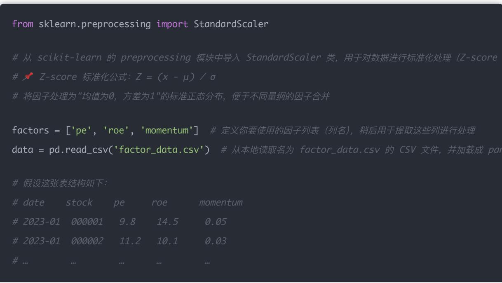
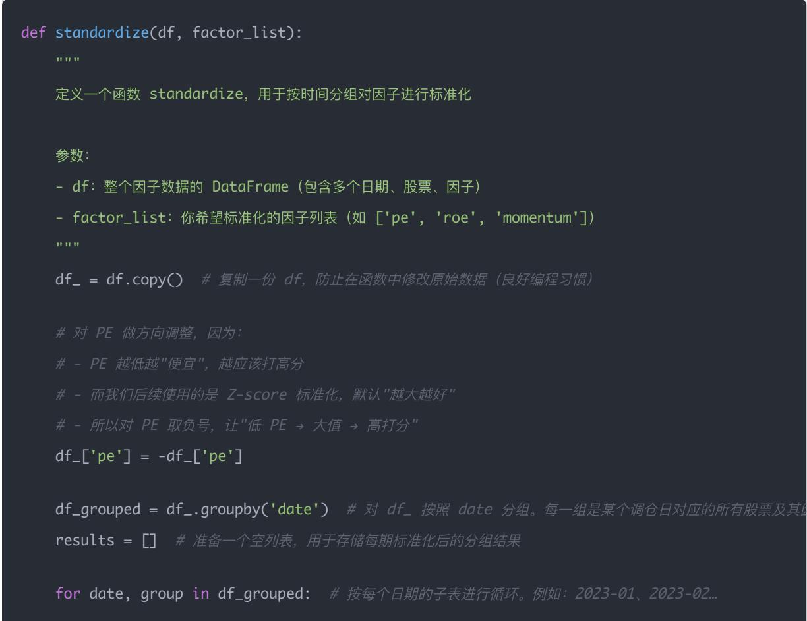
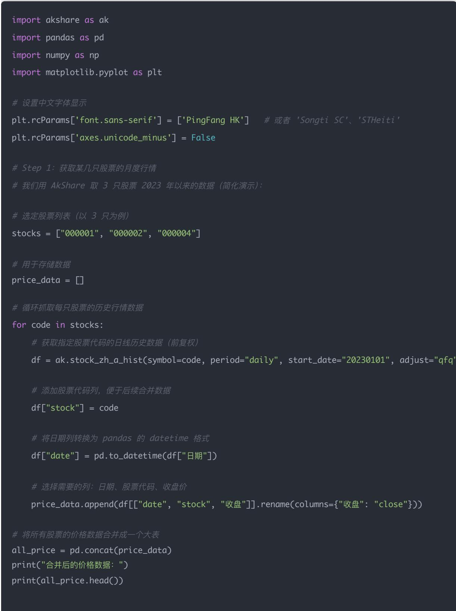
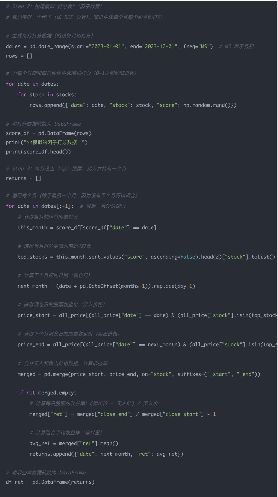

## 量化交易入门指南：第16天 - 搭建你的策略数据结构 & 多因子打分模型

原创 逻辑与流 逻辑与流 2025年9月 16 日 00:29 北京 1人

学习时间：60分钟

本文是量化交易入门指南的第16天内容，重点介绍如何构建多因子打分模型的数据结构和实现流程 文章从数据格式设计开始，详细讲解了因子标准化处理（Z-score） 方向调整 多因子融合打分等核心步骤 通过完整的代码示例和详细注释，帮助读者理解从原始数据到策略组合的完整流程 同时对比分析了AkShare 聚宽 优矿等不同数据源的优劣，提供了实用的学习路径建议 最后通过AkShare数据源实现了"因子选股→调仓回测→净值绘图"的完整策略演示，为后续的回测分析打下坚实基础

## 一 确定数据格式（DataFrame设计）

## 一个标准的多因子策略数据表应该长这样：

<table><tr><td>日期</td><td>股票</td><td>PE</td><td>ROE</td><td>Momentum</td><td>波动率</td><td>其他因子</td></tr><tr><td>2023-01</td><td>000001</td><td>9.8</td><td>14.5</td><td>0.05</td><td>0.18</td><td>...</td></tr><tr><td>2023-01</td><td>000002</td><td>11.2</td><td>10.1</td><td>0.03</td><td>0.25</td><td>...</td></tr><tr><td>2023-01</td><td>000004</td><td>15.6</td><td>8.9</td><td>0.02</td><td>0.22</td><td>...</td></tr><tr><td>2023-02</td><td>000001</td><td>10.2</td><td>15.1</td><td>0.08</td><td>0.19</td><td>...</td></tr><tr><td>2023-02</td><td>000002</td><td>12.1</td><td>9.8</td><td>0.04</td><td>0.26</td><td>...</td></tr><tr><td>2023-02</td><td>000004</td><td>16.1</td><td>9.2</td><td>0.06</td><td>0.21</td><td>...</td></tr><tr><td>...</td><td>...</td><td>...</td><td>...</td><td>...</td><td>...</td><td>...</td></tr></table>

你可以通过：

接入 Tushare / 聚宽 / 东方财富数据接口

使用本地 CSV 模拟历史数据

第一步是确保你拥有格式统一 时间对齐 因子全的数据表结构

以下代码的目标是： 读取历史因子数据 → 标准化处理（Z-score） → 合成多因子打分 → 每期选出前N 个股票

为了帮助读者更好地理解每个步骤的实现原理和代码逻辑，在代码中添加了非常详细的注释说明 这些注释不仅解释了"做什么"，更重要的是说明了"为什么这样做"，包括：

每个函数参数的具体含义和作用

关键步骤的数学原理（如Z-score标准化公式）

因子方向调整的业务逻辑（如PE越低越好的处理方式）

通过这些详细的代码注释和示例，读者可以深入理解多因子模型的核心思想和实现细节

## 二 因子标准化 & 方向调整（Z-score + 符号调整）

## 为什么需要标准化？因为 PE 和 ROE 数值量级不一样

\# 从 scikit-learn 的 preprocessing 模块中导入 StandardScaler 类，用于对数据进行标准化处理 （Z-score

factors = ['pe', 'roe', 'momentum']  # 定义你要使用的因子列表 （列名）， 稍后用于提取这些列进行处理data = pd.read\_csv('factor\_data.csv')  # 从本地读取名为 factor\_data. csv 的 CSV 文件， 并加载成 pa

\# date stock pe roe momentum

\# 2023-01 000001 9.8 14.5 0.05

\# 2023-01 000002 11.2 10.1 0.03

## 详细步骤分析：标准化函数设计

\# - 而我们后续使用的是 Z-score 标准化，默认"越大越好"

for date, group in df\_grouped:  # 按每个日期的子表进行循环 例如： 2023-01 2023-02

扩展理解（选讲）

如果你想看标准化结果的示例：

print(data\_std.head())

## 三 打分合成：多因子融合成一个"alpha 分数"

#简单平均

data\_std['score'] = data\_std[['pe', 'roe', 'momentum']].mean(axis=1)

\# 你也可以自定义权重，如:

\# data\_std['score'] = 0.4 \* data\_std['pe'] + 0.4 \* data\_std['roe'] + 0.2 \* data\_std['moment

#对每行股票，取这三列的平均值，作为最终的综合打分score。这一步可以自定义权重，例如:

## 四 调仓逻辑（选股 + 组合）

每月调仓一次，选出得分前 N 的股票持有一个月：

top\_n = 20

portfolio = (

data\_std.groupby('date')  # data std groupby( 'date ')： 按调仓日分组

.apply(lambda df: df.nlargest(top\_n, 'score')[['stock', 'score']])  # 每期选出的得分最高的n

.reset\_index(drop=True)  # 去掉多层索引 整理成扁平表格

## 五 保存输出作为下一步"回测"的输入

这个 CSV 就是你未来在 Day 12 回测中要加载的调仓计划。

## 小结（代码功能概览）

<table><tr><td>步骤</td><td>内容</td></tr><tr><td>标准化</td><td>按每期对因子做 Z-score,方向调整</td></tr><tr><td>打分合成</td><td>将多个因子融合成单一评分</td></tr><tr><td>排序选股</td><td>每期选出 Top N 股票</td></tr><tr><td>组合导出</td><td>保存结果用于后续回测</td></tr></table>

## 用akshare获取数据可以吗 还是说必须用聚宽 优矿

## 一 简要结论

<table><tr><td>平台</td><td>是否可用</td><td>优势</td><td>局限</td></tr><tr><td>AkShare</td><td>完全可以用!</td><td>免费、开放、Python原生、无需注册</td><td>有些财务指标发布不够及时、数据质量略浮动</td></tr><tr><td>聚宽(JoinQuant)</td><td>专业可用</td><td>有完整的因子库+高质量行情+回测接口</td><td>免费额度有限、需注册、封闭系统</td></tr><tr><td>优矿(Uqer)</td><td>可用</td><td>和聚宽类似,数据齐、回测强</td><td>接口关闭较多,限制更重,生态退化中</td></tr></table>

推荐策略：前期用 AkShare 自建因子库，后期有需要再接入聚宽数据或回测引擎

## 二 AkShare 能获取哪些数据（用于因子模型）？

AkShare 支持 A 股历史行情 财务指标 估值 行业分类 市场风格 等非常丰富的数据接口，常用因子数据包括：

<table><tr><td>因子类型</td><td>AkShare 接口示例</td></tr><tr><td>收盘价(行情)</td><td>ak.stock_zh_a_hist</td></tr><tr><td>财务指标(PE、ROE)</td><td>ak.stock_financial_analysis_indicator</td></tr><tr><td>财报数据</td><td>ak.stock_financial_report_sina、ak.stock_financial_abstract</td></tr><tr><td>行业分类</td><td>ak.stock_board_industry_name_ths</td></tr><tr><td>资金流、换手率</td><td>ak.stock_individual_fund_flow</td></tr></table>

import akshare as ak

#获取历史行情（复权、日线)

df\_price = ak.stock\_zh\_a\_hist(symbol="000001", period="daily", start\_date="20220101", adjus print(df\_price.head())

#获取财务分析指标（如 ROE、毛利率、净利润等）

df\_fin = ak.stock\_financial\_analysis\_indicator(stock="000001")

print(df\_fin.head())

示例：批量抓取 PE PB ROE 并构建因子表

你可以封装一个函数，每次抓取一个股票代码的数据，然后合并成全市场的因子 DataFrame。

## 三 什么时候需要聚宽/优矿？

当你：

1. 需要 高频更新 更完整的上市公司指标库（如 TTM 季报 商誉剥离等）

2. 需要用 封闭平台回测系统（如聚宽的 run\_query() + backtest()）

3. 需要 分钟级数据 / ETF / 期权数据

4. 想使用内置因子库（Alpha191 Barra 风格因子等）

这时再使用聚宽/优矿也不晚，而且你已经有了 AkShare 构建的完整模型经验

## 四 推荐学习路径

1. 前期：用 AkShare 搭建你自 己的多因子框架（数据 + 打分 + 回测）

2. 中期：可用 Pandas 实现组合生成 + 净值曲线 + IC 验证等分析

3. 后期：可选切换到聚宽 RiceQuant 等平台部署回测引擎和策略运行

4. 长远：可以用 Tushare Pro（注册后有 token）接入更官方的财务数据

## 小总结

<table><tr><td>想做什么</td><td>推荐用</td></tr><tr><td>自建框架练习、多因子研究</td><td>AkShare(开源、灵活)</td></tr><tr><td>快速试策略 / 用已有因子</td><td>聚宽 / 优矿(闭源、方便)</td></tr><tr><td>实盘部署、回测系统、数据质量</td><td>结合多源(AkShare + 聚宽 + Tushare)</td></tr></table>

我们就以 AkShare 为例，从获取 A 股行情数据开始，一步一步跑通 Day11 的回测策略：

\*\*"基于多因子打分，月度调仓，计算组合收益曲线"\*\*。

## 我们要完成的目标：

1. 获取多个 A 股股票的历史行情数据（使用 AkShare）

2. 假设已有打分（例如 ROE），选出每月 Top10 股票

3. 简化建仓，持有一个月，计算组合收益

4. 绘制净值曲线

## 代码如下：

\# Step 2：构建模拟"打分表"(因子数据)

#我们模拟一个因子(如 ROE 分数)，随机生成每个月每个股票的打分

\# 生成每月打分数据（假设每月初打分)

dates = pd.date\_range(start="2023-01-01", end="2023-12-01", freq="MS")  # MS 表示月初 rows = []

\# 为每个日期和每只股票生成随机打分(0-1之间的随机数)

for date in dates: for stock in stocks: rows.append({"date": date, "stock": stock, "score": np.random.rand()})

#将打分数据转换为 DataFrame

score\_df = pd.DataFrame(rows)

print("\n模拟的因子打分数据：")

print(score\_df.head())

\# Step 3：每月选出 Top2 股票，买入并持有一个月

returns = []

\# 遍历每个月(除了最后一个月，因为没有下个月可以调仓)

for date in dates[:-1]:  # 最后一月没法调仓

#获取当月的所有股票打分

this\_month = score\_df[score\_df["date"] == date]

\# 选出当月得分最高的前2只股票

top\_stocks = this\_month.sort\_values("score", ascending=False).head(2)["stock"].tolist()

\# 计算下个月初的日期(调仓日)

next\_month = (date + pd.DateOffset(months=1)).replace(day=1)

\# 获取调仓日的股票收盘价（买入价格）

price\_start = all\_price[(all\_price["date"] == date) & (all\_price["stock"].isin(top\_stock

\# 获取下个月调仓日的股票收盘价（卖出价格）

price\_end = all\_price[(all\_price["date"] == next\_month) & (all\_price["stock"].isin(top\_s

#合并买入和卖出价格数据，计算收益率

merged = pd.merge(price\_start, price\_end, on="stock", suffixes=("\_start", "\_end"))

#计算每只股票的收益率：（卖出价 - 买入价）／ 买入价

merged["ret"] = merged["close\_end"] / merged["close\_start"] - 1

\# 计算组合平均收益率（等权重）

avg\_ret = merged["ret"].mean()

returns.append({"date": next\_month, "ret": avg\_ret})

\# 计算累计净值曲线：(1 + r1) ×(1 + r2) × ...×(1 + rn)

df\_ret["net\_value"] = (1 + df\_ret["ret"]).cumprod()

print("\n策略收益率和净值数据：")

print(df\_ret)

\# Step 4：画出净值曲线

plt.figure(figsize=(10, 4))

plt.plot(df\_ret["date"], df\_ret["net\_value"], marker="o")

plt.xticks(rotation=45)

plt.title("策略净值曲线（模拟因子）")

plt.grid(True)

plt.tight\_layout()

plt.show()

## 运行结果如下图所示：

## 总结

你现在已经完成了一个最简版的 "因子选股 → 调仓回测 → 净值绘图"的完整策略流程！

可以替换 score\_df 为真实的因子，如 PE ROE 动量收益等

可以扩展为持仓权重 行业中性 换手率控制

可以接入更多股票，扩大组合

下一步：在 Day 17 中，我们将基于这个选股结果进行更详细的回测分析，包括基准对比 风险指标计算等
