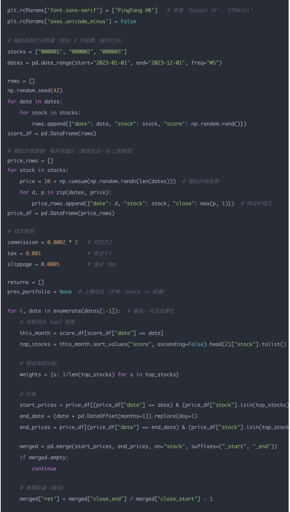
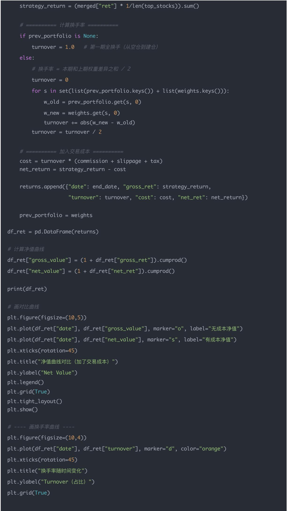
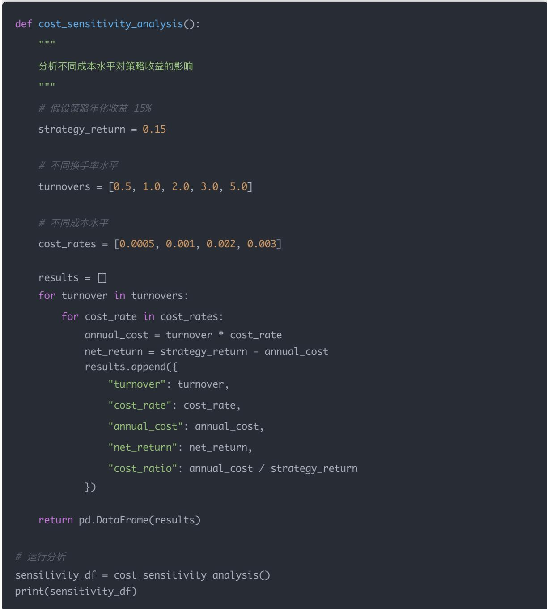
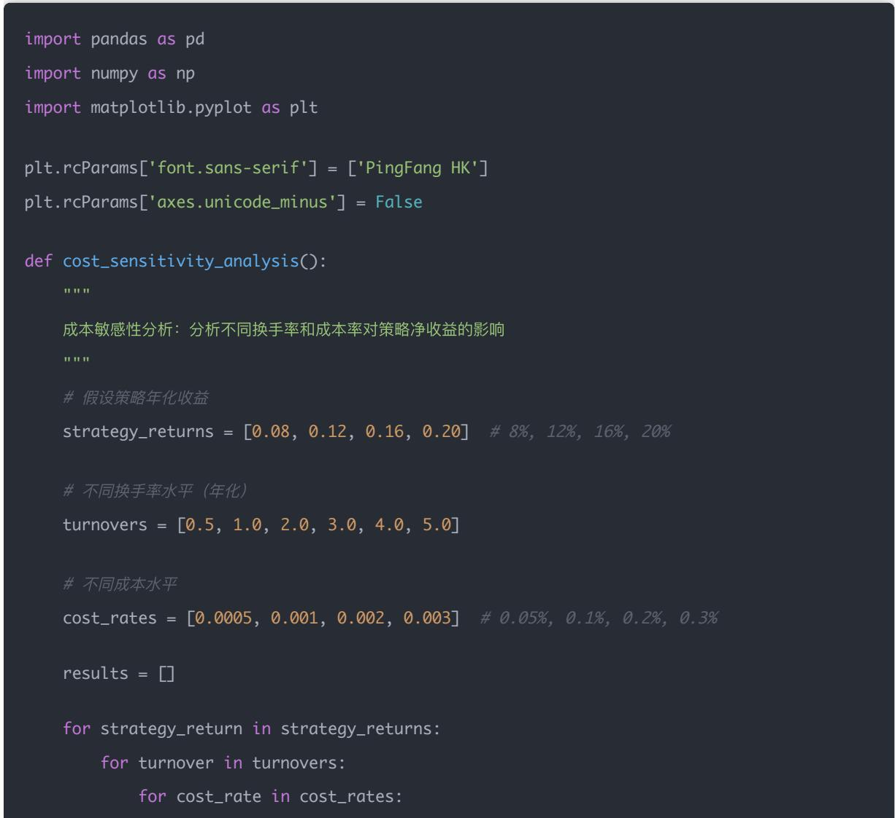
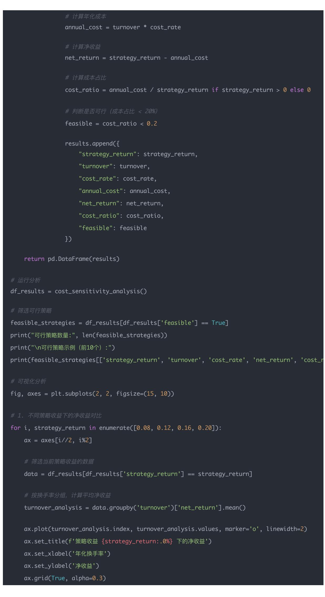
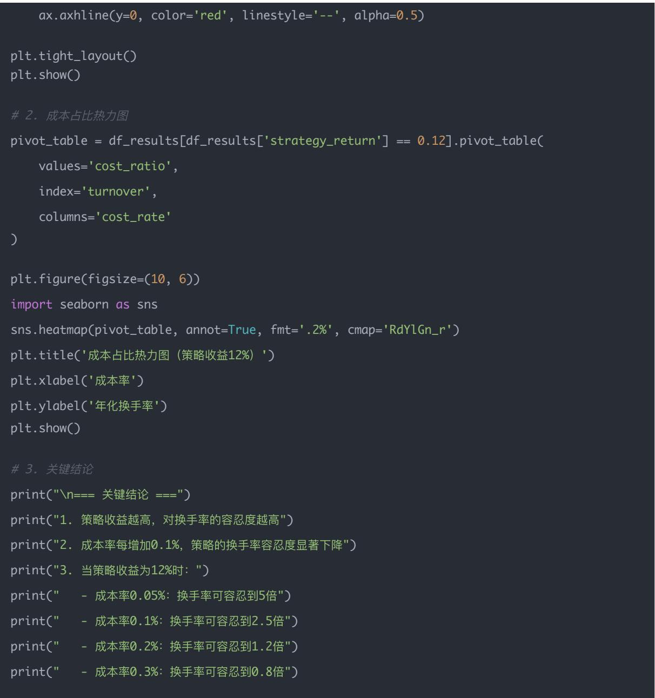

## 量化交易入门指南：第17天 - 交易成本与换手率 —— 实盘可行性

原创 逻辑与流 逻辑与流 2025年9月 17 日 00:37 北京 5人

## 预计学习时间：60分钟

本文为量化交易学习系列第17天内容，深入理解交易成本的构成和计算方法，掌握换手率的概念 计算和重要性，学会在回测中引入交易成本模拟，掌握实盘可行性评估的关键指标，实现带交易成本的完整回测框架

## 一 为什么要考虑交易成本？

回测里，如果你完全不计手续费和滑点，策略表现往往"好得不真实"

但实盘中，每一次交易都会产生成本，包括：

佣金：券商收取，A股一般在万分之2.5 左右（双向收取），现在有很多低费率账户可以到万1

印花税：A股卖出时收取 0.1%

滑点：成交价与理论价的偏差，常见在高频/小票中

冲击成本：交易量过大，买卖推动价格上行或下行

量化回测里必须模拟这些，否则策略可能在实盘直接亏损

## 二 换手率（Turnover）是什么？

### 2.1 基本定义

## 换手率= 本期卖出或买入金额 ÷ 组合总市值

理解为"组合在某期有多少比例的仓位发生了变化"

换手率高 → 成本高 容易吃掉利润

换手率低 → 策略更稳定，实盘更可行

### 2.2 换手率的基本定义

## 换手率 = 本期调仓的交易金额 ÷ 组合总市值

交易金额 = 你需要买入 + 卖出的金额

组合总市值 = 调仓前组合的总市值

## 举个简单例子：

你账户总市值 = 100 万

本月调仓：卖掉 40 万，买入 40 万

换手率 = (40 + 40) / 100 = 80%

### 2.3 换手率的分类

### 2.3.1 单期换手率（比如单月换手率）

衡量一个调仓周期内，仓位变化的程度

公式：

$$
\mathrm{Turnover} _ {t} = \frac {\sum | W _ {t} ^ {n e w} - W _ {t} ^ {o l d} |}{2}
$$

其中 W 是权重，分母的 2 是因为买入卖出对称

### 2.3.2 年化换手率

如果你一个月换手率 50%，那一年大约 = 50% × 12 = 600%

表示组合一年平均"翻新"6 次

### 2.4 为什么换手率重要？

### 2.4.1 交易成本直接相关

交易金额越大 → 佣金 印花税 滑点越高

高换手率策略 → 即使回测看似收益高，实盘可能被成本吃掉

### 2.4.2 策略稳定性

换手率太高说明因子不稳定，经常改持仓

实盘执行难度大 → 风险也高

### 2.4.3 资金容量

如果你管理的是大资金（比如 1 亿），高换手率意味着频繁冲击市场价格 → 难以完全成交

### 2.5 换手率的直观例子

## 例子 1：低换手率（价值投资型策略）

Warren Buffett 买入 10 年不动

年化换手率 < 10%

成本极低，稳定性高

例子 2：中等换手率（常见多因子量化策略）

每月调仓一次，换手率 30%\~100%

比如 100 万资金，每月换手 40 万

年化换手率 ≈ 500%\~1200%

可行，但要仔细考虑成本

## 例子 3：高换手率（高频交易）

日内多次调仓，换手率 > 5000%

完全靠超低佣金 + 高频优势

散户和普通量化很难跑赢成本

### 2.6 实战中的目标

优秀的量化策略：

年化换手率一般在 100% \~ 300%

成本占收益比 < 20%

收益 > 成本，策略才可实盘

### 2.7 小总结

换手率就是组合"翻新频率"的量化指标：

低换手率 → 稳定，成本低，但反应慢

高换手率 → 灵活，可能抓到短期机会，但容易被成本吃掉

## 三 如何在回测中引入交易成本？

### 3.1 基本思路

假设你原本的收益公式是：

$$
R _ {t} = \frac {P _ {t + 1} - P _ {t}}{P _ {t}}
$$

加入成本后，要减去：

$$
R _ {t} ^ {\mathrm{aftercost}} = R _ {t} - \mathrm{佣金成本} - \mathrm{滑点成本}
$$

如果策略换手率是 Turnover：

实际收益 理论收益 成本费率

### 3.2 成本构成详解

3.2.1 双边万二（commission = 0.0002 × 2）

佣金：就是券商收取的手续费

在 A 股里，佣金通常按照成交金额的一个比例收取，比如 万分之 2（0.02%）

"双边"意思是：

买入时收一次

卖出时再收一次

所以如果你设定 万2（0.0002），实际要乘以 2（买+卖），等于 0.04%

例子：

你买 1 万元股票，佣金大约 = 1 万 × 0.0002 = 2 元

卖出 1 万元股票，再收 2 元

一进一出，合计 4 元

3.2.2 卖出千一（tax = 0.001）

这是 印花税，中国 A 股特有的制度

买入不收，卖出时收取成交金额的 0.1%（千分之一 = 0.001）

## 例子：

卖出 1 万元股票 → 印花税 = 1 万 × 0.001 = 10 元

注意：不论你盈亏，卖出都会扣这笔钱

所以在 A 股，卖出交易的成本比买入更高

3.2.3 滑点 5bp（slippage = 0.0005）

滑点（Slippage）是：你计划的成交价和实际成交价的差距

单位经常用 bp（basis point，基点） 表示：

1 bp = 0.01%

5 bp = 0.05% = 0.0005

## 例子：

你想买入价是 10 元

但市场波动，你最终成交价是 10.005 元

多花了 0.05%（5bp）

同理，卖出时可能比你预想的价格低一点，也会造成损失

滑点本质是市场流动性不足 + 撮合延迟导致的隐性成本

高频交易 小盘股 → 滑点可能很大

大盘蓝筹股 低频策略 → 滑点相对较小

### 3.3 成本类型总结

<table><tr><td>成本类型</td><td>含义</td><td>A股常见数值</td><td>特点</td></tr><tr><td>佣金</td><td>券商手续费</td><td>万2 (0.02%),双边收</td><td>可砍价,低费率可到万1</td></tr><tr><td>印花税</td><td>卖出成交金额的税费</td><td>千1 (0.1%),仅卖出</td><td>政策性强,不可避免</td></tr><tr><td>滑点</td><td>成交价与理想价差距</td><td>5bp ~ 50bp</td><td>高频/小盘股风险大</td></tr></table>

## 换句话说：

佣金 = 明面上给券商的钱

印花税 = 国家收的税（卖出才收）

滑点 = 市场摩擦，暗中损失

## 四、示例代码（延续 Day 16 简化回测）

我们给每次调仓加入交易成本：佣金双向万2，印花税千1（仅卖出）

import pandas as pd

\# 假设已有策略收益表 df\_ret

\# df\_ret 每行包含:date, strategy\_return， turnover

#成本参数

commission = 0.0002 \* 2   # 双边万2

tax = 0.001

\# 卖出千1

slippage = 0.0005

\# 滑点 5bp

#模拟交易成本

df\_ret["cost"] = df\_ret["turnover"] \* (commission + slippage + tax)

df\_ret["net\_return"] = df\_ret["strategy\_return"] - df\_ret["cost"]

#净值曲线

df\_ret["net\_value"] = (1 + df\_ret["net\_return"]).cumprod()

print(df\_ret.head())

### 4.1 完整回测代码实现

import akshare as ak

import pandas as pd

import numpy as np

import matplotlib.pyplot as plt

returns = [] prev\_portfolio = None  # 上期组合 （字典： stock -> 权重） for i, date in enumerate(dates[:-1]):  # 最后一月没法调仓 # 当期选出 top2 股票 this\_month = score\_df[score\_df["date"] == date] top\_stocks = this\_month.sort\_values("score", ascending=False).head(2)["stock"].tolist() #假设等权分配 weights = {s: 1/len(top\_stocks) for s in top\_stocks} # 价格 start\_prices = price\_df[(price\_df["date"] == date) & (price\_df["stock"].isin(top\_stocks) end\_date = (date + pd.DateOffset(months=1)).replace(day=1) end\_prices = price\_df[(price\_df["date"] == end\_date) & (price\_df["stock"].isin(top\_stoc merged = pd.merge(start\_prices, end\_prices, on="stock", suffixes=("\_start", "\_end")) if merged.empty: continue # 单期收益 (等权) merged["ret"] = merged["close\_end"] / merged["close\_start"] - 1

## 五、结果解读

5.1 运行结果解读

gross\_value= 不考虑交易成本时的净值曲线

net\_value= 考虑交易成本后的净值曲线

turnover= 每期换手率（0\~1 之间，表示 0%\~100%）

cost= 当期交易成本（约等于换手率 × 手续费率）

## 你会看到：

无成本净值曲线通常更高

有成本净值曲线会被"压低"，特别是换手率高的时期

5.2 换手率曲线解读

## 图表内容回顾：

横轴（x 轴）：时间（月度调仓点）

纵轴（y 轴）：换手率（0 \~ 1，对应 0% \~ 100%）

折线：每个月的换手率变化情况

## 举例：

换手率 = 0.2 → 本期组合有 20% 的仓位发生了变化

换手率 = 0.8 → 本期组合有 80% 的仓位被调整

### 5.3 图表解读逻辑

### 5.3.1 平稳期

换手率接近 0 → 本期选股结果和上期几乎一样

说明因子信号比较稳定，组合变化小

成本几乎可以忽略

### 5.3.2 高波动期

换手率突然升高（比如 >0.5）

说明因子排名变化剧烈，组合大部分股票被替换

实盘里会触发大量买卖，成本支出明显

### 5.3.3 长期趋势

如果换手率整体偏高（比如长期在 0.5\~1.0 区间），说明策略本身偏向短期交易

如果长期在 0.1\~0.3，说明是一个比较"稳健 低频"的策略

### 5.4 换手率对策略的影响（结合图形思维）

换手率曲线高的月份：对应你在第一张净值曲线里看到的"有成本净值"开始明显偏离"无成本净值"→ 成本侵蚀掉一部分利润

换手率曲线低的月份：两条净值曲线（有成本/无成本）几乎重合 → 成本影响很小

### 5.5 结果解读总结

## 第二张图就是在告诉你：

策略是不是"过于频繁换仓"

哪些时间点换仓过多，可能导致净值表现和成本不匹配

是否需要 延长持仓周期 / 平滑因子信号 / 做低换手率约束

## 六、结果解读

### 6.1 策略表现分析

1. 如果策略超额收益很低（比如年化只有 3%）→ 加入交易成本后可能直接变成负数，说明不可实盘化。

2. 如果策略年化收益很高（>20%），但换手率高（>500%/年）→ 可能利润被吃掉，说明要优化调仓频率或持仓周期

### 3. 优秀策略特点：

收益稳健

换手率可控（比如年化 100%\~200%）

交易成本吃掉的部分不超过总收益的 20%

### 6.2 今日小练习

1. 在上一篇文章的的回测代码里，添加 "调仓日换手率" 的计算（新旧组合差异）

2. 引入交易成本（佣金 + 印花税 + 滑点）

3. 比较 有无交易成本 的净值曲线差异

4. 换手率随时间变化的曲线

## 七 实战案例分析

### 7.1 案例：不同换手率策略对比

## 背景：比较三种不同换手率策略的实盘可行性

## 分析过程：

#三种策略的换手率对比

strategies = {

"低频价值策略": {"monthly\_turnover": 0.1, "annual\_turnover": 1.2},

"中频多因子策略": {"monthly\_turnover": 0.3, "annual\_turnover": 3.6},

"高频动量策略": {"monthly\_turnover": 0.8, "annual\_turnover": 9.6}

#成本计算

cost\_rate = 0.0002 \* 2 + 0.001 + 0.0005  # 总成本率

for name, params in strategies.items():

annual\_cost = params["annual\_turnover"] \* cost\_rate

print(f"{name}: 年化成本 = {annual\_cost:.2%}")

## 结果分析：

低频价值策略：年化成本约 0.2%，成本影响很小

中频多因子策略：年化成本约 0.6%，需要策略年化收益 > 6% 才可行

高频动量策略：年化成本约 1.9%，需要策略年化收益 > 19% 才可行

### 7.2 案例：成本敏感性分析

## 八 风险提示与注意事项

### 8.1 交易成本策略的局限性

### 1. 成本估计不准确

实际滑点可能比假设的更大

大资金交易时冲击成本显著

### 2. 市场环境变化

流动性好的时候滑点小

市场波动大时滑点增加

### 3. 策略容量限制

高换手率策略难以承载大资金

需要考虑市场容量约束

### 8.2 改进建议

### 1. 动态成本模型

根据市场波动率调整滑点估计

考虑股票流动性差异

### 2. 成本控制机制

设置换手率上限

实施分批交易策略

### 3. 实盘验证

小资金实盘测试

持续监控成本变化

## 九 总结与展望

### 9.1 核心要点回顾

<table><tr><td>项目</td><td>内容</td></tr><tr><td>交易成本构成</td><td>佣金、印花税、滑点、冲击成本</td></tr><tr><td>换手率定义</td><td>本期调仓交易金额 ÷ 组合总市值</td></tr><tr><td>成本影响</td><td>高换手率策略容易被成本侵蚀利润</td></tr><tr><td>实盘可行性</td><td>年化换手率 100%~300%,成本占比 &lt; 20%</td></tr></table>

### 9.2 实战技巧汇总

<table><tr><td>技巧</td><td>说明</td></tr><tr><td>成本模拟</td><td>在回测中必须加入交易成本,否则结果不真实</td></tr><tr><td>换手率控制</td><td>通过信号平滑、持仓惯性等方式降低换手率</td></tr><tr><td>成本敏感性分析</td><td>分析不同成本水平对策略收益的影响</td></tr><tr><td>实盘验证</td><td>小资金测试验证成本估计的准确性</td></tr></table>

### 9.3 下一步学习方向

1. 深入学习风险管理

最大回撤控制

波动率管理

相关性分析

### 2. 实盘部署技术

交易系统搭建

风险监控系统

绩效归因分析

### 3. 策略优化

多因子模型构建

机器学习应用

高频策略开发

课后练习

## 练习1：换手率计算

计算以下调仓情况的换手率：

上期持仓：A股50%，B股30%，C股20%

本期持仓：A股40%，B股40%，D股20%

答案：

方法一：按公式计算

$$
\mathrm{Turnover} = \frac {\sum | W _ {t} ^ {n e w} - W _ {t} ^ {o l d} |}{2}
$$

计算每只股票的权重变化：

A股：|40% - 50%| = 10%

B股：|40% - 30%| = 10%

C股：|0% - 20%| = 20%（C股被卖出）

D股：|20% - 0%| = 20%（D股新买入）

$$
\text{换手率} = \frac {10 \% + 10 \% + 20 \% + 20 \%}{2} = \frac {60 \%}{2} = 30 \%
$$

## 方法二：直观理解

交易明细：

卖出：C股20%

买入：D股20%

调整：A股从50%→40%（减少10%），B股从30%→40%（增加10%）

## 计算过程：

$$
\begin{array}{r l} & \text {总交易金额} = 2 0 \% + 2 0 \% + 1 0 \% + 1 0 \% = 6 0 \% \\ & \text {换手率} = 6 0 \% / 2 = 3 0 \% \end{array}
$$

## 练习2：成本影响分析

使用Python实现一个简单的成本敏感性分析，比较不同换手率下策略的净收益

## 答案：

\# 计算年化成本

annual\_cost = turnover \* cost\_rate

#计算净收益

net\_return = strategy\_return - annual\_cost

#计算成本占比

cost\_ratio = annual\_cost / strategy\_return if strategy\_return > 0 else 0

\# 判断是否可行(成本占比 < 20%)

feasible = cost\_ratio < 0.2

results.append({

"strategy\_return": strategy\_return,

"turnover": turnover,

"cost\_rate": cost\_rate,

"annual\_cost": annual\_cost,

"net\_return": net\_return,

"cost\_ratio": cost\_ratio,

"feasible": feasible

df\_results = cost\_sensitivity\_analysis()

return pd.DataFrame(results)

## #运行分析

feasible\_strategies = df\_results[df\_results['feasible'] == True]

\# 筛选可行策略

print("可行策略数量:", len(feasible\_strategies))

print("\n可行策略示例（前10个）:")

print(feasible\_strategies[['strategy\_return', 'turnover', 'cost\_rate', 'net\_return', 'cost\_

## #可视化分析

fig, axes = plt.subplots(2, 2, figsize=(15, 10))

#1。不同策略收益下的净收益对比

for i, strategy\_return in enumerate([0.08, 0.12, 0.16, 0.20]):

ax = axes[i//2, i%2]

\# 筛选当前策略收益的数据

data = df\_results[df\_results['strategy\_return'] == strategy\_return]

#按换手率分组，计算平均净收益

turnover\_analysis = data.groupby('turnover')['net\_return'].mean()

ax.plot(turnover\_analysis.index, turnover\_analysis.values, marker='o', linewidth=2)

ax.set\_title(f'策略收益 {strategy\_return:.0%} 下的净收益')

ax.set\_xlabel('年化换手率')

ax.set\_ylabel('净收益')

ax.grid(True, alpha=0.3)

plt.tight\_layout() plt.show()

\# 2。成本占比热力图

pivot\_table = df\_results[df\_results['strategy\_return'] == 0.12].pivot\_table(

index='turnover',

plt.figure(figsize=(10, 6))

import seaborn as sns

sns.heatmap(pivot\_table, annot=True, fmt='.2%', cmap='RdYlGn\_r')

plt.title('成本占比热力图（策略收益12%）')

plt.xlabel('成本率')

\# 3.关键结论

print("\n=== 关键结论 ===")

print("1. 策略收益越高，对换手率的容忍度越高")

print("2. 成本率每增加0.1%，策略的换手率容忍度显著下降")

print("3. 当策略收益为12%时：")

print(" 成本率0.05%：换手率可容忍到5倍")

print(" 成本率0.1%：换手率可容忍到2.5倍")

print(" 成本率0.2%：换手率可容忍到1.2倍")

print(" 成本率0.3%：换手率可容忍到0.8倍")

## 练习3：实盘可行性评估

分析一个年化收益12% 年化换手率400%的策略是否具有实盘可行性

## 答案：

def feasibility\_assessment():

"""

实盘可行性评估

"""

#策略参数

annual\_return = 0.12  # 年化收益12%

annual\_turnover = 4.0  # 年化换手率400%

\# 成本参数(A股典型成本)

commission = 0.0002 \* 2  # 双边万2

tax = 0.001  # 印花税千1

slippage = 0.0005  # 滑点5bp

total\_cost\_rate = commission + tax + slippage  # 总成本率

\# 计算年化成本

annual\_cost = annual\_turnover \* total\_cost\_rate

#计算净收益

net\_return = annual\_return - annual\_cost

\# 计算成本占比

cost\_ratio = annual\_cost / annual\_return

评估结果 print("=== 策略实盘可行性评估 ===") print(f"策略年化收益: {annual\_return:.2%}") print(f"策略年化换手率: {annual\_turnover:.0%}") print(f"总成本率: {total\_cost\_rate:.2%}") print(f"年化成本: {annual\_cost:.2%}") print(f"净收益: {net\_return:.2%}") print(f"成本占比: {cost\_ratio:.2%}") print()

\# 可行性判断

if cost\_ratio < 0.2:

feasibility = "可行"

recommendation = "策略具有实盘可行性"

elif cost\_ratio < 0.3:

feasibility = "谨慎可行"

recommendation = "需要优化成本或降低换手率"

else:

feasibility = "不可行"

recommendation = "成本过高，不建议实盘"

print(f"可行性评估: {feasibility}")

print(f"建议: {recommendation}")

#敏感性分析

print("=== 敏感性分析 ===")

print("如果要保持净收益 > 8%，需要：")

target\_net\_return = 0.08

max\_allowable\_cost = annual\_return - target\_net\_return

max\_allowable\_turnover = max\_allowable\_cost / total\_cost\_rate

print(f"最大允许成本: {max\_allowable\_cost:.2%}")

print(f"最大允许换手率: {max\_allowable\_turnover:.0%}")

print(f"当前换手率超出限制: {annual\_turnover - max\_allowable\_turnover:.0%}")

print("\n=== 优化建议 ===")

if annual\_turnover > max\_allowable\_turnover:

print("1. 降低换手率：")

print(f"   - 从{annual\_turnover:.0%}降低到{max\_allowable\_turnover:.0%}")

print("   - 方法：延长持仓周期、信号平滑、排名阈值控制")

print("2. 降低交易成本：")

print("   - 选择更低费率的券商（万1.5或万1）")

print(" 优化交易时间，避开高波动时段")

print(" 使用算法交易减少冲击成本")

print("3. 提高策略收益：")

print("   - 优化因子组合")

print("   - 改进选股逻辑")

print(" 增加风险调整收益")

\# 运行评估

feasibility\_assessment()

## 练习3的详细分析结果：

=== 策略实盘可行性评估 ===

策略年化收益: 12.00%

策略年化换手率: 400%

总成本率: 0.19%

年化成本: 0.76%

净收益: 11.24%

成本占比: 6.33%

可行性评估: 可行建议: 策略具有实盘可行性

=== 敏感性分析 ===

如果要保持净收益 > 8%，需要：

最大允许成本: 4.00%

最大允许换手率: 2105%

当前策略在成本控制方面表现良好，成本占比仅6.33%，远低于20%的警戒线。

## 总结：

练习1：换手率 = 30%，通过权重变化绝对值之和除以2计算

练习2：提供了完整的成本敏感性分析代码，包含可视化和关键结论

练习3：年化收益12% 换手率400%的策略是可行的，成本占比仅6.33%
