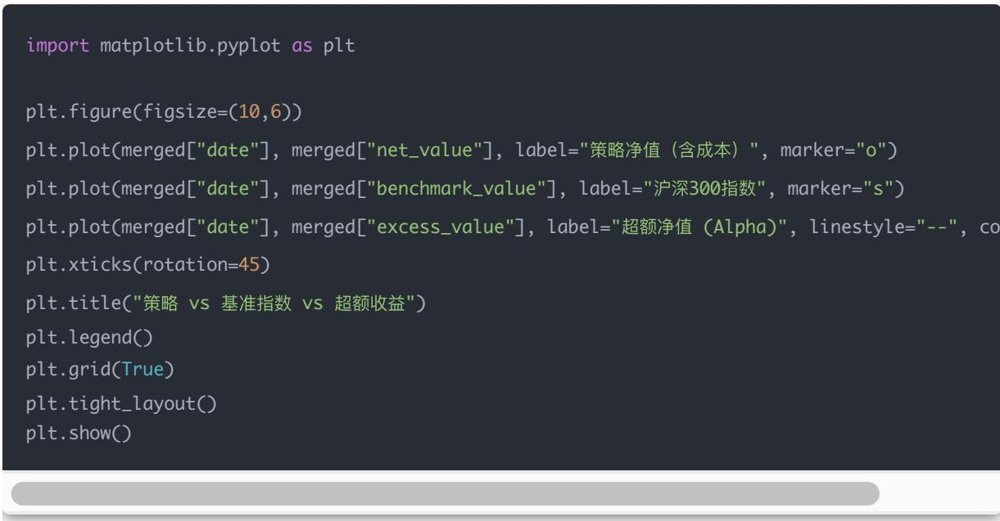
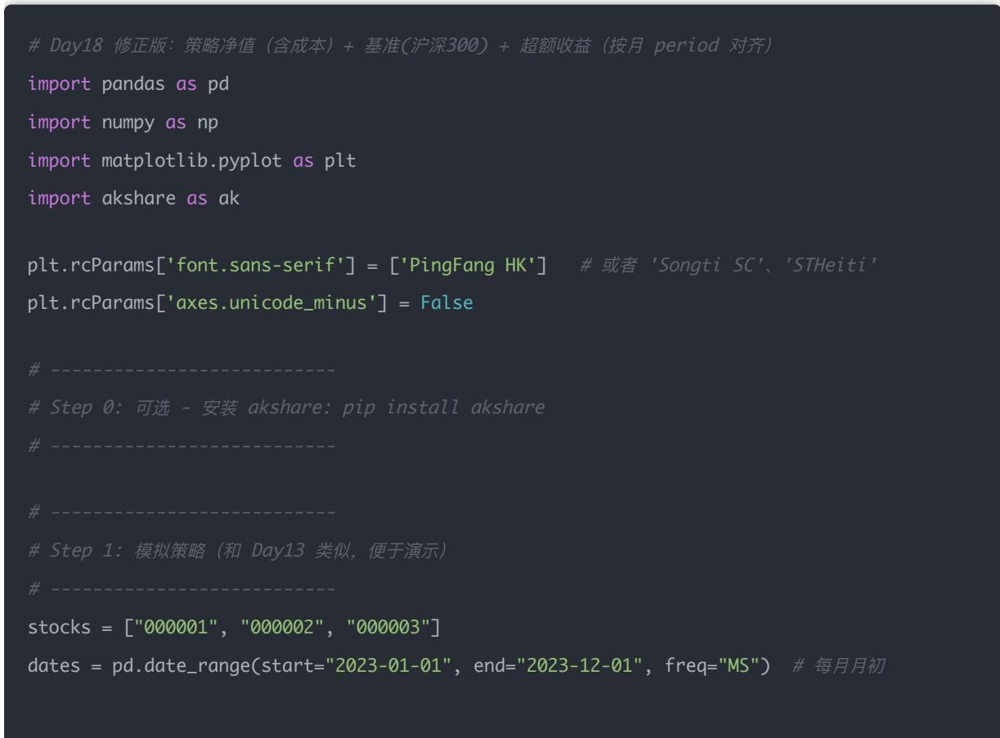
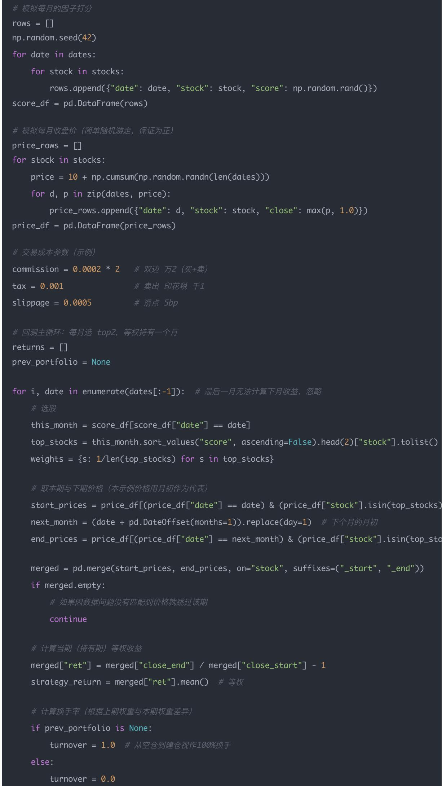
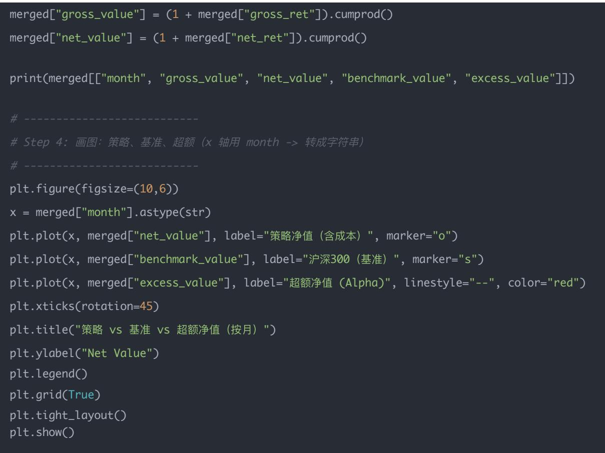

# 量化交易入门指南：第18天－与基准指数对比、超额收益（Alpha 回测）

原创 逻辑与流 逻辑与流 2025年9月18日 00:28 北京 📞 听全文

## 课程概述

## 学习目标：

- 深入理解基准指数对比的重要性和必要性

- 掌握超额收益（Alpha）的定义和计算方法

- 学会获取基准指数数据并进行对比分析

- 实现策略净值、基准净值、超额净值的完整回测框架

- 掌握策略评估的核心技能和思考方法

## 预计学习时间：30分钟

本文为量化交易学习系列第18天内容，系统讲解与基准指数对比的重要性，超额收益（Alpha）的定义和计算方法，Python实战实现策略与基准的对比分析，帮助你掌握量化策略评估的核心技能。

## 一、为什么要对比基准？

在量化里，单看策略收益是没意义的。

比如：

- 你的策略一年收益率 $= 15\%$

- 但是同期沪深300指数涨了 $20\%$

说明你跑输市场（虽然赚钱，但不如买 ETF 躺平）

所以我们必须引入基准指数（Benchmark），常见基准有：

- 沪深300 (000300.SH): 代表大盘蓝筹

- 中证500 (000905.SH): 代表中盘股

- 创业板指（399006.SZ）：代表成长股

- 上证综指 (000001.SH)：全市场代表

## 二、超额收益（Alpha）的定义

$$
\mathrm{超额收益} = R _ {\mathrm{策略}} - R _ {\mathrm{基准}}
$$

## 其中：

- 如果超额收益 $>0 \rightarrow$ 说明策略跑赢市场，真正有Alpha

- 如果超额收益 $< 0 \rightarrow$ 说明策略不如指数基金

在量化研究里，Alpha是最核心的考核标准之一。

## 三、Python 实现（基于 Day 13 回测结果）

我们在净值曲线上加一个基准指数（比如沪深300），计算策略 vs 基准的差异。

### 1. 获取基准数据（用 AkShare）

import akshare as ak

\# 获取沪深300指数数据

benchmark\_df = ak.index\_zh\_a\_hist(symbol="000300", period="daily", start\_date="20230101", ad

benchmark\_df["date"] = pd.to\_datetime(benchmark\_df["日期"])

benchmark\_df = benchmark\_df[["date", "收盘"]].rename(columns={"收盘": "benchmark\_close"})

### 2. 计算基准净值曲线

\# 按月取收盘价（和策略频率对齐）

benchmark\_monthly = benchmark\_df.set\_index("date").resample("M").last().reset\_index()

benchmark\_monthly["benchmark\_ret"] = benchmark\_monthly["benchmark\_close"].pct\_change().filln

benchmark\_monthly["benchmark\_value"] = (1 + benchmark\_monthly["benchmark\_ret"]).cumprod()

### 3. 合并策略 & 基准

\# 合并策略结果 df\_ret (Day13 的结果)

merged = pd.merge(df\_ret, benchmark\_monthly, on="date", how="inner")

\# 计算超额收益

merged["excess\_ret"] = merged["net\_ret"] - merged["benchmark\_ret"]

merged["excess\_value"] = (1 + merged["excess\_ret"]).cumprod()

print(merged[["date", "net\_value", "benchmark\_value", "excess\_value"]].head())

## 四、结果解读

- 策略净值曲线：你的量化模型真实表现

- 基准指数净值：如果你买ETF的表现

- 超额净值曲线：能直观看出"跑赢多少市场"

如果超额曲线稳步向上，说明策略真有 Alpha。如果超额曲线波动大或长期向下，说明策略只是"跟着市场涨跌"，没真正创造超额收益。

## 五、今日思考题

1. 如果你的策略收益率高，但超额收益为负，说明什么？

说明：

- 你的策略虽然赚钱了，但市场本身涨得更好。

- 本质上你"跑输市场"，还不如直接买指数基金。

例子：

- 策略年化收益率 $15\%$

- 沪深300年化收益率 $20\%$ 超额收益 $= -5\% \rightarrow$ 说明策略没有真正产生Alpha，只是"吃到了大盘上涨的红利"。

结论：策略无效，不能证明有 Alpha。

2. 如果超额收益长期为正，但总收益比指数低，你会怎么理解？

这种情况要分两种：

1. 初期落后，后期稳定跑赢

- 可能策略前几年表现差，但之后一直稳稳跑赢市场

- 长期来看，策略仍然有价值

### 2. 波动控制更好，但涨幅小

- 策略风险更低（比如最大回撤远小于指数），所以总收益低

- 但"风险调整后的收益"更好（夏普比率更高）

所以即使总收益低，但如果超额收益曲线长期上升，说明策略是真正有Alpha的。

### 3. 你认为应该选哪一个指数作为基准？（提示：要和你的股票池匹配）

原则：基准要和股票池的风格一致

- 如果股票池是沪深300成分股 $\rightarrow$ 基准选沪深300

- 如果股票池是中证500中盘股 $\rightarrow$ 基准选中证500

- 如果是创业板、小盘股池 $\rightarrow$ 基准选创业板指数

- 如果是全市场选股 $\rightarrow$ 基准选沪深 $300+$ 中证500的组合，或者中证全指

不匹配的基准没有参考意义。比如你全仓买中小盘股，却用沪深300（大盘蓝筹）做基准，得出的超额收益会失真。

## 六、完整代码实现

Day 18 的完整代码（含：策略净值、有成本净值、基准指数净值、超额收益曲线）写成一个可以直接跑的版本，方便你一次性看到效果

df\_ret = pd.DataFrame(returns)
df\_ret = df\_ret.sort\_values("month").reset\_index(drop=True)
df\_ret["gross\_value"] = (1 + df\_ret["gross\_ret"]).cumprod()
df\_ret["net\_value"] = (1 + df\_ret["net\_ret"]).cumprod()

\# ----
# Step 2: 获取基准指数（沪深300）历史日线数据（注意：不要传 adjust 参数）
# ----
# 注意：index\_zh\_a\_hist 不接受 \`adjust\` 参数（这是为股票历史接口 stock\_zh\_a\_hist 特有）
# 正确示例：ak.index\_zh\_a\_hist(symbol="000300", period="daily", start\_date="20230101", end\_date=benchmark\_df = ak.index\_zh\_a\_hist(symbol="000300", period="daily", start\_date="20230101", end\_date="20231231")

\# 将日期转为 datetime 并取月末收盘作为代表 (resample 'M' last)
benchmark\_df["date"] = pd.to\_datetime(benchmark\_df["日期"])
benchmark\_monthly = benchmark\_df.set\_index("date").resample("M").last().reset\_index()
benchmark\_monthly = benchmark\_monthly.rename(columns={"收盘": "benchmark\_close"})
benchmark\_monthly["benchmark\_ret"] = benchmark\_monthly["benchmark\_close"].pct\_change().filln
benchmark\_monthly["month"] = benchmark\_monthly["date"].dt.to\_period("M")
benchmark\_monthly["benchmark\_value"] = (1 + benchmark\_monthly["benchmark\_ret"]).cumprod()

\# ----
# Step 3: 用 month (Period) 对齐合并策略与基准
# ----
merged = pd.merge(df\_ret, benchmark\_monthly[["month", "benchmark\_ret", "benchmark\_value"], on="month", how="inner")

七、总结  
7.1 核心要点回顾

<table><tr><td>项目</td><td>内容</td></tr><tr><td>基准对比的重要性</td><td>单看策略收益无意义,必须与市场基准对比</td></tr><tr><td>超额收益定义</td><td>Alpha = 策略收益 - 基准收益</td></tr><tr><td>基准选择原则</td><td>基准要与股票池风格一致</td></tr><tr><td>结果解读</td><td>超额曲线向上说明有Alpha,向下说明跑输市场</td></tr></table>

### 7.2 实战技巧汇总

<table><tr><td>技巧</td><td>说明</td></tr><tr><td>基准选择</td><td>根据股票池特征选择合适基准指数</td></tr><tr><td>数据对齐</td><td>确保策略和基准数据频率一致</td></tr><tr><td>超额收益计算</td><td>策略收益减去基准收益得到Alpha</td></tr><tr><td>可视化分析</td><td>绘制三条曲线对比策略、基准、超额表现</td></tr></table>

### 7.3 关键思考

1. 策略收益高但超额为负 $\rightarrow$ 说明策略没产生Alpha，纯粹是"市场好"

2. 超额收益为正但总收益低 $\rightarrow$ 可能策略更稳健，风险控制好，仍然有价值

3. 基准要和股票池风格一致 $\rightarrow$ 否则结论失真

### 7.4 下一步学习方向

### 1. 深入学习风险调整收益

- 夏普比率、信息比率

- 最大回撤分析

- 波动率管理

### 2. 多基准对比分析

- 不同基准下的策略表现

- 基准轮动策略

- 相对强弱分析

### 3. 策略优化

- 基于Alpha的因子优化

- 动态基准调整

- 风险预算分配

通过今天的学习，你已经掌握了量化策略与基准对比分析的核心技能。这是评估策略真实价值的关键步骤，也是量化投资中不可或缺的重要环节。
