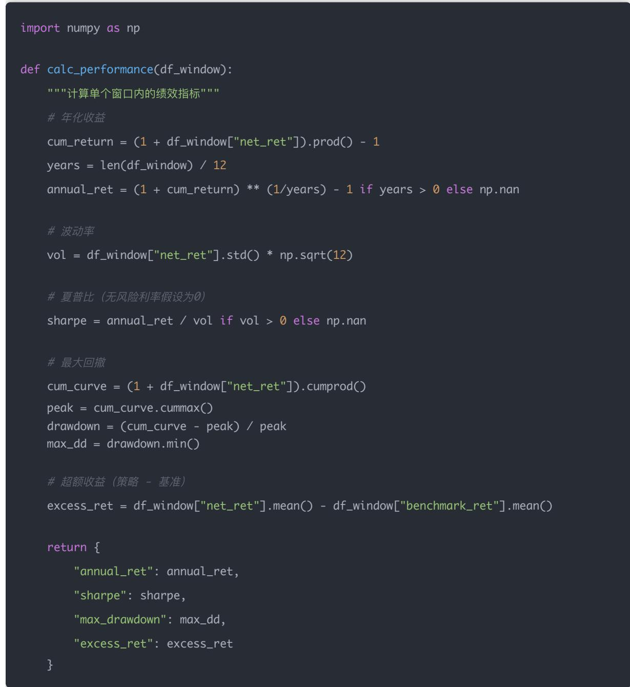
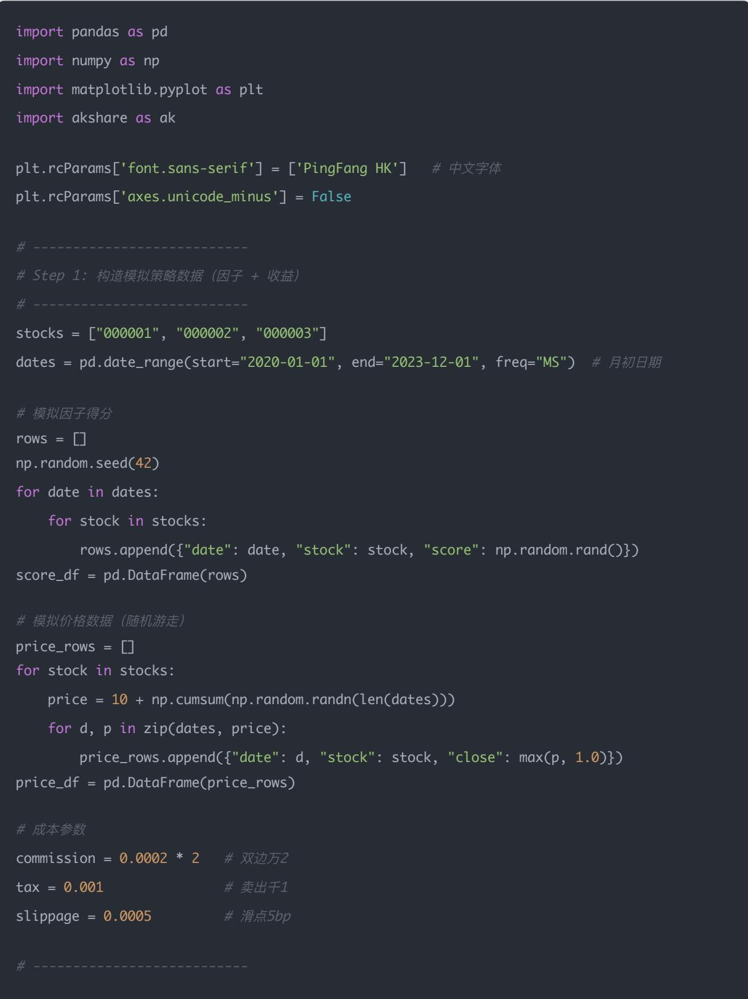
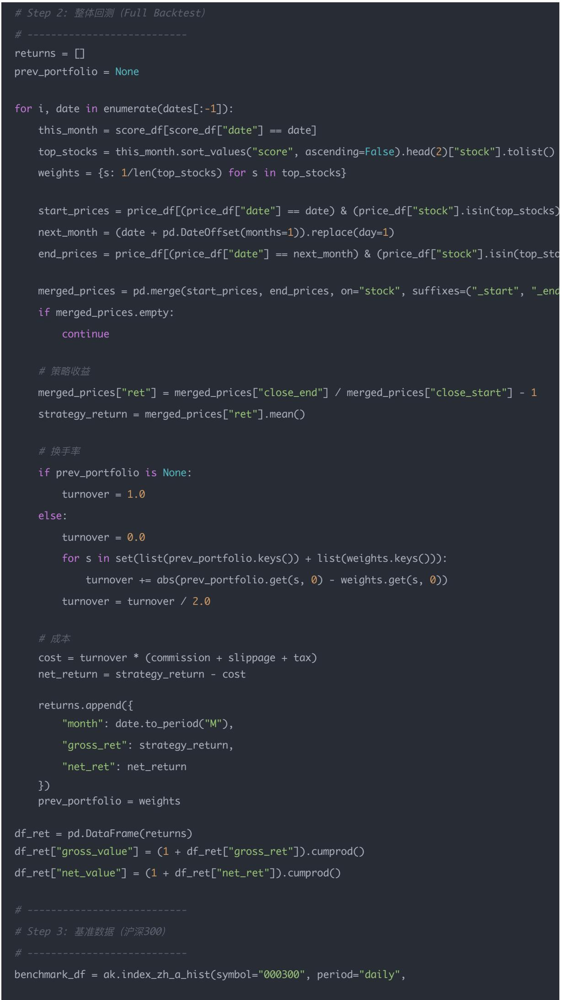
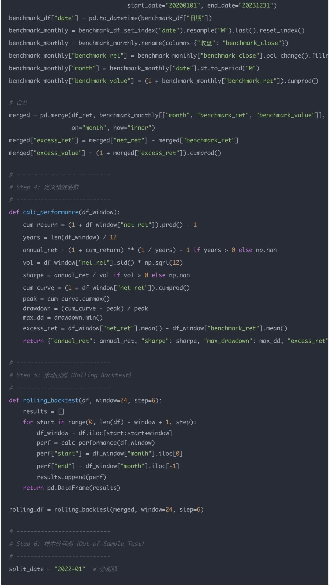
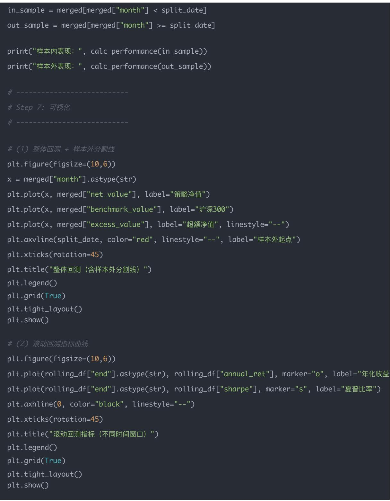

## 量化交易入门指南：第19天－策略稳定性测试、滚动回测

原创 逻辑与流 逻辑与流 2025年9月19日 18:33 北京 📄2人

本文深入探讨了量化策略的稳定性测试方法，重点介绍了滚动回测的核心思想和实现方法。通过将历史数据切分成多个滑动窗口，我们能够检验策略在不同时间区间的稳定性，避免"历史巧合"的陷阱。文章详细解释了滚动回测的基本概念、常见指标、代码实现，并补充了样本外回测的重要概念，帮助读者建立完整的策略验证体系。

## 学习时间

- 理论学习: 15分钟

- 代码实践: 20分钟

- 思考总结: 10分钟

- 总计: 45分钟

## 一、为什么需要滚动回测？

在之前的文章里，我们只是对策略做了一个"全区间"的回测，比如2020–2023年。

但问题是：

- 策略可能在牛市表现很好，在熊市就完全失效

- 或者只在某段时间偶然有效，长期并不稳定

滚动回测的目的：检验策略在不同时间区间的稳定性，避免"历史巧合"。

## 二、滚动回测的基本思想

把整段历史时间切分成多个"滑动窗口"，在每个窗口内分别做回测。

- 设定一个固定窗口长度，比如3年

- 每次向前滚动6个月或1年

- 在每个窗口内计算策略表现（收益率、夏普比、最大回撤等）

最后你得到一个时间序列：每个窗口的年化收益、夏普比等是否稳定？

## 三、常见指标

每个窗口内通常计算以下指标：

- 年化收益率

- 夏普比率

- 最大回撤

- 超额收益率（对比基准）

- 信息比率（IR）

## 四、代码示例（基于Day 16-18的结果merged）

我们假设merged DataFrame里已经有月度的net\_ret（策略月度收益），benchmark\_ret（基准月度收益）。

### 1. 定义滚动窗口绩效函数



## 补充知识点

1. 什么是月度net\_ret（策略月度收益）？

定义：策略在某一个月（调仓周期）的实际回报率。

计算公式：

$$
\mathrm {net\_ {r} et} _ {t} = \frac {\text {组合净值} _ {t} - \text {组合净值} _ {t - 1}}{\text {组合净值} _ {t - 1}}
$$

解释：

- 如果上个月组合净值是1.0，这个月变成 $1.05 \rightarrow$ 收益 $= +5\%$

- 我们称它为net\_ret（净收益率），是因为已经扣除了交易成本、滑点等费用

它反映的是策略在该月赚了多少（百分比）。

2. 什么是月度benchmark\_ret（基准月度收益）？

定义：基准指数（比如沪深300）的月度收益率。

公式：

$$
\mathrm {benchmark\_ {r} et} _ {t} = \frac {\text {指数收盘价} _ {t} - \text {指数收盘价} _ {t - 1}}{\text {指数收盘价} _ {t - 1}}
$$

解释：

- 如果沪深300上个月收盘价是4000点，这个月是4200点 $\rightarrow$ 收益 $= +5\%$

- 就像"你不选股，只买指数基金"会得到的回报

它反映的是大盘本身的收益水平。

3. 为什么要有这两个？

- net\_ret：你的策略表现

- benchmark\_ret：市场平均表现

两者一对比，就能看出策略有没有"超额收益":

$$
\mathrm {excess\_ret} _ {t} = \mathrm {net\_ret} _ {t} - \mathrm {benchmark\_ret} _ {t}
$$

- 如果excess\_ret > 0 → 策略跑赢市场

- 如果excess\_ret < 0 → 策略不如买指数

4. 举个数值例子

假设2023年1月\~3月：

<table><tr><td>月份</td><td>策略净值</td><td>net_ret(月度收益)</td><td>沪深300收盘价</td><td>benchmark_ret</td><td>超额收益</td></tr><tr><td>Jan</td><td>1.00</td><td>-</td><td>4000</td><td>-</td><td>-</td></tr><tr><td>Feb</td><td>1.05</td><td>+5%</td><td>4200</td><td>+5%</td><td>0%</td></tr><tr><td>Mar</td><td>1.10</td><td>+4.8%</td><td>4150</td><td>-1.2%</td><td>+6.0%</td></tr></table>

## 解读：

- 2月：策略赚了 $5\%$ ，但大盘也涨了 $5\% \rightarrow$ 没有超额收益

- 3月：策略赚了 $4.8\%$ ，大盘跌了 $1.2\% \rightarrow$ 策略跑赢大盘 $6\%$ ，这是Alpha

## 总结：

- net\_ret = 策略的月度收益（已经扣成本）

- benchmark\_ret = 基准指数的月度收益

- 两者对比 $\rightarrow$ 判断策略是否真正比市场聪明

### 2. 滚动窗口回测

window = 36 # 窗口长度，36个月=3年

step = 6 # 每次前滚6个月

results = []

for start in range(0, len(merged) - window + 1, step):

df\_window = merged.iloc[start:start+window]

perf = calc\_performance(df\_window)

perf["start"] = merged.iloc[start]["month"]

perf["end"] = merged.iloc[start+window-1]["month"]

results.append(perf)

rolling\_df = pd.DataFrame(results)

print(rolling\_df)

### 3. 可视化稳定性

import matplotlib.pyplot as plt

plt.figure(figsize=(10,5))

plt.plot(rolling\_df["end"].astype(str), rolling\_df["annual\_ret"], marker="o", label="年化收益

plt.plot(rolling\_df["end"].astype(str), rolling\_df["sharpe"], marker="s", label="夏普比")

plt.xticks(rotation=45)

plt.title("滚动窗口绩效指标")

plt.legend()

plt.grid(True)

plt.tight\_layout()

plt.show()

## 五、什么是样本外回测？

在量化策略研究里，我们一般把数据分成两部分：

### 1. 样本内 (In-Sample)

- 研究/训练时用到的数据

- 用来设计策略、调参、找最佳因子组合

- 比如：2015–2019年的数据

### 2. 样本外（Out-of-Sample）

- 完全没见过的新数据

- 用来检验策略的泛化能力（能否适应未来）

- 比如：2020–2022年的数据

如果策略在样本内表现好，但样本外一塌糊涂，那就说明：你是在过拟合历史数据。

## 样本外回测的常见方法

1. 固定切分（Train/Test Split）

- 比如用前5年做样本内，后2年做样本外

- 优点：简单直观

- 缺点：一次切分，结果可能受时间段选择影响

2. 滚动窗口（Rolling / Walk-Forward Test）

- 用前N年做训练，接下来1年做样本外；再往前滚动

- 比如：

- 2010–2015 → 训练，2016 → 验证

- 2011–2016 → 训练，2017 → 验证

- ...重复下去

- 优点：更接近实盘，反映策略在不同市场环境的稳定性

3. 交叉验证（Cross-Validation，机器学习常用）

- 对金融时间序列会用"时间序列交叉验证"而不是随机切分

- 本质和滚动窗口类似

## 样本外回测要看什么？

- 收益曲线：是否还能赚钱？

- Sharpe比率：风险调整后的收益是否仍然稳定？

- 回撤：有没有"爆雷"情况？

- 稳定性：多个样本外窗口表现是否一致？

## 常见误区

1. 偷看未来（Look-Ahead Bias）

- 比如你在2018年用到了2019年的财务数据 $\rightarrow$ 违规

2. 过度调参 (Data-Snooping Bias)

- 在样本内调参到完美 $\rightarrow$ 样本外肯定失效

- 就像背答案 $\rightarrow$ 换一道题就挂了

3. 只做一次切分

- 可能正好踩到一个"幸运区间" $\rightarrow$ 滚动样本外更可靠

## 直观比喻

- 样本内回测：你在家里做模拟题，成绩很好

- 样本外回测：去真正考试换一份新卷子，看看还能不能考好

- 实盘：真正走进考场，旁边还有干扰因素（滑点、流动性、资金约束）

## 六、回测的层次

在研究一个策略时，一般有三个层次的检验：

### 1. 整体回测 (Full Backtest)

- 把整段数据跑一遍，看看策略大概表现如何

- 输出：净值曲线、年化收益、Sharpe、最大回撤等

- 用途：初筛，快速判断"有没有潜力"

### 2. 滚动回测 (Rolling Backtest)

- 在多个时间窗口里重复回测，输出指标序列

- 输出：滚动年化收益、滚动Sharpe、滚动回撤曲线

- 用途：检验稳定性（是否只在某个时间段好）

### 3. 样本外回测 / Walk-forward

- 把数据切成训练集+验证集，先在历史一段区间内调参，再在未来区间测试

- 用途：避免过拟合，更接近实盘


## 是否要同时做？

## 答案是：要，且顺序上是递进关系

### 1. 先做整体回测

- 如果整体回测表现就很差（比如长期负收益），策略没必要再深入

- 如果整体表现还可以，再进入下一步

### 2. 再做滚动回测

- 如果发现策略只在某几年有效，其他时间失效 $\rightarrow$ 策略可能是"伪Alpha"，要么改进要么放弃

- 如果多个窗口表现都比较稳健 $\rightarrow$ 策略质量更高

### 3. 最后做样本外回测

- 这是最接近实盘的检验

- 很多机构要求"整体回测 + 滚动回测 + 样本外回测"全过，策略才会进入实盘

## 一个类比

- 整体回测：看一个学生三年总成绩（平均分高不高）

- 滚动回测：看他每学期成绩（有没有偏科、时好时坏）

- 样本外回测：给他一份新试卷（未来数据），看看能不能保持水准

光看总成绩（整体回测）可能以为他很厉害，但其实是靠某几科拉分；只有滚动成绩（滚动回测）能看出是否稳定。

## 实际建议

- 研究阶段：整体回测 + 滚动回测必须都做

- 准备实盘：一定要加样本外回测（或走样本外滚动窗口）

## 七、完整回测流程图

策略构思 / 因子设计

数据准备与清洗

(价格、财务、指数、无风险利率...)

整体回测 (Full Backtest)

输出：净值曲线、总收益、年化收益率、Sharpe、最大回撤

用途：初筛 → 策略是否值得深入？

滚动回测 (Rolling Backtest)

输出：滚动年化收益、滚动Sharpe、滚动回撤曲线

用途：检验策略稳定性，是否只在个别年份好

样本外回测 / Walk-Forward Test

做法：划分训练集 & 验证集

- 先在训练集上调参

- 再在验证集 / 未来区间上检验

用途：避免过拟合，接近实盘表现

综合评估（因子IC/IR、行业中性化、风险暴露分析）

实盘模拟 (Paper Trading)

真正实盘（Live Trading）

## 补充说明

- 整体回测：快速看全局表现，类似"平均成绩"

- 滚动回测：观察分段表现，类似"每学期成绩"

- 样本外回测：用未来未见过的数据测试，类似"换一份新试卷看看能不能考好"

- Paper Trading（模拟盘）：小资金或者虚拟账户跑，验证能不能执行

## 总结

一个严谨的量化研究，至少要经过：

- 整体回测 + 滚动回测（研究阶段）

- 样本外回测 + 模拟盘（实盘前）

最后才进入真金白银的实盘。

## 八、今日思考题

### 1. 如果一个策略在牛市窗口表现很好，但在熊市窗口年化收益为负，你会如何调整？

核心结论：先判断这是"风格暴露/市场beta问题"还是"因子本身在逆市失效"。然后从三类手段调整：降低市场暴露/做风险对冲/在模型层面增强鲁棒性。

排查步骤（必须做）：

1. 看暴露 (Beta)

- 计算策略对市场（基准）的回归β

- 若 $\beta \gg 1$ （正且大），说明策略高度跟随市场波动 $\rightarrow$ 在牛市放大收益，在熊市放大亏损

2. 看行业/风格集中度

- 是否某些行业在牛市占比大（比如成长股）导致在熊市被惩罚？

### 3. 看因子在不同市况下的IC/分组收益

- 因子在熊市的IC是否变为零或负？说明因子在熊市失效

## 调整策略（具体可执行项）：

## - 降低市场beta/做对冲

- 将持仓做市场中性（long-short）或加入对冲头寸（空一部分基准ETF）

- 简单方法：目标 $\beta$ 调到0.5（如果原本是1.2），按比例缩减仓位或对冲相应市值

## - 波动率/风险目标化

- 使用波动率调仓：当市场波动↑或策略滚动年化波动↑时自动降仓（例：目标波动10%，当前波动20%，仓位乘以10/20=0.5）

## - 添加防御类因子或资产

- 在组合里加入低风险/避险资产（国债、黄金、现金）作为对冲

## - 行业/风格中性化

- 对因子进行行业中性回归，或在每行业内挑选高分股，避免行业轮动导致的回撤

## - 引入动态/分段模型（Regime-aware）

- 用市况信号（如过去3个月市场回报、VIX/波动率指标）判断牛熊，当判定为"熊"时切换到低风险或不同因子集

## - 设置硬性风控阈值

- 最大回撤触发器：如果回撤超过X%，立即减仓或平仓

- 日内/周内止损规则用于极端反转

## 小实例（数值化操作）：

- 若滚动 $\beta = 1.5$ （过去12个月），你想把beta降到0.8：

- 缩仓比例 $= 0.8 / 1.5 \approx 0.53 \rightarrow$ 把仓位减到 $53\%$ 或做等价值的空仓对冲

- 市场3个月回报 $< -5\% \rightarrow$ 进入Risk-off：把仓位乘以0.5并增加国债权重 $20\%$

### 2. 滚动回测的窗口大小应该如何选择？（短vs长）

核心结论：窗口越长 $\rightarrow$ 统计显著性越高但对结构性变化反应慢；窗口越短 $\rightarrow$ 响应快但噪音大。选择需权衡"样本量（统计稳定）"与"非平稳性（可变市场环境）"。

## 选择原则（实用）：

### 1. 按数据频率

- 日度数据：窗口常用1-3年（250-750个交易日）

- 月度数据：窗口常用2-5年（24-60个月）

### 2. 目标指标决定窗口

- 想稳定估计Sharpe/年化收益：需要至少30-60个独立观测（一般36个月是常见选择）

- 想捕捉策略"失效点"或快速适配市场：短窗口（12\~24个月）更敏感

### 3. 考虑业务场景

- 长期基金（3-5年持有）：偏好长窗口

- 量化对冲（月度调仓）：建议24-36个月窗口 + 滚动步长3-6个月

### 4. 步长（step）选择

- 常用1\~6个月。步长太小会产生高度相关的窗口结果（噪音）；较大步长减少冗余但能降低分辨率

## 如何实操选择（建议流程）：

1. 先试36个月窗口，步长6个月（这是平衡稳定性与响应性的良好默认）

2. 再做敏感性分析：用24M、36M、48M三个窗口跑一次，比较年化收益/Sharpe的稳定性

3. 若三者差异很大，说明策略高度时间敏感，需要进一步做regime分析或减少信号噪声

## 统计注意点：

- 小窗口估计的Sharpe/IC标准误差大，不可盲目相信单个窗口结果

- 可以用bootstrap或t-test来检验指标是否显著高于0

### 3. 如何结合滚动回测结果来决定实盘持仓比例？

核心结论：用滚动回测的"绩效指标 + 风险指标 + 稳定性指标"做规则化的仓位调节（rule-based），结合波动率目标化和平滑机制。

## 关键信号（用以决定仓位）：

- 滚动Sharpe（或年化收益）：越高，适合加仓

- 滚动波动率：越高，应该降仓（或做风险目标化）

- 滚动最大回撤（或最近最大回撤）：大回撤 -> 降仓或暂时停用

- 超额收益稳定性（excess\_ret）：若超额长期为正，可保留或加仓

- 因子IC/IR的稳定性：IC均值高且波动小 $\rightarrow$ 更高信任度

可直接落地的仓位规则（几个模板）：

## 模板A：分档规则（简单直观）

- 若滚动Sharpe（36M）>1.0且max\_drawdown < 20% → 仓位 = 100%（满仓）

- 若 $0.5 < \text{Sharpe} \leq 1.0$ 或 $20\% \leq \max\_ \mathrm{dd} < 30\% \rightarrow$ 仓位 $= 50\%$

- 若Sharpe $\leq 0.5$ 或max\_dd $\geq 30\%$ →仓位 $= 0\%$ （观望）

模板B：线性映射（平滑）

- 设Sharpe在[sh\_min, sh\_max] = [0, 1.5]映射到仓位[0,1]:

$$
\text { exposure } = \operatorname{clip} \left(\frac {\text { Sharpe } - s h _ {m} i n}{s h _ {m} a x - s h _ {m} i n}, 0, 1\right)
$$

- 再用波动率做缩放：最终仓位 = exposure × (target\_vol/current\_vol) (cap在0\~1)

## 模板C：波动率目标化（行业常用）

- 目标组合年化波动target\_vol（比如 $10\%$ ）

- 当前策略滚动波动est\_vol（年化）

- 仓位缩放因子 = target\_vol / est\_vol

- 最终仓位 = base\_exposure × 缩放因子（并限制最大不超过1）

## 模板D：复合规则（更稳健）

- 基于Sharpe映射得到quality\_score (0\~1)

- 基于max\_drawdown得到risk\_penalty (0\~1)

- 初始仓位 = quality\_score × (1 - risk\_penalty)

- 再进行波动率目标化和平滑（用指数平均减少跳变）

## 具体数值示例（落地）：

• target\_vol = 0.10 (10%)

- 过去36月估计策略年化波动est\_vol = 0.20 (20%) → 缩放因子0.5

- 过去36月Sharpe $= 0.9 \rightarrow$ exposure初始按线性映射为0.6

- 最终仓位 $= 0.6 \times 0.5 = 0.30 \rightarrow$ 实盘以 $30\%$ 仓位运行策略

## 补充知识点

1. max\_drawdown（最大回撤）

直白理解：投资过程中，从高点到低点最大的跌幅。

举个例子：

- 最高净值 $100 \rightarrow$ 最低跌到 $70 \rightarrow$ 回撤 $= (70 - 100) / 100 = -30\%$

- 这就是最大回撤-30%

作用：衡量风险承受能力，回撤太大说明策略在某些极端情况下风险过高。

公式：

$$
\mathrm{MDD} = \min _ {t} \frac {V _ {t} - \max _ {s \leq t} V _ {s}}{\max _ {s \leq t} V _ {s}}
$$

其中V\_t是时刻t的净值。

2. Sharpe映射到仓位

场景：Sharpe比率越高，说明策略收益/风险比越好，仓位可以更大。

公式：

$$
\text { exposure } = \operatorname{clip} \left(\frac {\text { Sharpe } - s h _ {\min}}{s h _ {\max} - s h _ {\min}}, 0, 1\right)
$$

解释：

- 如果Sharpe = 0 → exposure = 0 (不持仓)

- 如果Sharpe $\geq 1.5 \rightarrow$ exposure $= 1$ （满仓）

- 如果Sharpe在 $0.75 \rightarrow$ exposure = 0.5（半仓）

- clip(): 限制结果在[0,1]范围内，防止超过

3. target\_vol / current\_vol

target\_vol（目标波动率）：你希望组合控制在的波动水平（比如10%年化）

current\_vol（当前波动率）：策略过去一段时间实际的波动率（比如20%）

缩放公式：

$$
\mathrm {scaled\_exposure} = \mathrm{exposure} \times \frac {\mathrm {target\_vol}}{\mathrm {current\_vol}}
$$

解释：如果目标是 $10\%$ ，实际是 $20\%$ ，那仓位应该减半（乘0.5）

作用：避免仓位太大导致风险超过预期

4. base\_exposure

直白理解：你默认给策略设定的基础仓位，比如 $50\%$

作用：避免模型计算出来仓位过小或过大，你人为给个"基准"

例子：即使Sharpe很低，base\_exposure = 20% → 依然会保留一些仓位，不至于完全空仓

5. quality\_score

直白理解：用策略绩效（Sharpe、Alpha、稳定性）算出的"质量分数"，范围一般[0,1]

例子：

- Sharpe = 1.2，算出来quality\_score = 0.8

```txt
• Sharpe = 0.3, quality_score = 0.2
```

作用：衡量"该策略目前表现是否足够好"

6. risk\_penalty

直白理解：根据风险（比如回撤）给仓位打折扣

例子：

- 如果最大回撤 $15\% \rightarrow$ risk\_penalty $= 0.1$

- 如果最大回撤 $40\% \rightarrow$ risk\_penalty $= 0.6$

作用：回撤越大，仓位惩罚越多，避免高风险情况下满仓

7. 综合公式

在实盘里，仓位一般综合以上因素：

$$
\mathrm {final\_exposure} = \mathrm {base\_exposure} \times \mathrm {quality\_score} \times (1 - \mathrm {risk\_penalty}) \times \frac {\mathrm {target\_vol}}{\mathrm {current\_vol}}
$$

- base\_exposure：人为设置的基准仓位

- quality\_score: 策略表现好坏

- risk\_penalty：风险惩罚

- vol调整：波动率控制

举个实际例子

假设：

- base\_exposure = 1.0 (默认满仓)

- Sharpe = 0.9 → quality\_score ≈ 0.6

- max\_drawdown = -25% → risk\_penalty = 0.25

• target\_vol = 0.10, current\_vol = 0.20

那么：

$$
\text {final\_exposure} = 1. 0 \times 0. 6 \times (1 - 0. 2 5) \times \frac {0 . 1 0}{0 . 2 0} = 0. 6 \times 0. 7 5 \times 0. 5 = 0. 2 2 5
$$

最终仓位 = 22.5%

说明：虽然Sharpe不错，但回撤较大、波动超标，所以仓位只能打到22.5%。

额外实践建议（避免频繁大小幅调整）：

- 平滑仓位变更：使用指数移动平均（alpha like 0.2）平滑新旧仓位，避免过度交易

- 设置最小持仓期限：例如每次变动至少保持1个月，避免噪音驱动频繁缩放

- 结合资金规模与流动性：若资金量很大或股票流动性差，要人为下调最大仓位上限

## 九、完整代码实现

把Day16-Day18（策略+基准+超额收益）和今天的滚动回测的代码合并成一个完整脚本，跑完能输出三部分结果：

1. 策略vs基准vs超额净值曲线

2. 滚动窗口绩效表（年化收益、Sharpe、最大回撤、超额收益）

3. 滚动窗口指标图（收益率&夏普比）



for i, date in enumerate(dates[:-1]):
    this\_month = score\_df[score\_df["date"] == date]
    top\_stocks = this\_month.sort\_values("score", ascending=False).head(2)["stock"].tolist()
    weights = {s: 1/len(top\_stocks) for s in top\_stocks}



if prev\_portfolio is None:
    turnover = 1.0
else:
    turnover = 0.0
    for s in set(list(prev\_portfolio.keys()) + list(weights.keys()):
    turnover += abs(prev\_portfolio.get(s, 0) - weights.get(s, 0))
    turnover = turnover / 2.0



start\_date="20200101", end\_date="20231231")
benchmark\_df["date"] = pd.to\_datetime(benchmark\_df["日期"])
benchmark\_monthly = benchmark\_df.set\_index("date").resample("M").last().reset\_index()
benchmark\_monthly = benchmark\_monthly.rename(columns={"收盘": "benchmark\_close"})
benchmark\_monthly["benchmark\_ret"] = benchmark\_monthly["benchmark\_close"].pct\_change().filln
benchmark\_monthly["month"] = benchmark\_monthly["date"].dt.to\_period("M")
benchmark\_monthly["benchmark\_value"] = (1 + benchmark\_monthly["benchmark\_ret"]).cumprod()

\# 合并
merged = pd.merge(df\_ret, benchmark\_monthly[["month", "benchmark\_ret", "benchmark\_value"], on="month", how="inner")
merged["excess\_ret"] = merged["net\_ret"] - merged["benchmark\_ret"]
merged["excess\_value"] = (1 + merged["excess\_ret"]).cumprod()

def calc\_performance(df\_window):
    cum\_return = (1 + df\_window["net\_ret"]).prod() - 1
    years = len(df\_window) / 12
    annual\_ret = (1 + cum\_return) \*\* (1 / years) - 1 if years > 0 else np.nan
    vol = df\_window["net\_ret"].std() \* np.sqrt(12)
    sharpe = annual\_ret / vol if vol > 0 else np.nan
    cum\_curve = (1 + df\_window["net\_ret"]).cumprod()
    peak = cum\_curve.cummax()
    drawdown = (cum\_curve - peak) / peak
    max\_dd = drawdown.min()
    excess\_ret = df\_window["net\_ret"].mean() - df\_window["benchmark\_ret"].mean()
    return {"annual\_ret": annual\_ret, "sharpe": sharpe, "max\_drawdown": max\_dd, "excess\_ret"

def rolling\_backtest(df, window=24, step=6):
    results = []
    for start in range(0, len(df) - window + 1, step):
    df\_window = df.iloc[start:start+window]
    perf = calc\_performance(df\_window)
    perf["start"] = df\_window["month"].iloc[0]
    perf["end"] = df\_window["month"].iloc[-1]
    results.append(perf)
    return pd.DataFrame(results)



## 图表解读

## 图(1)的含义（整体回测结果）

当前的图显示的是：

- 策略净值（含成本）

- 基准指数（沪深300）

- 超额净值（策略-指数）

- 红色竖线：样本外的起点

红色竖线就是样本外起点，表示从这条线之后的数据属于"没见过"的区间。

- 线左边：样本内回测（调参、验证）

- 线右边：样本外回测（检验泛化能力）

这样可以看：调出来的策略在未来还能不能跑得动。

图(2)的含义（滚动回测结果）

在代码里画的图：

plt.plot(rolling\_df["end"].astype(str), rolling\_df["annual\_ret"], marker="o", label="年化收益

plt.plot(rolling\_df["end"].astype(str), rolling\_df["sharpe"], marker="s", label="夏普比率")

显示的是：

- 横轴：窗口结束的月份（2021-12、2022-06、2022-12、2023-06）

- 纵轴：在该窗口里算出的指标

- 蓝线：年化收益率（窗口内的平均表现）

- 橙线：夏普比率（风险调整后的收益表现）

## 图像解读：

- 每个点（marker）代表一个2年的滚动窗口

- 点与点之间间隔6个月（因为step=6）

- 如果曲线比较平稳 $\rightarrow$ 策略在不同时间段都能保持稳定收益

- 如果曲线大幅波动 $\rightarrow$ 策略只在部分时间段有效，稳定性不足

## 十、最后的实践路线

你可以直接做的三步：

1. 在回测框架里加入滚动窗口（36M/step6M），计算每个窗口的：Sharpe、年化收益、年化波动、max drawdown、excess\_ret

2. 设计一个仓位决策函数（从上面的模板选一个），把每个窗口的指标映射成仓位信号（0\~1）

3. 在样本外回测这个"动态仓位 + 波动率目标化"策略，比较其长期净值与原始固定仓位策略，观察是否能降低回撤并保留大部分收益

总结：滚动回测是量化策略验证的重要环节，它帮助我们识别策略的稳定性，避免被"历史巧合"误导。结合样本外回测，我们能够更准确地评估策略的真实表现，为实盘交易提供可靠的依据。记住，一个严谨的量化研究必须经过整体回测、滚动回测和样本外回测三个层次的检验。
