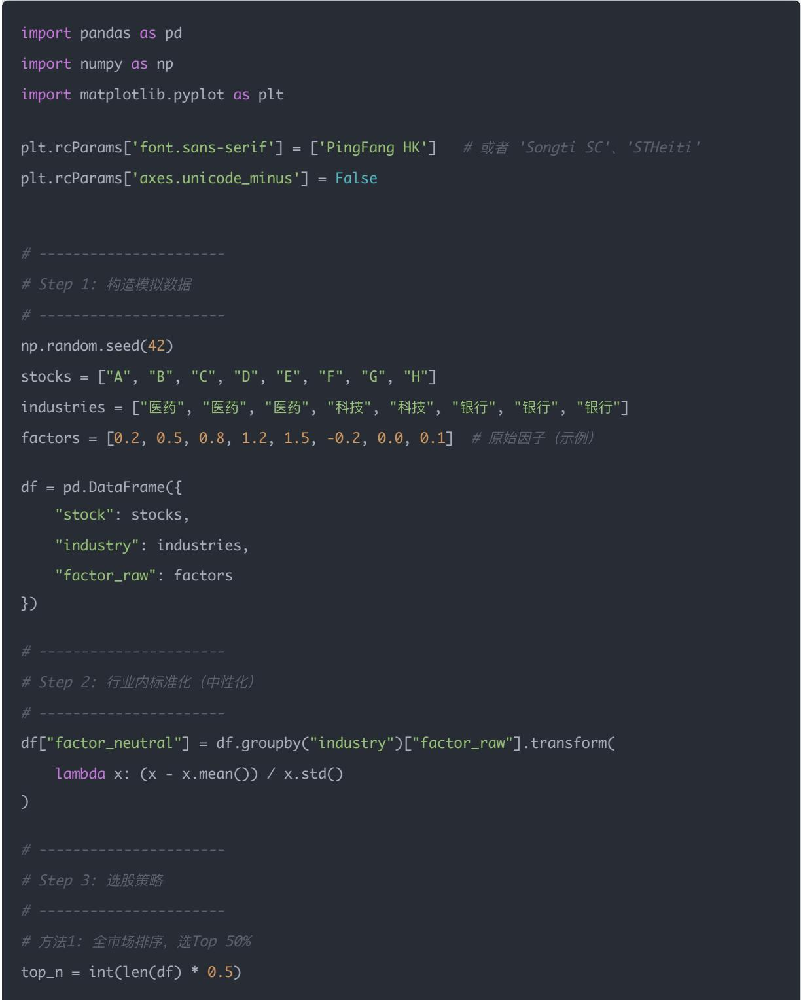
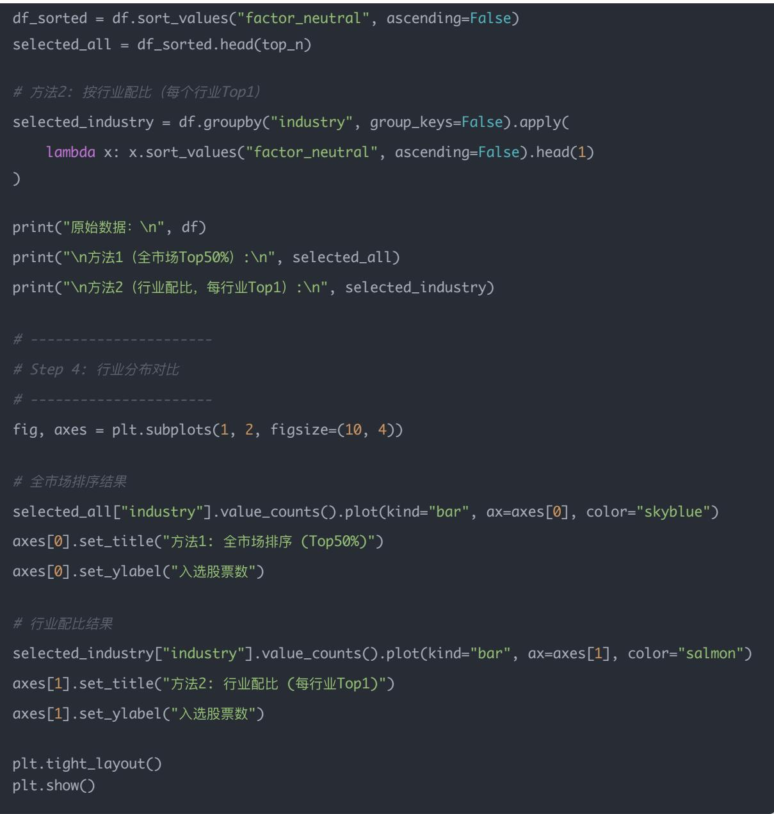
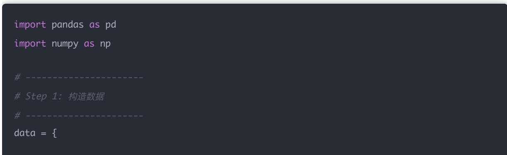
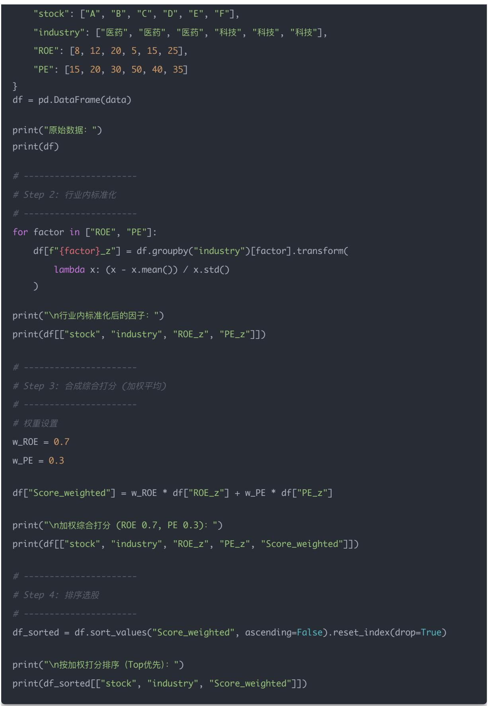
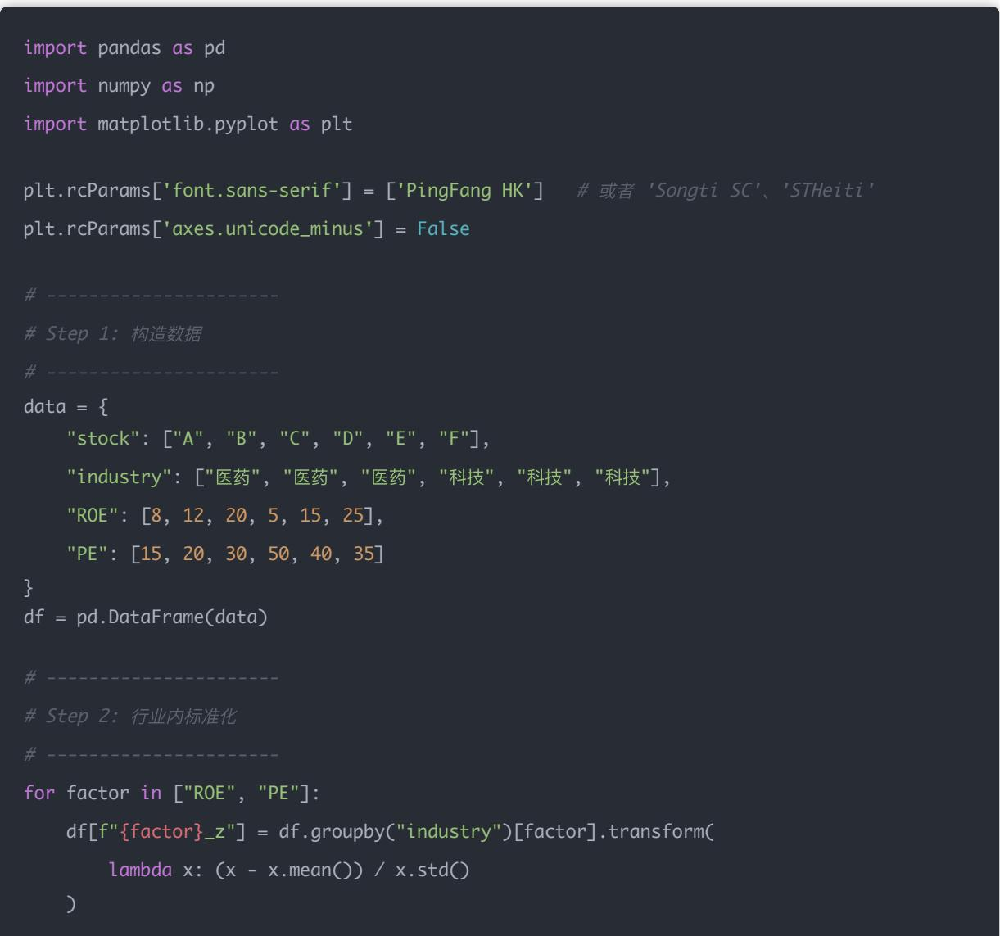
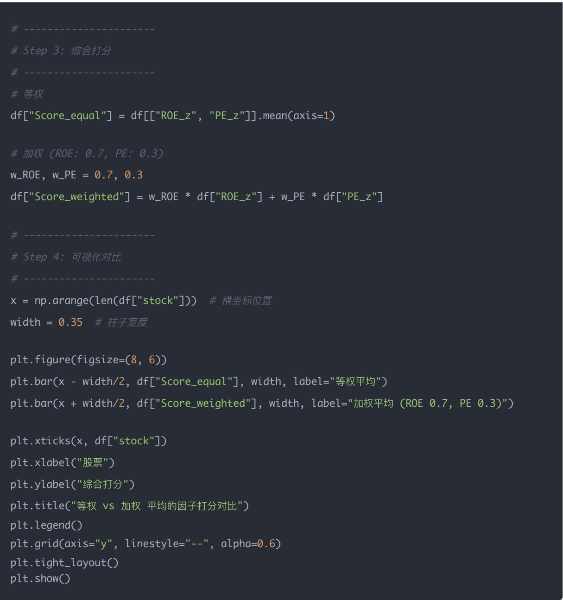

## 量化交易入门指南：第20天－风格因子控制（行业/市值）——风险中性化

原创 逻辑与流 逻辑与流 2025年9月21日 00:43 北京 📞 听全文

## 课程概述

## 学习目标：

- 深入理解风险中性化的概念和重要性

- 掌握行业中性化的原理和实现方法

- 学会市值中性化的技术要点

- 实现多因子中性化处理的完整流程

- 掌握等权平均与加权平均的因子合成技术

## 预计学习时间：60分钟

在因子选股中，风险中性化是确保因子有效性的关键步骤。本文深入探讨了行业和市值中性化的原理、方法和实践应用。通过控制行业暴露和市值暴露，我们可以避免将"行业轮动"或"大小盘风格"误认为是因子的真实效果。文章详细介绍了行业内标准化和行业回归中性化两种方法，并通过完整的代码示例展示了多因子中性化处理的完整流程，包括等权平均和加权平均的对比分析。掌握风险中性化技术，是构建稳健量化策略的重要基础。

在因子选股里，如果你不做"风险中性化"，很容易出现一种情况：

- 你以为因子有效，

- 其实它只是在"行业暴露"或"市值暴露"上赚钱。

## 1 什么是风险中性化？

- 行业暴露：如果你因子选出来的股票大部分是科技股，而恰好科技行业在这段时间涨得好，那因子赚钱并不是因子本身有用，而是"踩中行业风口"。

- 市值暴露：如果你选的股票都偏小市值，结果小票行情很好，你会觉得因子赚钱，实际上只是因为"风格偏好"。

为了检验因子的"纯粹有效性"，我们需要控制这些风险暴露，也就是风险中性化。

## 2 行业中性化的做法

## 方法 1：行业内标准化

在每个行业里，把因子值做标准化（Z-score）。

例如：

- 金融行业的股票，单独算平均、方差，做标准化

- 医药行业的股票，单独算标准化

• ...

这样保证行业间的因子值是可比的，避免"行业整体高估/低估"干扰。

## 方法 2：行业回归中性化

做一个回归：因子值 $=$ 行业哑变量 $+$ 残差只保留残差部分作为"行业中性化后的因子"。

## 3 市值中性化的做法

- 类似思路，可以对数市值（log(MarketCap)）做回归：

因子值 = 市值 + 残差

取残差部分作为"市值中性化后的因子"。

## 4例子

比如你要用ROE因子：

- 如果你直接全市场排序，可能选出来的全是银行（因为银行ROE普遍高）。

- 那你以为ROE因子赚钱，其实只是"行业效应"。

- 所以要在行业内比较ROE，才是真正的ROE选股。

## 5 代码小例子（行业中性化）

(这里我们用模拟数据举例，实盘里要用行业分类表，比如申万一级行业)

from sklearn.preprocessing import StandardScaler

"stock": ["A", "B", "C", "D", "E", "F"],

"industry": ["金融", "金融", "医药", "医药", "科技", "科技"],

"factor": [0.8, 0.9, 0.3, 0.5, 1.5, 1.7]

```python
df = pd.DataFrame(data)
# 方法1：行业内标准化
df["factor_neutral"] = df.groupby("industry")[ "factor"].transform( lambda x: (x - x.mean()) / x.std()
)
print(df)
```

## 运行后你会发现：

- 每个行业因子值都均值为0，标准差为1

- 去掉了"行业整体高/低"的影响，只保留了行业内差异

## 6 今日思考题

### 1. 为什么因子回测时需要做"行业中性化"?

## - 避免"行业轮动"误导结果

举例：假设银行股的 ROE 普遍比制造业高，如果你直接用 ROE 排序选股，最后组合里全是银行股。回测时如果银行板块刚好上涨，你会以为是 ROE 因子有效，实际上只是"行业因子"在赚钱。

## - 检验因子"纯净效果"

行业中性化的目的，就是把"行业整体效应"剥离掉，保留"行业内部的差异"。这样得到的结果，才能说明这个因子在不同环境下是否有效，而不是单纯靠踩对行业。

归纳一句话：行业中性化是为了剥离行业因素，保证因子的超额收益不是行业暴露带来的假象。

### 2. 如果不做市值中性化，会有哪些风险？

## - 小市值/大市值风格偏差

量化里常见现象：小盘股波动大、短期容易暴涨，而大盘股更稳健。如果你的因子回测结果很亮眼，但其实组合总是偏小盘，那么收益可能只是"市值风格因子"贡献的，而不是真正的选股因子。

## - 风险暴露过高

小盘股流动性差，容易带来冲击成本和滑点问题；大盘股虽然稳，但如果策略过度集中在大市值股上，超额收益可能会很低。

总结：不做市值中性化，策略可能只是吃"大小盘风格溢价"，而非真正的 Alpha。

### 3. 你觉得"中性化"会不会损失一部分收益?

- 会的

因为中性化本质上是"剥离掉行业、市值等系统性因子"，那么一部分原本来源于"踩中风格"的收益会被消掉。

## - 但这是必要的

如果目标是验证因子是否真正有效，那么必须中性化；如果目标是追求实盘收益，你可以选择部分保留行业/市值暴露。

## - 机构常见做法

- 在研究阶段：必须做中性化，确保Alpha因子是真正的Alpha。

- 在实盘阶段：会结合风险预算（比如允许行业偏离 $5\%$ 、市值偏离 $10\%$ ），以提高收益。

## 可以理解为：

- 中性化 $\rightarrow$ 得到"因子的真实能力"

- 不中性化 $\rightarrow$ 得到"因子 + 风格暴露"的综合收益

## 总结一下三题的核心：

1. 行业中性化 → 避免把行业轮动当成因子有效。

2. 市值中性化 → 避免大小盘风格风险掩盖因子效果。

3. 中性化可能损失部分收益，但能保证因子的"纯度"，是研究阶段必须做的步骤。

## 这里再提一句市值中性化

在正文部分，重点讲的是行业中性化（因为这是最常见的情况：因子回测结果被"行业效应"掩盖）。

- 但在量化的风险中性化体系里，除了行业，另一个非常重要的维度就是市值。

所以在最后的思考题里，我故意把行业中性化 + 市值中性化一起放进去，让你意识到：

- 行业因子（行业轮动效应）

- 市值因子（大小盘风格效应）

都可能导致"伪Alpha"。

## 为什么要同时提？

### 1. 行业中性化

- 防止因子只是挑中了某个行业（比如ROE因子全挑银行股）。

- 剥离行业影响后，才是真正的行业内比较。

### 2. 市值中性化

- 防止因子只是偏好小盘股或大盘股。

- 小盘股常常在牛市跑得快，但这不是因子的功劳。

但是因为"风格因子控制"的完整概念里，市值中性化和行业中性化是一对好兄弟，所以我提前在思考题里给你埋了个点：

- 让你意识到不光要管行业，还要管市值。

## 换句话说：

- 文章讲解的重点是行业中性化

- 思考题把市值中性化也拉进来，是为了让你提前建立风险中性化的全景概念

行业中性化的做法就是让每一个行业都可以比较？比如医药和科技也可以比较？比较的方法就是把因子标准化？

## 行业中性化的目的

是为了让因子在不同股票之间可比，而不被行业整体效应干扰。

- 没有中性化时：医药行业因子值整体偏低，科技行业因子值整体偏高 $\rightarrow$ 你可能选出来的全是科技股。

- 中性化后：每个行业里都做一次内部比较，你只挑出"行业内高分的股票"。这样你的组合就不会因为"科技行业整体高"而被行业偏好主导。

## 举个例子

假设你用的是 ROE 因子:

<table><tr><td>股票</td><td>行业</td><td>ROE</td></tr><tr><td>A</td><td>医药</td><td>5%</td></tr><tr><td>B</td><td>医药</td><td>10%</td></tr><tr><td>C</td><td>科技</td><td>20%</td></tr><tr><td>D</td><td>科技</td><td>25%</td></tr></table>

- 没做中性化：直接比ROE，科技股普遍比医药股高，所以你可能只选C、D。

- 做了行业中性化：

- 医药行业内：B > A

- 科技行业内：D > C

然后再把这两个行业的优胜者放在一起比较。

这样确保你是在比较"行业内的相对位置"，而不是"行业间的绝对高低"。

## 技术实现方法

方法1：行业内标准化（最常见）

df["factor\_neutral"] = df.groupby("industry")["factor"].transform(

lambda x: (x - x.mean()) / x.std()

效果：每个行业的因子分布都变成均值0，标准差1。这样因子值就是"在行业内的相对高低"。

方法2：行业回归残差

因子值 = 行业哑变量 + 残差

取残差作为"行业中性化因子"。→等价于把"行业整体效应"剔除，只保留行业内部差异。

## 总结一句话

- 行业中性化的本质：让因子比较时不受行业整体影响。

- 实现方式：

- 标准化：每个行业单独做均值-方差归一 $\rightarrow$ 得到行业内的相对分数

- 回归残差：用行业哑变量回归 $\rightarrow$ 取残差作为净化后的因子

行业内标准化以后，每个行业的因子分布都变成均值=0、标准差=1，那行业和行业之间怎么比较呢？

## 关键在于：比较的是"相对位置"而不是"绝对值"

1. 中性化前

→ 如果直接排序，全市场前 20% 的股票可能全是科技股，医药股全出局。

- 科技行业：因子值整体高

- 医药行业：因子值整体低

2. 行业内标准化后

→这时你要比较的不是"0.8比0.5高"，而是在各自行业里的相对分数。

- 科技行业：分布调整为均值0，标准差1

- 医药行业：分布调整为均值0，标准差1

## 举个例子：

<table><tr><td>股票</td><td>行业</td><td>原始因子</td><td>标准化后因子</td></tr><tr><td>A</td><td>医药</td><td>0.2</td><td>-1.0</td></tr><tr><td>B</td><td>医药</td><td>0.5</td><td>+1.0</td></tr><tr><td>C</td><td>科技</td><td>0.8</td><td>-1.0</td></tr><tr><td>D</td><td>科技</td><td>1.5</td><td>+1.0</td></tr></table>

- 医药行业：B > A

- 科技行业：D > C

- 如果要全市场选股票，你会从各行业里挑优胜者（相对高分的），而不是直接把科技全选走。

## 为什么标准化后还能比较？

因为虽然不同的行业最后都被"拉到"均值0、标准差1，但每只股票的分数，代表的是它在本行业里的相对位置：

- +1 → 高于行业平均水平一个标准差

- -1 → 低于行业平均水平一个标准差

这样不同的行业就有了可比性：

- 医药的"+1"和科技的"+1"含义一样 $\rightarrow$ 都是行业里的"强者"。

## 总结

- 行业内标准化后，不同的行业数值确实都分布在0附近

- 但股票间比较的意义变了：不再是"绝对高低"，而是"行业内的相对高低"

- 最终选股时，你就可以公平地在不同的行业中挑选"相对优秀"的股票，而不会被某个行业整体偏高/偏低所误导

行业内标准化之后，不同的行业分数都在均值 0、标准差 1 上下波动，那最后全市场选股时，到底各个行业该选多少支？

## 有两种常见的做法

方法1：全市场统一排序（常见于学术研究）

1. 每个行业都先标准化 $\rightarrow$ 得到"行业内相对分数"

2. 把所有股票放在一起，再统一排序

3. 选出前 $\mathsf{N}\%$ 的股票作为组合

举例：

- 医药：B(+1)，A(-1)

- 科技：D(+1)，C(-1)

如果选 Top 50%，结果就是选了 B（医药优胜者）和 D（科技优胜者）。每个行业都有机会，但最终选谁，取决于它的分数在全市场的排序。

方法 2：行业中性化配置（常见于实盘）

为了避免"科技行业太多，医药行业太少"，有的机构会强制每个行业按比例入选：

- 比如规定：每个行业都至少选1支股票

- 或者：行业权重 $\approx$ 基准指数（比如沪深300）的行业权重

## 举例：

- 如果沪深300里医药占 $20\%$ ，科技占 $30\%$ ，那你的组合里大致也按这个比例配股。

- 在行业内部再用因子分数挑选最优的几支。

这样可以避免组合过度集中在某一个行业，保证行业分布"中性"。

## 对比总结

<table><tr><td>做法</td><td>特点</td><td>风险</td><td>适用场景</td></tr><tr><td>全市场统一排序</td><td>简单,选因子得分最高的股票</td><td>行业分布可能偏差大</td><td>学术研究、快速验证因子</td></tr><tr><td>行业中性化配置</td><td>行业分布和基准接近,稳健</td><td>可能牺牲一点收益</td><td>实盘策略,风险控制更合理</td></tr></table>

## 中性化之后的核心逻辑

### 1. 行业内标准化

- 把行业"偏好"去掉，保证每个行业内的因子分数是可比的（均值=0，方差=1）。

- 这样避免了科技全是正数、银行全是负数导致你"只挑科技、不挑银行"的问题。

### 2. 跨行业比较

- 标准化以后，每个行业都在一个"公平起点"上，因子分数之间可以横向比较。

- B医药的 $+1$ 和D科技的 $+1$ ，可以放在一起比。

### 3. 行业数量怎么决定？

- 统一排序：直接全市场比较，得分高的就选，可能导致科技入选很多，银行入选很少。

- 按行业权重配比：比如参考沪深300的行业分布 $\rightarrow$ 医药占 $20\%$ ，就让组合里医药也占 $20\%$ 。

- 人为限制：每个行业至少选1支，避免某行业完全缺失。

## 换句话说

- 中性化让所有股票"可比"

- 选多少，选哪类行业 $\rightarrow$ 取决于你后续的组合构建方法（统一排序/权重控制/风险约束）

## 举例：

- 行业内标准化结果：

- 医药：A(-1)，B(+1)

- 科技：C(-1)，D(+1)

- 统一排序（Top $50\%$ ）：选B和D（医药1，科技1）

- 按行业权重（假设医药占 $30\%$ ，科技占 $70\%$ ）：

- 医药里挑 1/3，科技里挑 2/3

- 人为限制：每个行业至少1支 $\rightarrow$ 保证A或B和C或D都有代表

## 流程解读

### 1. 原始因子得分

→ 没中性化时，全市场排序会自动偏向医药。

- 医药股可能整体分高

- 银行股可能整体分低

### 2. 行业内标准化（中性化）

- 每个行业内：均值0，方差1

- 这样避免"行业整体偏高"的效应。

### 3. 两种选股方式

- 方法1：全市场排序 $\rightarrow$ 把标准化后的分数放在一起排序，直接选TopN。 $\rightarrow$ 结果可能行业分布极度不均，比如科技占 $80\%$ 。

- 方法2：按行业配比 $\rightarrow$ 参考指数（比如沪深300）行业权重来配比。 $\rightarrow$ 医药占 $10\%$ ，银行占 $20\%$ ，科技占 $15\% \dots \rightarrow$ 保持和指数类似的行业结构，更稳健。

- 方法3：人为约束 $\rightarrow$ 每个行业至少选1支股票，保证行业多样性。

### 4. 结果组合

- 方法1 → 偏向高分行业，可能"重仓科技"。

- 方法2 $\rightarrow$ 更均衡，和大盘风格一致。

- 方法3 $\rightarrow$ 行业都覆盖，但可能牺牲一部分超额收益。

总结：

行业中性化的本质 = "消除行业整体的分数偏移"，让我们更关注"行业内的相对好坏"。

至于最后组合怎么配，就要看你的策略目标：

- 追求 Alpha → 可以全市场排序

- 追求风格控制/低风险 $\rightarrow$ 行业配比或约束更好

以下代码 先做行业中性化 再全市场排序vs行业配比，然后画图对比一下行业分布



df\_sorted = df.sort\_values("factor\_neutral", ascending=False)

selected\_all = df\_sorted.head(top\_n)

\# 方法2：按行业配比（每个行业Top1）
selected\_industry = df.groupby("industry", group\_keys=False).apply( lambda x: x.sort\_values("factor\_neutral", ascending=False).head(1) )

print("原始数据：\n", df)



\# Step 4: 行业分布对比

fig, axes = plt.subplots(1, 2, figsize=(10, 4))

\# 全市场排序结果
selected\_all["industry"].value\_counts().plot(kind="bar", ax=axes[0], color="skyblue")
axes[0].set\_title("方法1：全市场排序（Top50%）")
axes[0].set\_ylabel("入选股票数")

## 数据结果

## 行业内标准化后的因子值

<table><tr><td>股票</td><td>行业</td><td>原始因子</td><td>中性化因子</td></tr><tr><td>A</td><td>医药</td><td>0.2</td><td>-1.00</td></tr><tr><td>B</td><td>医药</td><td>0.5</td><td>0.00</td></tr><tr><td>C</td><td>医药</td><td>0.8</td><td>+1.00</td></tr><tr><td>D</td><td>科技</td><td>1.2</td><td>-0.71</td></tr><tr><td>E</td><td>科技</td><td>1.5</td><td>+0.71</td></tr><tr><td>F</td><td>银行</td><td>-0.2</td><td>-1.09</td></tr><tr><td>G</td><td>银行</td><td>0.0</td><td>+0.22</td></tr><tr><td>H</td><td>银行</td><td>0.1</td><td>+0.87</td></tr></table>


方法1：全市场统一排序（Top 50%）

选出：C(医药)，E(科技)，H(银行)，G(银行)偏向因子分数高的行业，银行入选多。

方法2：行业配比（每个行业Top1）

选出：C(医药)，E(科技)，H(银行)每个行业保证有代表，分布更均衡。

代码 运行结果如下图所示:

## 图像解读

- 左图（全市场排序）：银行多了2支，医药和科技少一些。

- 右图（行业配比）：保证每个行业都有1支股票。

## 总结：

- 中性化以后，所有股票都能比较。

- 选股时行业数量多少 $\rightarrow$ 取决于策略设计：

- 如果只追求 Alpha → 统一排序即可

- 如果要控风险 $\rightarrow$ 参考行业配比或设置约束

## 如果有多个因子怎么办？

假设你有 ROE、PE、动量、波动率等多个因子：

## Step 1：对每个因子单独做中性化

for factor in ["ROE", "PE", "MOM", "VOL"):

df[f"{factor}\_neutral"] = df.groupby("industry")[factor].transform(

lambda x: (x - x.mean()) / x.std()

## Step 2: 合成一个"综合因子"

## 常见方法有：

1. 等权平均

df["score"] = df[['ROE\_neutral", "PE\_neutral", "MOM\_neutral", "VOL\_neutral']].mean(axis=1)

2. 加权平均（根据历史IC/IR给权重）

weights = {"ROE\_neutral": 0.4, "PE\_neutral": 0.3, "MOM\_neutral": 0.2, "VOL\_neutral": 0.1}
df["score"] = sum(df[f] \* w for f, w in weights.items())

3. 机器学习模型（比如线性回归 / XGBoost） $\rightarrow$ 用因子预测未来收益，模型的预测值就是综合因子。

## Step 3: 在"综合因子"上排序

- 再走前面讲的两种选股逻辑：

- 全市场排序

- 行业配比 / 约束

## 总结：

- 单因子：行业中性化 $\rightarrow$ 排序 $\rightarrow$ 选股

- 多因子：每个因子先行业中性化 $\rightarrow$ 综合成一个打分 $\rightarrow$ 排序 $\rightarrow$ 选股

以下把多个因子的处理方案用一个具体的例子帮助我们去理解来走完整流程（多个因子 → 行业内中性化 → 合成打分 → 选股）

## Step 1: 构造一份示例数据

假设我们有 6 只股票，两个行业（医药 & 科技），两个因子（ROE、PE）：

<table><tr><td>股票</td><td>行业</td><td>ROE(%)</td><td>PE</td></tr><tr><td>A</td><td>医药</td><td>8</td><td>15</td></tr><tr><td>B</td><td>医药</td><td>12</td><td>20</td></tr><tr><td>C</td><td>医药</td><td>20</td><td>30</td></tr><tr><td>D</td><td>科技</td><td>5</td><td>50</td></tr><tr><td>E</td><td>科技</td><td>15</td><td>40</td></tr><tr><td>F</td><td>科技</td><td>25</td><td>35</td></tr></table>

我们要对 ROE 和 PE 分别在行业内做标准化（Z-score）： $z = \frac{x - \mu}{\sigma}$

医药行业

- ROE: {8, 12, 20}

计算均值：

$$
\text {均值} = (8 + 1 2 + 2 0) / 3 = 4 0 / 3 = 1 3. 3 3
$$

计算标准差：

<div class="mineru-algorithm" style="white-space: pre-wrap; font-family:monospace;">
方差 $= [(8 - 13.33)^2 +(12 - 13.33)^2 +(20 - 13.33)^2 ] / 3 = [(-5.33)^2 +(-1.33)^2 +(6.67)^2 ] / 3 = [28.44 + 1.77 + 44.49] / 3 = 74.70 / 3 = 24.90$ 标准差 $= \sqrt{24.90}\approx 4.99$
</div>

标准化计算：

• A: (8 - 13.33)/4.99 ≈ -1.07

B: (12 - 13.33)/4.99 ≈ -0.27

• C: (20 - 13.33)/4.99 ≈ +1.34

- PE: {15, 20, 30}

计算均值：

$$
\text {均值} = (1 5 + 2 0 + 3 0) / 3 = 6 5 / 3 = 2 1. 6 7
$$

计算标准差：

<div class="mineru-algorithm" style="white-space: pre-wrap; font-family:monospace;">
方差 $= [(15 - 21.67)^{2} + (20 - 21.67)^{2} + (30 - 21.67)^{2}] / 3 = [(-6.67)^{2} + (-1.67)^{2} + (8.33)^{2}] / 3 = [44.49 + 2.79 + 69.39] / 3 = 116.67 / 3 = 38.89$ 标准差 $= \sqrt{38.89}\approx 6.24$
</div>

标准化计算：

• A: (15 - 21.67)/6.24 ≈ -1.07

B: (20 - 21.67)/6.24 ≈ -0.27

• C: (30 - 21.67)/6.24 ≈ +1.34

科技行业

- ROE: {5, 15, 25}

计算均值：

$$
\text {均值} = (5 + 1 5 + 2 5) / 3 = 4 5 / 3 = 1 5
$$

计算标准差：

<div class="mineru-algorithm" style="white-space: pre-wrap; font-family:monospace;">
方差 $= [(5 - 15)^2 +(15 - 15)^2 +(25 - 15)^2 ] / 3 = [(-10)^2 +(0)^2 +(10)^2 ] / 3 = [100 + 0 + 100] / 3 = 200 / 3 = 66.67$ 标准差 $= \sqrt{66.67}\approx 8.16$
</div>

标准化计算：

• D: (5 - 15)/8.16 ≈ -1.22

• E: (15 - 15)/8.16 = 0.00

$$
\bullet \quad F: (2 5 - 1 5) / 8. 1 6 \approx + 1. 2 2
$$

- PE: {50, 40, 35}

计算均值：

$$
\text {均值} = (5 0 + 4 0 + 3 5) / 3 = 1 2 5 / 3 = 4 1. 6 7
$$

计算标准差：

<div class="mineru-algorithm" style="white-space: pre-wrap; font-family:monospace;">
方差 $= [(50 - 41.67)^2 +(40 - 41.67)^2 +(35 - 41.67)^2 ] / 3 = [(8.33)^2 +(-1.67)^2 +(-6.67)^2 ] / 3 = [69.39 + 2.79 + 44.49] / 3 = 116.67 / 3 = 38.89$ 标准差 $= \sqrt{38.89}\approx 6.24$
</div>

标准化计算：

• D: (50 - 41.67)/6.24 ≈ +1.33

• E: (40 - 41.67)/6.24 ≈ -0.27

$$
\bullet \quad F: (3 5 - 4 1. 6 7) / 6. 2 4 \approx - 1. 0 7
$$

## Step 3: 合成综合打分

假设我们用等权平均：

$$
\text { Score } = \left(R O E _ {z} + P E _ {z}\right) / 2
$$

## Step 4: 选股（全市场排序）

- 排序结果：

- Top1: C (医药, 1.09)

- Top2: F (科技, 0.08)

- Top3: D (科技, 0.06)

组合可能是 $\{C, F, D\}$ 。

## 总结

1. 每个因子单独做行业内标准化（去掉行业效应）

2. 把中性化后的因子按权重合成一个综合打分

3. 根据打分排序，全市场或行业配比选股

这样你就能直观理解：

- ROE因子偏爱高ROE股票

- PE 因子偏爱低 PE 股票

- 综合打分就是在多个维度里选出"行业内相对优秀"的股票

把上面的手工计算流程写成一个完整Python脚本，你运行后能看到每一步的计算过程（行业内标准化 → 合成打分 → 最终选股排序）：

import pandas as pd

import numpy as np

\# Step 1: 构造数据

data = {
    "stock": ["A", "B", "C", "D", "E", "F"],
    "industry": ["医药", "医药", "医药", "科技", "科技", "科技"],
    "ROE": [8, 12, 20, 5, 15, 25],
    "PE": [15, 20, 30, 50, 40, 35]

df = pd.DataFrame(data)

\# Step 2: 行业内标准化

for factor in ["ROE", "PE"]:
    df[f"{factor}\_z"] = df.groupby("industry")[factor].transform(
    lambda x: (x - x.mean()) / x.std()

\# Step 3: 合成综合打分（等权平均）

print("\n综合打分：")

\# Step 4: 排序选股

df\_sorted = df.sort\_values("Score", ascending=False).reset\_index(drop=True)

print("\n按综合打分排序（Top优先）：")

## 输出结果（与之前的手算一致）

原始数据：

stock industry ROE PE

0 A 医药 8 15

$$
\begin{array}{c c c c c} & \text {stock industry} & \text {ROE\_z} & \text {PE\_z} \\ 0 & A & \text {医药} & - 1. 0 6 9 0 4 5 & - 1. 0 6 9 0 4 5 \\ 1 & B & \text {医药} & - 0. 2 6 7 2 6 1 & - 0. 2 6 7 2 6 1 \\ 2 & C & \text {医药} & 1. 3 3 6 3 0 6 & 1. 3 3 6 3 0 6 \\ 3 & D & \text {科技} & - 1. 2 2 4 7 4 5 & 1. 3 3 6 3 0 6 \\ 4 & E & \text {科技} & 0. 0 0 0 0 0 & - 0. 2 6 7 2 6 1 \\ 5 & F & \text {科技} & 1. 2 2 4 7 4 5 & - 1. 0 6 9 0 4 5 \end{array}
$$

$$
\begin{array}{l l l l l l} & \text {stock industry} & \text {ROE\_z} & \text {PE\_z} & \text {Score} \\ 0 & A & \text {医药} & - 1. 0 6 9 0 4 5 & - 1. 0 6 9 0 4 5 & - 1. 0 6 9 0 4 5 \\ 1 & B & \text {医药} & - 0. 2 6 7 2 6 1 & - 0. 2 6 7 2 6 1 & - 0. 2 6 7 2 6 1 \\ 2 & C & \text {医药} & 1. 3 3 6 3 0 6 & 1. 3 3 6 3 0 6 & 1. 3 3 6 3 0 6 \\ 3 & D & \text {科技} & - 1. 2 2 4 7 4 5 & 1. 3 3 6 3 0 6 & 0. 0 5 5 7 8 0 \\ 4 & E & \text {科技} & 0. 0 0 0 0 0 0 & - 0. 2 6 7 2 6 1 & - 0. 1 3 3 6 3 1 \\ 5 & F & \text {科技} & 1. 2 2 4 7 4 5 & - 1. 0 6 9 0 4 5 & 0. 0 7 7 8 5 0 \end{array}
$$

$$
\begin{array}{l l l l} \text {按综合打分排序 (Top优先):} \\ \text {stock industry Score} \\ 0 & C & \text {医药} & 1. 3 3 6 3 0 6 \\ 1 & D & \text {科技} & 0. 0 5 5 7 8 0 \\ 2 & F & \text {科技} & 0. 0 7 7 8 5 0 \\ 3 & B & \text {医药} & - 0. 2 6 7 2 6 1 \\ 4 & E & \text {科技} & - 0. 1 3 3 6 3 1 \\ 5 & A & \text {医药} & - 1. 0 6 9 0 4 5 \end{array}
$$

## 这样就能完整看到：

- 每个因子单独做了行业内标准化（均值 $= 0$ ，方差 $= 1$ ）

- 合成一个综合打分（等权平均）

- 按照综合打分排序，选出得分最高的股票（比如 Top3: C、D、F）

扩展一下，把等权平均换成加权平均，比如ROE权重大一点、PE权重小一点，这样你能看到"加权"对结果的影响

这样ROE在综合打分里更重要，PE影响较小。完整代码如下：

\# Step 1: 构造数据





## 输出结果（和等权对比）

加权综合打分（ROE 0.7，PE 0.3）：

0 A 医药 -1.069045 -1.069045 -1.069045

1 B 医药 -0.267261 -0.267261 -0.267261

2 C 医药 1.336306 1.336306 1.336306

3 D 科技 -1.224745 1.336306 -0.267261

4 E 科技 0.000000 -0.267261 -0.080178

<table><tr><td>5</td><td>F</td><td>科技</td><td>1.224745 -1.069045</td><td>0.698986</td></tr><tr><td colspan="5">按加权打分排序 (Top优先):</td></tr><tr><td colspan="5">stock industry Score_weighted</td></tr><tr><td>0</td><td>C</td><td>医药</td><td>1.336306</td><td></td></tr><tr><td>1</td><td>F</td><td>科技</td><td>0.698986</td><td></td></tr><tr><td>2</td><td>B</td><td>医药</td><td>-0.267261</td><td></td></tr><tr><td>3</td><td>D</td><td>科技</td><td>-0.267261</td><td></td></tr><tr><td>4</td><td>E</td><td>科技</td><td>-0.080178</td><td></td></tr><tr><td>5</td><td>A</td><td>医药</td><td>-1.069045</td><td></td></tr></table>

## 观察差异

- 等权平均时，Top3是C、D、F

- 加权平均 (ROE更重要) 时，Top3 变成 C、F、B

## 原因：

- D 虽然 PE 表现好，但 ROE 太差了（被高权重的 ROE 拉低了总分），所以掉到后面。

- B 虽然两个因子都一般，但因为没有太差的地方，所以被挤上来了。

- F 在加权平均中排名上升，因为它的 ROE 表现优秀，得到了更高的权重。

以下代码，运行以后就能看到等权 vs 加权的最终打分差异对比柱状图。





运行效果如上图所示

- 左边的柱子 = 等权平均打分

- 右边的柱子 = 加权平均打分（ROE 权重更大）

- 你可以一眼看到哪些股票因为ROE权重更高被"推上去了"，哪些因为PE权重低被"压下来了"。

## 总结

风险中性化是量化投资中确保因子有效性的核心技术。通过本文的深入分析，我们掌握了以下关键要点：

## 核心概念

1. 风险中性化的本质：剥离行业和市值等系统性风险暴露，确保因子收益来源于真正的选股能力而非风格偏好

2. 行业中性化：通过行业内标准化或回归残差方法，消除行业整体效应，实现跨行业公平比较

3. 市值中性化：控制大小盘风格暴露，避免将市值风格收益误认为因子Alpha

## 技术实现

1. 行业内标准化：每个行业单独计算Z-score，使因子分布标准化为均值0、标准差1

2. 多因子合成：通过等权平均或加权平均将多个中性化因子合成为综合打分

3. 选股策略：可选择全市场统一排序或行业配比约束，平衡收益与风险

## 实践意义

1. 研究阶段：必须进行风险中性化，确保因子的纯净性和有效性

2. 实盘阶段：可适当保留部分风格暴露，在风险控制与收益追求间找到平衡

3. 风险控制：通过中性化避免组合过度集中在特定行业或市值风格，提高策略稳健性

风险中性化不仅是技术手段，更是量化投资思维的重要体现。它帮助我们区分真正的Alpha与伪Alpha，为构建稳健的量化策略奠定坚实基础。掌握这一技术，将使我们在因子挖掘和策略构建中更加精准和可靠。
