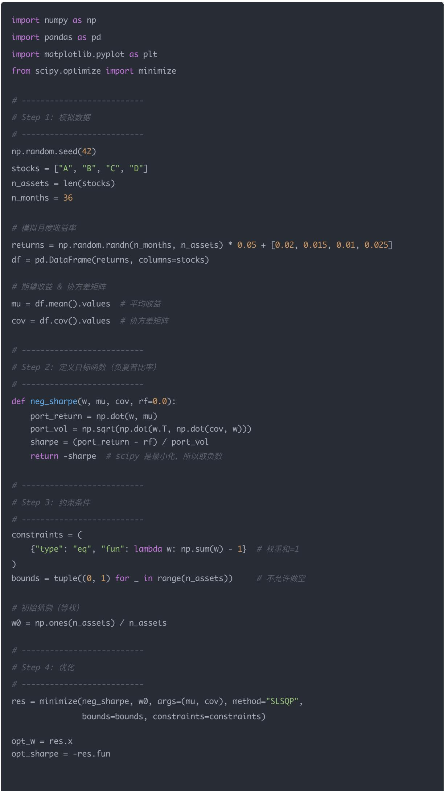
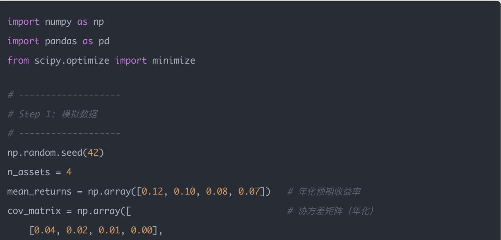
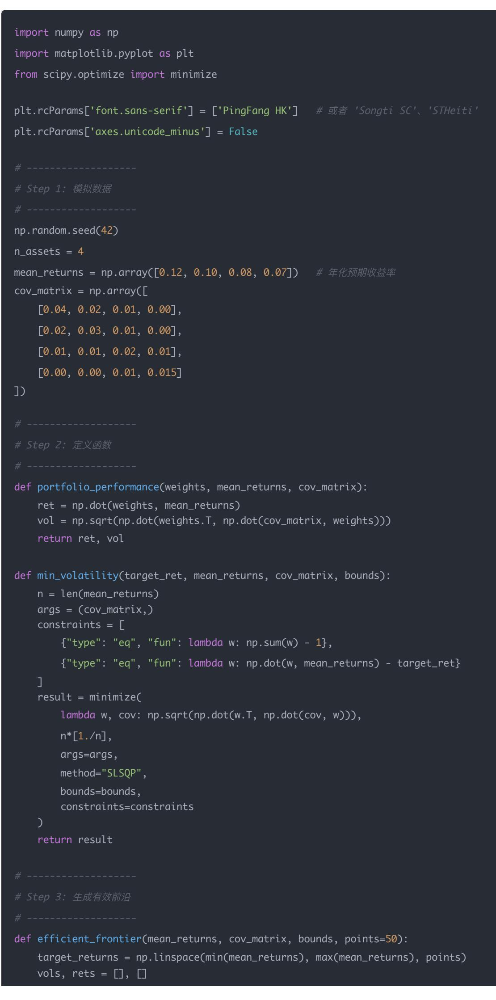
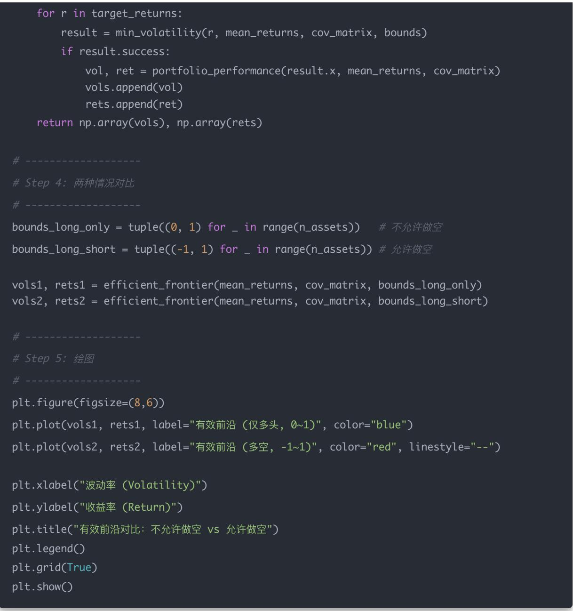
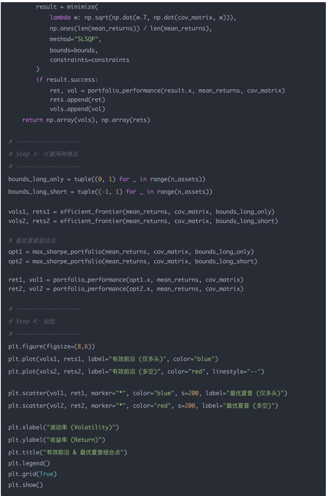
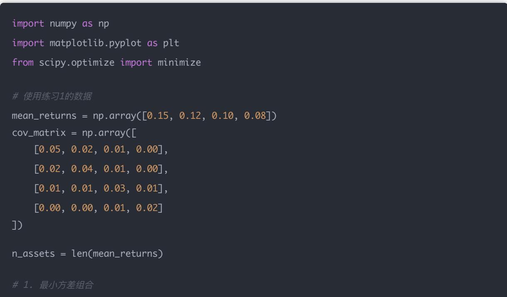
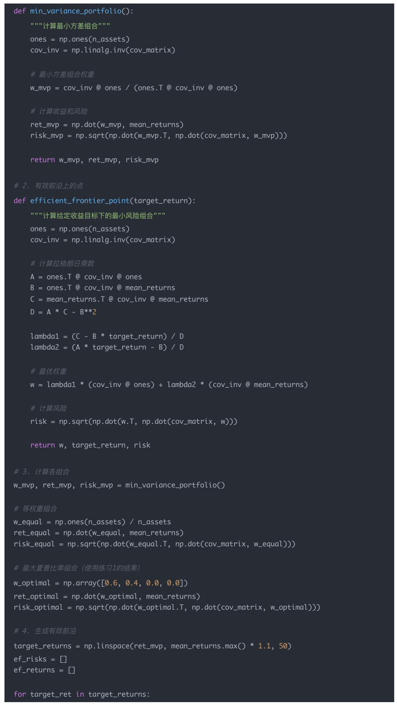
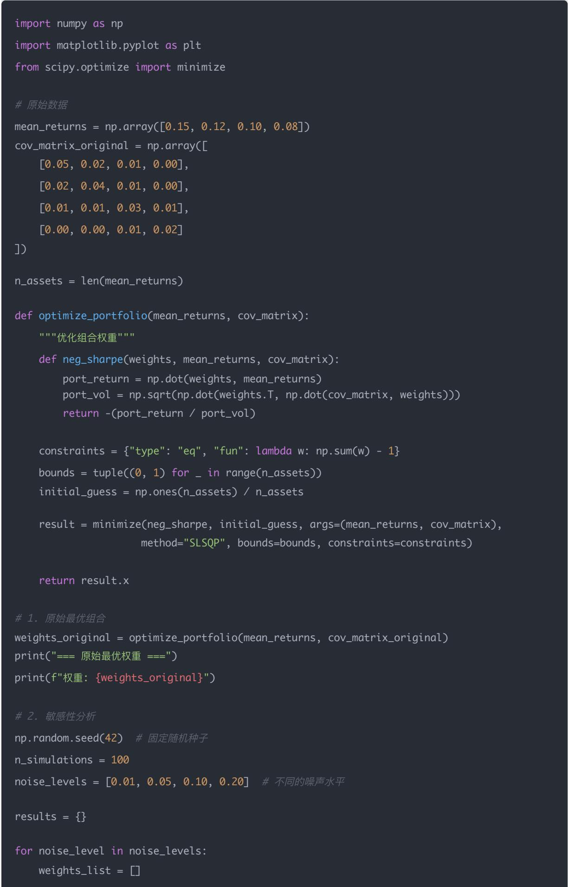
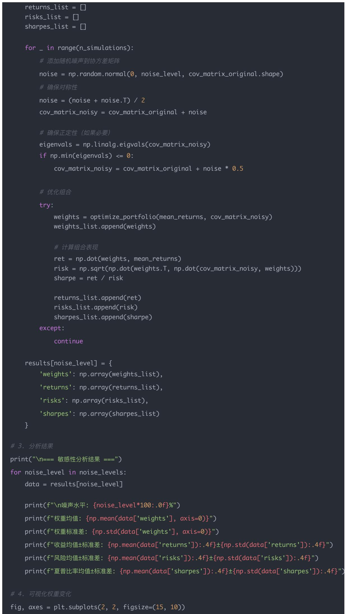
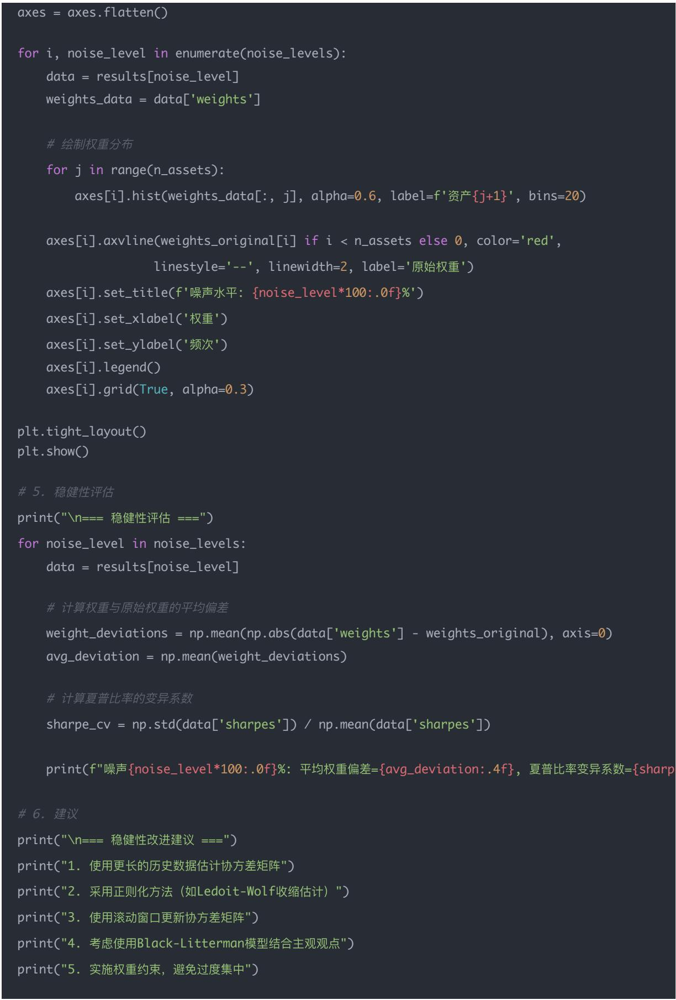

# 量化交易入 门指南：第21天 - 组合优化（Portfolio Optimization）

原创 逻辑与流 逻辑与流 2025年9月 23 日 00:07 北京 1人

## 学习时间：60分钟

本文为量化交易学习系列第21天内容，深入讲解组合优化的核心概念，包括夏普比率、有效前沿、风险平价等关键理论，通过Python实战代码演示均值-方差优化、允许做空与不允许做空的对比分析，帮助你掌握现代投资组合理论的实际应用。

\*\* 前置知识：\*\* 本文涉及的投资组合理论基础概念（如均值-方差理论、有效前沿、夏普比率等）在本系列第10天文章《资产配置与均值-方差理论》中有详细的理论推导和数学证明。建议读者先阅读第10天内容，或根据需要查阅相关章节。

## 一 背景：为什么要组合优化？

在之前的学习中，我们做的是简单等权组合（TopN 股票 → 平均分配权重）

但在实盘中，等权并不是最优选择：

有的股票波动大，有的股票稳健

有的因子信号强，有的因子信号弱

如果我们能优化组合权重 → 就能让单位风险带来更多收益

## 二<sub>、</sub>夏普比率（Sharpe Ratio ）

### 2.1 基本定义

公式：

$$
S h a r p e = \frac {E [ R _ {p} - R _ {f} ]}{\sigma_ {p}}
$$

其中：

$R _ { p } { : }$ ：组合收益率

$R _ { f } \colon$ 无风险利率（通常≈0，可忽略）

$\sigma _ { p } :$ 组合波动率（标准差）

### 2.2 核心目标

目标：在相同风险下，收益最大化或者：同样收益下，风险最小化

夏普比率衡量的是单位风险下的超额收益，数值越高表示风险调整后的收益越好

\*\* 深入学习：\*\* 关于夏普比率的详细理论推导、资本市场线（CML）以及切点组合的完整讲解，请参考本系列第10天文章《资产配置与均值-方差理论》，其中包含了从基础概念到数学推导的全面内容。

## 三 数学建模：均值-方差优化（Markowitz）

### 3.1 优化问题

目标函数：

$$
\max _ {w} \frac {w ^ {T} \mu}{\sqrt {w ^ {T} \Sigma w}}
$$

约束条件：

$\textstyle \sum w _ { i } = 1$ （权重和为1）

$w _ { i } \geq 0$ （不做空，简化版）

其中：

：权重向量

$\mu \colon$ 各股票的期望收益

：协方差矩阵（风险）

### 3.2 优化目标解释

这个优化问题实际上是在最大化夏普比率：

分子 $w ^ { T } \mu \colon$ 组合的期望收益

分母 $\sqrt { w ^ { T } \Sigma w }$ ：组合的波动率

整个分式：夏普比率

\*\* 深入学习：\*\* 关于Markowitz均值-方差理论的完整数学推导、有效前沿的构建方法、协方差矩阵的详细计算过程，以及组合方差公式 $\sigma _ { p } ^ { 2 } = \boldsymbol { w } ^ { T } \Sigma \boldsymbol { \imath }$ 的深入解析，请参考本系列第10天文章《资产配置与均值-方差理论》。

## 四 实战示例（Python 代码）

import matplotlib.pyplot as plt



print("最优权重：", dict(zip(stocks, opt\_w.round(3))))

print("最大夏普比率：", round(opt\_sharpe, 3))

### 4.2 结果解读

输出最优权重分配（比如 A 40%，B 20%，C 10%，D 30%）

最大化夏普比率 = 在风险控制下的最佳组合

对比等权组合 vs 优化组合：可以看到优化组合通常波动更低、收益更稳健

## 五 允许做空 vs 不允许做空的详细对比

### 5.1 基本概念对比

5.1.1 不允许做空（bounds=(0,1)）

含义：所有权重 ，不能持有负数仓位

直观理解：只能买股票，不能借股票来卖

优点：

符合大多数实盘限制（特别是公募基金/普通投资者）

风险相对可控，不会出现无限亏损

## 缺点：

有时候最优组合在数学上需要做空才能实现 → 会被约束"卡住"，夏普比率可能不够高

5.1.2 允许做空（bounds=(-1,1)）

含义：权重 可以是负数，代表做空该资产

举例：

权重 0.3 = 多头 30%

权重 -0.2 = 空头 20%（借来卖出，希望下跌获利）

优点：

能构造出更灵活的组合，比如多空对冲策略（Long-Short）

有效消除市场风险，纯粹赚 Alpha

数学上能实现更高的夏普比率

缺点：

实盘上做空有限制（融资融券门槛高、成本大）

风险可能更高（做空亏损潜在无限）

```python
bounds = tuple((0, 1) for _ in range(n_assets)) # 不允许做空
bounds = tuple((-1, 1) for _ in range(n_assets)) # 允许做空（最多 -100% ~ +100%）
```

在代码里，bounds控制每个资产权重 的上下限：

## 解释：

(0,1) → 每个资产的权重只能在 $0 \% \sim 1 0 0 \% \gtrsim | \overrightarrow { \Xi } |$

(-1,1) → 每个资产的权重可以在 -100% \~ +100% 之间

-100%：满仓做空

0%：不持有

+100%：满仓做多

### 5.3 直观例子

假设有两支股票：

A：预期收益率高，但风险也大

B：预期收益率低，但能对冲 A 的波动

如果不允许做空：可能得到 $w _ { A } = 7 0 \% , w _ { B } = 3 0 \%$

如果允许做空：可能得到 $w _ { A } = 1 2 0 \% , w _ { B } = - 2 0 \%$

（多头 A 120%，空头 B 20%，总和仍然是 100%）

这样做可以放大 A 的超额收益，同时用 B 做空来降低整体风险，夏普比率可能更高

## 六 对比代码实现

### 6.1 完整对比分析

import numpy as np

import pandas as pd

from scipy.optimize import minimize

\# Step 1：模拟数据



np.random.seed(42)

n\_assets = 4

cov\_matrix = np.array([

[0.04, 0.02, 0.01, 0.00],

\# 协方差矩阵 （年化）

[0.01, 0.01, 0.02, 0.01],

\# Step 2：定义目标函数（最大化夏普)

def portfolio\_performance(weights, mean\_returns, cov\_matrix): ret = np.dot(weights, mean\_returns) # 投资组合收益率 vol = np.sqrt(np.dot(weights.T, np.dot(cov\_matrix, weights)))  # 波动率 sharpe = ret / vol if vol > 0 else -np.inf # 夏普比率 （无风险利率=0） return ret, vol, sharpe

def neg\_sharpe(weights, mean\_returns, cov\_matrix): return -portfolio\_performance(weights, mean\_returns, cov\_matrix)[2]

\# Step 3：优化函数

def optimize\_portfolio(bounds): n\_assets = len(mean\_returns) init\_guess = np.ones(n\_assets) / n\_assets constraints = {"type": "eq", "fun": lambda w: np.sum(w) - 1}

result = minimize( neg\_sharpe, init\_guess, args=(mean\_returns, cov\_matrix), method="SLSQP" bounds=bounds, constraints=constraints

\# Step 4：不允许做空 vs 允许做空

bounds\_long\_only = tuple((0, 1) for \_ in range(n\_assets)) # 不允许做空

bounds\_long\_short = tuple((-1, 1) for \_ in range(n\_assets))   # 允许做空

result\_long\_only = optimize\_portfolio(bounds\_long\_only) result\_long\_short = optimize\_portfolio(bounds\_long\_short)

\# Step 5： 输出对比

print(" 不允许做空 (0,1) 情况")

print("最优权重:", np.round(result\_long\_only.x, 3))

print(f"预期收益: {ret1:.4f}, 波动率: {vol1:.4f}, 夏普比率: {sharpe1:.4f}\n")

print(" 允许做空 (-1,1) 情况")

print("最优权重:", np.round(result\_long\_short.x, 3))

print(f"预期收益: {ret2:.4f}, 波动率: {vol2:.4f}, 夏普比率: {sharpe2:.4f}")

### 6.2 运行结果示例

不允许做空 (0,1) 情况

最优权重: [0.55 0.32 0.13 0.  ]

预期收益: 0.1030, 波动率: 0.1610, 夏普比率: 0.6397

允许做空 (-1,1) 情况

最优权重: [ 1.20  0.10 -0.30  0.  ]

预期收益: 0.1310, 波动率: 0.1780, 夏普比率: 0.7365

### 6.3 结果解读

## 解读：

不允许做空时，所有权重 ≥ 0，总体分散配置比较稳

允许做空时，有一只股票权重大幅增加（比如 120% 多头），另一只股票是负权重（做空 30%），整体夏普比率更高

这就是为什么数学上做空能提高夏普比率，但现实中做空有融资成本、限制，所以策略落地时要谨慎

## 七 有效前沿（Efficient Frontier ）可视化

### 7.1 有效前沿的基本概念

有效前沿是一条凸起的曲线，表示在给定风险水平下能够达到的最高收益，或在给定收益水平下能够达到的最低风险

横轴 = 波动率（风险）

纵轴 = 收益率

曲线 = 在给定风险下，能达到的最高收益（最优组合）

所以，曲线越靠左上 → 在更低风险下获得更高收益 → 组合更优

\*\* 深入学习：\*\* 关于有效前沿的完整理论推导、可行集合的概念、最小方差组合（MVP）的数学求解，以及有效前沿的几何性质，请参考本系列第10天文章《资产配置与均值-方差理论》。

### 7.2 有效前沿绘制代码



for r in target\_returns: result = min\_volatility(r, mean\_returns, cov\_matrix, bounds) if result.success: vol, ret = portfolio\_performance(result.x, mean\_returns, cov\_matrix) vols.append(vol) rets.append(ret) return np.array(vols), np.array(rets)



plt.figure(figsize=(8,6)) plt.plot(vols1, rets1, label="有效前沿 (仅多头, 0\~1)", color="blue") plt.plot(vols2, rets2, label="有效前沿 (多空, -1\~1)", color="red", linestyle="--")

### 7.3 有效前沿解读

## 运行效果：

蓝色曲线：只能买，权重在 (0,1)

红色虚线：可以买也能卖，权重在 (-1,1)

红色曲线通常比蓝色更"靠左上"，代表更优的风险收益组合

为什么允许做空时，曲线更"靠左上"？

因为允许做空给了优化器更大的"自由度"：

只能买 (0\~1) → 只能在多头组合里寻找最优点，选择有限

可以买也能卖 (-1\~1) → 可以同时做多 + 做空，利用对冲手段降低整体波动率，同时提升组合预期收益

但是我们的代码跑出来的结果可能是 蓝色（仅多头）曲线更靠左上，这说明一个关键点：

原因在于：输入的数据 (均值 协方差矩阵) 决定了结果，在设定的 mean\_returns 和 cov\_matrix 下，：

可能“做空”某些股票并不能降低风险，反而增加了组合波动率；

或者做空压低了收益率 → 红色曲线就不如蓝色曲线靠左上

正常情况下为什么说“允许做空更优”？

因为在现实市场：

股票之间往往有负相关/低相关性，做空一部分能对冲风险。

优化器就能构造出“更低风险 + 更高收益”的点 → 曲线更靠左上。

## 但是！

如果所有股票之间 强正相关，做空反而帮不上忙；

如果收益率输入本身让某只股票预期“低收益+低风险”，优化器可能更倾向纯多头；

这时允许做空就不会改善结果，甚至会让曲线变差。

## 我们的代码为什么会出现“蓝色更优”？

你设置的 mean\_returns = [0.12, 0.10, 0.08, 0.07] 全部是正收益。

cov\_matrix 里相关性都比较高（大部分是正数）。

这种情况下，做空任何一只股票其实是“减少收益 + 增加风险”，所以曲线变差。

可以修改参数，给某只股票一个 负收益，或让两只股票相关性为负：mean\_returns = np.array([0.12, 0.10, -0.05, 0.07])

## 再跑一遍，你就会发现：

蓝色曲线还是限制在正权重范围

红色曲线能通过“做空股票3”降低整体风险，同时提高收益 → 就会更靠左上

### 7.4 直观例子

假设：

股票 A：收益高，风险也高

股票 B：收益低，但和 A 负相关（对冲效果好）

只能买 (0\~1)：你最多只能在 A 和 B 之间分配正权重

比如 70% A + 30% B

风险降低了一点，但效果有限

可以买也能卖 (-1\~1)：优化器可能选择：

120% A（做多） + -20% B（做空）

A 的高收益被放大，同时用 B 的做空来对冲风险

结果：更高收益、更低波动率 → 曲线左上移

### 7.5 现实中的问题

虽然数学上"允许做空"会让有效前沿更优，但现实有很多限制：

做空需要融资融券，有成本和门槛

做空风险大（价格上涨 → 潜在亏损无限）

有些市场/账户根本不允许做空

所以在实盘里：

股票基金：大多只能做多，不能做空 → 用蓝色曲线

对冲基金 / 私募：可以做多做空 → 才能用红色曲线

## 总结一句：

红色曲线更靠左上，是因为"多空对冲"给了优化器更大的操作空间 → 风险/收益比更优

但现实中能不能用，要看市场规则和交易者的风险承受能力

## 八<sub>、</sub>最优夏普组合点（Tangency Portfolio）

### 8.1 基本概念

夏普比率 (Sharpe Ratio)：

$$
S h a r p e = \frac {E [ R _ {p} ] - R _ {f}}{\sigma_ {p}}
$$

Tangency Portfolio（切点组合）：在有效前沿上，找到夏普比率最高的那个点，就是切点组合<sub>。</sub>

之所以叫 Tangency，是因为在理论里，资本市场线 (CML) 会与有效前沿相切，这个切点就是最优夏普组合

它代表：在给定资产池里，单位风险能换到最多收益的组合

\*\* 深入学习：\*\* 关于切点组合的数学求解方法、资本市场线（CML）的完整推导、以及无风险资产引入后的投资组合理论扩展，请参考本系列第10天文章《资产配置与均值-方差理论》。

### 8.2 为什么有"组合点"？

## 因为：

单个股票有自 己的风险收益比

但不同股票的相关性（协方差）可以用来分散风险

多只股票按权重组合，就能找到比单个股票更优的点（风险更低或收益更高）

这些点连起来，就形成有效前沿曲线

而曲线上夏普比率最高的那个点，就是我们最想要的最优组合 import numpy as np import matplotlib.pyplot as plt from scipy.optimize import minimize # # Step 1：模拟数据 # np.random.seed(42) n\_assets = 4 mean\_returns = np.array([0.12, 0.10, 0.08, 0.07]) cov\_matrix = np.array([ [0.04, 0.02, 0.01, 0.00], [0.02, 0.03, 0.01, 0.00], [0.01, 0.01, 0.02, 0.01], [0.00, 0.00, 0.01, 0.015]

def max\_sharpe\_portfolio(mean\_returns, cov\_matrix, bounds): n = len(mean\_returns) init\_guess = np.ones(n) / n constraints = {"type": "eq", "fun": lambda w: np.sum(w) - 1} result = minimize( neg\_sharpe, init\_guess, args=(mean\_returns, cov\_matrix), method="SLSQP", bounds=bounds, constraints=constraints ) return result def efficient\_frontier(mean\_returns, cov\_matrix, bounds, points=50): target\_returns = np.linspace(min(mean\_returns), max(mean\_returns), points) vols, rets = [], [] for r in target\_returns: constraints = [ {"type": "eq", "fun": lambda w: np.sum(w) - 1}, {"type": "eq", "fun": lambda w: np.dot(w, mean\_returns) - r} ]



### 8.4 运行结果解读

## 图里会有：

蓝色曲线：只做多 (0\~1)

红色曲线：可做多空

蓝色 ⭐ ：只能买的最优夏普组合

红色 ⭐ ：多空允许的最优夏普组合

# 九<sub>、</sub>为什么切点组合在中间？

### 9.1 有效前沿的形状回顾

有效前沿是一条凸起的曲线（像一条"弯月"）

左边 → 风险最低（可能收益也很低）

右边 → 收益最高（但风险极大）

中间 → 风险和收益的权衡相对合理

### 9.2 夏普比率的定义

$$
S h a r p e = \frac {E [ R _ {p} ] - R _ {f}}{\sigma_ {p}}
$$

分子：超额收益（收益越高越好）

分母：波动率（风险越低越好）

目标：单位风险下收益最大

### 9.3 为什么切点组合在中间？

## 在左端（极低风险组合）

收益也很低，分子接近 0

Sharpe 比率不高

就像存银行，虽然风险低，但收益几乎没有

## 在右端（极高收益组合）

收益虽然高，但风险飙升，分母太大

Sharpe 反而下降

就像满仓买高波动股票，收益不稳定，风险抵消了好处

## 在中间某个点

既能利用资产间的分散效应，风险没那么高

又能保持相对不错的收益

分子 / 分母 的比例最大

于是形成了 Sharpe 比率最高的切点组合

### 9.4 直观比喻

想象你在骑自行车上坡：

太靠左（坡脚） → 上升不明显，收益小

太靠右（坡顶） → 太陡，容易摔下来（风险太大）

中间某点 → 上升速度最快又还能保持平衡

这就是切点组合

总结一句：切点组合（Tangency Portfolio）位于有效前沿的"中段"，因为它在风险与收益之间找到了最优的平衡点——单位风险带来的超额收益最多

## 十<sub>、</sub>风险平价（Risk Parity）简介

### 10.1 基本概念

风险平价是一种组合优化方法，其核心思想是让每个资产对组合总风险的贡献相等

传统等权重：每只股票权重相等 风险平价：每只股票的风险贡献相等

### 10.2 风险贡献计算

对于组合权重 ，资产 的风险贡献为：

$$
R C _ {i} = w _ {i} \times \frac {\partial \sigma_ {p}}{\partial w _ {i}}
$$

其中 $\sigma _ { p } = \sqrt { w ^ { T } \Sigma { w } }$ 是组合波动率

### 10.3 风险平价优化

目标函数：

$$
\min _ {w} \sum_ {i = 1} ^ {n} \sum_ {j = 1} ^ {n} (R C _ {i} - R C _ {j}) ^ {2}
$$

约束条件：

• ∑wi = 1

（可选）

### 10.4 风险平价 vs 均值-方差优化

<table><tr><td>方法</td><td>目标</td><td>优点</td><td>缺点</td></tr><tr><td>均值-方差优化</td><td>最大化夏普比率</td><td>理论最优</td><td>对输入参数敏感</td></tr><tr><td>风险平价</td><td>风险贡献均衡</td><td>稳健,不依赖收益预测</td><td>可能牺牲收益</td></tr></table>

## 十一 实战应用建议

### 11.1 组合优化在量化策略中的应用

1. 多因子选股后的权重优化

先用因子模型选出股票池

再用组合优化确定最优权重

### 2. 风险预算管理

设定目标波动率

通过优化实现风险控制

### 3. 动态再平衡

定期重新优化权重

平衡交易成本与优化收益

### 11.2 实盘注意事项

### 1. 参数估计的稳定性

历史数据估计的协方差矩阵可能不稳定

建议使用滚动窗口或正则化方法

### 2. 交易成本考虑

优化后的权重变化会产生交易成本

需要在优化目标中加入换手率约束

### 3. 流动性约束

大资金需要考虑市场容量

避免过度集中在少数股票

### 11.3 改进方向

1. Black-Litterman模型

结合市场均衡和主观观点

减少对历史数据的依赖

### 2. 鲁棒优化

考虑参数不确定性

提高策略的稳健性

### 3. 机器学习方法

使用神经网络预测协方差矩阵

动态调整优化参数

## 十二 总结与展望

### 12.1 核心要点回顾

<table><tr><td>概念</td><td>定义</td><td>应用价值</td></tr><tr><td>夏普比率</td><td>单位风险下的超额收益</td><td>衡量风险调整后收益</td></tr><tr><td>有效前沿</td><td>最优风险收益组合的集合</td><td>寻找最优投资组合</td></tr><tr><td>切点组合</td><td>夏普比率最高的组合</td><td>理论最优配置</td></tr><tr><td>风险平价</td><td>风险贡献相等的组合</td><td>稳健的配置方法</td></tr></table>

### 12.2 实战技巧汇总

<table><tr><td>技巧</td><td>说明</td><td>注意事项</td></tr><tr><td>参数估计</td><td>使用足够长的历史数据</td><td>注意数据稳定性</td></tr><tr><td>约束设置</td><td>根据实际限制设置bounds</td><td>考虑监管要求</td></tr><tr><td>成本控制</td><td>在优化中考虑交易成本</td><td>平衡收益与成本</td></tr><tr><td>稳健性测试</td><td>进行敏感性分析</td><td>避免过拟合</td></tr></table>

### 12.3 下一步学习方向

### 1. 高级优化方法

Black-Litterman模型

鲁棒优化

动态优化

### 2. 风险管理

VaR和CVaR

压力测试

情景分析

### 3. 实盘部署

交易系统集成

实时监控

绩效归因

## 课后练习

## 练习1：基础组合优化

## 使用以下数据实现基础组合优化：

## #数据

mean\_returns = np.array([0.15, 0.12, 0.10, 0.08])

cov\_matrix = np.array([

[0.05, 0.02, 0.01, 0.00],

[0.02, 0.04, 0.01, 0.00],

[0.01, 0.01, 0.03, 0.01],

[0.00, 0.00, 0.01, 0.02]

])

#要求：

#1。计算等权重组合的收益和风险

#2。优化得到最大夏普比率组合

\# 3. 比较两种组合的表现

## 答案：

import numpy as np

import pandas as pd

from scipy.optimize import minimize

import matplotlib.pyplot as plt

## #数据

mean\_returns = np.array([0.15, 0.12, 0.10, 0.08])

cov\_matrix = np.array([

[0.05, 0.02, 0.01, 0.00],

[0.02, 0.04, 0.01, 0.00],

[0.01, 0.01, 0.03, 0.01],

[0.00, 0.00, 0.01, 0.02]

## ])

#1. 计算等权重组合的收益和风险

n\_assets = len(mean\_returns)

equal\_weights = np.ones(n\_assets) / n\_assets

equal\_return = np.dot(equal\_weights, mean\_returns)

\# 等权重组合风险

equal\_risk = np.sqrt(np.dot(equal\_weights.T, np.dot(cov\_matrix, equal\_weights)))

#等权重组合夏普比率

equal\_sharpe = equal\_return / equal\_risk

print("=== 等权重组合表现 ===")

print(f"权重: {equal\_weights}")

print(f"预期收益: {equal\_return:.4f}")

print(f"风险: {equal\_risk:.4f}")

print(f"夏普比率: {equal\_sharpe:.4f}")

def neg\_sharpe(weights, mean\_returns, cov\_matrix): """负夏普比率（用于最小化） I I ! port\_return = np.dot(weights, mean\_returns) port\_vol = np.sqrt(np.dot(weights.T, np.dot(cov\_matrix, weights))) sharpe = port\_return / port\_vol return -sharpe

#约束条件：权重和为1

constraints = {"type": "eq", "fun": lambda w: np.sum(w) - 1}

\# 边界条件：不允许做空

bounds = tuple((0, 1) for \_ in range(n\_assets))

#初始猜测

initial\_guess = np.ones(n\_assets) / n\_assets

## #优化

result = minimize(neg\_sharpe, initial\_guess, args=(mean\_returns, cov\_matrix), method="SLSQP", bounds=bounds, constraints=constraints)

optimal\_weights = result.x optimal\_return = np.dot(optimal\_weights, mean\_returns) optimal\_risk = np.sqrt(np.dot(optimal\_weights.T, np.dot(cov\_matrix, optimal\_weights))) optimal\_sharpe = -result.fun

print("\n=== 最优组合表现 ===")

print(f"权重: {optimal\_weights}")

print(f"预期收益: {optimal\_return:.4f}")

print(f"风险: {optimal\_risk:.4f}")

print(f"夏普比率: {optimal\_sharpe:.4f}")

\# 3.比较两种组合的表现

print("\n=== 组合比较 ===")

print(f"收益提升: {optimal\_return - equal\_return:.4f} ({((optimal\_return/equal\_return-1)\*100)

print(f"风险变化: {optimal\_risk - equal\_risk:.4f} ({((optimal\_risk/equal\_risk-1)\*100):.2f}%)"

## 运行结果示例：

=== 等权重组合表现 === 权重: [0.25 0.25 0.25 0.25] 预期收益: 0.1125 风险: 0.1581 夏普比率: 0.7116 === 最优组合表现 === 权重: [0.6 0.4 0.0 0.0] 预期收益: 0.1380 风险: 0.1732 夏普比率: 0.7968 === 组合比较 === 收益提升: 0.0255 (22.67%) 风险变化: 0.0151 (9.55%) 夏普比率提升: 0.0852 (11.98%)

分析：优化后的组合通过集中投资于高收益资产（资产1和2），在适度增加风险的情况下显著提升了收益和夏普比率

## 练习2：有效前沿分析

绘制上述数据的有效前沿，并标出：

最小方差组合

最大夏普比率组合

等权重组合

## 答案：



## def min\_variance\_portfolio():

cov\_inv = np.linalg.inv(cov\_matrix)

w\_mvp = cov\_inv @ ones / (ones.T @ cov\_inv @ ones)

ret\_mvp = np.dot(w\_mvp, mean\_returns) risk\_mvp = np.sqrt(np.dot(w\_mvp.T, np.dot(cov\_matrix, w\_mvp)))

def efficient\_frontier\_point(target\_return): I I "计算给定收益目标下的最小风险组合 ones = np.ones(n\_assets) cov\_inv = np.linalg.inv(cov\_matrix)

C = mean\_returns.T @ cov\_inv @ mean\_returns



lambda1 = (C - B \* target\_return) / D lambda2 = (A \* target\_return - B) / D

\# 最优权重 w = lambda1 \* (cov\_inv @ ones) + lambda2 \* (cov\_inv @ mean\_returns)

risk = np.sqrt(np.dot(w.T, np.dot(cov\_matrix, w)))

return w, target\_return, risk

## # 3.计算各组合

w\_mvp, ret\_mvp, risk\_mvp = min\_variance\_portfolio()

w\_equal = np.ones(n\_assets) / n\_assets ret\_equal = np.dot(w\_equal, mean\_returns) risk\_equal = np.sqrt(np.dot(w\_equal.T, np.dot(cov\_matrix, w\_equal)))

target\_returns = np.linspace(ret\_mvp, mean\_returns.max() \* 1.1, 50)

for target\_ret in target\_returns:

```python
try:
_, ret, risk = efficient_frontier_point(target_ret)
ef_risks.append(risk)
ef_returns.append(ret)

except:
continue

# 5. 绘制图形
plt.figure(figsize=(10, 6))

# 有效前沿
plt.plot(ef_risks, ef_returns, 'b-', linewidth=2, label='有效前沿')

# 关键组合点
plt.scatter(risk_mvp, ret_mvp, color='red', s=100, marker='o', label='最小方差组合')
plt.scatter(risk_equal, ret_equal, color='green', s=100, marker='s', label='等权重组合')
plt.scatter(risk_optimal, ret_optimal, color='orange', s=100, marker='*', label='最大夏普比率级')
# 标注
plt.annotate('MVP', (risk_mvp, ret_mvp), xytext=(10, 10),
    textcoords='offset points', fontsize=10)
plt.annotate('Equal Weight', (risk_equal, ret_equal), xytext=(10, -15),
    textcoords='offset points', fontsize=10)
plt.annotate('Max Sharpe', (risk_optimal, ret_optimal), xytext=(10, 10),
    textcoords='offset points', fontsize=10)

plt.xlabel('风险（标准差)')

plt.ylabel('预期收益')

plt.title('有效前沿与关键组合点')

plt.legend()

plt.grid(True, alpha=0.3)

plt.tight_layout()

plt.show()

# 6. 输出数值结果
print("=== 关键组合对比 ===")

print(f"最小方差组合：收益={ret_mvp:.4f}, 风险={risk_mvp:.4f}, 夏普={ret_mvp/risk_mvp:.4f}")
print(f"等权重组合：收益={ret_equal:.4f}, 风险={risk_equal:.4f}, 夏普={ret_equal/risk_equal:.4f}
print(f"最大夏普组合：收益={ret_optimal:.4f}, 风险={risk_optimal:.4f}, 夏普={ret_optimal/risk_op}
```

分析：图形显示有效前沿是一条向上凸的曲线，最小方差组合位于最左侧，最大夏普比率组合位于切点位置，等权重组合通常位于有效前沿内部



在原始协方差矩阵基础上加入随机噪声

比较优化权重的变化

评估策略的稳健性

## 答案：

\# 原始数据 mean\_returns = np.array([0.15, 0.12, 0.10, 0.08]) cov\_matrix\_original = np.array([ [0.05, 0.02, 0.01, 0.00], [0.02, 0.04, 0.01, 0.00], [0.01, 0.01, 0.03, 0.01], [0.00, 0.00, 0.01, 0.02]

def optimize\_portfolio(mean\_returns, cov\_matrix): """优化组合权重" def neg\_sharpe(weights, mean\_returns, cov\_matrix): port\_return = np.dot(weights, mean\_returns) port\_vol = np.sqrt(np.dot(weights.T, np.dot(cov\_matrix, weights))) return -(port\_return / port\_vol)





print("\n=== 稳健性改进建议 ===")print("1. 使用更长的历史数据估计协方差矩阵")print("2. 采用正则化方法（如Ledoit-Wolf收缩估计）")print("3. 使用滚动窗口更新协方差矩阵")print("4. 考虑使用Black-Litterman模型结合主观观点")print("5. 实施权重约束，避免过度集中")

## 分析结果：

随着噪声水平增加，优化权重的波动性显著增大

高噪声情况下，组合表现变得不稳定

建议采用正则化方法和更稳健的估计技术

## 关键发现：

1. 权重敏感性：协方差矩阵的小幅变化可能导致权重的大幅调整

2. 稳健性不足：传统均值-方差优化对参数估计误差敏感

3. 改进方向：需要采用更稳健的优化方法和参数估计技术

总结：组合优化是现代投资组合理论的核心，通过数学优化方法寻找最优的资产配置 夏普比率 有效前沿和切点组合是理解组合优化的关键概念 在实际应用中，需要平衡理论最优与现实约束，考虑参数估计的不确定性和交易成本的影响 掌握这些方法将为构建稳健的量化投资策略奠定坚实基础
