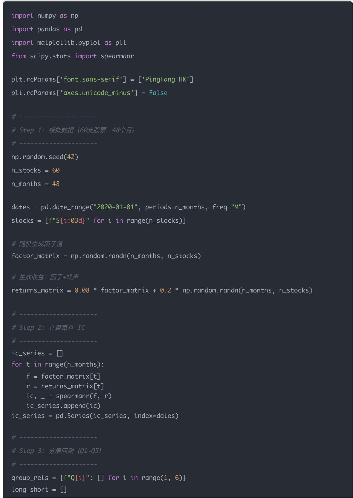
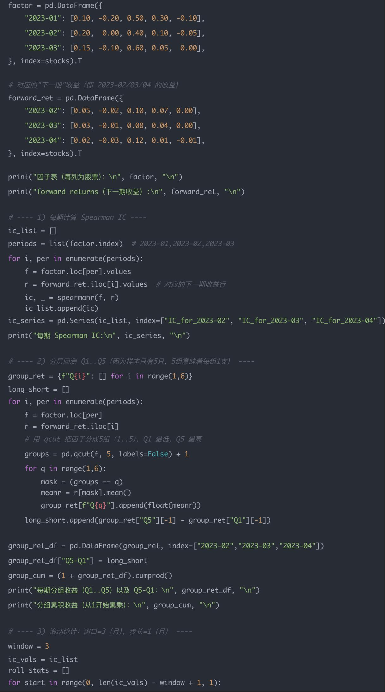
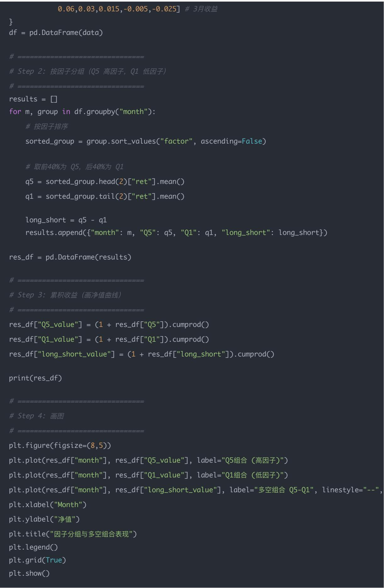

## 量化交易入门指南：第23天－多期分层回测 & 多空组合

原创 逻辑与流 逻辑与流 2025年9月25日 00:56 北京 📄3人

本文深入探讨了量化因子研究中的多期分层回测方法，从单期横截面回测扩展到多期时间序列回测。文章详细介绍了IC时间序列分析、分层回测、滚动统计等核心概念，通过具体的手算示例和Python代码实现，帮助读者掌握因子多期验证的完整流程。同时深入讲解了多空组合的构建原理和评估方法，为量化因子研究提供实用的技术指导。

## 学习时间

- 理论学习: 20分钟

- 代码实践: 25分钟

- 思考总结: 10分钟

- 总计: 55分钟

## 一、单期 vs 多期回测

在之前的因子研究中，我们大多只做了单期横截面回测：

- 当期因子值 $\rightarrow$ 下一期收益

- 用IC/分组回测来判断因子有效性

但是实盘需要更稳健的检验，所以我们要做多期回测：

- 连续滚动测试（跨多个时期）

- 看因子在长期下是否稳定有效

## 1 为什么称作「横截面」？

横截面（Cross-section）在统计学/计量经济学里，指的是同一时间点下，不同个体的数据集合。

- 横截面数据：同一个时点，不同股票的因子值

- 例子：2023年1月末，沪深300里所有股票的PE、ROE、动量等

- 时间序列数据：同一只股票，在不同时间上的数据

- 例子：平安银行（000001）从2015–2023年的ROE变化

我们在因子检验里做的，就是一个横截面回归/相关分析：

- 拿某一期（比如1月末）所有股票的因子值（横截面）

- 对比它们在下一期收益上的差异

所以称为横截面回测/横截面检验。

这就是因子研究的基本逻辑：

- 因子值=预测信号，未来收益=被预测对象

- 因子（预测变量）：我们能观测的，比如1月末的PE、ROE、动量

- 未来收益（被解释变量）：我们想预测的，比如2月的股票涨跌

## 举例

假设我们要研究「低 PE 因子」:

- 1月末：计算所有股票的PE值

- 根据这些PE值排序，分成高/低组

- 看2月的实际收益表现：是不是低PE组（价值股）平均收益更高？

如果成立 $\rightarrow$ 说明这个因子有预测力。

## 3 为什么不是用「1月的收益」来验证 1月末的因子？

因为因子要发挥作用，必须先观测到因子，再预测未来的回报。

如果你用1月的因子预测1月的收益，那就会偷看未来（look-ahead bias），失去了预测意义。

## 正确逻辑：

- 因子值时点：月末、季末、财报发布日等（当下已知）

- 收益检验窗口：下一期（月、季度），确保因子先于收益发生

## 4 一句话总结

- 称作「横截面」，因为我们在某个时点对所有股票做截面比较

- 用「1月末因子 $\rightarrow$ 2月收益」，是为了保证因子作为预测变量，避免偷看未来

## 二、多期回测（time-series rolling test）

## 思路：

- 把单期检验扩展到多个时期，形成一个"时间序列"

- 每期都做一次横截面检验，得到一串IC或分层收益

- 最终看长期平均表现 + 稳定性

## 常见做法：

### 1. IC 时间序列

- 每个月计算一次因子IC，得到一个时间序列

- 看它的均值（有效性）和标准差（稳定性）

### 2. 分层回测时间序列

- 每个月把股票分成 Q1\~Q5 五组，分别计算收益

- 把所有月份累积起来，看长期 $Q5 > Q1$ 吗？Q5-Q1曲线是否长期向上？

### 3. 滚动统计 (Rolling)

- 比如用过去36个月作为一个"窗口"，每次向前滑动6个月

- 看在不同窗口下，因子表现是否稳健（是否总是 $\mathrm{IC} > 0$ ，还是经常翻负）

## 三、为什么要多期回测？

### 1. 避免"过拟合"

- 单期可能是"幸运的噪音"

- 多期检验能确认因子是长期有效，而不是一次性的

### 2. 适应市场风格切换

- 牛市可能"动量因子"有效，熊市可能"价值因子"有效

- 多期检验能看到因子在不同市场环境下的表现

### 3. 评估稳定性

- 单期因子 $\mathrm{IC} = 0.3$ ，可能很亮眼

- 但如果长期IC平均只有0.02，且波动很大，这个因子不适合实盘

## 四、一个小例子

假设我们做了 12 个月的因子检验：

<table><tr><td>月份</td><td>单期IC</td></tr><tr><td>1月</td><td>0.25</td></tr><tr><td>2月</td><td>-0.05</td></tr><tr><td>3月</td><td>0.18</td></tr><tr><td>4月</td><td>0.30</td></tr><tr><td>5月</td><td>-0.10</td></tr></table>

- 如果你只看1月，会觉得因子很强

- 但如果看12个月整体，发现平均 $\mathrm{IC} = 0.08$ ，波动很大 $\rightarrow$ 因子其实不稳健

这就是单期 vs 多期的区别。

## 五、完整代码实现（因子多期回测的三个方法）

现在用60支"股票"、48个月的模拟数据做演示。因子是factor\_matrix（每月每股的因子值），未来月度收益由 $0.08^{*}$ factor + 噪声生成（所以在模拟里因子是"有用的"）。然后做了三个检验并画图：

1. IC 时间序列—每个月计算一次 Spearman IC（因子值 vs 当月的下一期收益），得到 IC 的时间序列并画图 (Plot 1)

2. 分层回测时间序列（Q1\~Q5）—每个月把股票按因子值分成5组（Q1最低，Q5最高），计算每组的当月（forward）平均收益，然后累计得到各组的累积收益曲线，并画出Q5-Q1多空曲线（Plot 2）

3. 滚动统计（window=36 个月，step=6 个月）—用过去 36 个月作为一个"窗口"、每隔 6 个月滚动一次，计算每个窗口的 IC 平均、IC 标准差、IR（IC\_mean/IC\_std）以及该窗口内 IC>0 的比例（Plot 3，和表格）

## 图表解读

图 1 — IC 时间序列（每月 Spearman IC）

- 横轴：时间（月）

- 纵轴：IC 值（秩相关）

- 有两条参考线：IC的历史均值（虚线）和0（黑色虚线）

## 如何解读：

- 如果IC大多数时间在0之上，说明因子倾向于正向预测未来收益（好）

- 看波动性：IC很波动说明不稳定；IC较稳定且均值明显大于0，说明稳定的预测能力

- 例子（模拟结果）中：IC整体在正区间，而且平均值比较明显（因为模拟里我让因子有Signal）

图 2 — 分层回测累积收益（Q1\~Q5）+ 多空（Q5\~Q1）

- 每条曲线是某一分组（Q1..Q5）的累积收益（按月复利，从1开始）

- 红线是Q5-Q1（Long-Short）

## 如何解读：

- 如果 Q5（顶层）长期高于 Q1（底层），且 Q5-Q1 向上（红线长期上升），说明因子在横截面上能够把"好股（高分）"和"坏股（低分）"区分开，长期能带来超额收益

- 观察曲线平滑性：如果多空曲线上涨但很抖动，说明因子虽有Alpha但不稳定或含高波动

图 3 — 滚动统计（窗口=36 月，步长=6 月）

- 每个点是一个36个月窗口内的统计量（窗口结束时间为X轴）

- 显示滚动 IC\_mean 和 IR（IC\_mean / IC\_std）

## 如何解读：

- 通过滚动窗口你可以看到：在不同时间段（不同市场环境）因子是否持续有效

- 如果某些窗口 IC\_mean 接近 0 或为负，说明在那段时间因子失效；如果大多数窗口 IC\_mean > 0 且 IR 较高，说明稳定可靠

- 另外查看 pct\_positive\_ic（窗口内 IC 为正的比例）也很有帮助：如果该比率接近 1，说明在窗口中绝大多数月份 IC>0

## 实务中如何判定"可用"与否（经验规则）

- IC (均值):

- 非常好： $>0.05$

- 较好：0.03 \~ 0.05

- 较弱：0 \~ 0.03

- 无效/反向: $\leq 0$

- IR（信息比）= mean(IC)/std(IC):

- 强稳健： $>1.0$

- 还行： $0.5\sim 1.0$

- 不稳: $< 0.5$

- pct\_positive\_ic（窗口内正IC的比例）：

- 越接近1越好；如果低于0.5，要非常小心

- 分层回测（Q5-Q1）累积收益：

- 看长期是否持续上行，且抖动（波动）不过大

- 滚动窗口：

- 若在不同窗口下 IC\_mean 都为正且 IR 可接受 → 因子稳定

- 若某些窗口显著为负 $\rightarrow$ 因子受市场风格影响较大（需要进一步剖析：在哪些市场环境下有效）

## 为什么要做滚动（而不是只看全样本平均）

- 全样本平均会掩盖"时变性"——一个因子可能在2015–2018有用，2019–2021失效

- 滚动可以发现因子在不同市场环境（牛市/熊市/震荡）下的表现差异，便于做风控与动态仓位调整（例如在窗口表现不好时缩小权重）

- 例如：你可以设规则：当最近36个月 $\mathrm{IR} < 0.5$ 或pct\_positive\_ic $< 0.6$ 时，降低因子权重或停用因子

## 一些可操作建议（如何把这些检验流程放入你的研究流程）

1. 先做每月 IC & 分层回测（横截面），看单期是否有信号

2. 做时间序列 IC（12/24/36 月）并画图，观察稳定性

3. 做36月滚动（步长6）来检验因子在不同时间段的稳健性

4. 记录 IR、pct\_positive\_ic、Q5-Q1 年化收益和波动，把这些作为是否上线实盘的硬阈值

5. 若因子不稳：尝试中性化（行业/市值）、对因子做平滑或合成多个相关因子（降低噪声），再重复检验

## 六、手算示例加深理解

下面我一步一步手算，用上面代码的相同数字——便于你完全看懂每个公式与步骤。

## 1) 数据（原始）

我们有 5 只股票：A,B,C,D,E。因子（factor）在 2023-01、2023-02、2023-03；对应的下一期收益（forward return）在 2023-02、2023-03、2023-04。

## 因子 (month t)

• 2023-01: A=0.10, B=-0.20, C=0.50, D=0.30, E=-0.10

• 2023-02: A=0.20, B=0.00, C=0.40, D=0.10, E=-0.05

• 2023-03: A=0.15, B=-0.10, C=0.60, D=0.05, E=0.00

## 下一期收益（month t+1）

• 2023-02 (forward of 2023-01): A=0.05, B=-0.02, C=0.10, D=0.07, E=0.00

• 2023-03 (forward of 2023-02): A=0.03, B=-0.01, C=0.08, D=0.04, E=0.00

• 2023-04 (forward of 2023-03): A=0.02, B=-0.03, C=0.12, D=0.01, E=-0.01

## 2) 每期计算 Spearman IC（秩相关）并手工算一次（公式）

Spearman 相关公式（标准形式）：

$$
\rho_ {s} = 1 - \frac {6 \sum d _ {i} ^ {2}}{n (n ^ {2} - 1)}
$$

其中 $d_{i} = (\text{第 } i \text{ 只股票的因子秩 - 它的收益秩})$ ，n=5。

期 1：用 2023-01 的因子去预测 2023-02 的收益

- 因子从小到大排序（秩1..5）：B(-0.20)=1, E(-0.10)=2, A(0.10)=3, D(0.30)=4, C(0.50)=5

- 对应收益排序（2023-02）从小到大（秩）： $B(-0.02)=1$ , $E(0.00)=2$ , $A(0.05)=3$ , $D(0.07)=4$ , $C(0.10)=5$

- 因子秩和收益秩完全一致 $\rightarrow$ 每个 $d_{i} = 0\rightarrow \sum d_{i}^{2} = 0\Rightarrow \rho_{s} = 1 - 0 = 1.0$ （完美正相关）

期 2：用 2023-02 的因子去预测 2023-03 的收益

- 因子（升序秩）： $E(-0.05)=1$ , $B(0.00)=2$ , $D(0.10)=3$ , $A(0.20)=4$ , $C(0.40)=5$

- 收益（2023-03）升序秩: B(-0.01)=1, E(0.00)=2, A(0.03)=3, D(0.04)=4, C(0.08)=5

- 逐只求 $d = \text{factor\_rank} - \text{return\_rank}$ :

• A: factor\_rank 4, return\_rank 3 ⇒ d = 1 ⇒ d² = 1

B: 2 - 1 = 1 $\Rightarrow$ d $^{2}$ = 1

C: $5 - 5 = 0 \Rightarrow \mathrm{d}^2 = 0$

• D: 3 - 4 = -1 $\Rightarrow$ d $^{2}$ = 1

• E: 1 - 2 = -1 $\Rightarrow$ d $^{2}$ = 1

- $\sum d_{i}^{2} = 1 + 1 + 0 + 1 + 1 = 4$

- 代入公式 $(n = 5)$ : $\rho_{s} = 1 - \frac{6\times 4}{5(25 - 1)} = 1 - \frac{24}{120} = 1 - 0.2 = 0.8$

期 3：用 2023-03 的因子去预测 2023-04 的收益

- 因子升序秩: $B(-0.10) = 1$ , $E(0.00) = 2$ , $D(0.05) = 3$ , $A(0.15) = 4$ , $C(0.60) = 5$

- 收益升序秩: $B(-0.03) = 1$ , $E(-0.01) = 2$ , $D(0.01) = 3$ , $A(0.02) = 4$ , $C(0.12) = 5$

- 秩完全一致 $\Rightarrow$ 所有 $d_{i} = 0 \Rightarrow \rho_{s} = 1.0$

IC 时间序列 = [1.0, 0.8, 1.0]

- 平均 $IC = (1 + 0.8 + 1) / 3 = 0.933333...$

- 用总体标准差（population std，ddof=0）计算：

- 差值平方和 $/3 = (0.0666667^2 + (-0.1333333)^2 + 0.0666667^2)/3 = 0.0088889$

- std ≈ 0.0942809

- IR = mean / std ≈ 0.9333333 / 0.0942809 ≈ 9.9（非常高；说明在这个小例子里 IC 很稳定）

3) 分层分组（Q1\~Q5）并计算每期组内平均收益、再做累积

说明：因为我们只有5支股票，分5组意味着每组正好1支——便于手算；真实研究通常用更多股票，分5或10组。

期 1（用 2023-01 的因子把股票分组，查看 2023-02 的收益）：

- 因子排序（从小到大）：B, E, A, D, C

- 所以：

- Q1（最低） $= \mathrm{B}\rightarrow \mathrm{Q}1$ 的收益 $=$ B在2023-02的收益 $= -0.02$

- Q2 = E → 收益 = 0.00

- Q3 = A → 收益 = 0.05

- Q4 = D → 收益 = 0.07

- Q5（最高） $= \mathrm{C}\rightarrow$ 收益 $= 0.10$

- 多空（Q5-Q1） $= 0.10 - (-0.02) = 0.12$

期 2（用 2023-02 因子分组，看 2023-03 收益）：

- 因子排序（升序）：E, B, D, A, C

- 对应2023-03收益：

• Q1 = E → 0.00

- Q2 = B → -0.01

• Q3 = D → 0.04

$$
\bullet \quad Q 4 = A \rightarrow 0. 0 3
$$

- Q5 = C → 0.08

$$
\bullet \quad \mathbf {Q 5 - Q 1} = 0. 0 8 - 0. 0 0 = 0. 0 8
$$

期 3（用 2023-03 因子分组，看 2023-04 收益）：

- 因子排序: B, E, D, A, C

- 对应2023-04收益：

• Q1 = B → -0.03

$$
\bullet \quad Q 2 = E \rightarrow - 0. 0 1
$$

$$
\bullet \quad Q 3 = D \rightarrow 0. 0 1
$$

$$
\bullet \quad Q 4 = A \rightarrow 0. 0 2
$$

$$
\bullet \quad Q 5 = C \rightarrow 0. 1 2
$$

• Q5-Q1=0.12 - (-0.03)=0.15

把每个月的组收益累积（按月复利，从1开始）

以 Q5 为例（每月收益分别 0.10、0.08、0.12）：

- 累积因子 $= (1 + 0.10) \times (1 + 0.08) \times (1 + 0.12) = 1.10 \times 1.08 \times 1.12 = \approx 1.33056 \rightarrow$ 累计 $+33.056\%$

以 Q1 为例（每月 -0.02、-0.01、-0.03）：

- 累积 $= 0.98 \times 0.99 \times 0.97 = \approx 0.941094 \rightarrow$ 累计 $-5.8906\%$

多空（Q5-Q1）月度收益分别 0.12、0.08、0.15：

- 多空累积 $= (1 + 0.12) \times (1 + 0.08) \times (1 + 0.15) = 1.12 \times 1.08 \times 1.15 = \approx 1.39056 \rightarrow$ 累计 $+39.056\%$

## 4) 滚动窗口（window=3，step=1）说明并手算

- 我们的 IC 序列是：[1.0, 0.8, 1.0]（对应 3 个样本期），窗口长度 = 3，步长 = 1

- 只有一个窗口（cover 所有 3 期），统计结果就是：

- ic\_mean = 0.933333...

- ic\_std ≈ 0.0942809

- IR = ic\_mean / ic\_std ≈ 9.9

- pct\_positive = proportion(IC > 0) = 3/3 = 1.0

为什么这样做？滚动窗口的作用是：「把历史分成多个时间段，分别计算指标」，可以看到因子在不同时期（不同市场环境）是否一直有效。在真实研究里我们通常用更长窗口（如36月）和较大步长（如每3或6个月滑动一次），以获得更稳健的统计结论；而本示例因为数据很少，用小窗口做演示。

## 5) 完整 Python 代码（和上面手算完全一致）

import pandas as pd

import numpy as np

from scipy.stats import spearmanr

\# ---- 数据（固定示例，便于复现手算） ----

stocks = ["A", "B", "C", "D", "E"]

\# 因子在 2023-01/02/03 三个时点的取值（我们用 month t 的因子去预测 t+1 的收益）

win = np.array(ic\_vals[start:start+window])
mean\_ic = win.mean()
std\_ic = win.std(ddof=0)  # population std consistent with上文示例
ir = mean\_ic / std\_ic if std\_ic > 0 else np.nan
pct\_pos = (win > 0).mean()
roll\_stats.append({
    "start": 0 + start,
    "end": 0 + start + window - 1,
    "ic\_mean": mean\_ic,
    "ic\_std": std\_ic,
    "ir": ir,
    "pct\_positive": pct\_pos
})
roll\_df = pd.DataFrame(roll\_stats)
print("滚动窗口统计（window=3）:\n", roll\_df.round(6), "\n")

## 输出结果如下：

因子表（每列为股票）.
2023-01 A B C D E
0.10 -0.2 0.5 0.30 -0.10
2023-02 0.20 0.0 0.4 0.10 -0.05
2023-03 0.15 -0.1 0.6 0.05 0.00

forward returns（下一期收益）：
A B C D E
2023-02 0.05 -0.02 0.10 0.07 0.00
2023-03 0.03 -0.01 0.08 0.04 0.00
2023-04 0.02 -0.03 0.12 0.01 -0.01

每期 Spearman IC:
IC\_for\_2023-02 1.0
IC\_for\_2023-03 0.8
IC\_for\_2023-04 1.0
dtype: float64

每期分组收益（Q1..Q5）以及 Q5-Q1:
2023-02 -0.02 0.00 0.05 0.07 0.10 0.12
2023-03 0.00 -0.01 0.04 0.03 0.08 0.08
2023-04 -0.03 -0.01 0.01 0.02 0.12 0.15

分组累积收益（从1开始累乘）：
Q1 Q2 Q3 Q4 Q5 Q5-Q1
2023-02 0.9800 1.0000 1.05000 1.070000 1.10000 1.12000
2023-03 0.9800 0.9900 1.09200 1.102100 1.18800 1.20960
2023-04 0.9506 0.9801 1.10292 1.124142 1.33056 1.39104

滚动窗口统计 (window=3):
start end ic\_mean ic\_std ir pct\_positive
0 0 2 0.933333 0.094281 9.899495 1.0- 分组（Q1..Q5）：把横截面的股票按因子排序，分组后比较高组和低组的后续回报，是检验因子是否能区分"好/坏股"的直接方式

- 累积 Q5 > Q1 / Q5-Q1 向上：说明长期持有高因子组、做空低因子组能够赚钱（因子有经济意义，不是偶然）

- IC时间序列：看每期IC是否稳定为正（只是正不够，还要稳定）

- 滚动窗口：检查因子在不同历史段的稳健性（是否在所有窗口都 $>0$ 或高IR），防止某一段数据"污染"总体结论

## 四、建议（怎么把小样例扩展到真实研究）

1. 在真实池子里用更多股票（上百\~上千），分组通常用5或10组

2. IC 用 Spearman 更常见（稳健），也可同时看 Pearson

3. 滚动窗口常用 36 个月（3 年）窗口、步长 3 或 6 个月；原因是要既观察长期稳定性，又不过度重叠造成冗余

4. 对于实盘，Q5-Q1 的交易要考虑交易成本/换手率，并做含成本回测

5. 若某窗口表现很差，进一步研究该窗口的市场风格（牛/熊、行业主导等），确定因子在什么环境下有效

## 七、多空组合（Long-Short Portfolio）

### 1. 什么是多空组合？

- 多头（Long）：买入（持有）因子值高的股票，比如「高ROE」的股票

- 空头（Short）：卖出（做空）因子值低的股票，比如「低ROE」的股票

- 多空组合（Long-Short Portfolio）：同时买高、卖低，用它的收益差来检验因子是否真的能带来超额收益（Alpha）

公式：

$$
r _ {l o n g - s h o r t} = r _ {Q 5} - r _ {Q 1}
$$

- Q5：因子值最高分组（通常代表因子看好的股票）

- Q1：因子值最低分组（因子最不看好的股票）

### 2. 为什么要做多空组合？

## 关键动机：

### 1. 剔除市场整体涨跌的影响

- 比如某个月市场整体涨 $10\%$ ，即便因子完全无效，所有分组可能都涨了，IC、Q5组看起来也不错

- 但如果你做Q5-Q1差值，就能看出因子是否真能区分股票优劣

- 如果因子有效 $\rightarrow$ Q5组比Q1组表现更好 $\rightarrow r_{long - short} > 0$

2. 直接反映因子能否产生 Alpha

- 实盘中，我们关心的不是市场整体涨跌，而是「因子是否能带来超额收益」

- 多空收益序列 $r_{Q5} - r_{Q1}$ 正是这个超额

### 3. 一个具体的小例子（手算过程）

假设某个月有5只股票（A、B、C、D、E），我们计算了一个因子（比如ROE）：

<table><tr><td>股票</td><td>ROE(因子值)</td><td>当月收益</td></tr><tr><td>A</td><td>20%</td><td>5%</td></tr><tr><td>B</td><td>15%</td><td>3%</td></tr><tr><td>C</td><td>10%</td><td>2%</td></tr><tr><td>D</td><td>5%</td><td>-1%</td></tr><tr><td>E</td><td>0%</td><td>-2%</td></tr></table>

分组（Q5\~Q1，假设5只股直接划分）：

- Q5（高ROE）：A, B （平均收益 $= (5\% + 3\%) / 2 = 4\%$ ）

- Q1（低ROE）：D, E （平均收益 $= (-1\% + -2\%) / 2 = -1.5\%$ ）

多空组合收益：

$$
r _ {l o n g - s h o r t} = r _ {Q 5} - r _ {Q 1} = 4 \% - (- 1. 5 \%) = 5. 5 \%
$$

解释：

- 如果你单纯买市场（随便买），整体可能是 $1\%$ （平均）

- 但如果你买高因子、卖低因子，就能额外多赚 $5.5\%$

- 这就是因子带来的 Alpha 收益

### 4. 完整 Python 演示（用5只股票的例子）

import pandas as pd

import matplotlib.pyplot as plt

\# Step 1: 构造数据（3个月 × 5只股票）

data = {

"month": ["2023-01"]\*5 + ["2023-02"]\*5 + ["2023-03"]\*5,

"stock": ["A", "B", "C", "D", "E"] \* 3,

"factor": [20, 15, 10, 5, 0, # 1月因子

18, 12, 8, 6, 1, # 2月因子

22,14,9,4,2], # 3月因子

$$
" \text {ret}": [ 0. 0 5, 0. 0 3, 0. 0 2, - 0. 0 1, - 0. 0 2, \quad \# 1 \text {月收益}
$$

0.04, 0.02, 0.01, -0.01, -0.03, # 2月收益

## 运行结果你会看到：

- Q5曲线：因子高分组的表现（长期往上）

- Q1曲线：因子低分组的表现（可能比较差）

- 多空曲线（Q5-Q1）：如果长期向上，就说明因子真的能产生超额收益Alpha

## 八、今日思考题

### 1. 如何判断一个因子的多期回测结果是否足够稳健，可以用于实盘？

核心判断标准：

1. IC 稳定性指标 $^{Q}$

- IC均值 $>0.03$ （较好）或 $>0.05$ （非常好）

- IR（信息比）= IC 均值/IC 标准差 > 0.5（还行）或 > 1.0（强稳健）

- pct\_positive\_ic > 0.6（窗口内正 IC 比例）

### 2. 分层回测表现

- Q5-Q1 多空组合年化收益 $>5\%$ （考虑交易成本后）

- Q5-Q1 曲线长期向上且波动不过大

- 各分组收益单调性：Q5 > Q4 > Q3 > Q2 > Q1

### 3. 滚动窗口稳定性

- 大多数滚动窗口 IC\_mean > 0

- 不同市场环境下（牛市/熊市/震荡）表现相对稳定

- 没有出现连续多个窗口显著为负的情况

### 4. 风险控制指标

- 最大回撤 $< 20\%$ （可接受）或 $< 15\%$ （较好）

- 年化波动率在合理范围内

- 换手率不过高（避免过度交易）

## 实操建议：

- 设置硬性阈值：IC均值 $>0.03$ 且 IR $>0.5$ 且 pct\_positive $>0.6$

- 如果指标不达标，考虑因子中性化、平滑处理或合成多个相关因子

- 在样本外数据上再次验证，确保泛化能力

### 2. 多空组合在实际交易中会遇到哪些问题？如何解决？

## 主要问题：

### 1. 做空限制

- 很多市场不允许做空或做空成本很高

- 解决方案：只做多头，用Q5-Q1的收益差作为因子有效性指标，实际交易时只买入Q5组

### 2. 交易成本

- 多空组合需要频繁调仓，交易成本较高

- 解决方案：降低调仓频率（如季度调仓）、选择流动性好的股票、考虑交易成本后的净收益

### 3. 资金约束

- 做空需要保证金，资金利用率受限

- 解决方案：使用股指期货或ETF进行对冲，或者采用市场中性策略

### 4. 流动性风险

- 某些股票流动性差，难以做空

- 解决方案：选择流动性好的股票，设置最小成交量阈值

## 实用建议：

- 先用多空组合验证因子有效性

- 实盘时根据资金规模和交易限制，选择合适的实现方式

- 考虑使用衍生品（期货、期权）进行对冲，降低交易成本

### 3. 如何设计一个完整的因子多期验证流程？

## 完整流程设计：

### 1. 数据准备阶段

- 确保因子数据无未来信息泄露

- 处理缺失值和异常值

- 进行行业/市值中性化处理

### 2. 单期验证

- 计算每期 IC (Pearson + Spearman)

- 进行分层回测（Q1-Q5）

- 分析因子分布和稳定性

### 3. 多期时间序列分析

- 计算 IC 时间序列，观察趋势和波动

- 进行分层回测时间序列分析

- 计算累积收益曲线

### 4. 滚动窗口分析

- 设置合适的窗口长度（如36个月）和步长（如6个月）

- 计算每个窗口的统计指标

- 分析不同市场环境下的表现

### 5. 样本外验证

- 划分训练集和测试集

- 在训练集上优化参数

- 在测试集上验证效果

### 6. 风险分析

- 计算最大回撤、波动率等风险指标

- 分析因子在不同市场环境下的表现

- 评估交易成本和流动性约束

### 7. 实盘准备

- 设置风控阈值和仓位管理规则

- 设计动态调仓机制

- 建立监控和预警系统

## 关键成功因素：

- 严格避免未来信息泄露

- 充分考虑交易成本和市场约束

- 建立完善的风险管理体系

- 持续监控和优化策略表现

总结：多期分层回测是量化因子研究的重要环节，它帮助我们全面评估因子的有效性和稳定性。通过IC 时间序列分析、分层回测、滚动统计等方法，我们能够识别真正有效的因子，避免被偶然性结果误导。多空组合的构建和评估，则为因子研究提供了直观的收益验证方法。记住，一个严谨的因子研究必须经过多期验证，确保在不同市场环境下都能保持稳定的表现。
