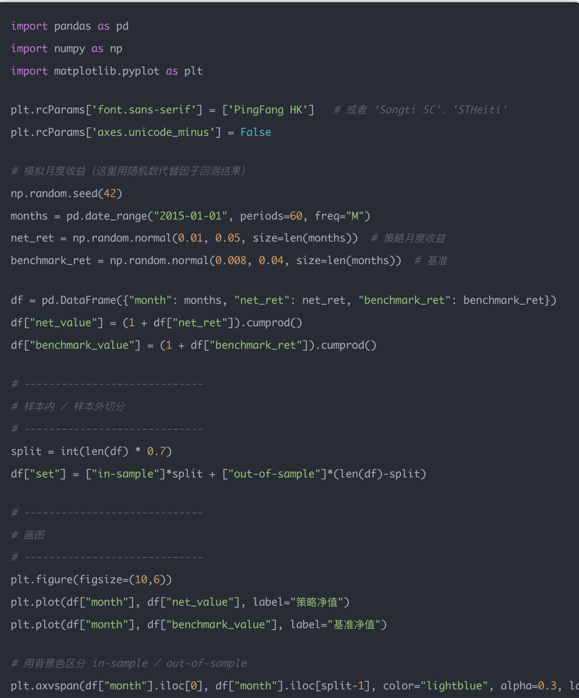
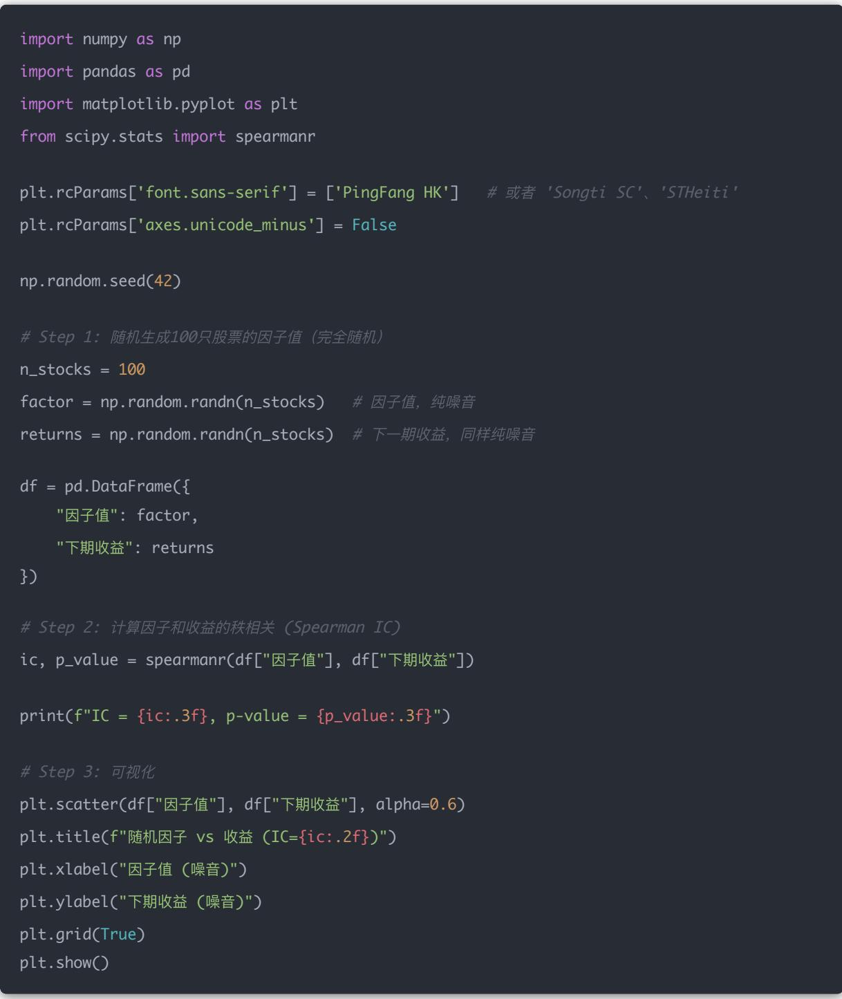

## 量化交易入门指南：第24天 - 样本外检验（Out-of-Sample Test）

原创 逻辑与流 逻辑与流 2025年9月26日 00:03 北京 📄2人

本文深入探讨了量化策略的样本外检验方法，重点介绍了过拟合问题的核心概念和防范策略。通过详细分析样本内外数据分割、Walk-Forward Test实现，以及噪音与信号的区分方法，帮助读者建立完整的策略真实性验证体系，避免"记住历史噪音"的陷阱。

## 学习时间

- 理论学习: 20分钟

- 代码实践: 25分钟

- 思考总结: 15分钟

- 总计: 60分钟

## 一、什么是样本外检验？

到目前为止，我们做的整体回测、滚动回测，本质上都是在样本内（In-Sample）检验：

- 使用相同的一段历史数据

- 不断测试、优化参数

- 看因子/策略是否有效

但这样容易出现过拟合（overfitting）——你可能只是「记住了」历史数据的噪音。

因此必须要做样本外回测（Out-of-Sample Test），才能检验策略的真实有效性。

## 1 什么是样本外检验？

- 样本内（In-Sample）：用来开发和训练策略的历史数据

- 样本外（Out-of-Sample）：完全没用过的新数据，用来验证策略是否还能奏效

## 举个例子：

- 2008–2018年数据 → 用来开发策略（样本内）

- 2019–2020年数据 $\rightarrow$ 用来检验策略（样本外）

- 如果样本外表现和样本内类似，说明策略稳健

- 如果样本外崩掉，说明可能是过拟合

## 二、样本外的常见方法

## (1) 固定分割

- 训练集：前80%时间（样本内）

- 测试集：后 $20\%$ 时间（样本外）

## (2) 滚动/扩展窗口（Walk-Forward Test）

- 每次用过去T个月做样本内训练

- 用接下来的K个月做样本外检验

- 不断向前滑动，重复这个过程

这就是类似机器学习里的「交叉验证」。

## 三、代码示例

样本内vs样本外的对比（简单切分70%/30%）：

plt.title("样本内 vs 样本外 回测")

## 四、图像解读

- 蓝色背景：样本内（策略开发）

- 绿色背景：样本外（独立验证）

- 如果绿色区间里，策略还能稳定跑赢基准 $\rightarrow$ 策略更可信

- 如果绿色区间里，净值掉队 $\rightarrow$ 说明可能过拟合

## 五、今日思考题

### 1. 如果样本外表现大幅弱于样本内，你觉得该怎么处理？

说明策略可能过拟合（overfitting）了。也就是说，你的因子/参数只是在样本内数据里「碰巧有效」，但没有真正的经济逻辑支撑。

应对方法：

1. 回到因子逻辑：检查因子是否有合理的经济学/财务学解释，还是纯粹「数据挖掘」

2. 降低模型复杂度：如果用了太多参数/因子，可以尝试减少维度，避免过拟合

3. 扩展样本：加入更多市场阶段的数据（牛市、熊市、震荡），看看因子是否稳健

4. 重新检验参数：尝试不同的参数组合，看结果是否一致

核心：一个真正的Alpha因子，应该在样本外依然有效，而不是只在历史数据里有效。

### 2. 为什么Walk-Forward Test更接近实盘？

因为它模拟了「真实的交易流程」：

- 在当下时点，你只能用「过去的数据」去训练和调参

- 然后用「未来一小段时间」去验证

- 再往前走一步，继续重复

## 举个例子：

- 用2015–2018数据开发 $\rightarrow$ 在2019测试

- 然后往前滚：2016–2019数据开发 → 在2020测试

- …以此类推

这样就能避免「偷看未来数据」的错误，和实盘的操作逻辑几乎一致。

3. 你觉得在实际中，样本外检验占多少比例比较合适？

## 常见做法：

- $70\%$ 样本内 + $30\%$ 样本外（比较常见的分法）

- $80\%$ 样本内 + $20\%$ 样本外（如果数据量比较少）

- Walk-Forward Test：不按固定比例，而是每次滚动，比如「3年训练 + 1年验证」

## 原则：

- 样本内必须足够长，能覆盖不同市场行情（牛市/熊市/震荡）

- 样本外也要足够长，才能体现策略是否稳健

## 经验上：

- 金融时间序列一般要至少5–10年，才能比较稳妥

- 如果你的样本外只有几个月 $\rightarrow$ 不能算稳健检验

## 总结一句话：

- 样本内 $\rightarrow$ 用来「发现 & 设计」策略

- 样本外 $\rightarrow$ 用来「验证 & 淘汰」过拟合策略

- Walk-Forward $\rightarrow$ 最接近实盘，是最终检验手段

## 六、过拟合（Overfitting）详解

过拟合是量化里非常关键的概念。

### 1. 什么是过拟合？

过拟合就是：模型在历史数据（样本内）表现很好，但在未来数据（样本外）表现很差。

换句话说，它「学得太好」，把噪音当成了规律。

### 2. 举个例子

假设你在研究某个选股因子（比如PE值）：

- 正常情况：你发现低PE股票大概率长期跑赢市场，但并不是每个月都赢

- 过拟合情况：你把参数调得很细（比如只买PE在7.3～7.5的股票），在过去10年数据里能赚大钱。但是 $\rightarrow$ 这只是「数据巧合」，并没有经济学逻辑支撑。到了未来市场，可能完全失效

这就是过拟合。

### 3. 过拟合的典型表现

1. 样本内收益特别高，但样本外收益很差

2. 参数调得太细（比如0.01的间隔调参）

3. 模型复杂度太高（用了太多因子/太多神经网络层）

4. 没有经济逻辑支撑，纯靠数据挖掘

### 4. 如何避免过拟合？

1. 减少参数：模型越简单，越不容易过拟合

2. 经济学逻辑优先：因子必须有合理的经济解释，而不是数据巧合

3. 交叉验证：用不同时间段/不同市场数据测试

4. 样本外检验：把未来的数据留出来，看是否依然有效

5. 正则化（在机器学习里）：限制模型复杂度，比如L1/L2正则

## 总结

- 过拟合就是"记住了历史噪音"，而不是学到了普适规律

- 在量化投资里，过拟合是最危险的陷阱之一

- 最有效的防御手段就是样本外检验 + Walk-Forward Test

## 七、噪音与信号的区分

过拟合的核心就是把"噪音"当成了信号。那我们就先搞清楚——什么是噪音？

### 1. 金融里的"信号"和"噪音"

- 信号（Signal）：指有经济逻辑、可重复、长期有效的规律

- 比如：长期来看，低估值（PE低）的股票往往回报更高

- 高ROE的公司更容易跑赢市场

- 噪音 (Noise): 指短期的、随机的、不可重复的波动

- 比如：某只股票因为CEO突然请病假而股价跌 $5 \%$

- 某天市场情绪极度亢奋，导致所有科技股暴涨

- 某个因子在过去1年表现很好，但没有经济学依据

### 2. 举个例子

假设我们研究股价与天气的关系：

- 在2015\~2020这6年，数据恰好显示「阴天时股价上涨概率更高」

- 如果你据此建立策略，这就是把"天气"这种噪音当成了信号

未来再看，就会发现根本没有任何规律，这就是过拟合。

### 3. 为什么金融市场"噪音"特别多?

因为市场价格每天都在受到成千上万因素的影响：

- 宏观经济数据（GDP、利率、通胀）

- 公司基本面（财报、分红、公告）

- 政策（监管、产业扶持）

- 突发事件（疫情、地缘政治、黑天鹅）

- 甚至纯粹的情绪和交易摩擦

这些短期因素会让价格剧烈波动，但很多并不是长期规律，因此就是"噪音"。

### 4. 怎么区分"噪音vs信号"?

- 看长期数据：如果规律只在某2年成立，而在其他8年都不成立 $\rightarrow$ 很可能是噪音

- 看逻辑支撑：是否有经济学/财务学解释？

- 看市场阶段：如果规律只在某一类行情里成立（比如牛市），那它可能只是阶段性噪音

## 总结一句话

- 噪音=短期随机波动（不可复现、无逻辑）

- 信号=长期稳定规律（可复现、有逻辑）

- 过拟合=把噪音错当信号

八、Python实验：噪音被误判成信号

一个Python小实验，用随机数据造一个"假规律"，展示什么是噪音被误判成信号：

1. 随机生成100只股票的因子值（纯随机，无任何经济意义）

2. 随机生成下一期的收益率

3. 人为检查因子和收益的相关性（IC）

在纯噪音的情况下，有时也会"恰好"得到一个看似很强的相关性。

- 理论上：因子值和收益完全无关 $\rightarrow$ IC应该接近0

- 实际上：可能会出现IC = 0.3、0.4甚至更高（只是统计上的"巧合"）

- 图上：你会看到一些点"似乎有趋势"，但其实完全是噪音

这就是过拟合的风险——如果你只看这一期，就会误以为这个因子有效，但在下一期完全失效。

## 九、完整的防噪音/防过拟合策略清单

样本外检验（Out-of-sample Test）就是对付噪音和过拟合的核心方法。但它不是唯一的手段，避免过拟合我们通常要多层防线。我整理一份完整的防噪音/防过拟合策略清单，你能一眼看明白：

### 1. 样本外检验（Out-of-Sample Test）

- 核心思想：不要只在"训练数据"上验证，而要在未来"没见过的数据"上检验

- 做法：

- 把数据分为训练集（In-sample）和测试集（Out-of-Sample）

- 在训练集上找规律 $\rightarrow$ 在测试集上验证能否复现

- 意义：如果一个规律只在样本内成立，到了样本外就失效 $\rightarrow$ 说明你抓到的只是"噪音"

### 2. 滚动回测（Rolling Window）

- 不要只看整体回测（全数据一次性），而是用时间窗口滑动的方式

例如：用2010\~2015训练，2016测试 $\rightarrow$ 然后窗口前滚6个月，再训练 $+$ 测试

- 好处：能检查因子在不同市场阶段是否稳定

- 如果IC有时正、有时负，说明可能是噪音

### 3. 多期检验（长期累积验证）

- 单期（比如1个月）的好结果可能是噪音

- 必须看长期：

- IC序列的均值（是否稳定正）

- IC的标准差（是否波动太大）

- 分组回测里Q5-Q1多空组合是否长期向上

- 这能过滤掉短期虚假的"因子有效性"

### 4. 经济学逻辑支撑

- 一个因子必须有逻辑理由，否则大概率是噪音

- 比如：

- PE低 $\rightarrow$ 便宜 $\rightarrow$ 未来可能涨√

- 天气阴天 $\rightarrow$ 股票涨（典型噪音）

### 5. 降低模型复杂度

- 过拟合的根源之一是模型太复杂，硬是把训练数据的噪音都"记住"了

- 实际中：

- 不要用太多因子（几十上百个因子拼凑）

- 控制模型自由度，比如用正则化（L1/L2）、简单打分法而不是复杂黑箱模型

### 6. 鲁棒性检验

- 换不同的数据、不同市场，看看结果是否还成立

- 换不同的参数（比如调仓频率、股票池大小），看因子是否仍然有效

- 如果稍微改一下参数，策略就失效 $\rightarrow$ 很可能过拟合

## 总结一句话

- 噪音不可避免，但我们要通过样本外检验 + 滚动回测 + 长期验证 + 逻辑支撑来确保我们抓到的是真正的信号，而不是"数据里的巧合"

总结：样本外检验是量化策略验证的核心环节，它帮助我们识别真正的Alpha因子，避免被历史噪音误导。通过建立完整的防过拟合体系，我们能够更准确地评估策略的真实表现，为实盘交易提供可靠的依据。记住，一个严谨的量化研究必须经过样本外检验的严格验证，才能确保策略的稳健性和可重复性。
