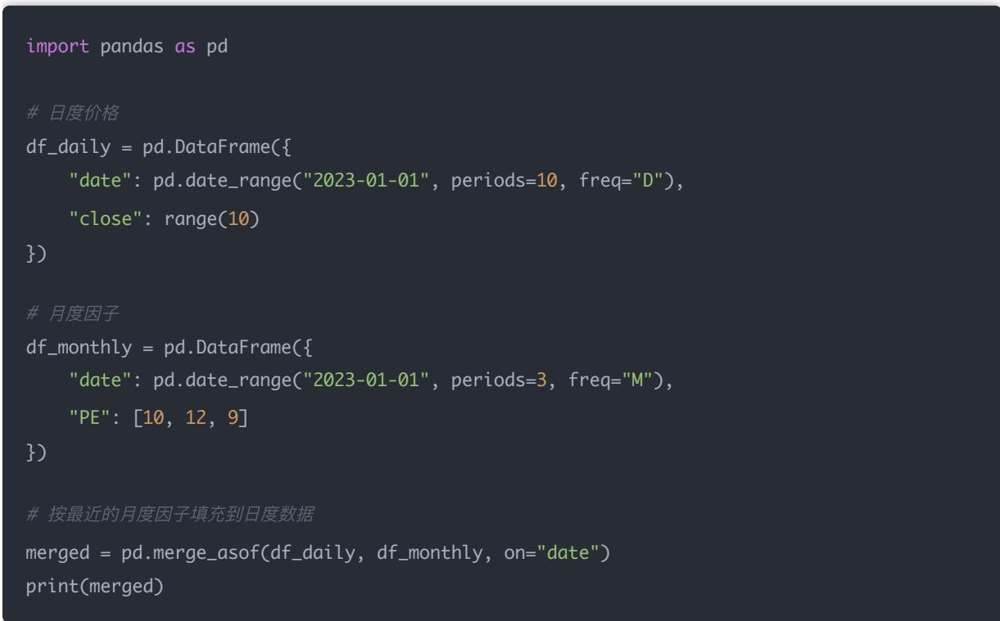
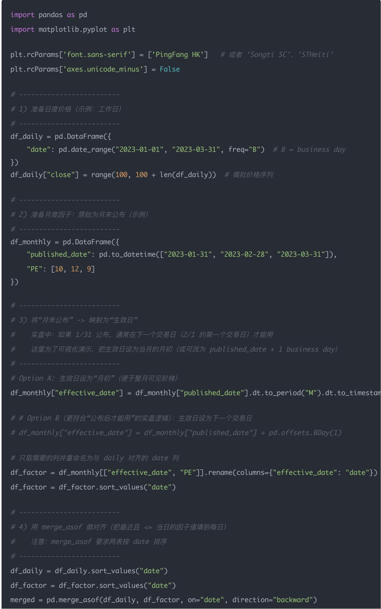
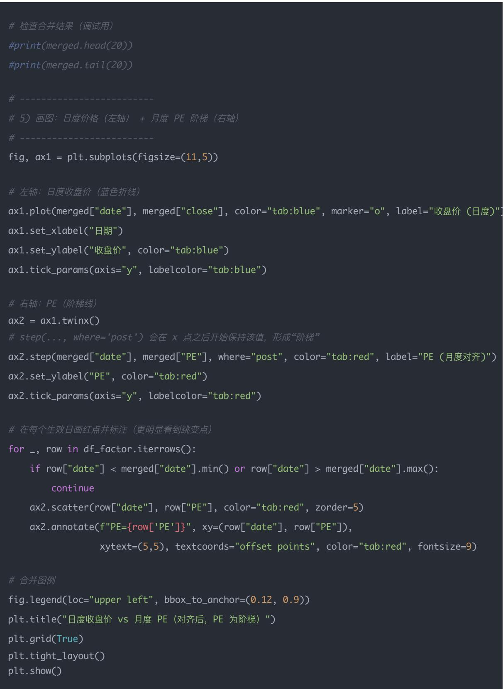

## 量化交易入门指南：第25天－高频更新数据管理技巧（数据工程）

原创 逻辑与流 逻辑与流 2025年9月27日 00:05 北京 标题已修改 📞4人

本文深入探讨了量化策略的数据工程核心技巧，重点介绍了增量更新、时间对齐、数据存储优化等关键技术。通过详细分析数据问题的识别与解决、不同频率数据的对齐方法，以及实时vs批量更新的策略选择，帮助读者建立完整的数据管理体系，确保策略能够稳定高效地运行。

## 学习时间

- 理论学习: 15分钟

- 代码实践: 30分钟

- 思考总结: 15分钟

- 总计: 60分钟

## 一、为什么数据工程很重要？

在实盘里，模型常常只占 20%，数据和工程占 80%。

- 数据乱 $\rightarrow$ 回测和实盘结果不一致

- 更新慢 $\rightarrow$ 无法实时跟单

- 有前视偏差/幸存者偏差 $\rightarrow$ 策略失真，实盘亏钱

因此，数据工程是量化的"地基"，没有它，模型和策略都跑不通。在真实量化团队里，数据组的工作量>研究组。

## 二、常见数据问题

### 1. 延迟问题

比如财报今天才公布，你却在回测时提前用了。

### 2. 幸存者偏差

只保留今天还在交易的股票，忽略退市/破产的公司。

### 3. 前视偏差

不小心用到了"未来数据"（例如2月初建仓时用了2月底的财务指标）。

### 4. 频率对齐问题

- 因子=季度财报 (季度频率)

- 收益=日度行情

- 需要对齐和填充

## 三、高频更新技巧

## (1) 增量更新 (Incremental Update)

不要每次都全量拉数据，效率太低。只拉"最新日期之后的数据"。

import akshare as ak

\# 例：只获取 2024-01-01 之后的新数据

new\_data = ak.stock\_zh\_a\_hist(symbol="000001", period="daily", start\_date="20240101")
print(new\_data.head())

## 增量更新的逻辑详解

### 1. 全量 vs 增量

- 全量更新：每次都从2000年开始，把所有历史数据重新下载一遍

- 缺点：数据量巨大（几十 GB），浪费时间和带宽

- 增量更新：只下载"数据库里还没有的新数据"

- 举例：如果你本地已经保存到2023-12-31，那么下一次只需要拉2024-01-01～今天的数据

### 2. 举个例子

假设你在本地数据库里，股票 000001 的行情只存到了 2023-12-31。那么下一次更新，你就只需要拉：

- 2024-01-01 → 今天

- 比如今天是2025-09-24，那就是拉这段时间的数据

这样，你的数据就从 "存到 2023 年底" → "补全到 2025 年 9 月 24 日"。

### 3. 代码示例

import akshare as ak

import pandas as pd

\# 1. 假设数据库里最后更新到 2023-12-31

latest\_date = "20231231"

\# 2. 从 2024-01-01 开始，只获取增量数据

new\_data = ak.stock\_zh\_a\_hist(symbol="000001", period="daily", start\_date=latest\_date)

## 总结：

- "最新日期之后的数据" = 相对于你已保存的数据的下一天开始

- 它的意义是避免重复下载旧数据，只拉"增量"部分

- 这样既保证数据是完整的，又避免浪费计算资源

## (2) 统一时间索引

不同频率的数据必须对齐：

- 日度行情：每天收盘价

- 月度因子：每月调仓

- 季度财报：三个月一更新

用 pandas.merge\_asof 或 resample 来对齐:

```python
import pandas as pd

# 日度收盘价
df_daily = pd.DataFrame({
    "date": pd.date_range("2023-01-01", periods=10, freq="D"),
    "close": range(10)
})

# 月度因子（比如PE）
df_monthly = pd.DataFrame({
    "date": pd.date_range("2023-01-01", periods=3, freq="M"),
    "PE": [10, 12, 9]
})

# 最近日期对齐（把月度PE填充到日度数据）
merged = pd.merge_asof(df_daily, df_monthly, on="date")
print(merged)
```

## 时间对齐详解

### 1. 为什么要对齐？

- 日度行情：每天都有一个收盘价

- 月度因子（比如动量、月度换手率）：每月才更新一次

- 季度财报（比如ROE、净利润）：三个月更新一次

如果你直接把这些表拼在一起，会发现：

- 日度有 250 个点/年

```python
import pandas as pd

# 日度价格
df_daily = pd.DataFrame({
    "date": pd.date_range("2023-01-01", periods=10, freq="D"),
    "close": range(10)
})

# 月度因子
df_monthly = pd.DataFrame({
    "date": pd.date_range("2023-01-01", periods=3, freq="M"),
    "PE": [10, 12, 9]
})

# 按最近的月度因子填充到日度数据
merged = pd.merge_asof(df_daily, df_monthly, on="date")
print(merged)
```

- 月度只有12个点/年

- 季度只有4个点/年

不对齐的话，就会出现空缺/错位，你没法直接回测。

### 2. 对齐的含义

简单说，就是：

- 找到某一天的调仓日，要知道这一天能用哪些因子值

- 因子如果不是日度的，就要"向前填充"到这一天

## 例子：

- 假设某公司 2023 Q1 财报在 4 月 30 日公布（ROE = 10%）

- 你在5月10日调仓，这时候可用的ROE还是 $10\%$ ，直到Q2财报出来为止

这就叫对齐：把季度数据映射到日度时间线上。

### 3. 实现方法

在 Pandas 里，常用两种方式：

(1) merge\_asof (最近日期匹配)



这样 df\_daily 的每一天都有了一个对应的 PE 值。

## (2) resample (重采样)

- 把日度数据降采样到月度

- 或把月度/季度数据升采样到日度，并用 ffill（向前填充）

## 总结：

- 对齐 = 把日度、月度、季度数据放到一条时间线上

- 原则：

- 财报数据：公布后才能用（避免前视偏差）

- 低频因子：向前填充到下一个更新日

- 行情数据：天然是日度，不用改

## (3) 数据存储优化

- CSV：简单，但大文件读取很慢

- HDF5 / Parquet：压缩存储，读取速度快（推荐）

- 数据库（PostgreSQL/MySQL）：多人协作、支持增量更新

## (4) 实时 vs 批量

- 高频策略（分钟/毫秒级）：必须实时更新，对延迟极其敏感

- 低频因子策略（财报类）：批量更新就行，比如每季度跑一次

## 四、今日小练习

### 1. 写一段代码，把月度因子（PE）和日度价格对齐（用 merge\_asof）

```python
import pandas as pd

# 日度价格（模拟数据）
df_daily = pd.DataFrame({
    "date": pd.date_range("2023-01-01", periods=15, freq="D"),
    "close": range(15, 30)
})

# 月度因子（PE 值，每月底更新一次）
df_monthly = pd.DataFrame({
    "date": pd.to_datetime(["2023-01-31", "2023-02-28", "2023-03-31"]),
    "PE": [10, 12, 9]
})

# 对齐：用最近的月度数据填充到日度价格
merged = pd.merge_asof(df_daily, df_monthly, on="date")
print(merged)
```

## 输出结果中，你会看到：

- 1月份所有交易日都用PE=10

- 2月份用PE=12

- 3月份用PE=9

这样就解决了低频因子 $\rightarrow$ 高频数据对齐的问题。

### 2. 想一想：你常用的因子里，哪些是日频更新（动量、波动率），哪些是季度更新（ROE、资产负债率）？

日频更新因子（每天行情就能更新的指标）：

- 动量（过去20日收益率）

- 波动率（过去30日标准差）

- 换手率（成交量 / 流通股）

- 技术指标（MA, RSI 等）

## 季度更新因子（财报公布才更新的指标）：

- ROE（净利润 / 股东权益）

- 资产负债率

- 营业收入增长率

- 毛利率 / 净利率

规律：价格类因子日频，财务类因子季频。

### 3. 如果要做日频动量因子，你会如何确保每天都能更新最新数据？

动量因子通常定义为：

$$
\mathrm{momentum} _ {t} = \frac {P _ {t}}{P _ {t - k}} - 1
$$

例如过去 20 日动量。

## 做法：

1. 每天收盘后，拉取最新价格数据（比如 AkShare、Tushare）

2. 把今天的收盘价和过去 20 天的历史价拼起来

3. 计算动量:

df\_daily["momentum\_20d"] = df\_daily["close"].pct\_change(20)

4. 存入数据库，下一次更新时从最近日期继续增量拉数据

关键点：

- 数据要每天收盘后更新一次

- 使用增量更新机制（避免重复下载历史数据）

## 五、扩展练习：可视化对齐效果

把练习1的结果画成折线图（日度价格曲线 + 对应的月度 PE 阶梯型曲线），这样你能直观看到对齐效果：





\# 右轴：PE（阶梯线）
ax2 = ax1.twinx()
# step(...，where='post') 会在 x 点之后开始保持该值，形成“阶梯”
ax2.step(merged["date"], merged["PE"], where="post", color="tab:red", label="PE（月度对齐）")
ax2.set\_ylabel("PE", color="tab:red")
ax2.tick\_params(axis="y", labelcolor="tab:red")

\# 在每个生效日画红点并标注（更明显看到跳变点）
for \_, row in df\_factor.iterrows():
    if row["date"] < merged["date"].min() or row["date"] > merged["date"].max():
    continue
    ax2.scatter(row["date"], row["PE"], color="tab:red", zorder=5)
    ax2.annotate(f"PE={row['PE']} ", xy=(row["date"], row["PE"]), xytext=(5,5), textcoords="offset points", color="tab:red", fontsize=9)

## 图像说明

## 图像的组成

### 1. 蓝色折线（收盘价，日频）

- 你生成的数据是工作日频率 (freq="B")，所以每个月大约有 \~20 个点

- 因为价格是按 range(100, 100+len(df\_daily)) 一天一天递增的，所以它表现为一条「折线」，每天涨 1 块- 之所以你说「每一部分有5个点」：这是因为你画的示例区间很短（1月1日到3月31日），每个月只有几个交易日，所以蓝线显示为几段小折线

### 2. 红色阶梯线（PE，月频）

- 只有在月初（或者设定的生效日）更新一次

- 在同一个月内保持不变，看上去就是「横着的红线」

- 到下个月再跳到新的数值

- 所以红线是「一格一格的阶梯」，每一格覆盖一个月

## 如何理解？

这张图就是在告诉你：

- 日度行情（蓝线）：每天更新，变化很快

- 月度因子（红阶梯）：一个月只变一次，保持不变

- 对齐：通过 merge\_asof，我们让每一天的股价都能找到「当时有效的因子值」

- 比如：2月5日的收盘价，对应的是1月底公布的PE（如果生效日设在2月初）

- 直到2月底公布了新的PE，这个红阶梯才跳到新的值

## 为什么这很重要？

### 1. 避免前视偏差

- 如果你直接用「2月末的PE去解释2月初的收益」，就是偷看未来

- 正确做法是：红色阶梯在公布之后才能用

### 2. 不同频率数据的对齐

- 你的研究因子可能是月度（PE）、季度（ROE）、日度（动量）

- 市场价格几乎总是日度（甚至分钟级）

- 所以必须把低频因子「对齐」到高频行情数据，否则回测会乱套

所以这张图展示的知识点就是：

- 蓝线（日度行情）：在不断变化

- 红线（月度因子）：是阶梯，每月更新一次

- 用 merge\_asof 对齐后：每天都能看到对应的有效因子值，这样才能正确做因子回测

## 六、总结

高频更新的关键：增量更新 + 时间对齐 + 高效存储。

\*\*数据工程是量化的"地基"\*，没有它，模型和策略都跑不通。

在真实量化团队里，数据组的工作量 $>$ 研究组。


总结：数据工程是量化策略成功运行的关键基础，通过增量更新、时间对齐、高效存储等技术手段，我们能够确保策略数据的准确性和实时性。掌握这些数据管理技巧，是量化交易从理论研究到工程落地的重要桥梁，为策略的稳定运行提供了坚实的技术保障。
