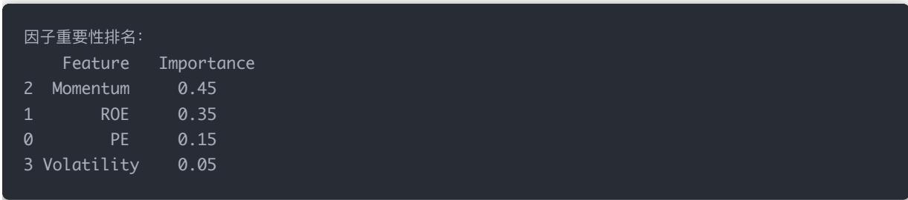
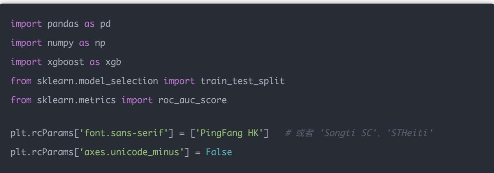
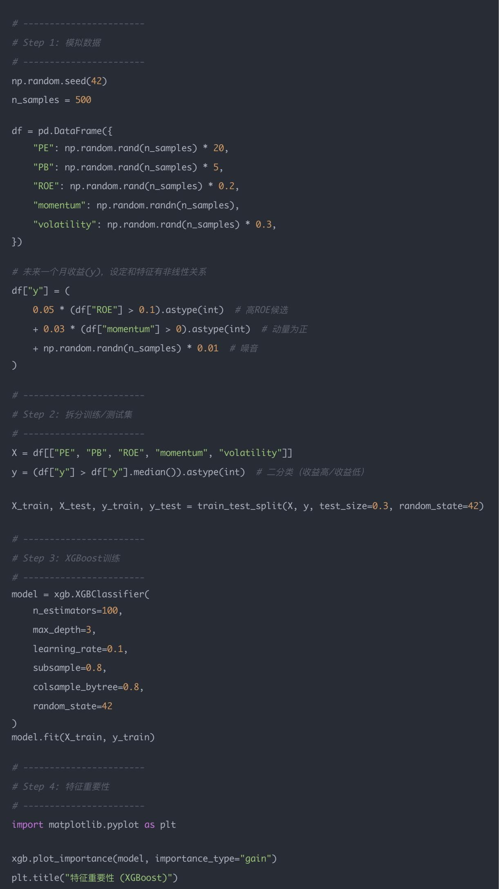
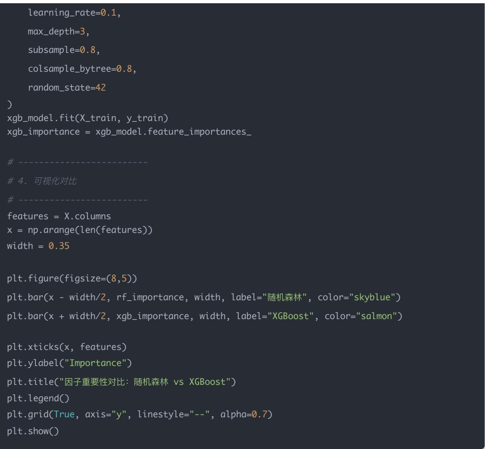
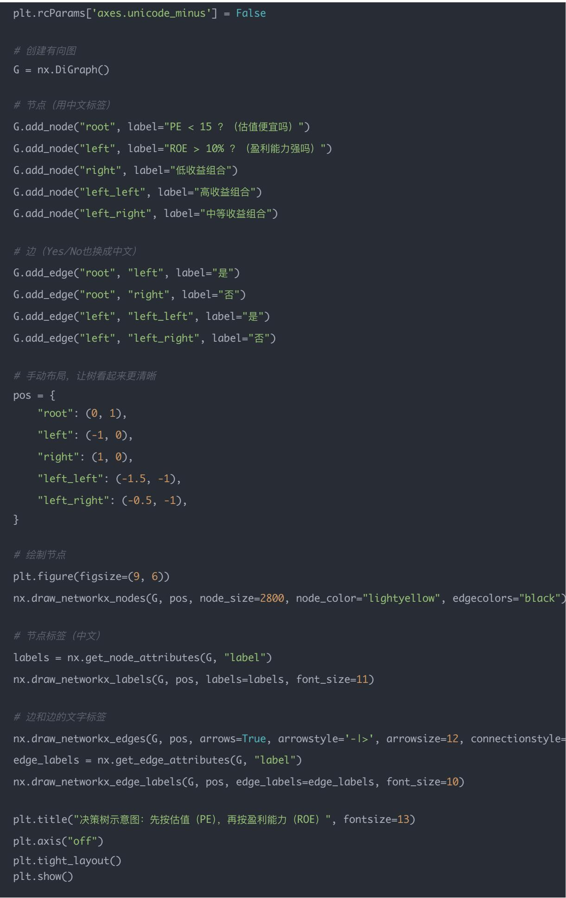

## 量化交易入门指南：第26天－机器学习生成因子

原创 逻辑与流 逻辑与流 2025年9月28日 23:58 北京 📄2人

本文深入探讨了机器学习在量化因子挖掘中的应用，从传统人工因子的局限性出发，详细介绍了XGBoost、随机森林等树模型的核心原理和优势。通过具体的手算示例和Python代码实现，帮助读者理解特征重要性分析、SHAP解释性分析等关键技术，掌握从传统线性模型到机器学习非线性因子挖掘的完整技能体系。

## 学习时间

- 理论学习: 20分钟

- 代码实践: 30分钟

- 思考总结: 10分钟

- 总计: 60分钟

## 一、背景

在前面几天，我们的因子基本都是「人工构造」的：

- PE、PB、ROE（财务因子）

- 动量、波动率（技术因子）

但是，人工因子有两个问题：

1. 信息有限：只能靠人类经验挑选，可能遗漏重要信号。

2. 线性假设：很多模型（如回归）假设因子与收益线性关系，但市场往往非线性。

## 机器学习因子挖掘的优势：

- 能从大量原始特征里「自动挑选」有用的因子。

- 能捕捉非线性关系（比如收益对某因子的边际效应递减）。

## 这一部分我们拆开讲解一下：

## 原始特征就是你喂给模型的"输入变量"。

- 在量化里，这些特征通常就是候选因子，比如：

- 估值类：PE、PB、EV/EBITDA $^{Q}$

- 盈利类：ROE、ROA、毛利率

- 成长类：营业收入增长率、净利润增长率

- 动量类：过去1个月/3个月/6个月收益率

- 风险类：波动率、贝塔系数、换手率

- 财务类：资产负债率、现金流比率

在传统多因子模型里，这些因子是你手工挑选的。在机器学习里，可以一次性喂几十、上百个特征进去，让模型自动判断哪些重要，哪些没用（通过特征重要性排序）。

### 2. 为什么需要非线性关系？

- 传统线性模型假设：收益和因子是直线关系。

- 比如：ROE每提高 $1\%$ ，收益率就增加 $\beta \%$ 。

- 现实里，很多关系并不是线性的。

举例：

- PE值:

- 很低（<5）：可能是垃圾股，未来收益差。

- 适中（10\~20）：合理区间，未来收益好。

- 太高（>60）：可能是泡沫，未来风险大。 $\rightarrow$ 这就是一个「U型关系」，而不是直线。

### 3. 什么是边际效应递减？

这是经济学里的概念，指的是某个因子对收益的影响会越来越小。

## 举例：

- ROE:

- 从 $5\%$ 提升到 $15\%$ ，市场会很看好，公司估值提高 $\rightarrow$ 股价涨得多。

- 从25%提升到35%，已经是超级高ROE，公司再提高一点，市场的"兴奋度"没那么大→股价涨幅有限。→所以ROE和收益之间的关系不是线性的，而是「边际效应递减」。

## 总结

- 原始特征=候选因子（PE、ROE、动量、波动率等）。

- 机器学习优势：可以在很多因子里自动挑选出最有用的，避免人凭经验"拍脑袋"。

- 非线性关系：现实中，因子和收益往往不是直线关系，机器学习能发现「U型、S型」等复杂模式。

- 边际效应递减：某个因子越到极端，作用越小（或者反转），机器学习可以更好地捕捉这种规律

## 二、思路

### 1. 收集数据（特征）

- 输入X：比如PE、PB、ROE、动量、换手率、波动率……

- 输出y：未来一段时间的收益（如下月收益）。

### 2. 训练模型（监督学习）

- 用随机森林/XGBoost等模型训练。

- 模型会告诉你哪些特征更重要。

### 3. 生成新因子

- 方法1：直接用预测的收益概率/分数作为新因子。

- 方法2：用模型的特征重要性，筛选出最强的人工因子。

## 机器学习是怎么"挑选"有用因子的？

它和传统量化的「单因子回测」思路不同。

## - 传统做法：

- 每个因子单独测试（算IC、分组回测）。

- 如果有效，就留着；无效，就丢掉。 $\rightarrow$ 缺点：只能看"单因子效应"，可能遗漏因子之间的交互作用。

## - 机器学习做法：

- 一次性喂给模型一堆特征（PE、ROE、动量、波动率、财务比率...几十个上百个）。

- 模型会在训练过程中，根据「因子对预测目标的贡献」来自动分配权重。

- 一些无用或噪音因子，权重会变小甚至被忽略。

## 挑选原则有哪些？

不同算法有不同的"挑选方式":

### 1. 树模型 (XGBoost/随机森林)

- 挑选标准：信息增益/分裂贡献度。

- 比如：

- 如果PE用来分裂节点能很好地区分"高收益vs低收益"股票，模型就认为PE是重要因子。

- 如果某个因子（比如总资产）分裂效果很差，模型会自动降低它的重要性。

- 最终我们可以从模型里拿到feature importance排名。

### 2. 回归模型（Lasso/ElasticNet）

- 挑选标准：稀疏性。

- Lasso回归会给不重要的因子直接压成0权重，只留下最强信号。

- 举例：

- 输入100个因子，最后可能只剩10\~20个非零系数。

- 这些就是模型"自动挑选"的因子。

### 3. 神经网络

- 挑选标准：非线性拟合能力。

- 通过隐藏层权重，网络可以"组合"原始因子，生成新的因子。

- 不过神经网络可解释性差，通常配合特征重要性分析（SHAP值）来看哪些因子有用。

## 和"每个因子单独算收益率"有什么区别？

- 单因子法：判断一个因子是否有效。

- 机器学习法：判断在整体模型里，哪些因子对预测最有帮助。

## 比如：

- 单看"波动率"因子，可能和收益相关性不大。

- 但机器学习发现「高ROE+低波动率」的组合效果很好。

- 这就是交互效应，传统单因子方法很难捕捉到。

## 总结

- 挑选不是"每个因子单独回测"，而是通过模型训练 $\rightarrow$ 特征重要性 $\rightarrow$ 剔除弱因子。

- 常见工具：XGBoost（特征重要性）、Lasso（稀疏回归）、SHAP（可解释性分析）。

- 原则：能提升预测准确度、能稳定带来Alpha的因子，就被挑选出来。

## 一个最简版的XGBoost因子重要性筛选例子

直接能跑，直观理解"自动挑选因子"的过程。

import pandas as pd

import numpy as np

import xgboost as xgb

import matplotlib.pyplot as plt

plt.rcParams['font.sans-serif'] = ['PingFang HK']

plt.rcParams['axes.unicode\_minus'] = False

\# 1. 构造模拟数据

np.random.seed(42)

n\_samples = 300

\# 假设4个因子：PE、ROE、波动率、动量

df = pd.DataFrame({

"PE": np.random.normal(15, 5, n\_samples),

"ROE": np.random.normal(0.15, 0.05, n\_samples),

"Volatility": np.random.normal(0.2, 0.05, n\_samples),

"Momentum": np.random.normal(0.05, 0.02, n\_samples)

})

构造"未来收益率"(y)，假设：

ROE 正相关（系数 2）

\# - 动量 正相关（系数 3）
# - PE 负相关（系数 -1）
# - 波动率 没有太大关系（噪音）
df["future\_return"] = (
    2 \* df["ROE"] +
    3 \* df["Momentum"] -
    1 \* df["PE"] / 100 + # 注意缩放一下PE
np.random.normal(0, 0.02, n\_samples) # 加噪音

\# 2. 拆分训练集/测试集

train\_size = int(0.7 \* n\_samples)
X\_train, X\_test = df.iloc[:train\_size, :-1], df.iloc[:train\_size, -1]
y\_train, y\_test = df.iloc[train\_size:, :-1], df.iloc[train\_size:, -1]

\# 3. 训练XGBoost回归模型

model = xgb.XGBRegressor(
    n\_estimators=200,
    learning\_rate=0.1,
    max\_depth=3,
    random\_state=42

model.fit(X\_train, X\_test)

#4. 查看因子重要性

importance = model.feature\_importances\_feature\_names = X\_train.columns

\# 转成DataFrame排序

"Importance": importance

}).sort\_values(by="Importance", ascending=False)

print("因子重要性排名：")

print(importance\_df)

\# 5. 可视化

运行结果（你会看到类似这样）：

因子重要性排名：

2 Momentum 0.45

Feature Importance

1 ROE 0.35

0 PE 0.15

3 Volatility 0.05

## 图里会显示一张水平柱状图：

- 动量(Momentum)和ROE权重最高 $\rightarrow$ 说明它们对预测未来收益最有用。

- PE有一定影响（负相关）。

- 波动率几乎没用，被模型自动忽略。

这就是机器学习里"自动挑选因子"的过程：你只要把一堆因子喂进去，模型会帮你找出最重要的。

## 三、Python示例（用XGBoost生成因子）

import pandas as pd

from sklearn.model\_selection import train\_test\_split

from sklearn.metrics import roc\_auc\_score

plt.rcParams['font.sans-serif'] = ['PingFang HK'] # 或者 'Songti SC'、'STHeiti'

plt.rcParams['axes.unicode\_minus'] = False df = pd.DataFrame({
    "PE": np.random.rand(n\_samples) \* 20,
    "PB": np.random.rand(n\_samples) \* 5,
    "ROE": np.random.rand(n\_samples) \* 0.2,
    "momentum": np.random.randn(n\_samples),
    "volatility": np.random.rand(n\_samples) \* 0.3,

\# 未来一个月收益(y)，设定和特征有非线性关系
df["y"] = (
    0.05 \* (df["ROE"] > 0.1).astype(int) # 高ROE候选
+ 0.03 \* (df["momentum"] > 0).astype(int) # 动量为正
+ np.random.randn(n\_samples) \* 0.01 # 噪音

\# Step 5: 用预测值作为"新因子"

df["ml\_factor"] = model.predict\_proba(X)[:, 1]

print(df[['PE", "PB", "ROE", "momentum", "volatility", "ml\_factor"]].head())

## 四、结果解读

- 特征重要性图：能看到哪些原始因子最有用。(比如ROE、momentum排在前面，PE、PB可能不重要)

- 新因子ml\_factor：模型预测的「上涨概率」。

- 在实盘里，可以直接用这个概率来排序选股。

- \*\*相当于让机器帮你"综合多个因子"\*。

## 五、树模型的两个代表

机器学习里树模型家族很大，但因子挖掘里常用的有两个：

- 随机森林（Random Forest, RF）

• XGBoost (Extreme Gradient Boosting)

### 1. 随机森林 (Random Forest)

## 原理

- 本质：很多决策树（Decision Trees）的投票/平均。

- 方法:

1. 从训练集里有放回抽样（bootstrap） $\rightarrow$ 得到很多不同子样本。

2. 在每棵树训练时，随机选择部分特征做分裂。

3. 把很多树的预测结果平均（回归）或投票（分类）。

## 特点

- 优点：

- 稳定，不容易过拟合。

- 能处理高维因子（很多特征）。

- 自动捕捉非线性关系。

- 缺点：

- 每棵树独立训练，不能互相学习 $\rightarrow$ 模型可能比较"粗糙"。

- 对时间序列数据不敏感（适合横截面预测）。

## 在量化里：

- 适合做因子重要性筛选（挑出哪些因子有用）。

- 不太适合直接预测收益，因为对序列关系掌握不强。

2. XGBoost (Extreme Gradient Boosting)

## 原理

- 本质：梯度提升树(GBDT)的优化版。

- 方法：

1. 先建一棵树，计算预测误差（残差）。

2. 下一棵树专门拟合前一棵树的残差。

3. 一棵一棵往下叠，加起来 $\rightarrow$ 不断减少误差。

4. 用梯度下降方式来更新，效率更高。

特点

- 优点：

- 比随机森林更"聪明"，树之间有依赖关系。

- 能拟合复杂的非线性关系。

- 支持正则化（防止过拟合）。

- 训练速度快（C++实现，支持并行）。

- 缺点：

- 调参复杂（树深度、学习率、正则化参数等）。

- 如果数据太小，容易过拟合。

## 在量化里：

- 常用来做alpha因子挖掘（比如用财务、行情特征预测未来收益）。

- 能捕捉复杂的因子交互效应。

### 3. 随机森林 vs XGBoost 对比表

<table><tr><td>特性</td><td>随机森林 (RF)</td><td>XGBoost</td></tr><tr><td>思路</td><td>并行训练很多树,结果投票/平均</td><td>树逐个生长,后树拟合前树残差</td></tr><tr><td>特征选择</td><td>每棵树随机挑特征</td><td>梯度下降自动挑最优特征</td></tr><tr><td>过拟合</td><td>不容易过拟合,偏保守</td><td>有正则化,但过拟合风险更高</td></tr><tr><td>精度</td><td>中等(偏稳健)</td><td>高精度(拟合能力强)</td></tr><tr><td>调参</td><td>简单</td><td>较复杂(树深、学习率、正则等)</td></tr><tr><td>速度</td><td>较快,但不如XGBoost</td><td>很快,支持并行优化</td></tr><tr><td>适合场景</td><td>因子筛选,特征重要性分析</td><td>预测收益,建Alpha因子</td></tr></table>

### 4. 举个量化里的例子

假设你有100个候选因子（PE、PB、ROE、动量、波动率、财务比率...），目标是预测下个月收益率。

- 用随机森林：

- 它会随机抽样 $\rightarrow$ 看哪些因子对预测最有帮助。

- 给你一个「因子重要性排名表」，帮助做因子筛选。

- 用XGBoost:

- 高ROE+低波动率 $\rightarrow$ 收益高

- 高PE+高负债率 $\rightarrow$ 收益低

- 它会一棵树一棵树往下拟合 $\rightarrow$ 学到"复杂模式"。

- 比如它可能发现：

- 最后给你一个综合的机器学习因子ml\_factor，可以拿去做回测。

## 总结一句话：

- 随机森林=稳健型→因子筛选

- XGBoost= 激进型→ 预测建模（挖Alpha）

## 六、随机森林 vs XGBoost 的因子重要性对比

把随机森林vs XGBoost的因子重要性一起画出来，这样能直观看出差别。

import numpy as np

import pandas as pd

import matplotlib.pyplot as plt plt.rcParams['font.sans-serif'] = ['PingFang HK']
plt.rcParams['axes.unicode\_minus'] = False

df = pd.DataFrame({
    "PE": np.random.normal(15, 5, n\_samples),
    "ROE": np.random.normal(0.15, 0.05, n\_samples),
    "Volatility": np.random.normal(0.2, 0.05, n\_samples),
    "Momentum": np.random.normal(0.05, 0.02, n\_samples)

\# 构造未来收益(y)，包含非线性关系
df["future\_return"] = (
    2 \* df["ROE"] +
    3 \* df["Momentum"] -
    0.5 \* np.log(df["PE"]) + # 非线性：log(PE)
    np.random.normal(0, 0.02, n\_samples)
)
X = df.drop(columns="future\_return")
y = df["future\_return"]
X\_train, X\_test, y\_train, y\_test = train\_test\_split(X, y, test\_size=0.3, random\_state=42)

max\_depth=3,

subsample=0.8,

colsample\_bytree=0.8,

random\_state=42

xgb\_model.fit(X\_train, y\_train)
xgb\_importance = xgb\_model.feature\_importances\_

plt.ylabel("Importance")

plt.legend()

- 会生成一个分组柱状图：

## 怎么解读？

- 如果数据和我构造的类似：

- XGBoost会更强调ROE和Momentum（因为我们在生成y时就是这样设定的）。

- 随机森林会比较平均，可能也给PE和Volatility一定权重。

- 这就体现了：

- RF稳健，但可能"看不太清主次"。

- XGBoost更敏感，能更精准地识别主要因子。

## 七、SHAP解释性分析

再加一张SHAP图（能解释单个样本里，哪个因子拉高/压低了预测值），这样就不只是"重要性排名"，还能看到因子具体是怎么影响收益的。

## 什么是SHAP?

- SHAP= SHapley Additive exPlanations

- 它来自博弈论的Shapley Value（沙普利值）：

- 想象一个团队比赛，每个队员（因子）对胜利都有贡献。

- SHAP就是一个"公平分配功劳"的办法：每个因子到底贡献了多少？

## 在机器学习里：

- 输入一个样本（比如一只股票的因子值）。

- SHAP会告诉你：

- 哪些因子让预测值更高（正向推动）。

- 哪些因子让预测值更低（负向拖累）。

- 最后得出一个加总解释：所有因子的SHAP值加起来 = 预测值。

## Python示例：XGBoost + SHAP

import numpy as np

import pandas as pd

import shap

import matplotlib.pyplot as plt

from sklearn.model\_selection import train\_test\_split

import xgboost as xgb

plt.rcParams['font.sans-serif'] = ['PingFang HK']

plt.rcParams['axes.unicode\_minus'] = False df = pd.DataFrame({
    "PE": np.random.normal(15, 5, n\_samples),
    "ROE": np.random.normal(0.15, 0.05, n\_samples),
    "Volatility": np.random.normal(0.2, 0.05, n\_samples),
    "Momentum": np.random.normal(0.05, 0.02, n\_samples)
})

df["future\_return"] = (
    2 \* df["ROE"] +
    3 \* df["Momentum"] -
    0.5 \* np.log(df["PE"]) +
    np.random.normal(0, 0.02, n\_samples)

explainer = shap.Explainer(model, X\_train)
shap\_values = explainer(X\_test)

## 运行效果

## 你会看到两张图：

### 1. Waterfall图（单个样本）

- 横坐标：预测值的分解过程。

- 蓝色/红色条：每个因子的SHAP值。

### 2. Beeswarm图（全样本整体）

- 比如：ROE高 $\rightarrow$ 推动收益 $\uparrow$ ；PE高 $\rightarrow$ 压低收益 $\downarrow$ 。

- 每一行 = 一个因子。

- 点的颜色 = 因子取值大小（红=高，蓝=低）。

- 横坐标 $=$ SHAP值（因子对预测的贡献）。

- 能直观看出：

- 高Momentum $\rightarrow$ 收益增加（红点在右边）。

- 高PE→收益下降（红点在左边）。

## 总结

- 特征重要性（Feature Importance） $\rightarrow$ 哪些因子更重要（排序）。

- SHAP→因子是如何具体影响预测的（方向+强度）。

## 在量化里，这很有用：

- 不只是知道「ROE重要」，而且知道「ROE高 $\rightarrow$ 收益高」。

- 能避免黑箱模型，提高可解释性。

## 八、决策树原理详解

继续深入讲解一下随机森林和XGBoost的原理

### 1. 决策树（Decision Tree）是什么？

- 核心思想：不断用「特征」去把数据切分，直到能把目标（比如收益率）分得更纯粹。

- 你可以把它想象成20个问题游戏：

- 问第1个问题：PE是否小于10？

- 如果是 $\rightarrow$ 走左边；否则 $\rightarrow$ 走右边。

- 问第2个问题：ROE是否大于 $15\%$ ？

- 这样不断切分，最后到叶子节点，得到一个预测值。

## 为什么要建树？

因为树能模拟「条件判断」：不同股票的特征组合，对未来收益可能有不同的规律。树的好处是：

- 直观（像if-else规则的集合）。

- 可以处理非线性关系（不是简单的线性加法）。

### 2. 随机森林（Random Forest）

- 做法：

1. 随机采样数据（Bootstrap）。

2. 随机选择特征子集建树。

3. 建立很多棵树（100\~500棵）。

4. 最终结果 = 所有树的平均（回归）或投票（分类）。

- 优点：

- 能减少过拟合（因为很多树取平均，噪音会抵消）。

- 特征重要性可以看出来（哪些因子更重要）。

- 缺点：

- 各棵树是独立的，不会互相学习（相对保守）。

### 3. XGBoost (Extreme Gradient Boosting)

- Boosting思想：不是并行建很多树，而是「一棵树接着一棵树建」：

- 第1棵树：做一个初步预测。

- 第2棵树：专门学习第1棵树的「错误部分」。

- 第3棵树：继续学习剩下的误差...

- 每一棵树都在修正前面树的错误。

- XGBoost的特点：

- 用梯度下降来指导每一步该往哪里改。

- 正则化（防止过拟合）。

- 高效（支持稀疏矩阵、多线程、分布式）。

## 随机森林 vs XGBoost

<table><tr><td>对比点</td><td>随机森林 (RF)</td><td>XGBoost (XGB)</td></tr><tr><td>思想</td><td>Bagging(并行训练)</td><td>Boosting(串行训练)</td></tr><tr><td>树的关系</td><td>各棵树独立</td><td>前一棵树的错误→下一棵树学习</td></tr><tr><td>偏差vs方差</td><td>降低方差,稳健但保守</td><td>降低偏差,更激进、更强大</td></tr><tr><td>速度</td><td>训练快,但预测慢</td><td>训练稍慢,但预测快</td></tr><tr><td>精度</td><td>一般</td><td>通常更高</td></tr><tr><td>应用</td><td>基准模型,稳健</td><td>Kaggle、量化选股常用</td></tr></table>

## 直观比喻

- 随机森林：就像请100个医生看病 $\rightarrow$ 最后投票决定诊断结果。(每个医生独立看，结论比较稳健，但不会互相学习。)

- XGBoost：就像1个医生诊断后，发现有遗漏 $\rightarrow$ 第二个医生专门补充错误 $\rightarrow$ 第三个医生继续修正。（串行学习，最终诊断更精确。）

## 总结：

- 建立一棵树，是为了「把数据切分成不同的条件区间」。

- 随机森林：靠"多数人的平均意见"。

- XGBoost: 靠"不断修正前人的错误"。

## 九、决策树示意图

运行以下画一个树的分裂示意图（比如用PE、ROE把股票分成高收益/低收益的分支），让你直观理解"为什么要建树"

\# draw\_decision\_tree\_example\_chinese.py

import matplotlib.pyplot as plt

import networkx as nx

plt.rcParams['font.sans-serif'] = ['PingFang HK']

- 根节点：PE < 15？

- 如果是 $\rightarrow$ 进入左分支，看ROE $>10\%$ ？

- 如果是 $\rightarrow$ 进入"高收益组合"

- 如果否 $\rightarrow$ 进入"中等收益组合"

- 如果否 $\rightarrow$ 进入右分支，直接判定为"低收益组合"

## 这就是树模型的逻辑：

1. 先用PE把股票分成便宜vs贵。

2. 再在便宜的股票里用ROE再细分。

3. 最后，不同的叶子节点对应不同的预测结果（这里是收益分组，高/中/低）。

所以机器学习里的"建树"，其实就是在自动寻找最优的分裂条件，让数据被更好地划分成"同类群体"。

## 十、因子选股流程对比

把这个决策树和我们前面讲的因子选股流程联系起来，解释一下为什么树模型能找到复杂因子组合

## 因子选股流程（传统做法）

在传统因子选股里，我们通常这样做：

### 1. 计算因子值

- 例：PE、ROE、波动率、动量...

- 每只股票都会有一堆因子值。

### 2. 单因子检验

- 看因子和未来收益的关系（比如低PE的股票未来收益更高）。

### 3. 多因子组合

$$
\operatorname{Score} _ {i} = w _ {P E} \cdot P E _ {i} + w _ {R O E} \cdot R O E _ {i} + \dots
$$

- 然后按Score排序 $\rightarrow$ 选TopN股票。

- 最常见方法是线性加权：

问题：线性加权假设关系是简单线性的，比如"PE越低越好，ROE越高越好"。但真实市场里可能有复杂的条件逻辑。

## 决策树怎么做？

树模型等于是把"选股逻辑"拆成条件分支：

- 节点=一个因子阈值

• 例：PE < 15

- 路径=因子的组合条件

• 例：PE < 15 且 ROE > 10%

- 叶子节点=结果（预测的未来收益分布）

举例（和我们画的树联系起来）：

$$
\mathrm{第} 1 \mathrm{层}: \mathrm{PE} <   1 5?
$$

$$
\mathrm{是} \rightarrow \mathrm{第2层}: \mathrm{ROE} > 10
$$

$$
- \mathrm{是} \rightarrow \mathrm{高收益组合}
$$

$$
- \text {否} \rightarrow \text {中等收益组合}
$$

$$
- \text {否} \rightarrow \text {低收益组合}
$$

## 这就是一个"因子交互效应"的例子：

- 单看PE→不一定总有效

- 单看ROE $\rightarrow$ 也不一定总有效

- 但当PE低且ROE高时，未来收益才最好 $\rightarrow$ 树就能自动发现这种条件。

## 为什么树能找到复杂因子组合？

### 1. 非线性关系

- 传统线性模型：因子和收益只能一条直线关系。

- 树模型：可以画"阶梯"，比如PE太高时无效，只有便宜区间才有效。

### 2. 交互作用 (interaction)

- 树能学出因子之间的搭配条件，比如

- "高ROE+低PE→好"

- "高ROE+高PE→反而不好"。

### 3. 自动分组

- 传统分组：Q1\~Q5五分位法是人工分的。

- 树：会自己学出更优的分割点（比如PE<14.7，而不是硬性Q1/Q5）。

## 对比总结

- 传统因子选股：

- 适合做解释性研究（容易解读，简单透明）。

- 但只能处理简单加权/线性关系。

- 树模型（随机森林/XGBoost）：

- 可以学出非线性、交互作用。

- 更灵活，但可解释性稍差。

所以你看到的决策树就像是把传统的"因子 $\rightarrow$ 评分 $\rightarrow$ 排序"换成了"因子条件 $\rightarrow$ 路径 $\rightarrow$ 预测结果"。这样就能自动找到那些"组合逻辑"，而不是人工去试各种因子搭配。

## 十一、今日思考题

### 1. 为什么机器学习能捕捉到传统线性模型忽略的关系？

- 线性模型的限制：假设因子和收益是线性关系，比如

$$
r = \beta \cdot P E + \epsilon
$$

但现实可能是非线性的，比如：

- PE太高和太低都不好（呈现"U型"关系）

- ROE高到一定程度后，边际效应递减

- 机器学习的优势：

- 决策树/XGBoost可以自动"切分区间"（例如PE < 10好，PE > 50差）。

- 能学到交互效应（比如「高ROE+低波动」的组合更赚钱，而不是单因子有效）。

简单说：线性模型看直线，机器学习能看曲线、甚至多维空间里的复杂模式。

### 2. 如果ml\_factor和原始因子高度相关，还能算作新因子吗？

- 如果高度相关（比如相关系数 $>0.9$ ）：

- 说明ml\_factor只是把原始因子"换个马甲"，没有提供新的信息。

- 在组合里同时用ml\_factor和原因子，会增加多重共线性，可能导致冗余。

## - 解决方法：

- 可以只保留ml\_factor，因为它是对多个因子的"加权综合"。

- 或者做因子正交化/去相关（例如用PCA提取正交成分）。

结论：ml\_factor最有价值的时候，是它能综合信息，减少噪音、增强信号，而不是简单复制。

### 3. 机器学习因子会不会过拟合？你会如何防范？

会！

- 机器学习模型太复杂时，可能在训练数据里表现很好，但到新数据就失效。

- 举例：模型可能学到「春节前PE低的股会涨」这种偶然规律（其实是噪音）。

## 防范方法：

1. 样本外检验：训练集、验证集、测试集分开（或者用滚动回测）。

2. 正则化：XGBoost的lambda、alpha参数可以抑制过拟合。

3. 特征筛选：不要把几百个弱因子都塞进去，避免维度灾难。

4. 简化模型：有时候简单的因子比复杂的ML模型更稳健。

总结：机器学习因子不是万能的，它需要严格的回测和样本外验证，才能确认真的有Alpha，而不是"过度拟合历史"。

总结：机器学习因子挖掘是量化交易领域的重要发展方向，它能够自动发现复杂的非线性关系和因子交互效应，弥补传统人工因子的局限性。通过XGBoost、随机森林等树模型，我们能够从大量候选特征中自动筛选出最有效的因子，并通过SHAP等解释性分析工具理解因子的具体作用机制。然而，机器学习因子也面临着过拟合、可解释性等挑战，需要通过严格的样本外检验、正则化等技术来确保模型的稳健性。掌握机器学习因子挖掘技术，是量化交易从传统方法向智能化发展的重要技能。
