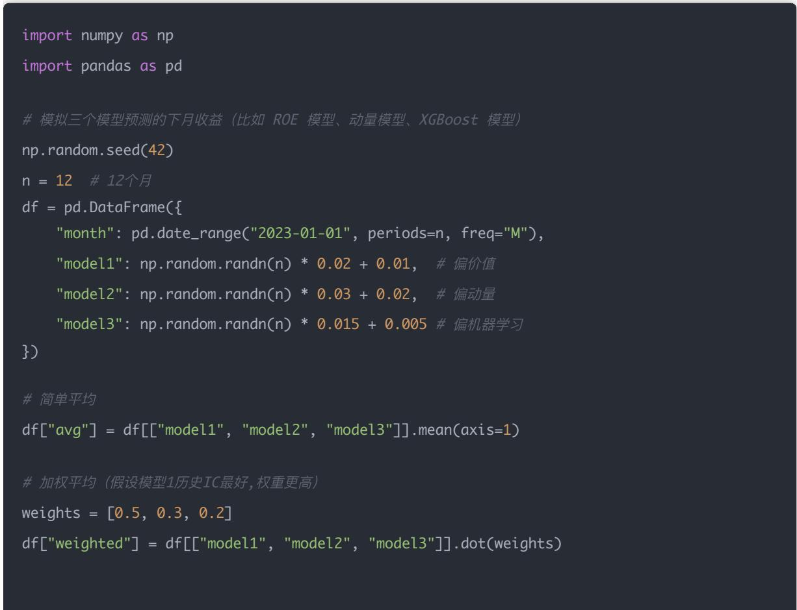
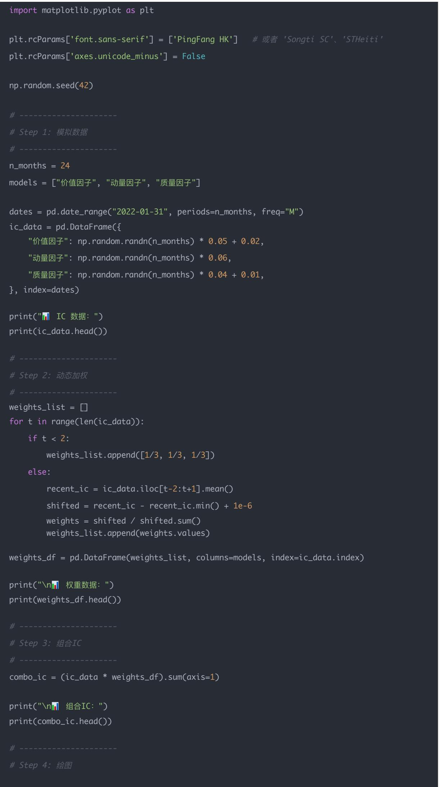
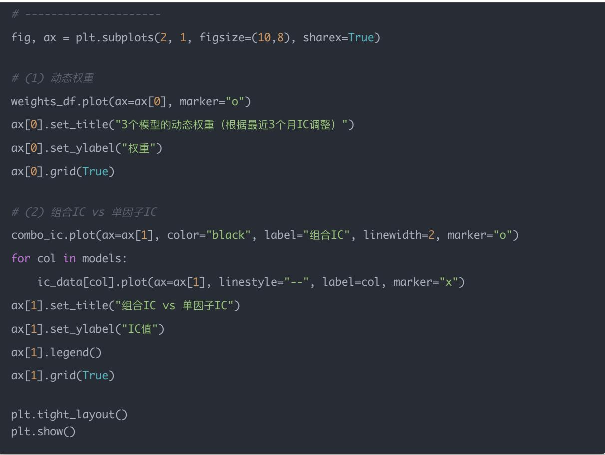

## 量化交易入门指南：第28天 - 多模型组合策略

原创 逻辑与流 逻辑与流 2025年10月 1 日 01:29 北京 听全文

本文深入探讨了量化交易中的多模型组合策略,从单一模型的局限性出发,详细介绍了平均法 加权平均法 动态加权 模型堆叠等多种组合方式 通过具体的Python代码实现和可视化分析,帮助读者理解模型组合的核心思想 动态权重调整机制 因子与模型的关系,掌握从单一模型到多模型融合的完整技能体系,构建更加稳健的量化投资策略。

## 学习时间

理论学习: 25分钟

代码实践: 40分钟

思考总结: 15分钟

总计: 80分钟

## 一 背景：从单模型到多模型

到目前为止,你已经学过:

单因子 / 多因子选股：使用财务指标 技术指标进行股票筛选

回测（整体 滚动 样本外）：验证策略的有效性和稳健性

机器学习因子（XGBoost 随机森林）：利用算法自动挖掘复杂的非线性关系

但现实中,没有哪个模型能一直有效 市场环境在不断变化,牛市 熊市 震荡市的有效因子可能完全不同 因此,我们需要学会:组合不同的模型,让整体策略更稳健

## 为什么单一模型有风险?

## 单一模型的问题主要体现在:

市场环境依赖性强：一个模型可能在牛市好用,在熊市就失效

过拟合风险：模型可能只是记住了历史特定时期的模式

因子失效：某个因子可能在一段时间后不再有效

## 二 为什么要多模型组合？

### 1. 单一模型风险大

一个模型可能在牛市好用,在熊市就失效 例如:

动量因子：在趋势明显的牛市中表现优异,但在震荡市或熊市中可能失效甚至反向

价值因子：在市场回归理性时有效,但在情绪化的牛市中可能跑输大盘

### 2. 不同模型互补

不同模型具有不同的特性和优势:

模型A善于抓动量：捕捉市场趋势和惯性效应

模型B善于抓价值：识别被低估的优质股票

模型C善于抓质量：筛选盈利能力强 财务稳健的公司

组合后可以降低风险,在不同市场环境下都能保持相对稳定的表现

### 3. 降低过拟合风险

如果多个模型在不同数据 不同方法下都得出类似信号,说明这个信号更可靠,而不是某个模型的偶然发现 这类似于科学研究中的"可重复性验证"

## 三、常见的组合方式

### 1. 平均法（Simple Average）

定义

直接对多个模型的预测取平均

例子

假设模型1预测未来收益率 5%,模型2预测 7%,模型3预测 3%,则组合预测 = (5% + 7% + 3%) / 3 = 5%

优点

简单稳健：实现容易,不需要额外的参数调优

降低噪音：能平滑掉单一模型的噪音和异常值

缺点

忽视差异：没有考虑到模型好坏差异,容易被弱模型"拖后腿"

无法适应：不能根据市场环境变化调整

### 2. 加权平均法（Weighted Average）

定义

给不同模型分配不同权重,按加权平均得到组合预测

例子

如果最近价值因子更稳健,分配权重 [0.5, 0.3, 0.2] →组合预测 = 5%×0.5 + 7%×0.3 + 3%×0.2 = 5.2%。

优点

突出优势：能突出表现更好的模型

灵活性高：可以根据历史表现或专家经验设置权重

缺点

权重难定：权重分配要科学,否则可能过拟合历史

静态问题：固定权重无法应对市场环境变化

3. 动态加权（Rolling / 动态调整）

定义

权重不是固定的,而是根据模型最近的表现来动态调整

例子

如果模型1最近 6 个月 IC 平均值最高,就给它更高权重

如果模型2表现变差,就降低权重

优点

适应性强：能适应市场风格切换（比如牛市动量强,熊市价值稳）

自动优化：根据实际表现自动调整,减少人为干预

缺点

复杂度高：需要额外的回测与风险控制

追涨杀跌风险：可能出现"哪个模型最近好就用哪个"的追涨杀跌行为

4. 模型堆叠（Stacking / Meta-Model）

定义

再建一个"元模型"来学习如何组合多个模型的预测

例子

用 XGBoost 学习"什么时候价值因子有效 什么时候动量因子有效"

优点

自动学习：能捕捉复杂关系,自动学到最佳组合方式

非线性组合：可以发现模型之间复杂的交互效应

缺点

复杂度高：实现和维护成本高

过拟合风险：需要大量数据,容易过度拟合

## 实际应用建议

## 在实盘里一般是:

入门阶段：平均法（稳健）

进阶阶段：加权（手动或动态调整）

专业基金：用 stacking/meta-model（机器学习组合）

## 四 Python 示例：平均 vs 加权

让我们通过一个简单的例子来对比平均法和加权平均法:

print("� 模型组合结果：")

print(df[["month", "model1", "model2", "model3", "avg", "weighted"]])

## 输出结果

$$
\begin{array}{l l l l l l l} \text {模型组合结果:} \\ & \text {month} & \text {model1} & \text {model2} & \text {model3} & \text {avg} & \text {weighted} \\ 0 & 2 0 2 3 - 0 1 - 3 1 & 0. 0 1 9 9 3 4 & 0. 0 2 7 2 5 9 & - 0. 0 0 3 1 6 6 & 0. 0 1 4 6 7 6 & 0. 0 1 7 5 1 2 \\ 1 & 2 0 2 3 - 0 2 - 2 8 & 0. 0 0 7 2 3 5 & - 0. 0 3 7 3 9 8 & 0. 0 0 6 6 6 4 & - 0. 0 0 7 8 3 3 & - 0. 0 0 6 2 6 9 \\ 2 & 2 0 2 3 - 0 3 - 3 1 & 0. 0 2 2 9 5 4 & - 0. 0 3 1 7 4 8 & - 0. 0 1 2 2 6 5 & - 0. 0 0 7 0 2 0 & - 0. 0 0 0 5 0 0 \\ 3 & 2 0 2 3 - 0 4 - 3 0 & 0. 0 4 0 4 6 1 & 0. 0 0 3 1 3 1 & 0. 0 1 0 6 3 5 & 0. 0 1 8 0 7 6 & 0. 0 2 3 2 9 7 \\ 4 & 2 0 2 3 - 0 5 - 3 1 & \text {0 .}   {0 .}   {0 .}   {5}   {3}   {1}   {7} & - \text {0 .}   {0 .}   {1}   {0}   {3}   {8}   {5} & - \text {0 .}   {0 .}   {0}   {4}   {0}   {1}   {0} & - \text {0 .}   {0 }   {0}   {3}   {0}   {2}   {6} & - \text {0 .}   {0 }   {0}   {1}   {2}   {5}   {9} \\ \text {5} & \text {2 .}   {2}   {3}   {-} \text {6-3 } \text {3} \text {0} & \text {0 .}   {0 .}   {0}   {5}   {3}   {1}   {7} & \text {0 .}   {0 .}   {2}   {9}   {4}   {2}   {7} & \text {0 .}   {0 .}   {0}   {0}   {6}   {2}   {5} & \text {0 .}   {0 }   {1}   {1}   {7}   {9} \text {0} & \text {0 .}   {0 }   {1}   {1}   {\dot {} }    {\dot {} }    {\dot {} }    {\dot {} }    {\dot {} }    {\dot {} }    {\dot {} }    {\dot {} }    {\dot {} }    {\dot {} }    {\dot {} }    {\dot {} }    {\dot {} }    {\dot {} }    {\dot {} }    {\dot {} }    {\dot {} }    {\dot {} }    {\dot {} }    {\dot {} }    {\dot {} } \\ \text {6} & \text {2 .}   {2}   {3}   {-} \text {7-31} & \text {.}.   \text {.}.   \text {.}.   \text {.}.   \text {.}.   \text {.}.   \text {.}.   \text {.}.   \text {.}.   \text {.}.   \text {.}.   \text {.}.   \text {.}.   \text {.}.   \text {.}.   \text {.}.   \text {.}.   \text {.}.   \text {.}.   \text {.}.   \text {.}.    \text {.}.    \text {.}.    \text {.}.    \text {.}.    \text {.}.    \text {.}.    \text {.}.    \text {.}.    \text {.}.    \text {.}.    \text {.}.    \text {.}.    \text {.}.    \text {.}.    \text {.}.    \text {.}.    \text {.}.    \text {.}.    \text {.}.    \text {.}. \\ \text {7} & \text {2 .}   {\dot{}}
$$

## 结果分析

运行后你会看到:

avg= 各模型等权平均,波动相对平滑

weighted= 按照模型1 更重要,模型3 次要 来加权,结果更偏向模型1的预测

## 五 实际意义

在量化投资中,很多基金公司都是:

同时运行 基本面模型+ 技术面模型+ 机器学习模型

然后做加权组合,避免单个模型失效导致亏损

根据市场环境动态调整权重,提高策略的适应性

这种多模型组合的方式,类似于"不要把所有鸡蛋放在一个篮子里"的分散投资原则,但应用在模型层面

## 六 动态加权示例

这里我们假设有 3 个模型（比如价值因子 动量因子 质量因子）,每个月它们各自有一个 IC 值（衡量因子预测能力） 我们用最近 3 个月的 IC 均值 来作为权重,动态调整组合预测

## Python 示例代码

import numpy as np

import pandas as pd

import matplotlib.pyplot as plt

plt.rcParams['font.sans-serif'] = ['PingFang HK']   # 或者 'Songti SC '、 'STHeiti '

plt.rcParams['axes.unicode\_minus'] = False

np.random.seed(42)

\# Step 1：模拟数据

n\_months = 24

"动量因子": np.random.randn(n\_months) \* 0.06,

}, index=dates)

print("� IC 数据：")

print(ic\_data.head())

\# Step 2：动态加权

print("\n� 组合IC：")

print(combo\_ic.head())

fig, ax = plt.subplots(2, 1, figsize=(10,8), sharex=True)

weights\_df.plot(ax=ax[0], marker="o")

ax[0].set\_title("3个模型的动态权重（根据最近3个月 IC调整）")

ax[1].set\_ylabel("IC值")

ax[1].legend()

## 输出解释

## 运行这段代码后,你会看到两张图:

某个因子最近 3 个月表现好 → 权重就提高

表现差 → 权重下降

你会看到权重曲线是动态变化的,而不是固定不变

## 第二张图 → 组合 IC（黑色粗线） vs 各单因子 IC（虚线）

组合 IC 曲线更平滑,不会像单个因子那样大起大落

说明动态加权能平滑掉噪音,同时保留因子有效性

在某些时期,组合 IC 可能不是最高的,但整体波动更小 更稳定

## 七 易混淆概念：因子 vs 模型

### 1. 因子 ≠ 模型,但可以成为模型的"输入"

因子（Factor）

就是我们常说的 PE ROE 动量 波动率 这些指标,本质是股票的特征值

模型（Model）

是一个预测收益的规则,可能基于单一因子,也可能是多个因子的组合

举例

如果我用 PE来预测下月收益,那这就是一个 单因子模型（PE模型）

如果我用 ROE来预测,就是一个 ROE模型

如果我用 XGBoost同时利用 PE ROE 动量 波动率做预测,这就是一个 多因子模型（机器学习模型）

### 2. 为什么在代码里写成 "价值因子" "动量因子" "质量因子"？

这里其实是 把"单因子模型"当作独立模型:

"价值因子模型"= 只用价值类因子（PE PB等）预测未来收益

"动量因子模型"= 只用动量类因子（过去收益率）预测未来收益

"质量因子模型"= 只用质量类因子（ROE 利润率）预测未来收益

所以在示例代码里:

我们模拟了这 3 种"单因子模型"各自的表现（用 IC 衡量预测能力）

然后再用 动态加权来组合它们 → 这就是 模型组合（Model Ensemble）

### 3. 为什么要组合？

就像投资里"不要把鸡蛋放在一个篮子里":

价值因子可能在某些年份很好用,但在牛市里失效

动量因子在趋势行情里很好用,但在震荡市里可能反向

质量因子更稳健,但爆发力不足

单因子不够稳定,把它们 组合（等权 / 动态加权）才能得到一个 更稳健的因子模型

### 4. 总结

所以,代码里写的 "价值因子" "动量因子" "质量因子",严格说就是 3 个"单因子模型",而不是"单纯的因子"。

## 八 今日思考题

### 1. 如果模型1（ROE）在牛市表现好,模型2（动量）在震荡市好,你会如何做加权？

核心思路

让适合的模型在合适的市场里权重大一些

## 策略设计

在牛市→ 提高 ROE 模型 权重,因为盈利能力强的公司往往跑赢

在震荡市→ 提高 动量模型 权重,因为市场缺乏趋势时,短期动量信号更有参考价值

## 实现方法

1. 基于市场状态的切换：比如用波动率 / 市场趋势指标来判断当前是牛市还是震荡市

2. 动态加权：根据过去一段时间（如 3-6 个月）的表现（IC 或收益率）来调整权重

2. 你觉得应该固定权重,还是根据市场环境动态调整权重？

## 固定权重

优点：简单稳定,避免过拟合

缺点：可能在某些行情下表现不佳

## 动态调整权重

优点：更灵活,可以适应市场环境

缺点：要注意噪音,避免频繁调整

实际操作建议

很多量化团队采用 "半固定 + 动态"的方式:

给每个模型一个 基础权重（比如价值30% 动量30% 质量40%）

再允许 ±10% 的浮动,根据最近的表现调整

这样既避免了全靠噪音做决定,也不会死板

### 3. 多模型融合能减少风险,但是否可能也会"稀释"掉收益？

## 是的,会有这种情况

风险降低：融合后,单个模型的极端表现被"平均化",回撤更小

收益被稀释：如果某个模型在某段时间特别强,融合后它的优势可能被其他弱模型拉低

## 这是一个 风险-收益权衡

如果你追求稳定（比如公募基金 长期稳健策略）,融合更合适

如果你追求高收益 能接受大回撤（比如私募里某些进攻性策略）,可能会让某个强模型占更大比重

## 一句话总结

市场状态决定权重,不是一成不变

动态调整 > 固定加权,但要避免过拟合

融合降低风险,但可能稀释收益,需要结合投资目标来选择

## 九、总结

多模型组合策略是量化交易中提高策略稳健性的重要方法 通过将不同特性的模型进行有机组合,我们可以:

1. 降低单一模型风险：避免因某个模型在特定市场环境下失效而导致的整体策略失败

2. 发挥模型互补优势：不同模型在不同市场环境下的优势可以相互补充

3. 提高策略稳定性：组合后的策略波动更小,回撤更可控

从简单的平均法到复杂的模型堆叠,我们有多种组合方式可以选择 实际应用中,需要根据自 己的资源经验和目标来选择合适的组合方法 动态加权是一个很好的进阶选择,它能够根据市场环境的变化自动调整模型权重,在稳健性和适应性之间取得平衡

记住,模型组合不是万能的,它需要建立在每个单独模型都经过严格验证的基础之上 同时,组合策略本身也需要通过样本外检验和滚动回测来验证其有效性 只有这样,我们才能构建出真正稳健 可靠的量化投资策略
