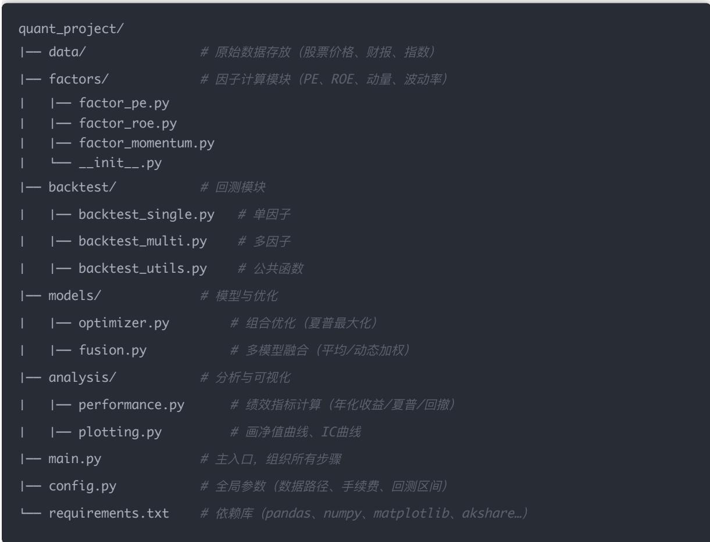
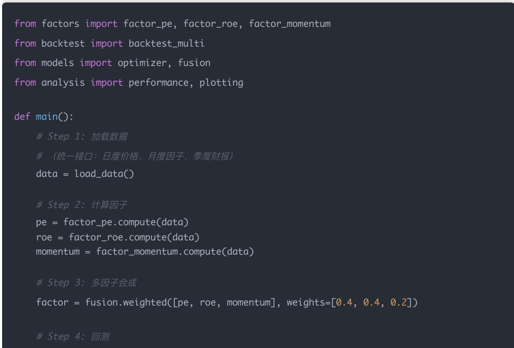
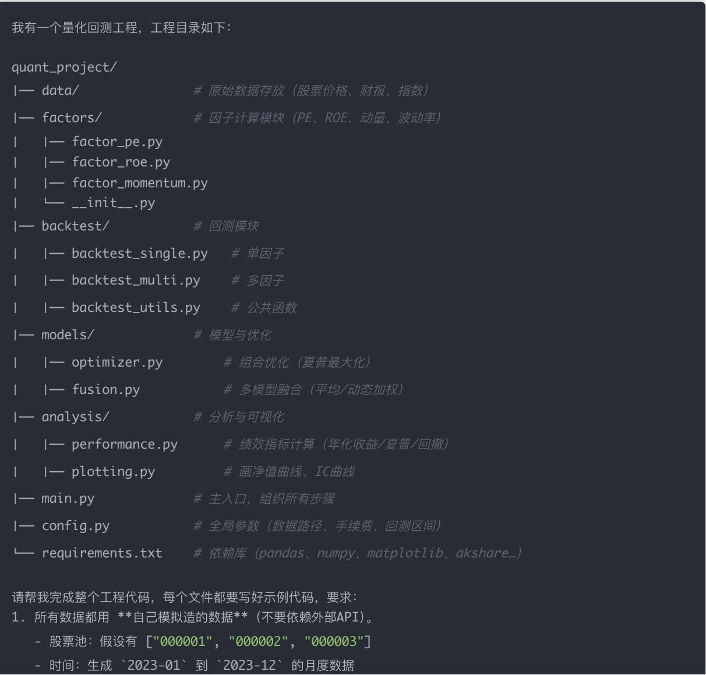

## 量化交易入门指南：第29天 - 项目工程整合

原创 逻辑与流 逻辑与流 2025年10月 3 日 12:04 北京 1人

本文系统讲解量化策略的工程化实现方法，从之前学习的分散知识点出发，详细介绍如何将单因子 多因子 回测 中性化 组合优化 多模型融合等模块整合成一个完整的工程化框架 通过清晰的项目结构设计 主流程编排示例 完整研究流程图以及模块对应关系的详细分析，帮助读者理解量化策略从研究到实盘的完整工程化路径，掌握可复用<sub>、</sub>可维护<sub>、</sub>可扩展的量化项目开发技能<sub>。</sub>

## 学习时间

理论学习: 30分钟

代码实践: 50分钟

思考总结: 20分钟

总计: 100分钟

## 一 背景：从分散实验到工程化框架

到目前为止，我们已经学习了量化交易的诸多核心技术：

单因子与多因子选股：从基础的财务指标到复杂的多因子组合

回测体系：整体回测 滚动回测 样本外验证

风险控制：行业中性化 市值中性化

组合优化：均值-方差优化 风险平价

模型融合：多模型组合 动态权重调整

这些知识点构成了量化策略的完整技术栈 然而，在实际的量化研究或团队开发中，如果这些模块仍然以分散的notebook小实验形式存在，会面临诸多问题：

## 分散实验的局限性

1. 代码重复：每个实验都要重新写数据加载 因子计算等基础代码

2. 难以维护：修改一个功能需要在多个notebook中同步更新

3. 协作困难：团队成员之间难以复用彼此的代码

4. 部署困难：从研究环境到生产环境需要大量重构工作

## 工程化的价值

将策略研究整合到工程化框架中，可以带来：

模块复用：一次开发，多次使用

易于维护：修改只需在一处进行

便于协作：统一的接口和规范让团队协作更顺畅

快速部署：研究成果可以快速转化为生产代码

因此，学会把"策略研究 → 回测 → 分析 → 输出结果"整合成一个可复用的项目结构，是从量化研究者向专业量化开发者转变的关键一步

## 二<sub>、</sub>Day29 学习目标

本节课的核心目标是：学会把策略研究的完整流程整合成一个可复用<sub>、</sub>可维护的工程化项目结构<sub>。</sub>

具体包括：

1. 掌握量化项目的标准目录结构设计

2. 理解各模块的职责划分与接口设计

3. 学会编写主流程代码，串联所有模块

4. 了解从数据到分析的完整工程化流程

5. 掌握使用AI工具快速生成工程代码的方法

## 三 完整的工程结构设计

一个专业的量化项目应该具备清晰的目录结构，每个模块各司其职，互不干扰又紧密协作 下面是一个经过实践检验的工程结构：



│── config.py # 全局参数 （数据路径 手续费 回测区间）

这个结构遵循了软件工程的几个重要原则：

1. 单一职责原则：每个模块只负责一项功能

factors/ 只负责因子计算

backtest/ 只负责回测逻辑

analysis/ 只负责结果分析

2. 高内聚低耦合：模块内部紧密相关，模块之间松散连接

各模块通过标准接口交互

修改一个模块不影响其他模块

### 3. 可扩展性：方便添加新功能

新增因子只需在 factors/ 目录下添加新文件

新增优化方法只需在 models/ 目录下扩展

### 4. 配置与代码分离：

所有参数集中在 config.py 管理

修改参数不需要改动业务代码

## 四 主流程逻辑设计

主流程文件 main.py 是整个项目的指挥中心，负责协调各个模块的执行顺序 一个典型的量化策略主流程包含以下步骤：



\# Step 5：优化 (可选)

optimized = optimizer.max\_sharpe(results)

\# Step 6：绩效分析

stats = performance.evaluate(optimized) print(stats)

\# Step 7：可视化

plotting.plot\_equity\_curve(optimized)

if \_\_name\_\_ == "\_\_main\_\_":

main()

## 流程设计要点

这个主流程设计体现了几个关键思想：

1. 线性流水线：数据按照固定的顺序流经各个模块

数据加载 → 因子计算 → 因子合成 → 回测 → 优化 → 分析

2. 统一接口：每个模块都提供标准的输入输出接口

因子模块接收原始数据，输出因子值

回测模块接收数据和因子，输出回测结果

3. 可选步骤：某些步骤可以根据需要选择性执行

优化步骤可以跳过，直接分析回测结果

可视化可以根据需要选择不同的图表类型

4. 易于调试：每一步都是独立的函数调用

可以在任何一步暂停，检查中间结果

可以单独测试某个模块的功能

## 五 完整研究流程可视化

为了更直观地理解量化选股的工程化思路，我们用流程图将整个研究过程串联起来 这个流程图展示了从数据获取到最终报告输出的完整链路：

## flowchart LR

A[数据获取] --> B[因子计算]

B --> C[因子处理 / 中性化]

C --> D[因子合成 (等权/加权/机器学习)]

D --> E[回测系统]

E --> F[绩效分析]

F --> G[组合优化 (最大化夏普/风险约束)]

G --> H[多模型融合 (平均/动态权重)]

## H --> I[可视化与报告输出]

subgraph Inputs[输入数据]

A1[行情数据\n(日度价格<sub>、</sub>成交量)]

A2[财务数据\n(PE, ROE, 净利润等)]

A3[宏观/行业数据\n指数 利率 经济指标]

end

A1 --> A

A2 --> A

A3 --> A

subgraph Outputs[输出结果]

O1[净值曲线]

O2[绩效表\n(年化收益<sub>、</sub>夏普<sub>、</sub>最大回撤)]

O3[多空组合表现]

end

$$
I \dashrightarrow 0 1
$$

$$
I \dashrightarrow 0 2
$$

$$
I \dashrightarrow 0 3
$$

� 提示：上面的Mermaid代码可以转换成可视化流程图！你可以：

访问 Mermaid Live Editorhttps://mermaid.live/

将上面的代码复制粘贴到编辑器中

即可看到完整的交互式流程图

## 流程详细解读

这个流程图展示了量化策略研究的9个关键步骤，让我们逐一深入理解：

1. 数据获取 (Data Acquisition)

这是整个流程的起点，需要收集三大类数据：

行情数据：股票日度价格 成交量 换手率等交易数据

财务数据：PE PB ROE 净利润等基本面指标

宏观/行业数据：市场指数 行业分类 宏观经济指标

数据质量直接影响后续所有环节，因此需要：

确保数据的完整性（无大量缺失）

处理数据的时间对齐问题（日度 月度 季度数据的匹配）

清洗异常值和错误数据

2. 因子计算 (Factor Calculation)

基于原始数据计算各类量化因子：

价值类因子：PE PB PS EV/EBITDA 等估值指标

质量类因子：ROE ROA 毛利率 净利率等盈利指标

动量类因子：过去1/3/6/12月收益率 相对强弱指标

波动率因子：历史波动率 贝塔系数等风险指标

技术类因子：MA<sub>、</sub>MACD<sub>、</sub>RSI 等技术指标

3. 因子处理/中性化 (Factor Processing)

原始因子往往包含行业或市值的系统性偏差，需要进行标准化处理：

行业中性化：消除行业因素的影响，使因子在不同行业间可比

市值中性化：消除市值因素的影响，避免因子偏向大盘股或小盘股

标准化：Z-score标准化，使不同因子处于同一量级

### 4. 因子合成 (Factor Combination)

将多个处理后的因子合成为综合评分：

等权合成：简单平均，适合因子能力相近的情况

加权合成：根据历史表现或专家经验分配权重

机器学习合成：使用XGBoost 随机森林等模型自动学习权重

### 5. 回测系统 (Backtesting)

基于因子评分进行历史模拟交易：

单期回测：单个时间点的横截面选股

多期回测：连续多个周期的滚动选股

成本考虑：计入交易成本 冲击成本 换手率限制

6. 绩效分析 (Performance Analysis)

## 评估策略的历史表现：

收益指标：年化收益率 累计收益率 超额收益

风险指标：波动率 最大回撤 下行波动率

风险调整收益：夏普比率 索提诺比率 信息比率

因子质量：IC（信息系数） IR（信息比率） 分组收益

7. 组合优化 (Portfolio Optimization)

在风险约束下寻找最优持仓权重：

均值-方差优化：Markowitz模型，平衡收益与风险

最大化夏普：在给定风险水平下追求最高夏普比率

风险平价：各资产对组合风险的贡献相等

风险约束：设置波动率上限 回撤限制 集中度约束

### 8. 多模型融合 (Ensemble Models)

结合多个策略或模型提高稳健性：

简单平均：多个模型预测的等权平均，降低单一模型风险

动态加权：根据近期表现动态调整各模型权重

IC加权：根据历史IC值分配权重

集成学习：使用Stacking等方法融合多个基础模型

9. 可视化与报告 (Visualization & Report)

## 将分析结果以直观的方式呈现：

净值曲线：策略净值随时间的变化，包括基准对比

绩效表格：收益 风险 风险调整收益等关键指标

多空组合：多头组合<sub>、</sub>空头组合的分别表现

因子分析：IC时序图 分组收益图 因子暴露分析

## 六 模块化工程框架映射

理解了完整流程后，我们需要将流程中的每一步映射到具体的代码模块 这种映射关系构成了工程化实现的骨架

## 流程 → 模块对应关系

让我们建立流程图与工程目录之间的详细对应关系：

1. 数据获取 (Data) → data/+ 数据加载模块

输入：

行情数据（日度价格 成交量）

财务数据（PE ROE 净利润等）

行业分类 市值数据

对应模块：

data\_loader.py → 从 AkShare / Tushare / 聚宽 拉取数据

\# data\_clean.py → 缺失值处理、频率对齐(daily / monthly / quarterly)

## 主要功能：

统一数据接口，支持多种数据源

数据缓存机制，避免重复下载

数据预处理，确保数据质量

2. 因子计算 (Factor Calculation) → factors/

## 输入：原始数据（价格 财务 行业等）

## 对应模块：

factors/basic\_factors.py → PE、PB、ROE、波动率、动量

factors/technical\_factors.py → MA、RSI、MACD

factors/alpha\_factors.py → 自定义 alpha 公式

## 主要功能：

每个因子一个独立函数或类

统一的输入输出接口

因子计算的向量化实现，提高效率

3. 因子处理/中性化 (Factor Processing) → factors/

## 对应模块：

\# factors/neutralization.py → 行业中性化、市值中性化

\# factors/standardize.py → Z-score 标准化

## 主要功能：

行业中性化：对行业均值进行回归，取残差

市值中性化：对市值因子进行回归，取残差

标准化：均值为0，标准差为1的变换

4. 因子合成 (Factor Combination) → models/

## 对应模块：

model/linear\_combine.py → 等权 / 加权打分

\# model/ml\_combine.py → 机器学习 (XGBoost、随机森林)

## 主要功能：

线性组合：简单加权求和

非线性组合：使用机器学习模型

权重优化：根据历史IC优化权重

5. 回测系统 (Backtest) → backtest/

## 对应模块：

\# backtest/single\_period.py → 单期横截面回测

\# backtest/multi\_period.py → 多期分层回测

\# backtest/rolling.py → 滚动窗口回测

\# backtest/transaction\_cost.py → 加入交易成本、换手率

## 主要功能：

单期回测：某个时间点的选股效果

多期回测：连续时间的策略表现

成本模拟：交易费用 冲击成本 滑点

6. 绩效分析 (Performance Analysis) → analysis/

## 对应模块：

\# analysis/performance.py →年化收益、波动率、夏普比率、最大回撤

\# analysis/ic\_ir.py → IC/IR 评估因子质量

\# analysis/plotting.py → 净值曲线、超额收益曲线

## 主要功能：

收益指标：年化 累计 超额收益

风险指标：波动率 最大回撤 VaR

风险调整收益：夏普 索提诺 卡玛比率

7. 组合优化 (Portfolio Optimization) → optimization/

## 对应模块：

\# optimization/mean\_variance.py → 均值-方差优化 (Markowitz)

\# optimization/risk parity.py → 风险平价组合

optimization/max\_sharpe.py → 最大化夏普比率

## 主要功能：

均值-方差优化：求解最优权重

风险约束：波动率上限 集中度限制

二次规划求解器调用

8. 多模型融合 (Ensemble Models) → ensemble/

对应模块：

ensemble/simple\_average.py →简单平均

ensemble/dynamic\_weight.py →动态加权 (IC加权、滚动加权)

## 主要功能：

简单平均：多个因子或模型的等权平均

IC加权：根据历史IC值分配权重

动态调整：根据滚动窗口表现调整权重

9. 可视化与报告 (Visualization & Report) → report/

## 对应模块：

report/report\_generator.py → 自动生成研究报告(净值曲线 + 表格）

report/dashboard.py → 可交互仪表盘 (Streamlit / Dash)

## 主要功能：

自动报告：生成PDF或HTML格式的研究报告

交互式仪表盘：实时调整参数查看效果

图表库：可复用的图表模板

## 映射总结

## 通过上述映射，我们建立了流程图里的每一步与工程模块的一一对应关系：

```gitattributes
数据 → 因子 → 回测 → 优化 → 分析 → 报告
↓    ↓    ↓    ↓    ↓    ↓
data_ factors backtest optimization analysis report
loader    /*.py    /*.py    /*.py    /*.py    /*.py
```

这种清晰的映射关系带来的好处：

1. 开发有章可循：知道每个功能应该放在哪个模块

2. 维护有迹可寻：问题定位快速，修改范围明确

3. 扩展有序可控：新增功能按照规范添加到对应模块

4. 协作有规可依：团队成员按照统一的架构协作开发

## 七 一站式工程代码生成

为了帮助大家快速搭建完整的工程框架，我准备了一个"一站式提示词" 这个提示词可以直接喂给Cursor （或类似的 AI 编程助手），让它自动生成完整的工程代码

## 提示词设计说明

由于本文篇幅限制，我们不在正文中列举所有代码实现 取而代之，这个提示词包含了：

完整的工程目录结构

各文件的功能说明

模拟数据的生成逻辑（不依赖外部API）

所有模块的接口规范

可运行的示例代码

## 这样做的好处是：

1. 快速启动：几分钟内得到完整可运行的代码框架

2. 可定制：生成的代码可以根据需求修改

3. 学习参考：通过阅读生成的代码学习工程化实践

## 完整提示词

## 我有一个量化回测工程，工程目录如下：

\# 原始数据存放 （股票价格 财报 指数）



\# 因子计算模块 （PE ROE 动量 波动率）

│   │── backtest\_single.py   # 单因子

\# 多因子

│── models/

\# 组合优化 （夏普最大化）

│   │── fusion.py

│── analysis/

\# 分析与可视化

│   │── performance.py

│   │── plotting.py

\# 画净值曲线 IC曲线

│── main.py

\# 主入口 组织所有步骤

│── config.py

\# 全局参数 （数据路径 手续费 回测区间）

1. 所有数据都用 \*\*自 己模拟造的数据\*\*（不要依赖外部API）

- 股票池：假设有 ["000001", "000002", "000003"]

- 时间：生成 \`2023-01\` 到 \`2023-12\` 的月 度数据

- 价格数据：用随机游走生成，确保收盘价始终 > 0

- 财务数据：比如 EPS 随机 0.5\~2.0，ROE 随机 5%\~20%

因子分数：随机生成 0\~1 的浮点数

2. 单因子回测：每月选择 top2 股票，等权持有到下个月

3. 多因子回测：先把 PE<sub>、</sub>ROE<sub>、</sub>动量合成一个综合打分（等权或加权），再选股

4. 回测中计算：- 毛收益率 gross\_ret- 净收益率 net\_ret（考虑手续费）- 换手率 turnover累积净值曲线

5. 分析模块输出：年化收益 夏普比率 最大回撤画出净值曲线

6. 模型与优化模块：optimizer.py：实现均值-方差优化（Markowitz），输出最优权重fusion.py：实现多模型融合（简单平均 + 动态加权）

7. main.py 要能跑通整个流程：- 造数据- 调用因子计算- 回测- 输出绩效指标画图

8. 所有文件必须有可运行的示例（即使是造数据）9. 代码里写清楚注释，方便我理解

## 特别注意：

定要用模拟造数据，不要调用 akshare 或 tushare造数据逻辑示例：- 收盘价：price = 10 + np.cumsum(np.random.randn(len(dates)))EPS：np.random.uniform(0.5, 2.0)ROE：np.random.uniform(0.05, 0.2)动量：过去N期收益率

回测循环的逻辑要能跑通

## 另外，这里是工程调用关系图（Mermaid）：

\`\`\`mermaid

flowchart TDmain[main.py 主入 口] --> config[config.py 配置]

main --> factors[因子计算模块] factors --> factor\_pe[PE 因子] factors --> factor\_roe[ROE 因子] factors --> factor\_momentum[动量因子]

main --> backtest[回测模块] backtest --> backtest\_single[单因子回测] backtest --> backtest\_multi[多因子回测] backtest --> backtest\_utils[回测工具函数]

main --> models[模型与优化] models --> optimizer[组合优化] models --> fusion[多模型融合]

main --> analysis[分析与可视化] analysis --> performance[绩效指标] analysis --> plotting[画图]

data[(data 数据存放)] --> factors

factors --> backtest

backtest --> analysis

models --> analysis

## ### 使用方法

1. \*\*复制提示词\*\*：将上述完整提示词复制到剪贴板

2. \*\*打开AI助手\*\*：打开Cursor<sub>、</sub>GitHub Copilot Chat或其他AI编程助手

3. \*\*粘贴执行\*\*：将提示词粘贴到对话框，让AI生成代码

4. \*\*验证运行\*\*：检查生成的代码，运行main.py验证功能

5. \*\*按需修改\*\*：根据自 己的需求调整参数和逻辑

\### 提示词的优势

这个提示词经过精心设计，具有以下特点：

1. \*\*自包含\*\*：不依赖任何外部数据源，使用模拟数据

2. \*\*完整性\*\*：涵盖从数据到分析的完整流程

3. \*\*可运行\*\*：生成的代码可以直接运行，无需额外配置

4. \*\*可学习\*\*：代码包含详细注释，便于理解和学习

5. \*\*可扩展\*\*：在此基础上可以方便地添加新功能

##八、工程化最佳实践

在实际开发中，除了基本的项目结构，还有一些工程化的最佳实践值得遵循：

\### 1.配置管理

将所有可配置参数集中在 \`config.py\` 中：

```python
# config.py
class Config:
    # 数据配置
    DATA_PATH = "./data/"
    START_DATE = "2023-01-01"
    END_DATE = "2023-12-31"

    # 回测配置
    COMMISSION_RATE = 0.001  # 手续费率
    SLIPPAGE = 0.001  # 滑点

    # 因子配置
    FACTOR_WEIGHTS = {
    'pe': 0.4,
    'roe': 0.4,
    'momentum': 0.2
    }

    # 选股配置
    TOP_N = 10  # 选择前N只股票
```

## 优势：

参数修改不需要改动业务代码

便于参数调优和敏感性分析

支持多环境配置（开发 测试 生产）

### 2. 日 志记录

在关键步骤添加日志，便于调试和监控：

import logging

logging.basicConfig( level=logging.INFO, format='%(asctime)s - %(name)s - %(levelname)s - %(message)s

logger = logging.getLogger(\_\_name\_\_)

def main():logger.info("开始加载数据...")data = load\_data()logger.info(f"数据加载完成 共{len(data)}条记录")

logger.info("因子计算完成")

## 优势：

追踪程序执行流程

快速定位问题

记录关键指标变化

### 3. 单元测试

## 为关键模块编写单元测试：

\# tests/test\_factors.py

import unittest

from factors import factor\_pe

class TestFactorPE(unittest.TestCase):

def test\_compute(self):

#准备测试数据

test\_data = ...

\# 计算因子

result = factor\_pe.compute(test\_data)

#验证结果

self.assertEqual(len(result), len(test\_data))

## 优势：

确保代码质量

防止修改引入bug

文档化代码行为

### 4. 版本控制

## 使用Git进行版本管理：

#.gitignore

data/

\*.pyc

\_\_pycache\_\_/

.ipynb\_checkpoints/

results/

\*.log

## 优势：

追踪代码变更历史

支持多人协作

便于回滚错误修改

### 5. 文档完善

## 为项目编写清晰的README：

\# 量化回测工程

\## 项目简介

这是一个完整的量化选股回测框架...

\## 快速开始

1. 安装依赖：\`pip install -r requirements.txt\`

2. 运行主程序：\`python main.py\`

\## 模块说明

- factors/：因子计算模块

- backtest/：回测引擎

- ...

\## 使用示例

## 优势：

新成员快速上手

降低维护成本

提升项目专业度

## 九 从研究到生产的路径

工程化不仅仅是代码组织，更重要的是建立从研究到生产的完整流程：

## 研究阶段

1. 探索性分析：在Jupyter Notebook中快速实验

2. 因子验证：单因子IC测试 分组回测

3. 策略原型：初步的多因子组合

## 工程化阶段

1. 代码重构：将notebook代码模块化

2. 接口标准化：统一各模块的输入输出

3. 测试覆盖：编写单元测试和集成测试

## 生产部署阶段

1. 性能优化：向量化计算 并行处理

2. 稳定性保障：异常处理 容错机制

3. 监控告警：实时监控策略表现 异常告警

## 持续迭代

1. A/B测试 ：对比新旧策略表现

2. 参数调优：在生产环境持续优化

3. 因子更新：定期评估因子有效性，淘汰失效因子

## 十 今日思考题

1. 为什么要把notebook实验转化为工程化代码？直接用notebook不行吗？

## Notebook的局限性：

难以复用：每次实验都要复制粘贴大量代码

不易维护：代码分散在多个cell中，修改困难

协作困难：Git对notebook的版本控制支持不好

性能问题：无法进行深度优化，难以并行化

生产受限：无法直接部署到生产环境

## 工程化的优势：

模块复用：一次编写，到处使用

团队协作：统一规范，多人并行开发

快速部署：研究成果可以快速上线

持续优化：便于性能调优和功能迭代

## 实践建议：

研究阶段用Notebook快速验证想法

验证成功后立即工程化，形成可复用模块

维护一个标准的工程模板，快速搭建新项目

### 2. 在多人协作的量化团队中，如何保证代码质量和一致性？

## 代码规范：

统一的代码风格（PEP8 Black格式化）

统一的命名规范（变量 函数 类的命名约定）

统一的注释规范（docstring格式）

## 代码审查：

Pull Request机制：所有代码合并前必须review

自 动化检查：集成Pylint Flake8等工具

单元测试要求：新功能必须有测试覆盖

## 架构规范：

明确的模块划分：每个人负责特定模块

标准的接口定义：模块间通过约定接口交互

文档要求：重要模块必须有使用文档

## 协作流程：

使用Git分支策略（如Git Flow）

定期代码同步会议

建立公共模块库，避免重复开发

### 3. 如何判断一个量化项目的工程化水平？

## 初级工程化：

## 有基本的目录结构

✅ 代码和配置分离

✅ 能够运行完整流程

## 中级工程化：

✅ 模块化设计，职责清晰

✅ 有单元测试覆盖

✅ 有日志和异常处理

✅ 配置管理完善

## 高级工程化：

✅ 高度可复用，组件化设计

✅ 完整的CI/CD流程

✅ 性能优化（并行 缓存）

✅ 监控和告警机制

✅ 完善的文档体系

## 评估维度：

1. 可维护性：代码是否容易理解和修改

2. 可扩展性：新增功能是否容易

3. 可测试性：是否便于编写和运行测试

4. 可部署性：是否能够快速部署到生产环境

5. 可监控性：运行状态是否可观测

### 4. 工程化会不会降低研究的灵活性？

平衡之道： 工程化和灵活性并不矛盾，关键在于设计好抽象层次：

## 保持灵活性的方法：

插件化架构：核心框架稳定，功能以插件形式扩展

配置驱动：通过配置文件控制行为，无需修改代码

接口抽象：定义抽象接口，实现可以灵活替换

## 实践建议：

保留研究环境（Notebook）用于快速实验

成熟的模块沉淀到工程框架

建立从研究到工程的快速转化机制

典型案例： 某量化团队的做法是维护两个代码库：

Research库：Jupyter Notebooks，快速试错

Production库：工程化代码，稳定可靠

通过 自 动化工具将Research中的成果快速迁移到Production

## 十一<sub>、</sub>总结

项目工程整合是量化交易从研究到实盘的关键一步 通过本节课的学习，我们掌握了：

## 核心要点回顾

### 1. 工程化的必要性

从分散的notebook实验到统一的工程框架

提高代码复用性 可维护性和协作效率

为生产部署奠定基础

### 2. 标准项目结构

清晰的 目 录划分：data factors backtest models analysis

单一职责原则：每个模块专注一项功能

配置与代码分离：参数集中管理

### 3. 完整研究流程

数据获取 → 因子计算 → 因子处理 → 因子合成

回测系统 → 绩效分析 → 组合优化 → 模型融合

可视化与报告输出

### 4. 流程与模块映射

每个流程步骤对应特定的代码模块

建立清晰的调用关系和数据流转

便于开发 维护和扩展

### 5. 工程化最佳实践

配置管理 日志记录 单元测试

版本控制 文档完善

从研究到生产的完整路径

## 实践建议

1. 立即行动：使用提供的一站式提示词，让AI帮你生成完整的工程框架

2. 逐步完善：在基础框架上根据自 己的需求添加功能

3. 持续学习：研究优秀开源项目的代码组织方式

4. 团队协作：在团队中推广工程化规范，提升整体效率

展望


掌握了工程化技能后，你可以：

快速迭代：新策略从想法到验证的周期大大缩短

稳定可靠：代码质量有保障，减少生产环境的意外

高效协作：团队成员可以并行开发，互不干扰

专业提升：从量化研究者向量化工程师/架构师发展

工程化不是目的，而是手段 最终目标是构建稳健盈利的量化策略 良好的工程化实践能让我们更专注于策略本身，而不是被技术细节困扰

接下来的学习中，我们将在这个工程化框架的基础上，继续深入探索更高级的量化技术，包括高频交易 风险管理 策略优化等内容 每一个新知识点都可以自然地集成到这个框架中，让你的量化工具箱越来越强大

记住：好的工程化设计，是量化策略成功的基石 从今天开始，让我们告别分散的实验代码，拥抱专业的工程化开发！
