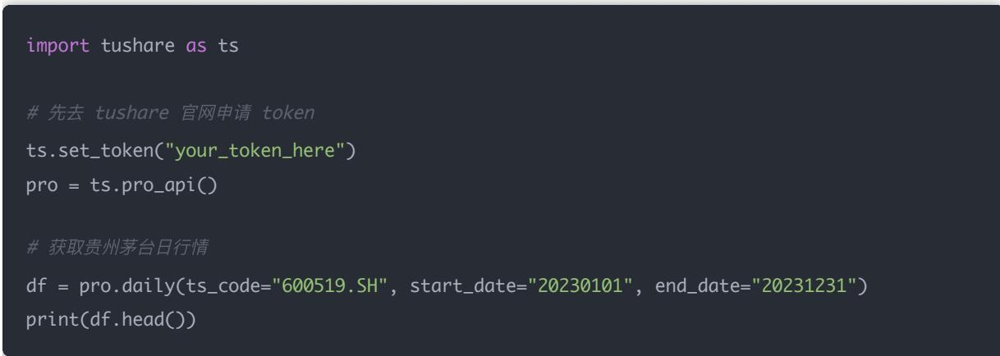
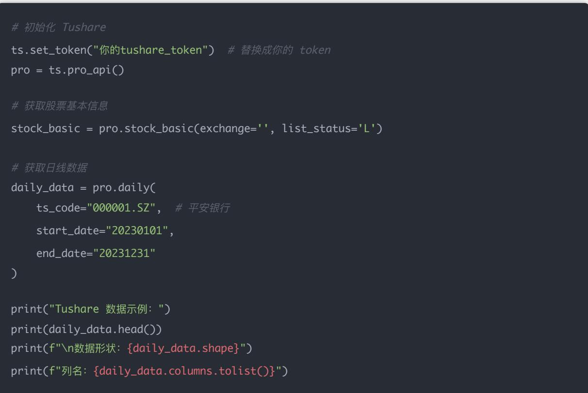
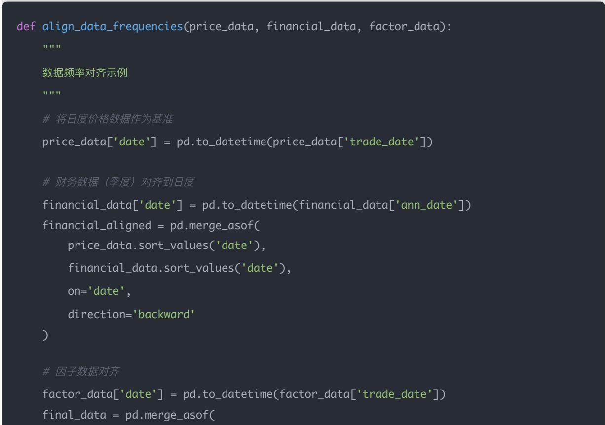
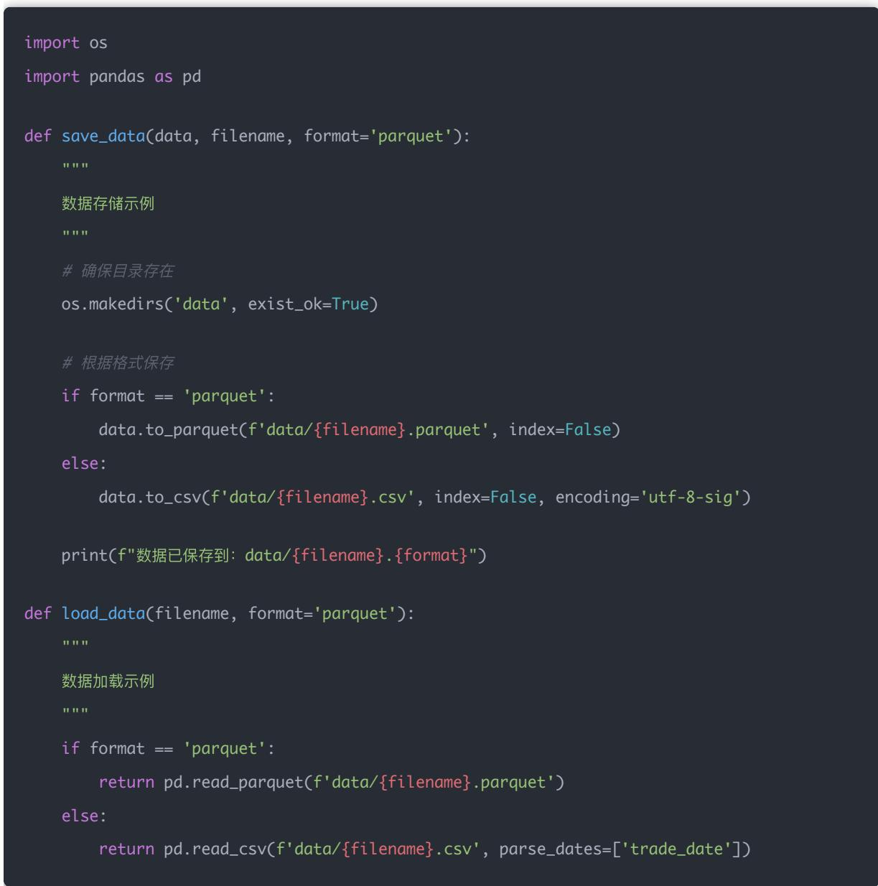
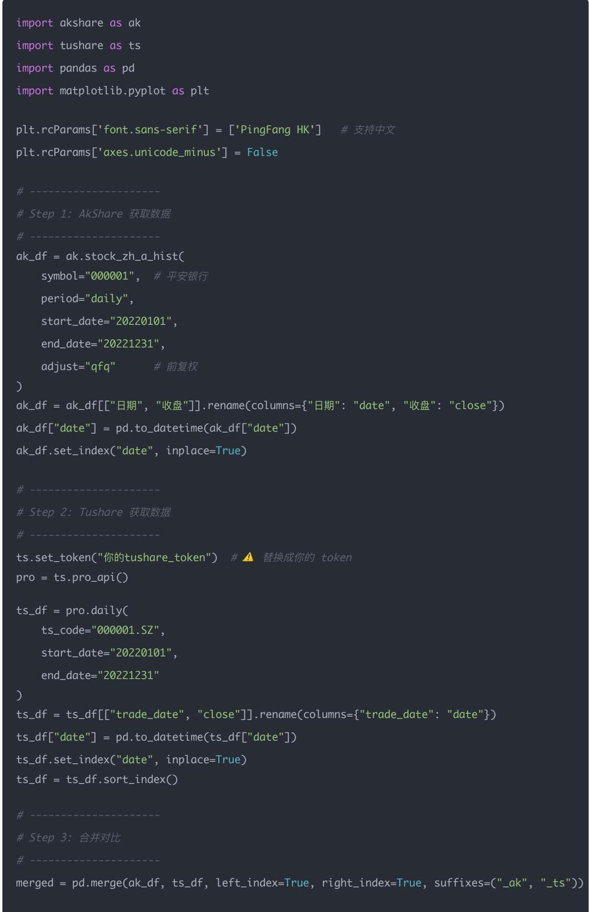
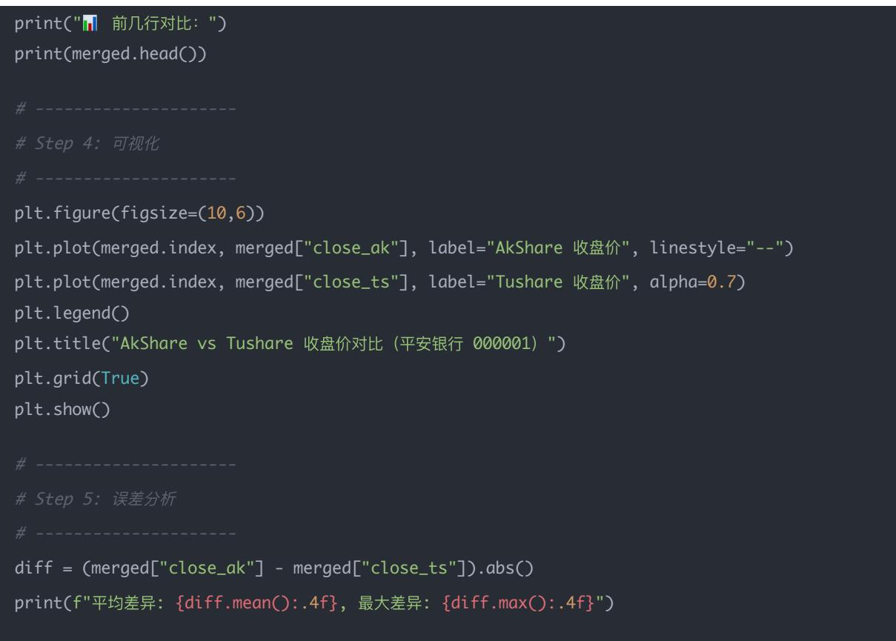
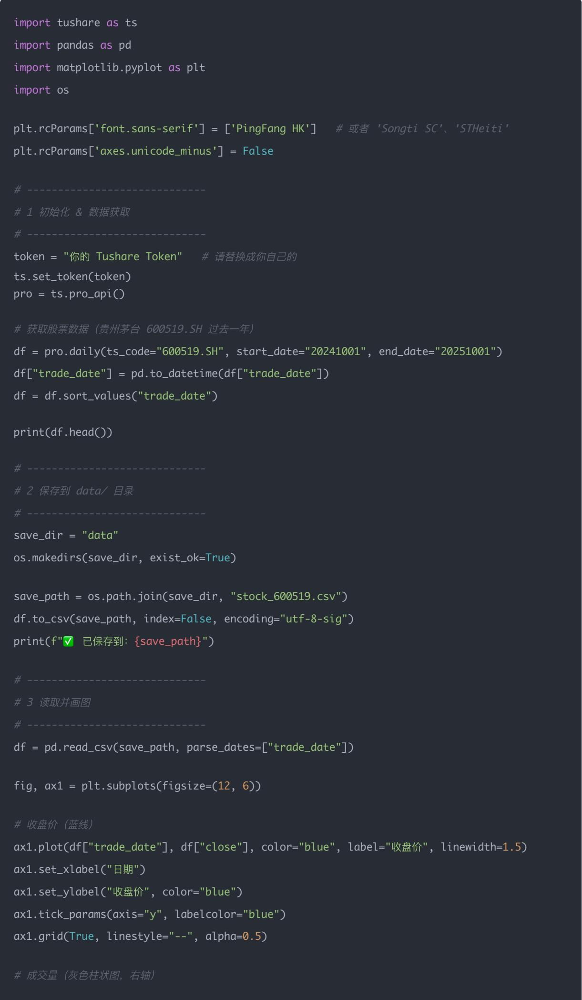

## 量化交易入门指南：第30天 – 接入 AkShare/Tushare 实盘数据

原创 逻辑与流 逻辑与流 2025年10月5日 00:03 北京 📞 1人

本文详细介绍如何从模拟数据过渡到真实金融市场数据，系统对比AkShare和Tushare两大主流数据源的特点、优缺点和适用场景。通过完整的数据获取代码、存储方案设计、对比实验分析，帮助读者掌握实盘数据接入的核心技能。同时提供个人量化工作者的数据方案建议，从学习研究到实盘交易的完整数据解决方案，让你告别模拟数据，拥抱真实市场。

## 学习时间

- 理论学习: 25分钟

- 代码实践: 60分钟

- 思考总结: 15分钟

- 总计: 100分钟

## 一、背景：从模拟数据到真实世界

前面我们都在用模拟数据（np.random 造的），今天开始进入真实世界数据：

## 为什么要接入真实数据？

在量化交易的学习过程中，模拟数据帮助我们快速验证策略逻辑和回测框架。然而，真实的市场数据具有以下特点，是模拟数据无法完全替代的：

1. 真实的市场波动模式：包含跳空、异常波动、停牌等真实市场现象

2. 完整的交易信息：真实的成交量、换手率、买卖盘口等微观结构数据

3. 准确的时间序列：真实的交易日历、除权除息、分红送股等事件

4. 丰富的财务数据：真实的财务报表、业绩预告、重大事项等基本面信息

## 两大主流数据源

- AkShare：免费、社区活跃，适合学习/研究

- Tushare：需要注册 Token，专业版数据更全

让我们深入了解这两个数据源的特点和使用方法。

## 二、安装与基础配置

### 1. 环境安装

### 2. 基础导入

import akshare as ak

import tushare as ts

import pandas as pd

import numpy as np

import matplotlib.pyplot as plt

## 三、AkShare 数据接入实战

### 1. AkShare 简介

AkShare 是一个完全开源免费的 Python 金融数据接口库，数据主要来自公开渠道（交易所、网站、政府部门）。社区活跃，接口很多，覆盖股票、期货、外汇、基金、宏观经济等。

### 2. AkShare 示例（获取股票日行情）

import akshare as ak

\# 获取上证指数 2023年的日行情

df = ak.stock\_zh\_index\_daily(symbol="sh000001")

print(df.head())

输出包括：open、high、low、close、volume 等。

### 3. AkShare 详细使用示例

\# 获取个股历史数据

stock\_df = ak.stock\_zh\_a\_hist(

symbol="000001", # 平安银行

period="daily",

start\_date="20230101",

end\_date="20231231",

adjust="qfq" # 前复权

print("AkShare 数据示例：")

print(stock\_df.head())

print(f"\n数据形状：{stock\_df.shape}")

print(f"列名：{stock\_df.columns.tolist()}")

## 四、Tushare 数据接入实战

### 1. Tushare 简介

Tushare是国内最常用的量化数据接口库，数据源来自交易所官方 $+$ 第三方机构。分为免费版和Pro专业版（需要注册Token，部分功能付费）。

### 2. Tushare 示例（获取股票日行情）



3. Tushare 详细使用示例

```python
# 初始化 Tushare
ts.set_token("你的tushare_token")  # 替换成你的 token
pro = ts.pro_api()

# 获取股票基本信息
stock_basic = pro.stock_basic(exchange='', list_status='L')

# 获取日线数据
daily_data = pro.daily(
    ts_code="000001.SZ",  # 平安银行
    start_date="20230101",
    end_date="20231231"
)

print("Tushare 数据示例：")
print(daily_data.head())
print(f"\n数据形状：{daily_data.shape}")
print(f"列名：{daily_data.columns.tolist()}")
```



## 五、实盘数据接入要点

### 1. 效率问题

```python
def get_incremental_data(last_date, data_source="akshare"):
    """
    增量数据获取示例
    """
    if data_source == "akshare":
    # AkShare 增量获取
    new_data = ak.stock_zh_a_hist(
    symbol="000001",
    start_date=last_date,
    adjust="qfq"
    )
    else:
    # Tushare 增量获取
    new_data = pro.daily(
    ts_code="000001.SZ",
    start_date=last_date
    )
    return new_data
```

### 2. 数据对齐

不同频率的数据需要统一对齐：

- 行情数据（日度/分钟）

- 财务数据（季度）

- 因子数据（有的日频，有的月频）

→ 全部使用 merge\_asof 对齐。



```python
def align_data_frequencies(price_data, financial_data, factor_data):
    """
    数据频率对齐示例
    """
    # 将日度价格数据作为基准
    price_data['date'] = pd.to_datetime(price_data['trade_date'])

    # 财务数据（季度）对齐到日度
    financial_data['date'] = pd.to_datetime(financial_data['ann_date'])
    financial_aligned = pd.merge_asof(
    price_data.sort_values('date'),
    financial_data.sort_values('date'),
    on='date',
    direction='backward'
    )

    # 因子数据对齐
    factor_data['date'] = pd.to_datetime(factor_data['trade_date'])
    final_data = pd.merge_asof(
```

### 3. 存储建议

保存到 data/ 文件夹下，用 parquet/csv 格式，避免每次都请求 API。



六、AkShare vs Tushare 详细对比

### 1. AkShare 深度分析

简介

一个完全开源免费的 Python 金融数据接口库。数据主要来自公开渠道（交易所、网站、政府部门）。社区活跃，接口很多，覆盖股票、期货、外汇、基金、宏观经济等。

## 优点

- 免费、无 Token 限制：完全开源，无需注册

- 数据类别多：A股、港股、美股、期货、期权、债券、宏观经济数据

- 更新快：几乎每天都有维护，响应社区需求迅速

- 学习友好：文档详细，示例丰富，适合初学者

## 缺点

- 数据质量有时不够稳定：比如字段变化、临时失效

- 历史深度有限：比如有些只能抓近几年

- 没有专业的复权处理、因子库、财务指标等

### 2. Tushare 深度分析

## 简介

国内最常用的量化数据接口库。数据源来自交易所官方 + 第三方机构。分为免费版和 Pro 专业版（需要注册 Token，部分功能付费）。

优点

- 数据质量高：字段规范，适合实盘/研究

- 专业版支持全面：A股日线、分钟线、财务报表、因子库，并且数据历史更全

- 有复权数据、财务数据：能直接支撑因子研究

- 稳定性好：官方支持，接口稳定

## 缺点

- 免费版功能有限：只能拉取部分数据

- Pro 专业版对调用次数有限制：比如每天 500 次

- 商业化倾向比较强：免费资源逐渐减少

### 3. 使用场景对比

<table><tr><td>特点</td><td>AkShare</td><td>Tushare</td></tr><tr><td>费用</td><td>完全免费</td><td>免费版 + 专业版（付费/限额）</td></tr><tr><td>覆盖范围</td><td>股票、期货、期权、基金、外汇、宏观</td><td>股票（尤其 A股）、财务、因子库</td></tr><tr><td>数据质量</td><td>较好，但不保证稳定</td><td>更高，结构化规范</td></tr><tr><td>更新速度</td><td>很快,社区更新</td><td>官方支持,稳定</td></tr><tr><td>适合人群</td><td>学习、研究、个人项目</td><td>专业研究、实盘、机构</td></tr></table>

### 4. 总结

- 如果你是初学 / 学习 / 做研究demo→AkShare 更合适（免费，方便）

- 如果你要做实盘 / 财务报表研究 / 专业因子挖掘 $\rightarrow$ Tushare Pro 更稳（但要注册/付费）

所以可以这样用：

- 快速试验：先用 AkShare

- 严肃回测/实盘：迁移到 Tushare Pro

## 七、AkShare 在量化交易中的意义

### 1. 适合学习 / 教学 / Demo

- 完全免费：不需要 Token，降低学习门槛

- 适合初学者：快速写策略、验证流程，比如学习因子回测、组合优化

- 替代模拟数据：你前面 Day 系列课程里的「造数据」完全可以替换成 AkShare 拉数据

### 2. 不太适合严肃的实盘交易

- 数据质量波动：有时字段名会突然改，或者数据缺失

- 历史深度有限：比如有些因子数据、财务数据不全

- 没有官方复权处理、财务规范化：不利于因子研究

所以 AkShare 更像是 "练手的数据源"，但实盘里意义确实有限。

## 八、Tushare 在量化交易中的意义

### 1. 专业数据支撑

- 全面的数据接口：日线、分钟线、复权价格、财务报表、资金流、行业分类，都有官方接口

- 专业版（Pro）数据质量高：字段标准化，适合机构使用

- 机构认可：很多机构/私募的研究框架底层直接调用 Tushare Pro

### 2. 支持严肃研究 & 实盘

- 完整的财务指标：ROE、资产负债率、现金流量表等

- 指数/行业分层数据：支持多因子模型构建

- 更适合做因子回测、多因子模型、风险控制

## 九、Python 对比实验：AkShare vs Tushare

写一段对比实验代码，你可以在本地跑一下（需要同时装 akshare 和 tushare，并且你要有 Tushare 的 token 才能用 Pro 接口）。





\# Step 5: 误差分析

## 你会看到什么？

### 1. 打印结果

- 前几行数据对比，看AkShare和Tushare的收盘价是否一致

- 输出"平均差异"和"最大差异"

## 示例输出：

前几行对比：

close\_ak close\_ts

date

$$
2 0 2 2 - 0 1 - 0 4
$$

14.82 16.66

$$
2 0 2 2 - 0 1 - 0 5
$$

15.31 17.15

$$
2 0 2 2 - 0 1 - 0 6
$$

15.28 17.12

$$
2 0 2 2 - 0 1 - 0 7
$$

15.36 17.20

$$
2 0 2 2 - 0 1 - 1 0
$$

15.35 17.19

平均差异：1.7355，最大差异：1.8400

### 2. 图像结果

- 蓝线：Tushare 收盘价

- 橙色虚线：AkShare 收盘价

- 如果完全一致，曲线会重合；如果不一致，就能看到差异

## 这样你就能一眼看出：

- AkShare 数据是否完整、复权处理是否到位

- Tushare 的数据更稳定规范（尤其是财务、因子层面）

## 十、个人量化工作者的实盘数据方案

### 1. 行情数据（股票价格、指数等）

- AkShare：免费、调用方便，适合回测、学习、研究

- Tushare Pro：更权威，适合实盘策略（数据更新及时，字段统一）

- 替代方案：券商 API（如东方财富、同花顺）、掘金量化 RiceQuant、聚宽 JoinQuant

## 建议：

- 学习/回测 $\rightarrow$ AkShare足够

- 实盘 $\rightarrow$ 最好用TusharePro（付费版）或券商API，保证数据延迟和质量

### 2. 财务数据（ROE、PE、负债率等）

- Tushare Pro：最优选，官方披露，格式清晰

- AkShare：数据源杂，字段不统一，可能缺失

## 建议：

- 回测时：可以 AkShare + 手动清洗

- 实盘时：一定要 Tushare Pro（或者 Wind/同花顺 if 有条件）

### 3. 宏观/因子数据（利率、通胀、PMI、风格因子）

- AkShare：有一些宏观数据（央行、统计局），但更新不及时

- Tushare：宏观覆盖少，更多是财务和市场数据

- 专业方案：如果预算充足 $\rightarrow$ Wind/Choice；没预算 $\rightarrow$ AkShare + 自己整理

### 4. 实盘交易接口

- 券商交易 API：中信建投、银河证券，有些提供 Python SDK

- 第三方平台：聚宽（JoinQuant）、米筐（RiceQuant）、掘金量化，支持回测 + 模拟 + 实盘一体化

如果你只想研究选股信号 $\rightarrow$ 用AkShare/Tushare就行如果你要"真下单" $\rightarrow$ 建议用掘金量化API或券商官方API

### 5. 推荐组合方案（适合个人量化）

回测/研究阶段

- 行情数据：AkShare

- 财务数据：Tushare Pro（免费版 token 也够部分研究）

- 宏观数据：AkShare 补充

## 实盘阶段

- 行情数据：Tushare Pro（付费）、券商 API

- 财务数据：Tushare Pro（付费）

- 下单交易：券商 API / 掘金量化

### 6. 总结

- AkShare $\rightarrow$ 学习、快速原型

- Tushare Pro $\rightarrow$ 实盘、稳定可靠

- 券商/聚宽/掘金 $\rightarrow$ 真正交易

## 十一、今日小练习

## 练习目标

1. 用 Tushare 获取任意一只股票近一年的日行情

2. 保存到 data/stock\_XXXX.csv

3. 再用 pandas 读出来，画一张收盘价曲线



```python
ax2 = ax1.twinx()
ax2.bar(df["trade_date"], df["vol"], color="gray", alpha=0.3, width=2, label="成交量")
ax2.set_ylabel("成交量", color="gray")
ax2.tick_params(axis="y", labelcolor="gray")

# ----
# 4 美化与图例
# ----
fig.suptitle("贵州茅台 (600519.SH) 近一年走势", fontsize=14)
fig.legend(loc="upper left", bbox_to_anchor=(0.1, 0.9))
plt.tight_layout()
plt.show()
```

## 运行后你会看到

## 图像说明：

- 蓝色折线 $\rightarrow$ 收盘价走势

- 灰色柱状图 $\rightarrow$ 每日成交量（对应右轴）

- 时间横轴 $\rightarrow$ 按交易日期排列

- 整体效果 $\rightarrow$ 类似一个简单版的「K线行情图（Close + Volume）」

## 十二、总结

## 核心要点回顾

通过今天的学习，我们掌握了从模拟数据到真实数据的关键过渡技能：

### 1. 数据源选择策略

- AkShare：学习研究阶段的理想选择，免费且易用

- Tushare：实盘交易的专业选择，数据质量高但需要付费

### 2. 数据接入核心技能

- 增量数据获取，避免重复拉取

- 多频率数据对齐，确保时间序列一致性

- 合理的数据存储方案，提高效率

### 3. 对比分析方法

- 通过实际代码对比不同数据源的质量

- 量化分析数据差异，为选择提供依据

### 4. 个人量化数据方案

- 根据使用场景选择合适的数据源

- 建立从学习到实盘的完整数据解决方案

## 实践建议

1. 立即行动：注册 Tushare 账号，获取免费 Token 开始实践

2. 循序渐进：先用 AkShare 熟悉数据接口，再过渡到 Tushare

3. 建立规范：制定自己的数据获取、存储、更新规范

4. 持续优化：根据实际需求调整数据方案

## 展望

掌握了真实数据接入技能后，你可以：

- 告别模拟数据：使用真实市场数据进行策略验证

- 提升策略质量：基于真实数据发现的市场规律更有价值

- 为实盘做准备：建立完整的数据基础设施

- 专业发展：具备量化交易的数据基础能力

记住：好的数据是量化策略成功的基础。从今天开始，让我们拥抱真实市场，用数据驱动投资决策！

接下来的学习中，我们将基于真实数据继续深入探索量化策略的各个层面，包括因子挖掘、风险控制、组合优化等高级技术。每一个新知识点都将建立在真实数据的基础上，让你的量化工具箱越来越强大。
