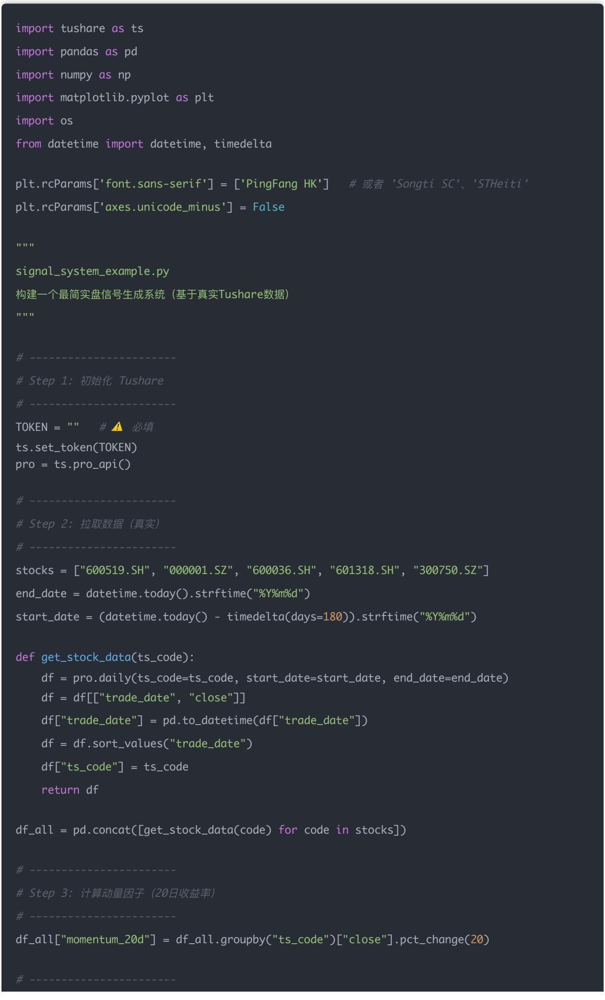
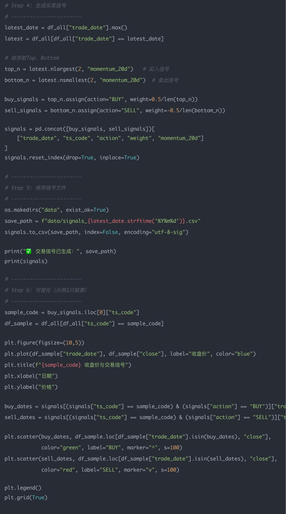

# 量化交易入门指南：第31天－构建实盘选股信号系统（信号输出）

原创 逻辑与流 逻辑与流 2025年10月7日 15:41 北京 📄 1人

本文系统讲解量化交易中最关键的环节——交易信号系统的构建。从信号的核心定义出发，深入剖析信号与因子、模型、回测的关系，详细介绍信号的生命周期管理、核心组件设计、规范化格式、风控检查机制、调度与监控方案。通过基于真实Tushare数据的完整代码实现，展示如何将研究中的买卖信号以可靠、安全、可审计的方式输出给下单系统，实现从策略研究到实盘执行的平滑过渡。

## 学习时间

- 理论学习: 30分钟

- 代码实践: 50分钟

- 思考总结: 20分钟

- 总计: 100分钟

今天我们把前面学到的因子/回测/优化知识工程化，做成一个能持续产出、可审计、可下单的实盘信号系统。目标：把"研究里生成的买卖信号"以可靠、安全、可监控的方式输出给下单系统（或交易接口）。

信号是量化实盘中最关键、也是最容易被模糊的一个概念。我们一步步来把「什么是信号（Signal）」讲透。

## 一、信号的核心定义

在量化交易中，信号（Signal）就是"告诉你买什么、卖什么、买多少、什么时候"的指令。

它是整个策略研究的「最终产物」，连接了研究 $\rightarrow$ 决策 $\rightarrow$ 下单执行的桥梁。

## 二、信号与因子、模型、回测的关系

## 可以这么理解：

<table><tr><td>层级</td><td>含义</td><td>输出结果</td></tr><tr><td>因子 (Factor)</td><td>从数据中提炼的特征,例如 PE、ROE、动量、波动率</td><td>一个数(特征值)</td></tr><tr><td>模型 (Model)</td><td>组合多个因子,预测未来收益或风险</td><td>每只股票的预测分数</td></tr><tr><td>信号 (Signal)</td><td>把预测分数转化为具体操作指令</td><td>例如「买入A,卖出B」</td></tr><tr><td>执行 (Execution)</td><td>把信号转化为真实交易动作</td><td>发单到券商接口</td></tr></table>

举个例子：

<table><tr><td>股票</td><td>PE</td><td>ROE</td><td>动量</td><td>模型预测得分</td><td>信号</td></tr><tr><td>600000.SH</td><td>10</td><td>20%</td><td>+3%</td><td>0.85</td><td>BUY(权重 0.3)</td></tr><tr><td>600001.SH</td><td>30</td><td>5%</td><td>-2%</td><td>0.10</td><td>SELL(权重 -0.2)</td></tr></table>

这里的 "BUY/SELL + 权重" 就是最终生成的信号。

## 三、信号的组成要素

一个标准化的交易信号，至少包括以下几个关键字段：

<table><tr><td>字段名</td><td>含义</td><td>示例</td></tr><tr><td>trade_date</td><td>信号生效的交易日期</td><td>2025-10-05</td></tr><tr><td>stock</td><td>股票代码</td><td>600519.SH</td></tr><tr><td>action</td><td>动作(BUY/SELL/HOLD)</td><td>BUY</td></tr><tr><td>target_weight</td><td>目标持仓权重</td><td>0.05</td></tr><tr><td>score</td><td>策略或模型分数</td><td>0.93</td></tr><tr><td>reason</td><td>生成信号的逻辑</td><td>&quot;因子分数Top10&quot;</td></tr><tr><td>version</td><td>模型版本号</td><td>v1.2.1</td></tr><tr><td>signature</td><td>签名或hash,防篡改</td><td>e4d909c2...</td></tr></table>

## 四、信号的"生命周期"

信号不是一次性的，而是一个"流":

1. 生成 (generate): 每天或每分钟生成新的信号;

2. 验证 (validate): 检查是否符合风控;

3. 发布 (publish): 写入文件/数据库/推送;

4. 执行 (execute): 由交易引擎接收并下单;

5. 回溯 (audit $^{Q}$ ): 记录信号产生的依据、参数、版本。

这样，你在实盘中任何一天的仓位变化，都能追溯到某一条信号的产生逻辑。

五、信号 ≠ 因子信号 ≠ 交易指令（区别）

<table><tr><td>概念</td><td>特点</td><td>作用</td></tr><tr><td>因子信号</td><td>从数据提取出的指标,如&quot;动量=+10%&quot;</td><td>反映市场特征</td></tr><tr><td>交易信号(Trading Signal)</td><td>将因子信号转化为操作,如&quot;买入Top10&quot;</td><td>决策层</td></tr><tr><td>下单指令(Order)</td><td>执行信号,包含价格、数量、方向</td><td>执行层</td></tr></table>

也就是说：信号是从"模型输出"到"下单执行"的中间翻译器。

## 六、通俗类比

假设你是一个基金经理：

- "我觉得茅台未来三个月要涨" $\rightarrow$ 这是观点（alpha）

- "我决定买入茅台 $5\%$ 的仓位" $\rightarrow$ 这是信号（signal）

- "我今天以1800元限价单买100手茅台" $\rightarrow$ 这是订单 (order)

所以信号就是：「基于分析和模型，做出的可执行投资决策。」

## 七、为什么要设计"信号系统"

## 在实盘中，信号系统的重要性主要体现在：

<table><tr><td>目标</td><td>说明</td></tr><tr><td>可重复性</td><td>每次生成的信号流程相同,可自动化</td></tr><tr><td>可回溯性</td><td>每条信号都能找到来源因子和模型版本</td></tr><tr><td>可监控性</td><td>能看到今天有多少BUY/SELL信号、是否异常</td></tr><tr><td>可扩展性</td><td>未来可以切换模型/市场,不影响信号结构</td></tr></table>

## 八、总结一句话

信号（Signal）就是量化策略的"下单建议书"。它承上启下：上接因子模型，下接执行系统。它告诉你——"明天该买哪些股票，卖哪些股票，买多少，凭什么。"

下面按要点拆解：架构、核心组件、信号格式、风控检查、交付方式、调度/监控、以及可运行示例代码（生成 CSV + 简单 HTTP 服务暴露信号）。示例使用前面我们造的数据思路，方便直接跑通。

## 二、核心组件说明

### 1. 数据层 (DataStore)

- 存放：日线/分钟线行情、财务数据、行业分类、历史回测结果。

- 存储建议：parquet/sqlite/timeseries DB；实盘可用 Redis 做缓存（最新行情）。

- 功能：把原始数据变成当期因子（Z-score、行业中性化、winsorize等）。

- 输出：factor\_df（字段 date, stock, factor1, factor2, ...）。

### 3. 信号生成（SignalGen）

- 功能：把因子合成总分、排序、按规则选topN或多空分层。

- 输出："交易信号": {trade\_date, stock, signal\_type, target\_weight, score, reason}。

### 4. 风控 & 头寸分配 (RiskCheck)

- 风险阈值：单股权重上限、行业暴露、日换手率上限、流动性约束。

- 头寸计算：根据目标波动率/可用资金/做多做空约束计算最终下单权重。

### 5. 信号输出 (SignalOut)

- 功能：持久化（CSV/DB），并将信号推送给下单模块：常见方式有文件、HTTP REST、消息队列（Kafka/Redis/PubSub）。

- 要求：幂等（重复发送不致重复下单）、版本化（signal\_v1）、时间戳、签名。

### 6. 下单执行（Executor）

- 职责：由券商 API 或第三方平台接单。信号系统应只负责"下单指令"产出，不直接做重试/资金划拨（交由执行引擎）。

### 7. 监控/审计（Monitor）

- 功能：日志、信号历史、命中率、异常告警（如信号为空、权重超限、失联）。

- 通知：自动邮件/钉钉/Slack $^{Q}$ 通知。

## 三、信号规范（建议 JSON/CSV 字段）

每条信号应包含：

- signal\_id (唯一)

- generated\_at (UTC 时间)

- trade\_date（信号生效日期）

- stock（代码，标准化，如600519.SH）

• action (BUY/SELL/HOLD/SHORT/COVER)

- target\_weight（目标仓位，-1\~1；多空可为负）

- score (因子得分)

- reason（为什么产生此信号：top2/by\_score/风控调整）

- version（信号版本/模型版本）

- signature（可选，HMAC 签名确保完整性）

## 四、关键工程要点（可靠性与安全）

- 幂等性：信号要能标识唯一 signal\_id，重复产生时判断是更新还是跳过。

- 版本控制：模型/因子/参数变更都要有版本号，便于回溯。

- 事务与持久化：在输出信号前，先写入DB，再推送；写失败则回滚。

- 签名与权限：若通过网络传输信号，使用 HMAC $^{Q}$ 或 TLS+API Key 校验。

- 审计日志：每次信号的输入因子、参数、风控调整都要记录，便于回测/复盘。

- 延迟要求：日频策略可以用 Cron $^{Q}$ （日内 T-1 生成），分钟/秒级策略需考虑低延迟传输（Kafka/Redis）。

- 回退机制：若最新模型出问题，能回退到上一个稳定版本。

## 五、调度与运行方式

- 日级（大部分选股策略）：每天收盘后或第二天早上（T0或 $\mathrm{T} + 1$ ）运行一次。

- 推荐：cron 或 Airflow 调度 -> 触发 generate\_signals()。

- 高频/分钟级：使用流式处理（kafka + workers）或实时订阅行情。

- 每次运行做三步：compute factors -> generate signals -> risk check -> persist & push。

使用真实行情数据（Tushare）生成交易信号的版本。直接拉取某几支股票的真实收盘价、计算动量因子、生成买卖信号。

## 一、目标

我们要实现的 signal\_system\_example.py 功能是：

1. 从 Tushare 获取几支股票的近半年日行情；

2. 计算简单动量因子（近 20 日收益率）；

3. 生成交易信号（买入 Top N、卖出 Bottom N）；

4. 保存信号到 data/signals\_YYYYMMDD.csv;

5.（可选）画一张收盘价 + 信号点的图。

## 二、完整代码示例

## 三、运行结果示例（输出）

√ 交易信号已生成：data/signals\_20250930.csv

trade\_date ts\_code action weight momentum\_20d

0 2025-09-30 300750.SZ BUY 0.25 0.327302

1 2025-09-30 600519.SH BUY 0.25 -0.031724

2 2025-09-30 600036.SH SELL -0.25 -0.069751

3 2025-09-30 601318.SH SELL -0.25 -0.060518

## 生成一张图，形象地展示："系统是如何根据动量信号决定买卖点的"

## 这张图主要包含三部分：

1. 蓝色折线：表示选定股票（示例中是 sample\_code，比如 600519.SH 贵州茅台）在过去半年内的收盘价走势。

2. 绿色上三角 ▲：表示买入信号（BUY）。在这些日期，动量（过去 20 日涨幅）排名靠前，所以系统建议买入。

3. 红色下三角 ▼：表示卖出信号（SELL）。在这些日期，动量（过去20日涨幅）排名靠后，所以系统建议卖出。

## 二、图像解读（实质含义）

以图为例：

- 蓝色线（价格走势）展示了过去行情；

- 绿色 ▲通常出现在上涨趋势中段或初期；

- 红色 ▼通常出现在下跌趋势末端或反弹疲弱区。

这说明了：系统在用"动量"这个指标，尝试去追随趋势（trend following）。

也就是说：

<table><tr><td>区域</td><td>动量信号逻辑</td><td>实际含义</td></tr><tr><td>蓝线上升 + 绿▲ 出现</td><td>动量强</td><td>买入信号:顺势做多</td></tr><tr><td>蓝线下降 + 红▼ 出现</td><td>动量弱</td><td>卖出信号:止盈或做空</td></tr><tr><td>蓝线震荡 + 信号频繁反转</td><td>动量不稳</td><td>说明市场震荡,容易假信号</td></tr></table>

## 三、这张图的作用

这张图其实就是一个信号验证图（Signal Validation Chart），在量化研究中非常常见。它可以帮你快速回答 3 个问题：

1. 信号是否合理？看买点（绿▲）是否大多出现在价格上升阶段。

2. 信号是否滞后？如果买点都出现在行情末端，说明信号计算太慢。

3. 信号是否频繁？如果绿▲红▼密密麻麻交替，说明噪音太多，阈值需要调高。

## 四、进阶延伸（未来改进）

你可以在信号生成逻辑上进一步强化，比如：

<table><tr><td>改进方向</td><td>实现方法</td></tr><tr><td>加上过滤条件</td><td>比如仅当成交量放大时才触发信号</td></tr><tr><td>结合多因子</td><td>动量 + 估值（PE）双确认</td></tr><tr><td>信号平滑</td><td>用移动平均、z-score 或机器学习模型预测</td></tr><tr><td>回测信号收益</td><td>将这些买卖信号输入回测系统，看累计收益</td></tr></table>

## 结论

通过本文的学习，我们深入理解了量化交易中信号系统的核心价值：

1. 概念层面：信号是从研究到执行的关键桥梁，将抽象的因子分析转化为具体的交易指令。

2. 工程层面：构建可靠的信号系统需要考虑幂等性、版本控制、事务安全、审计追踪等多个维度。

3. 实践层面：基于真实数据的代码示例展示了如何将理论转化为可运行的信号生成系统。

4. 验证层面：通过可视化分析，我们可以直观地评估信号的质量和合理性。

信号系统是量化交易从研究走向实盘的关键环节。只有构建了可靠、安全、可监控的信号系统，我们才能真正实现策略的自动化执行，将量化研究的成果转化为实际的交易收益。下一步，我们可以在此基础上加入更复杂的风控逻辑、多因子模型，以及更精细的执行优化，构建更加完善的量化交易体系。

## 量化交易入门指南·目录

## <上一篇

量化交易入门指南：第30天－接入AkShare/Tushare实盘数据

阅读 201

2026年超火爆的休闲

小游戏，休闲又解

压！

点击了解更多>

下一篇>

量化交易入门指南:第33天 - 总结复盘与持续进阶建议(长期规划)

2026年超火爆的休闲小游戏，休闲又解压！

疯狂末日小游戏

立即试玩
