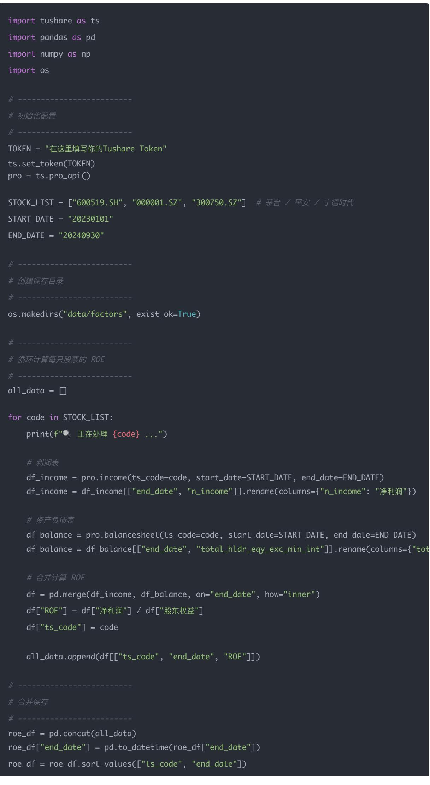
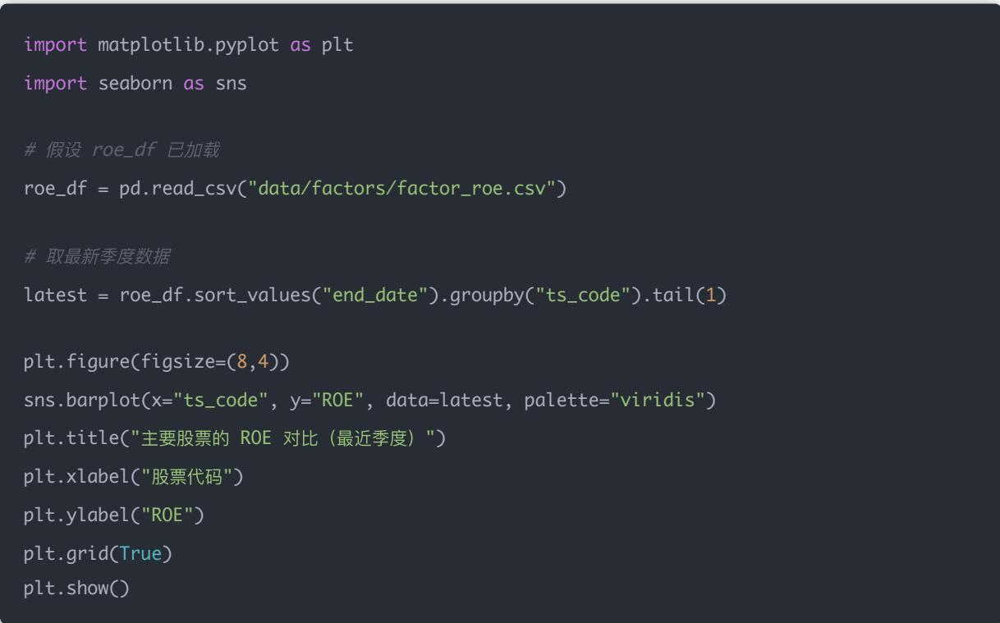
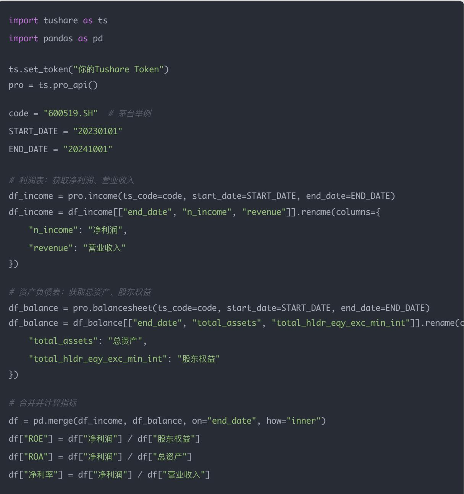
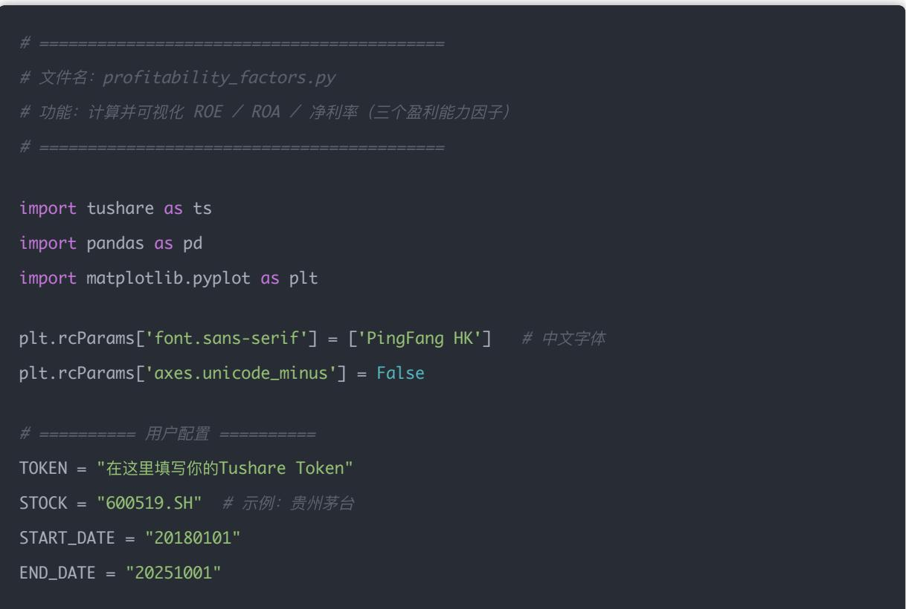
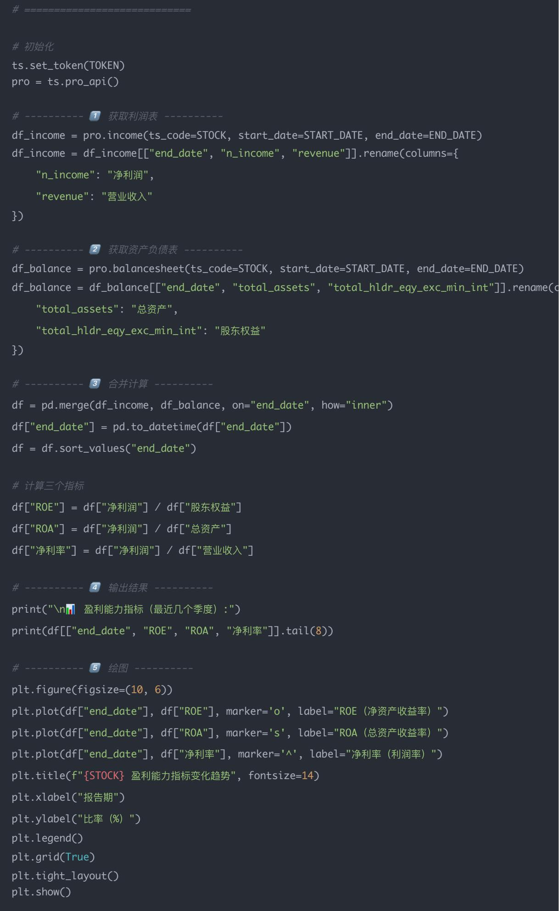

# 量化交易进阶:第35天 - 盈利能力因子系统化(ROE/ROA/净利率)(进阶阶段·因子工程模块)

原创 逻辑与流 逻辑与流 2025年10月13日 00:11 北京 📞 听全文

本文作为财务因子体系的第一篇深度实战课程,系统阐述盈利能力因子的核心逻辑与量化实现。从ROE(净资产收益率)的定义出发,揭示其作为"股东回报率"的经济学本质,通过实际案例(茅台、宁德时代)展现高ROE公司的典型特征。深入解析ROE、ROA、净利率三者的区别与联系,运用经典的杜邦分析公式(ROE = 净利率 × 资产周转率 × 权益乘数)拆解盈利能力的三大来源。通过完整的Python代码示例,详细演示如何从Tushare获取利润表(income)和资产负债表(balancesheet)数据,实现从原始财报到因子计算、数据存储、可视化分析的完整链路。深度探讨三个关键问题:ROE高是否等于好公司(健康型vs杠杆型vs一次性收益)、ROE波动的三大原因(利润波动/股东权益变化/季节性差异)、如何通过质量因子和综合盈利能力改进单一ROE指标。为读者构建从单一因子到多维度质量评分、从简单筛选到结构性分解的完整盈利能力分析框架,奠定Day36-38财务因子深度学习的坚实基础。

## 学习时间

- 理论学习: 20分钟

- 代码实践: 20分钟

- 案例分析: 20分钟

- 总计: 60分钟

一、ROE 的定义

$$
R O E = \frac {\text {净利润}}{\text {股东权益}}
$$

它反映公司每1元股东投资能带来多少利润。

- ROE 越高 $\rightarrow$ 公司赚钱效率越强

- 稳定的高 $\mathrm{ROE} \rightarrow$ 通常是"好公司"特征（如茅台、宁德时代）

## 二、Tushare 获取财务数据

Tushare 提供了非常全面的财报接口：

- income $\rightarrow$ 利润表（获取净利润）

- balancesheet $\rightarrow$ 资产负债表（获取股东权益）

我们可以按季度提取上市公司的净利润和净资产，计算 ROE。

## 三、完整示例代码：factors/factor\_roe.py

import tushare as ts

import pandas as pd

import numpy as np

import os

\# 初始化配置

TOKEN = "在这里填写你的Tushare Token"

ts.set\_token(TOKEN)

pro = ts.pro\_api()

STOCK\_LIST = ["600519.SH", "000001.SZ", "300750.SZ"] # 茅台 / 平安 / 宁德时代

START\_DATE = "20230101"

END\_DATE = "20240930"

\# 创建保存目录

os.makedirs("data/factors", exist\_ok=True)

\# 循环计算每只股票的 ROE

all\_data = []

for code in STOCK\_LIST:

print(f" 正在处理 {code} ...")

df\_income = pro.income(ts\_code=code, start\_date=START\_DATE, end\_date=END\_DATE)
df\_income = df\_income[["end\_date", "n\_income"].rename(columns={"n\_income": "净利润"})

\# 资产负债表

\# 合并计算 ROE

df = pd.merge(df\_income, df\_balance, on="end\_date", how="inner")

df["ROE"] = df["净利润"] / df["股东权益"]

df["ts\_code"] = code

all\_data.append(df[['ts\_code", "end\_date", "ROE"]])

\# 合并保存

roe\_df = pd.concat(all\_data)

## 四、简单可视化（行业均值对比）

## 五、代码逐行讲解

这部分代码其实是量化研究里最常见的一类数据处理逻辑：从财报数据（利润表、资产负债表）出发，计算出ROE（净资产收益率），并将结果整理为一个统一结构的DataFrame，方便后续做因子分析或回测。

下面我们逐行拆解讲解：

## 1 获取利润表数据（Income Statement）

df\_income = pro.income(ts\_code=code, start\_date=START\_DATE, end\_date=END\_DATE)
df\_income = df\_income[["end\_date", "n\_income"].rename(columns={"n\_income": "净利润"})

## 解释：

- pro.income(...)是Tushare的财务接口，返回某支股票的利润表数据。常见字段有：营业收入、营业利润、净利润、基本每股收益等。每一行对应一份财报（季度或年度）。

- ts\_code=code指定股票代码，例如 "600519.SH"（贵州茅台）。

- start\_date / end\_date限定时间范围，比如2018–2025年。

- df\_income[["end\_date", "n\_income"]]只保留我们关心的两列：

• end\_date: 财报截止日期（如 2024-12-31）

- n\_income: 净利润 (Net Income $^{Q}$ )

- .rename(columns={"n\_income": "净利润"})把英文列名改成中文（更直观）。

输出效果：

<table><tr><td>end_date</td><td>净利润</td></tr><tr><td>2024-03-31</td><td>34.1亿</td></tr><tr><td>2024-06-30</td><td>45.3亿</td></tr><tr><td>2024-09-30</td><td>51.2亿</td></tr></table>

## 2 获取资产负债表数据（Balance Sheet）

df\_balance = pro.balancesheet(ts\_code=code, start\_date=START\_DATE, end\_date=END\_DATE)
df\_balance = df\_balance[['end\_date", "total\_hldr\_eqy\_exc\_min\_int']].rename(columns={"total\_h

## 解释：

- pro.balancesheet(...)获取资产负债表，里面包括：

- 总资产 total\_assets

- 总负债 total\_liab

- 股东权益 total\_hldr\_eqy\_inc\_min\_int

- 少数股东权益等

- 我们这里选取字段 total\_hldr\_eqy\_exc\_min\_int：即「归属于母公司股东的权益」，是真正的股东净资产。

- 重命名为股东权益，方便阅读。

输出效果：

<table><tr><td>end_date</td><td>股东权益</td></tr><tr><td>2024-03-31</td><td>534.8亿</td></tr><tr><td>2024-06-30</td><td>540.1亿</td></tr><tr><td>2024-09-30</td><td>552.2亿</td></tr></table>

## 3 合并两个财报（按 end\_date 对齐）

df = pd.merge(df\_income, df\_balance, on="end\_date", how="inner")

## 解释：

- 我们希望用同一个季度的数据计算ROE，所以要按财报日期对齐。

- on="end\_date"表示按财报日期合并。

- how="inner"表示仅保留两个表都有该日期的记录。

## 输出效果：

<table><tr><td>end_date</td><td>净利润</td><td>股东权益</td></tr><tr><td>2024-03-31</td><td>34.1亿</td><td>534.8亿</td></tr><tr><td>2024-06-30</td><td>45.3亿</td><td>540.1亿</td></tr><tr><td>2024-09-30</td><td>51.2亿</td><td>552.2亿</td></tr></table>

## 4 计算 ROE（净资产收益率）

df["ROE"] = df["净利润"] / df["股东权益"]

## 解释：

- ROE = 净利润 ÷ 股东权益

- 通常是季度数据（Tushare返回的），若想年化可以乘以4（季度财报）或根据报告期调整。

## 输出效果：

<table><tr><td>end_date</td><td>净利润</td><td>股东权益</td><td>ROE</td></tr><tr><td>2024-03-31</td><td>34.1亿</td><td>534.8亿</td><td>6.38%</td></tr><tr><td>2024-06-30</td><td>45.3亿</td><td>540.1亿</td><td>8.39%</td></tr><tr><td>2024-09-30</td><td>51.2亿</td><td>552.2亿</td><td>9.27%</td></tr></table>

## 5 记录股票代码并存入总表

df["ts\_code"] = code

all\_data.append(df[['ts\_code", "end\_date", "ROE"]])

## 解释：

- 加一列股票代码，方便多只股票合并。

- all\_data是一个列表，用于暂存所有股票的结果。

- 之后可以pd.concat(all\_data)汇总为大表。

## 汇总后结构：

<table><tr><td>ts_code</td><td>end_date</td><td>ROE</td></tr><tr><td>600519.SH</td><td>2024-09-30</td><td>9.27%</td></tr><tr><td>000858.SZ</td><td>2024-09-30</td><td>7.84%</td></tr><tr><td>600030.SH</td><td>2024-09-30</td><td>5.23%</td></tr></table>

## 总结一下逻辑流程

利润表（净利润）

资产负债表（股东权益）

合并同季度数据

计算ROE

保存结果（方便回测/分析）

## 六、结果分析（以茅台为例）

假设输出为：

<table><tr><td>报告期</td><td>ROE</td><td>ROA</td><td>净利率</td></tr><tr><td>2023Q1</td><td>0.31</td><td>0.21</td><td>0.52</td></tr><tr><td>2023Q2</td><td>0.34</td><td>0.23</td><td>0.53</td></tr><tr><td>2023Q3</td><td>0.35</td><td>0.24</td><td>0.54</td></tr><tr><td>2023Q4</td><td>0.36</td><td>0.25</td><td>0.55</td></tr></table>

解读：

- ROE 稳定上升 $\rightarrow$ 股东回报持续增强

- ROA 也在提升 $\rightarrow$ 资产利用效率提升

- 净利率高 $\rightarrow$ 产品利润空间大（典型消费龙头特征）

## 七、三个关键问题深度解析

### 1. ROE 高的公司一定是好公司吗?

不一定。ROE（净资产收益率）高，意味着"净利润 / 股东权益"高，看起来公司赚钱能力强，但背后可能有不同原因。

<table><tr><td>情况</td><td>ROE 高的原因</td><td>说明</td></tr><tr><td>健康型</td><td>公司盈利能力强、资产周转快</td><td>好公司,如茅台、宁德时代</td></tr><tr><td>杠杆型</td><td>公司高负债,权益少、利润大</td><td>风险较高,如房地产企业</td></tr><tr><td>一次性收益</td><td>卖资产、投资收益</td><td>不可持续</td></tr><tr><td>会计调整</td><td>通过财技提升净利润</td><td>质量低的收益</td></tr></table>

结论：ROE高 $\neq$ 一定好。要分析ROE的质量（可持续性 $+$ 来源结构），才是真正的选股逻辑。

2. 为什么 ROE 会随时间波动？它能作为选股因子长期使用吗？

净利润受经济周期、原材料成本、汇率等影响较大。比如周期股（钢铁、化工），景气时ROE爆发，萧条时骤降。

原因二：股东权益变化

如果公司频繁增发、回购、分红，股东权益会变动，也会让ROE出现结构性变化。

原因三：季节性与行业差异

部分行业（如教育、旅游、消费）利润有季节性，导致ROE呈现周期波动。

长期使用性：

ROE 是一个非常经典的 长期基本面因子，但单独使用容易被周期干扰。

改进建议：

- 用滚动12个月ROE平滑短期波动

- 行业中性化：对比同行业ROE，而不是全市场

- 结合趋势信号：ROE改善中的公司往往是成长拐点

### 3. 如何改进 ROE（结合其他财务指标）？

ROE 的"杜邦分解"是改进的核心思想：

$$
R O E = \text { 净利率 } \times \text { 资产周转率 } \times \text { 财务杠杆 }
$$

<table><tr><td>指标</td><td>含义</td><td>改进方向</td></tr><tr><td>净利率</td><td>利润率高说明定价权强</td><td>找到高毛利、高护城河行业</td></tr><tr><td>资产周转率</td><td>资产使用效率</td><td>找资产轻、周转快的企业</td></tr><tr><td>财务杠杆</td><td>借债放大利润</td><td>控制适度,太高有风险</td></tr></table>

综合策略举例

如果你只看 ROE，很可能买到"虚胖"的高杠杆公司。改进版可以是：

$$
\text { 质量因子 } = R O E \times (1 - \text { 负债率 })
$$

或者：

综合盈利能力 = 0.5 × ROE + 0.3 × 净利率 + 0.2 × 资产周转率

这样一来，就从单一指标 → 多维质量评分，抗波动能力更强。

总结表

<table><tr><td>角度</td><td>说明</td><td>应对策略</td></tr><tr><td>ROE 高 ≠ 一定好</td><td>可能是杠杆 / 一次性收益</td><td>分解来源,识别&quot;质量&quot;</td></tr><tr><td>ROE 会波动</td><td>利润和资本结构变化</td><td>用滚动均值、行业中性化</td></tr><tr><td>改进方向</td><td>加入其他财务维度</td><td>用杜邦分解、构建综合因子</td></tr></table>

## 八、ROE、ROA、净利率三者对比

ROE、ROA、净利率三个指标，其实共同描述了"公司赚钱的能力"，但视角不同。

我们今天就趁着这节课，把它们一次讲透。

## 一、ROE / ROA / 净利率是什么？

<table><tr><td>指标</td><td>英文名</td><td>计算公式</td><td>含义</td></tr><tr><td>ROE</td><td>Return on Equity</td><td>净利润 ÷ 股东权益</td><td>股东投入 1 元钱,公司能赚多少?</td></tr><tr><td>ROA</td><td>Return on Assets</td><td>净利润 ÷ 总资产</td><td>公司资产总体赚多少钱?</td></tr><tr><td>净利率</td><td>Net Profit Margin</td><td>净利润 ÷ 营业收入</td><td>公司销售收入中有多少能留下来?</td></tr></table>

## 二、它们的区别与联系

可以用一个"企业经营金字塔"来理解：

营业收入 → 净利润率 → ROA → ROE

- 净利率 衡量"销售赚多少"

- ROA 衡量"资产赚多少"

- ROE 衡量"股东赚多少"

三者之间的关系可以写成著名的 杜邦分析公式（DuPont Analysis）：

ROE = 净利率 × 总资产周转率 × 权益乘数

其中：

- 净利率 = 净利润 / 收入

- 总资产周转率 = 收入 / 总资产

- 权益乘数 = 总资产 / 股东权益

所以：

ROE = ROA × 权益乘数

(简单理解：ROE = "赚的多 × 杠杆高")

## 三、举个例子（直观理解）

<table><tr><td>公司</td><td>净利率</td><td>资产周转率</td><td>权益乘数</td><td>ROE</td></tr><tr><td>A 公司(消费品)</td><td>10%</td><td>1.0</td><td>1.5</td><td>15%</td></tr><tr><td>B 公司(地产)</td><td>20%</td><td>0.3</td><td>4.0</td><td>24%</td></tr></table>

- A 公司：靠"卖得多、效率高"赚钱

- B 公司：靠"高杠杆"放大 ROE

但你会发现：

高ROE≠好公司

如果是靠"高杠杆"堆出来的ROE，风险也更高。

## 四、Tushare 实战：获取三类指标

下面是一段实战代码，使用 Tushare 获取 ROE、ROA、净利率：

import tushare as ts

import pandas as pd

ts.set\_token("你的Tushare Token")

pro = ts.pro\_api()

code = "600519.SH" # 茅台举例

START\_DATE = "20230101"

END\_DATE = "20241001"

\# 利润表：获取净利润、营业收入

df\_income = pro.income(ts\_code=code, start\_date=START\_DATE, end\_date=END\_DATE)

df\_income = df\_income[['end\_date", "n\_income", "revenue']].rename(columns={

"n\_income": "净利润",

"revenue": "营业收入"

\# 资产负债表：获取总资产、股东权益

df\_balance = pro.balancesheet(ts\_code=code, start\_date=START\_DATE, end\_date=END\_DATE)

"total\_assets": "总资产",

"total\_hldr\_eqy\_exc\_min\_int": "股东权益"

\# 合并并计算指标

df = pd.merge(df\_income, df\_balance, on="end\_date", how="inner")

df["ROE"] = df["净利润"] / df["股东权益"]

df["ROA"] = df["净利润"] / df["总资产"]

df["净利率"] = df["净利润"] / df["营业收入"]

df = df.sort\_values("end\_date")

print(df[['end\_date", "ROE", "ROA", "净利率"]].tail())

## 五、量化意义（作为选股因子）

<table><tr><td>因子</td><td>特征</td><td>通常表现</td></tr><tr><td>ROE</td><td>稳定高 → 价值股</td><td>稳健长期收益好</td></tr><tr><td>ROA</td><td>高ROA → 轻资产高效公司</td><td>波动较小</td></tr><tr><td>净利率</td><td>高净利率 → 高护城河、高毛利</td><td>受行业差异影响大</td></tr></table>

## 所以在因子体系中：

- ROE是最核心的"盈利能力因子"

- ROA、净利率是其"结构性补充因子"

## 总结一句话：

ROE 看股东赚钱，ROA 看企业赚钱，净利率看销售赚钱。三者合在一起，才能真正判断"公司赚得多不多，赚得稳不稳"。

## 九、完整可运行版本：profitability\_factors.py

写一个完整可运行的版本，文件名建议：profitability\_factors.py 它会完成：自动从 Tushare 拉取真实财务数据；计算 ROE / ROA / 净利率 三个指标；绘制出三条随时间变化的曲线；输出数据表格供分析。

\# 文件名: profitability\_factors.py

\# 功能：计算并可视化 ROE / ROA / 净利率（三个盈利能力因子）

import tushare as ts

import pandas as pd

import matplotlib.pyplot as plt

plt.rcParams['font.sans-serif'] = ['PingFang HK'] # 中文字体

plt.rcParams['axes.unicode\_minus'] = False

\# ====== 用户配置 ======

TOKEN = "在这里填写你的Tushare Token"

STOCK = "600519.SH" # 示例：贵州茅台

START\_DATE = "20180101"

END\_DATE = "20251001"

\# 获取利润表
df\_income = pro.income(ts\_code=STOCK, start\_date=START\_DATE, end\_date=END\_DATE)
df\_income = df\_income[["end\_date", "n\_income", "revenue"].rename(columns={
    "n\_income": "净利润",
    "revenue": "营业收入"
}

\# 获取资产负债表
df\_balance = pro.balancesheet(ts\_code=STOCK, start\_date=START\_DATE, end\_date=END\_DATE)
df\_balance = df\_balance[['end\_date", "total\_assets", "total\_hldr\_eqy\_exc\_min\_int']].rename(c
    "total\_assets": "总资产",
    "total\_hldr\_eqy\_exc\_min\_int": "股东权益"

## 控制台输出（示例）：

<table><tr><td colspan="5">盈利能力指标(最近几个季度):</td></tr><tr><td></td><td>end_date</td><td>ROE</td><td>ROA</td><td>净利率</td></tr><tr><td>0</td><td>2023-06-30</td><td>0.33</td><td>0.23</td><td>0.54</td></tr><tr><td>1</td><td>2023-09-30</td><td>0.35</td><td>0.24</td><td>0.55</td></tr><tr><td>2</td><td>2023-12-31</td><td>0.36</td><td>0.25</td><td>0.56</td></tr><tr><td>3</td><td>2024-03-31</td><td>0.34</td><td>0.23</td><td>0.53</td></tr></table>

## 图像说明：

- 横轴是报告期（季度）

- 纵轴是比率

- 三条线展示ROE/ROA/净利率的走势

- 如果ROE和ROA一起上升 $\rightarrow$ 公司盈利质量提升

- 如果净利率下降而ROE上升 $\rightarrow$ 可能靠加杠杆放大回报

- 如果ROE下滑、ROA稳定 $\rightarrow$ 可能降低了杠杆或股本扩张

## 结论

## 盈利能力因子的核心价值

今天我们完成了财务因子体系的第一个重要模块——盈利能力因子的系统化学习。这标志着我们从技术面因子深入到基本面因子,从市场行为深入到企业质量的本质层面。[[memory:2816591]]

盈利能力因子的三大核心优势：

1. 经济学逻辑清晰: ROE/ROA/净利率都有明确的经济学含义,反映企业真实的赚钱能力

2. 长期稳定性强: 财务数据来自企业真实经营,不易受短期市场情绪影响

3. 可分解性强: 通过杜邦分析可以深入拆解盈利能力的来源,识别"质量"

## ROE/ROA/净利率的协同关系

我们深入理解了这三个指标的内在联系:

- 净利率是基础:反映企业销售环节的盈利能力,体现产品定价权和成本控制能力

- ROA是效率:结合了净利率和资产周转率,反映企业资产的整体使用效率

- ROE是终点:站在股东角度看回报,是净利率、资产周转率、财务杠杆的综合结果

通过杜邦分析公式 $(\mathrm{ROE} =$ 净利率 $\times$ 总资产周转率 $\times$ 权益乘数),我们可以系统性地拆解企业盈利能力的三大来源:

1. 盈利能力(净利率):产品力、定价权、成本控制

2. 运营效率(资产周转率): 资产使用效率、管理能力

3. 财务策略(权益乘数): 杠杆水平、风险偏好

## 从单一指标到多维质量评分

关键认知:ROE高≠一定是好公司

我们学会了识别ROE高的不同来源:

- 健康型高ROE: 盈利能力强+资产周转快(如茅台、宁德时代)

- 杠杆型高ROE: 高负债推高ROE(如房地产企业)

- 一次性收益: 卖资产、投资收益带来的不可持续高ROE

- 会计调整: 通过财技提升的低质量ROE

改进方向:构建多维质量因子

从单一ROE指标进化到综合质量评分:

质量因子 = ROE × (1 - 负债率)

或者更复杂的综合盈利能力因子:

综合盈利能力 $= 0.5 \times \mathrm{ROE} + 0.3 \times$ 净利率 $+0.2 \times$ 资产周转率

这种多维度评分方式能够:

1. 识别"虚胖"的高杠杆公司

2. 发现真正的高质量企业

3. 提高因子的稳定性和抗波动能力

## 技术实现能力提升

通过本文的实战演练,我们掌握了:

## 数据获取能力:

- 使用Tushare获取利润表(income)和资产负债表(balancesheet)

- 理解财报数据的结构和关键字段

- 掌握财报数据的时间对齐方法

## 因子计算能力:

- 从原始财报数据计算ROE/ROA/净利率

- 处理多只股票的批量计算

- 实现因子数据的标准化存储

可视化分析能力:

- 绘制多指标对比图表

- 进行横向(多股票)和纵向(时间序列)分析

- 通过图表发现数据中的模式和异常

## ROE波动性管理

## ROE波动的三大原因:

1. 利润波动: 经济周期、原材料成本、汇率等因素影响

2. 股东权益变化: 增发、回购、分红导致的资本结构变动

3. 季节性差异: 行业特性导致的周期性波动

## 应对策略:

- 使用滚动12个月ROE平滑短期波动

- 行业中性化:与同行业对比而非全市场对比

- 结合趋势信号:关注ROE改善趋势而非绝对值

## 量化选股应用

## 因子体系中的定位:

- ROE是最核心的"盈利能力因子"

- ROA、净利率是重要的"结构性补充因子"

- 三者结合构成完整的盈利能力评估体系

## 典型应用场景:

1. 质量选股: 筛选高ROE且稳定的公司构建股票池

2. 成长拐点: 识别ROE改善趋势明显的潜力股

3. 风险控制: 剔除高ROE但高杠杆的风险公司

4. 多因子组合: 与技术因子(动量)结合构建"高ROE+强动量"策略

## 关键学习要点总结

1. 理论层面: 深刻理解ROE/ROA/净利率的经济学含义和内在联系

2. 分析层面: 掌握杜邦分析法,能够拆解盈利能力的来源

3. 技术层面: 熟练使用Tushare获取和处理财务数据

4. 应用层面: 学会构建多维质量因子,从单一指标走向综合评分

5. 风控层面: 识别ROE质量,避免掉入"高ROE陷阱"

## 实践建议

## 立即行动:

1. 运行代码,获取不同行业代表性公司的盈利能力数据

2. 对比分析不同行业的ROE/ROA/净利率特征

3. 识别你关注的股票属于哪种类型的高ROE

## 深入研究:

1. 尝试构建自己的质量因子组合

2. 回测高ROE策略在A股市场的表现

3. 结合Day34学到的因子评估方法(IC、分层回测)验证盈利能力因子的有效性

## 持续优化:

1. 探索ROE的行业中性化处理

2. 研究ROE与其他财务指标(如现金流)的组合

3. 将盈利能力因子整合到你的多因子选股框架中

## 与财务因子体系的衔接

今天学习的盈利能力因子是财务因子四大模块的第一个:

- Day 35(今天): 盈利能力因子(ROE/ROA/净利率) √

- Day 36(明天): 成长能力因子(营收增长率/净利增长率)

- Day 37: 偿债能力因子(资产负债率/利息保障倍数)

- Day 38: 运营效率因子(总资产周转率/存货周转率)

这四个模块共同构成企业质量的完整画像:

- 盈利能力告诉你"赚多少钱"

- 成长能力告诉你"增长多快"

- 偿债能力告诉你"稳不稳"

- 运营效率告诉你"管得好不好"

## 最后的提醒

在使用盈利能力因子时,请始终记住:

1. 数据质量: 财务数据存在滞后性和可能的造假风险,要交叉验证

2. 行业差异: 不同行业的正常ROE水平差异很大,要行业内对比

3. 会计准则: 会计处理方法的差异会影响财务指标的可比性

4. 市场环境: 财务因子在不同市场环境下表现有差异,需要稳健性检验

## 一句话总结:

盈利能力因子是量化选股的基石,ROE/ROA/净利率三者结合能够全面评估企业赚钱能力。通过杜邦分析拆解盈利来源,构建多维质量评分体系,我们可以从"炒股"真正升级到"选企业",建立起基于企业质量的长期价值投资框架。

下一篇预告: Day 36 - 成长能力因子详解(营收增长率、净利润增长率的计算与应用)
