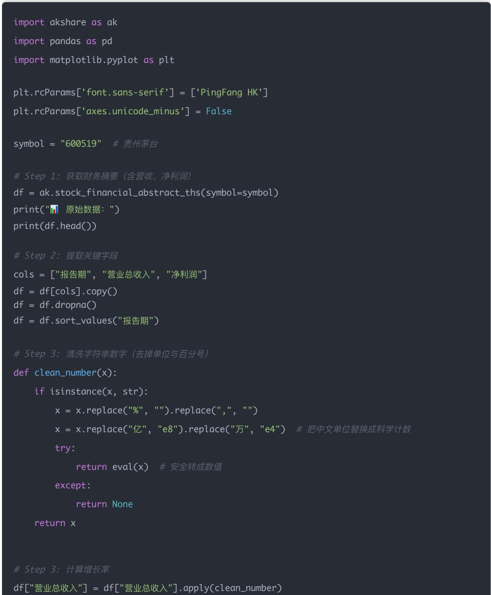
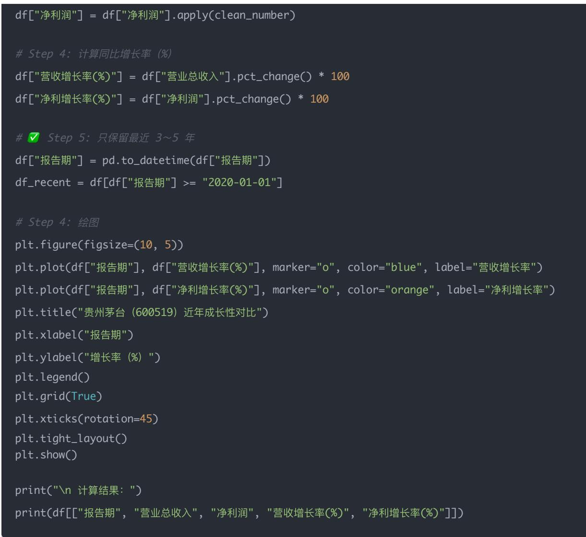

# 量化交易进阶:第36天 - 成长能力因子系统化(Revenue Growth/NetProfit Growth)

原创 逻辑与流 逻辑与流 2025年10月 14 日 00:46 北京 听全文

本文作为财务因子体系的第二篇深度实战课程,系统阐述成长能力因子的核心逻辑与量化实现 从营收增长率与净利增长率的定义出发,揭示成长因子在识别潜力股 区分价值股与成长股中的关键作用 深入解析为什么成长因子如此重要——它能帮助我们提前识别业绩爆发期公司 筛选高增长潜力股 结合PE构造经典PEG因子 通过完整的Python代码示例,详细演示如何从AkShare获取贵州茅台的财务摘要数据,处理中文单位(亿 万)的数值清洗,计算同比增长率,并绘制营收与净利增长率的对比图表 深度探讨三个关键问题:营收增长率高是否等于好投资(优质增长vs低质量增长vs异常增长) 净利润增长率波动的双面性(风险vs机会) 如何构造PEG因子挖掘"高增长+低估值"标的 为读者构建从单一盈利能力到成长性分析 从财务指标到估值结合的完整投资分析框架,承接Day35的盈利能力学习,为Day37-38的偿债能力与运营效率学习奠定基础。

## 学习时间

理论学习: 20分钟

代码实践: 25分钟

案例分析: 20分钟

总计: 65分钟

## Day 36 成长能力因子（Growth Factors）

这是财务因子体系里非常重要的一环，用于衡量企业未来增长潜力。

## 一、今日 目标

学习如何系统化构造成长能力类因子，包括： 因子名称 含义 常用公式 营收增长率（RevenueGrowth） 公司主营业务收入的增长速度 (本期营收 - 上期营收) / 上期营收 净利增长率（Net ProfitGrowth） 公司利润的增长速度 (本期净利润 - 上期净利润) / 上期净利润

这两个指标一般都是同比计算（即与去年同季度相比），能更真实反映企业成长性。

## 二 为什么要研究成长因子？

价值股：当前估值便宜，但增长慢（典型如银行 电力 保险）

成长股：估值贵，但未来成长性强（典型如新能源 科技 生物医药）

成长因子帮助我们： • 提前识别业绩"爆发期"公司； • 筛选高增长的潜力股； • 结合估值（如 PE）形成"PEG 因子"。

## 三、示例公式解释

假设公司去年 Q2 营收为 10 亿元，今年 Q2 营收为 12 亿元：

$$
\mathrm{营收增长率} = \frac {12 - 10}{10} = 0.2 = 20
$$

如果净利润从 1 亿涨到 1.5 亿：

$$
\mathrm{净利增长率} = \frac {1 . 5 - 1}{1} = 0. 5 = 50
$$

## 四 Python 实战示例（用 akshare 获取真实数据）

我们取贵州茅台（600519.SH）最近 3 年的财报数据，计算营收增长率 & 净利增长率，并画图对比。

## 五 图像效果说明

运行后你会得到一张类似下图的折线图：

蓝线：营收增长率

橙线：净利增长率

<table><tr><td>情形</td><td>说明</td></tr><tr><td>橙线高于蓝线</td><td>利润增长快于收入增长,说明成本控制好、利润率上升</td></tr><tr><td>橙线低于蓝线</td><td>利润增速低于营收增速,可能毛利率下降或费用上升</td></tr><tr><td>两线同时下滑</td><td>成长动能减弱</td></tr><tr><td>波动大</td><td>可能与季节性或一次性项目(资产减值、税收)有关</td></tr></table>

## 六、今日思考题

### 1. 营收增长率高的公司一定值得投资吗？为什么？

答案：不一定。

营收增长代表公司业务在扩张，但是否值得投资，要看"增长的质量"。

我们可以从三方面判断增长的"真伪"与"可持续性"：

<table><tr><td>情况</td><td>含义</td><td>投资价值</td></tr><tr><td>优质增长</td><td>营收持续增长 + 毛利率/净利率也同步提升</td><td>高成长企业(典型如茅台、宁德时代早期)</td></tr><tr><td>低质量增长</td><td>营收增长但利润不升反降,可能靠价格战或补贴</td><td>&quot;虚胖增长&quot;,可持续性差</td></tr><tr><td>异常增长</td><td>营收暴涨但伴随应收账款暴增</td><td>存在财务造假或收入确认问题</td></tr></table>

结论：营收增长率高 ≠ 一定好，要结合盈利能力（毛利率、ROE）判断增长质量。

### 2. 净利润增长率波动大，是风险还是机会？

答案：既可能是风险，也可能是机会

<table><tr><td>情形</td><td>含义</td><td>启示</td></tr><tr><td>风险</td><td>净利润大幅波动 → 成本/周期/汇率/原材料等不稳定</td><td>周期性行业(如钢铁、化工)常见,不宜长期持有</td></tr><tr><td>机会</td><td>若净利润大幅反弹且有基本面支撑 → 业绩拐点</td><td>&quot;业绩反转股&quot;可能迎来估值修复</td></tr></table>

3. 如果同时考虑估值（PE），你能构造出什么新因子？（提示：PEG）

答案：PEG（Price / Earnings to Growth ratio）因子

PEG是最经典的「成长性 × 估值」复合指标。

$$
\mathrm{PEG} = \frac {\mathrm{PE}}{\text {利润增长率}}
$$

## PEG值含义与投资判断：

<table><tr><td>PEG值</td><td>含义</td><td>投资判断</td></tr><tr><td>PEG ≈ 1</td><td>增长与估值匹配</td><td>合理估值</td></tr><tr><td>PEG &lt; 1</td><td>增长高、估值低</td><td>低估的成长股,具吸引力</td></tr><tr><td>PEG &gt; 2</td><td>估值高于成长性</td><td>高估风险</td></tr></table>

## 举例：

A 股" 白 马股"常 PEG≈1

科技股在高增长阶段 PEG 可<1

概念炒作股常 PEG>2，说明"透支未来增长"

## 小结表

<table><tr><td>因子</td><td>含义</td><td>投资启示</td></tr><tr><td>营收增长率</td><td>业务扩张速度</td><td>看&quot;增长质量&quot;</td></tr><tr><td>净利增长率</td><td>盈利弹性</td><td>反映周期/拐点</td></tr><tr><td>PEG</td><td>成长与估值平衡</td><td>挖掘&quot;高增长+低估值&quot;标的</td></tr></table>

## 七 PEG因子的构造与应用详解

## PEG因子的核心逻辑

## PEG = PE / 利润增长率

## 三个关键理解

### 1. PEG的经济学含义:

PEG衡量"每单位增长"需要支付多少估值

PEG≈1表示增长与估值匹配,是合理定价

PEG<1表示增长被低估,PEG>2表示增长被高估

### 2. PEG的适用场景:

适用于稳定增长的成长股(增长率10%-30%)

适用于行业对比(同行业公司PEG对比)

不适用于高速增长股(增长率> ${ } > 5 0 \% , \mathsf { P E G }$ 会很小)

不适用于负增长或零增长股(分母为0或负数)

### 3. PEG的实战应用:

<table><tr><td>PEG区间</td><td>估值状态</td><td>投资策略</td><td>典型案例</td></tr><tr><td>PEG &lt; 0.5</td><td>严重低估</td><td>重点关注,可能是价值陷阱或真机会</td><td>周期股底部、困境反转股</td></tr><tr><td>0.5 ≤ PEG &lt; 1</td><td>低估</td><td>优质成长股,值得配置</td><td>高增长科技股、消费股</td></tr><tr><td>PEG ≈ 1</td><td>合理</td><td>白马股,长期持有</td><td>茅台、美的等稳健增长股</td></tr><tr><td>1 &lt; PEG &lt; 2</td><td>略贵</td><td>需要强劲增长支撑</td><td>部分高估值科技股</td></tr><tr><td>PEG &gt; 2</td><td>高估</td><td>警惕风险,透支未来增长</td><td>概念炒作股、主题投资股</td></tr></table>

## PEG因子的改进版本

#基础PEG

PEG = PE / 净利增长率

\# 改进版1：考虑ROE质量

质量调整PEG = PE / (净利增长率 × ROE)

\# 改进版2：考虑股息率

股息调整PEG = PE / (净利增长率 + 股息率)

#改进版3：考虑增长稳定性

稳定性调整PEG = PE / (净利增长率 × (1 - 增长率标准差))

## 价值股vs成长股的系统性区分

## 通过成长因子,我们能够系统性地区分两大投资风格:

<table><tr><td>维度</td><td>价值股</td><td>成长股</td></tr><tr><td>营收增长率</td><td>0-10%</td><td>20%+</td></tr><tr><td>净利增长率</td><td>0-10%</td><td>20%+</td></tr><tr><td>ROE</td><td>稳定(15-20%)</td><td>可能较低但提升中</td></tr><tr><td>PE</td><td>低(10-15倍)</td><td>高(30-50倍)</td></tr><tr><td>PEG</td><td>&gt;1(增长慢)</td><td>&lt;1(增长快)</td></tr><tr><td>行业</td><td>银行、保险、电力</td><td>科技、新能源、医药</td></tr><tr><td>投资逻辑</td><td>估值修复</td><td>业绩增长</td></tr><tr><td>风险</td><td>价值陷阱</td><td>增长不达预期</td></tr></table>

## 投资策略启示:

牛市中后期: 成长股表现更好(市场愿意给高估值)

熊市或震荡市: 价值股更抗跌(估值低 有安全边际)

均衡配置: 同时持有价值股和成长股,降低组合波动

## 结论

今天我们完成了财务因子体系的第二个模块——成长能力因子的学习。在Day35学习了企业"赚多少钱"之后,今天学会了评估企业"增长多快"。[[memory:2816591]]

## 核心收获

1. 两个关键因子

营收增长率: 反映业务扩张速度

净利增长率: 反映盈利增长质量

PEG因子: 结合成长性与估值的复合指标

### 2. 关键认知

营收增长率高 ≠ 一定值得投资,要看增长质量

净利润波动既可能是风险,也可能是业绩拐点机会

优质增长 = 营收和净利同步增长 + 毛利率提升

### 3. 技术能力

使用AkShare获取财务数据

中文单位转换的数据清洗技巧

pct\_change()计算增长率的方法

## 实战应用

## 选股策略:

成长股筛选: 营收增长率>20% AND 净利增长率>20%

PEG选股: 0.5 < PEG < 1 (高增长+低估值)

质量成长: 增长率高 + 净利率提升 + 应收账款增速<营收增速

## 因子组合:

\# 成长+质量组合

综合得分 = 0.3×ROE排名 + 0.3×净利增长率排名 + 0.2×PEG排名 + 0.2×毛利率排名

## 学习进度

Day 35: 盈利能力因子(ROE/ROA/净利率)

Day 36(今天): 成长能力因子(营收增长率/净利增长率) ✅

Day 37(明天): 偿债能力因子(资产负债率/利息保障倍数)

Day 38: 运营效率因子(总资产周转率/存货周转率)

一句话总结: 成长能力因子帮助我们识别企业未来潜力,结合Day35的盈利能力因子,构建起从"当前赚钱能力"到"未来增长潜力"的完整投资分析框架。

下一篇预告: Day 37 - 偿债能力因子详解(资产负债率、利息保障倍数的计算与风险识别)
