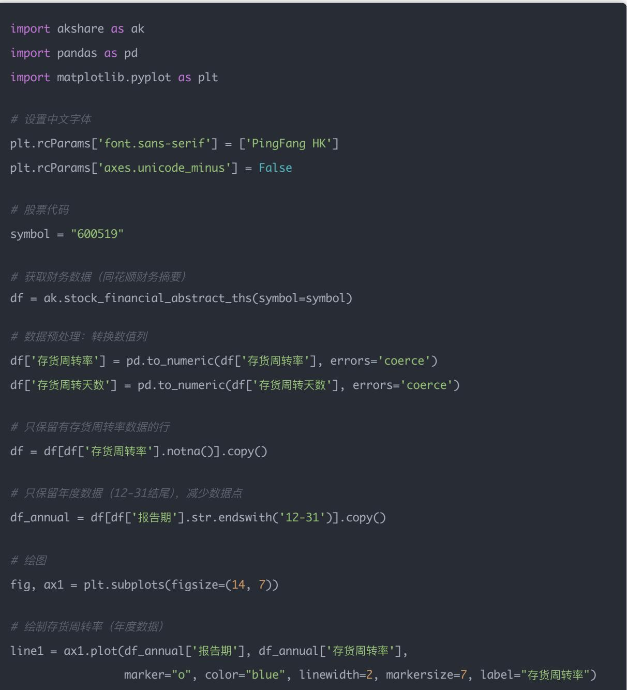
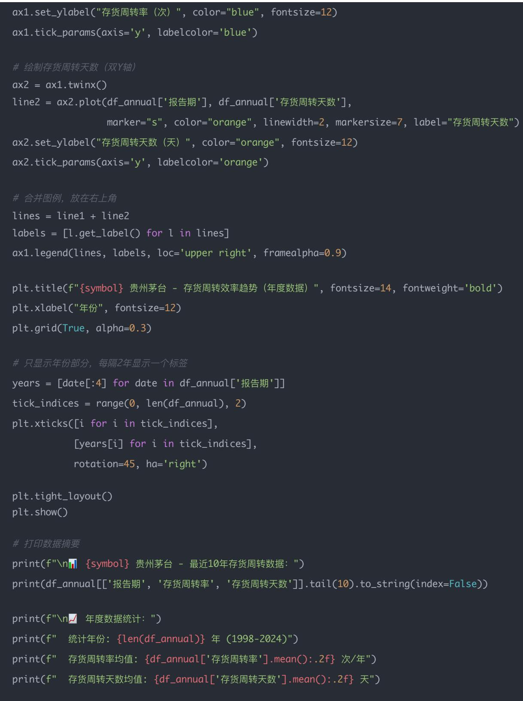

## 量化交易进阶:第38天 - 运营效率因子系统化(Operating EfficiencyFactors)

原创 逻辑与流 逻辑与流 2025年10月 17 日 00:31 北京 听全文

本文作为财务因子体系的第四篇深度实战课程,系统阐述运营效率因子的核心逻辑与量化实现 从总资产周转率与存货周转率的定义出发,揭示运营效率因子在识别企业管理质量 资产运用效率 资金周转速度中的关键作用 深入解析为什么运营效率因子在制造业 零售业中最有参考价值——它能帮助我们识别资产利用效率高的企业(如格力电器 海尔智家) 库存管理优秀的公司(如茅台 永辉超市) 以及运营能力强的管理团队。

## 学习时间

理论学习: 10分钟

代码实践: 10分钟

案例分析: 10分钟

总计: 30分钟

## Day 38｜运营效率因子（Operating Efficiency Factors）

今天的主题是：用两个核心指标判断企业管理质量

它主要衡量企业的资产运用效率 管理水平 资金周转速度 这类指标往往在制造业 零售业中最有参考价值（比如格力电器 海尔智家 茅台 永辉超市等）

## 今日主题：运营效率因子

用两个核心指标判断企业管理质量

总资产周转率（Asset Turnover） + 存货周转率（Inventory Turnover）

## 一 指标定义与意义

<table><tr><td>指标</td><td>公式</td><td>含义</td><td>解读</td></tr><tr><td>总资产周转率</td><td>营业收入 ÷ 平均总资产</td><td>衡量公司资产创造收入的能力</td><td>越高说明资产利用效率越好;越低说明资金占用重或效率低</td></tr><tr><td>存货周转率</td><td>营业成本 ÷ 平均存货</td><td>衡量库存变现速度</td><td>越高说明库存管理好、销售顺畅;过低或过高都可能有风险</td></tr><tr><td>存货周转天数</td><td>365 ÷ 存货周转率</td><td>库存从购入到销售所需的天数</td><td>周期越短说明企业运转越灵活</td></tr></table>

## 二、分析逻辑

### 1. 总资产周转率反映"资本效率"

→ 同样一元资产，谁能创造更多销售额，谁的管理更高效

→ 比如：茅台约 0.8 次/年，万科 0.3 次/年，永辉超市 2.5 次/年

### 2. 存货周转率反映"运营能力"

→ 过低：库存积压 产品滞销

→ 过高：可能库存过低 产能紧张 供应链压力大

→ 所以要结合行业平均来分析

## 三 完整可运行代码（akshare版）

## 四 图像与分析说明

## 指标含义

存货周转率（蓝色线）= 营业收入 ÷ 平均存货

表示一年内存货周转（销售）的次数

数值越高，说明存货销售越快

存货周转天数（橙色线）= 365天 ÷ 存货周转率

表示存货从入库到售出的平均天数

数值越低，说明存货流动越快

## 图表显示的趋势

第一阶段：1998-2016年

存货周转天数高达2000+天（约5-6年）

存货周转率极低（0.15次/年左右）

说明茅台当时大量囤积基酒进行长期窖藏

## 第二阶段：2017年开始

2017年出现转折点：存货周转天数骤降到1293天（约3.5年）

存货周转率提升到0.28-0.30次/年

近10年保持稳定在1200-1300天区间

## 说明的问题

战略调整（2017年转折）

茅台从"极度囤积"转向"合理周转"

可能原因：市场需求旺盛，加快出货节奏

平衡了"窖藏增值"和"资金周转"

## 行业特殊性

普通企业存货周转天数在30-90天

茅台是1300天（3.6年）！

因为白酒需要陈化，存货时间长反而是优势

近年稳定性（2017-2024）

周转天数稳定在1200-1300天

说明茅台已找到最优库存策略

既保证酒质，又兼顾现金流

结论

这个图反映了茅台从"重窖藏"到"稳经营"的战略演变，存货周转慢不是缺点，而是高端白酒的护城河！

今日总结

<table><tr><td>指标</td><td>高代表什么</td><td>低代表什么</td><td>理想区间（制造业）</td></tr><tr><td>总资产周转率</td><td>管理高效、资本利用好</td><td>资产臃肿、周转慢</td><td>0.5 ~ 1.5</td></tr><tr><td>存货周转率</td><td>库存管理好、销售快</td><td>库存积压</td><td>3 ~ 6</td></tr><tr><td>存货周转天数</td><td>资金周转快</td><td>资金占用高</td><td>60~120 天</td></tr></table>

## 结论

今天我们完成了财务因子体系的第四个也是最后一个模块——运营效率因子的学习 至此,财务因子四大模块(盈利能力、成长能力、偿债能力、运营效率)已全部完成。[[memory:2816591]]

## 核心收获

1. 两个关键因子

总资产周转率: 反映资产创造收入能力,越高说明资产利用效率越好

存货周转率: 反映库存管理能力和销售速度

存货周转天数: 反映资金周转速度,需结合行业特性判断

### 2. 关键认知

运营效率指标在制造业 零售业中最有参考价值

不同行业的理想周转率差异巨大,要按行业属性判断

高端白酒等特殊行业,存货周转慢反而是护城河

### 3. 茅台案例启示

2017年战略转折:从"极度囤积"到"合理周转"

存货周转天数从2000+天降至1200-1300天

## 财务因子体系完整框架

平衡了"窖藏增值"与"资金周转"的最优策略

## 四大模块回顾:

Day 35: 盈利能力因子(ROE/ROA/净利率) - 告诉你"赚多少钱"

Day 36: 成长能力因子(营收增长率/净利增长率) - 告诉你"增长多快"

Day 37: 偿债能力因子(资产负债率/利息保障倍数) - 告诉你"稳不稳"

Day 38(今天): 运营效率因子(总资产周转率/存货周转率) - 告诉你"管得好不好"

## 综合应用:

\# 企业质量综合评分

企业质量得分 = 0.3×盈利能力 + 0.3×成长能力 + 0.2×偿债能力 + 0.2×运营效率

## 实战应用

选股策略:

制造业筛选: 总资产周转率>0.8 AND 存货周转率>3

零售业筛选: 存货周转率>6 AND 存货周转天数<60天

行业对比: 同行业内周转率排名前30%

一句话总结: 运营效率因子帮助我们识别管理优秀 资产利用高效的企业,结合盈利 成长 偿债三大因子,构建起完整的企业质量评估体系,为基本面量化选股奠定坚实基础
