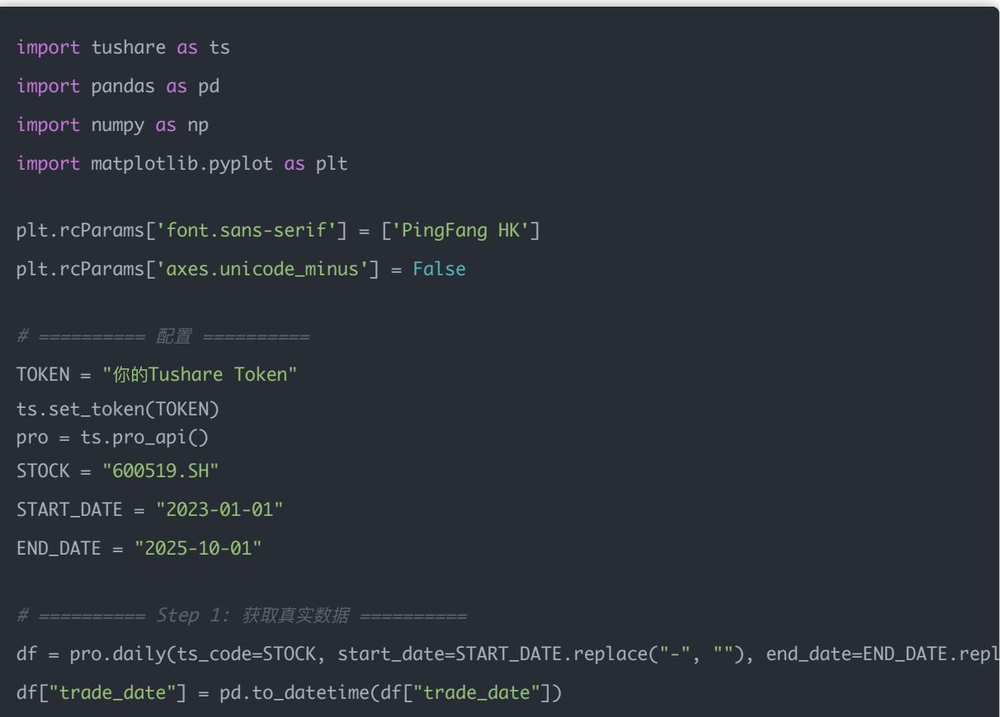

# 量化交易进阶:第39天 - 技术面因子系统化(Technical Factors)

原创 逻辑与流 逻辑与流 2025年10月 20 日 21:57 北京 听全文

技术面因子基于行情数据(价格 成交量)提取,相比反映公司基本面的财务因子,更关注交易行为与短期趋势 系统阐述动量 波动率 均线偏离率 RSI四个核心技术因子的逻辑内核——动量捕捉趋势延续效应,波动率衡量市场不确定性,均线偏离率判断短期超买超卖,RSI评估相对强弱 揭示技术因子使用的关键结合市场环境与多指标验证,构建从单一技术指标到市场状态判断 从技术信号到策略决策的完整分析框架。

## 学习时间

理论学习: 10分钟

代码实践: 10分钟

案例分析: 10分钟

总计: 30分钟

## Day 39：技术面因子系统化

主题：动量 波动率 均线偏离率 RSI

## 一 技术面因子的逻辑核心

技术面因子（Technical Factors）是基于行情数据（价格 成交量）提取的特征，用于反映市场情绪趋势与波动 相比财务因子（反映公司基本面），技术因子更关注交易行为与短期趋势

<table><tr><td>因子</td><td>含义</td><td>常见周期</td><td>直觉解释</td></tr><tr><td>动量(Momentum)</td><td>最近价格涨得多的股票未来还可能继续涨</td><td>20日、60日</td><td>趋势延续效应</td></tr><tr><td>波动率(Volatility)</td><td>价格上下波动的幅度</td><td>20日</td><td>风险与不确定性</td></tr><tr><td>均线偏离率(MA Deviation)</td><td>当前价相对均线的偏离程度</td><td>10日、30日</td><td>判断短期超买/超卖</td></tr><tr><td>RSI(相对强弱指标)</td><td>过去上涨/下跌的相对强度</td><td>14日</td><td>判断超买超卖(技术指标)</td></tr></table>

## 二 公式与计算方法

$$
\mathrm{Momentum} _ {t} = \frac {P _ {t}}{P _ {t - n}} - 1
$$

表示过去 n 日的价格涨幅

## 2 波动率（Volatility）

$$
\mathrm{Volatility} _ {t} = \sqrt {\frac {1}{n - 1} \sum_ {i = 1} ^ {n} (r _ {i} - \bar {r}) ^ {2}}
$$

即过去 n 日的收益率标准差

## 3 均线偏离率（MA Deviation）

$$
\mathrm{MA} \backslash \_ \mathrm{Dev} _ {t} = \frac {P _ {t} - M A _ {t}}{M A _ {t}}
$$

判断当前价偏离均线的程度

## 4 RSI（Relative Strength Index）

$$
R S I = 1 0 0 - \frac {1 0 0}{1 + R S}, \quad R S = \frac {\text {平均涨幅}}{\text {平均跌幅}}
$$

## 三 完整可运行示例（基于 Tushare 实盘数据）

说明：以下代码使用真实行情数据计算四个技术因子，并绘制结果对比

df["momentum\_20"] = df["close"] / df["close"].shift(20) - 1

window = 14 delta = df["close"].diff() gain = (delta.where(delta > 0, 0)).rolling(window).mean() loss = (-delta.where(delta < 0, 0)).rolling(window).mean() rs = gain / loss df["rsi\_14"] = 100 - (100 / (1 + rs))

## 四、图像解读

<table><tr><td>图层</td><td>含义</td></tr><tr><td>第一行（黑线）</td><td>贵州茅台的收盘价走势</td></tr><tr><td>第二行（蓝线）</td><td>20日动量：上升表示近期涨势强</td></tr><tr><td>第三行（橙线）</td><td>20日波动率：大幅上升代表市场震荡加剧</td></tr><tr><td>第四行（绿线）</td><td>RSI：超过70为超买，低于30为超卖信号</td></tr></table>

## 五 思考题

1 为什么动量因子往往在趋势性市场表现好，而在震荡市失效？

## 答案解析：

动量（Momentum）因子核心逻辑：

"涨者恒涨，跌者恒跌" —— 趋势延续性

在 趋势性市场（Trending Market） 中：

股票价格呈现明显的单方向运动（上涨或下跌）

过去 20 日上涨的股票，往往未来还会延续上涨

动量捕捉的正是这种"惯性效应（Price Momentum）"

在 震荡市（Range-bound Market） 中：

价格围绕均值上下波动，没有持续方向

动量因子信号频繁反转 假突破多

高频"追涨杀跌"会导致交易成本上升，收益反而下降

\*\* 直观理解：\*\*

<table><tr><td>市场类型</td><td>动量表现</td><td>说明</td></tr><tr><td>趋势市(单边上涨/下跌)</td><td>☑ 好</td><td>趋势延续,动量信号清晰</td></tr><tr><td>震荡市(上下反复)</td><td>✗ 差</td><td>信号频繁反转、假突破多</td></tr></table>

2 波动率上升代表风险加大，但也可能意味着"突破在即"，为什么？

## 答案解析：

波动率（Volatility）反映了市场"情绪张力"

当波动率上升，说明多空力量剧烈博弈

通常分两种情形：

<table><tr><td>情形</td><td>市场状态</td><td>含义</td></tr><tr><td>波动率持续高企</td><td>不确定性大、风险上升</td><td>市场情绪紧张、方向难判</td></tr><tr><td>波动率&quot;骤升&quot;后伴随价格突破</td><td>可能是趋势起点</td><td>市场能量积蓄 → 爆发式行情</td></tr></table>

## 总结：

"波动率升高" ≠ "风险增加"， 在技术分析中，它既可能是风险预警信号，也可能是趋势启动信号

## 3 RSI 超过 70 是否一定是卖出信号？你会如何结合均线偏离率一起判断？

## 答案解析：

RSI（相对强弱指标）是一个"震荡指标"，衡量短期超买超卖：

RSI > 70：说明近期上涨过快，超买区间

RSI < 30：说明下跌过多，超卖区间

\*\* 但 RSI 超过 70 ≠ 一定要卖出 \*\*

在强势趋势行情中（尤其是牛市），RSI 常常会长期维持在 70\~90

此时卖出反而会错过主升浪

\*\* 正确做法：结合均线偏离率（MA Deviation）使用：\*\*

<table><tr><td>情况</td><td>RSI</td><td>均线偏离率</td><td>建议</td></tr><tr><td>RSI &gt; 70 且价格远高于均线(偏离率大)</td><td>√ 超买</td><td>√ 卖出或减仓信号</td><td></td></tr><tr><td>RSI &gt; 70 但价格贴着均线稳步上升</td><td>! 强势延续</td><td>! 不宜轻易卖出</td><td></td></tr><tr><td>RSI &lt; 30 且价格远低于均线</td><td>√ 超卖</td><td>√ 可能反弹买入机会</td><td></td></tr></table>

## 也就是说：

RSI 判断"情绪"，均线偏离率判断"位置" 两者结合，能过滤掉大量假信号

## 总结复盘表

<table><tr><td>因子</td><td>有效场景</td><td>风险场景</td><td>建议搭配</td></tr><tr><td>动量（Momentum）</td><td>趋势市场</td><td>震荡市场</td><td>配合波动率或趋势确认</td></tr><tr><td>波动率（Volatility）</td><td>趋势起点/风险上升期</td><td>高频震荡期</td><td>配合成交量、突破信号</td></tr><tr><td>RSI</td><td>短期情绪极端</td><td>强趋势中失真</td><td>配合均线偏离率、价格位置</td></tr></table>

## 结论

今天我们完成了技术面因子的系统化学习,开启了从财务因子到技术因子的转变 [[memory:2816591]][[memory:3527405]]

## 核心收获

### 1. 四个核心技术因子

动量因子: 捕捉趋势延续效应,20日涨幅反映短期惯性

波动率: 衡量市场不确定性与风险,既是预警也可能是信号

均线偏离率: 判断价格相对均线位置,识别短期超买超卖

RSI: 评估相对强弱,结合位置判断更可靠

### 2. 关键认知

技术因子关注交易行为与短期趋势,与财务因子互补

技术指标的有效性高度依赖市场环境(趋势市vs震荡市)

单一指标易产生假信号,需多指标交叉验证

技术分析不是"看图说话",而是量化市场情绪与趋势

### 3. 实战要点

动量策略适合趋势市,震荡市需配合其他信号过滤

波动率突变需结合成交量与价格突破方向判断

RSI超买超卖信号需结合均线偏离率验证

技术因子计算周期选择影响信号灵敏度(短周期灵敏但噪音多)

## 技术面 vs 财务面对比

## 互补性分析:

<table><tr><td>维度</td><td>财务因子</td><td>技术因子</td></tr><tr><td>数据来源</td><td>财务报表</td><td>行情数据</td></tr><tr><td>更新频率</td><td>季度/年度</td><td>日度/分钟</td></tr><tr><td>反映内容</td><td>公司基本面</td><td>市场情绪与趋势</td></tr><tr><td>适用周期</td><td>中长期</td><td>短中期</td></tr><tr><td>核心逻辑</td><td>价值发现</td><td>趋势跟踪</td></tr></table>

## 因子体系框架

## 已完成模块:

财务因子系列(Day 35-38):

Day 35: 盈利能力因子 ✅

Day 36: 成长能力因子 ✅

Day 37: 偿债能力因子

Day 38: 运营效率因子

技术因子系列(Day 39-):

Day 39(今天): 动量/波动率/均线偏离率/RSI

## 综合应用策略:

#财务+技术双轮驱动

选股得分 = 0.5×财务综合得分 + 0.5×技术面得分

#财务面：筛选优质公司

财务筛选 = (ROE>15%) & (营收增长率>20%) & (资产负债率<60%)

#技术面：把握入场时机

技术筛选 = (动量>0) & (RSI<70) & (波动率稳定)

一句话总结: 技术面因子帮助我们捕捉市场情绪与短期趋势,结合财务因子构建"基本面选股+技术面择时"的完整量化框架,为多因子模型构建奠定坚实基础

下一步预告: 接下来将继续深入技术面因子体系,学习成交量因子 换手率因子等,完善技术分析工具箱,最终实现财务与技术因子的有机融合
