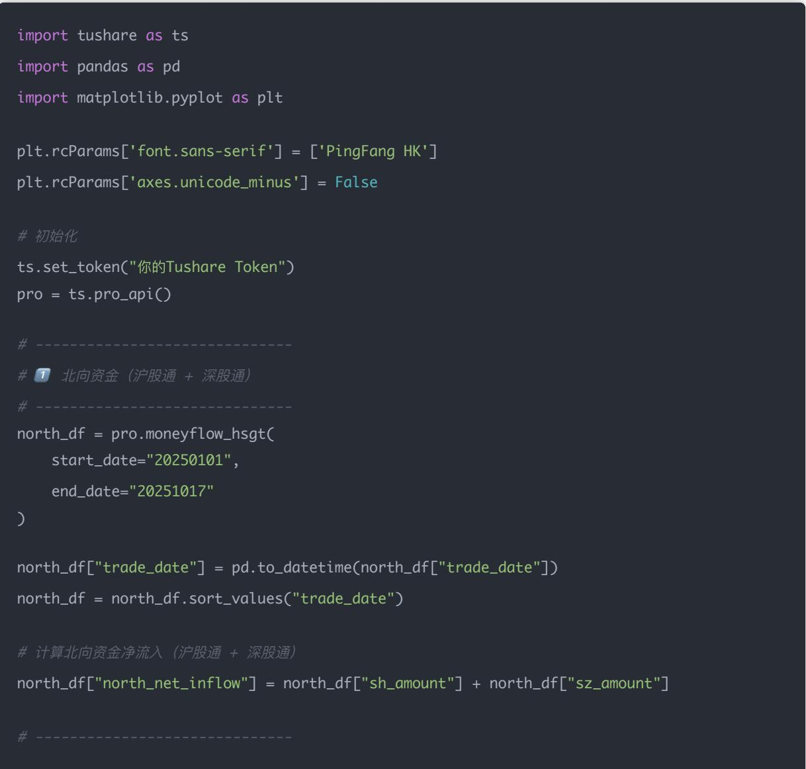

# 量化交易进阶:第40天 - 情绪与资金流因子系统化(Sentiment & Capital Flow Factors)

原创 逻辑与流 逻辑与流 2025年10月22日 00:05 北京 📞 听全文

完成技术面因子学习后,本文开启情绪与资金流因子的系统化学习。情绪因子基于市场行为与资金流向提取,反映市场共识方向与风险偏好。系统阐述北向资金、新闻情绪、主力资金流向、市场人气四个核心情绪维度——北向资金代表外资聪明钱,新闻情绪反映舆论波动,主力资金流向揭示机构博弈,市场人气衡量散户热度。揭示情绪因子使用的关键——构建综合市场情绪指数,结合北向资金趋势确认、主力资金短期动量、新闻情绪快速反应、市场人气极值预警,构建从单一情绪指标到市场风险偏好判断、从资金流向到择时决策的完整分析框架。

## 学习时间

- 理论学习: 15分钟

- 代码实践: 10分钟

- 案例分析: 5分钟

- 总计: 30分钟

## Day 40: 情绪与资金流因子

主题：北向资金、新闻情绪、资金流向 目标：理解"市场情绪"如何影响资金行为，从而构建"聪明钱"类因子。

## 一、为什么要研究"情绪"与"资金流"

在量化选股中，除了公司基本面（ROE、成长性）和价格行为（动量、波动率），还有一个经常被忽视、但实际影响股价短期波动最强的维度：

资金 + 情绪 = 市场共识的方向

比如：

- 北向资金持续流入 $\rightarrow$ 外资看多，市场情绪偏乐观

- 新闻标题负面增加 $\rightarrow$ 市场恐慌，短期调整

- 主力资金净流入 $\rightarrow$ 资金面"抬轿", 价格上行概率高

这些指标虽然不反映公司基本面，但能反映市场行为的"温度"。

## 二、常见的"情绪与资金流"因子类型

<table><tr><td>因子类别</td><td>示例指标</td><td>含义</td></tr><tr><td>北向资金流</td><td>当日净买入额 / 5日累计流入</td><td>外资对A股的偏好强弱</td></tr><tr><td>新闻情绪</td><td>正面新闻占比 / 情绪得分</td><td>市场媒体情绪指标</td></tr><tr><td>主力资金流向</td><td>主力资金净流入 (亿元)</td><td>大单资金活动情况</td></tr><tr><td>市场人气</td><td>涨停家数 / 下跌家数</td><td>投机氛围强弱</td></tr></table>

## 一、什么是"北向资金"?

"北向资金"指的是：

通过沪股通、深股通流入中国A股市场的境外资金。

背景：沪港通 & 深港通机制

2014年后，中国与香港建立了「沪港通」「深港通」制度，允许内地与香港之间的投资者互通买卖股票。

- 沪股通（Shanghai-Hong Kong Stock Connect）：境外资金买入「上海证券交易所」的股票

- 深股通 (Shenzhen–Hong Kong Stock Connect)：境外资金买入「深圳证券交易所」的股票

## 因此：

- 从香港流入内地股市的资金，叫北向资金

- 从内地流出买香港股票的资金，叫南向资金

"北"代表流向北方（内地市场），“南"代表流向南方（香港市场）。

## 二、北向资金的主要构成

北向资金主要是通过港交所参与A股交易的外资机构资金，包括：

<table><tr><td>来源类型</td><td>举例</td></tr><tr><td>全球指数基金</td><td>追踪 MSCI、FTSE Russell 的 ETF、共同基金</td></tr><tr><td>海外主权基金</td><td>新加坡政府投资公司、挪威养老基金</td></tr><tr><td>外资投行</td><td>高盛、摩根士丹利、贝莱德</td></tr><tr><td>QFII/RQFII</td><td>获得中国合格境外投资者资格的机构</td></tr></table>

这些资金一般偏好：

- 大市值、流动性强的蓝筹股

- 基本面稳健、业绩确定性高的公司

例如：贵州茅台、宁德时代、中国平安、招商银行。

## 三、北向资金数据怎么看？

## 主要有三种数据指标：

<table><tr><td>指标</td><td>含义</td><td>意义</td></tr><tr><td>北向资金净流入</td><td>当天买入额 - 卖出额</td><td>代表外资当日总体买入意愿</td></tr><tr><td>沪股通净流入</td><td>买上海市场的部分</td><td>通常偏向权重股</td></tr><tr><td>深股通净流入</td><td>买深圳市场的部分</td><td>偏向成长股</td></tr></table>

举例：

北向资金今日净流入 +50亿 → 外资整体在买入A股； → 常被视作市场偏"多"的信号。

## 四、北向资金的分析逻辑

### 1. 趋势跟随（Trend Following）

北向资金往往提前布局，一旦形成持续流入，说明外资认可中国市场前景：

- 连续流入 $\rightarrow$ 市场上升趋势

- 连续流出 $\rightarrow$ 市场风险偏好下降

### 2. 结构性偏好（Stock Preference）

- 偏好"白马蓝筹": 消费、金融、医药、电力

- 不太参与中小盘或题材股 3. 宏观敏感性（Macro Sensitivity）

北向资金对人民币汇率、美国利率、地缘政治非常敏感；一旦美元走强、人民币贬值，外资会快速撤离。

## 五、为什么北向资金重要？

<table><tr><td>原因</td><td>说明</td></tr><tr><td>代表&quot;聪明钱&quot;</td><td>外资机构研究深、反应快,趋势常提前显现</td></tr><tr><td>全球视角</td><td>反映中国市场在全球资产配置中的地位</td></tr><tr><td>影响市场结构</td><td>外资持股占比提升,影响板块风格(价值股占优)</td></tr><tr><td>可做情绪因子</td><td>连续净流入/流出可视为市场强弱信号</td></tr></table>

## 六、量化中的应用

在量化策略里，「北向资金」常被设计为情绪或资金流因子：

- north\_money\_today：当日净流入额

- north\_money\_5d：5日累计净流入

- north\_ratio：北向资金持股占总市值比例

- north\_diff：今日流入 - 过去5日平均流入

可以与指数收益率配合，构造「外资主导度」模型，判断趋势强弱。

小结

<table><tr><td>维度</td><td>内容</td></tr><tr><td>概念</td><td>通过沪股通、深股通进入A股的境外资金</td></tr><tr><td>来源</td><td>全球机构投资者</td></tr><tr><td>特点</td><td>长线、稳健、偏爱蓝筹</td></tr><tr><td>作用</td><td>反映外资风险偏好与市场趋势</td></tr><tr><td>量化应用</td><td>情绪因子 / 资金流因子</td></tr></table>

## 二、新闻情绪（舆论情绪）

定义：

基于 财经新闻标题、微博、研报摘要、公告解读 等文本，通过 NLP（自然语言处理） 分析其「情感倾向」。

例如：

"公司业绩暴增100%"→正面情绪+0.9"监管调查、业绩预减"→负面情绪-0.8

获取方式：

- 新浪财经 / 腾讯财经新闻的 NLP 情绪得分

- AkShare 的 stock\_news\_emotion

- 或者自建情感模型（如 SnowNLP + 词典法）

常见指标：

<table><tr><td>指标</td><td>含义</td></tr><tr><td>新闻情绪均值</td><td>最近7天新闻的平均情绪得分</td></tr><tr><td>新闻正负比</td><td>正面新闻数量 ÷ 总新闻数量</td></tr><tr><td>情绪波动率</td><td>情绪得分的标准差，代表舆论不确定性</td></tr></table>

应用逻辑：

- 情绪持续高涨 $\rightarrow$ 可能短期过热

- 情绪急转负 $\rightarrow$ 市场恐慌

- 情绪极低 $\rightarrow$ 可能是底部区域

## 示例因子：

news\_sentiment\_factor = 最近3日平均情绪 - 最近10日平均情绪

表示短期舆论相对于中期的变化趋势。

## 三、主力资金流向（机构情绪）

定义:

主力资金指的是机构、游资、大户等大资金的买卖行为。与北向资金不同，它主要反映A股内部资金的态度。

常见数据来源：

- 东方财富、同花顺、choice的「资金流向」数据

- 分为主力净流入、超大单流入、大单流入等

常用指标：

<table><tr><td>指标</td><td>含义</td><td>意义</td></tr><tr><td>主力净流入(亿元)</td><td>主力买入 - 卖出资金</td><td>判断主力是否在吸筹</td></tr><tr><td>净流入占成交比</td><td>净流入 ÷ 总成交额</td><td>去除市值规模影响</td></tr><tr><td>主力资金5日趋势</td><td>连续流入 / 流出天数</td><td>判断主力持续性意图</td></tr></table>

应用逻辑：

- 连续几天主力资金净流入，说明机构在「建仓」

- 大盘跌、主力流入 $\rightarrow$ 主力在低吸

- 大盘涨、主力流出 $\rightarrow$ 主力在出货

量化中常构造：

main\_money\_factor = 主力5日净流入额 / 5日成交额

当 main\_money\_factor > 0.03 时，资金明显偏多。

## 四、市场人气（散户情绪）

定义：

反映普通投资者的交易热度与市场活跃度。

## 主要来自交易行为与网络搜索：

- 涨跌停家数

- 成交金额 / 换手率

- 百度搜索指数（如"股市暴跌""开户")

- 微博热度、东方财富股吧发帖量等

典型指标：

<table><tr><td>指标</td><td>含义</td></tr><tr><td>涨停家数 - 跌停家数</td><td>衡量短期市场乐观程度</td></tr><tr><td>成交额增速</td><td>反映资金参与热情</td></tr><tr><td>搜索热度指数</td><td>散户舆论的关注度</td></tr></table>

## 应用逻辑：

- 市场人气高 $\rightarrow$ 成交放量、题材股爆发

- 市场人气低 $\rightarrow$ 成交萎缩、避险情绪升温

- 极高人气时往往接近短期顶部

- 极低人气时常见于市场底部

可构造：

popularity\_factor = (涨停家数 - 跌停家数) / 总家数

## 四、四种情绪的综合关系

<table><tr><td>维度</td><td>主导群体</td><td>特征</td><td>周期</td></tr><tr><td>北向资金</td><td>外资机构</td><td>稳定、趋势性强</td><td>周级、月级</td></tr><tr><td>主力资金</td><td>内资机构</td><td>短中期博弈</td><td>日级、周级</td></tr><tr><td>新闻情绪</td><td>舆论媒体</td><td>快速反应、易反转</td><td>小时级、日级</td></tr><tr><td>市场人气</td><td>散户</td><td>过热与恐慌交替</td><td>日级</td></tr></table>

高级策略中，常将四者合并为「综合市场情绪指数（MSI）」，通过权重加权的方式构造因子，用来判断整体市场风险偏好。

举个例子

假设今天的数据是：

<table><tr><td>因子</td><td>当前值</td><td>解释</td></tr><tr><td>北向资金净流入</td><td>+80亿</td><td>外资看好</td></tr><tr><td>主力资金流入</td><td>+30亿</td><td>机构参与</td></tr><tr><td>新闻情绪</td><td>+0.75</td><td>舆论积极</td></tr><tr><td>市场人气</td><td>0.65</td><td>散户热情高涨</td></tr></table>

这时大盘短期可能继续上涨；但若第二天新闻情绪骤降、主力转出，则要警惕"高位反转"。

小结

<table><tr><td>类别</td><td>核心作用</td><td>适合周期</td></tr><tr><td>北向资金</td><td>趋势判断</td><td>中长线</td></tr><tr><td>主力资金流</td><td>机构行为</td><td>中短线</td></tr><tr><td>新闻情绪</td><td>舆论波动</td><td>高频 / 日频</td></tr><tr><td>市场人气</td><td>散户热度</td><td>高频 / 日频</td></tr></table>

## 三、用 TuShare 获取北向资金流入 和 主力资金净流入

\# 2 主力资金流向
# ----
flow\_df = pro.moneyflow\_hs\_daily(start\_date="20250101", end\_date="20251017")
flow\_df["trade\_date"] = pd.to\_datetime(flow\_df["trade\_date"])
flow\_df = flow\_df.groupby("trade\_date")[ "net\_mf\_vol"].sum().reset\_index() # 汇总A股主力净流入
# ----
# 3 合并绘图
# ----
df = pd.merge(north\_df[['trade\_date", "north\_net\_inflow"]], flow\_df, on="trade\_date", how="i
plt.figure(figsize=(12,6))
plt.subplot(2,1,1)
plt.bar(df["trade\_date"], df["north\_net\_inflow])/1e8, color="red", label="北向资金净流入（亿元）
plt.axhline(0, color="black", linestyle="--")
plt.legend()
plt.title("北向资金净流入")
plt.subplot(2,1,2)
plt.plot(df["trade\_date"], df["net\_mf\_vol])/1e4, color="blue", label="主力资金净流入（亿元）")
plt.axhline(0, color="black", linestyle="--")
plt.legend()
plt.title("A股主力资金净流入")
plt.tight\_layout()
plt.show()

## 一、数据接口说明

<table><tr><td>数据类型</td><td>接口</td><td>主要字段</td><td>含义</td></tr><tr><td>北向资金</td><td>moneyflow_hsgt</td><td>sh_amount, sz_amount</td><td>沪股通/深股通资金净流入额(单位:元)</td></tr><tr><td>主力资金流</td><td>moneyflow_hs_daily</td><td>net_mf_vol</td><td>主力资金净流入成交量(手),正为流入,负为流出</td></tr></table>

## 二、代码逻辑讲解

北向资金部分

north\_df["north\_net\_inflow"] = north\_df["sh\_amount"] + north\_df["sz\_amount"]

代表沪股通 + 深股通的净流入总额。当柱状图 > 0 时，说明外资（北向资金）在买入A股，市场风险偏好上升；当 < 0 时，则表示外资在撤离A股，市场偏谨慎。

北向资金通常被视为"聪明资金"，对短期行情有一定指示作用。

## 主力资金部分

flow\_df = pro.moneyflow\_hs\_daily(...)

flow\_df.groupby("trade\_date")[ "net\_mf\_vol"].sum()

这是A股所有股票主力资金的净流入汇总，反映了市场内部（机构、大资金）的资金方向。

- net\_mf\_vol > 0 → 主力净买入（看多）

- net\_mf\_vol < 0 → 主力净卖出（避险）

两者结合可以看：

- 外资（北向资金）态度

- 内资（主力资金）态度

有时候会出现「外资买、内资卖」或「外资卖、内资买」的背离，这通常是市场博弈的信号。

## 三、图像解读

## 图 1：北向资金净流入（红色柱）

- 红柱 $\rightarrow$ 当天外资净买入（流入A股）

- 绿柱（负数） $\rightarrow$ 外资净卖出

- 通常伴随大盘上涨，属于"情绪先行指标"

图 2：主力资金净流入（蓝线）

- 曲线平稳 $\rightarrow$ 市场观望

- 连续上升 $\rightarrow$ 机构持续加仓

- 连续下降 $\rightarrow$ 机构撤资或高位出货

## 四、常见的现象与应用

<table><tr><td>现象</td><td>含义</td></tr><tr><td>北向资金与主力资金同时流入</td><td>市场风险偏好高，趋势向好</td></tr><tr><td>北向资金流入、主力流出</td><td>外资看多，内资谨慎（短期震荡）</td></tr><tr><td>北向资金流出、主力流入</td><td>外资避险、内资抄底</td></tr><tr><td>双方同时流出</td><td>市场情绪转弱，需警惕调整</td></tr></table>

## 小结

- 北向资金="外资视角" $\rightarrow$ 中长期信心指标

- 主力资金="内资视角" $\rightarrow$ 短期交易情绪

- 结合分析可以判断：

- 市场风险偏好

- 机构 vs 外资分歧

- 阶段性行情的"温度表"

## 四、构造情绪因子示例（示意逻辑）

## 北向资金强度因子

$$
\mathrm{North} \backslash = \frac {5 \text {日均流入}}{5 \text {日绝对值总流量}}
$$

→ 反映连续性与力度。

新闻情绪因子（可用情感分析 API 或 GPT 提取）

$$
\text { Sentiment } _ {t} = \frac {\text { 正面新闻数 } - \text { 负面新闻数 }}{\text { 总新闻数 }}
$$

## 主力资金净流入比

$$
\mathrm{Capital} \backslash \_ \mathrm{Flow} _ {t} = \begin{array}{c} \text {主力净流入} \\ \text {成交额} \end{array}
$$

## 五、综合资金面情绪指数（合成）

你可以把这些指标标准化、合成一个"市场情绪指数":

$$
\text { EmotionIndex } _ {t} = 0. 5 \times \text { North } \backslash \text { Strength } _ {t} + 0. 3 \times \text { Sentiment } _ {t} + 0. 2 \times \text { Capital } \backslash \text { Flow } _ {t}
$$

当 EmotionIndex > 0 → 市场情绪偏多；当 EmotionIndex < 0 → 市场情绪偏空。

## 六、实战思路：用情绪因子作为市场风控

<table><tr><td>情绪状态</td><td>策略动作</td></tr><tr><td>北向资金持续流出 + 新闻负面增加</td><td>降低仓位、避险</td></tr><tr><td>北向资金持续流入 + 市场人气上升</td><td>加仓、顺势做多</td></tr><tr><td>情绪极度乐观（指数大涨 + RSI&gt;80）</td><td>注意短期顶部风险</td></tr></table>

## 七、今日思考题

### 1.北向资金流入与指数上涨是否一定是因果关系？

答案：不一定是因果关系，而是高度相关关系。

你会观察到：

- 北向资金流入时，A股指数（尤其是沪深300）往往上涨

- 流出时，指数常常下跌

但是：

- 资金流向 $\neq$ 指数涨跌的"原因"

- 它更多是 市场情绪与预期的共同反映

举个例子：

- 外资提前判断宏观利好（如降准、美元走弱），提前布局买入

- 资金流入在价格上涨前出现 $\rightarrow$ 看似"北向带动上涨"

- 实际上是"外资信息领先 + 情绪共振"

总结：

北向资金更像一个"聪明钱情绪指标"，与行情同向，但不是因果，而是共因关系（共同受到预期、政策、流动性影响）。

### 2. 为什么情绪指标往往"先行"但也"易反转"?

这其实是"情绪因子"的双刃剑特性：

情绪指标（比如北向资金净流入、新闻情绪指数）往往领先价格变化，因为资金是提前布局的。

举例：

- 当外资连续流入、新闻情绪由负转正 $\rightarrow$ 市场还没涨

- 一两周后指数才明显上行

- 这时情绪起到了领先信号（先行指标）作用

但同时：

- 情绪往往过度波动

- 市场一旦过热（例如情绪极度乐观），反而是顶部信号

- 情绪极度悲观时（比如连续流出、舆论恐慌），反而接近底部

总结：

情绪指标"领先"，因为它反映预期；情绪指标"易反转"，因为市场容易"走极端"。

### 3. 如果北向资金与主力资金信号相反，你更相信哪个？为什么？

## 分析逻辑：

<table><tr><td>比较维度</td><td>北向资金</td><td>主力资金</td></tr><tr><td>来源</td><td>外资（长期机构资金）</td><td>内资（游资、机构混合）</td></tr><tr><td>时间周期</td><td>中长期布局</td><td>短线交易为主</td></tr><tr><td>影响对象</td><td>权重股、蓝筹</td><td>中小盘、题材股</td></tr><tr><td>信号稳定性</td><td>较稳健、趋势性强</td><td>噪音多、波动大</td></tr></table>

## 因此：

- 如果你做的是中长期配置 / 指数增强策略，更应该相信北向资金信号（它代表海外机构的宏观判断）

- 如果你做的是短线博弈 / 板块轮动策略，可以重点关注主力资金净流入（资金活跃度、题材热度）

## 综合建议：

- 北向资金 $\rightarrow$ 趋势确认因子

- 主力资金 $\rightarrow$ 短期动量因子

- 二者同时流入 $\rightarrow$ 最强共振信号（市场情绪全面转多）

## 总结表格

<table><tr><td>维度</td><td>领先性</td><td>反转性</td><td>稳定性</td><td>适用场景</td></tr><tr><td>北向资金</td><td>强（提前布局）</td><td>中</td><td>高</td><td>中长期策略</td></tr><tr><td>主力资金</td><td>弱（日内波动）</td><td>强</td><td>低</td><td>短线博弈</td></tr><tr><td>新闻情绪</td><td>强（快速反应）</td><td>强</td><td>中</td><td>风控辅助</td></tr></table>

今天我们完成了情绪与资金流因子的系统化学习,开启了从技术因子到市场情绪因子的转变。

## 核心收获

### 1. 四个核心情绪维度

- 北向资金: 外资聪明钱,反映中长期趋势与全球资金风险偏好

- 新闻情绪: 舆论温度计,通过NLP量化媒体情感倾向

- 主力资金流向: 内资机构博弈,反映短期资金动向与建仓出货信号

- 市场人气: 散户情绪,衡量市场活跃度与极端情绪

### 2. 关键认知

- 情绪因子反映市场行为温度,不反映基本面但影响短期波动

- 北向资金与指数涨跌是相关非因果,共同受预期驱动

- 情绪指标既领先(反映预期)又易反转(极端回归)

- 不同资金类型适用不同策略周期(外资中长期vs内资短线)

### 3. 实战要点

- 数据获取: TuShare提供北向资金与主力资金流向数据

- 因子构造: 资金强度因子、净流入比率、情绪变化率

- 综合指数: 多维度加权构建市场情绪指数(MSI)

- 风控应用: 情绪极值预警、资金背离信号、趋势确认辅助

## 情绪因子 vs 技术因子对比

## 互补性分析:

<table><tr><td>维度</td><td>技术因子</td><td>情绪因子</td></tr><tr><td>数据来源</td><td>行情数据(价格/成交量)</td><td>资金流向/舆论/搜索</td></tr><tr><td>更新频率</td><td>日度/分钟</td><td>日度/实时</td></tr><tr><td>反映内容</td><td>价格趋势与波动</td><td>市场情绪与资金行为</td></tr><tr><td>适用周期</td><td>短中期</td><td>高频到中期</td></tr><tr><td>核心逻辑</td><td>趋势延续/均值回归</td><td>预期先行/情绪共振</td></tr></table>

## 因子体系框架

## 已完成模块:

- 财务因子系列(Day 35-38):

- Day 35: 盈利能力因子

- Day 36: 成长能力因子 √

- Day 37: 偿债能力因子

- Day 38: 运营效率因子 √

- 技术因子系列(Day 39):

- Day 39: 动量/波动率/均线偏离率/RSI

- 情绪因子系列(Day 40-):

- Day 40(今天): 北向资金/新闻情绪/主力资金/市场人气 √

## 综合应用策略:

\# 多因子综合模型

综合得分 = 0.4x财务得分 + 0.3x技术得分 + 0.3x情绪得分

\# 情绪因子用于择时与风控

if 北向资金连续5日流入 and 主力资金同向 and 新闻情绪>0.5:

仓位 = 80% # 情绪共振,加仓

elif 北向资金连续流出 and 新闻情绪<-0.3:

仓位 = 30% # 情绪转弱,降仓

\# 情绪极值预警

if 市场人气指标 > 0.9: # 极度亢奋预警 = "短期顶部风险"

elif 市场人气指标 < 0.1: # 极度冷清

预警 = "可能接近底部"

一句话总结: 情绪与资金流因子帮助我们捕捉市场行为温度与资金动向,结合财务因子与技术因子构建"基本面选股+技术面择时+情绪面风控"的完整量化框架,为多因子模型与市场择时策略提供关键信号。

下一步预告: 接下来将继续深入因子工程,学习因子标准化、因子合成 $^{2}$ 、因子有效性检验等高级技术,完善从单因子到多因子模型的构建路径,最终实现财务、技术、情绪三大因子体系的有机融合。
