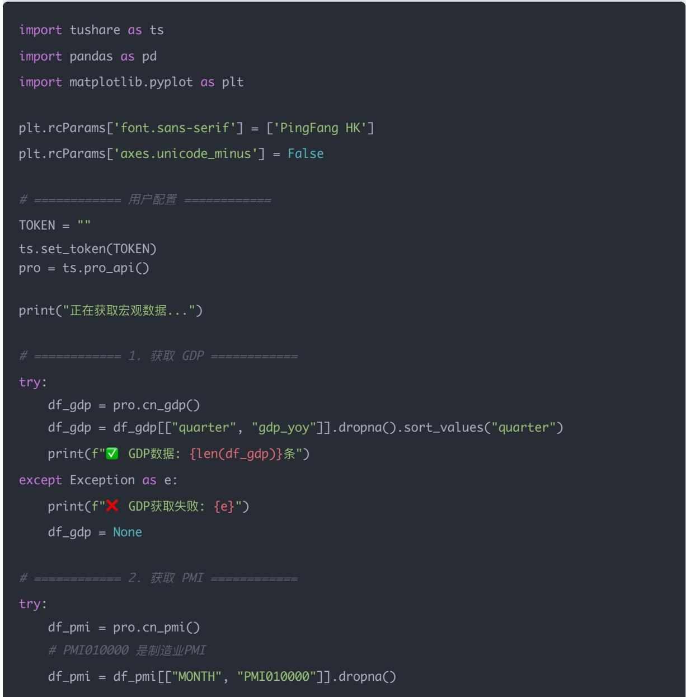
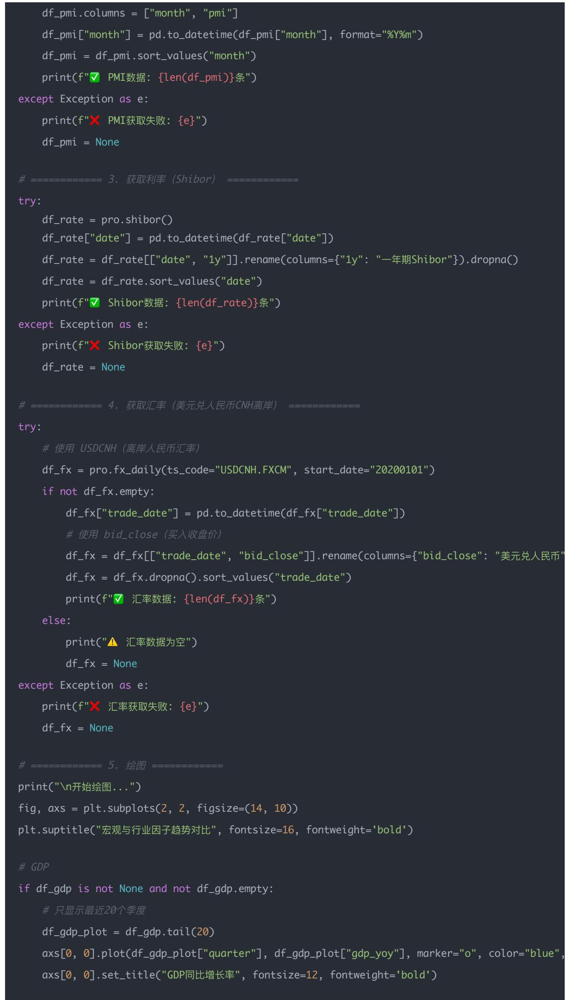
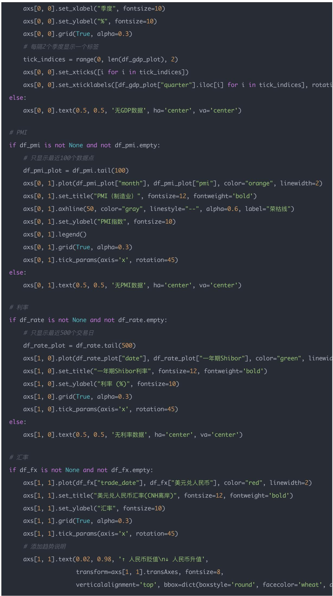

# 量化交易入门进阶:第41天 - 宏观与行业因子系统化(Macro &Industry Factors)

原创 逻辑与流 逻辑与流 2025年10月 23 日 19:29 北京 听全文

宏观因子基于宏观经济数据提取,反映经济周期、政策环境与市场风险偏好。系统阐述GDP、PMI、利率、汇率四个核心宏观因子的逻辑内核——GDP反映经济增长水平,PMI作为领先指标提前反映经济拐点,利率影响估值与资金成本,汇率影响资本流动与行业竞争力。揭示宏观因子使用的关键——构建宏观景气度指数,结合GDP增速、PMI变化、利率走势、汇率波动判断经济周期阶段,为量化策略中的宏观择时与行业轮动提供实战工具。

## 学习时间

理论学习: 15分钟

代码实践: 10分钟

案例分析: 5分钟

总计: 30分钟

主题：GDP、PMI、利率、汇率、行业轮动 目标：从公司层面上升到宏观层面，学习如何把经济周期信号融入量化模型。

## 一、课程目标

## 今天你将学会：

1. 理解四类宏观因子（GDP、PMI、利率、汇率）

2. 学会用 AkShare / Tushare 获取这些指标

3. 计算宏观经济周期指标（景气度、衰退、复苏）

4. 构建「行业轮动信号

5. 绘制宏观与市场表现的对比图（GDP vs 上证指数）

## 二、核心概念

<table><tr><td>因子</td><td>含义</td><td>投资含义</td></tr><tr><td>GDP增速</td><td>经济总体增长水平</td><td>高增速→景气上行;负增长→衰退风险</td></tr><tr><td>PMI</td><td>采购经理人指数,&gt;50为扩张,&lt;50为收缩</td><td>宏观领先指标之一</td></tr><tr><td>利率</td><td>无风险收益率、融资成本</td><td>利率上升→压制股市估值</td></tr><tr><td>汇率</td><td>人民币兑美元</td><td>汇率升值→资本流入;贬值→资本外流</td></tr><tr><td>行业轮动</td><td>经济不同阶段领先行业不同</td><td>复苏 → 周期股;繁荣 → 消费;衰退 → 医药、公用事业</td></tr></table>

我们把 PMI（采购经理人指数） 和 汇率（人民币兑美元） 两个概念做一次系统、透彻但通俗的讲解，包含定义、为什么重要、它们如何影响市场／行业、实务中的用法和注意事项。

## 三 PMI（采购经理人指数）——为什么说它是宏观的"领先指标"？

## 1）PMI 是什么（定义与构成）

PMI 全称 Procurement Managers' Index（采购经理人指数），通常按月发布，反映制造业或非制造业采购、生产、库存、就业、供应商交货等环节的景气变化。

常见的子项包括：新订单、产出（产量）、雇佣、供应商交货时间、原材料库存等。

指数计算方式（简化说明）：把这些调查问题的"扩张/持平/收缩"回答按权重合成一个百分制指标，50 为荣枯线：

50：多数受访者反馈"扩张" → 经济活动扩张

=50：持平

<50：收缩

## 2）为什么 PMI 被称为"领先指标"？

来源是企业采购和订单的第一手感受：采购经理在收到新订单、安排生产、下采购单时，会比产出、销售额、税收这些"硬数据"更早感知需求变化。

时间频率高（通常月度），发布比许多宏观数据（如季度 GDP）要早：当月的 PMI 往往在月初/中就可得，能较快反映经济节奏的改变。

直接反映需求侧变化：新订单（New Orders）项常常对未来产出有很强的指示性，若新订单持续回升，企业会提前增加采购、扩产，随后带动产出、就业、投资等。

所以：PMI 的变化通常领先 GDP / 工业增加值 / 企业盈利若干周到数月，因而常被用作经济周期的短期风向标。

## 3）PMI 在投资/策略中的实用价值

行业轮动：PMI 上升 → 周期性行业（煤炭、钢铁、化工、机械、建材）容易先受益；PMI 下降 → 防御性行业（医药、公用事业、食品）相对抗跌。

情绪/仓位管理：把 PMI 纳入宏观情绪因子，用于决定风险敞口（如：当PMI持续回升 -> 提高股票仓位；持续下行 -> 降低仓位或偏防御）。

先行信号：在构建宏观因子时，常把 PMI 做滞后/领先分析（比如 PMI 本月与指数未来 1–3 个月的相关性）。

## 4）局限与注意事项

样本偏差：PMI 来自抽样调查，可能存在行业或区域的代表性偏差。

行业构成变更：制造业结构变化（高附加值比重上升）可能改变 PMI 对某些传统行业的指示性。

噪音 & 假信号：单次极端值可能受季节性、节假日、统计口径等影响，需看持续性（多月趋势）而不是单月判断。

先行但不完美：PMI 提前发出信号并不保证市场会马上对应——市场价格还受估值、流动性、政策等多维影响。

## 四 汇率（人民币兑美元）——为什么"升值→资本流入；贬值→资本外流"？

## 1）汇率基本概念

汇率是两种货币之间的兑换比率，例如人民币/美元汇率表示 1 美元可以兑换多少人民币（或相反，取决于报价方式）。

汇率变动受：利差（两国利率）、预期（通胀/增长差异）、资本流动（跨境资金买卖）、外汇管制与央行干预、风险偏好、国际收支等多重因素影响。

## 2）为什么"升值 → 资本流入"是常见机制（直观逻辑）

"升值 → 资本流入" 这个结论基于两个主要渠道（并非绝对但常见）：

## a) 资产重估与套利渠道

若人民币预期升值（相对于美元），持有人民币计价资产的外币投资者将获得额外汇率收益（资本利得），这会吸引境外资金买入人民币资产（股票/债券/房地产等）以分享升值收益 → 资本流入。

同时，当人民币升值时，国内资产对外币计价变"更便宜/更有吸引力"或实际收益提高（视计价口径），吸引外资。

## b) 利差与收益率（包含"真实利差"）

如果在一个时期内，中国利率（或人民币资产的风险调整后回报）相对美元资产更高，且汇率预期支持人民币不贬值，那么跨境资本会流入以追逐更高收益（尤其在资本自由流动时）。升值通常伴随对货币稳定的信心，从而降低外资进入的外汇风险溢价。

因此：升值预期 + 相对高收益 → 吸引外资流入。反过来，若人民币贬值或存在贬值预期，外资会担心汇兑损失，于是撤资或减少配置 → 资本外流。

## 3）更细致的因果链（什么时候可能例外）

## 虽然上面是一般逻辑，但实际还要看以下条件：

资本账户是否开放：若资本管制严格（资本不能自由进出），汇率变化对跨境资本流动的影响会被削弱。

外资资金性质：长期战略性外资（如直接投资、长期基金）对短期汇率波动不太敏感；短期投机资金（热钱）对汇率预期非常敏感。

宏观/政策背景：若升值是由贸易顺差、外汇管制放松或资本项目开放引起，资本流入逻辑更强；若升值伴随经济快速下行（资本逃离其他方式），影响就复杂。

避险情绪：在全球风险偏好极低时，即便本币升值，也可能出现撤资（因为资金寻求美元避险），所以不能简单以"升值→流入"为定律。

## 4）汇率变动对不同行业/资产的影响（实战角度）

出口型企业（制造、外向型加工）：人民币升值 → 出口商品以外币计价收益下降 → 对出口企业不利（利润压缩）；贬值则利好。

进口依赖型企业（能源、科技进口设备）：人民币升值 → 进口成本下降 → 有利；贬值则成本上升。

外币负债重的企业：人民币贬值会增加其本币计价的外债负担（风险上升）。

金融市场：人民币升值通常与资本流入/货币宽松收紧或外汇储备变化相关，会影响利率、估值水平与风险溢价。

股市风格：长期来看，持续升值+资本流入常伴随估值扩张（资金充裕），偏好成长/高估值板块；持续贬值则市场避险，偏好价值/出口受益的板块视情况而定。

## 5）在量化/策略里如何使用汇率信息

宏观因子输入：把汇率（或汇率变化率）作为宏观因子之一，做 z-score 标准化后输入多因子模型。

行业分配规则：当人民币预期贬值 → 增配出口型行业，减配进口依赖行业（反之亦然）。

风险管理：当发现快速贬值 + 资金外流信号 → 降低杠杆、提高现金比重或对冲外汇风险（使用期货/期权）。

滞后/领先处理：汇率和资本流动互为因果且可能反馈，量化时通常做滞后检验（比如汇率的当月/上月变动对未来1–3月行业收益的影响）。

## 6）注意事项与陷阱

短期噪音很大：汇率日内波动受热钱、投机、新闻影响，短期噪声大，需用合适频率（周、月）平滑。

政策干预可能突然改变传导：央行/外汇管理局的干预可以迅速扭转汇率走势，带来断裂式变化。

多因子交互：汇率与利率、通胀、资本项政策紧密相关，用单一汇率因子判断风险可能遗漏交互效应。

数据口径：人民币报价可能是直接/间接（USD/CNY vs CNY/USD），注意统一口径与正负方向（升值或贬值的正负定义）。

## 五 如何把 PMI 与汇率结合进量化框架（实用建议）

### 1. 频率与对齐

PMI：月度（或月初数据），适合月度/季度调仓决策；

汇率：可用 日频或周频，但在宏观因子里常用 月度均值或月度变动率对齐 PMI。

### 2. 标准化与合成因子

对每个宏观变量做 Z-score（滚动窗口均值/标准差），避免不同尺度影响组合权重；

构造宏观景气/外资情绪指数，如：

macro\_score = w1 \* z(PMI) + w2 \* z(GDP\_growth) - w3 \* z(interest\_rate)fx\_score = -z(ΔUSD/CNY)  # 如果Δ为美元升值则打负号 定义要清晰

把 macro\_score 与 fx\_score 结合决定行业权重或整体杠杆。

### 3. 交易规则示例

若 macro\_score 上升且 fx\_score 正（人民币升值或稳固）→ 提高股票仓位、偏好周期/消费行业；

若 macro\_score 下降且 fx\_score 负（人民币贬值）→ 降低风险敞口、偏好防御行业或对冲外汇风险。

### 4. 检验与稳健性

做滚动回测（不同时间窗口）检验 PMI 与汇率因子对行业收益的稳定性；

做样本外测试与压力测试（例如突发贬值、政策干预的情形）来评估策略鲁棒性。

## 六 简短结论（便于记忆）

PMI：企业采购/订单的直接反映，因其"先感知需求、先下订单"的特性，常常领先工业产出与股市表现；适合做短-中期宏观景气判断与行业轮动的先导信号。

汇率（人民币兑美元）：通过影响资本流动、外币计价收益和贸易竞争力，间接影响资金流向与行业收益；升值通常吸引资本流入（尤其是短期投机/收益套利），贬值则会产生资本外流压力，但实际效果受资本管制、政策和全球风险偏好等因素影响。

## 七 实战示例代码（使用 TuShare）

if df\_rate is not None and not df\_rate.empty: # 只显示最近500个交易日 df\_rate\_plot = df\_rate.tail(500) axs[1, 0].plot(df\_rate\_plot["date"], df\_rate\_plot["一年期Shibor"], color="green", linewi axs[1, 0].set\_title("一年期Shibor利率", fontsize=12, fontweight='bold') axs[1, 0].set\_ylabel("利率 (%)", fontsize=10) axs[1, 0].grid(True, alpha=0.3) axs[1, 0].tick\_params(axis='x', rotation=45) else: axs[1, 0].text(0.5, 0.5, '无利率数据', ha='center', va='center')

if df\_fx is not None and not df\_fx.empty:axs[1, 1].plot(df\_fx["trade\_date"], df\_fx["美元兑人 民币"], color="red", linewidth=2)axs[1, 1].set\_title("美元兑人 民币汇率(CNH离岸)", fontsize=12, fontweight='bold')axs[1, 1].set\_ylabel("汇率", fontsize=10)axs[1, 1].grid(True, alpha=0.3)axs[1, 1].tick\_params(axis='x', rotation=45)#添加趋势说明axs[1, 1].text(0.02, 0.98, '↑ 人 民币贬值\n↓ 人 民币升值',transform=axs[1, 1].transAxes, fontsize=8,verticalalignment='top', bbox=dict(boxstyle='round', facecolor='wheat'

else:

axs[1, 1].text(0.5, 0.5, '无汇率数据', ha='center', va='center')

plt.tight\_layout(rect=[0, 0, 1, 0.96])

#保存图片

output\_file = "宏观因子趋势图.png"

plt.savefig(output\_file, dpi=100, bbox\_inches='tight')

print(f"\n✅ 图表已保存到: {output\_file}")

plt.show()

print("\n✅ 完成！")

## 代码说明

<table><tr><td>指标</td><td>数据来源</td><td>说明</td></tr><tr><td>GDP</td><td>pro.cn_gdp()</td><td>年度 GDP 同比增长率,衡量经济增速</td></tr><tr><td>PMI</td><td>pro.cn_pmi()</td><td>制造业景气度指标(高于 50 = 扩张)</td></tr><tr><td>利率</td><td>pro.shibor()</td><td>银行间拆借利率,一般反映货币政策松紧</td></tr><tr><td>汇率</td><td>pro.fx_daily()</td><td>人民币兑美元汇率,反映资本流动与国际收支</td></tr></table>

## 八 图像结果与解读

1 GDP同比增长率（左上）

## 指标含义：

衡量国家经济增长速度

数值越高，经济增长越快

## 如何解读：

6%：经济快速增长

4-6%：稳健增长（当前中国目标区间）

< 4%：增长放缓

## 趋势分析（最近20个季度）：

显示疫情后经济恢复情况

可以看到2020年Q1大幅下跌（疫情冲击）

之后逐步回升，现在稳定在5%左右

2 PMI制造业指数（右上）

## 指标含义：

采购经理指数，反映制造业景气度

50是荣枯线（图中灰色虚线）

## 如何解读：

50：制造业扩张，经济向好

= 50：持平

< 50：制造业收缩，经济走弱

## 实战意义：

PMI是领先指标，提前反映经济走势

持续3个月 > 50，经济复苏信号

持续低于50，需警惕经济下行

3 一年期Shibor利率（左下）

## 指标含义：

银行间拆借利率，反映市场资金成本

## 中国的"无风险利率"基准

## 如何解读：

利率上升 ↑：

货币政策收紧

资金成本提高

对股市不利（资金流出）

利率下降 ↓：

货币政策宽松

资金成本降低

对股市有利（资金流入）

## 投资启示：

利率走低时，考虑加仓股票

利率走高时，债券更有吸引力

4 美元兑人民币汇率CNH（右下）

## 指标含义：

1美元能兑换多少人民币

CNH是离岸人民币汇率

## 如何解读：

数值上升 ↑：

人民币贬值（1美元换更多人民币）

出口企业受益

进口成本上升

数值下降 ↓：

人民币升值（1美元换更少人民币）

进口企业受益

出口竞争力下降

## 投资关联：

人民币贬值 → 外资流出压力 → A股承压

人民币升值 → 外资流入增加 → A股受益

关注7.0和6.5关键点位

## 四大因子的联动关系

GDP增速 ↓ → PMI走弱 → 央行降息(Shibor↓) → 刺激经济

## 实战应用：

当GDP增速放缓 + PMI<50 + 利率下降时，是逆周期投资机会

当四个指标同时向好时，经济处于扩张期，适合满仓

当指标出现背离（如GDP增长但PMI下降），需谨慎观察

这四个指标构成了完整的宏观经济监控体系！

## 九 扩展：行业轮动信号

<table><tr><td>经济阶段</td><td>宏观特征</td><td>领先行业</td></tr><tr><td>复苏期</td><td>GDP低→上升中;PMI上行;利率低</td><td>周期股(钢铁、建材、机械)</td></tr><tr><td>繁荣期</td><td>GDP高;PMI高位;利率上升</td><td>消费、金融</td></tr><tr><td>滞涨期</td><td>通胀高;利率高;PMI下行</td><td>能源、资源</td></tr><tr><td>衰退期</td><td>GDP下行;PMI&lt;50;降息</td><td>医药、公用事业、科技</td></tr></table>

在量化里：我们可以用 PMI、利率、GDP 同步变化率 构造一个「宏观景气度指数（Macro SentimentIndex）」：

macro\_score = 0.4 \* PMI\_zscore + 0.3 \* GDP\_growth\_zscore - 0.3 \* Rate\_zscore

得分高时偏多，得分低时偏空。

## 十 今日思考题

## 1 为什么 PMI 通常领先股市？

## 逻辑核心

股市 = 对未来经济和盈利的预期。 而 PMI（采购经理人指数）反映的是企业对 当前与未来几个月生产经营活动 的真实感知。

因此，PMI 的变化往往比企业财报、GDP 增长率、工业增加值等\*\*"滞后指标"更早反映经济拐点\*\*。

## 因果链

<table><tr><td>阶段</td><td>经济/市场状态</td><td>PMI变化</td><td>投资者预期</td><td>股市反应</td></tr><tr><td>1</td><td>经济触底</td><td>PMI从低位回升(&lt;50→&gt;50)</td><td>预期企业盈利将好转</td><td>股价率先上涨</td></tr><tr><td>2</td><td>经济过热</td><td>PMI高位见顶(&gt;55下降)</td><td>预期盈利增速见顶</td><td>股价提前调整</td></tr><tr><td>3</td><td>经济收缩</td><td>PMI持续低迷</td><td>预期盈利恶化</td><td>股价持续下跌</td></tr></table>

这就解释了：PMI 是"领先指标"，而股价是"预期驱动"。 当 PMI 连续数月回升（特别是"新订单分项"回升）时，通常代表制造业需求开始复苏，股市常提前反弹。

\*\* 在量化策略中的用法\*\*

构建宏观因子 PMI\_diff = PMI\_t - PMI\_{t-1}

若 PMI\_diff 连续 2 个月为正 → 增加股票仓位

若 PMI\_diff 连续下降 → 降低风险暴露、转向防御板块

历史验证中，这种规则常能"捕捉底部拐点"，因为市场总是比经济数据早走一步。

## 2 利率下降对股市估值有何影响？

关键机制：折现率下降 → 估值上升

股市的核心估值逻辑可以用 DCF （现金流折现模型） 表示：

$$
P = \Sigma (t = 1 t o \infty) C F _ {t} / (1 + r) ^ {t}
$$

其中：

：未来现金流（公司盈利）

：折现率 ≈ 无风险利率 + 风险溢价

当央行降息（利率下降）时：

折现率 r 下降 → 每期现金流的现值上升 → 估值上升（股价上涨）

同时，债券收益率下降 → 投资者寻求更高收益 → 资金从债券流向股票

## 实际效果

<table><tr><td>情况</td><td>影响</td></tr><tr><td>短期降息（宽松周期）</td><td>提振流动性、刺激估值扩张</td></tr><tr><td>长期高利率</td><td>提高融资成本、压缩企业利润</td></tr><tr><td>极端降息或负利率</td><td>若经济疲弱，反而表明衰退风险，股市可能先涨后跌</td></tr></table>

因此，利率下降对股市的影响取决于背景：

若是"宽松初期" → 有利于股市

若是"衰退末期" → 降息也救不了市场

## 量化角度的结论

在多因子框架中，利率变化率 是典型的宏观因子：

$$
R a t e _ {C} h a n g e = r _ {t} - r _ {t - 1}
$$

若为负（降息）→ 权重加股票

若为正（加息）→ 降杠杆

同时可结合估值因子（PE、PB）判断\*\*"估值扩张空间"\*\*： 利率下降 + 估值低位 = 最理想的进场组合。

## 3 如果人民币持续贬值，你认为哪些行业会受益 哪些会受损？

## 汇率的直接效应

人民币贬值 = 外币更贵、出口更便宜。 这意味着：

出口型企业：收入增加（受益）

进口依赖型企业：成本上升（受损）

\*\* 受益行业（出口导向 / 外需驱动）\*\*

<table><tr><td>行业</td><td>原因</td></tr><tr><td>制造业(电子、家电、机械)</td><td>出口收入以美元计价,折算成人民币更多</td></tr><tr><td>纺织、服装、家具、轻工</td><td>出口比例高,人民币贬值提升竞争力</td></tr><tr><td>化工原料、基础工业品</td><td>部分出口企业受益,但要看原料进口结构</td></tr></table>

举例：比如一家出口美国的公司，每出口 \$1,000，汇率从 7.0 → 7.3，人民币收入变多： 7000 →7300 元人民币（+4.3% 收入增长）

受损行业（进口依赖 / 高外债）

<table><tr><td>行业</td><td>原因</td></tr><tr><td>航空公司</td><td>飞机租赁、航油结算以美元计价,成本上升</td></tr><tr><td>芯片、半导体、精密设备制造</td><td>进口原材料/设备成本上升</td></tr><tr><td>能源、化工部分子行业</td><td>原油、天然气等以美元定价,进口成本增加</td></tr><tr><td>高外债企业</td><td>外债以美元计价,人民币贬值导致债务本币价值上升(偿债压力大)</td></tr></table>

## 综合影响与市场表现

短期：人民币贬值 → 资金外流 → 风险资产承压（股市震荡）

中期：出口行业利润改善、制造业景气度上升

长期：若贬值预期稳定（非恐慌性），有助于出口修复、贸易顺差扩大

## 策略启示（量化逻辑）

构建"汇率敏感行业因子"：

$$
F X _ {I m p a c t} = w _ {e} x p o r t - w _ {i} m p o r t
$$

当人民币贬值时，提高出口权重、降低进口权重。

也可结合北向资金数据验证： 若人民币贬值伴随外资流出（north\_flow下降） → 降低整体风险敞口。

## 总结表

<table><tr><td>因子</td><td>影响路径</td><td>投资含义</td></tr><tr><td>PMI</td><td>领先经济周期</td><td>反映制造业景气度上升 → 股市往往提前上涨</td></tr><tr><td>利率</td><td>折现率、资金成本</td><td>利率下降提升估值、刺激股市</td></tr><tr><td>汇率</td><td>影响出口竞争力与资本流动</td><td>贬值利好出口行业,升值利好进口和内需</td></tr></table>

## 十二、总结

本讲从公司层面上升到宏观层面，系统学习了四大宏观因子的获取、分析和应用：

## 核心收获

### 1. 四个核心宏观因子

GDP增速: 反映经济增长水平,高增速→景气上行,负增长→衰退风险

PMI: 采购经理人指数,>50为扩张,<50为收缩,是宏观领先指标

利率: 无风险收益率、融资成本,利率上升→压制股市估值

汇率: 人民币兑美元,汇率升值→资本流入,贬值→资本外流

### 2. 关键认知

PMI作为领先指标,通过企业采购经理的实时感知,提前反映经济拐点

汇率对资本流动的影响路径:升值吸引外资流入,贬值产生资本外流压力

四大因子联动机制:GDP、PMI、利率、汇率相互影响,形成完整的经济周期监控体系

行业轮动策略:不同经济阶段对应不同领先行业,为量化投资提供宏观指导

### 3. 实战要点

数据获取: Tushare提供GDP、PMI、利率、汇率等宏观数据

因子构造: 宏观景气度指数、汇率敏感行业因子、PMI变化率

综合应用: 构建宏观景气度指数,结合四大因子判断经济周期阶段

行业轮动: 根据经济阶段调整行业配置,实现宏观择时

## 互补性分析:

<table><tr><td>维度</td><td>财务因子</td><td>技术因子</td><td>情绪因子</td><td>宏观因子</td></tr><tr><td>数据来源</td><td>财务报表</td><td>行情数据</td><td>资金流向/舆论</td><td>宏观经济数据</td></tr><tr><td>更新频率</td><td>季度/年度</td><td>日度/分钟</td><td>日度/实时</td><td>月度/季度</td></tr><tr><td>反映内容</td><td>公司基本面</td><td>市场情绪与趋势</td><td>市场行为温度</td><td>经济周期与政策环境</td></tr><tr><td>适用周期</td><td>中长期</td><td>短中期</td><td>高频到中期</td><td>中长线</td></tr><tr><td>核心逻辑</td><td>价值发现</td><td>趋势跟踪</td><td>情绪共振</td><td>周期判断</td></tr></table>

## 因子体系框架

## 已完成模块:

财务因子系列(Day 35-38):

Day 35: 盈利能力因子 ✅

Day 36: 成长能力因子 ✅

Day 37: 偿债能力因子 ✅

Day 38: 运营效率因子 ✅

技术因子系列(Day 39):

Day 39: 动量/波动率/均线偏离率/RSI

情绪因子系列(Day 40):

Day 40: 北向资金/新闻情绪/主力资金/市场人气

宏观因子系列(Day 41-):

Day 41(今天): GDP/PMI/利率/汇率/行业轮动

## 综合应用策略:

## # 多因子综合模型

综合得分 = 0.3×财务得分 + 0.2×技术得分 + 0.2×情绪得分 + 0.3×宏观得分

#宏观因子用于择时与行业轮动

if GDP增速>5% and PMI>50 and 利率下降 and 人 民币稳定:

仓位 = 80%  # 宏观环境向好 加仓

if 经济阶段 == "复苏期":

行业权重 = 周期股  # 钢铁 建材 机械

elif GDP增速<3% and PMI<50 and 利率上升:

仓位 = 30%  # 宏观环境转弱 降仓

if 经济阶段 == "衰退期":

行业权重 = 防御股  # 医药 公用事业 科技# 宏观因子极值预警if PMI连续3个月 <50:预警 = "经济下行风险elif 人民币快速贬值:预警 "资本外流压力

一句话总结: 宏观因子帮助我们判断经济周期与政策环境,结合财务、技术、情绪三大因子构建"基本面选股+技术面择时+情绪面风控+宏观面轮动"的完整量化框架,为多因子模型与行业轮动策略提供关键信号。

下一步预告: 接下来将继续深入因子工程,学习因子标准化、因子合成 、因子有效性检验等高级技术,完善从单因子到多因子模型的构建路径,最终实现财务、技术、情绪、宏观四大因子体系的有机融合。
