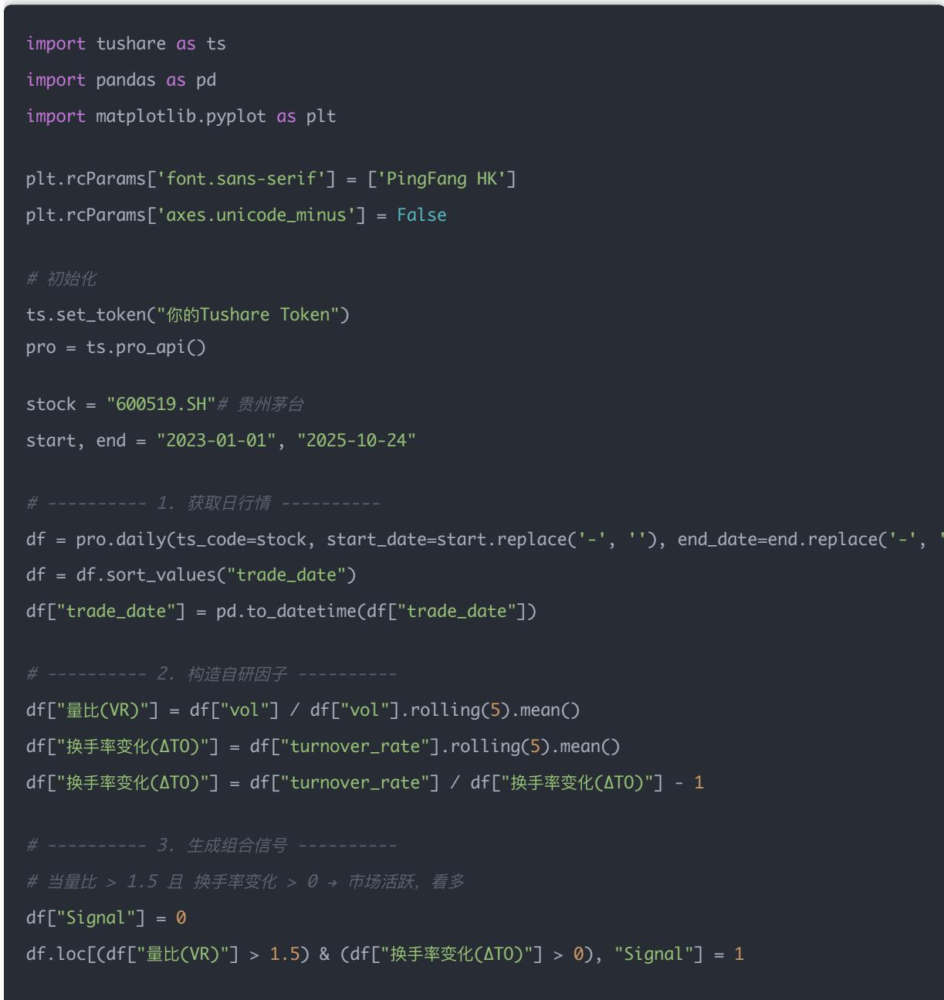
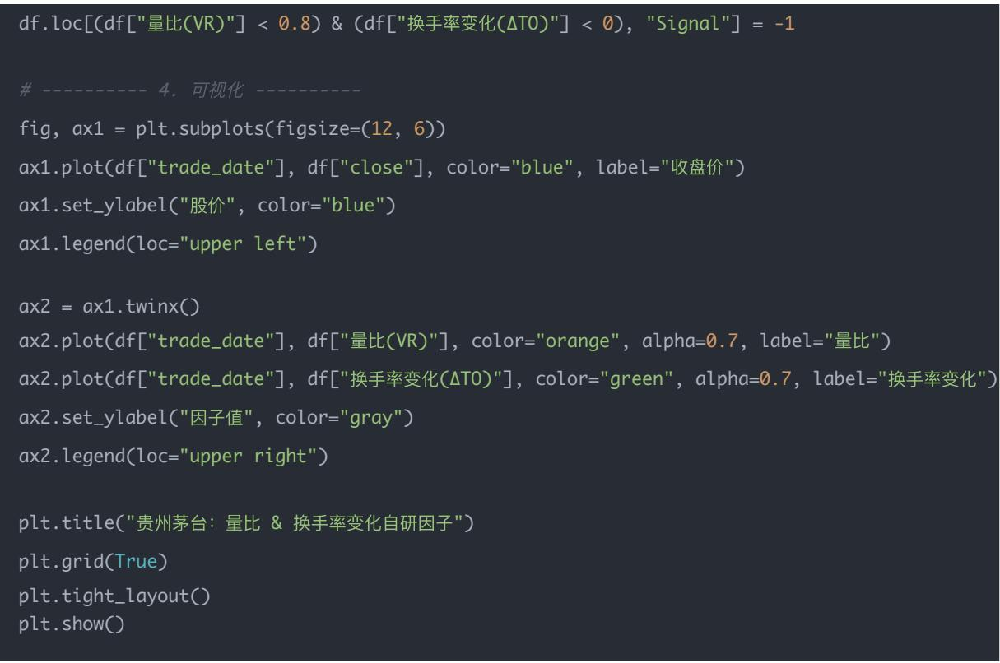

## 量化交易进阶:第42天 - 自研Alpha因子系统化(Custom Alpha Factors)

原创 逻辑与流 逻辑与流 2025年10月28日 22:05 北京 标题已修改 听全文

完成财务、技术、情绪、宏观四大因子体系学习后,本文开启自研Alpha因子的创造性学习。自研因子是从市场微观结构出发设计的原创因子,是量化研究真正进入创造阶段的标志性一步。系统阐述量比因子(VR)、换手率变化率(ΔTO)两个核心自研因子的构建逻辑,通过Python代码示例演示如何使用Tushare获取真实数据并绘制量价共振图表。深度解析三个核心问题:为什么'放量上涨'有时反而是顶部信号,因子在不同市场环境下如何动态调整,还有哪些量价衍生因子可以设计。揭示自研因子构建的关键——从市场微观结构出发设计原创因子,为量化策略中的因子创新与Alpha挖掘提供实战工具。

## 学习时间

- 理论学习: 15分钟

- 代码实践: 10分钟

- 案例分析: 5分钟

- 总计: 30分钟

## Day 42: 自研 Alpha 因子

主题是——从"抄别人因子" $\rightarrow$ 到"造自己因子"。

这是量化研究真正进入创造阶段的标志性一步。

## 一、什么是自研 Alpha 因子？

Alpha 因子的本质:

能在未来一段时间内，预测股票收益率的特征变量。

之前我们用过别人造好的因子，比如：

- 财务因子：ROE、PE、资产负债率

- 技术因子：动量、波动率、RSI $^{Q}$

- 情绪因子：北向资金、新闻热度

而今天，你要学会造出自己的因子。它可能来源于交易行为、成交量模式、盘口微结构、资金分布……

## 二、常见"自研"逻辑类型

<table><tr><td>类型</td><td>示例</td><td>含义</td></tr><tr><td>价格行为类</td><td>量比、换手率变化、涨跌幅异动</td><td>捕捉&quot;市场活跃度&quot;变化</td></tr><tr><td>波动率类</td><td>近5日波动/近20日波动比值</td><td>捕捉短期风险上升信号</td></tr><tr><td>资金流类</td><td>主力净流入占比变化率</td><td>捕捉资金行为的加速</td></tr><tr><td>结构性因子</td><td>行业内相对强弱=股票涨幅-行业平均涨幅</td><td>识别行业龙头切换</td></tr><tr><td>复合因子</td><td>量价共振=量比×收益率</td><td>综合市场行为与价格反应</td></tr></table>

## 三、我们今天要造两个自研因子

<table><tr><td>因子名</td><td>公式</td><td>直觉含义</td></tr><tr><td>量比因子 (VR)</td><td>当日成交量 / 过去5日平均成交量</td><td>市场活跃度是否突然上升</td></tr><tr><td>换手率变化率 (ΔTO)</td><td>当日换手率 / 过去5日平均换手率 - 1</td><td>资金参与热度变化</td></tr></table>

## 四、示例代码（使用 Tushare 实盘数据）

df.loc[(df["量比(VR)"] < 0.8) & (df["换手率变化(ΔTO)"] < 0), "Signal"] = -1

plt.grid(True)

plt.tight\_layout()

## 五、图像解读

plt.show()

- 蓝线：股价走势

- 橙线：量比（交易放大倍数）

- 绿线：换手率变化（资金热度变化）

当橙绿两线同步上升 $\rightarrow$ 市场情绪活跃，短线可看多当两线急剧下降 $\rightarrow$ 流动性降低，短线风险加大

六、如何检验"自研因子"是否有效？

1. 相关性检验（IC / Rank IC）

- 计算因子与未来1期收益的Spearman相关

- IC > 0 表示该因子"有预测力"

### 2. 分层回测

- 按因子值将股票分成5组

- 看 Q5（高因子组）与 Q1（低因子组）未来收益差

### 3. 样本外验证

- 用历史数据（样本内）训练参数

- 用未来数据（样本外）测试稳健性

## 七、今日思考题

## 1 为什么"放量上涨"有时反而是顶部信号？

表面上看，“放量上涨”代表买盘强劲、资金涌入，似乎是看涨信号。但在不同阶段，它的含义可能完全相反：

<table><tr><td>市场阶段</td><td>成交量变化</td><td>含义</td></tr><tr><td>上升初期</td><td>成交量温和放大</td><td>新资金流入,趋势启动(看多)</td></tr><tr><td>上升中期</td><td>成交量稳定增长</td><td>趋势健康,主力持续加仓</td></tr><tr><td>上升末期</td><td>暴量上攻</td><td>主力出货、散户接盘,量价背离(看空)</td></tr></table>

## 解释：

- 放量上涨若出现在股价已连续大涨后，往往是主力兑现筹码

- 成交量暴增说明市场参与者过度集中，之后容易出现"量价背离"

- 技术上，这常伴随RSI>70、MACD顶背离等现象

量化角度：你可以构造 "成交量变化率 + RSI" 因子：

df["量价警报"] = (df["成交量"].pct\_change() > 0.5) & (df["RSI"] > 70)

当连续触发时，往往意味着局部顶部风险升高。

## 2 如果一个因子在牛市有效、熊市失效，你会怎么处理？

这是 "因子稳定性 / Regime Sensitivity" 的典型问题。

## 原因：

- 牛市中"趋势类因子"（如动量、突破）效果好

- 熊市中"防御类因子"（如ROE、低波动、股息率）表现更稳

- 因此，单一因子在不同市场阶段可能"翻脸"

## 解决方案：

<table><tr><td>方法</td><td>思路</td></tr><tr><td>① 市场状态识别</td><td>用上证指数的20日、60日均线判断牛熊状态</td></tr><tr><td>② 动态权重调整</td><td>牛市加大动量权重，熊市提高价值/防御权重</td></tr><tr><td>③ 滚动回测验证</td><td>通过滑动窗口测试，不同阶段选择最优因子组合</td></tr></table>

## 示例逻辑：

if market\_trend == "bull":

alpha = 0.7 \* momentum + 0.3 \* value

else:

alpha = 0.7 \* value + 0.3 \* quality

## 3 你能想到哪些别的量价衍生因子？

量价因子是技术面研究的核心，除了"成交量变化率"，还有很多衍生设计：

<table><tr><td>因子名</td><td>定义</td><td>含义</td></tr><tr><td>振幅 (Amplitude)</td><td>(高 - 低) / 收盘价</td><td>波动强度,反映市场情绪</td></tr><tr><td>量比 (Volume Ratio)</td><td>当前成交量 / 最近5日平均量</td><td>交易活跃度变化</td></tr><tr><td>成交额变化率</td><td>成交额的环比变化</td><td>资金进出力度</td></tr><tr><td>OBV (能量潮)</td><td>累积资金流向指标</td><td>判断主力吸筹/派发</td></tr><tr><td>VWAP (加权均价) 偏离率</td><td>(收盘 - VWAP) / VWAP</td><td>反映当前价位是否偏高</td></tr><tr><td>主力净流入占比</td><td>主力资金流入 / 总成交额</td><td>反映控盘度变化</td></tr></table>

## 量化构建示例：

df["振幅"] = (df["high"] - df["low"]) / df["close"]

df["量比"] = df["volume"] / df["volume"].rolling(5).mean()

df["VWAP偏离"] = (df["close"] - df["vwap"]) / df["vwap"]

这些指标结合，可以形成 "量价共振" 信号，更有效地捕捉趋势拐点。

## 八、小结

## 核心思维

- 放量不是永远看多，要结合位置与背景判断

- 因子要适应不同市场环境（动态调整）

- 量价因子是技术因子体系的基础，可组合优化

## 九、结论

今天我们完成了自研Alpha因子的创造性学习,开启了从"抄别人因子"到"造自己因子"的突破性转变。

## 核心收获

### 1. 自研因子的核心价值

- 原创性: 从市场微观结构出发,设计独特的预测特征

- 针对性: 基于交易行为、成交量模式、资金分布等维度

- 创新性: 突破传统因子框架,挖掘新的Alpha来源

### 2. 两个核心自研因子

- 量比因子(VR): 当日成交量/过去5日平均成交量,捕捉市场活跃度变化

- 换手率变化率(ΔTO): 当日换手率/过去5日平均换手率-1,反映资金参与热度变化

### 3. 关键认知

- 自研因子需要结合市场环境动态调整(牛市vs熊市)

- 量价关系在不同阶段含义相反(上升初期vs末期)

- 因子有效性需要严格的IC检验、分层回测、样本外验证

### 4. 实战要点

- 从市场微观结构出发设计因子逻辑

- 结合量价关系、资金流向、交易行为构建复合因子

- 通过多维度验证确保因子稳健性

- 建立因子在不同市场环境下的动态调整机制

## 自研因子 vs 传统因子对比

## 创新性分析:

<table><tr><td>维度</td><td>传统因子</td><td>自研因子</td></tr><tr><td>数据来源</td><td>财务报表/行情数据</td><td>市场微观结构/交易行为</td></tr><tr><td>设计思路</td><td>基于成熟理论</td><td>原创性思考与创新</td></tr><tr><td>更新频率</td><td>季度/日度</td><td>实时/高频</td></tr><tr><td>反映内容</td><td>基本面/技术面</td><td>市场微观行为</td></tr><tr><td>适用周期</td><td>中长线</td><td>短中线到高频</td></tr><tr><td>核心逻辑</td><td>价值发现/趋势跟踪</td><td>行为金融/微观结构</td></tr></table>

## 因子体系框架

## 已完成模块:

- 财务因子系列(Day 35-38):

- Day 35: 盈利能力因子 √

- Day 36: 成长能力因子 √

- Day 37: 偿债能力因子 √

- Day 38: 运营效率因子 √

- 技术因子系列(Day 39):

- Day 39: 动量/波动率/均线偏离率/RSI √

- 情绪因子系列(Day 40):

- Day 40: 北向资金/新闻情绪/主力资金/市场人气 √

- 宏观因子系列(Day 41):

- Day 41: GDP/PMI/利率/汇率/行业轮动 √

- 自研因子系列(Day 42-):

- Day 42(今天): 量比因子/换手率变化率/量价共振

## 综合应用策略:

## # 多因子综合模型

综合得分 = 0.25×财务得分 + 0.2×技术得分 + 0.2×情绪得分 + 0.2×宏观得分 + 0.15×自研得分

\# 自研因子用于Alpha挖掘与创新

if 量比因子>1.5and 换手率变化>0and 市场环境=="活跃期":

Alpha权重 = 0.3# 自研因子权重提升

elif 市场环境=="震荡期":

Alpha权重 = 0.1# 传统因子权重提升

\# 自研因子极值预警

if 量比因子>3.0: # 极度放量

预警 = "短期顶部风险"

elif 换手率变化<-0.5: # 资金大幅撤离

预警 = "流动性风险"

一句话总结: 自研Alpha因子是量化研究的创造性突破,通过从市场微观结构出发设计原创因子,结合传统因子体系构建"基本面选股+技术面择时+情绪面风控+宏观面轮动+自研面创新"的完整量化框架,为因子创新与Alpha挖掘提供实战工具。

下一步预告: 接下来将继续深入因子工程,学习因子标准化、因子合成 $^{2}$ 、因子有效性检验等高级技术,完善从单因子到多因子模型的构建路径,最终实现五大因子体系的有机融合与动态优化。

## 量化交易入门指南·目录

## <上一篇

量化交易入门进阶:第41天 – 宏观与行业因子系统化(Macro & Industry Factors)

阅读 144 修改于2025年10月29日  

雪越下越大，幸存者越来越多，你的营地还能撑多久？

点击了解更多>

## 下一篇>

量化交易进阶:第43天－因子评估指标(IC、ICIR、RankIC、半衰期、稳定性分析)

雪越下越大，幸存者越来越多，你的营地还能撑多久？

无尽冬日-3亿人都在玩

立即体验
