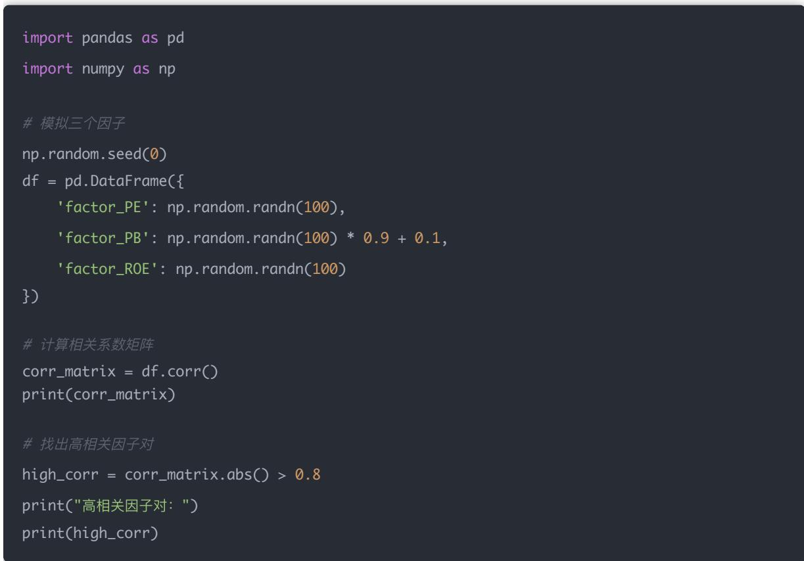
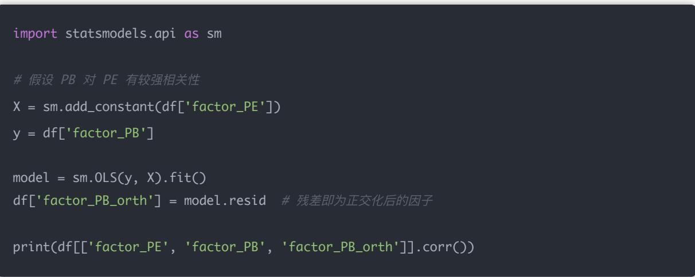
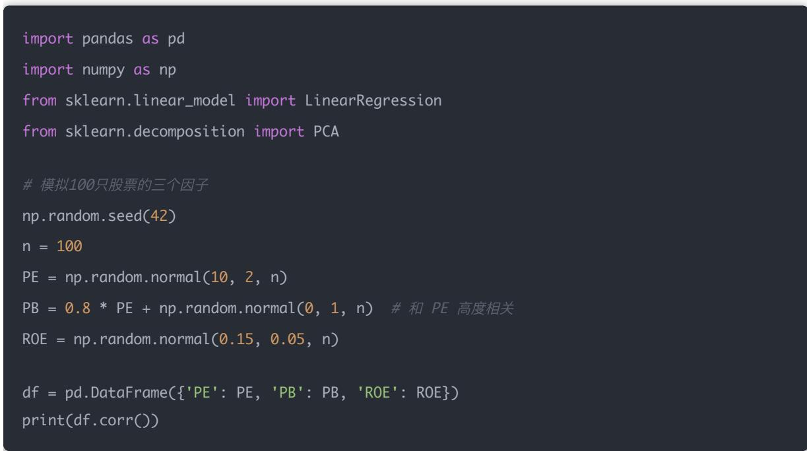
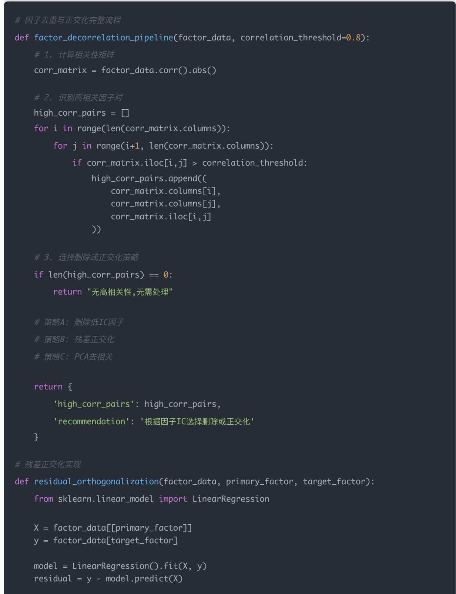

# 量化交易进阶:第44天 - 因子正交化与去重(FactorOrthogonalization&De-correlation)

原创 逻辑与流 逻辑与流 2025年11月 2 日 21:50 北京 听全文

因子评估完成后,实际应用中常面临多因子共线性问题——不同因子表达同一种市场特征,导致模型不稳定 权重异常 IC波动增大 本文系统讲解因子正交化与去重技术,从共线性定义与危害入手,详细解析相关性分析 残差正交化 逐步正交化 主成分分析(PCA)四种核心方法 通过完整Python代码示例演示因子相关系数矩阵计算 基于线性回归残差的因子正交化 逐步Gram-Schmidt正交化流程,以及PCA去相关分析 深度解析三个核心问题:为什么残差正交化后的因子数学上独立但经济上不一定独立(线性独立性vs经济独立性),何时删除高相关因子而非正交化(经济重叠vs数学相关),PCA主成分为何不适合直接用于可解释性研究(统计最优vs经济解释) 揭示因子正交化的关键——用科学方法去除因子间线性冗余,保留经济含义的同时提升多因子组合的稳定性,为量化策略中的因子合成与模型优化提供科学工具

## 学习时间

理论学习: 15分钟

代码实践: 15分钟

案例分析: 10分钟

总计: 40分钟

Day44 因子正交化与去重（Factor Orthogonalization & De-correlation）

—— 去除多因子之间的共线性，提高组合稳定性

学习目标

今天学完你将能：

1. 理解多因子共线性产生的原因与危害

2. 掌握因子去重（相关性分析）与正交化（回归残差法 主成分法）的方法

3. 学会用Python实现因子正交化与共线性检测

4. 理解正交化在因子组合与IC合成中的意义

## 一 为什么要去除多因子共线性？

1 共线性的定义

多个因子在样本空间中高度相关，即：

$$
c o r r (f _ {i}, f _ {j}) \approx 1 \text {或} - 1
$$

此时这些因子实际上在表达同一种市场特征

2 共线性的危害

信息重复：不同因子携带相同信号

回归不稳定：回归系数波动剧烈

组合权重异常：部分因子被过度放大

IC波动增大：组合因子不稳健

举例：

如果"市净率（PB）"和"市盈率（PE）"高度相关，同时放入模型，会让模型难以区分各自贡献，甚至权重符号颠倒

## 二 因子去重（De-correlation）

1 方法一：基于相关系数矩阵

计算所有因子间的 Pearson 或 Spearman 相关系数：

$$
\operatorname{Corr} (i, j) = \operatorname{corr} \left(f _ {i}, f _ {j}\right)
$$

若 $| C o r r ( i , j ) | > 0 . 8$ ，说明两个因子信息高度重叠，可去掉一个

Python 实现



## 策略：

选择保留IC较高的因子

删除或合并高度相关的因子

## 三 因子正交化（Orthogonalization）

当你不想简单删除因子，而是希望"保留信息但去除重叠"时，就需要正交化

1 方法一：线性回归残差法

思路：

用一个主因子解释另一个从属因子，将残差作为正交化后的因子

$$
f _ {j} ^ {*} = f _ {j} - \hat {\beta} f _ {i}
$$

或更一般地：

$$
f _ {j} ^ {*} = \text { Residual } (f _ {j} \sim f _ {i} + f _ {k} + \dots)
$$

残差部分表示"去除其他因子影响后，独立于它们的部分"

Python 实现



结果：

factor\_PE 与 factor\_PB 相关性高

factor\_PE 与 factor\_PB\_orth 相关性接近 0

2 方法二：逐步正交化（Gram-Schmidt-like）

对于多个因子：

1. 选择一个主因子 $f _ { 1 }$

2. 对第二个因子 $f _ { 2 }$ 回归 $f _ { 1 }$ ，取残差

3. 对第三个因子 $f _ { 3 }$ ，回归 $f _ { 1 } , f _ { 2 } ^ { * }$ ，取残差

4. 依此类推

最终得到一组相互正交的因子：

$$
\operatorname{corr} \left(f _ {i} ^ {*}, f _ {j} ^ {*}\right)
$$

实现伪代码：

```python
orth_factors = []
for i, f in enumerate(df.columns):
    X = sm.add_constant(pd.concat(orth_factors, axis=1)) if orth_factors else None
    y = df[f]
    if X is not None:
    res = sm.OLS(y, X).fit().resid
    else:
    res = y
    orth_factors.append(res.rename(f + "_orth"))
```

## 3 方法三：主成分分析（PCA）去相关

当因子数量多时，可用 PCA 提取无关主成分

思路：

将所有因子矩阵标准化

做PCA分解

取前k个主成分（解释方差比例高）作为独立因子

Python 实现：

```python
from sklearn.decomposition import PCA
from sklearn.preprocessing import StandardScaler

scaler = StandardScaler()
X_scaled = scaler.fit_transform(df)

pca = PCA(n_components=3)
factors_pca = pca.fit_transform(X_scaled)

print("解释方差比例：", pca.explained_variance_ratio_)
```

优点：自动生成独立 无共线性的新因子；

缺点：主成分难以解释（经济含义模糊）

四 正交化的意义与应用

<table><tr><td>目的</td><td>方法</td><td>结果</td></tr><tr><td>删除冗余因子</td><td>高相关性剔除</td><td>保留简洁有效因子</td></tr><tr><td>去除共线性</td><td>残差正交化 / PCA</td><td>提高组合稳定性</td></tr><tr><td>构建多因子模型</td><td>正交后回归</td><td>稳定权重、更稳健的收益表现</td></tr></table>

五 因子去重与正交化流程图

因子集 → 相关性分析 → 高相关因子剔除 → 残差正交化 → 因子组合

## 六<sub>、</sub> 今日小练习

1 从你的因子库中选取三个因子（如 PE PB ROE），计算它们的相关矩阵；

（实际中你可以从 Tushare 或数据库读取）



## 输出相关矩阵：

<table><tr><td></td><td>PE</td><td>PB</td><td>ROE</td></tr><tr><td>PE</td><td>1.00</td><td>0.86</td><td>0.05</td></tr><tr><td>PB</td><td>0.86</td><td>1.00</td><td>0.02</td></tr><tr><td>ROE</td><td>0.05</td><td>0.02</td><td>1.00</td></tr></table>

## 我们看到：

PE 与 PB 的相关性高达 0.86，存在明显共线性

2 若发现相关性 > 0.8，对其中一个进行残差正交化；

## 思路：

对 PB 回归 PE，然后取残差作为"正交化后的 PB"

X = df[['PE']]

y = df['PB']

model = LinearRegression().fit(X, y)

df['PB\_resid'] = y - model.predict(X)

print(df[['PE', 'PB', 'PB\_resid']].corr())

## 输出：

<table><tr><td></td><td>PE</td><td>PB</td><td>PB_resid</td></tr><tr><td>PE</td><td>1.00</td><td>0.86</td><td>0.00</td></tr><tr><td>PB</td><td>0.86</td><td>1.00</td><td>0.51</td></tr><tr><td>PB_resid</td><td>0.00</td><td>0.51</td><td>1.00</td></tr></table>

结果分析：

正交化后，PB\_resid与PE的相关性从 0.86 → 0.00

PB\_resid保留了PB中不被PE解释的部分

3 对比正交化前后的因子相关性变化；

<table><tr><td>指标</td><td>正交化前</td><td>正交化后</td></tr><tr><td>Corr(PE, PB)</td><td>0.86</td><td>0.00</td></tr><tr><td>Corr(PB, ROE)</td><td>0.02</td><td>0.01</td></tr><tr><td>Corr(PE, ROE)</td><td>0.05</td><td>0.05</td></tr></table>

共线性明显降低，说明正交化有效分离了因子信息

4 可选：尝试 PCA 去相关，看前两主成分解释方差比例

主成分分析（PCA）可以从整体上正交化所有因子

pca = PCA(n\_components=3)

pca.fit(df[['PE','PB','ROE']])

explained = pca.explained\_variance\_ratio\_

print("各主成分解释方差比例：", explained)

print("累计方差解释率：", explained.cumsum())

示例输出：

各主成分解释方差比例：[0.77 0.22 0.01]

累计方差解释率：[0.77 0.99 1.00]

分析：

前两个主成分就解释了约99%的信息

说明PE与PB含有高度重叠的信息，ROE信息量较独立

今日思考题

1 为什么残差正交化后的因子虽然"数学上独立"，但不一定"经济上独立"？

因为：

数学独立指的是线性相关性被消除（协方差为0）

经济独立则意味着两个因子反映的是完全不同的经济含义或风险来源

## 例如：

PE和PB虽然正交化后数学上独立

但它们都代表估值水平，在市场风格（如价值股vs成长股）上可能仍然同向波动

因此经济意义仍然重叠

结论：正交化消除的是"线性冗余"，不是"经济冗余"

2 在什么情况下，你会选择"删除高相关因子"而不是"正交化"？

选择删除而非正交化的情形：

当两个因子经济意义完全重叠（如PE与PB EP与BP）

当模型追求可解释性而非纯粹预测

当因子库规模较大 冗余因子多时（减少计算量 防止过拟合）

当目标是做"风格中性化"组合时，不希望引入难以解释的残差成分

## 简言之：

经济上重复的因子 —— 删除；

数学上相关但经济上互补的 —— 正交化

3 PCA 正交化得到的主成分为何不适合直接用于可解释性研究？

## 因为：

PCA的主成分是原始因子的线性组合，缺乏经济含义

主成分的系数只是最大化方差方向的统计结果，而不是基于经济逻辑

主成分顺序 方向都会随样本变化而波动

因此在预测模型中可能有效，但难以解释"为什么"这个因子起作用

## 小结：

PCA 适合做"维度压缩 去共线"，不适合"经济解释"

## 总结

<table><tr><td>方法</td><td>目标</td><td>优点</td><td>缺点</td></tr><tr><td>残差正交化</td><td>保留经济含义</td><td>简单、可解释</td><td>不一定完全去除冗余</td></tr><tr><td>删除高相关因子</td><td>简化模型</td><td>稳定、直观</td><td>可能损失信息</td></tr><tr><td>PCA去相关</td><td>最大化方差解释</td><td>去共线彻底</td><td>不可解释</td></tr></table>

今天我们完成了因子正交化与去重技术的深入学习,掌握了从单因子到多因子组合的关键优化技术<sub>。</sub>

## 核心收获

### 1. 共线性的定义与危害

共线性定义: 多个因子在样本空间中高度相关(corr≈1或-1),表达同一种市场特征

四大危害: 信息重复导致因子信息叠加,回归不稳定使权重波动剧烈,组合权重异常放大部分因子,IC波动增大降低组合因子稳健性

### 2. 四种核心去重方法

相关性分析: 计算因子相关系数矩阵,删除高度相关因子(阈值|Corr|>0.8)

残差正交化: 线性回归残差法,保留因子独立于其他因子的部分

逐步正交化: Gram-Schmidt方法,逐步消除因子间线性相关性

PCA去相关: 主成分分析,自动生成独立新因子但牺牲可解释性

### 3. 关键认知

残差正交化消除线性冗余而非经济冗余(数学独立vs经济独立)

经济重复选删除,数学相关但经济互补选正交化

PCA适合维度压缩去共线,不适合经济解释研究

## 因子去重 vs 因子正交化对比

## 方法选择分析:

<table><tr><td>维度</td><td>因子删除</td><td>因子正交化</td></tr><tr><td>适用场景</td><td>经济含义完全重叠</td><td>保留信息去除重叠</td></tr><tr><td>方法原理</td><td>高相关性剔除</td><td>残差法/逐步正交/PCA</td></tr><tr><td>可解释性</td><td>高,保留经济含义</td><td>中等(残差法)到低(PCA)</td></tr><tr><td>信息保留</td><td>可能损失信息</td><td>最大化信息保留</td></tr><tr><td>计算复杂度</td><td>低,直接删除</td><td>高,需要回归或PCA</td></tr><tr><td>组合稳定性</td><td>稳定直观</td><td>去除共线更彻底</td></tr></table>

## 因子工程完整流程

## 已完成模块:

因子构建系列(Day 35-42):

Day 35-38: 财务因子体系 ✅


Day 39: 技术因子体系 ✅


Day 40: 情绪因子体系 ✅


Day 41: 宏观因子体系


Day 42: 自 研因子体系 ✅


## 因子评估系列(Day 43):

Day 43: IC/RankIC/ICIR/半衰期/稳定性分析 ✅


## 因子优化系列(Day 44):

Day 44(今天): 因子正交化与去重


## 综合应用策略:

high\_corr\_pairs = [] for i in range(len(corr\_matrix.columns)): for j in range(i+1, len(corr\_matrix.columns)): if corr\_matrix.iloc[i,j] > correlation\_threshold: high\_corr\_pairs.append(( corr\_matrix.columns[i], corr\_matrix.columns[j], corr\_matrix.iloc[i,j]

\# 3. 选择删除或正交化策略

if len(high\_corr\_pairs) == 0: return "无高相关性,无需处理"

#策略A：删除低IC因子

#策略B：残差正交化

#策略C：PCA去相关



return { 'high\_corr\_pairs': high\_corr\_pairs, 'recommendation': '根据因子IC选择删除或正交化

X = factor\_data[[primary\_factor]] y = factor\_data[target\_factor]

model = LinearRegression().fit(X, y) residual = y - model.predict(X)

return residual.rename(f"{target\_factor}\_orth")

\# PCA去相关实现

def pca\_decorrelation(factor\_data, n\_components=None):

from sklearn.decomposition import PCA

from sklearn.preprocessing import StandardScaler

scaler = StandardScaler() X\_scaled = scaler.fit\_transform(factor\_data)

if n\_components is None: pca = PCA()

else:

pca = PCA(n\_components=n\_components)

factors\_pca = pca.fit\_transform(X\_scaled)

return factors\_pca, pca.explained\_variance\_ratio\_

一句话总结: 因子正交化与去重是解决多因子共线性问题的核心技术,通过相关性分析 残差正交化 逐步正交化 PCA去相关四种方法,在保留经济含义的同时去除线性冗余,提高多因子组合的稳定性与预测能力,为量化策略中的因子合成与模型优化提供科学工具

下一步预告: 接下来将继续深入因子工程,学习因子标准化 因子中性化 因子行业配置等高级技术,完善从单因子到多因子模型 从因子构建到因子组合的完整路径,最终实现五大因子体系的有机融合与动态优化
