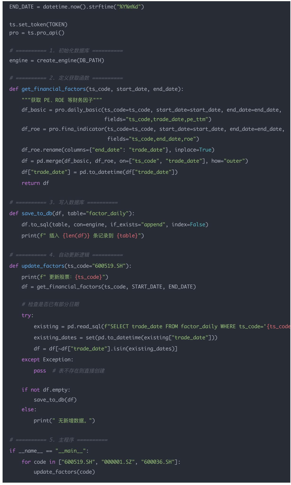

## 量化交易进阶:第46天 - 数据存储工程化 因子每日更新脚本(pandas+ SQLAlchemy)(进阶阶段·因子工程模块)

原创 逻辑与流 逻辑与流 2025年11月 7 日 00:08 北京 听全文

从CSV手动存储到数据库自动化更新,数据存储工程化是量化系统从研究到生产的必经之路 本文系统讲解如何用pandas和SQLAlchemy实现因子每日更新脚本,从Tushare数据获取 数据清洗 SQLite数据库写入到增量更新机制,提供完整可运行的代码示例 深入解析并行加速 批量写入 数据库选型等工程化实践,揭示数据存储工程化在量化系统中的核心价值——实现自动化更新 统一格式 可回溯查询 高效检索,为多因子模型构建奠定坚实的数据基础

## 学习时间

理论学习: 15分钟

代码实践: 25分钟

案例分析: 10分钟

总计: 50分钟

day46 数据存储工程化 因子每 日 更新脚本（pandas + SQLAlchemy）

## 一、为什么要做数据存储工程化？

之前我们都是手动获取 计算因子（比如用 AkShare /Tushare），然后用 CSV 存在本地

## 但这有三个问题：

1. 难维护：每次都要重新下载，容易重复计算；

2. 效率低：回测或策略读取时速度慢；

3. 不易扩展：没法方便地加新因子或自动更新

## 工程化的目标就是—

"自动化更新 + 数据库存储 + 稳定调用"

在前面 40+ 天的学习中，我们的因子（ROE PE 动量 波动率等）都只是存在 DataFrame 里

但实盘研究或多因子框架中，必须满足：

每日更新（新数据自动写入数据库）

统一格式（不同因子字段一致）

可回溯（任何日期都能重现当日因子值）

高效查询（支持筛选股票 区间 行业）

所以今天，我们把 因子 → SQL 数据库，用 pandas + SQLAlchemy 实现

## 二、核心思路

整体流程如下：

[ Tushare / AkShare 接 口 ]

↓

pandas 清洗数据

↓

SQLAlchemy 写入数据库

↓

每日更新（调度任务）

## 因子模块读取使用

## 三 完整代码示例：每日更新入库

下面的代码演示：

1. 从 Tushare 获取 PE ROE 因子；

2. 写入 SQLite 数据库；

3. 自动跳过已存在日期

quant\_project/

│── data\_engine/

│   ├── factor\_updater.py

\# 因子每日更新脚本

│   ├── db\_init.py

\# 数据库连接与建表

│   └── \_\_init\_\_.py

│── factors/

│   ├── factor\_pe.py

│   ├── factor\_roe.py

│   ├── factor\_momentum.py

│── config.py

└── main.py

import tushare as ts

import pandas as pd

from sqlalchemy import create\_engine

from datetime import datetime, timedelta

#==========配置==========

TOKEN = "你的tushare\_token"

DB\_PATH = "sqlite:///factor\_data.db"

START\_DATE = "2023-01-01"

2.定义获取函数 def get\_financial\_factors(ts\_code, start\_date, end\_date): """获取 PE ROE 等财务因子""" df\_basic = pro.daily\_basic(ts\_code=ts\_code, start\_date=start\_date, end\_date=end\_date, fields="ts\_code,trade\_date,pe\_ttm") df\_roe = pro.fina\_indicator(ts\_code=ts\_code, start\_date=start\_date, end\_date=end\_date, fields="ts\_code,end\_date,roe") df\_roe.rename(columns={"end\_date": "trade\_date"}, inplace=True) df = pd.merge(df\_basic, df\_roe, on=["ts\_code", "trade\_date"], how="outer") df["trade\_date"] = pd.to\_datetime(df["trade\_date"]) return df

def save\_to\_db(df, table="factor\_daily"): df.to\_sql(table, con=engine, if\_exists="append", index=False) print(f" 插入 {len(df)} 条记录到 {table}")

try: existing = pd.read\_sql(f"SELECT trade\_date FROM factor\_daily WHERE ts\_code='{ts\_code existing\_dates = set(pd.to\_datetime(existing["trade\_date"])) df = df[\~df["trade\_date"].isin(existing\_dates)]

## 三 效果说明

## 执行后：

数据库中会生成表 factor\_daily；

字段：ts\_code | trade\_date | pe\_ttm | roe

每次运行自动检测已存在的日期，增量更新；

未来可以用 SQL 查询 合并 计算多因子模型

## 今日思考题

1 为什么数据库比 CSV 更适合长期维护因子？

为什么数据库比 CSV 更适合长期维护因子？

让我们从存储结构 维护性 扩展性三个角度看

<table><tr><td>维度</td><td>CSV 文件</td><td>数据库 (SQLite/MySQL/PostgreSQL)</td></tr><tr><td>存储结构</td><td>扁平文件,无法定义主键、索引</td><td>结构化表,主键唯一约束,关系清晰</td></tr><tr><td>更新方式</td><td>只能全量覆盖或人工合并</td><td>支持增量写入、更新、删除</td></tr><tr><td>查询性能</td><td>必须全文件扫描</td><td>支持索引检索、条件过滤、聚合查询</td></tr><tr><td>数据一致性</td><td>无事务机制,易出错</td><td>有事务机制,支持回滚与锁</td></tr><tr><td>可扩展性</td><td>难以维护多因子、多版本</td><td>可建立多表、多库、视图、权限控制</td></tr><tr><td>协作与服务化</td><td>不支持并发与远程访问</td><td>可支持 Web API 与多用户并发</td></tr></table>

## 总结一句话：

CSV 适合一次性分析，数据库适合持续维护和版本管理

在实际工程中，CSV 常用于因子计算的中间结果，

而数据库承担因子持久化与查询中心的角色

2 如果每天更新几百只股票的数据，如何加速（并行 / 异步）？

这是量化数据工程的高频问题 常见的三种优化层次如下：

（1）计算层面：并行计算因子

使用 Python 多进程 / 多线程（multiprocessing.Pool 或 concurrent.futures）

使用 Dask 或 Ray 进行分布式计算

示例：每个进程处理一部分股票，计算完成后汇总写入

from concurrent.futures import ProcessPoolExecutor

def compute\_factor(stock):

\# 计算某支股票因子

...

return df\_factor

with ProcessPoolExecutor(max\_workers=8) as executor:

results = list(executor.map(compute\_factor, stock\_list))

## （2）存储层面：批量写入数据库

单条 INSERT 写入效率非常低

应使用：

批量写入（bulk insert）

事务控制（一次提交多条）

pandas 的 to\_sql(if\_exists='append', chunksize=5000)

在 SQLAlchemy 中：

session.bulk\_save\_objects(records)

session.commit()

或：

df.to\_sql('factor\_value', engine, if\_exists='append', index=False, chunksize=2000)

## （3）系统层面：异步与增量更新

异步队列：利用 asyncio 或消息队列（RabbitMQ、Kafka）解耦计算与写入

增量更新：每日只更新新交易日数据，而非全量覆盖

分库分表：例如每个因子独立一张表，每年或每季度分区表，提高查询效率

实际工程建议：

每天定时任务（如 Airflow） → 并行计算因子 → 批量写入数据库 → 日志审计成功率

3 除了 SQLite，还能用哪些数据库来做量化因子管理？

我们可以从性能 并发 分析能力三个维度来选

<table><tr><td>类型</td><td>示例</td><td>特点</td><td>适用场景</td></tr><tr><td>关系型数据库</td><td>MySQL、PostgreSQL、MariaDB</td><td>事务安全、结构清晰、广泛支持</td><td>回测系统、团队因子共享</td></tr><tr><td>内存数据库</td><td>Redis</td><td>键值快速读写、无磁盘索引</td><td>实时信号缓存、短期 alpha</td></tr><tr><td>列式数据库</td><td>ClickHouse、DuckDB</td><td>针对分析优化,支持高压缩与快速聚合</td><td>大规模多因子分析</td></tr><tr><td>时序数据库</td><td>InfluxDB、TimescaleDB</td><td>优化时间序列查询</td><td>高频因子、分钟级数据</td></tr><tr><td>本地嵌入式</td><td>DuckDB、Parquet 文件</td><td>无需服务器,类 SQLite 性能更高</td><td>本地研究、小规模分析</td></tr><tr><td>大数据方案</td><td>Spark SQL、Hive</td><td>分布式计算,海量数据支持</td><td>PB 级历史行情与因子分析</td></tr></table>

推荐路径：

<table><tr><td>阶段</td><td>建议数据库</td></tr><tr><td>研究 / 原型期</td><td>SQLite / DuckDB</td></tr><tr><td>团队协作 / 回测平台</td><td>MySQL / PostgreSQL</td></tr><tr><td>大规模多因子分析</td><td>ClickHouse / TimescaleDB</td></tr><tr><td>实时交易系统</td><td>Redis + MySQL 混合架构</td></tr></table>

## 总结一览

<table><tr><td>问题</td><td>核心答案</td></tr><tr><td>1为什么用数据库?</td><td>数据库具备索引、事务、结构化、扩展性,更适合长期维护因子</td></tr><tr><td>2如何加速?</td><td>并行计算+批量写入+异步更新+增量处理</td></tr><tr><td>3还能用哪些?</td><td>MySQL、PostgreSQL、ClickHouse、DuckDB、Redis、TimescaleDB等</td></tr></table>

## 结论

数据存储工程化是量化系统从研究迈向生产的关键一步 通过使用pandas和SQLAlchemy实现因子每日更新脚本,我们实现了自动化更新 增量写入 高效查询等核心功能 掌握并行加速 批量写入 数据库选型等工程化实践,为多因子模型的构建和量化策略的实盘部署奠定了坚实的数据基础
