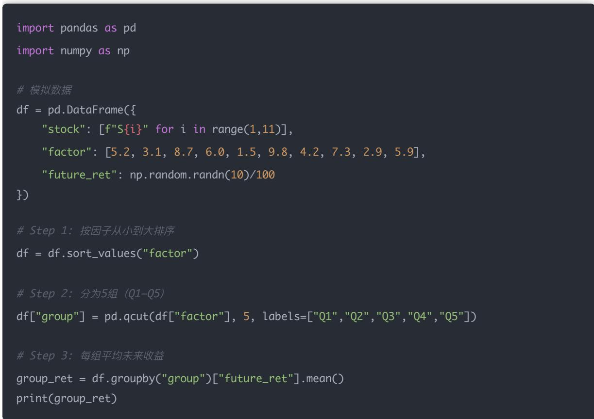
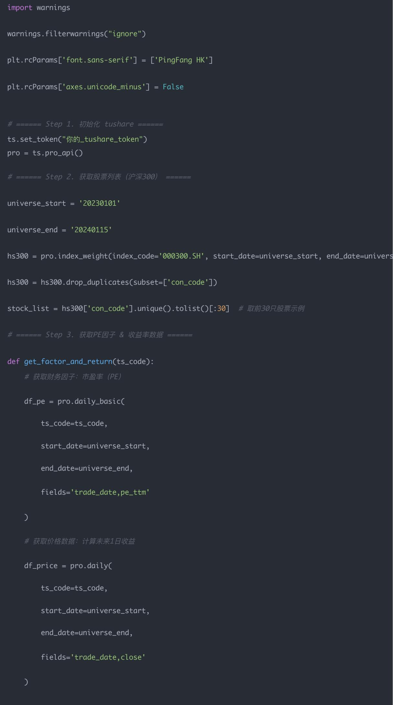

## 量化交易进阶:第47天 - 因子研究复盘 自动生成因子表现报告(IC 曲线 + 分层收益)

原创 逻辑与流 逻辑与流 2025年11月 8 日 23:18 北京 听全文

摘要：聚焦IC曲线与分层收益两大指标,并通过Python脚本实现因子表现的全流程自动化复盘。

我们正式进入“量化研究员的报告自动化阶段”，这也是从“写代码做研究”到“构建研究体系”的关键一步。

## 学习目标

今天我们要实现两件事：

1. 理论部分：理解 IC 曲线 分层收益（Group Return） 如何反映因子有效性；

2. 实践部分：用 Python 自动生成一份因子表现报告，内容包括：

因子每日 IC 曲线；

因子多空组合收益曲线；

各分层年化收益 信息比率表格

## 一 理论讲解：IC 曲线与分层收益

### 1. 因子有效性度量的两种视角

<table><tr><td>指标</td><td>含义</td><td>适用场景</td></tr><tr><td>IC 曲线 (Information Coefficient)</td><td>衡量因子预测的“方向是否正确”。IC 越高,说明因子越能预测未来收益。</td><td>因子选优</td></tr><tr><td>分层收益 (Group Return)</td><td>衡量因子高低分组之间的实际收益差异。</td><td>因子实际收益能力</td></tr></table>

### 2. IC 曲线的经济含义

若因子能预测股票未来收益，那么“因子值高 → 未来收益高”，则 Spearman 相关系数（RankIC）应为正

IC > 0.05 通常认为因子有效；

IC 稳定 波动小（ICIR 高） 更加可靠

### 3. 分层收益法（Group Return Analysis）

## 流程如下：

1. 将所有股票按因子值排序；

2. 划分为 5 组（Q1–Q5）；

3. 分别计算每组未来一段时间（如 5 日 20 日）的平均收益；

4. Q5 - Q1 即为多空收益。

若 Q5 > Q1 且稳定上升，说明因子有效

因子研究中“分层（分组）方法”的核心逻辑，这实际上是量化研究员每天都在操作的关键步骤

我们来一步一步拆开讲清楚

## 为什么要“排序 + 分组”

因子研究的目标，是想回答：

“高因子值的股票，未来是不是表现更好？”

要验证这个问题，就要：

先看每只股票的因子值（比如 PE ROE 动量等）；

把股票从低到高（或从高到低）排序；

然后分成几层（分组），观察每层的平均收益

这样我们就能直观地看到：

因子值高的那一组，未来收益是否真的高

## 二 排序 + 分组的数学步骤

假设今天（t 日）有 100 只股票，我们计算了它们的某个因子（例如 ROE）：

<table><tr><td>股票</td><td>ROE(因子)</td></tr><tr><td>A</td><td>5.2</td></tr><tr><td>B</td><td>9.8</td></tr><tr><td>C</td><td>2.1</td></tr><tr><td>...</td><td>...</td></tr><tr><td>Z</td><td>15.3</td></tr></table>

## Step 1：排序（Sort）

先按因子值从小到大排序（ascending），

如果这个因子是“值越大越好”，那我们从小到大；

如果是“越小越好”（比如 PE），则可以从大到小

在 pandas 中可以这样写：

df = df.sort\_values("factor")

## Step 2：分组（Quantile 分层）

把排序后的股票均匀地分为 5 组，也就是每组 20 只股票（100 ÷ 5 = 20）

这种分法叫分位数分组（Quantile Grouping），即按照因子分布的 20%、40%、60%、80%、100% 分割。

在 pandas 中可以这样写：

df["group"] = pd.qcut(df["factor"], 5, labels=False)

## 这行代码含义是：

<table><tr><td>group 值</td><td>含义</td></tr><tr><td>0</td><td>因子值最低的 20% 股票 (Q1)</td></tr><tr><td>1</td><td>第二层 (20%-40%)</td></tr><tr><td>2</td><td>第三层</td></tr><tr><td>3</td><td>第四层</td></tr><tr><td>4</td><td>因子值最高的 20% 股票 (Q5)</td></tr></table>

## Step 3：计算各组未来收益

例如计算每组股票的未来 5 日收益率平均值：

group\_return = df.groupby("group")["future\_ret"].mean()

结果可能是这样：

<table><tr><td>组别</td><td>平均未来收益</td></tr><tr><td>Q1(低因子组)</td><td>0.1%</td></tr><tr><td>Q2</td><td>0.2%</td></tr><tr><td>Q3</td><td>0.4%</td></tr><tr><td>Q4</td><td>0.7%</td></tr><tr><td>Q5(高因子组)</td><td>1.1%</td></tr></table>

Step 4：判断因子有效性

若收益从 Q1 → Q5 逐渐上升，说明因子值越高 → 未来收益越高，因子有效（正向因子）

若收益从 Q1 → Q5 逐渐下降，说明因子值越高 → 未来收益越低，因子为反向因子（例如 PE）。

若没有规律，说明因子无效或噪声大

## 三 完整示例（Python演示）

假设我们有 10 只股票的因子与未来收益：  

输出类似：

Name: future\_ret, dtype: float64

可以看到：收益随因子值上升而增加，说明这个因子预测能力较强

## 四 拓展：不同的分组方法

<table><tr><td>方法</td><td>说明</td><td>适用场景</td></tr><tr><td>qcut 分位数分组</td><td>每组样本数量相等（最常用）</td><td>样本分布较均匀</td></tr><tr><td>cut 区间分组</td><td>每组因子区间相等，但样本数量不均</td><td>样本极端分布时</td></tr><tr><td>自定义分组</td><td>例如分为“高、中、低”三层</td><td>实盘组合划分</td></tr></table>

## 小结

<table><tr><td>步骤</td><td>操作</td><td>含义</td></tr><tr><td>排序</td><td>按因子值从低到高排序</td><td>模拟投资者按信号选股</td></tr><tr><td>分组</td><td>按分位数切分成5层</td><td>检验不同“强度”的股票表现</td></tr><tr><td>计算</td><td>每组未来收益</td><td>量化因子预测力</td></tr><tr><td>比较</td><td>Q5 - Q1</td><td>判断正向/反向有效性</td></tr></table>

## 五 数学与逻辑推导

### 1. IC（信息系数）定义

$$
I C _ {t} = \operatorname{corr} \left(\operatorname{rank} \left(\text {factor} _ {t}\right), \operatorname{rank} \left(\text {return} _ {t + 1}\right)\right)
$$

即：当天因子值与未来收益的秩相关系数

2. 分层收益（Group Return）定义

$$
R _ {i} = \frac {1}{N _ {i}} \sum_ {j \in g r o u p _ {i}} r e t u r n _ {j}
$$

## 多空收益：

$$
R _ {l o n g - s h o r t} = R _ {t o p} - R _ {b o t t o m}
$$

## 六 Python 实现：基于 Tushare 的因子表现报告

import tushare as ts

import pandas as pd

import numpy as np

import matplotlib.pyplot as plt

from scipy.stats import spearmanr

import warnings

warnings.filterwarnings("ignore")

plt.rcParams['font.sans-serif'] = ['PingFang HK']

plt.rcParams['axes.unicode\_minus'] = False

\# ====== Step 1. 初始化 tushare ======

ts.set\_token("你的\_tushare\_token")

pro = ts.pro\_api()

\# ====== Step 2.获取股票列表（沪深300)

universe\_start = '20230101'

universe\_end = '20240115'

hs300 = pro.index\_weight(index\_code='000300.SH', start\_date=universe\_start, end\_date=univers

hs300 = hs300.drop\_duplicates(subset=['con\_code'])

stock\_list = hs300['con\_code'].unique().tolist()[:30]  # 取前30只股票示例

\# Step 3. 获取PE因子 & 收益率数据 ———

def get\_factor\_and\_return(ts\_code):

\# 获取财务因子：市盈率(PE)

df\_pe = pro.daily\_basic(

ts\_code=ts\_code,

start\_date=universe\_start,

end\_date=universe\_end,

fields='trade\_date,pe\_ttm'

#获取价格数据：计算未来1日收益

df\_price = pro.daily(

ts\_code=ts\_code,

start\_date=universe\_start,

end\_date=universe\_end,

fields='trade\_date,close'

df = pd.merge(df\_pe, df\_price, on='trade\_date', how='inner')

df = df.sort\_values('trade\_date')

df['factor'] = df['pe\_ttm']

df['future\_ret'] = df['close'].pct\_change().shift(-1)

df['ts\_code'] = ts\_code

df = df[['trade\_date','ts\_code','factor','future\_ret']].dropna()

if len(df) < 10:

return pd.DataFrame(columns=['trade\_date','ts\_code','factor','future\_ret'])

return df

#聚合所有股票

all\_data = []

for code in stock\_list:

df = get\_factor\_and\_return(code)

if len(df) > 30:

all\_data.append(df)

if not all\_data:

raise ValueError("选定股票在指定区间内缺乏足够PE或价格数据。")

data = pd.concat(all\_data, ignore\_index=True)

data['trade\_date'] = pd.to\_datetime(data['trade\_date'])

\# ====== Step 4. 计算每日 RankIC ======

ic\_list = []

dates = sorted(data['trade\_date'].unique())

for date in dates:

subset = data[data['trade\_date'] == date]

if subset['factor'].nunique() > 5:

ic, \_ = spearmanr(subset['factor'], subset['future\_ret'], nan\_policy='omit')

ic\_list.append({'date': date, 'IC': ic})

ic\_df = pd.DataFrame(ic\_list).dropna()

if ic\_df.empty:

raise ValueError("IC 序列为空，请检查因子或收益率数据是否有效 ")

\# ====== Step 5。 分层收益分析 ======

#以最近一个交易日为例，进行分层

latest\_date = data['trade\_date'].max()

subset = data[data['trade\_date'] == latest\_date].dropna(subset=['factor','future\_ret'])

if subset.empty or subset['factor'].nunique() < 2:

raise ValueError("最新交易 日 可用数据不足，无法进行分层分析。")

subset['group'] = pd.qcut(subset['factor'], 5, labels=False, duplicates='drop')

group\_ret = subset.groupby('group')['future\_ret'].mean()

\# ====== Step 6。 可视化报告 ======

\# --- IC 曲线 ---

plt.figure(figsize=(10,4))

plt.plot(ic\_df['date'], ic\_df['IC'], label='IC 曲线')

plt.axhline(0, color='gray', linestyle='--')

plt.title("PE 因子每 日 RankIC 曲线")

plt.xlabel(" 日 期")

plt.ylabel("IC 值")

plt.legend()

plt.grid(True)

plt.show()

\# --- 分层收益图 ---

plt.figure(figsize=(6,4))

group\_ret.plot(kind='bar')

plt.ylabel("未来 日 均收益")

plt.grid(True)

plt.show()

\# --- 多空收益

long\_short\_ret = group\_ret.iloc[-1] - group\_ret.iloc[0]

print(f"多空组合 日 均收益：{long\_short\_ret:.4%}")

\# --- IC 统计 ---

ic\_mean = ic\_df['IC'].mean()

ic\_std = ic\_df['IC'].std()

icir = ic\_mean / ic\_std

print(f"IC均值：{ic\_mean:.4f}, IC标准差：{ic\_std:.4f}, ICIR：{icir:.2f}")

选取沪深300成份股中一批样本...

## 流程大致是：

在指定时间区间获取沪深300成份股，限定在有完整数据的股票

对每只股票抓取 daily\_basic 里的 pe\_ttm 和 daily 里的收盘价，合并后生成因子序列和次日收益。

对全样本按交易日截面跑 Spearman RankIC，观察因子值与未来收益的相关性

选最新交易日做一次按因子值的五分位分层，看高低分组的平均收益差异 计算多空收益

最后用曲线和柱状图把 IC 走势 分层收益可视化，并输出 IC 统计指标

总结来说，它是在验证 “PE 因子能否为未来一天的收益提供信息”——属于量化选股里常见的因子测试回测框架的一个简化版本

## 七 输出说明

### 1. IC 曲线

反映了 PE 因子与未来收益的相关性随时间的变化

若 IC 大部分为正且稳定（波动不大），说明 PE 能持续预测未来收益 IC 大多围绕 0 震荡，正值区间代表 PE 因子在这些日子里同未来收益正相关，负值日说明信号反向；曲线的起伏反映了因子在样本期内稳定性一般，偶尔出现极端值需关注数据完整性

### 2. 分层收益柱状图

股票按 PE 值从低到高分为 5 组（Q1–Q5）。

通常情况下：

Q1（低PE）表现更好 → 代表“价值因子”有效；

Q5（高PE）表现差 → 市场高估股票短期表现较弱

### 3. 多空组合收益

多空组合日均收益：-0.4728%

IC均值：-0.0492, IC标准差：0.2760, ICIR：-0.18

Q1 – Q5 为多空组合收益，若为正 → 表示低估值买入 高估值卖出能赚到钱

## 八 思考题（带参考答案）

1. 为什么使用 PE 因子时，低 PE 股票往往收益更高？

因为 PE 越低，代表估值越便宜，具备“价值回归”效应

2. 为什么 PE 因子在不同年份效果不同？

市场风格切换（如价值 vs 成长），会导致估值因子的 IC 波动

3. 如果 IC 曲线长期围绕 0 上下波动，说明什么？

因子预测力不稳定，或存在滞后，需要改进计算逻辑或换周期

## 九、小结

<table><tr><td>模块</td><td>内容</td><td>意义</td></tr><tr><td>因子</td><td>PE(真实财务因子)</td><td>衡量估值水平</td></tr><tr><td>IC 曲线</td><td>IC均值 + 稳定性</td><td>判断预测方向正确性</td></tr><tr><td>分层收益</td><td>多空组合验证</td><td>判断收益可实现性</td></tr><tr><td>ICIR</td><td>评估稳定性</td><td>因子好坏的重要指标</td></tr></table>

结论

结论：PE 因子能否带来正向收益需结合 RankIC 和分层收益同步检验,自动化复盘让判断更直观

量化交易进阶:第46天 - 数据存储工程化 因子每 日 更新脚本(pandas + SQLAlchemy)(进…

阅读 131

白雪吞没城市，火炉

还在燃烧，你能带大

家撑到天亮吗？

点击了解更多

量化交易进阶:第48天 - 特征工程(因子标准化 缺失值填充 分箱 Winsorize 去极值)

白雪吞没城市，火炉还在燃烧，你能带大家撑到天亮吗？

无尽冬日-3亿玩家推荐

进入小游戏
