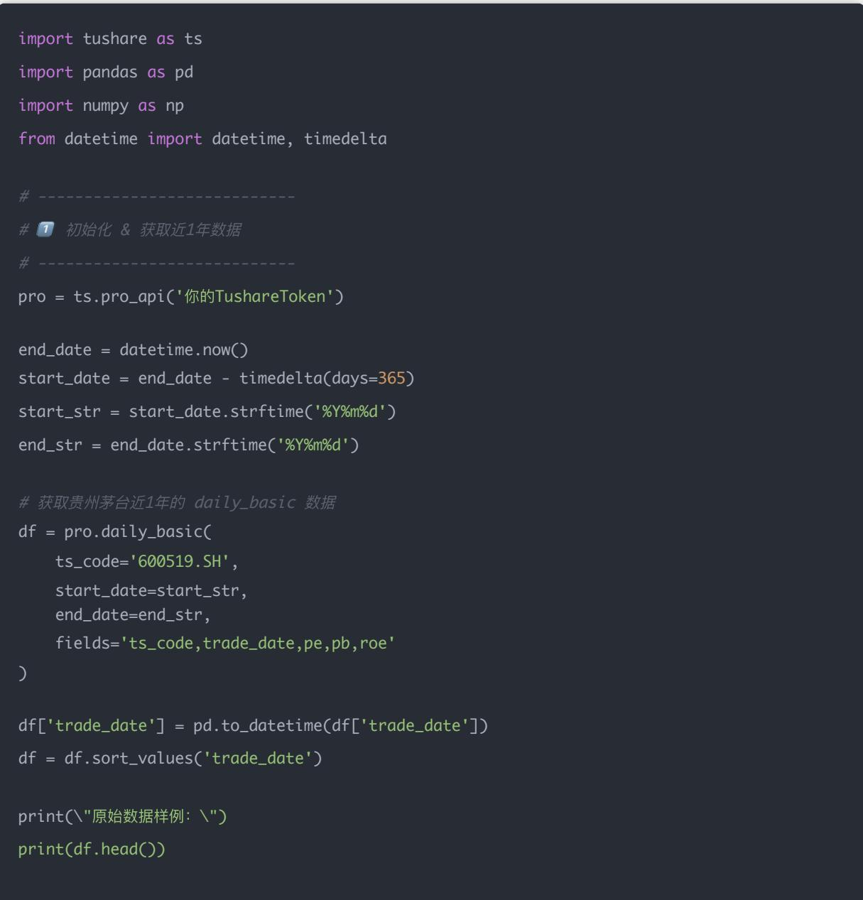
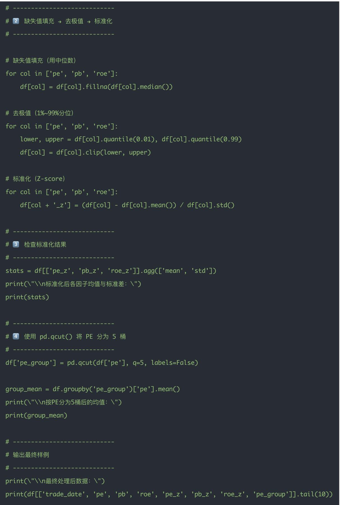

# 量化交易进阶:第48天 - 特征工程(因子标准化、缺失值填充、分箱、Winsorize 去极值)

原创 逻辑与流 逻辑与流 2025年11月9日 22:27 北京 📞 听全文

摘要：回顾缺失值填充、去极值、标准化、分箱四大环节的理论要点，结合 Tushare 批量处理与贵州茅台实测案例演示完整流水线，并解释 Winsorize、行业中性化、分箱适用场景的实战取舍，帮助你搭建稳健可复用的因子预处理模版。

## 主题目标

在量化因子研究中，数据预处理（特征工程）是至关重要的一步。

即使一个好的因子，如果有极值、缺失、尺度不一致，也可能导致结果失真。

本节我们系统学习四大核心操作：

1 缺失值处理（Missing Value Imputation）

2 去极值 (Winsorize)

3 标准化（Standardization）

4 分箱 (Binning)

## 一、缺失值处理（Missing Value Imputation）

## 为什么有缺失值？

- 股票停牌、退市

- 财报未披露（例如PE、ROE暂时为空）

- 数据源异常

## 常见处理方法：

<table><tr><td>方法</td><td>说明</td><td>适用场景</td></tr><tr><td>删除样本</td><td>删除含缺失的行</td><td>数据量大、缺失较少</td></tr><tr><td>均值 / 中位数 / 众数填充</td><td>用全市场或行业均值代替</td><td>常用于基本面因子</td></tr><tr><td>前向 / 后向填充 (ffill, bfill)</td><td>用邻近日期数据填充</td><td>时序数据</td></tr><tr><td>分组填充</td><td>按行业或市值分组后填充</td><td>控制组间差异</td></tr></table>

df['pe'] = df['pe'].fillna(df['pe'].median()) # 用中位数填充

\# 或者

df['pe'] = df.groupby('industry')['pe'].transform(lambda x: x.fillna(x.mean()))

## 二、去极值（Winsorize）

为什么要去极值？

极端值（outliers）会严重影响因子分布和相关性，例如：

- 财报错误：ROE = 9999%

- 暴涨暴跌导致PE异常

常见方法：

1 百分位截断法 (Percentile Cut)

lower, upper = df['pe'].quantile(0.01), df['pe'].quantile(0.99)

df['pe'] = df['pe'].clip(lower, upper)

2 MAD (Median Absolute Deviation) 法

median = df['pe'].median()

mad = (df['pe'] - median).abs().median()

df['pe'] = df['pe'].clip(median - 3\*mad, median + 3\*mad)

三、标准化（Standardization）

为什么标准化？

不同因子量纲不同：

- PE: 几十到上百

- ROE: 0\~1

- 成交量：百万级

直接比较会导致权重失衡。

方法：

1 Z-score 标准化

df['pe\_z'] = (df['pe'] - df['pe'].mean()) / df['pe'].std()

2 行业中性化标准化

df['pe\_z'] = df.groupby('industry')['pe'].transform(

lambda x: (x - x.mean()) / x.std()

df['pe\_norm'] = (df['pe'] - df['pe'].min()) / (df['pe'].max() - df['pe'].min())

## 四、分箱（Binning）

## 为什么要分箱？

- 降低噪声，提高稳健性；

- 在分层回测中直接使用；

- 便于非线性关系分析。

## 方法：

\# 等频分箱

df['pe\_bin'] = pd.qcut(df['pe'], q=5, labels=False)

\# 等距分箱

df['pe\_bin'] = pd.cut(df['pe'], bins=5, labels=False)

等频（qcut）：每箱样本数相同

等距（cut）：每箱数值区间相同

## 五、综合示例：Tushare 因子预处理流程

import tushare as ts

import pandas as pd

import numpy as np

pro = ts.pro\_api('你的Tushare Token')

\# 1 获取某日股票基础数据

df = pro.daily\_basic(ts\_code='', trade\_date='20250102',

fields='ts\_code,pe,pb,roe')

#2 缺失值填充

df['pe'] = df['pe'].fillna(df['pe'].median())

df['pb'] = df['pb'].fillna(df['pb'].median())

df['roe'] = df['roe'].fillna(df['roe'].median())

#3 去极值

for col in ['pe', 'pb', 'roe']:

lower, upper = df[col].quantile(0.01), df[col].quantile(0.99)

df[col] = df[col].clip(lower, upper)

for col in ['pe', 'pb', 'roe']:

df[col+'\_z'] = (df[col] - df[col].mean()) / df[col].std()

#5 分箱

df['pe\_group'] = pd.qcut(df['pe'], 5, labels=False)

print(df.head())

## 今日小练习

1 从 Tushare 获取近 1 年沪深 A 股的 PE、PB、ROE 数据；

分别对这 3 个因子执行：缺失值填充 → 去极值 → 标准化；

3 检查标准化后的均值与标准差是否接近 0、1；

4 使用 pd.qcut() 将 PE 分为 5 桶，输出各桶均值。今日小练习这个你就用实际存在的某一只股票来完成，把这四道题目做了，用 Tushare。

## 练习答案（以贵州茅台为例）

import tushare as ts

import pandas as pd

import numpy as np

from datetime import datetime, timedelta

\# 1 初始化 & 获取近1年数据

pro = ts.pro\_api('你的TushareToken')

end\_date = datetime.now()

start\_date = end\_date - timedelta(days=365)

start\_str = start\_date.strftime('%Y%m%d')

end\_str = end\_date.strftime('%Y%m%d')

\# 获取贵州茅台近1年的 daily\_basic 数据

df = pro.daily\_basic(

ts\_code='600519.SH',

start\_date=start\_str,

df['trade\_date'] = pd.to\_datetime(df['trade\_date'])

df = df.sort\_values('trade\_date')

print(\ "原始数据样例： \ ")

\# 去极值（1%\~99%分位）
for col in ['pe', 'pb', 'roe']:
    lower, upper = df[col].quantile(0.01), df[col].quantile(0.99)
    df[col] = df[col].clip(lower, upper)

## 今日思考题详解（Day48：特征工程）

1 为什么 Winsorize 比直接删除极端值更稳健？

答案:

- Winsorize（缩尾处理）：将超过上下分位点的值替换为该分位点的数值；

- 删除极端值（Trim）：直接把这些样本剔除。

## 差异与影响：

<table><tr><td>方法</td><td>处理方式</td><td>样本数量</td><td>稳定性</td><td>适用场景</td></tr><tr><td>删除极端值</td><td>直接丢弃</td><td>减少</td><td>容易引入偏差</td><td>样本量大且异常点确实错误</td></tr><tr><td>Winsorize</td><td>替换为分位点</td><td>保留</td><td>更稳健</td><td>金融因子常用</td></tr></table>

## 举例说明：

假设我们要计算 PE 因子的均值：

- 一只“极端高估值”的股票PE=500；

- 其他大部分股票 PE 在 10–50。

直接删除 PE=500 的股票，会改变样本数量与均值分布；而 Winsorize 只把它“压缩”到上分位（如 99% 分位=80），这样：

- 保留了样本；

- 降低了异常值的影响；

- 均值、标准差更稳健。

## 结论：

Winsorize 能平衡“数据完整性”与“稳健性”，在金融因子处理中几乎是默认选择。

2 若行业内数据分布差异极大（如银行 vs 科技），应如何处理标准化？

## 答案：分行业标准化（Industry Neutralization）

## 原因：

- 银行业的 PE 往往集中在 5–10;

- 科技行业可能在30–80；

- 如果你全市场一起标准化：

- 银行类股票的 PE 都会被判定为“低估”；

- 科技股都变成“高估”；

- 导致因子偏向行业，而不是个股特征。

正确做法：

df['pe\_z'] = df.groupby('industry')['pe'].transform(lambda x: (x - x.mean()) / x.std())

## 结论：

行业中性化（Industry Neutralization）是因子标准化前的重要步骤，可以防止因子“偷带行业效应”，让信号更纯粹地反映个股差异。

3 为什么在机器学习模型（如 XGBoost）中，分箱反而可能降低性能？

答案：因为树模型本身已经能自动处理非线性与分段关系，无需再人为分箱。

## 原理分析：

- XGBoost / LightGBM 等模型基于树结构；

- 它们通过寻找最优分裂点（split point）来自动学习分段；

- 若我们人为先把连续变量分箱（例如 qcut 分成 5 桶）：

- 会将连续信息离散化；

- 造成信息损失；

- 降低模型的拟合能力。

## 举例说明：

假设 PE 因子从 5 到 100 连续分布:

- 树模型本可找到“PE < 20”、“PE > 70”等精细边界；

- 但如果你提前分为5桶，只剩下 $\{0,1,2,3,4\}$ 五个类别；

- 模型只能在桶之间分裂，无法捕捉更细的结构。

## 结论：

分箱适合线性模型或分层研究，不适合非线性模型（树、神经网络）。在 XGBoost 中应保持连续特征形式。

## 小结表

<table><tr><td>问题</td><td>核心答案</td></tr><tr><td>Winsorize 的优势</td><td>保留样本、降低异常点影响、稳健性更高</td></tr><tr><td>行业差异处理</td><td>分行业标准化（行业中性化）</td></tr><tr><td>分箱与树模型</td><td>分箱会损失信息，树模型已能自动分裂</td></tr></table>

## 结论

遵循“缺失值填充→去极值→标准化→分箱”的流程，可保持因子整洁性与稳定性，确保量化策略在不同场景下稳健发挥。

## 量化交易入门指南·目录

## <上一篇

量化交易进阶:第47天－因子研究复盘 自动生成因子表现报告(IC 曲线 + 分层收益)

阅读103

开局一人一狗，无限

探索资源，守护人类

最后文明！

点击了解更多>

下一篇>量化交易进阶:第49天 - LightGBM & CatBoost 用梯度提升模型预测收益与风险

开局一人一狗，无限探索资源，守护人类最后文明！

无尽冬日-3亿玩家力荐

$\mathcal{S}$ 进入小游戏
