# 量化交易进阶:第49天 - LightGBM & CatBoost 用梯度提升模型预测收益与风险

原创 逻辑与流 逻辑与流 2025年11月12日 11:19 北京 📞 听全文

主题：使用机器学习模型（树模型）从多因子特征中预测未来收益或风险。

## 一、学习目标

今天我们要解决两个关键问题：

1. 如何用 LightGBM / CatBoost 训练模型预测未来收益?

2. 如何从模型中提取特征重要性（Feature Importance），指导因子筛选？

3. 如何评估模型效果：IC、分层收益、AUC、回测稳定性？

## 二、树模型在量化中的优势

1. 梯度提升树（GBDT）思想

梯度提升模型是一种集成学习（Ensemble Learning）方法：

用多个弱模型（决策树）叠加形成一个强预测器。

模型公式：

$$
\hat {y} = \sum_ {m = 1} ^ {M} \gamma_ {m} f _ {m} (x)
$$

其中每个 $f_{m}(x)$ 是一棵决策树，

模型不断拟合前一轮的残差（gradient），逐步逼近真实收益。

### 1.1 公式的整体含义

$$
\hat {y} = \sum_ {m = 1} ^ {M} \gamma_ {m} f _ {m} (x)
$$

这是梯度提升模型（GBM, LightGBM, XGBoost, CatBoost等）的预测表达式，表示模型是多个弱学习器（通常是决策树）的加权和。

- $\hat{y}$ : 最终预测值（模型输出）

- $f_{m}(x)$ : 第 m 棵树的输出 (弱学习器)

- $\gamma_{m}$ ：该树的权重（步长/学习率/最优系数）

- $M$ ：总共迭代的树的数量

换句话说，模型在训练中逐步叠加一棵棵树来修正残差，每棵树都试图学习前面所有树预测错误的部分。

### 1.2 系数 $\gamma_{m}$ 的意义

每一项的系数 $\gamma_{m}$ 代表了这一轮弱学习器在整体模型中的贡献大小。

梯度提升训练的过程是这样的：1. 初始化模型

$$
\hat {y} ^ {(0)} = \arg \min _ {\gamma} \sum_ {i} L (y _ {i}, \gamma)
$$

比如在回归问题中，可能直接取均值。

### 2. 每一轮迭代

- 计算上一轮预测的残差（或者梯度方向）：

$$
r _ {i} ^ {(m)} = - \frac {\partial L (y _ {i} , \hat {y} _ {i} ^ {(m - 1)})}{\partial \hat {y} _ {i} ^ {(m - 1)}}
$$

- 拟合一个新树 $f_m(x)$ 来逼近残差。

- 然后找到最佳的 $\gamma_m$ (该树的整体缩放系数):

$$
\gamma_ {m} = \arg \min _ {\gamma} \sum_ {i} L \left(y _ {i}, \hat {y} _ {i} ^ {(m - 1)} + \gamma f _ {m} (x _ {i})\right)
$$

- 更新预测：

$$
\hat {y} ^ {(m)} = \hat {y} ^ {(m - 1)} + \nu \gamma_ {m} f _ {m} (x)
$$

其中 $\nu\in(0,1]$ 是全局学习率（shrinkage）。

### 1.3 直观理解

- 每一轮加的 $f_{m}(x)$ 是一个“小修正”；

- $\gamma_{m}$ 告诉模型：这一棵树到底要修正多少；

- $\nu$ 是全局的“油门控制”，避免一次修得太多导致过拟合；

- 所以模型其实是一个：

baseline + 若干小步修正的和

### 1.4 类比帮助理解

如果你在预测收益率 $\hat{y}$ ，那么可以理解为：

- 第1棵树预测了一个大致方向（整体趋势）；

- 第2棵树修正了其中一些误差；

- 第3棵树修正了更细的残差；

- 每棵树修正的强度由 $\gamma_{m}$ 决定。

最终：

$$
\hat {y} = \text { 趋势 } + \text { 修正 } + \text { 修正 } + \dots
$$

### 1.5 举个简单例子

假设目标是回归，损失函数是 MSE:

$$
L (y, \hat {y}) = \frac {1}{2} (y - \hat {y}) ^ {2}
$$

则梯度：

$$
\boldsymbol {r} _ {i} ^ {(m)} = \boldsymbol {y} _ {i} - \hat {\boldsymbol {y}} _ {i} ^ {(m - 1)}
$$

最优步长：

$$
\gamma_ {m} = 1 \quad (\text { 对   于 } \mathrm{MSE} \text { 是   固   定   的 })
$$

所以模型变成简单的：

$$
\hat {y} = \sum_ {m = 1} ^ {M} \nu f _ {m} (x)
$$

这就是 LightGBM/XGBoost 回归树 最基本的原理。

符号 含义 数学作用

$f_{m}(x)$ 第 $\mathfrak{m}$ 棵树学习残差方向的修正

$\gamma_{m}$ 权重 / 步长 控制树的修正幅度

$\nu$ 学习率 全局缩放系数，防止过拟合

M树的数量 控制模型复杂度

下面是一个完整可运行的 Python 代码，用来绘制梯度提升（Gradient Boosting）逐步修正预测过程图，并展示每一轮拟合残差和叠加预测的变化曲线。

import numpy as np

import matplotlib.pyplot as plt

from sklearn.tree import DecisionTreeRegressor

plt.rcParams['font.sans-serif'] = ['PingFang HK'] # 或者 'Songti SC'、'STHeiti'

plt.rcParams['axes.unicode\_minus'] = Falseplt.figure(figsize=(10, 6))
plt.plot(X, y\_true, 'k--', label='真实函数 (sin(x))')
plt.scatter(X, y, s=15, color='black', alpha=0.6, label='带噪声数据')

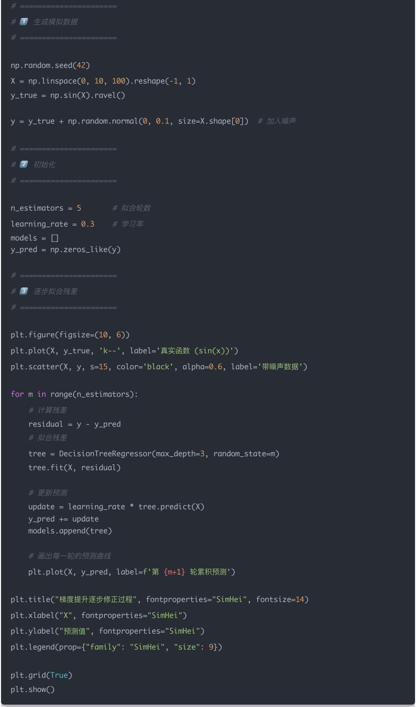

运行后你会看到：

- 黑色虚线：真实函数 $y = \sin (x)$

- 黑点：含噪声的数据（模型训练目标）

- 彩色曲线：每一轮的累计预测结果（第1\~5轮）

每一轮曲线都更接近真实函数，展示了残差逐步修正 $\rightarrow$ 模型累积提升的过程。

总结

为什么 GBDT 适合因子建模

特点 解释

自动处理非线性 不需要人工构造高阶项

变量筛选能力强 可自动识别重要因子

抗异常值能力强 不依赖均值方差假设

可解释性强 可输出 feature importance

## 三、LightGBM 实战：预测未来 5 日收益

我们用 Tushare 获取真实数据，选取一批股票样本进行训练。

示例目标：预测股票未来5日收益率是否为正（分类问题）。

import numpy as np

import pandas as pd

import tushare as ts

import lightgbm as lgb

import matplotlib.pyplot as plt

from datetime import datetime

from sklearn.model\_selection import train\_test\_split

from sklearn.metrics import roc\_auc\_score, classification\_report

1 初始化与参数

token = ""

pro = ts.pro\_api(token)

start\_date = "20230101"

end\_date = "20241231"

merge\_start = pd.to\_datetime(start\_date)
merge\_end = pd.to\_datetime(end\_date)

2 获取沪深300股票池

hs300 = pro.index\_weight(index\_code="000300.SH", trade\_date=end\_date)

if hs300.empty:
    fallback\_date = "20240131"
    hs300 = pro.index\_weight(index\_code="000300.SH", trade\_date=fallback\_date)

if hs300.empty:
raise RuntimeError("无法获取沪深300成分股，请检查 Token 权限或 trade\_date 配置。")

symbols = hs300["con\_code"].unique()[:30] # 仅取前30只演示

3 拉取行情与因子数据

dfs = []
roe\_info = []

for code in symbols:

df\_basic = pro.daily\_basic(

ts\_code=code,

start\_date=start\_date,

end\_date=end\_date,

fields="ts\_code,trade\_date,pe,pb,ps"

df\_price = pro.daily(

ts\_code=code,

start\_date=start\_date,

end\_date=end\_date,

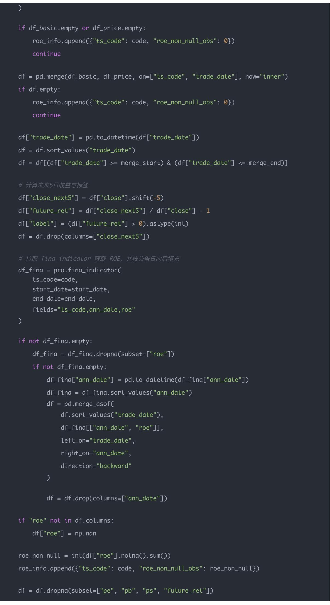

dfs.append(df[['trade\_date", "ts\_code", "pe", "pb", "ps", "roe", "future\_ret", "label"]]

if not dfs:
raise RuntimeError("未获取到有效的行情/因子数据，无法建模。")

data = pd.concat(dfs, ignore\_index=True)

feature\_cols = ["pe", "pb", "ps"]

if data["roe"].notna().any():

feature\_cols.append("roe")

print("样本量：", len(data))

print("使用因子：", feature\_cols)

print("\nROE 可用性统计：\n", pd.DataFrame(roe\_info))

4 因子预处理

X = data[feature\_cols].copy()

y = data["label"]

X = X.replace([np.inf, -np.inf], np.nan).fillna(X.median())

for col in X.columns:
    lower, upper = X[col].quantile(0.01), X[col].quantile(0.99)
    X[col] = X[col].clip(lower, upper)

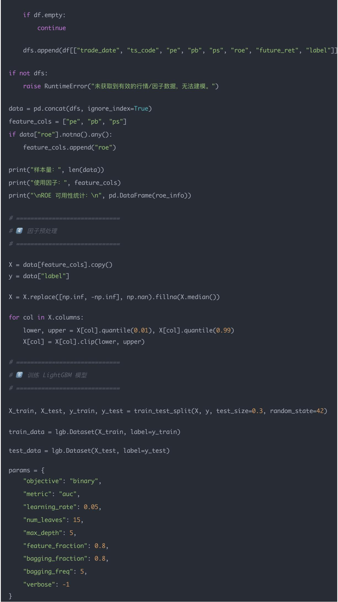

5 训练 LightGBM 模型

X\_train, X\_test, y\_train, y\_test = train\_test\_split(X, y, test\_size=0.3, random\_state=42)

train\_data = lgb.Dataset(X\_train, label=y\_train)

test\_data = lgb.Dataset(X\_test, label=y\_test)

params = {
    "objective": "binary",
    "metric": "auc",
    "learning\_rate": 0.05,
    "num\_leaves": 15,
    "max\_depth": 5,
    "feature\_fraction": 0.8,
    "bagging\_fraction": 0.8,
    "bagging\_freq": 5,
    "verbose": -1
}

model = lgb.train(
    params,
    train\_data,
    valid\_sets=[test\_data],
    num\_boost\_round=200,
    callbacks=[lgb.early\_stopping(20), lgb.log\_evaluation(20)]

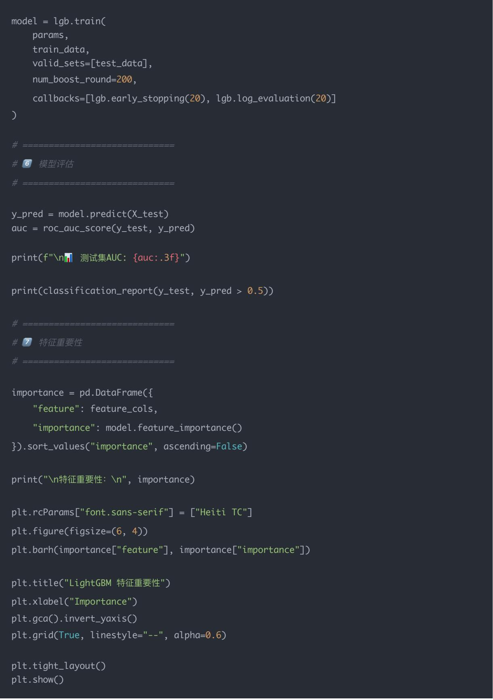

importance = pd.DataFrame({
    "feature": feature\_cols,
    "importance": model.feature\_importance()
}).sort\_values("importance", ascending=False)

print("\n特征重要性：\n", importance)

plt.rcParams["font.sans-serif"] = ["Heiti TC"]
plt.figure(figsize=(6, 4))
plt.barh(importance["feature"], importance["importance"])
plt.title("LightGBM 特征重要性")
plt.xlabel("Importance")
plt.gca().invert\_yaxis()
plt.grid(True, linestyle="--", alpha=0.6)

plt.tight\_layout()
plt.show()

输出：

<table><tr><td>类别</td><td>precision</td><td>recall</td><td>f1-score</td><td>support</td></tr><tr><td>0</td><td>0.60</td><td>0.61</td><td>0.60</td><td>2072</td></tr><tr><td>1</td><td>0.59</td><td>0.59</td><td>0.59</td><td>2023</td></tr><tr><td>accuracy</td><td>0.60</td><td>0.60</td><td>0.60</td><td>4095</td></tr><tr><td>macro avg</td><td>0.60</td><td>0.60</td><td>0.60</td><td>4095</td></tr><tr><td>weighted avg</td><td>0.60</td><td>0.60</td><td>0.60</td><td>4095</td></tr></table>

特征重要性：

<table><tr><td>feature</td><td>importance</td></tr><tr><td>pb</td><td>770</td></tr><tr><td>pe</td><td>765</td></tr><tr><td>ps</td><td>745</td></tr><tr><td>roe</td><td>501</td></tr></table>

- 测试集AUC: 0.642：模型在区分未来5日上涨(1)与下跌(0)时，比随机水平（0.5）好一些，但仍有提升空间。

- 分类报告：

- 0 类（未来下跌）：precision=0.60 表示模型把一只股票预测为下跌时有 60% 准确；recall=0.61 表示实际下跌的股票中有 61% 被识别出来；f1-score=0.60 是二者的折中。

- 1 类（未来上涨）：precision=0.59、recall=0.59、f1-score=0.59，说明模型对上涨的识别力度和准确度与下跌相近。

- support 是各类别在测试集中的样本数（下跌 2072、上涨 2023），基本均衡。

- accuracy=0.60：总预测正确率 60% 左右；宏平均和加权平均的 precision/recall/f1 也都在 0.60，说明两个类别表现接近，没有明显偏向。

这是LightGBM给出的特征重要性统计，数值越大表示模型越常用该因子来划分样本、对预测贡献越大：

- pb（市净率）得分770，当前样本中它最有助于判断未来5日涨跌。

- pe（市盈率）紧随其后，说明估值高低也在模型里体现了作用。

- ps（市销率）与前两项相近，也提供较多信息。

- roe（净资产收益率）虽然得分略低（501），但仍然被模型频繁使用，说明通过fina\_indicator合并后的ROE确实参与了预测。若想增强其影响，可以尝试拓展时间窗口、做季节性平滑或加入同比/环比变化等派生指标。

## 四、模型解读

- AUC > 0.6：模型具备一定区分能力；

- 特征重要性（Feature Importance）能告诉我们哪些因子在预测未来收益中贡献最大；

- 若“ROE”或“PE”重要性高，说明市场近期更关注盈利能力因子。

AUC 是机器学习和量化投资中最常用的模型评估指标之一，全称是：

$$
A U C = \mathrm{AreaUndertheROCCurve}
$$

即 “ROC 曲线下的面积”。

它主要用于衡量二分类模型的整体区分能力，比如：

- 模型能否把“涨的股票”和“跌的股票”区分开；

- 模型能否把“好样本”和“坏样本”排序正确。

### 4.1 核心直觉

假设你训练了一个模型，输出每只股票“明天上涨的概率”：

股票 实际涨跌 模型预测的上涨概率
A 涨 0.9
B 跌 0.2
C 涨 0.8
D 跌 0.3

直觉上：

- 模型希望“涨的股票概率高”，“跌的股票概率低”；

- AUC衡量的就是这种排序能力。

### 4.2 数学定义

AUC 是 ROC 曲线下的面积，而 ROC 曲线由以下两维构成：

坐标轴含义

x轴：FPR $^{Q}$ （False Positive Rate） 错把跌的股票当成涨的比例

y轴：TPR（True Positive Rate） 正确识别出涨的股票的比例

随着分类阈值从高到低移动，模型会生成不同的(FPR, TPR)点，连接起来形成一条ROC曲线。

AUC 则是:

$$
\mathrm{AUC} = \int_ {0} ^ {1} T P R (F P R) d (F P R)
$$

## 数值范围：

- AUC = 1.0 → 完美区分（涨的都排前面）

- AUC = 0.5 → 完全随机（模型没用）

- AUC $< 0.5 \rightarrow$ 排序反了（涨跌颠倒）

### 4.3 直观解释

AUC 就是“随机抽取一只涨的股票”和“一只跌的股票”，模型预测得分更高的那只为“涨”的概率。

4.4 Python 实战示例

下面演示如何计算并绘制 ROC 曲线与 AUC:

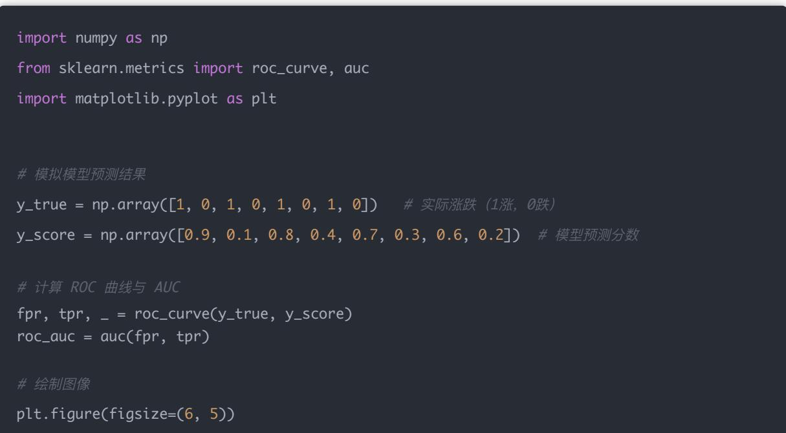

plt.plot([0, 1], [0, 1], color='navy', lw=1, linestyle='--', label='随机分类线')

plt.xlabel('FPR（假正率）', fontproperties='SimHei')

plt.ylabel('TPR（真正率）', fontproperties='SimHei')

plt.title('AUC 指标示意图', fontproperties='SimHei')

plt.legend(prop={"family": "SimHei"})

plt.grid(True)

plt.show()

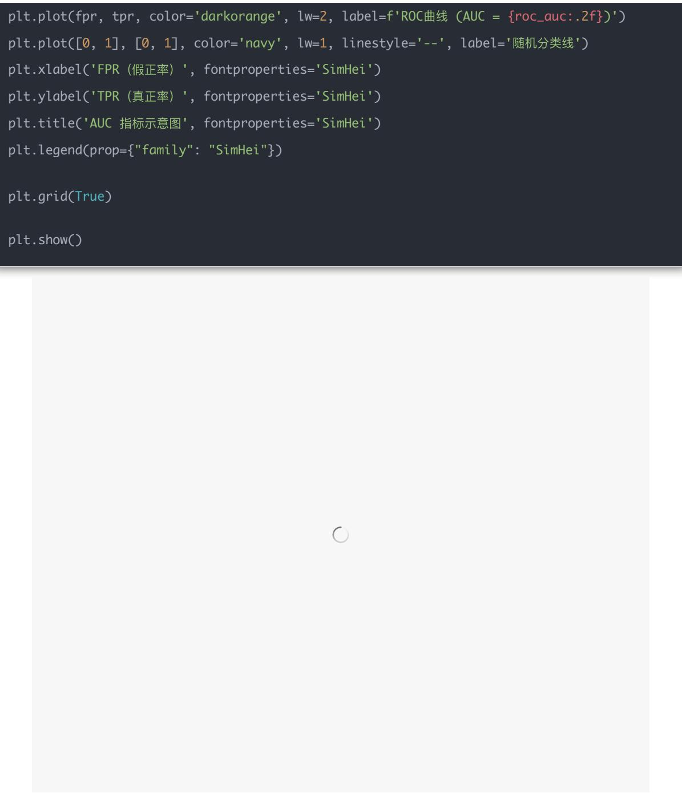

## 五、量化投资中的应用

在量化中，AUC 可用于：

- 因子预测涨跌方向的准确度衡量；

- 择时模型的优劣比较；

- 分类风险模型（如是否触及止损）的判断。

例如：

若你的收益预测因子能把“未来涨幅高的股票”排在前列，

那么它的AUC就会接近1.0。

总结一句话：

AUC衡量的是模型区分正负样本（涨/跌）的整体能力。它不依赖阈值、不受收益尺度影响，非常适合做因子有效性评估。

如果你理解了 LightGBM 或 XGBoost，那么理解 CatBoost 会非常顺畅——它们都属于同一类模型：

梯度提升决策树（Gradient Boosting Decision Tree, GBDT）家族。

不过 CatBoost 是这个家族中最“聪明”、最自动化”的一员，尤其擅长处理类别型（categorical）特征。

## 五、CatBoost：类别特征友好的梯度提升

### 5.1 CatBoost 是什么?

CatBoost = Categorical + Boosting

由 Yandex（俄罗斯的“百度”）开发，核心目标是解决传统 GBDT 的两个问题：1. 类别特征难处理（如“行业”、“省份”、“交易所”等）2. 训练速度慢、过拟合严重

CatBoost 通过数学优化和工程改进，让模型能：

- 自动识别类别特征；

- 无需人工独热编码（One-Hot）；

- 拟合更稳定；

- 更快、更省内存。

### 5.2 CatBoost 的核心创新

<table><tr><td>问题</td><td>XGBoost/LightGBM</td><td>CatBoost 的改进</td></tr><tr><td>类别特征</td><td>需手动编码</td><td>自动转换为“统计编码”</td></tr><tr><td>梯度偏移(梯度泄露)</td><td>可能过拟合</td><td>使用 Ordered Boosting 解决</td></tr><tr><td>参数复杂度</td><td>超多参数</td><td>几乎开箱即用</td></tr><tr><td>训练速度</td><td>快</td><td>同样快,甚至更稳</td></tr><tr><td>特征交互</td><td>手动构造</td><td>自动特征组合(Interaction Detection)</td></tr></table>

### 5.3 核心思想：Ordered Boosting（有序提升）

传统GBDT在每一轮训练时，会用当前样本的真实标签来计算梯度，这容易导致模型“偷看答案”，出现目标泄漏（Target Leakage）。

CatBoost 的解决方法是:

在训练每棵树时，只用在此样本“之前”出现的样本信息。这样即便在随机顺序下，也避免了泄漏。

5.4 类别特征处理（Category Encoding）

假设有一个类别特征：股票代码行业000001银行000002地产000003银行000004科技CatBoost会自动转换为“统计目标编码”：

$$
\mathrm{编码值} = \frac {\mathrm{该类别的正样本数} + \mathrm{prior}}{\mathrm{该类别的总样本数} + \mathrm{平滑项}}
$$

例如“银行”行业可能被转化为“上涨概率 $= 0.7$ ”，“科技” $= 0.4$ 。

这一过程无需人工干预，非常适合股票行业、板块、地区等离散变量。

5.5 Python 实战示例

下面我们用一个简单例子演示 CatBoost 的使用。

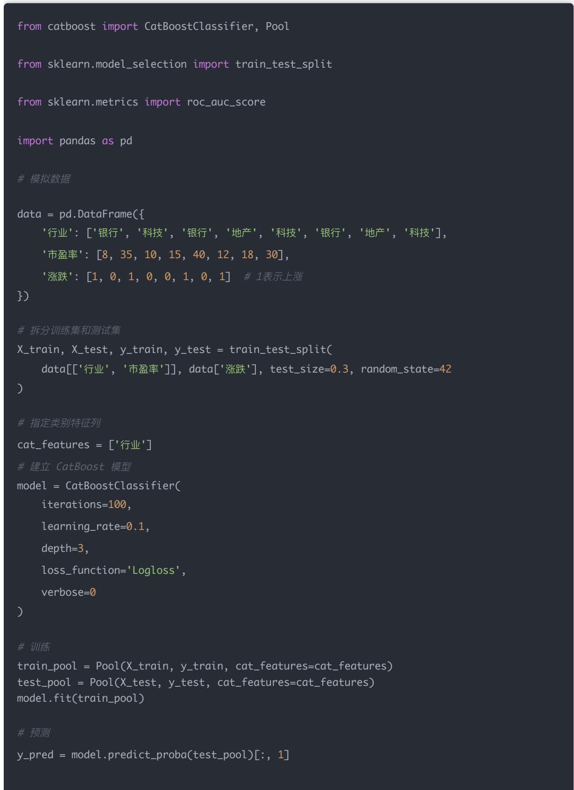

### 5.6 量化中的应用

在量化投资里，CatBoost 非常适合：

<table><tr><td>应用场景</td><td>示例</td></tr><tr><td>多因子融合</td><td>输入财务因子 + 技术因子 + 行业分类</td></tr><tr><td>风险模型</td><td>预测个股是否会暴跌</td></tr><tr><td>择时策略</td><td>判断市场短期上行概率</td></tr><tr><td>高维特征</td><td>自动处理数百个原始因子</td></tr></table>

它尤其擅长“混合数据类型”问题（数值 + 类别），比如：

用股票的市盈率（数值）+行业（类别）+板块（类别）预测未来5日收益率方向。

### 5.7 小结

<table><tr><td>特点</td><td>含义</td></tr><tr><td>模型类型</td><td>梯度提升决策树(GBDT)</td></tr><tr><td>开发团队</td><td>Yandex</td></tr><tr><td>优势</td><td>自动处理类别特征、抗过拟合、速度快</td></tr><tr><td>关键机制</td><td>Ordered Boosting、Target Encoding</td></tr><tr><td>在量化中的用法</td><td>因子融合、分类择时、风险预测</td></tr></table>

做一个真正完整的量化实战例子：

用 CatBoost + Tushare 预测未来 5 日涨跌（分类任务）。

### 5.8 实战思路总览

1. 获取数据：用 tushare 获取沪深 A 股一年的日线数据、财务指标（PE、PB、ROE）。

2. 计算目标变量：

- target = 1 → 未来5日收益 > 0

- target = 0 → 否则

3. 特征工程：

- 填充缺失值

- Winsorize 去极值

- 标准化数值特征

- 行业编码为类别特征（CatBoost天然支持）

4. 训练模型：
- CatBoostClassifier
- 验证集评估 AUC
5. 可视化结果：
- ROC 曲线
- AUC 值

### 5.9 安装依赖

pip install tushare catboost scikit-learn matplotlib pandas scipy

### 5.10 完整实战代码

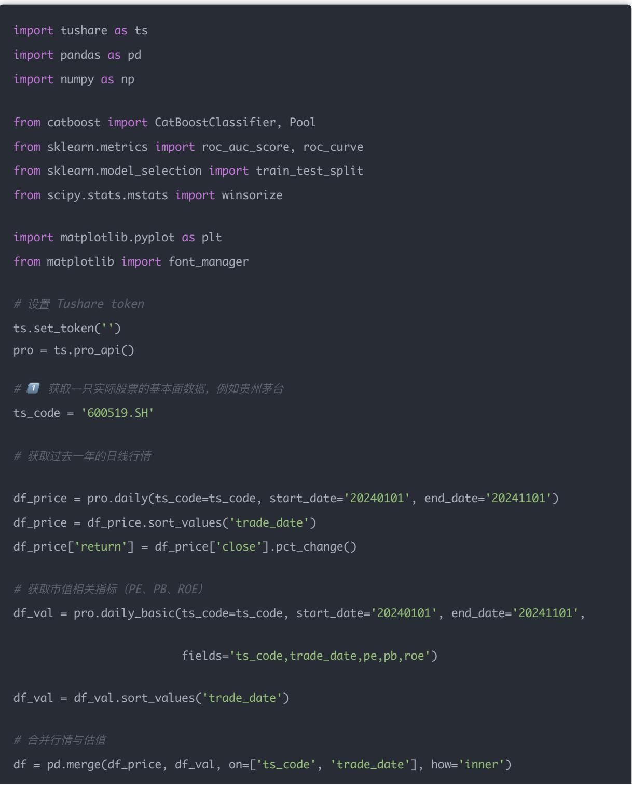

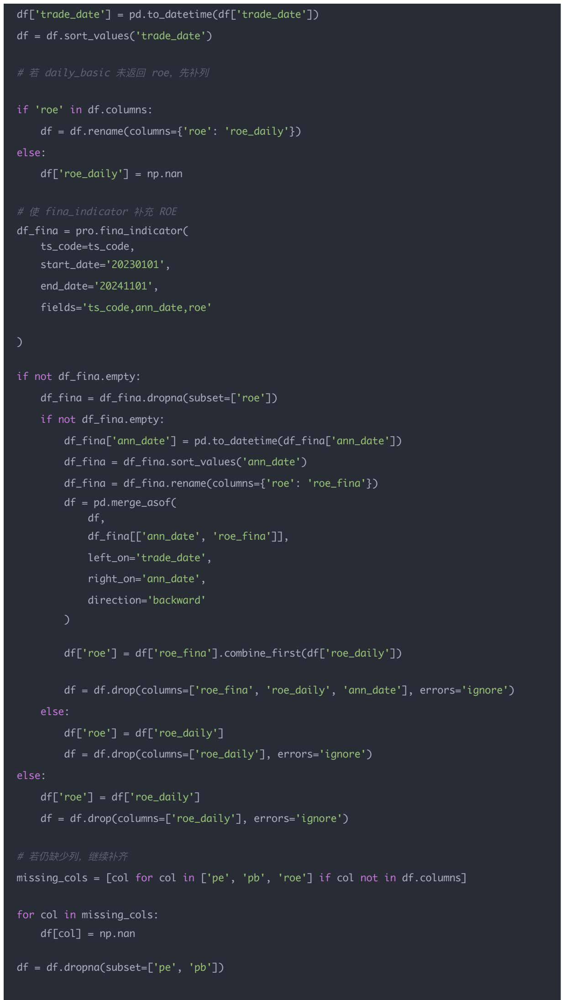

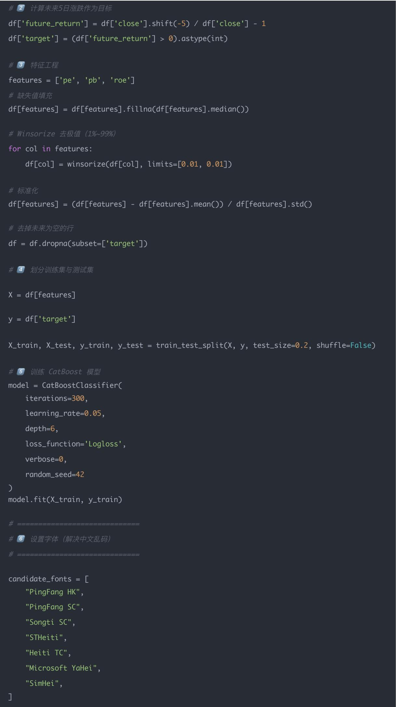

#2 计算未来5日涨跌作为目标

df['future\_return'] = df['close'].shift(-5) / df['close'] - 1
df['target'] = (df['future\_return'] > 0).astype(int)

\# 3 特征工程

features = ['pe', 'pb', 'roe']

缺失值填充

df[features] = df[features].fillna(df[features].median())

\# Winsorize 去极值 (1%\~99%)

for col in features:
    df[col] = winsorize(df[col], limits=[0.01, 0.01])

\# 标准化
df[features] = (df[features] - df[features].mean()) / df[features].std()

\# 去掉未来为空的行

df = df.dropna(subset=['target'])

\# 4 划分训练集与测试集

X = df[features]

y = df['target']

X\_train, X\_test, y\_train, y\_test = train\_test\_split(X, y, test\_size=0.2, shuffle=False)

\# 5 训练 CatBoost 模型
model = CatBoostClassifier(
    iterations=300,
    learning\_rate=0.05,
    depth=6,
    loss\_function='Logloss',
    verbose=0,
    random\_seed=42
)
model.fit(X\_train, y\_train)

6 设置字体（解决中文乱码）

candidate\_font = [
    "PingFang HK",
    "PingFang SC",
    "Songti SC",
    "STHeiti",
    "Heiti TC",
    "Microsoft YaHei",
    "SimHei",

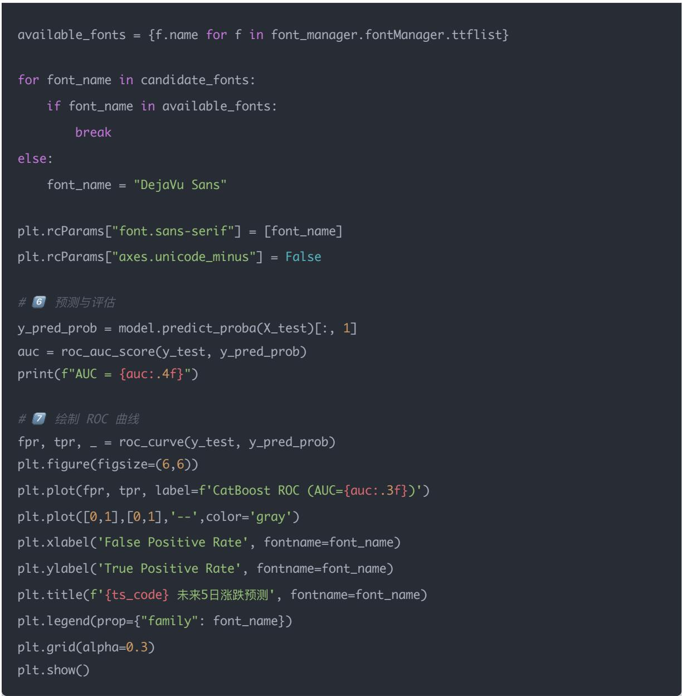

### 5.11 运行结果解读

- 输出示例：AUC = 0.5015

AUC≈0.50 基本等于随机猜涨跌（硬币正反面），说明这版特征和模型几乎没学到有用信号；比 0.5 只高千分之一，仍可视作“没效果”。要改善，需要重新检查数据质量、扩充或派生更有预测力的因子，甚至调整标签定义或模型方案。

## - 图中:

- 曲线越靠左上角 $\rightarrow$ 模型越好

- 对于实盘研究，可进一步加入横截面多股票训练。

### 5.12 优化方向建议

## - 扩充/改造特征

- 加入更多维度：换手率、成交量、波动率、市值、行业哑变量等；

- 用指标的变化率或滚动统计（如 pe 的5日均值、pb 日变化、roe 环比、行业相对值）增强信息；

- 引入技术面特征（MA、MACD、RSI、布林带等），丰富信号来源。

## - 重定义标签与样本

- 未来收益可换成10日、20日甚至带阈值（如涨幅 $>1\%$ 设为1，否则0），让信号更稳定；

- 调整时间窗口或覆盖更多年份，增加样本多样性；

- 滑动取样或滚动训练/验证，模拟真实交易流程。

## - 模型与参数

- 尝试 LightGBM、XGBoost、随机森林等对比模型；

- 做网格搜索或使用 CatBoost 的 GridSearch 调参；

- 控制随机拆分方式，使用时间序列划分或交叉验证，减少过拟合。

## - 数据质量检查

- 确认 roe 对齐正确，可考虑财报公告日向后平滑；

- 检查异常值、停牌数据、缺失填充是否影响结果；

- 如果样本多为噪声（A股短期波动大），可尝试做行业内排序、相对强度等预处理。

## - 策略层面

- 改为截面排序（按因子打分分层）而不是二分类；

- 做多空组合收益回测，关注IC/IR，而非日内方向；

- 结合交易成本、风控条件，优化可执行性。

## 结论

LightGBM与CatBoost形成的梯度提升框架能快速验证多因子信号、提取重要性并结合AUC回测评估，为收益和风险预测提供简单且可复制的起点。

## 量化交易入门指南·目录

## <上一篇

量化交易进阶:第48天 - 特征工程(因子标准化、缺失值填充、分箱、Winsorize 去极值)

## 下一篇>

量化交易进阶:第50天 - 深度学习因子模型 (Deep Factor Model)

阅读111

寒冬没有退路，合理分配每份资源才能守住营地。

点击了解更多>

寒冬没有退路，合理分配每份资源才能守住营地。

无尽冬日-3亿人都在玩

立即体验
