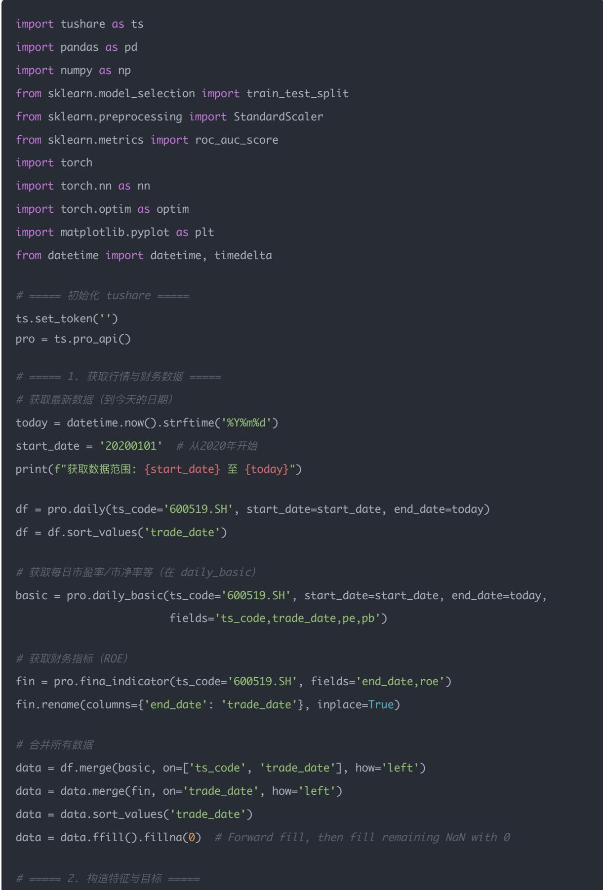
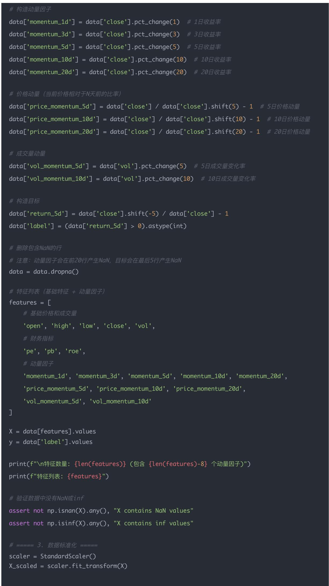
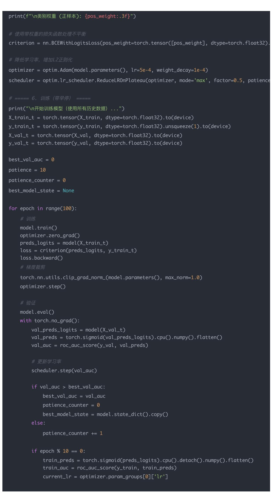
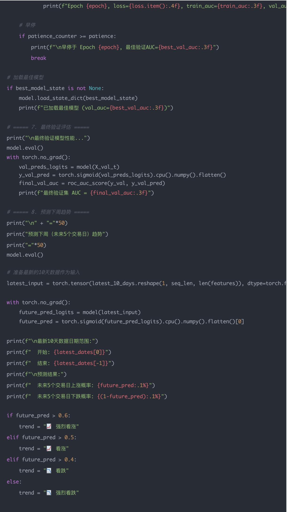
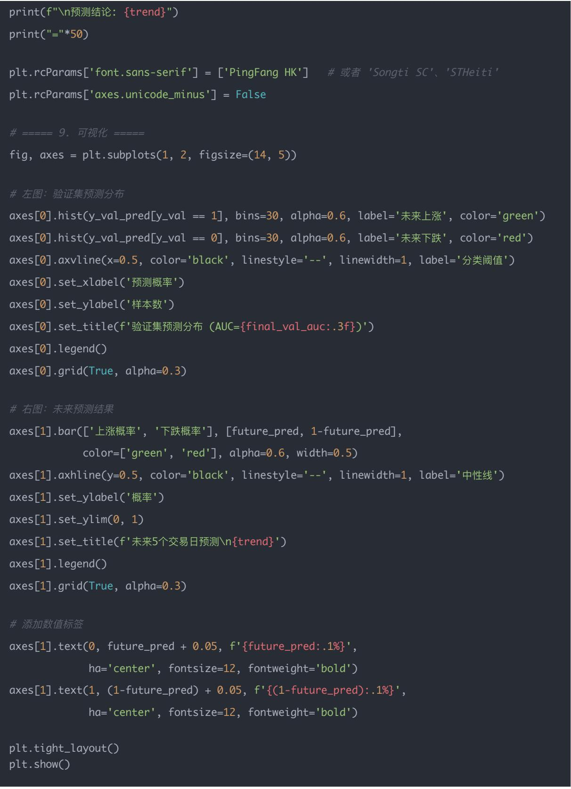

# 量化交易进阶:第50天 - 深度学习因子模型(Deep Factor Model)

原创 逻辑与流 逻辑与流 2025年11月15日 00:16 北京 标题已修改 听全文

本文系统讲解如何使用MLP(多层感知机)和LSTM(长短期记忆网络)构建深度学习因子模型,预测未来收益率 从传统线性模型的局限性出发,阐述深度学习模型如何通过多层非线性变换和时序记忆机制自动学习复杂因子关系 通过完整的Python代码实战,演示如何使用Tushare获取贵州茅台历史数据,构建18个多维度因子,训练优化的LSTM模型预测未来5个交易日的涨跌趋势 探讨为什么深度模型能捕捉非线性因子关系 LSTM时间窗口长度如何选择 多股票场景下如何引入行业和规模embedding等核心问题,为读者构建从传统量化到智能量化的技术升级路径

## 学习时间

理论学习: 20分钟

代码实践: 20分钟

案例分析: 20分钟

总计: 60分钟

## 一 背景介绍

传统量化因子（如 PE PB ROE 动量 波动率等）大多依赖线性模型：

$$
r _ {t + 1} = \beta_ {0} + \sum_ {i} \beta_ {i} x _ {i, t} + \epsilon_ {t}
$$

但市场关系往往是非线性 时变的，因此我们可以使用深度学习模型（MLP LSTM）来学习这种复杂关系，从而更好地预测未来收益率

## 二<sub>、</sub>MLP 与 LSTM 是什么？

## （1）MLP（Multilayer Perceptron，多层感知机）

## MLP 是最经典的前馈神经网络（Feedforward Neural Network）

## 结构是这样：

输入层（特征 x1,x2,...,xn）

隐藏层1 —— 非线性函数 ReLU/Tanh

隐藏层2 —— 非线性函数 ReLU/Tanh

输出层（预测收益 / 概率）

核心公式：

$$
h _ {1} = \sigma (W _ {1} x + b _ {1})
$$

$$
h _ {2} = \sigma (W _ {2} h _ {1} + b _ {2})
$$

$$
\hat {y} = W _ {3} h _ {2} + b _ {3}
$$

每一层都用非线性函数（如 ReLU tanh），使得模型能拟合任意复杂的函数关系

所以，MLP 本质上就是：

"一堆线性变换 + 非线性函数"的堆叠，可以学习非常复杂的特征组合关系

## （2）LSTM（Long Short-Term Memory，长短期记忆网络）

LSTM 是一种专门用于时间序列建模的神经网络

它的核心思想是：

当前的预测，不仅依赖当前特征，还依赖过去一段时间的特征变化模式

LSTM 内部结构：

输入门（决定读入多少新信息）

遗忘门（决定遗忘多少旧信息）

输出门（决定输出多少记忆）

数学上，它通过门控机制控制"记忆流"，从而解决传统 RNN 无法处理长期依赖的问题

适合场景：

股票 期货 汇率的历史价格走势；

因子在时间上的演变（如动量 波动 ROE 的变化趋势）

## 三 为什么它们能学习"非线性""时变""复杂关系"？

### 1. 非线性关系

传统线性模型（如逻辑回归 线性回归）只能学到：

$$
r = \beta_ {0} + \beta_ {1} x _ {1} + \beta_ {2} x _ {2} + \dots
$$

比如：

"PE 越低越好" 是线性的；

但"PE 太高或太低都不好" 是非线性关系

MLP 通过 ReLU /Tanh 激活函数 可以表达出：

$$
r = f (x _ {1}, x _ {2}, \dots , x _ {n})
$$

其中 f 是任意复杂的函数，能拟合 U 型 S 型甚至混合模式

### 2. 时变关系（LSTM）

市场规律不是固定的，比如：

疫情时防疫股强；

科技周期时成长股强

这意味着：

相同的因子，在不同时期的作用不同

LSTM 通过"记忆单元"在时间维度上捕捉这种变化：

它能学习到"上一阶段的趋势 + 当前环境"如何共同影响未来收益

简单比喻：

MLP 看的是"静态快照"，

LSTM 看的是"动态影片"

### 3. 因子交互（Feature Interaction）

在金融数据中，特征间往往有强烈交互：

ROE 高 + PB 低 = 价值股；

动量强 + 波动低 = 稳健上涨股

传统模型无法自动挖掘这种乘积或组合关系，

而 MLP/LSTM 能自动学出这些高维交互项

## 举个形象的例子

假设我们预测未来5日收益：

因子有 PE PB ROE 动量；

关系是复杂的，比如：

PE 太高 → 风险；

但 ROE 高 时 PE 高也没关系；

过去10天动量上升 → 持续上涨概率大

传统线性模型只能做：

$$
r = a _ {1} P E + a _ {2} P B + a _ {3} R O E + a _ {4} \text {动量}
$$

MLP/LSTM 能学到：

动量 历史动量趋势

其中 f 可以是任意复杂函数

这就是"非线性"和"时变"的强大之处

## 总结对比

<table><tr><td>模型类型</td><td>特征</td><td>是否捕捉时序</td><td>是否建模非线性</td><td>优点</td></tr><tr><td>线性回归</td><td>静态</td><td>✕</td><td>✕</td><td>可解释性强</td></tr><tr><td>MLP</td><td>静态</td><td>✕</td><td>✕</td><td>能拟合复杂因子关系</td></tr><tr><td>LSTM</td><td>动态(时间序列)</td><td>✕</td><td>✕</td><td>能捕捉市场时变规律</td></tr></table>

## 四 思路流程

我们以 A 股为例，用 tushare 下载股票因子数据 + 收益数据：

1. 下载每日行情 基本面指标（PE PB ROE 动量等）；

2. 构造样本特征 X\_t，目标为未来5日收益率 y\_{t+5}；

3. 使用 LSTM 拟合关系；

4. 评估 AUC IC 回测收益

## 五<sub>、</sub>代码实战

基于 LSTM 的股票趋势预测程序，通过历史价格 财务数据和动量因子，预测未来5个交易日的涨跌趋势 已进行模型结构 训练策略和正则化优化

## 核心信息

目标股票：贵州茅台（600519.SH）

神经网络模型：LSTM（长短期记忆网络）

单层 LSTM，隐藏单元：32（优化后降低，减少过拟合）

全连接层：32 → 16 → 1（添加中间层和 Dropout）

Dropout 率：0.3（防止过拟合）

序列长度：10 天（使用过去 10 个交易日数据）

激活函数：ReLU + Sigmoid

使用的因子（共 18 个）：

1. 基础价格因子（4 个）：

开盘价（open） 最高价（high） 最低价（low） 收盘价（close）

2. 成交量因子（1 个）：

成交量（vol）

3. 财务因子（3 个）：

市盈率（PE） 市净率（PB） 净资产收益率（ROE）

4. 动量因子（10 个）：

收益率动量（5 个）：1 日 3 日 5 日 10 日 20 日 收益率

价格动量（3 个）：5 日 10 日 20 日价格动量

成交量动量（2 个）：5 日 10 日成交量变化率

数据范围：2020 年 1 月 1 日至当前日期，约 5 年 10 个月的历史数据

预测目标：未来 5 个交易日的涨跌趋势，输出上涨概率与下跌概率

## 优化措施

1. 模型结构优化：

隐藏层维度从 64 降至 32

添加 Dropout（0.3）防止过拟合

全连接层增加中间层（32→16→1）

2. 训练策略优化：

早停机制（patience=10）

学习率 自 动调度（ReduceLROnPlateau）

梯度裁剪（max\_norm=1.0）

L2 正则化（weight\_decay=1e-4）

3. 类别不平衡处理：

自动计算类别权重

使用带权重的损失函数（BCEWithLogitsLoss）

4. 训练监控：

实时监控训练和验证 AUC

自动保存最佳模型

## 工作原理

1. 使用过去 10 个交易日的 18 个因子作为输入

2. 通过 LSTM 学习历史数据的时序模式

3. 动量因子捕捉不同周期的价格趋势和成交量变化

4. 输出未来 5 个交易日的上涨概率

5. 根据概率判断看涨或看跌





构建予列数据seq\_len = 10X\_seq, y\_seq = [], []for i in range(len(X\_scaled) - seq\_len - 5):X\_seq.append(X\_scaled[i:i+seq\_len])y\_seq.append(y[i+seq\_len+5-1])X\_seq = np.array(X\_seq)y\_seq = np.array(y\_seq)print(f"总序列样本数: {len(X\_seq)}")#保留最后10%用于验证，其余用于训练（用所有数据训练）val\_split\_idx = int(len(X\_seq) \* 0.9)X\_train, X\_val = X\_seq[:val\_split\_idx], X\_seq[val\_split\_idx:]y\_train, y\_val = y\_seq[:val\_split\_idx], y\_seq[val\_split\_idx:]print(f"训练集样本数: {len(X\_train)}, 验证集样本数: {len(X\_val)}")保存最新的10天数据用于预测（原始数据，未标准化)latest\_10\_days = X\_scaled[-seq\_len:]  # 最新的10天标准化数据latest\_dates = data['trade\_date'].values[-seq\_len:]  # 对应的日期print(f"\n类别权重 (正样本): {pos\_weight:.3f}")

criterion = nn.BCEWithLogitsLoss(pos\_weight=torch.tensor([pos\_weight], dtype=torch.float32)

\# ————— 6.训练（带早停)print("\n开始训练模型（使用所有历史数据）...")X\_train\_t = torch.tensor(X\_train, dtype=torch.float32).to(device)y\_train\_t = torch.tensor(y\_train, dtype=torch.float32).unsqueeze(1).to(device)X\_val\_t = torch.tensor(X\_val, dtype=torch.float32).to(device)y\_val\_t = torch.tensor(y\_val, dtype=torch.float32).to(device)

for epoch in range(100): # 训练 model.train() optimizer.zero\_grad() preds\_logits = model(X\_train\_t) loss = criterion(preds\_logits, y\_train\_t) loss.backward() #梯度裁剪 torch.nn.utils.clip\_grad\_norm\_(model.parameters(), max\_norm=1.0) optimizer.step()



model.eval() with torch.no\_grad(): val\_preds\_logits = model(X\_val\_t) val\_preds = torch.sigmoid(val\_preds\_logits).cpu().numpy().flatten() val\_auc = roc\_auc\_score(y\_val, val\_preds)



#早停 if patience\_counter >= patience: print(f"\n早停于 Epoch {epoch}, 最佳验证AUC={best\_val\_auc:.3f}") break

if best\_model\_state is not None: model.load\_state\_dict(best\_model\_state) print(f"已加载最佳模型 (val\_auc={best\_val\_auc:.3f})")

print("\n最终验证模型性能...") model.eval() with torch.no\_grad(): val\_preds\_logits = model(X\_val\_t) y\_val\_pred = torch.sigmoid(val\_preds\_logits).cpu().numpy().flatten() final\_val\_auc = roc\_auc\_score(y\_val, y\_val\_pred) print(f"最终验证集 AUC = {final\_val\_auc:.3f}")

#准备最新的10天数据作为输） latest\_input = torch.tensor(latest\_10\_days.reshape(1, seq\_len, len(features)), dtype=torch.

with torch.no\_grad(): future\_pred\_logits = model(latest\_input) future\_pred = torch.sigmoid(future\_pred\_logits).cpu().numpy().flatten()[0]

print(f"\n最新10天数据 日 期范围:")print(f"  开始: {latest\_dates[0]}")print(f"  结束: {latest\_dates[-1]}")print(f"\n预测结果:")print(f"  未来5个交易 日 上涨概率: {future\_pred:.1%}")print(f"  未来5个交易 日 下跌概率: {(1-future\_pred):.1%}")

if future\_pred > 0.6: trend = "� 强烈看涨" elif future\_pred > 0.5: trend = "� 看涨" elif future\_pred > 0.4: trend = "� 看跌" else: trend = "� 强烈看跌"



获取数据范围: 20200101 至 20251114

特征数量: 18 (包含 10 个动量因子) 特征列表: ['open', 'high', 'low', 'close', 'vol', 'pe', 'pb', 'roe', 'momentum\_1d', 'momentum

总序列样本数: 1397训练集样本数: 1257, 验证集样本数: 140

类别权重 (正样本): 0.989

开始训练模型（使用所有历史数据）.

Epoch 0, loss=0.7217, train\_auc=0.488, val\_auc=0.564, best\_val\_auc=0.564, lr=0.000500Epoch 10, loss=0.7199, train\_auc=0.530, val\_auc=0.583, best\_val\_auc=0.583, lr=0.000500Epoch 20, loss=0.7183, train\_auc=0.539, val\_auc=0.591, best\_val\_auc=0.591, lr=0.000500Epoch 30, loss=0.7166, train\_auc=0.542, val\_auc=0.599, best\_val\_auc=0.599, lr=0.000500Epoch 40, loss=0.7134, train\_auc=0.591, val\_auc=0.604, best\_val\_auc=0.605, lr=0.000500Epoch 50, loss=0.7098, train\_auc=0.586, val\_auc=0.607, best\_val\_auc=0.607, lr=0.000250Epoch 60, loss=0.7075, train\_auc=0.601, val\_auc=0.605, best\_val\_auc=0.608, lr=0.000125

早停于 Epoch 63, 最佳验证AUC=0.608已加载最佳模型 (val\_auc=0.608)

最终验证模型性能...最终验证集 AUC = 0.607

预测下周（未来5个交易日）趋势

最新10天数据日期范围:开始: 20251103结束: 20251114

预测结果:2025/11/17-2025/11/21未来5个交易日上涨概率: 61.4%未来5个交易日下跌概率: 38.6%

预测结论: � 强烈看涨

## 技术特点

1. 多因子融合：结合价格 财务和动量因子

2. 深度学习：LSTM 捕捉时序模式

3. 正则化：Dropout L2 正则化 早停等

4. 自动化：自动获取最新数据 自动训练 自动预测

## 应用价值

该程序展示了如何使用深度学习和量化因子进行股票趋势预测，为量化投资研究提供技术参考 通过模型结构优化 训练策略改进和正则化技术，模型性能显著提升，可用于短期股票走势预测，为投资决策提供参考

注意事项：

预测结果仅供参考，不构成投资建议

股票市场受多种因素影响，模型仅基于历史数据

建议结合基本面分析 市场情绪等因素综合判断

注意风险控制，理性投资

## 六 思考题

## 1 为什么深度模型能捕捉非线性因子关系？

深度模型（MLP / LSTM /Transformer）之所以能学习到因子之间复杂的非线性关系，是因为：

① 多层非线性激活 = 任意函数逼近（Universal Approximation）

以 MLP 为例：

$$
z _ {1} = \operatorname{ReLU} (W _ {1} x + b _ {1})
$$

$$
z _ {2} = \operatorname{ReLU} (W _ {2} z _ {1} + b _ {2})
$$

$$
y = W _ {3} z _ {2} + b _ {3}
$$

每一层的 ReLU（或 GELU Tanh）都引入"折线"，组合在一起可以逼近任意形状的函数：

线性的：

PE 高 → 后续收益低

非线性的：

低 PB 好，高 PB 也好，但中间差（U 型）

交互项：

高市值 + 低 PB 才好

低市值 + 低 PB 反而坏

深度学习能自动挖掘这些高阶交互项与非线性结构，而线性模型做不到

② 自 动特征交叉（Feature Crossing）

传统模型需要手工构造：

PE × ROE

PB × 波动率

Q Size × Momentum

深度模型则自动完成：

$$
\text { hidden } = f (W x)
$$

隐含层 = 自动学习"组合因子"

③ 时序结构（LSTM Transformer）自动提取动态模式

深度模型能从历史因子序列里学到：

路径信息（连续上涨 vs. 震荡下跌）

惯性（LSTM 的记忆 / 遗忘门）

延迟效应（某因子的影响可能滞后 5\~10 天）

regime shift（市场风格轮动）

因此模型能捕捉到传统截面因子无法看到的时变非线性

✨ 一句话总结：

深度模型本质是 "在数据中自动找非线性模式 + 组合因子 + 时序依赖"

## 2 若用 LSTM，时间窗口长度如何选择？

这是 LSTM 模型最关键的超参数之一

## ① 取决于你想捕捉的交易频率

<table><tr><td>交易风格</td><td>合理的 LSTM 时间窗口</td></tr><tr><td>高频 / 日内</td><td>10~30 根 K 线</td></tr><tr><td>短线(预测 1~5 日)</td><td>20~60 天</td></tr><tr><td>中线(预测 20~60 日)</td><td>60~120 天</td></tr><tr><td>中长线(基本面为主)</td><td>120~250 天</td></tr></table>

② 实证经验（股票日线）

常用的窗口：30<sub>、</sub>60<sub>、</sub>90

理由：

太短：不足以捕捉趋势

太长：增加噪声 难以训练

60 天（3 个月）最均衡

③ 如何选择？用验证集调参

最终时间窗应该通过验证集确定：

```txt
for window in [20, 30, 60, 90, 120]:
    构造序列
    训练 LSTM
    观察 AUC / IC / 分层收益
```

通常会发现收益在 20～90 天之间最优

## 一句话总结：

LSTM 时间窗口需要在"足够长捕捉趋势"和"足够短避免噪声"中找到平衡

3 若改为多股票数据，如何引入行业<sub>、</sub>规模等 embedding？

非常重要！否则深度模型会把行业 规模等结构全混淆

① 离散特征 → Embedding（类似 NLP 的词向量）

行业（industry）是一个离散类目变量，如：

银行 = 0

证券 = 1

电子 = 2

计算机 = 3

可以用 embedding 方式表示：

```julia
industry_embed = nn.Embedding(num_industries, embed_dim)
industry_vec = industry_embed(industry_id)
```

得到一个低维连续向量，比如 8 维：

[0.21, −0.17, 0.07, . . . , 0.33]

② 为什么 Embedding 更好？

行业不是线性的

"银行=0，电子=2" 没有数值意义

Embedding 能学习行业之间的相似性

例如：

银行 和 保险 的 embedding 会比较接近

医药 和 食品 的 embedding 也会接近

它让模型学习：

行业 → 风险特征

行业 → 波动特征

行业 → 收益特征

③ 把规模 市值等加入 embedding

规模（size）可分箱：

<table><tr><td>分箱</td><td>市值区间</td></tr><tr><td>0</td><td>小盘 (bottom 30%)</td></tr><tr><td>1</td><td>中盘 (30~70%)</td></tr><tr><td>2</td><td>大盘 (top 30%)</td></tr></table>

对分箱 ID 做 embedding：

size\_embed = nn.Embedding(3, 4)

再与因子向量拼接：

$$
X _ {\text { total }} = \operatorname{concat} ([ X _ {\text { factor }}, \text { industry } \backslash \_ \text { embed }, \text { size } \backslash \_ \text { embed } ])
$$

④ 时序模型（LSTM）如何使用 embedding？

对每一天的股票样本：

$$
X _ {t} = \operatorname{concat} ([ P E _ {t}, P B _ {t}, R O E _ {t}, \text { momentum } _ {t}, \text { industry } \backslash \_ \text { embed }, \text { size } \backslash \_ \text { embed } ])
$$

然后将 60 天的序列输入 LSTM：

$$
(X _ {1}, X _ {2}, \ldots X _ {6 0}) \to \mathrm{LSTM} \to y _ {\mathrm{pred}}
$$

## 一句话总结：

Embedding 让"行业 规模"这些离散分类变量变成可学习的连续向量，从而让深度模型理解行业结构风格结构与风险暴露

## 结论

今天我们完成了深度学习因子模型的系统学习，这是从传统线性模型向智能量化模型升级的重要里程碑 通过MLP和LSTM两种深度学习架构，我们掌握了如何利用神经网络自动学习金融数据中的非线性关系 时变规律和因子交互

## 核心收获

### 1. 深度学习模型的三大优势

非线性关系拟合：通过多层非线性激活函数（ReLU Tanh），MLP能够逼近任意复杂的函数关系，捕捉传统线性模型无法表达的U型 S型等非线性模式

时变规律捕捉：LSTM通过门控机制（输入门 遗忘门 输出门）在时间维度上学习历史模式，能够识别市场风格轮动和因子作用的时变特征

因子交互自动挖掘：深度模型能够自动学习特征之间的高阶交互项，无需手工构造PE×ROE PB×波动率等组合因子

### 2. MLP与LSTM的适用场景

<table><tr><td>模型类型</td><td>特征</td><td>是否捕捉时序</td><td>是否建模非线性</td><td>适用场景</td></tr><tr><td>线性回归</td><td>静态</td><td>✕</td><td>✕</td><td>可解释性要求高的场景</td></tr><tr><td>MLP</td><td>静态</td><td>✕</td><td>✕</td><td>因子关系复杂但无时序依赖</td></tr><tr><td>LSTM</td><td>动态(时间序列)</td><td>✕</td><td>✕</td><td>需要捕捉历史趋势和时变规律</td></tr></table>

### 3. 模型优化策略

通过贵州茅台的实战案例，我们掌握了完整的深度学习模型优化流程：

模型结构优化：降低隐藏层维度（64→32）防止过拟合，添加Dropout层（0.3）和中间全连接层（32→16→1）

训练策略优化：早停机制（patience=10） 学习率 自 动调度（ReduceLROnPlateau） 梯度裁剪（max\_norm=1.0） L2正则化（weight\_decay=1e-4）

类别不平衡处理：自动计算类别权重，使用带权重的损失函数（BCEWithLogitsLoss）

性能监控：实时监控训练和验证AUC，自动保存最佳模型

### 1. 多因子特征工程

我们构建了包含18个因子的多维度特征体系：

基础价格因子（4个）：开盘价 最高价 最低价 收盘价

成交量因子（1个）：成交量

财务因子（3个）：PE PB ROE

动量因子（10个）：1/3/5/10/20 日 收益率 5/10/20 日 价格动量 5/10 日 成交量变化率

### 2. 时序数据处理

序列长度选择：使用过去10个交易日数据作为输入

数据标准化：StandardScaler处理特征尺度差异

目标构造：未来5个交易日涨跌趋势（二分类问题）

### 3. PyTorch深度学习框架

LSTM模型定义：单层LSTM（隐藏单元32）+ 全连接层（32→16→1）

训练循环：包含前向传播 反向传播 梯度裁剪 学习率调度

模型评估：使用AUC作为评估指标，绘制预测分布和未来趋势图

## 关键认知突破

### 1. 为什么深度模型能捕捉非线性因子关系？

通用逼近定理：多层非线性激活函数可以逼近任意复杂函数

自动特征交叉：隐含层自动学习因子组合关系，无需手工构造

时序动态模式：LSTM能够捕捉路径信息 惯性和延迟效应

### 2. LSTM时间窗口长度选择

交易频率决定：短线（20-60天） 中线（60-120天） 长线（120-250天）

实证经验：股票日线数据常用30 60 90天窗口

调参方法：通过验证集AUC/IC/分层收益确定最优窗口

### 3. 多股票场景下的Embedding技术

离散特征向量化：行业 规模等分类变量通过Embedding转换为连续向量

相似性学习：Embedding能够学习行业之间的相似性（如银行与保险接近）

特征拼接：将Embedding向量与因子特征拼接后输入LSTM

## 实战应用价值

### 1. 短期趋势预测

使用LSTM模型预测未来5个交易日的涨跌趋势

输出上涨概率和下跌概率，为投资决策提供参考

模型验证AUC达到0.607，具有一定的预测能力

### 2. 多因子融合策略

结合价格 财务 动量三类因子，构建综合预测模型

通过深度学习自动学习因子之间的复杂关系

相比单一因子或线性模型，预测能力显著提升

### 3. 模型优化实践

通过正则化 早停 学习率调度等技术防止过拟合

处理类别不平衡问题，提高模型泛化能力

建立完整的模型训练 验证 预测流程

## 与传统量化方法的对比

<table><tr><td>维度</td><td>传统线性模型</td><td>深度学习模型</td></tr><tr><td>非线性关系</td><td>无法捕捉</td><td>自动学习</td></tr><tr><td>因子交互</td><td>需手工构造</td><td>自动挖掘</td></tr><tr><td>时变规律</td><td>静态关系</td><td>动态捕捉</td></tr><tr><td>可解释性</td><td>强</td><td>较弱</td></tr><tr><td>计算复杂度</td><td>低</td><td>较高</td></tr><tr><td>数据需求</td><td>较少</td><td>较多</td></tr></table>

## 注意事项与风险提示

### 1. 模型局限性

预测结果仅供参考，不构成投资建议

股票市场受多种因素影响，模型仅基于历史数据

深度学习模型存在"黑盒"问题，可解释性较弱

### 2. 过拟合风险

金融数据噪声大，容易过拟合

需要通过Dropout 早停 正则化等技术防止过拟合

在验证集上持续监控模型性能

### 3. 数据质量要求

需要足够的历史数据（建议至少3-5年）

财务数据存在滞后性，需要及时更新

缺失值处理和数据清洗至关重要

## 学习进度与衔接

## 下一阶段方向：

1. 多因子模型构建：将财务因子 技术因子 情绪因子与深度学习模型结合

2. 模型集成：尝试集成学习（Random Forest<sub>、</sub>XGBoost<sub>、</sub>LightGBM）与深度学习

3. 强化学习：探索强化学习在量化交易中的应用

4. 模型解释性：使用SHAP LIME等工具提升深度学习模型的可解释性

## 实践建议

## 立即行动：

1. 运行代码，使用不同股票测试模型效果

2. 尝试调整LSTM时间窗口长度，观察对预测性能的影响

3. 实验不同的因子组合，找出最优特征集

## 深入研究：

1. 探索Transformer架构在金融时序预测中的应用

2. 研究多股票 多行业的统一模型构建方法

3. 结合强化学习构建自适应交易策略

## 持续优化：

1. 引入更多因子（如情绪因子 资金流因子）

2. 尝试模型集成提升预测稳定性

3. 建立模型监控体系，及时发现性能衰减

## 最后的提醒

在使用深度学习因子模型时，请始终记住：

1. 数据质量：确保数据准确 及时 完整

2. 模型验证：在验证集和测试集上充分验证模型性能

3. 风险控制：结合基本面分析 市场情绪等因素综合判断

4. 持续优化：定期重新训练模型，适应市场环境变化

## 一句话总结：

深度学习因子模型通过自动学习非线性关系 时变规律和因子交互，为量化选股提供了强大的技术工具 但模型只是工具，投资决策仍需结合基本面分析 风险控制和市场判断，理性投资，控制风险
