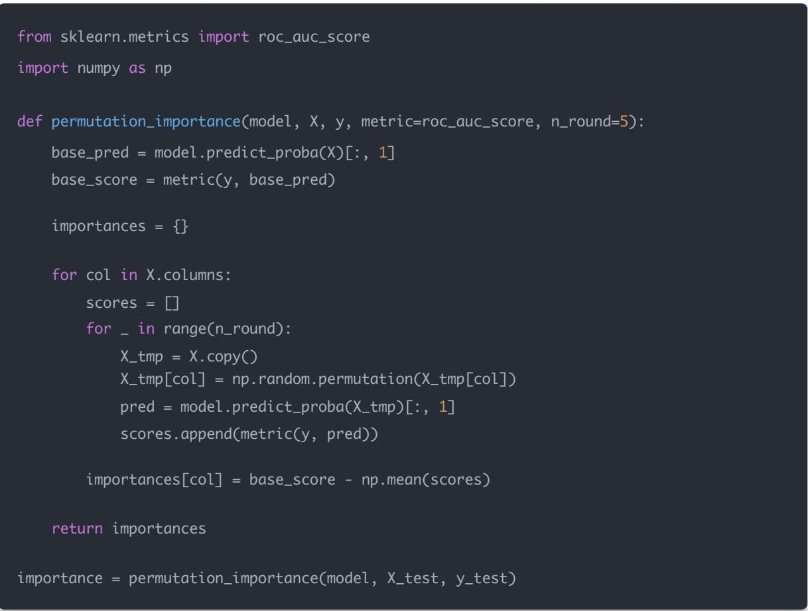

# 量化交易进阶:第52天 - 因子重要性与解释性（Explainable ML forQuant）(进阶阶段·深度学习模块)

原创 逻辑与流 逻辑与流 2025年11月 18 日 22:06 北京 听全文

本文系统讲解因子重要性与解释性技术，重点介绍Permutation Importance（置换重要性）和SHAP（Shapley Additive Explanations）两种最常用的解释方法 阐述如何解释复杂机器学习模型（CatBoostGNN LSTM MLP）的因子贡献，包括因子重要性排序 作用方向判断 非线性关系识别 过拟合检测与未来信息泄露检验 详细讲解深度因子模型（MLP/LSTM/GNN）的解释方法，对比不同模型因子重要性的统一框架，并给出因子负贡献的处理策略 适合从传统因子向深度因子（GNN/MLP/LSTM）过渡阶段的读者。

“模型越复杂，解释性越重要”

机器学习模型越复杂（如 CatBoost GNN LSTM），越难解释它为什么能赚钱 / 为什么在某段时间失效。

所以必须使用解释性技术，让你看到：

哪些因子最重要？

因子作用方向（正向？负向？）

因子是线性还是非线性作用？

因子是否在过拟合？

模型是否在"偷看未来"？

今天说两类最常用技术：

## 一 Permutation Importance（置换重要性）

Permutation Importance 是最直观 最容易理解的方法，特别适合快速验证因子的全局重要性

## 核心思想（简单粗暴但好用）

把某个因子的值随机打乱，然后看模型效果下降多少

若效果下降大 → 这个因子很重要

若效果下降几乎为 0 → 因子不重要（可能被别的因子替代）

衡量下降指标：AUC IC MSE Accuracy 都可以

## 如何做（示例代码）

（假设你用 CatBoost / XGBoost）

Permutation Importance 的优点

简单直观

不依赖模型结构

可以用在 Tree / MLP / LSTM / GNN 任何黑盒模型

## 缺点

因子高度相关时，会"分不清"真正重要谁

只能做全局解释（不能解释单只股票）

虽然 Permutation Importance 简单有效，但在量化研究中，我们往往需要更细致的解释能力。接下来介绍的 SHAP 不仅能做全局解释，还能解释单个样本，是量化研究中最流行的解释工具

## 二 SHAP（Shapley Additive Explanations）

这是量化研究中最流行的解释工具

## SHAP：你要先理解它的直觉

每个因子对预测值的贡献是多少？

比如模型预测贵州茅台未来上涨概率为 70%

SHAP 可以告诉你：

PE 因子贡献 +5%

ROE 因子贡献 +10%

行业 embedding 贡献 +7%

波动率贡献 –3%

把所有因子贡献加起来 = 模型最终输出

## SHAP 最牛的两点（你最应该知道）

1. 解释单个样本（单只股票）

Permutation 只能解释全局

## SHAP 能解释：

为什么这只股票被预测上涨？

哪些因子拉高了它的概率？

哪些因子拖累了它？

这对你做"选股理由解释"特别有用

2. 可以解释复杂模型（CatBoost LightGBM 深度网络）

CatBoost 有官方 SHAP 加速实现，非常快

深度模型可用：

DeepSHAP（for MLP）

GraphSHAP / GNNExplainer（for GNN）

Temporal SHAP（for LSTM）

## SHAP 示例代码（CatBoost）

from catboost import CatBoostClassifier, Pool

import shap

model = CatBoostClassifier()

model.fit(X\_train, y\_train)

explainer = shap.TreeExplainer(model)

shap\_values = explainer.shap\_values(X\_test)

\# summary plot

shap.summary\_plot(shap\_values, X\_test)

## 你能看到每个因子的：

全局重要性（像变量重要性）

贡献方向（红色正贡献，蓝色负贡献）

非线性关系（dependence plot）

## SHAP 能帮你回答的量化关键问题

哪些因子在赚钱？（重要性排序）

因子对收益影响方向是什么？（正向？U 型？阈值？）

因子是否在过拟合？

不同市场环境（震荡 / 牛市 / 熊市），因子贡献如何变化？

模型为什么某个月失效？（解释反常预测）

是否存在隐含因子冗余？（两个因子作用几乎一样）

## SHAP vs Permutation Importance 对比

<table><tr><td>项目</td><td>Permutation</td><td>SHAP</td></tr><tr><td>能解释单只股票</td><td>×</td><td>√</td></tr><tr><td>解释全局重要性</td><td>√</td><td>√(更细致)</td></tr><tr><td>支持所有模型</td><td>√</td><td>大部分(深度网络稍慢)</td></tr><tr><td>计算速度</td><td>快</td><td>CatBoost 快、其他一般</td></tr><tr><td>能看非线性作用</td><td>有点</td><td>非常强</td></tr><tr><td>能识别因子冗余</td><td>弱</td><td>强</td></tr></table>

结论：

快速验证 → 用 Permutation

做论文 / 实盘解释 → 用 SHAP

掌握了 Permutation Importance 和 SHAP 的基本用法后，接下来我们要解决一个更实际的问题：如何解释深度因子模型？这对于从传统因子过渡到深度因子的你来说，是最关键的一步

## 三 对你最重要的部分：深度因子模型如何做解释？

你前几天已经学：

MLP 因子模型

LSTM 因子模型

GNN（深度因子）

那么问题来了：

深度模型这么黑盒，到底怎么解释？

答案：

1. MLP/LSTM → 用 SHAP's DeepExplainer

示例：

explainer = shap.DeepExplainer(model, X\_train[:200])

shap\_values = explainer.shap\_values(X\_test)

shap.summary\_plot(shap\_values, X\_test)

2. GNN → 用 GNNExplainer

可以解释：

哪些邻居节点影响最大？

哪些边对预测最重要？

哪些节点特征起主要作用？

from torch\_geometric.nn import GNNExplainer

explainer = GNNExplainer(model, epochs=200)

node\_feat\_mask, edge\_mask = explainer.explain\_node(node\_id, x, edge\_index)

GNN 的解释意义很大，比如：

原来"茅台的预测受到五粮液和泸州老窖的影响最大"

→ 说明行业图构建正确

理解了深度模型的解释方法后，让我们通过三个实际思考题来巩固这些知识，这些题目将帮助你更好地理解如何在实际研究中应用解释性技术

## 四 今日思考题

给你三个模型（你最近都学过）：

1. CatBoost 因子模型

2. MLP 深度因子模型

3. 行业图 + GAT 深度因子模型

请你回答：

因为这三种模型结构完全不同，所以要用统一的框架来比较因子重要性

这里给你一个最实用 最清晰的"三步法"：

## 第一步：为所有模型准备同一批输入因子

假设因子矩阵为：

X = [PE, PB, ROE, Volatility, Turnover, Momentum, IndustryEmbedding ...]

三种模型虽然结构不同，但它们共享同样的输入特征：

CatBoost → 输入 X

MLP → 输入 X

GAT → 输入 X 和 图结构（edge\_index），但节点特征仍是 X

所以它们都能计算对 X 中每个因子的贡献度

## 第二步（核心）：使用统一的解释方法

不同模型使用不同 SHAP，但最终结果都是"每个因子的贡献值"

<table><tr><td>模型</td><td>推荐解释方法</td></tr><tr><td>CatBoost</td><td>TreeSHAP(内置,最准确、最快)</td></tr><tr><td>MLP 深度因子</td><td>DeepSHAP</td></tr><tr><td>GAT 行业图模型</td><td>GNNExplainer 或 GraphSHAP</td></tr></table>

## 最后都能得到：

因子 i 对预测值的贡献 = importance[i]

也就是说能得到一张统一的因子贡献表：

<table><tr><td>因子</td><td>CatBoost</td><td>MLP</td><td>GAT</td></tr><tr><td>PE</td><td>+0.12</td><td>+0.05</td><td>+0.02</td></tr><tr><td>ROE</td><td>+0.30</td><td>+0.14</td><td>+0.22</td></tr><tr><td>Momentum</td><td>+0.04</td><td>+0.21</td><td>+0.19</td></tr><tr><td>行业 embedding</td><td>0</td><td>0</td><td>+0.35</td></tr></table>

第三步：比较模型对因子的依赖模式

对比维度：

①重要性大小

哪些因子最重要？

不同模型是否一致？

②方向性

因子对预测是正贡献 负贡献？

不同模型是否一致？

③非线性作用

MLP GAT 是否捕获了 CatBoost 没抓到的非线性关系？

④结构性信息

GAT 是否在行业相关股票之间捕捉到传染效应？

总结一句话：

用 SHAP/GNNExplainer 将所有模型的因子贡献转换到同一量纲，然后做横向对比，就是比较因子重要性的标准方法

## 2：为什么深度模型的解释性更难？

原因其实就一句话：

深度模型是多层非线性组合，输入与输出之间没有"明确路径"

但为了让你完全理解，我拆成 4 点：

① 深度模型是"多层变换"，信息被混合

例如一条计算路径：

x → Linear → ReLU → Linear → ReLU → Linear → output

每一层都会混合 旋转 缩放特征，使得某个因子对最终结果的贡献变得不透明

不像线性回归：

Y = w1 \* PE + w2 \* PB + w3 \* ROE

线性模型可以直接看到 w1 w2 w3 就是贡献

② 深度模型含有大量参数

MLP → 可能上万参数

GNN → 可能几十万参数

LSTM → 参数更多，还含时间结构

这么多参数就像一个黑盒，大部分参数都无法与具体因子对应

③ 深度模型可以捕捉复杂的交互作用：PE × ROE × Momentum Q

## 深度学习能捕捉：

<table><tr><td>关系类型</td><td>线性模型</td><td>树模型</td><td>深度模型</td></tr><tr><td>线性关系</td><td>√</td><td>√</td><td>√</td></tr><tr><td>两两交互</td><td>×</td><td>√</td><td>√</td></tr><tr><td>多因子高阶交互</td><td>×</td><td>弱</td><td>√√√</td></tr><tr><td>时间依赖</td><td>×</td><td>×</td><td>√(LSTM)</td></tr><tr><td>图结构依赖</td><td>×</td><td>×</td><td>√(GAT)</td></tr></table>

越强大的模型 → 越难解释

④ 图模型（GAT）更难解释，因为输入不仅包含特征，还包含图结构

GAT 的输入包括：

自 己的因子（如 PE）

邻居股票的因子（如五粮液影响茅台）

而注意力机制会动态学习邻居权重：

h\_i = Σ attention(i,j) \* x\_j

你根本不知道模型到底是哪些股票影响了预测（除非用 GNNExplainer）。

一句话总结：

深度模型越强，构建的"特征空间越复杂"，每个因子对结果的贡献就越难追踪，所以解释性变弱

## 3：如果发现某个因子 SHAP 贡献长期为负，该怎么办？

首先，你需要理解：

SHAP 的"负贡献"＝该因子降低模型预测的上涨概率（或收益）

并不意味着这个因子没用，它可能是：

已经成为"反转因子"

当前市场环境中是负 alpha

和别的因子冲突

因子风格轮动中的"落后者"

下面分情况讲：

① 如果因子长期负贡献（跨多周期）→ 可能是"反转因子"

举例：

PE 因子长期回报为负

说明"高估值股票→更可能上涨"（典型成长风格）

这种情况你可以：

反转该因子（用 -PE）

或者直接让模型继续使用它（因为模型已经捕捉了真实关系）

② 如果因子短期负贡献（风格转换导致）

常见于 A 股：

牛市：Momentum（动量）贡献大

熊市：Value（价值）贡献大

短期负贡献可能只是风格变化，不需要立刻删除因子

你可做：

分时段训练模型

分风格 regime 做切换

使用模型 ensemble 分担风险

③ 如果 SHAP 显示因子贡献在随机波动（无方向性）→ 因子无效

无效因子特点：

SHAP 平均贡献接近 0

Permutation importance 很小

RankIC ≈ 0

这类因子应该：

剔除

或者降权（给因子一个更小的系数）

④ 如果因子贡献为负，但与某些因子强相关 → 可能是多重共线性

## 比如：

PB 和 PE 强相关

ROE 和 净利率 强相关

模型会"选择其中一个"，另一个可能被赋予负贡献权重

操作：

删除相关因子

PVE（Principal Variance Explained）做降维

或使用 PCA / AutoEncoder 提取正交风格因子

一句话总结：

SHAP 负贡献 ≠ 因子不好

可能是风格变化，也可能是反向因子

真正需要删除的是 —— 贡献随机波动 + 弱重要性 的因子

## 总结：你今天学到的三点

## Q1：比较三种模型因子重要性的方法

使用 SHAP/GNNExplainer，把三者统一到共同尺度，然后横向对比

## Q2：深度模型解释性难的原因

因为多层非线性 高阶交互 参数多 结构复杂（尤其 GNN）

## Q3：因子 SHAP 长期为负该怎么办

判断它是反转因子 风格周期 无效因子 还是共线因子，然后分别处理

## 结论

核心价值：因子解释性是连接传统因子与深度因子模型的桥梁，让你理解复杂模型为何有效 何时失效，从而提升模型的稳健性与可维护性

方法选择：Permutation Importance 适合快速验证与全局重要性评估；SHAP 适合单样本解释、非线性关系识别与深度模型分析，是量化研究中最实用的解释工具

深度模型解释：MLP/LSTM 使用 DeepSHAP，GNN 使用 GNNExplainer，通过统一框架（SHAP/GNNExplainer）可将不同模型结构的因子贡献转换到同一量纲进行横向对比因子负贡献处理：需区分反转因子 风格周期 无效因子与多重共线性，分别采用反转因子 分时段训练 剔除或降维等策略，而非简单删除

实践建议：从 CatBoost 的 TreeSHAP 入手，逐步掌握 DeepSHAP 与 GNNExplainer，建立因子重要性监控体系，定期检查因子贡献变化，识别过拟合与未来信息泄露，提升模型的可解释性与稳健性
