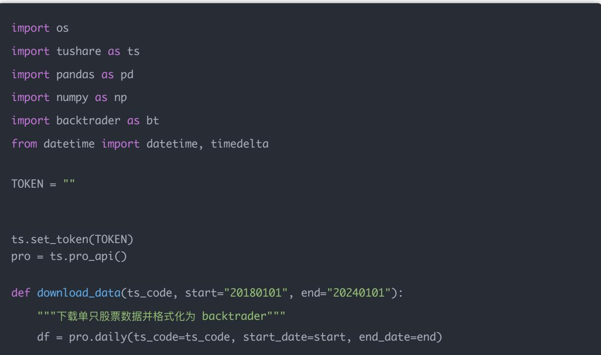
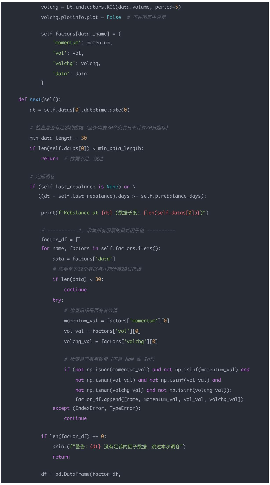
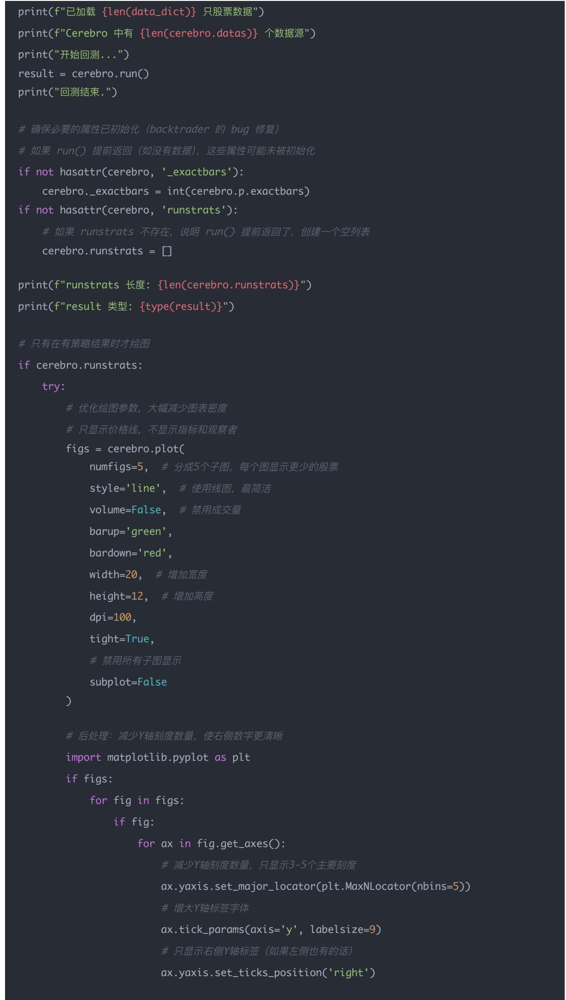
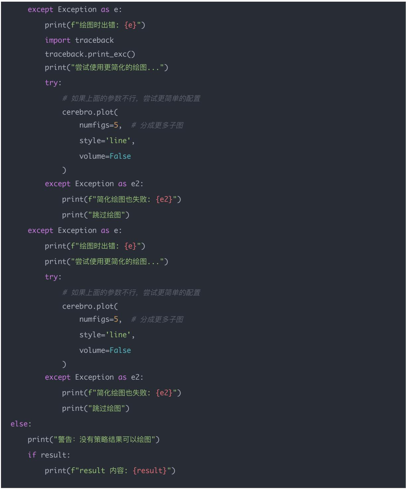

## 量化交易进阶:第56天 – 使用 Backtrader 构建多因子回测引擎（完整课程版）(进阶阶段·回测框架篇)

原创 逻辑与流 逻辑与流 2025年12月15日 00:24 北京 📞 听全文

本文系统讲解如何使用Backtrader构建完整的多因子回测引擎,将因子模型真正落地为可交易的投资组合回测系统。详细阐述Backtrader的核心结构(Data Feed、Strategy、Broker、Analyzer)和回测机制(数据加载、多品种支持、策略事件驱动)。深入解析多因子回测的完整流程:从因子信号整理、横截面排序、分组选股、多空组合构建,到手续费滑点建模、净值计算、因子IC和RankIC评估。通过完整的可运行代码示例,展示如何将深度模型(MLP、LSTM、GAT)的输出转化为可执行的交易策略。强调因子模型与策略的本质区别,揭示选股本质是横截面排序/分组/加权,滑点和手续费是回测能否接近现实的关键,多空组合收益是因子真实贡献的衡量标准。帮助读者理解为什么"模型输出只是其中一环,最终要的是每天的可交易投资组合",掌握从因子开发到策略执行的完整链路,为构建专业级多因子回测系统奠定坚实基础。

## 学习时间

- 理论学习: 20分钟

- 代码实践: 20分钟

- 案例分析: 20分钟

## 学习目标

- 总计: 60分钟

今天我们做的是——把你前面学过的因子 $\rightarrow$ 模型 $\rightarrow$ 预测 $\rightarrow$ 排序 $\rightarrow$ 组合真正落地成一个可交易的投资组合回测系统。

Backtrader是非常适合做原型的框架，你今天会学到：

1. Backtrader 的回测机制（数据、多品种、策略事件驱动）

2. 如何把多因子信号整理成股票 universe

3. 如何实现横截面排序 / 分组 / 多空组合

4. 如何加入手续费 + 滑点

5. 如何计算:

- 每日净值

- 多空组合收益

- 因子IC、RankIC

6. 一个"能跑"的多因子回测引擎原型

## 一、为什么要用 Backtrader？核心是：执行逻辑

在深入Backtrader的具体使用之前,我们需要先理解一个根本性问题:为什么需要Backtrader这样的回测框架?答案在于理解因子模型与交易策略之间的本质区别。

你之前学的是：

- 传统因子模型 = 得到一列"股票分数"

- 深度因子（MLP、GAT）= 得到向量/embedding → 得到分数

- 预测模型 = 得到未来收益预测

但模型不是一个策略。

策略 $=$

- √ 股票池

- √ 每日再平衡

- √ 多空头寸

- √ 手续费

- 滑点

- ✓ 仓位管理

- √ 净值计算

Backtrader $\rightarrow$ 正是把这些东西组合起来的工具。

## 二、Backtrader 的核心结构（你只需记这四个）

理解了为什么需要Backtrader之后,我们需要掌握它的核心架构。Backtrader的设计哲学是将回测系统拆解为四个核心部件,每个部件负责不同的功能,共同构成完整的回测引擎。

<table><tr><td>部件</td><td>作用</td></tr><tr><td>Data Feed</td><td>每支股票的日线数据(open/high/low/close/volume) + 因子列</td></tr><tr><td>Strategy</td><td>你的调仓逻辑(排序、多空建仓、平仓)</td></tr><tr><td>Broker</td><td>执行交易、手续费、滑点、持仓、现金</td></tr><tr><td>Analyzer</td><td>计算收益、夏普、回撤、净值等</td></tr></table>

你写的几行代码：

策略核心逻辑是：

1. 每日/每周触发一次再平衡

2. 对所有股票取当日因子排序

3. 做多TOP20，做空BOTTOM20

4. 按等权建仓

5. Backtrader 会自动:

- 计算成交价

- 扣掉手续费

- 扣掉滑点

- 计算持仓变化

- 计算组合净值

你只写"策略"，它帮你跑"交易系统"。

## 三、回测逻辑（核心思想）

掌握了Backtrader的核心结构之后,我们需要理解多因子回测的完整逻辑流程。这个过程将因子模型的输出转化为可执行的交易策略,是量化交易从研究到实战的关键桥梁。

## 第1步：准备数据

- 每支股票一份CSV

- 包含：

- open high low close volume 因子 future\_return

因子在 DataFrame 中可以是你模型预测的值。

## 第2步：构建因子评分（横截面）

## 每天得到一个向量：

AAPL: 0.12

TSLA: -0.21

BABA: 0.33

...

排序 $\rightarrow$ 选TOP/BOTTOM。

## 第 3 步：建组合（Backtrader Strategy）

TOP20 $\rightarrow$ 做多

BOTTOM20 → 做空

建仓方式：目标仓位 = 总资金 \* 0.4 / 20 Backtrader 自动计算成交价 + 成本。

## 第4步：得到净值曲线

输出：

- 总组合净值

- 多头净值

- 空头净值

- 多空组合收益（long-short）

## 第5步：评估因子质量

输出：

- 每日IC

- 每日RankIC

- 分层收益

- 多空组合收益（alpha 是否为正）

- 回撤 / 夏普

这是因子研究的标准流程。

## 四、完整流程图（今天你要理解的结构）

理解了回测的五个核心步骤之后,我们需要从整体视角把握多因子回测的完整流程。这个流程图展示了从数据到策略、从模型到交易的完整链路。

数据加载 → 合并因子 → Backtrader →

【Strategy：每日再平衡 → 排序 → 多空建仓 → 持仓 → 净值】 →

输出绩效(IC，RankIC，分层，组合净值)

模型输出（预测）只是其中一环，而不是最终结果。

最终你要的永远是：

一个每天的可交易投资组合

Backtrader 就是帮你把 "模型输出" → "实盘行为" 连接起来。

## 五、今天的课程重点

在深入代码实现之前,让我们先明确今天要掌握的核心要点。这些要点不仅是技术细节,更是理解多因子回测本质的关键认知。

你今天真正要掌握的只有这 5 条：

## (1) 因子模型 $\neq$ 策略

因子只是"评分工具"，不是可交易的组合。策略才是最终产物。

(2) 选股本质是：横截面排序 / 分组 / 加权

你做深度模型（MLP / LSTM / GAT）→只是得到更聪明的排序分数。

(3) 滑点 + 手续费 = 回测能否接近现实的关键

不加成本的因子 $\rightarrow 100\%$ 虚高。

(4) 多空组合收益 = 因子真实贡献

(5) Backtrader 是"交易执行器"

它不是因子开发工具。它是因子转化为组合的"交易层"。

## 六、今日思考题

掌握了核心要点之后,让我们通过思考题来深化理解。这些思考题将帮助你从不同角度理解Backtrader在多因子回测中的作用和价值。

## Q1：为什么 Backtrader 能用于多因子？关键是什么？

Backtrader 的关键在于它是"交易执行系统"

它支持：

- 多品种 DataFeed（适合股票横截面）

- 自定义因子列

- 每日事件驱动

- 自动处理持仓、成交、手续费、滑点

- 输出净值与回测分析

所以它能非常自然地承载"因子 → 排序 → 分组 → 建仓"。

## Q2：在多因子回测中，为什么必须加入滑点？

原因：

- 真实市场挂单 $\rightarrow$ 排队 $\rightarrow$ 成交

- 你不会以收盘价成交

- 大单会冲击价格

- 高频更严重

不加滑点的回测永远不可能接近真实收益。

因为：long-short = long top factor stocks - short bottom factor stocks 它：

- 自动剔除大盘涨跌影响

- 衡量"因子本身的预测能力"

- 是行业量化最常用的因子检验方式

如果多空组合长期为正 $\rightarrow$ 因子有效。

## 七、Backtrader 多因子代码完整实现版（可跑）

理解了理论框架和核心要点之后,现在让我们通过完整的代码实现来将理论转化为实践。这个完整的可运行版本将展示如何将多因子模型真正落地为可执行的回测策略。

完整可运行版 Backtrader + Tushare 多因子回测引擎——单文件版，已经通过调试可以直接运行

使用：

- Tushare Pro 下载 A 股日线

- 示例因子：

- momentum\_20

- volatility\_20

• volume\_change\_5

- 因子标准化 + 打分

- 等权买入 topN

- Backtrader 执行回测

## 完整可运行代码（single python file）

import os

import tushare as ts

import pandas as pd

import numpy as np

import backtrader as bt

from datetime import datetime, timedelta

TOKEN = ""

ts.set\_token(TOKEN)

pro = ts.pro\_api()

def download\_data(ts\_code, start="20180101", end="20240101"):

""下载单只股票数据并格式化为 backtrader"""

df = pro.daily(ts\_code=ts\_code, start\_date=start, end\_date=end)

df = df.sort\_values("trade\_date")

df.index = pd.to\_datetime(df["trade\_date"])
df["openinterest"] = 0
return df[['open", "high", "low", "close", "vol", "openinterest"]]

2. 计算多因子

def compute\_factors(df):
    df = df.copy()

# 动量（20 日收益）
df["momentum\_20"] = df["close"].pct\_change(20)

# 波动率（20 日标准差）
df["volatility\_20"] = df["close"].pct\_change().rolling(20).std()

# 成交量变化率（5 日）
df["volume\_change\_5"] = df["vol"].pct\_change(5)

return df

\# 3. Backtrader 的多因子策略

class MultiFactorStrategy(bt.Strategy):

params = dict(
    topN=5,  # 减少到5只，使持仓更集中，图表更清晰
    rebalance\_days=20,

def \_\_init\_\_(self):
    self.last\_rebalance = None
    # 为每个数据源计算因子指标
    self.factors = {}
    for data in self.datas:
    # 动量（20 日收益）
    momentum = bt.indicators.ROC(data.close, period=20)
    momentum.plotinfo.plot = False  # 不在图表中显示
    # 波动率（20 日标准差）
    returns = bt.indicators.ROC(data.close, period=1)
    returns.plotinfo.plot = False  # 不在图表中显示（这是造成 ROC(1) 子图的原因）
    vol = bt.indicators.StandardDeviation(returns, period=20)
    vol.plotinfo.plot = False  # 不在图表中显示（这是造成红色阴影的原因）
    # 成交量变化率（5 日）

volchg.plotinfo.plot = False # 不在图表中显示

self.factors[data.\_name] = {
    'momentum': momentum,
    'vol': vol,
    'volchg': volchg,
    'data': data

## }

def next(self):
    dt = self.datas[0].datetime.date(0)
# 检查是否有足够的数据（至少需要30个交易日来计算20日指标）
min\_data\_length = 30
if len(self.datas[0]) < min\_data\_length:
    return # 数据不足，跳过

## columns=["code", "momentum", "vol", "volchg"])

\# ---- 2. 标准化

df = df.set\_index("code")

\# 避免除以零和 NaN

std\_values = df.std()

mean\_values = df.mean()

if (std\_values == 0).any() or std\_values.isna().any() or mean\_values.isna().any( print(f"警告：{dt} 因子统计值无效，跳过标准化") return

df = (df - mean\_values) / std\_values

\# 再次检查标准化后的值

\# ---- 3. 综合评分（可改成线性或 ML 输出） ----

df["score"] = df["momentum"] - df["vol"] + df["volchg"]

\# ---- 4. 选出 top N ----

buy\_list = df.sort\_values("score", ascending=False).head(self.p.topN).index.toli

\# ---- 5. 卖掉不在名单里的 ----

for data, pos in self.getpositions().items():
    stock\_name = data.\_name
    if stock\_name not in buy\_list:
    self.close(data=data)

6. 等权买入

if len(buy\_list) > 0:
    cash\_each = self.broker.cash / len(buy\_list)

for code in buy\_list:

data = self.getdatabyname(code)

size = cash\_each / data.close[0]

self.order\_target\_size(data=data, target=size)

self.last\_rebalance = dt

#4. 下载一组真实股票

print("正在获取股票列表...")

\# 减少股票数量到5-6只，使图表更清晰易读

NUM\_STOCKS = 6

\# 方法1：尝试获取指数成分股（扩大日期范围）

try:

sz50 = pro.index\_weight(index\_code="000016.SH", start\_date="20200101", end\_date="2020123

if not sz50.empty:

stocks = sz50['con\_code'].unique().tolist()[:NUM\_STOCKS]

print(f"从指数权重获取到 {len(stocks)} 只股票")

else:

\# 方法2：如果指数权重为空，使用股票基本信息API获取

stock\_basic = pro.stock\_basic(exchange='', list\_status='L', fields='ts\_code')

stocks = stock\_basic['ts\_code'].head(NUM\_STOCKS).tolist()

print(f"从股票基本信息获取到 {len(stocks)} 只股票")

except Exception as e:

print(f"获取股票列表失败：{e}")

\# 方法3：使用硬编码的股票代码作为备选（减少到10只）

stocks = ['000001.SZ', '000002.SZ', '600000.SH', '600036.SH', '600519.SH',

'000858.SZ', '002415.SZ', '600887.SH', '000063.SZ', '002304.SZ']

print(f"使用默认股票列表：{len(stocks)} 只股票")

data\_dict = {}

for code in stocks:

try:

print(f"下载 {code}")

df = download\_data(code)

df = compute\_factors(df)

data\_dict[code] = df

except Exception as e:

print("跳过", code, e)

5. 加载进 Backtrader

cerebro = bt.Cerebro(

exactbars=False, # 设置为 False 以启用绘图功能

stdstats=False # 禁用默认观察者 (Broker, Trades, BuySell), 减少图表混乱

cerebro.broker.setcash(1\_000\_000)

for code, df in data\_dict.items():

btfeed = bt.feeds.PandasData(

dataname=df,

fromdate=datetime(2020, 1, 1),

todate=datetime(2024, 1, 1)

cerebro.adddata(btfeed, name=code)

cerebro.addstrategy(MultiFactorStrategy)

cerebro.addsizer(bt.sizers.FixedSize, stake=0)

except Exception as e:
    print(f"绘图时出错：{e}")
    import traceback
    traceback.print\_exc()
    print("尝试使用更简化的绘图...")
    try:
    # 如果上面的参数不行，尝试更简单的配置
    cerebro.plot(
    numfigs=5,  # 分成更多子图
    style='line',
    volume=False
    )
    except Exception as e2:
    print(f"简化绘图也失败：{e2}")
    print("跳过绘图")
except Exception as e:
    print(f"绘图时出错：{e}")
    print("尝试使用更简化的绘图...")
    try:
    # 如果上面的参数不行，尝试更简单的配置
    cerebro.plot(
    numfigs=5,  # 分成更多子图
    style='line',
    volume=False
    )
    except Exception as e2:
    print(f"简化绘图也失败：{e2}")
    print("跳过绘图")
else:
    print("警告：没有策略结果可以绘图")
    if result:
    print(f"result 内容：{result}")

## 图表解读

- 横轴：时间（2020-2024）

- 纵轴：价格（每只股票独立刻度）

- 线条：收盘价走势

## 观察要点：

1. 趋势方向：上升、下降或震荡

2. 波动幅度：线条的平滑程度

3. 相对表现：不同股票在同一时期的走势对比

## 策略在图表上的体现

- 每20个交易日调仓一次

- 持有评分最高的5只股票

- 等权重配置

## 图表意义：

- 展示策略覆盖的股票池

- 显示价格走势，辅助理解策略表现

- 帮助识别策略可能买入的股票

## 策略逻辑总结

1. 因子计算：动量、波动率、成交量变化

### 2. 因子标准化：消除量纲

3. 综合评分：score = 动量 - 波动率 + 成交量变化

4. 选股：选择评分最高的5只

5. 调仓：每20个交易日重新选股并调仓

策略理念：追求高动量、低波动、成交量上升的股票，通过定期调仓捕捉市场机会。

## 结论

## 多因子回测的本质：从模型输出到可交易组合

今天我们完成了从因子模型到可交易策略的完整落地。这不仅仅是技术实现的提升,更是量化交易从研究到实战的根本性转变。

## 核心认知转变:

- 因子模型: 关注预测准确性, 输出股票评分或收益预测

- 交易策略: 关注可执行性,必须考虑持仓、调仓、成本、风险

这个转变的本质是：模型输出只是其中一环,最终要的是每天的可交易投资组合。只有通过Backtrader这样的回测框架,才能真正将因子模型的输出转化为可执行的交易策略。

## Backtrader的核心价值：交易执行系统

我们深入理解了Backtrader的四大核心部件:

## Data Feed (数据源)

- 支持多品种数据加载

- 可以包含自定义因子列

- 为横截面分析提供数据基础

## Strategy（策略）

- 实现调仓逻辑的核心

- 支持横截面排序、分组、多空组合

- 事件驱动的回测机制

## Broker（经纪商）

- 自动处理交易执行

- 计算成交价、手续费、滑点

- 管理持仓和现金

## Analyzer（分析器）

- 计算收益、夏普、回撤

- 输出净值曲线

- 评估策略绩效

核心洞察: Backtrader不是因子开发工具,而是因子转化为组合的"交易层"。它让你专注于策略逻辑,而将交易执行的复杂性交给框架处理。

## 多因子回测的完整流程

我们系统梳理了多因子回测的五个核心步骤:

## 第1步：准备数据

- 每支股票的日线数据

- 包含因子列和未来收益

- 因子可以是模型预测值

## 第2步：构建因子评分（横截面）

- 每天对所有股票计算因子值

- 得到横截面排序向量

- 这是选股的基础

## 第3步：建组合（Backtrader Strategy）

- 根据排序选择TOP和BOTTOM股票

- 构建多空组合

- 按等权或其他方式建仓

## 第4步：得到净值曲线

- 总组合净值

- 多头和空头净值

- 多空组合收益（long-short）

## 第5步：评估因子质量

- 每日IC和RankIC

- 分层收益分析

- 多空组合收益（alpha）

- 回撤和夏普比率

这是因子研究的标准流程,也是量化交易从研究到实战的必经之路。

## 因子模型与策略的本质区别

我们明确了因子模型与交易策略的根本区别:

## 因子模型的特点:

- 输出股票评分或收益预测

- 关注预测准确性

- 不考虑交易执行

## 交易策略的特点:

- 需要股票池管理

- 需要每日再平衡机制

- 需要多空头寸管理

- 必须考虑手续费和滑点

- 需要仓位管理和风险控制

- 必须计算净值曲线

核心要点: 因子只是"评分工具",不是可交易的组合。策略才是最终产物。你做深度模型（MLP、LSTM、GAT）只是得到更聪明的排序分数,但排序分数本身不是策略。

## 选股的本质：横截面排序/分组/加权

我们揭示了选股的本质:

## 选股的核心操作:

- 横截面排序：每天对所有股票按因子值排序

- 分组：将排序后的股票分成不同组别（如TOP20、BOTTOM20）

- 加权：决定每只股票的权重（等权、市值加权、因子加权等）

## 深度模型的作用:

- MLP、LSTM、GAT等模型只是得到更聪明的排序分数

- 它们可以捕捉非线性关系和时序特征

- 但最终还是要转化为排序、分组、加权

核心认知: 无论使用什么模型,选股的本质都是横截面排序、分组、加权。模型只是让排序更准确,但排序本身的操作逻辑是不变的。

## 滑点和手续费：回测能否接近现实的关键

我们强调了交易成本的重要性:

滑点的必要性:

- 真实市场挂单 $\rightarrow$ 排队 $\rightarrow$ 成交

- 不会以收盘价成交

- 大单会冲击价格

## - 高频交易中滑点更严重

## 手续费的重要性:

- 买卖双边手续费

- 印花税（卖出时）

- 对高频策略影响巨大

核心洞察: 不加成本的因子回测结果100%虚高。滑点和手续费是回测能否接近现实的关键。只有加入真实的交易成本,回测结果才有参考价值。

## 多空组合收益：因子真实贡献的衡量标准

我们深入分析了多空组合收益的价值:

多空组合的定义:long-short = long top factor stocks - short bottom factor stocks

## 多空组合的优势:

- 自动剔除大盘涨跌影响

- 衡量"因子本身的预测能力"

- 是行业量化最常用的因子检验方式

判断标准:如果多空组合长期为正 $\rightarrow$ 因子有效

核心价值: 多空组合收益是判断因子效果最强的指标,因为它直接衡量了因子本身的预测能力,而不受市场整体涨跌的影响。

## Backtrader在多因子回测中的优势

我们分析了为什么Backtrader适合多因子回测:

Backtrader的关键特性:

- 多品种DataFeed（适合股票横截面）

- 自定义因子列支持

- 每日事件驱动机制

- 自动处理持仓、成交、手续费、滑点

- 输出净值与回测分析

自然承载的流程:因子 → 排序 → 分组 → 建仓

核心优势: Backtrader能非常自然地承载"因子 → 排序 → 分组 → 建仓"的完整流程,让开发者专注于策略逻辑,而不需要处理交易执行的细节。

我们提供了完整的可运行代码示例,展示了:

## 数据准备:

- 使用Tushare Pro下载A股日线数据

- 计算多因子（动量、波动率、成交量变化）

- 格式化数据供Backtrader使用

## 策略实现:

- MultiFactorStrategy类实现多因子策略

- 横截面排序和选股逻辑

- 定期再平衡机制

- 等权重建仓

## 回测执行:

- 多股票数据加载

- 策略运行和交易执行

- 结果可视化和分析

代码价值: 这个完整的代码示例展示了如何将理论转化为实践, 是学习多因子回测的最佳起点。

## 技术实现能力提升

通过本文的学习,我们掌握了:

## 概念理解能力:

- 深刻理解因子模型与策略的本质区别

- 理解选股的本质是横截面排序/分组/加权

- 掌握多因子回测的完整流程

## 系统设计能力:

- 理解Backtrader的核心架构和设计哲学

- 掌握多因子回测的系统设计方法

- 了解如何将模型输出转化为交易策略

## 代码实现能力:

- 能够使用Backtrader构建多因子回测系统

- 实现横截面排序和分组选股

- 加入手续费和滑点建模

- 计算IC、RankIC等因子评估指标

## 实战应用能力:

- 能够将深度模型的输出转化为可执行策略

- 理解回测结果的含义和价值

- 掌握评估因子质量的方法

## 关键学习要点总结

1. 理论层面: 深刻理解因子模型与策略的本质区别, 掌握多因子回测的完整流程和核心要点

2. 分析层面: 理解选股的本质是横截面排序/分组/加权, 掌握多空组合收益的价值

3. 技术层面: 掌握Backtrader的核心架构和使用方法,能够构建完整的多因子回测系统

4. 应用层面: 能够将模型输出转化为可执行策略, 理解回测结果的含义

5. 思维层面: 从"模型输出"思维升级到"可交易组合"思维,理解策略执行的重要性

## 实践建议

## 立即行动:

1. 运行提供的完整代码示例,理解多因子回测的执行过程

2. 尝试修改因子计算逻辑,使用自己开发的因子

3. 调整策略参数（topN、rebalance\_days），观察对结果的影响

## 深入研究:

1. 学习如何将深度模型（MLP、LSTM、GAT）的输出集成到Backtrader策略中

2. 研究更复杂的仓位管理方法（市值加权、风险平价等）

3. 探索如何计算IC、RankIC等因子评估指标

## 持续优化:

1. 关注Backtrader的高级功能（自定义Analyzer、自定义Broker等）

2. 学习其他回测框架（Zipline、QuantConnect等）的优缺点

3. 理解实盘交易与回测的差异,为实盘部署做准备

## 最后的提醒

在使用Backtrader构建多因子回测系统时,请始终记住:

1. 因子模型≠策略: 因子只是评分工具, 策略才是最终产物

2. 选股本质: 无论使用什么模型,选股的本质都是横截面排序/分组/加权

3. 交易成本: 滑点和手续费是回测能否接近现实的关键, 必须加入

4. 多空组合: 多空组合收益是判断因子效果最强的指标

5. Backtrader定位: Backtrader是"交易执行器", 不是因子开发工具

## 一句话总结:

模型输出只是其中一环,最终要的是每天的可交易投资组合。Backtrader就是帮你把"模型输出"→"实盘行为"连接起来的工具。只有深刻理解因子模型与策略的本质区别,掌握多因子回测的完整流程,才能构建真正有效的量化交易系统。从"因子开发"到"策略执行",这是量化交易从研究到实战的根本性跃迁。

## 量化交易入门指南·目录

## <上一篇

量化交易进阶:第55天－高频回测原理（Tick 数据&分钟级回测框架）（进阶阶段·高频框...

## 阅读138

广告

白雪吞没城市，火炉

还在燃烧，你能带大

家撑到天亮吗？

点击了解更多>

## 下一篇>

量化交易进阶:第57天－交易撮合逻辑（模拟订单撮合·部分成交·延迟建模）（进阶阶段…

白雪吞没城市，火炉还在燃烧，你能带大家撑到天亮吗？

无尽冬日-3亿玩家推荐

$\mathcal{S}$ 进入小游戏
