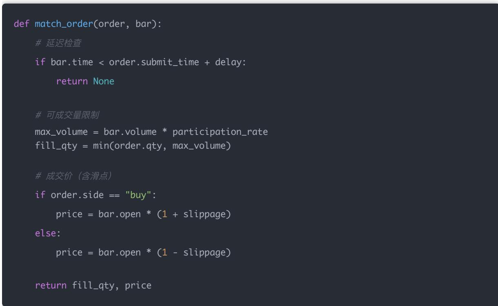

## 量化交易进阶:第57天 - 交易撮合逻辑（模拟订单撮合·部分成交·延迟建模）(进阶阶段·回测框架篇)

原创 逻辑与流 逻辑与流 2025年12月 16 日 23:11 北京 听全文

本文系统讲解交易撮合逻辑的核心原理与技术实现,深入剖析模拟订单撮合 部分成交 延迟建模等关键概念 详细阐述撮合系统(Matching Engine)的本质是将交易意图转化为现实中可能发生的成交结果,揭示普通回测的虚假假设(用收盘价全仓买入 无延迟 无滑点 想买多少买多少 不存在排队) 系统解析撮合系统的三大核心模块(订单Order 市场Market 撮合规则Matching Rule),深入讲解Bar级撮合模型 滑点(Slippage)建模(固定比例滑点 成交量相关滑点) 部分成交(Partial Fill)的成因与建模方式 延迟(Latency)建模的四种来源(信号计算 下单 交易所 撮合) 通过完整的撮合伪代码示例,展示如何将延迟 滑点 部分成交组合成完整的撮合流程 强调撮合逻辑是打破理想化假设的关键,80%看起来赚钱的策略在加入真实撮合后都会失效,交易撮合是把策略拉回现实的最后一道门槛 帮助读者理解为什么"撮合=把你的交易意图,变成现实中可能发生的成交结果",掌握从理想化回测到真实交易执行的完整链路,为构建专业级回测系统奠定坚实基础<sub>。</sub>

## 学习时间

理论学习: 25分钟

概念理解: 20分钟

## 学习目标

代码实践: 15分钟

总计: 60分钟

今天我们要掌握的是—— 将你的"交易意图"转化为"现实中可能发生的成交结果"

撮合逻辑是回测系统中最容易被忽视但最关键的环节,你今天会学到：

1. 什么是撮合系统,为什么普通回测是"假"的

2. 撮合系统的三大核心模块(订单 市场 撮合规则)

3. 最基础的Bar级撮合模型

4. 滑点(Slippage)的建模方法

5. 部分成交(Partial Fill)的成因与实现

6. 延迟(Latency)的四种来源与建模方式

7. 完整的撮合流程实现

## 一句话总结

撮合 = 把你的"交易意图"，变成"现实中可能发生的成交结果"

## 一、什么是「撮合」？（核心概念）

在深入撮合系统的技术细节之前,我们需要先理解撮合的本质 撮合不是简单的"下单即成交",而是将交易意图转化为真实市场环境下的成交结果

在真实市场中：

你不是"发了买入就一定成交"

你面对的是：

价格队列

成交量限制

时间延迟

对手盘不足

撮合系统（Matching Engine）就是在模拟：

如果我在这个时间 用这个价格 下这个量的单，市场会怎么回应我？

## 二、为什么普通回测是"假"的？

理解了撮合的本质后,我们需要认识到普通回测与真实交易的巨大差距 这种差距不是技术细节的差异,而是根本假设的不同

## 很多初学回测，隐含了这些不现实假设：

<table><tr><td>假设</td><td>问题</td></tr><tr><td>用收盘价全仓买入</td><td>实际不可能</td></tr><tr><td>无延迟</td><td>实盘一定有延迟</td></tr><tr><td>无滑点</td><td>大资金必然有</td></tr><tr><td>想买多少买多少</td><td>流动性约束</td></tr><tr><td>不存在排队</td><td>现实中你在队尾</td></tr></table>

撮合逻辑，就是把这些假设一个一个打破

## 三、撮合系统的 3 个核心模块

理解了普通回测的问题后,我们需要掌握撮合系统的核心架构 撮合系统由三个相互关联的模块组成,每个模块都直接影响最终的成交结果

## 1 订单（Order）

一笔订单至少包含：

方向：买 / 卖

类型：市价 / 限价

价格

数量

时间戳

## 2 市场（Market）

撮合系统只"看得到"你允许它看到的市场信息：

K 线（最粗糙）

Bar（OHLCV）

Level-1（盘口最优价）

Level-2（五档 / 十档）

你用什么数据，决定你撮合能做到多真实

## 3 撮合规则（Matching Rule）

决定：

能不能成交

成交多少

成交价格是多少

## 四、最基础的撮合模型（教学必备）

掌握了撮合系统的三大模块后,我们需要从最简单的模型开始理解撮合逻辑 Bar级撮合是最基础的模型虽然简单,但它是理解更复杂撮合系统的基础

## 模型 1：Bar 级撮合（入门）

假设：

使用 日线 / 分钟线

买单在下一根 bar 的开盘价成交

信号在 t 成交在 t+1 的 Open

优点：简单 稳定

缺点：严重理想化

示例逻辑

```python
if signal == 1:
    fill_price = next_bar_open * (1 + slippage)
```

## 五、滑点（Slippage）建模

理解了基础撮合模型后,我们需要引入第一个现实因素——滑点 滑点是真实交易中不可避免的成本,也是区分理想化回测与真实回测的关键指标

## 1 什么是滑点？

你想成交的价格 ≠ 实际成交价格

原因：

流动性不足

排队靠后

市场冲击

## 2 常见滑点模型

（1）固定比例滑点（教学用）

$$
\text { fill\_price } = \text { price } * (1 + 0. 0 0 1)
$$

（2）成交量相关滑点（进阶）

滑点 ∝ 下单量 / 当期成交量

## 六、部分成交（Partial Fill）

理解了滑点之后,我们需要面对另一个现实问题——部分成交 在真实市场中,你很少能一次性成交全部订单,部分成交是常态而非例外

## 为什么会发生？

你想买 10 万股

当前 bar 成交量只有 3 万

或盘口可吃的量不足

简化建模方式

常见 participation\_rate = 5% \~ 20%

## 示例

当期成交量：1,000,000

参与率：10%

最多成交：100,000

## 七、延迟（Latency）建模（极其重要）

理解了部分成交后,我们需要引入最后一个关键因素——延迟 延迟是高频交易中的生死线,也是中低频策略中容易被忽视但影响巨大的因素

## 延迟来自哪里？

<table><tr><td>来源</td><td>说明</td></tr><tr><td>信号计算</td><td>因子计算时间</td></tr><tr><td>下单</td><td>网络 / API</td></tr><tr><td>交易所</td><td>排队</td></tr><tr><td>撮合</td><td>撮合周期</td></tr></table>

## 回测中的延迟建模

简化方式（教学推荐）

信号产生在 t 下单在 t + delay\_bar

例如：

日 线：delay = 1 天

分钟线：delay = 1\~3 分钟

## 八、把这些组合起来：一个"像样"的撮合流程

掌握了延迟 滑点 部分成交这三个核心要素后,我们需要将它们组合成一个完整的撮合流程 这个流程将模拟真实交易中订单的完整生命周期

1. 生成信号2. 等待延迟3. 创建订单4. 判断是否可成交5. 计算可成交数量（部分成交）6. 计算成交价（含滑点）7. 更新持仓 & 现金

## 九、一个教学级「撮合伪代码

理解了完整的撮合流程后,让我们通过代码来具体实现这个流程 这个教学级的伪代码展示了如何将理论转化为可执行的逻辑



## 十、为什么这节课非常关键？

掌握了撮合逻辑的实现方法后,我们需要理解为什么这节课如此重要 撮合逻辑不是可选的优化,而是回测系统真实性的基础

因为：

80% 看起来"赚钱"的策略在加入真实撮合后都会死掉

你现在已经在做：

✔ 因子研究

✔ 信号系统

✔ Paper Trading

## 十一、你现在处在什么水平？

理解了撮合逻辑的重要性后,让我们评估一下自 己的水平 掌握撮合逻辑是区分专业回测与业余回测的分水岭<sub>。</sub>

## 如果你能理解并实现：

延迟

滑点

部分成交

## 你已经超过 90% 的"伪量化回测"

结论

## 交易撮合的本质：从交易意图到成交结果

今天我们完成了从理想化回测到真实交易执行的思维转变 这不仅仅是技术实现的提升,更是量化交易从研究到实战的根本性认知升级<sub>。</sub>[[memory:2816591]]

## 核心认知转变:

理想化回测: 假设可以按理想价格立即成交全部订单,忽略市场现实

真实撮合: 必须考虑延迟 滑点 部分成交 价格队列等现实约束

这个转变的本质是：撮合=把你的交易意图,变成现实中可能发生的成交结果 只有通过撮合系统,才能真正模拟真实市场环境下的交易执行过程

## 普通回测的虚假假设

我们系统揭示了普通回测中隐含的五大致命假设:

① 用收盘价全仓买入

实际不可能按收盘价成交

大单必然冲击价格

## ② 无延迟

实盘一定有信号计算 下单 交易所 撮合的延迟

延迟直接影响成交价格和机会

## ③ 无滑点

大资金必然产生滑点

滑点是真实交易成本的重要组成部分

## ④ 想买多少买多少

受流动性约束

必须考虑市场深度和成交量限制

## ⑤ 不存在排队

现实中你在队尾

队列位置决定能否成交

核心洞察: 撮合逻辑就是把这些假设一个一个打破,让回测结果接近真实交易

## 撮合系统的三大核心模块

我们深入理解了撮合系统的核心架构:

## ① 订单（Order）

包含方向 类型 价格 数量 时间戳

是撮合系统的输入

## ② 市场（Market）

撮合系统只能看到你允许它看到的市场信息

从K线到Level-2,数据粒度决定撮合真实性

## ③ 撮合规则（Matching Rule）

决定能不能成交 成交多少 成交价格

是撮合系统的核心逻辑

核心要点: 你用什么数据,决定你撮合能做到多真实 撮合规则的质量直接决定了回测结果的可靠性

## Bar级撮合：最基础的模型

我们学习了最基础的撮合模型:

## 模型特点:

使用 日线/分钟线数据

买单在下一根bar的开盘价成交

信号在t,成交在t+1的Open

优点: 简单 稳定,适合教学和理解

缺点: 严重理想化,无法模拟真实市场微观结构

核心价值: Bar级撮合是理解更复杂撮合系统的基础,虽然简单,但包含了撮合的核心思想

## 滑点建模：真实交易成本的关键

我们深入分析了滑点的成因和建模方法:

## 滑点的本质:

你想成交的价格 ≠ 实际成交价格

由流动性不足 排队靠后 市场冲击导致

常见滑点模型:

① 固定比例滑点（教学用）

简单易用,适合初步建模

$$
\bullet \quad f i l l \_ p r i c e = p r i c e * (1 + 0. 0 0 1)
$$

## ② 成交量相关滑点（进阶）

更接近真实情况

滑点 ∝ 下单量 / 当期成交量

核心洞察: 滑点是区分理想化回测与真实回测的关键指标,大资金必然产生滑点,忽略滑点的回测结果会被 严重高估<sub>。</sub>

## 部分成交：流动性约束的现实

我们理解了部分成交的成因和建模方式:

为什么会发生部分成交:

你想买10万股,但当前bar成交量只有3万

盘口可吃的量不足

流动性限制

## 建模方式:

max\_fill = bar\_volume \* participation\_rate

filled = min(order\_size, max\_fill)

常见参与率: 5% \~ 20%

核心价值: 部分成交是真实市场的常态,忽略部分成交会导致仓位管理 错误和风险敞口扩大

延迟建模：时间维度的现实约束

我们系统分析了延迟的四种来源:

## ① 信号计算延迟

因子计算需要时间

复杂模型计算时间更长

## ② 下单延迟

网络传输延迟

API调用延迟

## ③ 交易所延迟

订单排队时间

交易所处理时间

## ④ 撮合延迟

撮合周期

订单簿更新延迟

## 回测中的简化建模:

信号产生在t,下单在t + delay\_bar

日 线: delay = 1天

分钟线: delay = 1\~3分钟

核心洞察: 延迟是高频交易中的生死线,也是中低频策略中容易被忽视但影响巨大的因素 延迟直接影响成交价格和交易机会

## 完整的撮合流程

## 我们掌握了单笔交易的完整生命周期:

## 7个关键步骤:

1. 生成信号

2. 等待延迟

3. 创建订单

4. 判断是否可成交

5. 计算可成交数量（部分成交）

6. 计算成交价（含滑点）

7. 更新持仓 & 现金

核心价值: 只有将这7个步骤完整实现,才能模拟真实交易中的订单执行过程

## 撮合伪代码的实现价值

我们提供了教学级的撮合伪代码,展示了:

## 延迟检查:

判断订单是否已经过了延迟期

未到延迟期则返回None

## 可成交量限制:

根据bar成交量和参与率计算最大可成交量

取订单数量和最大可成交量的最小值

## 成交价计算:

买入: $p r i c e \ = \ \mathsf { b a r . o p e n ~ \mu ^ * ~ ( 1 ~ + ~ \mathsf { s l i p p a g e } ) }$

卖出: $p r i c e \ = \ \mathsf { b a r . o p e n ~ ^ { \ast } ~ ( 1 ~ - ~ \mathsf { s l i p p a g e } ) }$

代码价值: 这个伪代码展示了如何将延迟 滑点 部分成交组合成完整的撮合逻辑,是理解撮合系统的关键<sub>。</sub>

## 撮合逻辑的关键重要性

我们深刻理解了为什么撮合逻辑如此关键:

## 核心数据:

80%看起来"赚钱"的策略在加入真实撮合后都会死掉

## 原因分析:

理想化回测忽略了真实交易成本

滑点和延迟会大幅侵蚀策略收益

部分成交导致仓位管理错误

流动性约束限制了策略规模

核心认知: 交易撮合=把你拉回现实的最后一道门槛 只有通过撮合系统,才能真正评估策略在真实市场中的表现

## 技术实现能力提升

通过本文的学习,我们掌握了:

## 概念理解能力:

深刻理解撮合系统的本质和作用

理解普通回测的虚假假设

掌握延迟 滑点 部分成交的核心概念

## 系统设计能力:

理解撮合系统的三大核心模块

掌握Bar级撮合模型的设计思路

了解如何将延迟 滑点 部分成交组合成完整流程

## 代码实现能力:

能够实现基础的撮合逻辑

理解撮合伪代码的实现细节

掌握滑点和部分成交的建模方法

## 实战应用能力:

能够识别回测系统中的虚假假设

理解为什么某些策略在实盘中失效

掌握提升回测真实性的方法

## 关键学习要点总结

1. 理论层面: 深刻理解撮合系统的本质,掌握延迟 滑点 部分成交的核心概念

2. 分析层面: 理解普通回测的虚假假设,掌握撮合系统的三大核心模块

3. 技术层面: 掌握Bar级撮合模型和滑点建模方法,理解完整的撮合流程

4. 应用层面: 能够实现基础的撮合逻辑,理解撮合对策略评估的重要性

5. 思维层面: 从"理想化回测"思维升级到"真实交易执行"思维,理解撮合是回测真实性的基础

## 实践建议

## 立即行动:

1. 分析自 己现有回测系统中的虚假假设

2. 尝试实现基础的撮合逻辑（延迟 滑点 部分成交）

3. 对比加入撮合前后的回测结果差异

## 深入研究:

1. 学习更高级的撮合模型（Tick级撮合 订单簿模拟）

2. 研究不同市场环境下的滑点特征

3. 探索延迟优化的方法和技术

## 持续优化:

1. 关注撮合系统的最新研究和技术进展

2. 学习专业交易系统的撮合实现方式

3. 理解不同市场（A股 美股 期货）的撮合特点


在实现撮合逻辑时,请始终记住:

1. 撮合不是可选的: 撮合逻辑是回测系统真实性的基础,不是可选的优化

2. 数据决定真实性: 你用什么数据（K线 Bar Level-1 Level-2）,决定你撮合能做到多真实

3. 成本不能忽略: 滑点和延迟是真实交易成本,忽略它们会导致回测结果严重高估

4. 流动性是约束: 部分成交是真实市场的常态,必须考虑流动性约束

## 一句话总结:

撮合=把你的交易意图,变成现实中可能发生的成交结果 只有深刻理解撮合系统的本质,掌握延迟 滑点 部分成交的建模方法,才能构建真正有效的回测系统 80%看起来"赚钱"的策略在加入真实撮合后都会失效,交易撮合是把策略拉回现实的最后一道门槛 从"理想化回测"到"真实交易执行",这是量化交易从研究到实战的根本性跃迁

## 量化交易入门指南 · 目录

上一篇

量化交易进阶:第56天 - 使用 Backtrader 构建多因子回测引擎（完整课程版）(进阶阶段

下一篇

量化交易进阶:第58天 - 滑点建模（SlippageModeling）(进阶阶段·回测框架篇)

阅读 89

广告


白雪吞没城市，火炉

还在燃烧，你能带大

家撑到天亮吗？


点击了解更多

白雪吞没城市，火炉还在燃烧，你能带大家撑到天亮吗？


无尽冬日-3亿玩家推荐

进入小游戏
