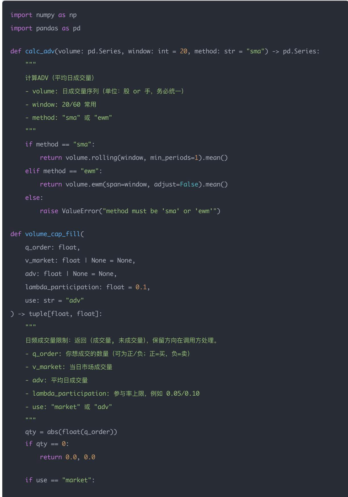
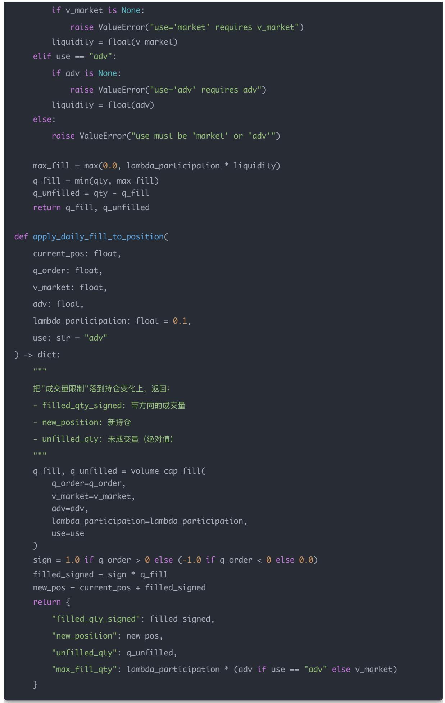
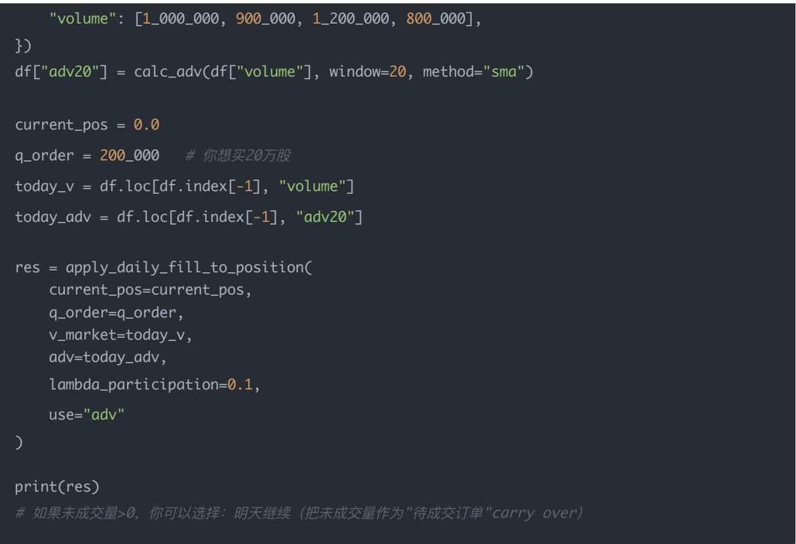
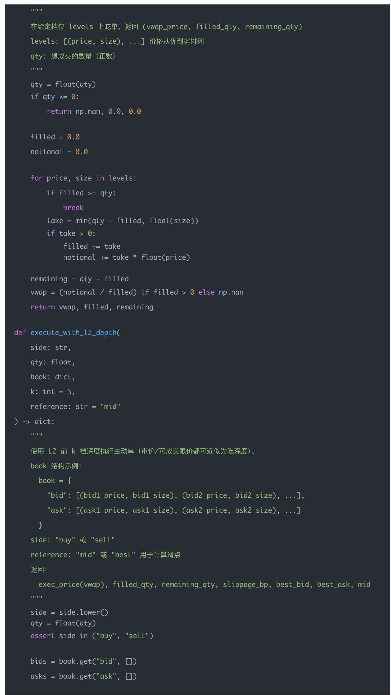
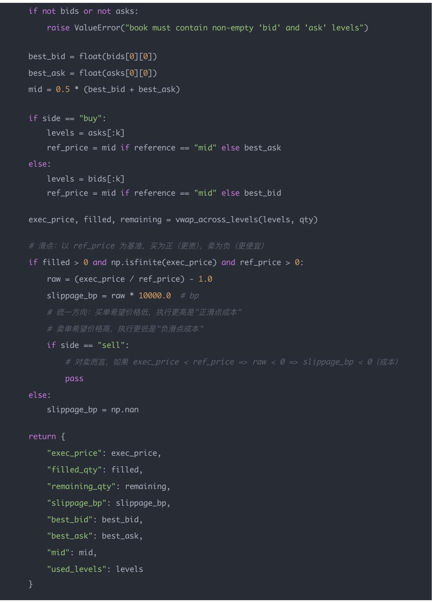

# 量化交易进阶:第59天 - 成交量限制——加入流动性约束（不能全额成交）(进阶阶段·回测框架篇)

原创 逻辑与流 逻辑与流 2026年1月 10 日 22:31 北京 听全文

本文系统讲解成交量限制的核心原理与技术实现,深入剖析流动性约束的本质与建模方法 详细阐述成交量限制(Liquidity Constraint)的定义(市场每天能成交的量是有限的,不能假设100%成交),揭示忽略成交量限制等于回测收益严重高估的核心问题 系统解析三种常见的成交量约束模型(固定比例模型 基于ADV的平均成交量模型 盘口深度模型),深入讲解每种模型的公式 参数含义 适用场景和优缺点,强调模型1/2解决的是规模与容量(Capacity),模型3解决的是执行与价格(Execution & Price) 通过完整的Python代码示例,展示日频容量版本(ADV/参与率约束成交量)和分钟/L2执行版本(前k档深度→跨档VWAP成交价)的实现方法,详细说明如何在Backtrader中集成成交量限制 强调成交量限制不是优化项而是生存条件,一个无法成交的Alpha等价于不存在,绝大多数Alpha不是不赚钱而是赚不到规模,成交量限制是规模扩张的天花板帮助读者理解为什么"成交量限制不是优化项,而是生存条件",掌握从理想化成交假设到真实流动性约束的完整链路,为构建专业级回测系统奠定坚实基础<sub>。</sub>

## 学习时间

理论学习: 30分钟

概念理解: 25分钟

## 学习目标

代码实践: 20分钟

总计: 75分钟

你今天要解决一个非常现实 但很多量化回测忽略的问题：

"我想买这么多，但市场根本接不住 "

具体你将学会：

1. 为什么回测中不能假设100%成交

2. 成交量限制（Liquidity Constraint）是什么

3. 常见的成交量约束模型

4. 如何把成交量限制加入回测/Backtrader

5. 如何判断策略是否被"流动性扼杀"

## 一句话总结

成交量限制不是优化项，而是生存条件 一个无法成交的Alpha，等价于不存在

## 一 为什么必须考虑成交量限制？

在深入成交量限制的技术细节之前,我们需要先理解为什么成交量限制如此重要 成交量限制不是可选的优化,而是决定策略能否在真实市场中生存的关键约束

你之前的回测默认逻辑是：

下单多少 → 成交多少（理想化）

但真实市场中：

市场每天能成交的量是有限的

你不能成为"当天最大的买家"

大单会引发：

冲击成本

对手盘撤单

价格跳变

成交不完全

## 忽略成交量限制 = 回测收益严重高估

## 二 成交量限制的三种常见模型

理解了成交量限制的重要性后,我们需要掌握具体的建模方法 成交量限制有多种建模方式,每种方式适用于不同的场景和频率 下面我们将系统介绍三种最常见的模型

## 模型1：固定比例模型（最常用）

$$
Q _ {f i l l} = \min (Q _ {o r d e r}, \lambda \cdot V _ {m a r k e t})
$$

简单

稳健

日频/多因子回测标配

机构常用λ=5%-10%

## 模型2：基于ADV（平均成交量）

$$
Q _ {f i l l} = \min (Q _ {\text { order }}, \lambda \cdot A D V)
$$

更平滑

适合低频策略

避免极端日波动误导

若有L1/L2：

$$
Q _ {f i l l} \leq \sum_ {i = 1} ^ {k} V _ {a s k _ {i}}
$$

只能成交到前k档

剩余挂单进入队列

高频/Tick必须用

## 三 三种模型的深入解析

掌握了三种模型的基本公式后,我们需要深入理解每种模型的细节 下面把三种"成交量/流动性约束模型"再讲得更细致：不仅解释公式,还把公司里（真实量化团队）每一项参数怎么理解 怎么取 怎么落地都说明白

## 先统一：这些符号到底代表什么？

在深入每个模型之前,我们需要先统一符号的含义 这些符号是理解成交量限制模型的基础,也是你在实际工作中与团队沟通的共同语言

$^ { * * } Q _ { o r d e r } { } ^ { * * } ,$ ：你这次"想成交"的数量（shares/手/股）

来自策略的目标仓位变化：

$$
Q _ {o r d e r} = Q _ {t a r g e t} - Q _ {c u r r e n t}
$$

$^ { * * } Q _ { f i l l } { } ^ { * * } \colon$ 这次"实际能成交"的数量（受到流动性限制）

$* * V _ { m a r k e t } *$ \*：市场在该时间段内的真实成交量（volume）

日频就是当天成交量；分钟频就是该分钟成交量；tick则是更细粒度

ADV（Average Daily Volume）：过去一段时间（ 日 频常用20/60 日 ）的平均 日 成交量

$$
A D V = \frac {1}{N} \sum_ {t = 1} ^ {N} V _ {\text {market}, t}
$$

$* * \lambda * * \cdot$ 你允许 自 己"吃掉市场成交量的比例"（participation rate / participation cap）

也叫参与率上限,例如5%–10%

$^ { * * } V _ { a s k _ { i } } { } ^ { * * }$ ：卖盘第i档挂单量 $( \mathsf { a s k \thinspace s i z e } )$

$^ { * * } k ^ { * * } \colon$ 你允许"扫到第几档"（可理解为最大吃单深度）

这些东西在公司里通常属于Execution / Trading / Quant Research交叉的"交易可执行性建模"<sub>。</sub>

$$
Q _ {f i l l} = \min (Q _ {o r d e r}, \lambda \cdot V _ {m a r k e t})
$$

每一项在公司里是什么意思？

$Q _ { o r d e r }$ （策略想成交量）

组合管理（PM）给的目标：今天要买入/卖出多少

$V _ { m a r k e t }$ （市场可供"消化"的成交量）

用当天真实成交量（回测中是历史值）

日内策略可能用"当前分钟成交量"或"到目前为止累计成交量"

（你能占用市场的比例）

公司里常叫：Participation Rate

含义：你不希望自 己的订单成为市场的"主导力量",避免冲击过大 引起对手盘撤单 暴露意图

为什么"日频/多因子"常用它？

因为日频回测通常没有盘口（L2）,最靠谱的可执行性近似就是：

我最多吃掉当天成交量的某个比例

在公司里怎么取？

常见的取法（经验规则）：

大盘蓝筹： ～ （流动性好）

中小盘： ～

很小市值/次新：更低甚至直接剔除

有的团队会"分层设 "：

按ADV分桶：ADV越大, 越高

或按行业/成交额分层

## 它的优缺点

优点：简单 稳健 能立刻给"容量上限"直觉

缺点：

用当天成交量会受到"极端放量/缩量日"误导

不区分主动吃单vs被动挂单

不区分日内成交分布（上午成交多,尾盘成交多）

2) 模型2：基于ADV的模型（更像"机构版本"）

公式

$$
Q _ {f i l l} = \min (Q _ {o r d e r}, \lambda \cdot A D V)
$$

## 每一项代表什么？

ADV是你对"这只股票长期可交易性"的估计

公司里用于：容量评估（Capacity） 交易预算（Trade Budget）

\*\* \*\*同样是参与率上限,但这里更像是"长期参与率",不被某一天的放量干扰

为什么它更平滑 更适合低频？

因为日频的成交量噪声非常大：

财报/利好放量

恐慌缩量

停牌复牌异常量

ADV相当于对成交量做了低通滤波,你得到的是"稳定的可成交能力"

公司里ADV怎么算？

常见窗口：

20日ADV：短期 反应快（适合短周期策略）

60日ADV：更稳健（多因子 机构常用）

带权重的EWMAADV：最近更重要

$$
A D V _ {e w m} = \sum w _ {t} V _ {t}
$$

更真实的公司做法：动态

实务里往往不是固定 ,而是：

波动变大 → 降低 （风险更高,冲击更大）

市场流动性变差（熊市） → 降低

组合换手高 → 降低 （不然成本爆炸）

## 它的优缺点

优点：稳定 适合做容量评估与资金规模推算

缺点：

不能反映"今天突然缩量导致你其实成交不了"

如果策略强依赖事件日（财报日）,ADV会低估/高估真实可成交

公式（你写的）

$$
Q _ {f i l l} \leq \sum_ {i = 1} ^ {k} V _ {a s k _ {i}}
$$

（买入吃卖盘；卖出则对称为吃买盘 $\cdot \sum V _ { b i d _ { i } } )$

每一项代表什么？

$^ { * * } V _ { a s k _ { i } } { ^ { * * } } :$ 卖盘第i档挂单量

L1只有ask1

L2有ask1…ask5/ask10

$^ { * * k ^ { * * } } $ 你允许扫到第几档

公司里常叫：max levels / sweep depth

越大,你吃得越深,冲击越大 滑点越大

这个模型的核心思想： 你能立刻成交的数量,受"对手盘挂单深度"限制

公司里它怎么用？

(A) 市价单/主动吃单（Aggressive Order）

如果你用市价买入：

你会按 $\mathrm { a s k } 1 \to \mathrm { a s k } 2 \to \mathrm { a s k } 3$ …逐档吃

最大立即成交量上限 ≈ 前k档卖量之和

成交价一般是"跨档 ${ \mathsf { V W A P } } ^ { \mathsf { I I } }$

$$
P _ {e x e c} = \frac {\sum_ {i = 1} ^ {k} P _ {a s k _ {i}} \cdot q _ {i}}{\sum_ {i = 1} ^ {k} q _ {i}}
$$

其中 $q _ { i }$ 是你在第i档实际吃掉的量

(B) 限价单/被动挂单（Passive Limit）

你挂在bid1买入：

是否成交取决于未来卖盘是否打到bid

这就引入"排队位置"（Queue Position）

盘口深度只是"队列总长度",你在队列里第几位未知,需要建模

所以盘口深度模型更适合：

主动单（立即成交）

或把被动单近似为"成交概率模型 + 队列模型"

## 它的优缺点

优点：非常贴近真实交易过程（能反映"吃深度→滑点变大"）

缺点：需要L2数据；对排队位置仍需要额外模型；还要考虑延迟导致盘口变化

## 4) 三个模型在公司里一般怎么分工使用？

理解了三种模型的特点后,我们需要知道在实际工作中如何选择 给你一个"公司常用分层"：

日频多因子 / 股票池很大 / 没有盘口

用模型1或模型2（最常见：ADV模型）

分钟级 / 小股票池 / 有L1/L2

用模型3（深度 + VWAP + 冲击）

高频限价单策略（做市/抢单）

模型3 + 队列模型（queue position）+ 成交概率模型（fill probability）

## 5) 一个非常重要的直觉（你要记住）

掌握了三种模型的应用场景后,我们需要形成一个关键直觉 这个直觉将帮助你理解不同模型解决的不同问题<sub>。</sub>

模型1/2解决的是：规模与容量（Capacity）

模型3解决的是：执行与价格（Execution & Price）

你想投1亿：先看模型2（ADV）你"能不能交易得动"

你想做分钟策略：再看模型3你"会不会被迫吃深度 滑点多大"

## 四<sub>、</sub>Python代码实现

理解了三种模型的原理后,我们需要通过代码来具体实现 下面两份"可直接用"的实现（纯Python +pandas/numpy）,分别对应：

1. 日频容量版本（ADV/参与率约束成交量,产生部分成交）

2. 分钟/L2执行版本（前k档深度 → 跨档VWAP成交价 + 部分成交 + 剩余挂单）

我会把代码写成"模块化函数",可以直接塞进你的回测/Backtrader/自研引擎里

1) 日频容量版本：ADV/参与率约束成交量（不能全额成交）

思路（对应模型1/2）

你有目标下单量 $Q _ { o r d e r }$ （股/手,建议统一到"股"）

市场流动性用当日成交量 $V _ { m a r k e t }$ 或ADV表示

允许最大参与率 （如5%\~10%）

真实成交量：

$$
Q _ {f i l l} = \min (| Q _ {o r d e r} |, \lambda \cdot \text { Liquidity })
$$

剩余 $Q _ { u n f i l l e d } = | Q _ { o r d e r } | - Q _ { f i l l }$ （可选择"撤单"或"下一天继续成交"）

代码（可直接用）





怎么在日频回测里用（示例）



"volume": [1\_000\_000, 900\_000, 1\_200\_000, 800\_000],

df["adv20"] = calc\_adv(df["volume"], window=20, method="sma")

current\_pos = 0.0

q\_order = 200\_000   # 你想买20万股

today\_v = df.loc[df.index[-1], "volume"]

today\_adv = df.loc[df.index[-1], "adv20"]

q\_order=q\_order,

v\_market=today\_v,

adv=today\_adv,

use="adv"

print(res)

#如果未成交量>0，你可以选择：明天继续(把未成交量作为"待成交订单"carry over)

实务里"是否carry over"要看你的执行假设：

TWAP/VWAP执行：往往会跨天慢慢做完（carry over）

当日收盘调仓模型：经常假设当日不成交就撤（不carry over）

## 2) 分钟/L2执行版本：前k档深度算VWAP + 部分成交

思路（对应模型3）

你下一个"立即执行"的主动单（marketable order）：

买入：从ask1 → ask2 → …逐档吃

卖出：从bid1 → bid2 → …逐档吃

最多吃到第k档（风险/成本控制）

得到：

成交量filled\_qty

剩余量remaining\_qty

成交均价vwap\_price

滑点（相对mid或相对best）

代码（核心函数）

import numpy as np

import pandas as pd





"exec\_price": exec\_price,

"filled\_qty": filled,

"remaining\_qty": remaining,

"slippage\_bp": slippage\_bp,

"best\_bid": best\_bid,

"best\_ask": best\_ask,

"mid": mid,

"used\_levels": levels

## 用一个L2例子跑一下（你一看就懂）

"bid": [(10.05, 12000), (10.04, 18000), (10.03, 25000), (10.02, 15000), (10.01, 10000)]

"ask": [(10.06,  9000), (10.07,  5000), (10.08, 12000), (10.09,  8000), (10.10,  6000)]

\# 你要市价买 20000 股，最多吃到前3档

res\_buy = execute\_with\_l2\_depth(side="buy", qty=20000, book=book, k=3, reference="mid")

print("BUY:", res\_buy)

#你要市价卖 30000 股，最多吃到前2档

res\_sell = execute\_with\_l2\_depth(side="sell", qty=30000, book=book, k=2, reference="mid") print("SELL:", res\_sell)

## 你会得到：

买单：先吃ask1的9000,再吃ask2的5000,再吃ask3的6000（刚好满20000）

exec\_price是跨档VWAP

slippage\_bp反映"相对mid或best的滑点"

若k太小或深度不足,会出现remaining\_qty > 0（这就是部分成交）

## 五 如何在回测中"真正加入"成交量限制？

掌握了成交量限制的建模方法后,我们需要知道如何在回测中正确实现 错误的方式会破坏回测逻辑,正确的方式才能真实反映市场约束

## 错误方式

直接减仓位

随便缩小下单量

或忽略剩余未成交部分

这会破坏回测逻辑

## 正确方式（事件驱动）

## 每次下单：

1. 计算理论下单量 $Q _ { o r d e r }$

2. 根据成交量约束得到 $Q _ { f i l l }$

3. 只更新已成交部分的持仓

4. 剩余部分：

要么取消

要么下一周期继续尝试

## 六 Backtrader中的实现思路（核心逻辑）

理解了正确的实现方式后,我们需要知道如何在Backtrader中具体实现 你要在策略中做这件事：

```python
market_volume = data.volume[0]
target_qty = desired_position - current_position

filled, unfilled = volume_constrained_fill(
    abs(target_qty),
    market_volume,
    limit_ratio=0.1
)

if filled > 0:
    self.order_target_size(
    data=data,
    target=current_position + np.sign(target_qty) * filled
)
```

## 关键点：

Backtrader默认"假设成交"

你需要在策略层主动限制可成交量

## 七 成交量限制对策略的"致命影响"

理解了如何实现成交量限制后,我们需要理解它对策略的深刻影响 成交量限制不是简单的成本,而是决定策略能否在真实市场中生存的关键因素

你会看到这些现象：

1 小资金 → 策略看起来很好

2 放大资金 → 回测突然崩掉

原因不是策略错,而是：

市场流动性无法支撑你的规模

## 一个真实结论（非常重要）

绝大多数Alpha不是不赚钱,而是"赚不到规模"

成交量限制是规模扩张的天花板

## 八 成交量限制如何指导策略设计？

理解了成交量限制对策略的影响后,我们需要知道如何根据流动性约束来优化策略设计 成交量限制不仅是约束,更是策略优化的指南针

✔ 如果策略被成交量限制严重：

提高持仓周期（低频）

缩小股票池到高流动性标的

放弃小市值股票

降低换手率

降低组合集中度

✔ 如果策略对成交量不敏感：

才具备扩展资金规模的潜力

## 九 你今天必须形成的直觉

掌握了成交量限制的技术细节和应用方法后,我们需要形成正确的直觉 这些直觉将帮助你判断策略的可行性和优化方向

1. "能不能成交"比"方向对不对"更重要

2. 流动性是策略的硬约束

3. 成交量限制决定策略最大可管理规模（Capacity）

4. 不加成交量限制的回测几乎一定是虚高

## 十 今日小练习（非常重要）

形成了正确的直觉后,让我们通过练习来深化理解 这些练习将帮助你从不同角度理解成交量限制的重要性和复杂性

Q1

为什么成交量限制会导致"策略在小资金下有效,大资金下失效"？

因为下单量随资金线性放大,但市场成交量不变； 当下单量接近或超过市场可承受范围时,只能部分成交策略预期收益无法实现

Q2

ADV模型相比单日成交量模型的优势是什么？

ADV平滑了单日极端波动,更稳定地反映股票的真实流动性, 更适合中低频策略和规模评估

Q3

如果你发现某个Alpha在成交量约束下完全无法执行,你应该如何处理？

要么：

缩小资金规模

降低换手

提高持仓周期

替换为流动性更好的标的

若仍不可行,应果断放弃该Alpha<sub>。</sub>

## 结论

## 成交量限制的本质：从理想化成交假设到真实流动性约束

今天我们完成了从理想化成交假设到真实流动性约束的思维转变 这不仅仅是技术实现的提升,更是量化交易从研究到实战的根本性认知升级<sub>。</sub>[[memory:2816591]]

核心认知转变:

理想化假设: 假设可以按目标数量100%成交,忽略市场流动性的限制

真实成交量限制: 必须考虑市场每天能成交的量是有限的,不能假设全额成交

这个转变的本质是：成交量限制不是优化项,而是生存条件 只有通过精确的成交量限制建模,才能真正模拟真实市场环境下的交易执行过程

## 成交量限制的核心定义

我们系统揭示了成交量限制的核心定义:

成交量限制的数学表达:

理想情况：下单多少 → 成交多少

真实情况： $Q _ { f i l l } = \operatorname* { m i n } ( Q _ { o r d e r } , \lambda \cdot V _ { m a r k e t } ) \overrightarrow { \Xi } \overrightarrow { \zeta } \operatorname* { m i n } ( Q _ { o r d e r } , \lambda \cdot A D V )$

核心约束：市场每天能成交的量是有限的

核心洞察: 忽略成交量限制等于回测收益严重高估 成交量限制不是可选的优化,而是决定策略能否在真实市场中生存的关键约束

## 成交量限制的三大来源

我们深入分析了成交量限制的根本原因:

## ① 市场流动性有限

市场每天能成交的量是有限的

你不能成为"当天最大的买家"

大单会引发冲击成本 对手盘撤单 价格跳变 成交不完全

② 策略规模与市场容量不匹配

下单量随资金线性放大

但市场成交量不变

当下单量接近或超过市场可承受范围时,只能部分成交

## ③ 执行方式与市场微观结构不匹配

主动吃单受盘口深度限制

被动挂单受排队位置影响

不同执行方式面临不同的流动性约束

核心要点: 成交量限制是市场微观结构的必然结果,不是策略的问题,而是市场的现实 只有正视这个现实,才能构建真正有效的策略

## 三种成交量约束模型的深入解析

我们系统解析了三种常见的成交量约束模型:

## ① 固定比例模型（最常用）

• 公式: Q fill = min(Qorder, λ · Vmarket)

特点: 简单 稳健 日频/多因子回测标配

参数: 通常为5%–10%（大盘蓝筹5%–15%,中小盘1%–5%）

适用场景: 日频多因子 股票池很大 没有盘口数据

优点: 简单 稳健 能立刻给"容量上限"直觉

缺点: 受极端放量/缩量日误导,不区分主动/被动单,不区分日内成交分布

## ② 基于ADV的模型（更像"机构版本"）

公式: $Q _ { f i l l } = \operatorname* { m i n } ( Q _ { o r d e r } , \lambda \cdot A D V )$

特点: 更平滑 适合低频策略 避免极端日波动误导

ADV计算: 常用20 日或60 日窗口,也可用EWMA加权

适用场景: 中低频策略 容量评估 交易预算

优点: 稳定 适合做容量评估与资金规模推算

缺点: 不能反映"今天突然缩量导致你其实成交不了",对事件日可能低估/高估

## ③ 盘口深度模型（L1/L2,适合高频/分钟）

公式: $\begin{array} { r } { Q _ { f i l l } \leq \sum _ { i = 1 } ^ { k } V _ { a s k _ { i } } } \end{array}$ （买入吃卖盘）

特点: 只能成交到前k档,剩余挂单进入队列,高频/Tick必须用

成交价: 跨档 $\begin{array} { r } { \mathsf { V W A P } \ : P _ { e x e c } = \frac { \sum _ { i = 1 } ^ { k } P _ { a s k _ { i } } \cdot q _ { i } } { \sum _ { i = 1 } ^ { k } q _ { i } } } \end{array}$

适用场景: 分钟级 小股票池 有L1/L2数据 高频限价单策略

优点: 非常贴近真实交易过程,能反映"吃深度→滑点变大"

缺点: 需要L2数据,对排队位置需要额外模型,还要考虑延迟导致盘口变化核心洞察: 模型1/2解决的是规模与容量（Capacity）,模型3解决的是执行与价格（Execution & Price）<sub>。</sub>你想投1亿先看模型2（ADV）能不能交易得动,你想做分钟策略再看模型3会不会被迫吃深度 滑点多大<sub>。</sub>

## 三种模型的分工使用

我们详细说明了三种模型在实际工作中的分工:

日频多因子 / 股票池很大 / 没有盘口

用模型1或模型2（最常见：ADV模型）

解决容量评估问题

分钟级 / 小股票池 / 有L1/L2

用模型3（深度 + VWAP + 冲击）

解决执行价格问题

## 高频限价单策略（做市/抢单）

模型3 + 队列模型（queue position）+ 成交概率模型（fill probability）

解决排队和成交概率问题

核心要点: 不同场景需要不同的模型,选择正确的模型是成交量限制建模成功的关键

## Python代码实现的价值

我们提供了完整的Python代码实现,展示了:

## 日频容量版本:

calc\_adv() : 计算ADV（支持SMA和EWMA）

volume\_cap\_fill() : 核心成交量限制函数

apply\_daily\_fill\_to\_position() : 将成交量限制应用到持仓变化

支持"market"和"adv"两种模式

返回成交量 未成交量 新持仓等完整信息

分钟/L2执行版本:

vwap\_across\_levels() : 跨档VWAP计算

execute\_with\_l2\_depth() : 使用L2前k档深度执行主动单

返回成交价 成交量 剩余量 滑点等完整信息

支持买卖双向 不同参考价格

实现价值: 这些代码展示了如何将理论模型转化为可执行代码,可以直接集成到回测/Backtrader/自研引擎里,是学习成交量限制建模的最佳起点

## 回测中正确实现成交量限制的方法

我们详细说明了在回测中正确实现成交量限制的方法:

## 错误方式:

直接减仓位

随便缩小下单量

忽略剩余未成交部分

这会破坏回测逻辑

## 正确方式（事件驱动）:

每次下单：计算理论下单量 $Q _ { o r d e r }$

根据成交量约束得到

只更新已成交部分的持仓

剩余部分：要么取消,要么下一周期继续尝试

## Backtrader实现:

Backtrader默认"假设成交"

需要在策略层主动限制可成交量

使用 order\_target\_size() 时考虑成交量约束

核心要点: 成交量限制必须通过事件驱动的方式实现,不能简单粗暴地修改仓位,否则会破坏回测的逻辑一致性

## 成交量限制对策略的致命影响

我们深入分析了成交量限制对策略的深刻影响:

## 现象:

小资金 → 策略看起来很好

放大资金 → 回测突然崩掉

## 根本原因:

不是策略错,而是市场流动性无法支撑你的规模

下单量随资金线性放大,但市场成交量不变

当下单量接近或超过市场可承受范围时,只能部分成交

## 核心结论:

绝大多数Alpha不是不赚钱,而是"赚不到规模"

成交量限制是规模扩张的天花板

策略预期收益无法实现不是因为信号错误,而是因为无法成交

核心洞察: 成交量限制揭示了策略的真实容量上限,这是策略设计时必须考虑的关键因素

## 成交量限制如何指导策略设计

我们详细说明了如何根据成交量限制来优化策略:

如果策略被成交量限制严重:

提高持仓周期（低频）

缩小股票池到高流动性标的

放弃小市值股票

降低换手率

降低组合集中度

如果策略对成交量不敏感:

才具备扩展资金规模的潜力

可以逐步增加资金规模

可以扩展到更多标的

核心要点: 成交量限制不仅是约束,更是策略优化的指南针 通过分析成交量限制对策略的影响,可以找到策略优化的方向

## 成交量限制的关键直觉

我们形成了四个关键直觉:

① "能不能成交"比"方向对不对"更重要

即使信号正确,如果无法成交,策略也无法盈利

流动性是策略的硬约束

② 流动性是策略的硬约束

不能假设市场有无限流动性

必须考虑市场每天能成交的量是有限的

③ 成交量限制决定策略最大可管理规模（Capacity）

策略的容量上限由流动性决定

超过容量上限的策略无法在真实市场中执行

④ 不加成交量限制的回测几乎一定是虚高

理想化的回测会严重高估策略收益

只有加入成交量限制,才能得到真实的策略表现

核心认知: 这些直觉将帮助你判断策略的可行性和优化方向,理解成交量限制在策略设计中的核心地位

## 思考题的深度解析

我们深入分析了三个关键思考题:

思考题1: 为什么成交量限制会导致"策略在小资金下有效,大资金下失效"？

答案: 因为下单量随资金线性放大,但市场成交量不变；当下单量接近或超过市场可承受范围时,只能部分成交,策略预期收益无法实现

核心价值: 理解成交量限制对策略规模的影响,掌握策略容量评估的方法

## 思考题2: ADV模型相比单日成交量模型的优势是什么？

答案: ADV平滑了单日极端波动,更稳定地反映股票的真实流动性,更适合中低频策略和规模评估

核心价值: 理解不同模型的适用场景,掌握模型选择的依据

## 思考题3: 如果Alpha在成交量约束下完全无法执行应该如何处理？

答案: 要么缩小资金规模 降低换手 提高持仓周期 替换为流动性更好的标的；若仍不可行,应果断放弃该Alpha<sub>。</sub>

核心价值: 理解成交量限制对策略可行性的影响,掌握策略优化的方向

核心洞察: 这些思考题帮助我们理解成交量限制的复杂性和重要性,掌握不同场景下的应对策略

## 技术实现能力提升

## 通过本文的学习,我们掌握了:

## 概念理解能力:

深刻理解成交量限制的本质和三大来源

理解三种模型的区别和适用场景

掌握成交量限制对策略的影响

## 模型设计能力:

理解固定比例 ADV 盘口深度三种模型

掌握不同模型的参数设置方法

能够根据场景选择合适的模型

## 代码实现能力:

能够实现ADV计算函数

能够实现成交量限制函数

能够实现L2深度执行函数

理解如何在Backtrader中集成成交量限制

## 实战应用能力:

能够判断策略是否被成交量限制

理解成交量限制对策略收益的影响

掌握策略优化的方向

能够评估策略的容量上限

## 关键学习要点总结

1. 理论层面: 深刻理解成交量限制的本质和三大来源,掌握三种模型的原理和适用场景

2. 分析层面: 理解成交量限制对策略的影响,掌握策略容量评估的方法

3. 技术层面: 掌握完整的成交量限制模型设计和Python实现方法

4. 应用层面: 能够在回测中正确实现成交量限制,理解成交量限制如何指导策略设计

5. 思维层面: 从"理想化成交假设"思维升级到"真实流动性约束"思维,理解成交量限制是回测真实性的关键

## 实践建议

## 立即行动:

1. 实现提供的成交量限制函数,理解参数对结果的影响

2. 在现有回测系统中集成成交量限制

3. 对比加入成交量限制前后的回测结果差异

4. 分析策略在不同资金规模下的表现

## 深入研究:

1. 学习不同市场（A股 美股 期货）的流动性特征

2. 研究动态 的设置方法

3. 探索队列模型和成交概率模型

4. 学习容量评估和资金规模规划的方法

## 持续优化:

1. 根据实盘数据校准成交量限制参数

2. 关注成交量限制建模的最新研究进展

3. 理解不同执行方式（TWAP/VWAP）对成交量限制的影响

4. 建立策略容量评估体系

## 最后的提醒

在实现成交量限制时,请始终记住:

1. 成交量限制不是可选的: 成交量限制不是优化项,而是生存条件,一个无法成交的Alpha等价于不存在

2. 模型选择很重要: 不同场景需要不同的模型,日频用ADV模型,分钟级用盘口深度模型

3. 容量评估必须做: 策略的容量上限由流动性决定,必须评估策略的最大可管理规模

4. 参数要保守: 宁可低估成交量,也不要高估,保守的参数设置才能得到真实的策略表现

## 一句话总结:

成交量限制不是优化项,而是生存条件 一个无法成交的Alpha,等价于不存在 只有深刻理解成交量限制的本质和三大来源,掌握三种模型的原理和适用场景,才能构建真正有效的回测系统 从"理想化成交假设"到"真实流动性约束",这是量化交易从研究到实战的根本性跃迁 绝大多数Alpha不是不赚钱,而是"赚不到规模",成交量限制是规模扩张的天花板,只有正视这个现实,才能构建真正能够在真实市场中生存的策略<sub>。</sub>

## 量化交易入门指南 · 目录

上一篇

量化交易进阶:第58天 - 滑点建模（SlippageModeling）(进阶阶段·回测框架篇)

## 下一篇

量化交易进阶:第60天 - 波动率目标仓位根据风险调整持仓权重（Volatility

阅读 79


开局一人一狗，无限探索资源，守护人类最后文明！

点击了解更多

开局一人一狗，无限探索资源，守护人类最后文明！


无尽冬日-3亿玩家力荐

进入小游戏
