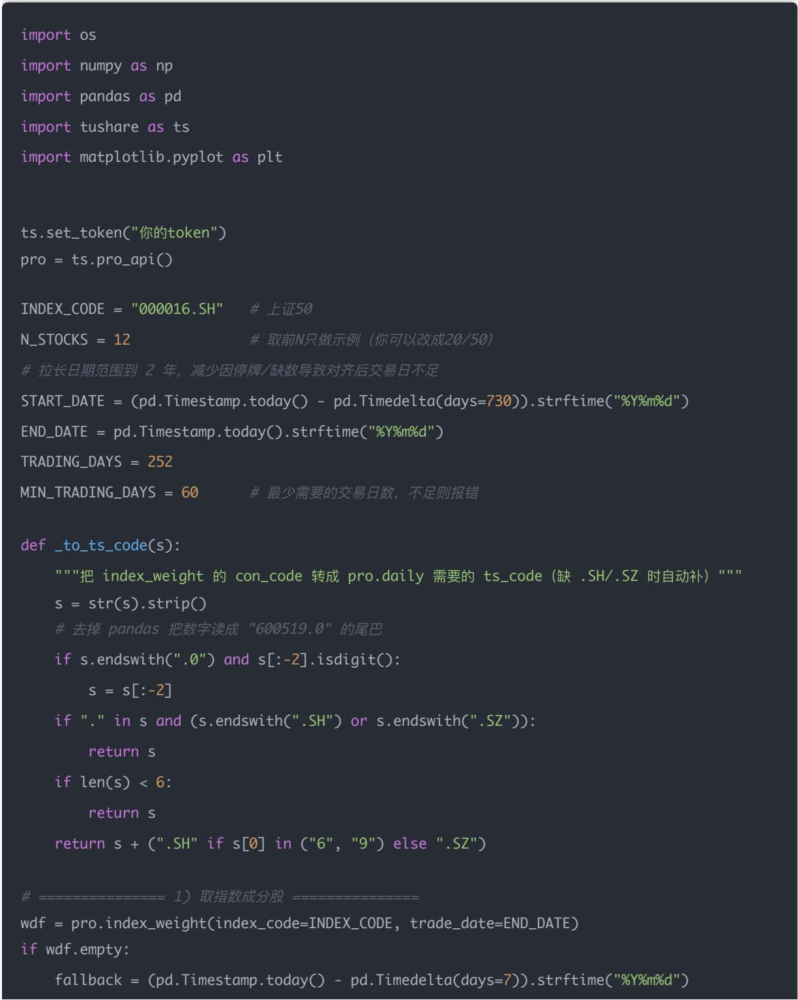
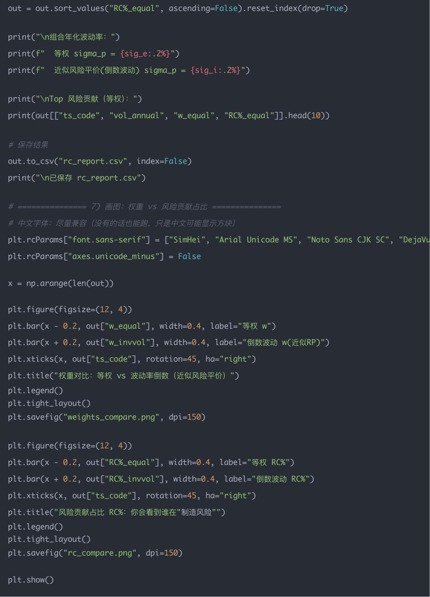

## Day 61｜风险平价仓位分配——各资产按波动率平衡风险（RiskParity）

原创 逻辑与流 逻辑与流 2026年1月 25 日 15:21 北京 听全文

本文系统讲解风险平价仓位分配的核心原理与技术实现,深入剖析各资产按波动率平衡风险(Risk Parity)的本质与建模方法 详细阐述风险平价的定义(让每个资产对组合总风险的贡献尽量相同而不是按资金等权),揭示等权会导致高波动资产贡献过多风险 组合风险被最危险资产主导的核心问题 系统解析风险贡献(Risk Contribution) 边际风险贡献(MRC) 组合波动率公式,深入讲解波动率倒数加权(近似风险平价)和协方差风险平价(优化求解)两种方法,强调风险平价不是在预测收益而是在承认无法可靠预测收益时选择把风险分得公平一点 通过完整的Python代码示例,展示如何用上证50成分股计算每只股票的MRC RCRC%并对比等权与近似风险平价的风险贡献,画图可视化权重与风险贡献 帮助读者理解为什么"风险平价是让风险均匀分摊 波动率目标是让风险总量恒定",掌握从等权思维到风险等权的完整链路,为构建机构常用的稳定组合奠定基础

## 学习时间

理论学习: 15分钟

概念理解: 15分钟

代码实践: 20分钟

## 学习目标

总计: 50分钟

你今天要掌握一种非常经典 机构常用的组合构建方式：

不是按"资金等权"，而是按"风险等权" 让每个资产对组合总风险的贡献尽量相同

学完你能做到：

理解风险贡献（Risk Contribution）是什么

会做最简单的"波动率倒数加权"（近似风险平价）

会做更严格的"协方差风险平价"（优化求解）

能用 Python 实现并可视化风险贡献

## 一句话总结

风险平价是"让风险均匀分摊"，波动率目标是"让风险总量恒定" 两者结合，就是机构常用的稳定组合构建框架

## 一、概念讲解

在深入风险平价的技术细节之前,我们需要先理解传统等权的问题与风险平价所要达到的目标。

## 传统等权的问题

等权 $w _ { i } = 1 / N$ 会导致：

高波动资产贡献过多风险

组合风险被"最危险"的资产主导

## 风险平价的目标

让每个资产的风险贡献相等：

$$
R C _ {i} \approx \frac {\sigma_ {p}}{N}
$$

其中：

$R C _ { i }$ ：第 i 个资产对组合波动率的风险贡献

$\sigma _ { p } \colon$ 组合波动率

## 二 数学/逻辑推导（关键公式）

理解了风险平价的目标后,我们需要掌握其数学原理 下面从组合波动率 边际风险贡献到风险贡献,把关键公式与金融含义讲清

## (A) 组合波动率

$$
\sigma_ {p} = \sqrt {w ^ {T} \Sigma w}
$$

## (B) 边际风险贡献（Marginal Contribution）

资产 i 的边际贡献：

$$
M R C _ {i} = \frac {\partial \sigma_ {p}}{\partial w _ {i}} = \frac {(\Sigma w) _ {i}}{\sigma_ {p}}
$$

## (C) 风险贡献（Risk Contribution）

$$
R C _ {i} = w _ {i} \cdot M R C _ {i} = w _ {i} \cdot \frac {(\Sigma w) _ {i}}{\sigma_ {p}}
$$

风险平价就是希望：

$$
R C _ {1} = R C _ {2} = \dots = R C _ {N}
$$

我们已经看到公式了，但\*\*"为什么是这样""它在金融上到底在算什么"\*\*如果不讲清楚，后面所有 RiskParity 都会变成"背公式"

下面不急着算，而是站在研究员 / 机构组合经理的视角，把这三步一点点拆开讲清"道理"

## 一、先统一一个直觉：

"组合风险"到底是什么？

我们说的风险，不是亏多少钱，而是：

组合收益率的波动幅度（标准差）

如果组合收益是

$$
R _ {p} = \sum_ {i} w _ {i} R _ {i}
$$

那么组合风险就是：

$$
\sigma_ {p} = \sqrt {\operatorname{Var} (R _ {p})}
$$

## 二、(A) 组合波动率

$$
\sigma_ {p} = \sqrt {w ^ {T} \Sigma w}
$$

1 这个公式在"人话"里是什么意思？

把它拆开：

$$
w ^ {T} \Sigma w = \sum_ {i} \sum_ {j} w _ {i} w _ {j} \operatorname{Cov} (R _ {i}, R _ {j})
$$

也就是说： 组合风险 = 所有资产两两之间"一起波动"的加权总和

它包含三层信息：

（1）你买了多少（ ）

仓位越大，对风险影响越大

（2）资产本身波动多大 $\textstyle ( \Sigma _ { i i } = \sigma _ { i } ^ { 2 } )$

高波动资产天然更危险

（3）资产之间是否同涨同跌 $( \Sigma _ { i j } )$

高相关 → 风险会叠加

低相关 / 负相关 → 风险会被抵消

这一步告诉你：风险不是简单加的，而是"相关性驱动"的

## 三、(B) 边际风险贡献 MRC

$$
M R C _ {i} = \frac {\partial \sigma_ {p}}{\partial w _ {i}}
$$

1 "边际"是什么意思？（非常重要）

在公司里，"边际"永远问一句话：

"如果我多买一丁点这个资产，组合风险会增加多少？"

这就是边际风险贡献

2 为什么要对 $\sigma _ { p }$ 求导？

因为你想知道的是：

不是"这个资产风险大不大"

而是 "在当前组合结构下，再多买一点它，会让整体风险怎么变？"

这一步已经不是"资产自身"，而是\*\*"资产在组合里的角色"\*\*

3 为什么结果是

$$
M R C _ {i} = \frac {(\Sigma w) _ {i}}{\sigma_ {p}}
$$

我们不用严格数学推导，用直觉解释：

是什么？

它等于：

$$
(\Sigma w) _ {i} = \sum_ {j} \operatorname{Cov} (R _ {i}, R _ {j}) \cdot w _ {j}
$$

意思是：

资产 i 与"整个组合"的协方差

如果资产 i：

和组合高度同涨同跌 → 很大 → 再加一点它，组合风险涨得很快

如果资产 i：

与组合低相关甚至负相关 $ ( \Sigma w ) _ { i } \prime \rfloor \backslash $ 它更像"风险对冲器"

再除以 $\sigma _ { p } ?$

因为我们对的是 标准差（不是方差） 这是一个尺度归一化，让结果是"每单位权重对 σ 的贡献"。

MRC 本质是在问： "这只资产在当前组合里，是放大器，还是缓冲器？"

## 四 (C) 风险贡献 RC

$$
R C _ {i} = w _ {i} \cdot M R C _ {i}
$$

1 为什么还要再乘一个 $w _ { i } ?$

因为：

MRC 只告诉你："每增加 1 单位权重，风险涨多少"

但你现实中并没有买 1 单位

你买了 这么多

所以真实的风险贡献是：

"我现在持有的这部分仓位，一共贡献了多少风险"

这一步是从"边际"回到"现实"

2 RC 的金融含义（一句话）

$R C _ { i } = ☉ \neqqop $ 对"组合总波动率"的实际贡献

而且有一个非常重要的性质：

$$
\sum_ {i} R C _ {i} = \sigma_ {p}
$$

所有资产的风险贡献 正好加起来等于组合总风险

这点在公司里非常重要，因为：

你可以 把风险"像资金一样分账"

可以说： "这 30% 风险是 A 贡献的， 那 10% 是 C 贡献的 "

## 五 为什么"风险平价"要让

$$
R C _ {1} = R C _ {2} = \dots = R C _ {N}
$$

1 核心思想（非常朴素）

不要让任何一只资产"主宰组合命运"

如果某只资产：

占了 60% 的风险贡献 那么一旦它出问题：

整个组合基本完蛋

2 风险平价在做什么？

它不是说：

每只资产买一样多

每只资产收益一样

而是说：

每只资产"背的风险包袱一样重"

这是一种非常"稳健"的思维方式，尤其适合：

不确定未来谁赚钱

但确定不想被单一资产拖死

## 六 一个极直观的小例子（帮助你形成"内感"）

假设只有两只资产： 资产 波动率 相关性 权重 A 高 高 大 B 低 低 小

等权组合：

A 的 RC 可能是 80%

B 的 RC 只有 20%

风险平价组合：

会自动 减 A、加 B

直到： $R C _ { A } \approx R C _ { B }$

这不是"看不看好 A"，而是"不把命压在 A 上"

## 七 你现在应该形成的"研究员级直觉"

1. 决定"谁和谁一起涨跌"

2. MRC 决定"多买一点谁最危险"

3. 决定"现在是谁在拖着组合跑"

4. 风险平价 = 让"每个人背同样重的包"

## 八 一句话总结（非常重要）

风险平价不是在预测收益， 而是在承认我们"无法可靠预测收益"， 于是选择把风险分得公平一点

## 三 用真实A股组合计算风险贡献

掌握了风险贡献的公式与金融含义后,我们通过一个真实A股组合来具体计算每只股票的RC,你会第次"看到"谁在真正制造风险 下面给你一份可直接运行的脚本（Tushare）：

自动取 上证50（000016.SH） 的前 N 只成分股（你可改 N）

拉取近 1 年日线

计算收益率 → 协方差矩阵 （年化）

给两种权重：等权 / 波动率倒数权重（近似风险平价）

计算每只股票的：

• MRCi = (Σw)i/σp

• RCi = wi · MRCi

（风险贡献占比）

画两张图：权重对比 + 风险贡献对比

wdf = pro.index\_weight(index\_code=INDEX\_CODE, trade\_date=fallback)

\# index\_weight 无数据时，用一批常见上证50成分股兜底

## ]

print("index\_weight 无数据，使用内置成分股列表：", codes[:N\_STOCKS], "else:wdf = wdf.sort\_values("weight", ascending=False)col = "con\_code" if "con\_code" in wdf.columns else "code"raw = wdf[col].dropna().astype(str).tolist()codes = [\_to\_ts\_code(c) for c in raw[: max(N\_STOCKS \* 2, 50)]]print("候选成分股：", codes[:N\_STOCKS], II ")

for code in codes: df = pro.daily(ts\_code=code, start\_date=START\_DATE, end\_date=END\_DATE, fields="ts\_code, df = df.sort\_values("trade\_date") if df.empty: print("  跳过（无数据）: %s" % code) continue if len(df) < min\_obs: print("  跳过（不足 %d 天）: %s (len=%d)" % (min\_obs, code, len(df))) continue s = pd.Series(df["close"].values, index=pd.to\_datetime(df["trade\_date"])) price[code] = s if len(price) >= N\_STOCKS: break

if len(price) < 2:raise ValueError("可用成分股不足 2 只 请检查：1) Tushare 积分/权限是否可查 日 线 index\_weight；"2) 日 期 %s\~%s 是否合理；3) 终端中"跳过"原因% (START\_DATE, END\_DATE)

% (price\_df.shape[0], MIN\_TRADING\_DAYS)

if price\_df.shape[0] < 120:print("注意：可用交易 日 %d 略少，协方差估计可能更 noisy，建议拉长 日 期或减少成分股。" % price\_df.sh

ret\_df = price\_df.pct\_change().dropna() cov\_daily = ret\_df.cov() cov\_annual = cov\_daily \* TRADING\_DAYS

def risk\_contributions(weights: np.ndarray, cov: np.ndarray): I u " 返回 rc(每个资产对组合波动率的贡献), mrc(边际贡献), sigma\_p(组合年化波动率) " u " w = np.asarray(weights).reshape(-1, 1) cov = np.asarray(cov) sigma\_p = float(np.sqrt(w.T @ cov @ w)) # (Σ w)\_i sigma\_w = cov @ w mrc = (sigma\_w / max(sigma\_p, 1e-12)).flatten() rc = (w.flatten() \* mrc) return rc, mrc, sigma\_p

def inv\_vol\_weights(ret\_df: pd.DataFrame): vol = ret\_df.std() \* np.sqrt(TRADING\_DAYS) # 年化波动率 inv = 1.0 / np.maximum(vol.values, 1e-12) w = inv / inv.sum() return w, vol

assets = list(ret\_df.columns) n = len(assets)

w\_equal = np.ones(n) / n w\_invvol, vol\_annual = inv\_vol\_weights(ret\_df)

\# 6） 计算 RC 并整理表格 rc\_e, mrc\_e, sig\_e = risk\_contributions(w\_equal, cov\_annual) rc\_i, mrc\_i, sig\_i = risk\_contributions(w\_invvol, cov\_annual)

out = pd.DataFrame({ "ts\_code": assets, "vol\_annual": vol\_annual.values, "w\_equal": w\_equal, "RC\_equal": rc\_e, "RC%\_equal": rc\_e / rc\_e.sum(), "w\_invvol": w\_invvol, "RC\_invvol": rc\_i, "RC%\_invvol": rc\_i / rc\_i.sum(),

### 1. 看 RC%\_equal

如果某只股票 权重一样（等权），但 RC% 很高 说明它 波动更大 或 与其它股票高度同涨同跌 它在组合里是"风险发动机"

2. 对比 RC%\_equal vs RC%\_invvol

你会看到：用"波动率倒数"后，很多高波动票的 RC% 会下降

风险贡献更均匀（但不一定完全相等，因为相关性还在）

## 四 今日思考题（附参考答案）

理解了风险平价的计算与实现后,我们通过几道思考题来巩固核心概念

Q1：风险平价 vs 波动率目标，有什么区别？

答：

风险平价解决的是 "内部资产之间怎么分配"

波动率目标解决的是 "整个组合风险水平控制在多少" 二者经常一起用：先 risk parity 再整体 vol scaling。

Q2：为什么相关性越强，波动率倒数法越不准？

答： 倒数法默认资产之间相互独立（或弱相关） 如果两资产高度同涨同跌，它们对风险的贡献会叠加，必须靠协方差矩阵来校正

Q3：风险平价组合的最大缺点是什么？

答： 它不关心收益/alpha，只关心风险分摊。 如果低波动资产长期收益差，组合收益会被拖累。 所以实务里常把 risk parity 作为"风险底盘"，再叠加 alpha 倾斜

## 结论

风险平价是"让风险均匀分摊"，波动率目标是"让风险总量恒定" 两者结合，就是机构常用的稳定组合构建框架

量化交易入门指南 · 目录量化交易进阶:第60天 - 波动率目标仓位——根据风险调整持仓权重（Volatility…

阅读 113

开局一人一狗，无限探索资源，守护人类最后文明！

点击了解更多

量化交易进阶:第62天 - 从 Alpha 到可交易组合的完整链路（四件套串联）

开局一人一狗，无限探索资源，守护人类最后文明！

无尽冬日-3亿玩家力荐

进入小游戏
